# Son haberler

Ajanın yazdığı son haberler (otomatik güncellenir).

## Altın fiyatları 29 Ekim 2026: Gram altın 6.488,18 TL

**Ekonomi · Merkez** · 2026-10-29 11:58 UTC · Kaynak: [Harem Altın](https://www.haremaltin.com/altin-fiyatlari)

> Gram altın güne yükselişle başladı. Harem Altın verilerine göre gram altın 6.398,52 TL'den alınıyor, 6.488,18 TL'den satılıyor.

Altın piyasasında güne yükselişle başlandı. Harem Altın'ın saat 14.58 itibarıyla verilerine göre gram altının satış fiyatı 6.488,18 TL, alış fiyatı 6.398,52 TL oldu. Gram altın, önceki kapanışa göre yüzde 0,05 yükseldi.

Ziynet altınlarda çeyrek altın 10.575 TL, yarım altın 21.143 TL, tam altın 42.151 TL, ata altın 42.973 TL seviyesinden satışa sunuluyor.

22 ayar bileziğin gram satış fiyatı 6.060,65 TL, has altının gram fiyatı 6.468,77 TL olarak belirlendi.

Uluslararası piyasalarda altının onsu 4.019,30 dolardan işlem görürken, dolar/TL 49,89 seviyesinde bulunuyor.

Fiyatlar Harem Altın'ın saat 14.58 itibarıyla paylaştığı verilere dayanmaktadır; kuyumcular arasında farklılık gösterebilir. Bu haber yatırım tavsiyesi değildir.

---

## Cumhuriyet'in 103. yılında devlet erkanı Anıtkabir'de

**Türkiye · Türkiye** · 2026-10-29 09:31 UTC · Kaynak: [İletişim Başkanlığı](https://www.iletisim.gov.tr/turkce/haberler/detay/cumhurbaskani-erdogan-baskanligindaki-devlet-erkani-anitkabiri-ziyaret-etti-29-10-26)

> Cumhurbaşkanı Erdoğan başkanlığındaki devlet erkanı Anıtkabir'i ziyaret etti, Özel Defter'e not yazdı.

29 Ekim Cumhuriyet Bayramı ve Cumhuriyet'in ilanının 103. yıl dönümü kutlamalarının ilk töreni Anıtkabir'de düzenlendi. Tören, devlet erkanının Aslanlı Yol'da yürüyüşüyle başladı.

Cumhurbaşkanı Recep Tayyip Erdoğan'ın başkanlığındaki kortejde TBMM Başkanı Numan Kurtulmuş, Cumhurbaşkanı Yardımcısı Cevdet Yılmaz, Yeni Parti Genel Başkanı Özgür Özel, MHP Genel Başkanı Devlet Bahçeli, CHP Genel Başkanı Kemal Kılıçdaroğlu, İYİ Parti Genel Başkanı Müsavat Dervişoğlu, Kabine üyeleri, yüksek yargı organlarının başkanları, Genelkurmay Başkanı Orgeneral Selçuk Bayraktaroğlu, kuvvet komutanları, siyasi partilerin temsilcileri ve diğer devlet erkanı yer aldı.

Erdoğan, üzerinde ay yıldız bulunan çelengi Atatürk'ün mozolesine bıraktı. Ardından saygı duruşunda bulunuldu ve İstiklal Marşı okundu. Erdoğan ve beraberindekiler daha sonra Misak-ı Millî Kulesi'ne geçti.

Erdoğan, burada Anıtkabir Özel Defteri'ne yazdığı notta Atatürk'ü, silah arkadaşlarını ve şehitleri şükranla andı. Notunda "Türkiye Cumhuriyeti'ni, devleti ve milletiyle birlikte müreffeh ve muzaffer yarınlara ulaştırmak için farklı cephelerde yoğun bir mücadele içindeyiz" ifadesini kullanan Erdoğan, Türkiye Yüzyılı hedefine ulaşıncaya kadar kararlılıkla çalışmayı sürdüreceklerini yazdı.

---

## Erdoğan'dan Cumhuriyet Bayramı video mesajı: "Türkiye bugün dünden daha güçlü"

**Türkiye · Türkiye** · 2026-10-29 07:31 UTC · Kaynak: [İletişim Başkanlığı](https://www.iletisim.gov.tr/turkce/haberler/detay/cumhurbaskani-erdogandan-cumhuriyet-bayrami-mesaji-29-10-26)

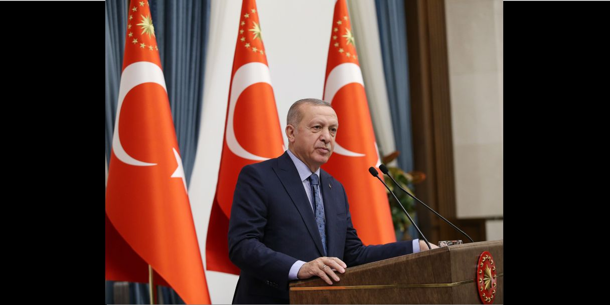

> Cumhurbaşkanı Erdoğan, Cumhuriyet'in 103. yılında video mesaj yayımladı.

Cumhurbaşkanı Recep Tayyip Erdoğan, 29 Ekim Cumhuriyet Bayramı dolayısıyla video mesaj yayımladı. Cumhuriyet'in kuruluşunun 103. yıl dönümünün büyük bir gurur ve coşkuyla kutlandığını belirten Erdoğan, vatandaşların, Kıbrıs Türkü kardeşlerin ve dünyanın farklı yerlerinde yaşayan Türklerin bayramını tebrik etti.

Erdoğan, Türkiye'nin yakın çevresinde ve dünyanın farklı yerlerinde savaşların, çatışmaların ve krizlerin yaşandığı zor bir dönemde istikrarını koruduğunu, anlaşmazlıkların çözümü için de sorumluluk aldığını söyledi.

Cumhuriyet'i Türk milletinin bağımsızlık iradesinin ve hür yaşama kararlılığının en güçlü nişanesi olarak niteleyen Erdoğan, Gazi Mustafa Kemal önderliğindeki Millî Mücadele'nin, birlik ve beraberlik içinde kenetlenen bir milletin en zor şartlarda neleri başarabileceğini dünyaya gösterdiğini belirtti. Son 24 yılda savunma sanayisinden enerjiye, ulaştırmadan diplomasiye uzanan alanlarda katedilen mesafeyi "müessir ve müreffeh Türkiye'ye giden yolun kilometre taşları" olarak gördüklerini ifade etti.

"Dünyada barış, bölgede barış ve yurtta barış" şiarıyla barış ve adalet için gayret göstermeye devam edeceklerini söyleyen Erdoğan, Türkiye Yüzyılı hedefini hayata geçireceklerini belirtti. Erdoğan, "Türkiye hamdolsun bugün dünden daha güçlüdür" ifadesini kullandı.

Mesajın sonunda Atatürk'ü, silah arkadaşlarını, Millî Mücadele kahramanlarını ve şehitleri rahmetle andı, gazilere şükranlarını sundu.

---

## Bakan Tekin'den Cumhuriyet Bayramı mesajı: "Eğitim en sağlam dayanağımız"

**Eğitim · Türkiye** · 2026-10-29 06:31 UTC · Kaynak: [Milli Eğitim Bakanlığı](https://www.meb.gov.tr/bakan-tekin039in-29-ekim-cumhuriyet-bayrami-mesaji/haber/42330/tr)

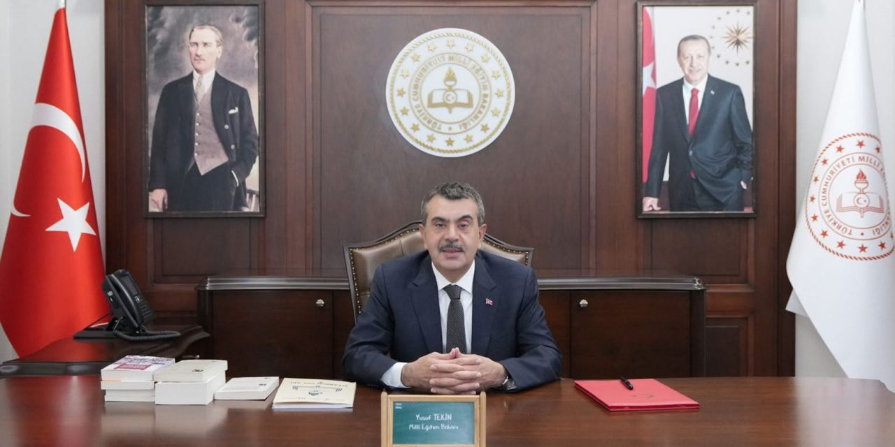

> Bakan Tekin, Cumhuriyet'in 103. yılında Maarif Modeli'ne ve öğretmenlere vurgu yaptı.

Millî Eğitim Bakanı Yusuf Tekin, Cumhuriyet'in ilanının 103. yıl dönümü dolayısıyla bir mesaj yayımladı. Tekin, mesajında yurdun dört bir yanındaki vatandaşların, Kıbrıs Türk halkının, yurt dışında yaşayanların ve bütün eğitim camiasının 29 Ekim Cumhuriyet Bayramı'nı kutladı.

Bakan Tekin, bu özel günün milletin birliğini ve kardeşliğini güçlendirmesini, ülke ve bütün insanlık için huzura ve barışa vesile olmasını diledi. Cumhuriyet'in banisi Gazi Mustafa Kemal Atatürk'ü, Millî Mücadele'yi yöneten Gazi Meclis'in mensuplarını ve bu mücadelenin bütün kahramanlarını şükranla andığını belirtti; şehitleri rahmetle, gazileri minnetle andı.

Tekin, Cumhuriyet'in ikinci yüzyılının şafağında Cumhurbaşkanı'nın işaret ettiği Türkiye Yüzyılı hedeflerine millet olarak omuz verdiklerini söyledi. Bu hedefin en sağlam dayanağının eğitim, en büyük güvencesinin ise iyi yetişmiş nesiller olduğunu vurguladı. Türkiye Yüzyılı Maarif Modeli'ni bu bilinçle hayata geçirdiklerini, modelle millî ve manevi değerlerine bağlı, tarihine ve kültürüne vâkıf, hür düşünen, muhakeme eden ve üreten nesiller yetiştirmeyi amaçladıklarını ifade etti.

Mesajında öğretmenlere de seslenen Tekin, onları eğitim idealini yaşatan "cumhuriyet neferleri" olarak niteledi ve "Hakkınız ödenmez" dedi.

---

## Erdoğan, ABD Başkanı Trump ile telefonda görüştü

**Türkiye · Türkiye** · 2026-10-29 02:31 UTC · Kaynak: [Google Haberler - Cumhurbaşkanı](https://www.iletisim.gov.tr/turkce/haberler/detay/cumhurbaskani-erdoganin-abd-baskani-trump-ile-gorusmesine-iliskin-aciklama28-10-26)

> Liderler ikili ilişkileri ve bölgesel gelişmeleri ele aldı; Trump Cumhuriyet Bayramı'nı kutladı.

Cumhurbaşkanı Recep Tayyip Erdoğan, Amerika Birleşik Devletleri Başkanı Donald Trump ile telefon görüşmesi gerçekleştirdi. Liderler, Türkiye-ABD ikili ilişkilerini ve bölgesel ile küresel gelişmeleri ele aldı.

Erdoğan, önümüzdeki sene tesisinin 100. yıl dönümü kutlanacak Türkiye-ABD ilişkilerinin geliştirilmesi ve iş birliğine her alanda ivme kazandırılması için çalışmaya devam edeceklerini belirtti.

Erdoğan, Mekke Ortak Savunma İttifakı olarak Hürmüz Boğazı ve Yemen'deki gelişmeleri yakından takip ettiklerini, sorunun diplomasi zemininde çözülmesi için gayret gösterdiklerini ifade etti. Türkiye'nin, Ukrayna-Rusya arasında diplomatik sürecin canlandırılması ve savaşın bu yolla sona erdirilmesi için yapılan çalışmalara destek vermeye hazır olduğunu da belirtti.

Trump ise Erdoğan'ı ve Türk halkını Cumhuriyet Bayramı dolayısıyla kutladı; Türk Devletleri Teşkilatı Zirvesi'nin başarılı geçmesi temennisini iletti.

---

## Tepebaşı'nda 'Yediden Yetmişe Cumhuriyet Bayramı Kutlaması' üç kuşağı buluşturdu

**Gündem · Tepebaşı** · 2026-10-28 20:32 UTC · Kaynak: [Tepebaşı Belediyesi](https://www.tepebasi.bel.tr/Haber/Detay/tepebası’ndacumhuriyetcoskusuucneslibirarayagetirdi)

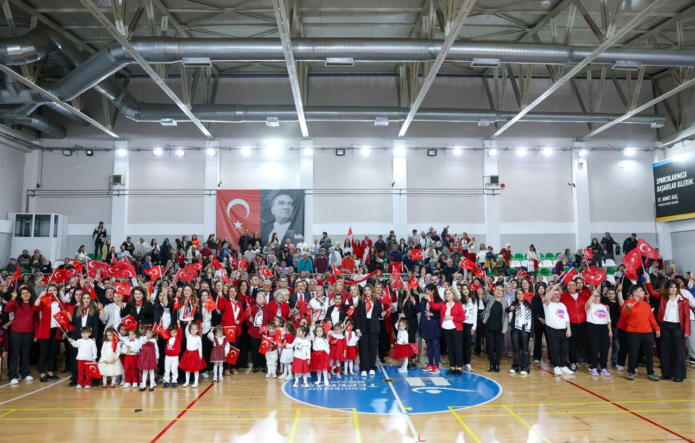

> Yunusemre Spor Kompleksi'ndeki etkinlikte vals ve rumba gösterileri yapıldı, Andımız hep birlikte okundu.

Tepebaşı Belediyesi'nin "Yediden Yetmişe Cumhuriyet Bayramı Kutlaması", Yunusemre Spor Kompleksi'nde yapıldı. Etkinliği belediyenin Kadın Aile Hizmetleri Müdürlüğü, Gençlik ve Spor Hizmetleri Müdürlüğü ile Sağlık İşleri Müdürlüğü düzenledi. Metin Özöğüt Yaşam Merkezi sakinleri, belediyeye bağlı kreşlerdeki çocuklar ve engelli merkezlerinde eğitim gören gençler bayram sevincini birlikte yaşadı.

Yaşam merkezi sakinleriyle anaokulu çocuklarının birlikte sunduğu vals gösterisi ve üç çiftin vals ile rumba gösterisi beğeni topladı. Engelli merkezlerindeki gençler Atatürk'ün sevdiği şarkıları seslendirdi. Tepebaşı Belediye Başkanı Ahmet Ataç, belediye personeli, çocuklar, gençler ve deneyimli vatandaşlar "Andımız"ı hep birlikte okudu; 98 yaşındaki Ayhan Tunçer de bir konuşma yaptı.

Ataç, Cumhuriyet'in kuşakları yan yana getiren ortak bir kazanım olduğunu söyledi ve etkinliğe emek verenlere teşekkür etti. (Kaynak: Tepebaşı Belediyesi)

---

## Tepebaşı'nda 8. Geleneksel Cumhuriyet Kupası'nı Sağlık İşleri Müdürlüğü kazandı

**Spor · Tepebaşı** · 2026-10-28 20:32 UTC · Kaynak: [Tepebaşı Belediyesi](https://www.tepebasi.bel.tr/Haber/Detay/tepebasıbelediyesi8gelenekselcumhuriyetkupasıtamamlandı)

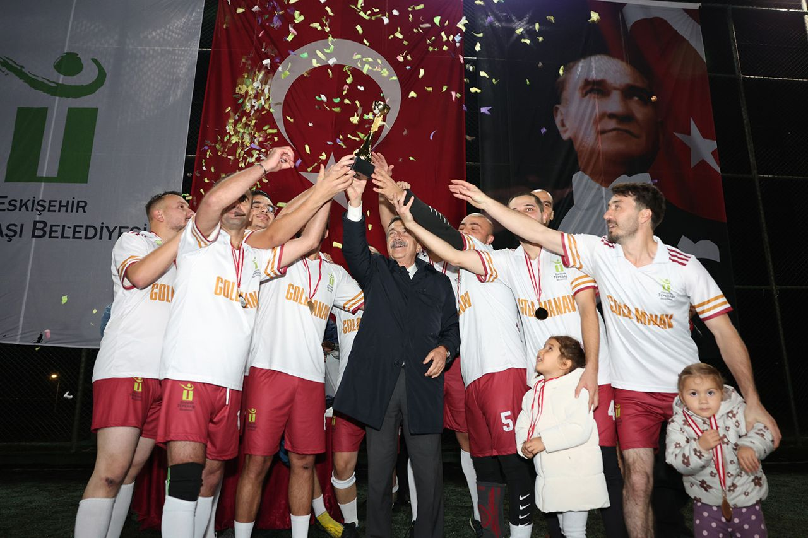

> Turnuvaya 12 takım ve 150 belediye personeli katıldı; Park Bahçeler ikinci, Temizlik İşleri üçüncü oldu.

Tepebaşı Belediyesi'nin 12 takım ve 150 personelin katılımıyla düzenlediği 8. Geleneksel Cumhuriyet Kupası tamamlandı. Esentepe Halı Saha'da oynanan finalde Sağlık İşleri Müdürlüğü, Park Bahçeler Müdürlüğü'nü geçerek şampiyon oldu. Park Bahçeler Müdürlüğü ikinci, Temizlik İşleri Müdürlüğü üçüncü sırada yer aldı.

Turnuvayı Spor İşleri Müdürlüğü düzenledi. Kayıtlar 14 Eylül'de başladı, maçlar 5 Ekim'de oynanmaya başladı. Tepebaşı Belediye Başkanı Ahmet Ataç, kupanın çalışma arkadaşlarını sporun birleştirici gücü etrafında buluşturan bir gelenek olduğunu söyledi ve dereceye giren takımları kutladı. (Kaynak: Tepebaşı Belediyesi)

---

## 'Atatürk ve Dünya Çocukları' anıtı açıldı, adını Eskişehirliler anketle belirleyecek

**Kültür-Sanat · Tepebaşı** · 2026-10-28 19:33 UTC · Kaynak: [Tepebaşı Belediyesi](https://www.tepebasi.bel.tr/Haber/Detay/ataturkvecocuklarınizieskisehir’inkenthafızasınakazındı)

> Tepebaşı Belediyesi'nin 18. Pişmiş Toprak Sempozyumu'nda hazırlanan anıtın yapımına 126 kişi emek verdi.

Tepebaşı Belediyesi'nin 18. Uluslararası Eskişehir Pişmiş Toprak Sempozyumu kapsamında kente kazandırdığı "Atatürk ve Dünya Çocukları" temalı kolektif anıt, 29 Ekim Cumhuriyet Bayramı'nın arifesinde törenle açıldı. Tepebaşı Belediye Başkanı Ahmet Ataç'ın ev sahipliğindeki törene Odunpazarı Belediye Başkanı Kazım Kurt, Büyükşehir Belediye Başkan Vekili Vural Yörük, Tepebaşı Kent Konseyi Başkanı Canan Adlım, Prof. Bilgehan Uzuner ve çok sayıda vatandaş katıldı. Bando gösterisiyle başlayan törende Tepebaşı Belediyesi Erken Çocukluk Eğitim Merkezlerindeki çocuklar bayraklarla yer aldı; protokol kurdele keserek anıtı açtı.

Anıtın yapımına 6'sı Türk, 2'si yabancı 8 sanatçı, 90 çocuk, 24 stajyer ve 4 konuk akademisyen, toplam 126 kişi katkı sundu. Sanatçıların hazırladığı çocuk figürleri, çocukların pişmiş topraktan yaptığı çiçeklerle bir araya geldi. Uzuner, tasarımın merkezinde Atatürk'ün siluetinin bulunduğunu, belirli saatlerde ışığın yere de yansıdığını anlattı. Anıt, sempozyumun dördüncü kolektif eseri; daha önce "Varlığınız Sağlığımız Anıtı", "Sonsuz Cumhuriyet Anıtı" ve Yazılıkaya'dan esinlenen eser kente kazandırılmıştı.

Ataç, sempozyumun 25 yıllık birikiminde 236 sanatçının katıldığını, yaklaşık 700 güzel sanatlar öğrencisinin yer aldığını, Eskişehir'e 244 pişmiş toprak heykel kazandırıldığını ve 400 bildirinin sunulduğunu söyledi. Anıtın adı, "Cumhuriyet'in Çocukları", "Atatürk'ün Çiçekleri", "Atatürk'ün Dünya Çocukları" ve "Atatürk'ün Çiçek Bahçesi" seçenekleriyle halk oylamasına sunulacak. (Kaynak: Tepebaşı Belediyesi)

---

## Vali Yılmaz, gösteri uçuşu için Eskişehir'e gelen SOLOTÜRK ekibini kabul etti

**Gündem · Merkez** · 2026-10-28 12:52 UTC · Kaynak: [Eskişehir Valiliği](https://www.eskisehir.gov.tr/valimiz-dr-erdinc-yilmaz-solo-turk-ekibini-kabul-etti)

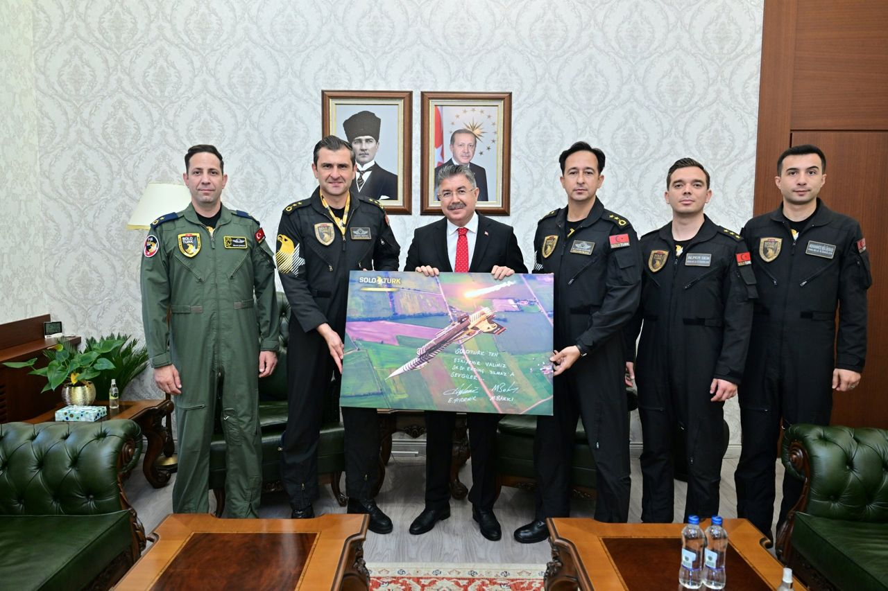

> Vali Erdinç Yılmaz, ekibe gösteri uçuşunda başarılar diledi.

Eskişehir Valisi Dr. Erdinç Yılmaz, SOLOTÜRK gösteri uçuşu kapsamında Eskişehir'e gelen Hava Pilot Yarbay Murat Bakıcı, Hava Pilot Yarbay M. Erhan Aydemir, Hava Pilot Binbaşı Murat Çakmak, Hava Piyade Yüzbaşı Ş. Alper Şen ve Hava Harekât Astsubay Üstçavuş Muhammed Bölükbaşı'nı kabul etti.

Yılmaz, SOLOTÜRK'ün Türk Hava Kuvvetlerinin gücünü, Türk pilotlarının yeteneğini ve havacılıktaki başarılarını gökyüzünde temsil ettiğini belirtti. Ekibe nazik ziyaretleri için teşekkür eden Yılmaz, gösteri uçuşunda başarılar diledi. (Kaynak: Eskişehir Valiliği)

---

## Altın fiyatları 28 Ekim 2026: Gram altın 6.525,46 TL

**Ekonomi · Merkez** · 2026-10-28 11:51 UTC · Kaynak: [Harem Altın](https://www.haremaltin.com/altin-fiyatlari)

> Gram altın güne yükselişle başladı. Harem Altın verilerine göre gram altın 6.454,67 TL'den alınıyor, 6.525,46 TL'den satılıyor.

Altın piyasasında güne yükselişle başlandı. Harem Altın'ın saat 14.51 itibarıyla verilerine göre gram altının satış fiyatı 6.525,46 TL, alış fiyatı 6.454,67 TL oldu. Gram altın, önceki kapanışa göre yüzde 0,63 yükseldi.

Ziynet altınlarda çeyrek altın 10.636 TL, yarım altın 21.265 TL, tam altın 42.393 TL, ata altın 43.219 TL seviyesinden satışa sunuluyor.

22 ayar bileziğin gram satış fiyatı 6.095,59 TL, has altının gram fiyatı 6.505,94 TL olarak belirlendi.

Uluslararası piyasalarda altının onsu 4.046,10 dolardan işlem görürken, dolar/TL 49,89 seviyesinde bulunuyor.

Fiyatlar Harem Altın'ın saat 14.51 itibarıyla paylaştığı verilere dayanmaktadır; kuyumcular arasında farklılık gösterebilir. Bu haber yatırım tavsiyesi değildir.

---

## Mahkeme, Alpagut-Atalan altın-gümüş madeni projesinin ÇED olumlu kararını durdurdu

**Gündem · Merkez** · 2026-10-28 11:36 UTC · Kaynak: [Google Haberler - Eskişehir etkinlik](https://www.eskisehirekspres.net/eskisehirin-dogasi-icin-kritik-karar-ced-olumlu-karari-durduruldu)

> Eskişehir 2. İdare Mahkemesi, Büyükşehir Belediyesi'nin açtığı davada yürütmeyi durdurma kararı verdi.

Eskişehir Büyükşehir Belediyesi'nin Alpagut-Atalan Altın-Gümüş Madeni Projesi'ne karşı açtığı davada önemli bir gelişme yaşandı. Eskişehir 2. İdare Mahkemesi, bilirkişi raporunda doğa ve su kaynaklarına yönelik ciddi risklerin ortaya konulmasının ardından, telafisi güç zararlar oluşabileceği değerlendirmesiyle ÇED Olumlu kararının yürütmesini durdurdu.

Eskişehir Büyükşehir Belediye Başkanı Ayşe Ünlüce, kararın kentin doğal kaynaklarının korunması açısından büyük önem taşıdığını belirtti. Ünlüce açıklamasında, "Alpagut-Atalan Altın-Gümüş Madeni Projesi'ne karşı açtığımız davada, bilirkişi raporuyla doğamıza ve su kaynaklarımıza yönelik ciddi riskler ortaya konuldu" dedi ve Eskişehir'in suyuna, toprağına ve geleceğine sahip çıkmaya devam edeceklerini söyledi. (Kaynak: Eskişehir Ekspres)

---

## Yenikent Olimpik Havuzu'nda çocuk yüzme kış spor okulu kayıtları 2 Kasım'da

**Spor · Merkez** · 2026-10-28 08:33 UTC · Kaynak: [Eskişehir Gençlik ve Spor İl Müdürlüğü](https://eskisehir.gsb.gov.tr/HaberDetaylari/1/305045/olimpik-havuz-cocuk-egitim-yuzme-kayitlari.aspx)

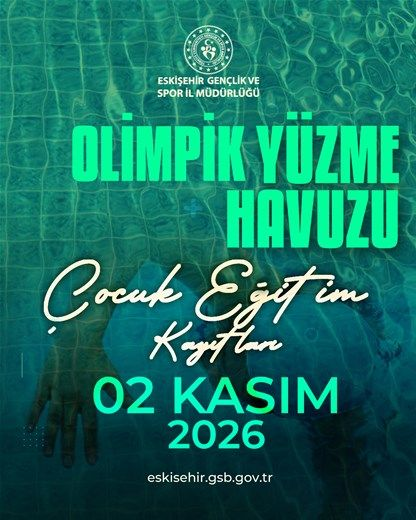

> 7-17 yaş grubu için 8 haftalık, 16 derslik eğitimlerin kaydı 2 Kasım Pazartesi 08.00-17.00 arasında alınacak.

Eskişehir Gençlik ve Spor İl Müdürlüğü, Yenikent Olimpik Yüzme Havuzu'ndaki ücretli kış spor okulu çocuk eğitim kayıtlarının 2 Kasım 2026 Pazartesi günü 08.00-17.00 saatleri arasında alınacağını duyurdu. Kayıtlar saat 08.00'de başlayacak. Eğitimler 8 hafta, yani 16 ders sürecek.

Kayıt, 2011-2019 doğumlu, yüzme bilen ve bilmeyen çocuklar için yapılacak. Kayıt sırasında kimlik ibrazı zorunlu; anne, baba ve reşit kardeş dışındaki kişilerin yaptıracağı kayıtlar alınmayacak. Kayıt formuna katılmak istenen grubun numarası yazılmalı. Duyuruya göre ücretler ön kayıt işlemi yapıldıktan sonra yatırılacak, elden veya kredi kartıyla ücret alınmayacak ve kayıt işleminden önce herhangi bir IBAN numarasına ücret yatırılmaması gerekiyor.

Ücret, 07-17 yaş grubu için tek çocukta 1750 TL, iki kardeşte kişi başı 1600 TL, üç kardeşte kişi başı 1450 TL; her durumda 50 TL kart ücreti ekleniyor. Üyeliğini iptal etmek isteyenlerin durumlarını belgelendirmesi gerekiyor; ücret iadesi yapılmayacak, ücret hakkı iptal edilen kayıt döneminden itibaren 2 kayıt dönemi içinde kullanılabilecek. Eğitim başladıktan sonra grup değişikliği yapılmayacak. (Kaynak: Eskişehir Gençlik ve Spor İl Müdürlüğü)

---

## Türkiye'de ilk Eskişehir Bal Kabağı Çalıştayı ESOGÜ'de yapıldı

**Tarım · Tepebaşı** · 2026-10-28 06:33 UTC · Kaynak: [Tepebaşı Belediyesi](https://www.tepebasi.bel.tr/Haber/Detay/tepebasıbelediyesi’ndenbirilkdahabalkabagıilkkezulusalolcektemasayayatırıldı)

> Tepebaşı Belediyesi ve ESOGÜ Ziraat Fakültesi, bal kabağını ulusal ölçekte ele alan ilk çalıştayı düzenledi.

Tepebaşı Belediyesi ile Eskişehir Osmangazi Üniversitesi (ESOGÜ) Ziraat Fakültesi iş birliğinde düzenlenen Eskişehir Bal Kabağı Çalıştayı, bal kabağını ulusal ölçekte ele alan ilk buluşma oldu. Çalıştay ESOGÜ Ali Numan Kıraç Yerleşkesi Prof. Dr. Ali Koç Konferans Salonu'nda yapıldı.

Akademisyenler ve tarımsal araştırma enstitülerinin temsilcileri; bal kabağının genetik kaynaklarını, ıslahını, yetiştiriciliğini ve kırsal kalkınmadaki yerini değerlendirdi. Çalıştaya Geçit Kuşağı Araştırma Enstitüsü Müdürü Ulaş Çınar, Sakarya Mısır Araştırma Enstitüsü Müdürü Mehmet Yılmaz, Eskişehir İl Tarım ve Orman Müdür Yardımcısı Hasan Öz ile Tarımsal Araştırmalar ve Politikalar Genel Müdürlüğü'nden Dr. Evran Doğan da katıldı.

Tepebaşı Belediye Başkanı Ahmet Ataç, Kızılinler bal kabağının Eskişehir'in kırsal değerlerinden biri olduğunu ve coğrafi işaret tescili taşıdığını hatırlatarak üretimi geliştirmek ve üreticiye daha fazla katkı sunmak istediklerini söyledi. ESOGÜ Ziraat Fakültesi Dekanı Prof. Dr. Onur Koyuncu da bilgilerin paylaşılmasının önemine değindi. Çalıştayın moderatörlüğünü Doç. Dr. Sıtkı Ermiş yaptı; ilk oturumlarda kabak türlerinin tarihsel gelişimi ve ıslah çalışmaları ele alındı. (Kaynak: Tepebaşı Belediyesi)

---

## 29 Ekim'de Büyükşehir 5 mahalleden tören alanına ücretsiz ring seferleri düzenleyecek

**Ulaşım · Merkez** · 2026-10-27 15:05 UTC · Kaynak: [Google Haberler - Eskişehir](https://www.gazetevatan.com/sehirler/eskisehir/eskisehir-icin-yeni-karar-ucretsiz-olacak-2420141)

> Ring araçları 29 Ekim Perşembe günü saat 08.45'te Fevzi Çakmak, Orhangazi, 75. Yıl, Çankaya ve Şirintepe'den hareket edecek.

Eskişehir Büyükşehir Belediyesi, Cumhuriyet'in 103. yıl dönümü kutlamaları kapsamında vatandaşların tören alanına kolay ve güvenli ulaşımını sağlamak için 5 ayrı güzergâhta ücretsiz ring seferi düzenleyecek. Ring araçları 29 Ekim Perşembe günü saat 08.45'te hareket edecek.

Seferler Fevzi Çakmak, Orhangazi, 75. Yıl, Çankaya ve Şirintepe mahallelerinden başlayacak ve her hat Odunpazarı'nda son bulacak.

Hatlar şöyle: Ring Hattı 1 Fevzi Çakmak Mahallesi'nden Topçular Caddesi, Gazi Yakup Satar Caddesi, Çevre Yolu, Prof. Dr. Yılmaz Büyükerşen Caddesi ve Yunusemre Caddesi üzerinden; Ring Hattı 2 Orhangazi Mahallesi'nden Eskişehir-Kütahya Yolu, Ulusal Egemenlik Caddesi, Basın Şehitleri Caddesi ve Atatürk Bulvarı üzerinden; Ring Hattı 3 75. Yıl Mahallesi'nden Gün Sazak Caddesi, Selami Vardar Caddesi, Çevre Yolu ve Cumhuriyet Bulvarı üzerinden; Ring Hattı 4 Çankaya Mahallesi'nden Mustafa Özel Bulvarı, Arabacılar Bulvarı, Dumlupınar Caddesi üzerinden; Ring Hattı 5 Şirintepe Mahallesi'nden Bülent Ecevit Bulvarı, İsmet İnönü Bulvarları ve Atatürk Bulvarı üzerinden Odunpazarı'na ulaşacak. (Kaynak: Eskişehir Haberleri)

---

## Kurşunlu Külliyesi için tahliye tarihi 3 Kasım: Kurt yürütmeyi durdurma başvurusu yaptı

**Belediye · Odunpazarı** · 2026-10-27 12:58 UTC · Kaynak: [Google Haberler - Odunpazarı](https://yerel-haberler.haberturk.com/eskisehir-haberleri/kursunlu-kulliyesi-icin-tahliye-tebligati-baskan-kazim-kurttan-yurutmeyi-durdurma-119504772)

> Odunpazarı Belediye Başkanı Kurt, Vakıflar'ın tebligatına karşı İdare Mahkemesi'ne başvurduklarını açıkladı.

Odunpazarı Belediye Başkanı Kazım Kurt, Vakıflar Genel Müdürlüğü tarafından Kurşunlu Külliyesi için belediyeye tahliye tebligatı gönderildiğini ve karara karşı İdare Mahkemesi'ne iptal ile yürütmenin durdurulması başvurusu yaptıklarını açıkladı.

Kurt'un basın açıklamasına göre süreç 2024 yılı sonunda başladı. İlk tahliye kararına karşı açılan dava istinaf aşamasında. Kurt, 20 Kasım 2025'te yürürlüğe giren kanunun geçici 15. maddesine dikkat çekerek, belediyenin vakıf şartlarını kabul ettiğini resmen bildirmesine rağmen yanıt alamadıklarını ve tahliye için 3 Kasım 2026 tarihinin tebliğ edildiğini söyledi. Kurt, tahliyenin kanuna aykırı olduğunu savundu.

Kurt'a göre tahliye gerçekleşirse 3 müze kapanacak, cam atölyesi ve fırınları kapanacak, 3 festival sona erecek, külliyede çalışan 18 kişi işsiz kalacak ve yaklaşık 20 esnaf ticaret yapamaz hale gelecek. Kurt ayrıca kira artış oranlarında belediyenin hesabı ile Vakıfların talebinin uyuşmadığını söyledi.

Haberde yer alan bilgiler Kurt'un açıklamasına dayanıyor; Vakıflar Genel Müdürlüğü'nün görüşü kaynakta yer almıyor. (Kaynak: Anadolu Gazetesi)

---

## Büyükşehir'in müze ve tesisleri 28-29 Ekim'de açık, Halk Ekmek 29 Ekim'de kapalı

**Gündem · Merkez** · 2026-10-27 12:57 UTC · Kaynak: [Google Haberler - Eskişehir](https://ankahaber.net/haber/eskisehir-buyuksehir-belediyesi-nden-kultur-sanat-noktalarinda-29-ekim-duzenlemesi-f516d7ac)

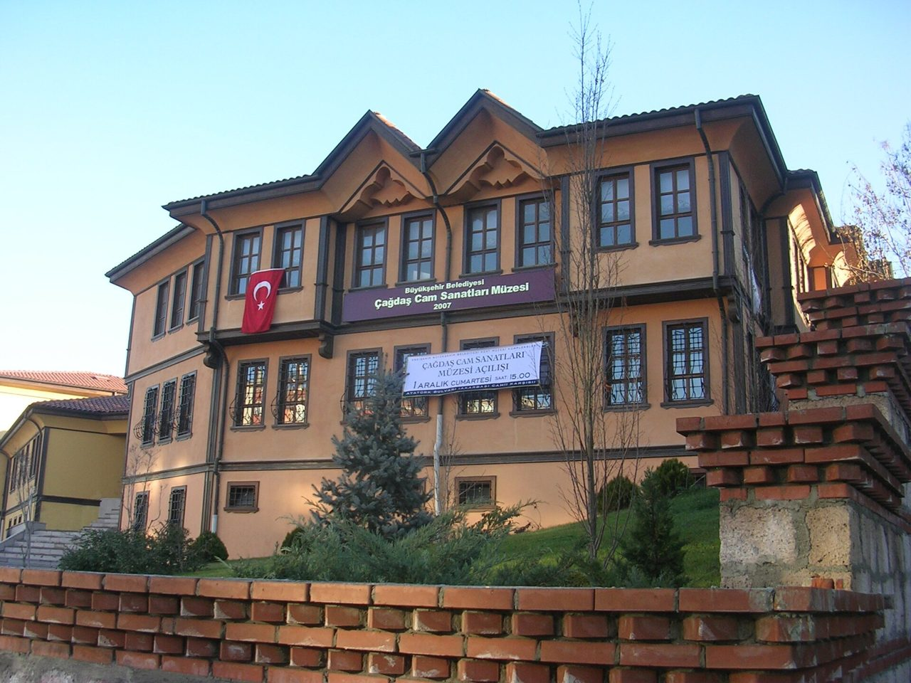

> Müzeler, Sazova'daki tesisler ve sosyal tesisler Cumhuriyet Bayramı'nda ziyaretçilere açık olacak.

Eskişehir Büyükşehir Belediyesi, 29 Ekim Cumhuriyet Bayramı nedeniyle müze, kültür ve sanat merkezleri, turistik noktalar ile sosyal tesislerin çalışma düzenini açıkladı. Birçok tesis 28 Ekim Çarşamba ve 29 Ekim Perşembe günlerinde ziyaretçilerini ağırlayacak.

Açık olacak müzeler arasında Yılmaz Büyükerşen Balmumu Heykeller Müzesi, Çağdaş Cam Sanatları Müzesi, Kent Belleği Müzesi, Kurtuluş Müzesi, İmren Erşen Oya Müzesi, Hamam Müzesi, Zühal Yorgancıoğlu Moda ve Tasarım Müzesi ile Ergün Başar Portre Galerisi var. Sanat Sokağı'ndaki Çağdaş Seramik Sanatları Müzesi, Bilim Deney Merkezi, Sabancı Uzay Evi, Masal Şatosu'nun Kendin Keşfet alanı, Hayvanat Bahçesi ve Sualtı Dünyası, Kalyon Müze Gemi, Sazova'daki Dekovil Tren, Gondol ve Bot Turu ile belediyeye ait kafeler de her iki gün hizmet verecek.

Kentpark Kafe, Üretici Market Adliye, Üretici Market Bağlar, İskele 26 ve Emek Kafe de 28-29 Ekim'de açık olacak. Halk Et Marketler ve Halk Ekmek büfeleri ise 28 Ekim Çarşamba günü açık, 29 Ekim Perşembe günü kapalı olacak. (Kaynak: DHA)

---

## Tepebaşı'nın minik piyanistleri Özdilek Sanat Merkezi'nde konser verdi

**Kültür-Sanat · Tepebaşı** · 2026-10-27 11:33 UTC · Kaynak: [Tepebaşı Belediyesi](https://www.tepebasi.bel.tr/Haber/Detay/tepebası’nınminikpiyanistlerisahnede)

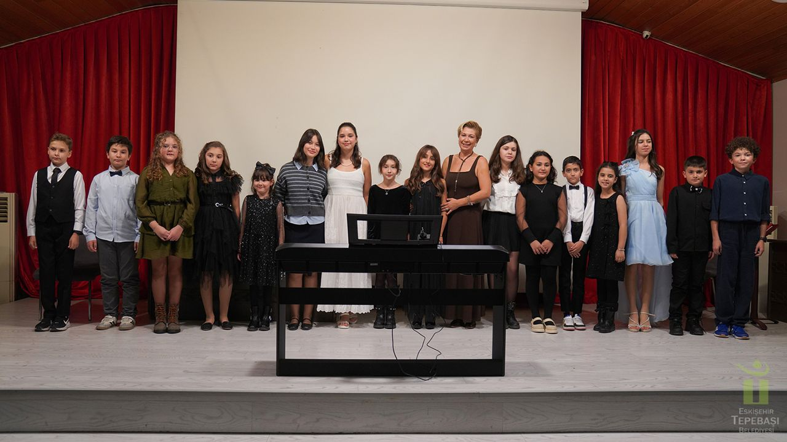

> Belediyenin piyano kurslarına katılan 7-12 yaş arasındaki 16 öğrenci 25 Ekim'de sahne aldı.

Tepebaşı Belediyesi'nin düzenlediği piyano kurslarına katılan 7-12 yaş arasındaki 16 öğrenci, eğitim sürecinde öğrendiklerini Özdilek Sanat Merkezi'nde düzenlenen konserde dinleyicilerle paylaştı. Konser 25 Ekim'de, Özgenur Altaş'ın eğitmenliğinde yapıldı.

En az bir yıldır piyano eğitimi alan öğrenciler, kursta öğrendiklerini sahnede sergiledi. Eğitimler öğrencilerin gelişimine göre genellikle iki yıl sürüyor.

Tepebaşı Belediyesi'nin sanat kursları, çocukların ilgi ve yeteneklerini geliştirmelerine, öğrendiklerini paylaşmalarına ve sahne deneyimi kazanmalarına katkı sunuyor. (Kaynak: Tepebaşı Belediyesi)

---

## Altın fiyatları 27 Ekim 2026: Gram altın 6.453,36 TL

**Ekonomi · Merkez** · 2026-10-27 11:16 UTC · Kaynak: [Harem Altın](https://www.haremaltin.com/altin-fiyatlari)

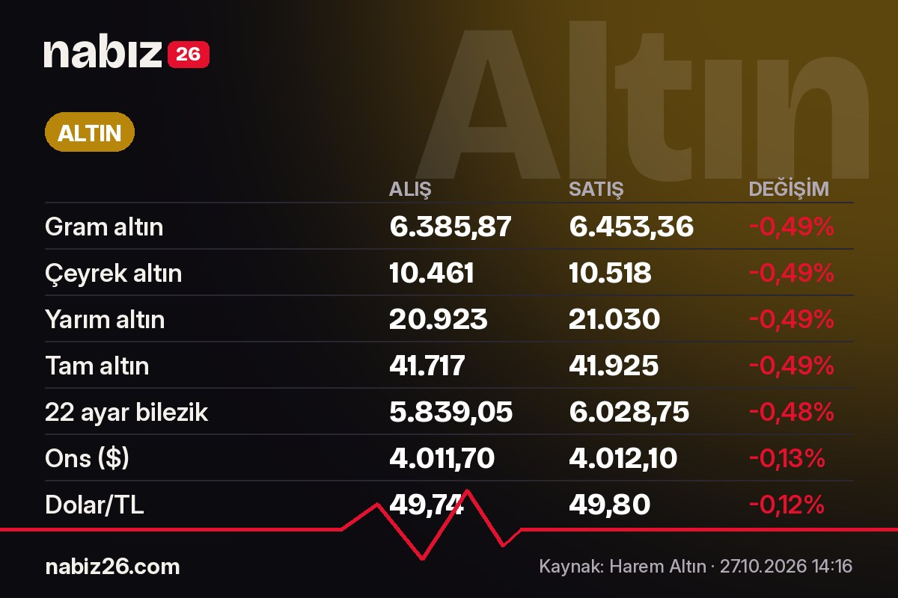

> Gram altın güne düşüşle başladı. Harem Altın verilerine göre gram altın 6.385,87 TL'den alınıyor, 6.453,36 TL'den satılıyor.

Altın piyasasında güne düşüşle başlandı. Harem Altın'ın saat 14.16 itibarıyla verilerine göre gram altının satış fiyatı 6.453,36 TL, alış fiyatı 6.385,87 TL oldu. Gram altın, önceki kapanışa göre yüzde 0,49 geriledi.

Ziynet altınlarda çeyrek altın 10.518 TL, yarım altın 21.030 TL, tam altın 41.925 TL, ata altın 42.742 TL seviyesinden satışa sunuluyor.

22 ayar bileziğin gram satış fiyatı 6.028,75 TL, has altının gram fiyatı 6.434,84 TL olarak belirlendi.

Uluslararası piyasalarda altının onsu 4.012,10 dolardan işlem görürken, dolar/TL 49,80 seviyesinde bulunuyor.

Fiyatlar Harem Altın'ın saat 14.16 itibarıyla paylaştığı verilere dayanmaktadır; kuyumcular arasında farklılık gösterebilir. Bu haber yatırım tavsiyesi değildir.

---

## Tepebaşı'nda Cumhuriyet Bayramı kortej, ücretsiz konser ve EKO-ŞOV ile kutlanacak

**Gündem · Tepebaşı** · 2026-10-27 10:32 UTC · Kaynak: [Tepebaşı Belediyesi](https://www.tepebasi.bel.tr/Haber/Detay/tepebası’ndacumhuriyetbayramıkortejvekonserlerlekutlanacak)

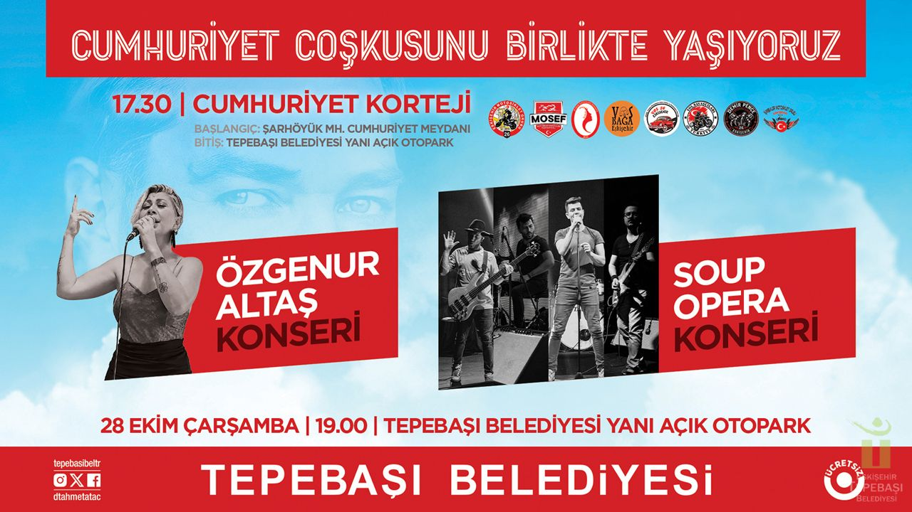

> Kortej 28 Ekim'de 17.30'da Cumhuriyet Meydanı'ndan yola çıkacak; 29 Ekim'de EKO-ŞOV Espark AVM önünde.

Tepebaşı Belediyesi, 29 Ekim Cumhuriyet Bayramı'nı konserler, EKO-ŞOV ve Cumhuriyet Kortejiyle kutlayacak.

Kutlamalar 28 Ekim Çarşamba günü saat 17.30'da Şarhöyük Mahallesi Cumhuriyet Meydanı'ndan yola çıkacak Cumhuriyet Korteji ile başlayacak. Kortej, Tepebaşı Belediyesi yanındaki açık otoparkta sona erecek. Eskişehir Motosiklet Grubu 26, MOSEF, VesBaga Eskişehir, Vos 26 Eskişehir, Yol Kawaşçıları Türkiye ve Demir Pençe 26 Eskişehir gibi topluluklar korteje destek verecek.

Ardından saat 19.00'da Özgenur Altaş, saat 20.00'de Soup Opera sahne alacak. Konserler ücretsiz. 29 Ekim Perşembe günü saat 14.00'te EKO-ŞOV eşliğinde kutlama programı Espark AVM önünde sürecek.

Tepebaşı Belediye Başkanı Ahmet Ataç, tüm Eskişehirlileri kutlamalara davet etti. (Kaynak: Tepebaşı Belediyesi)

---

## Başkan Ataç Gaziler Günü'nde gazi ve şehit yakınlarıyla kahvaltıda buluştu

**Gündem · Tepebaşı** · 2026-10-27 10:32 UTC · Kaynak: [Tepebaşı Belediyesi](https://www.tepebasi.bel.tr/Haber/Detay/baskanatacgazivesehityakınlarıylaaynısofradabulustu)

> Tepebaşı Belediyesi'nin programına Muharip Gaziler Derneği, Şehit Aileleri Derneği ve EMŞAV temsilcileri katıldı.

Tepebaşı Belediyesi, Gaziler Günü kapsamında şehit aileleri ve gaziler için kahvaltı programı düzenledi. Tepebaşı Belediye Başkanı Ahmet Ataç'ın ev sahipliğindeki buluşmaya Eskişehir Muharip Gaziler Derneği, Eskişehir Şehit Aileleri Derneği ve Emniyet Teşkilatı Vazife Malulü ve Şehit Aileleri Vakfı (EMŞAV) temsilcileri, şehit yakınları ve gaziler katıldı.

Ataç, program boyunca konuklarıyla tek tek sohbet etti. Cumhuriyet Bayramı'nın 103. yıl dönümü dolayısıyla kutlama mesajlarının paylaşıldığı programda dernek ve vakıf temsilcileri de konuşma yaptı ve ev sahipliği için teşekkür etti.

Ataç, "Sadece önemli gün ve haftalarda değil, yılın 365 gününde bir ve beraberiz" dedi. Şehitlerin yılın her günü hatırlanması ve hatıralarının yaşatılması gerektiğini söyleyen Ataç, Tepebaşı Belediyesi'nin her zaman yanlarında olacağını belirtti. (Kaynak: Tepebaşı Belediyesi)

---

## Bakan Kurum: Sıfır Atık'ta geri kazanım oranı 2017'de yüzde 13'ten yüzde 37'ye çıktı

**Türkiye · Türkiye** · 2026-10-27 09:32 UTC · Kaynak: [İletişim Başkanlığı](https://www.iletisim.gov.tr/turkce/haberler/detay/bakan-kurum-sifir-atiktan-cop31e-turkiyenin-iklim-diplomasisi-panelinde-konustu)

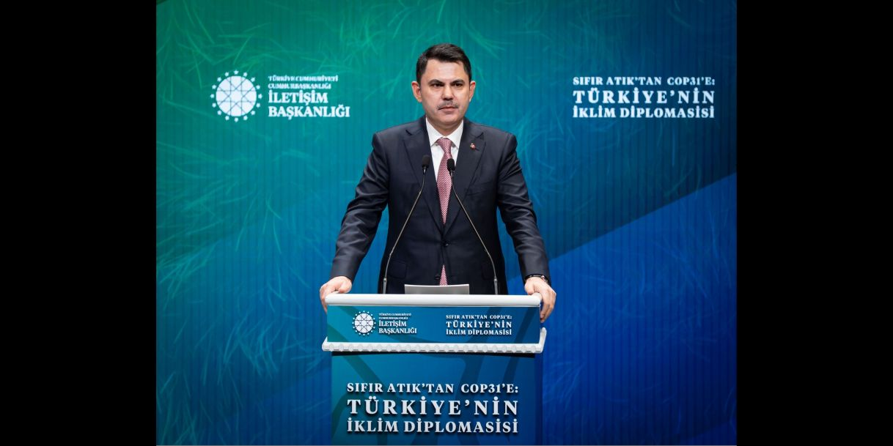

> COP31 Başkanı Murat Kurum, İletişim Başkanlığı'ndaki 'Sıfır Atık'tan COP31'e' panelinde konuştu.

COP31 Başkanı ve Çevre, Şehircilik ve İklim Değişikliği Bakanı Murat Kurum, Cumhurbaşkanlığı İletişim Başkanlığı Konferans Salonu'nda düzenlenen "Sıfır Atık'tan COP31'e: Türkiye'nin İklim Diplomasisi" panelinin açılışında konuştu.

Kurum'un açıkladığı verilere göre geri kazanım oranı 2017'de yüzde 13 iken 2025'te yüzde 37'ye çıktı. Bu dönemde 90 milyon ton atık geri kazanıldı ve ekonomiye yaklaşık 365 milyar liralık katkı sağlandı. Depozitolu Ambalajlar Sistemi kapsamında bugüne kadar 520 milyon ambalaj yeniden ekonomiye kazandırıldı. Kurum, Sıfır Atık Hareketi'nin Emine Erdoğan'ın öncülüğünde başlatıldığını belirtti.

Kurum, COP31'e hazırlandıklarını söyleyerek iklim krizinin gezegeni yaşanamaz hâle getirme tehlikesine dikkat çekti. Daha önceki gece Antalya'daki şiddetli hortumda 4 kişinin hayatını kaybettiğini aktaran Kurum, ölenlere rahmet, yakınlarına sabır diledi. Türkiye'nin Akdeniz havzasındaki konumu nedeniyle iklim krizinin etkilerine en fazla maruz kalan ülkelerden biri olduğunu belirten Kurum, kentsel dönüşümü milli güvenlik meselesi olarak gördüklerini söyledi. (Kaynak: İletişim Başkanlığı)

---

## 4. Kızılinler Bal Kabağı Panayırı'na binlerce Eskişehirli katıldı

**Tarım · Tepebaşı** · 2026-10-27 06:32 UTC · Kaynak: [Tepebaşı Belediyesi](https://www.tepebasi.bel.tr/Haber/Detay/binlerceeskisehirlipanayırdabulustu)

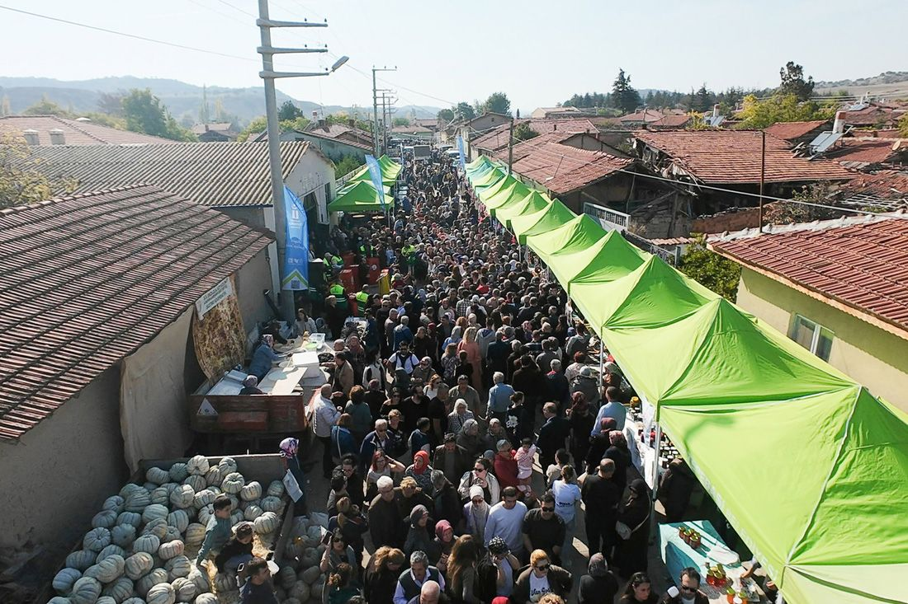

> Tepebaşı Belediyesi'nin düzenlediği panayırda sembolik mezat ve halk oyunları gösterisi yapıldı.

Tepebaşı Belediyesi'nin düzenlediği 4. Kızılinler Bal Kabağı Panayırı'na binlerce Eskişehirli katıldı. Kızılinler Davet Salonu'ndaki panayırda saatler süren kuyruklar ve yoğun araç trafiği oluştu. Coğrafi işaretli Kızılinler bal kabağı tanıtıldı, sembolik mezat ve halk oyunları gösterisi yapıldı.

Panayıra katılan Tepebaşı Belediye Başkanı Ahmet Ataç, panayırın 2023'te bir fikir olarak doğduğunu, bu yıl dördüncüsünün yapıldığını söyledi. Ataç, geçen yıl ulusal olacağını söylediklerini, bu yıl ulusal olduğunu ve seneye büyük ihtimalle uluslararası olacağını belirtti.

Kızılinler Muhtarı Halil İbrahim Can, bal kabağının rulo pastadan baklavaya uzanan bir lezzet serüveni olduğunu ve bu yıl Tepebaşı Belediyesi'nin de Kızılinler'de üretim yaptığını söyledi. Tepebaşı Kırsal Kalkınma Kurulu Başkanı Mehmet Kızılinler, ürünün yaklaşık 90 yıldır ata tohumuyla üretildiğini hatırlattı. Eskişehir Ticaret Borsası Başkanı Ahmet Oğuz, coğrafi işaret tescilinin markalaşma yolunda önemli bir adım olduğunu belirtti. ESOGÜ Ziraat Fakültesi Dekanı Prof. Dr. Onur Koyuncu da üreticilerin emeğinin bilimsel bilgiyle desteklenip katma değere dönüşmesi gerektiğini söyledi. (Kaynak: Tepebaşı Belediyesi)

---

## Kabine toplantısı sona erdi: Erdoğan haftanın diplomasi programını açıkladı

**Türkiye · Türkiye** · 2026-10-27 05:32 UTC · Kaynak: [Google Haberler - Cumhurbaşkanı](https://www.iletisim.gov.tr/turkce/haberler/detay/cumhurbaskanligi-kabinesi-toplandi-26-10-26)

> Cumhurbaşkanı Erdoğan, yaklaşık 3 saat süren Kabine Toplantısı'nın ardından programı ve dış politika başlıklarını açıkladı.

Cumhurbaşkanlığı Kabinesi, Cumhurbaşkanı Recep Tayyip Erdoğan başkanlığında Cumhurbaşkanlığı Külliyesi'nde toplandı. Saat 15.38'de başlayan toplantı yaklaşık 3 saat sürdü. Erdoğan, toplantının ardından millete seslendi.

Erdoğan konuşmasına, Zonguldak'ta geçen hafta özel bir maden ocağındaki grizu patlamasında hayatını kaybeden 3 madenciye ve Ankara'daki askerî araç kazasında şehit olan Albay Sayit Gökgöz'e başsağlığı dileyerek başladı. Kabine toplantısında iç siyaset, ekonomi, güvenlik ve dış politikaya ilişkin güncel gelişmeleri ele aldıklarını söyledi.

Erdoğan'ın aktardığına göre Kanada Başbakanı Mark Carney'nin ziyaretinde ilişkiler stratejik ortaklık seviyesine yükseltildi; savunma, hava ulaştırma ve enerji alanlarında üç anlaşma imzalandı ve serbest ticaret anlaşması müzakerelerine yıl bitmeden başlanması kararlaştırıldı. 3 milyar dolar civarındaki ticaret hacminin önce 5, sonra 10 milyar dolara çıkarılması hedefleniyor. Erdoğan, 16 Ekim'de Kamboçya Başbakanı Hun Manet'i İstanbul'da ağırladıklarını da hatırlattı.

Erdoğan, önümüzdeki günlerin programını şöyle açıkladı: 28 Ekim'de Kazakistan Cumhurbaşkanı Kasım Cömert Tokayev Ankara'da ağırlanacak ve aynı gün Beştepe Millet Ormanı halkın kullanımına açılacak. 30 Ekim Cuma günü Türk Devletleri Teşkilatı'nın 13. Zirvesi Ankara'da yapılacak. Ardından Güney Kore ziyareti ve dönüşte Antalya'da COP31 Zirvesi planlanıyor. (Kaynak: İletişim Başkanlığı)

---

## Kazım Kurt: Kurşunlu Külliyesi ve eserlerin sorumluluğunu Vakıflar'a bırakıyoruz

**Belediye · Odunpazarı** · 2026-10-27 02:33 UTC · Kaynak: [Google Haberler - Odunpazarı](https://www.2eylul.com.tr/kazim-kurttan-kursunlu-kulliyesi-tepkisi-buyurun-sizin-olsun)

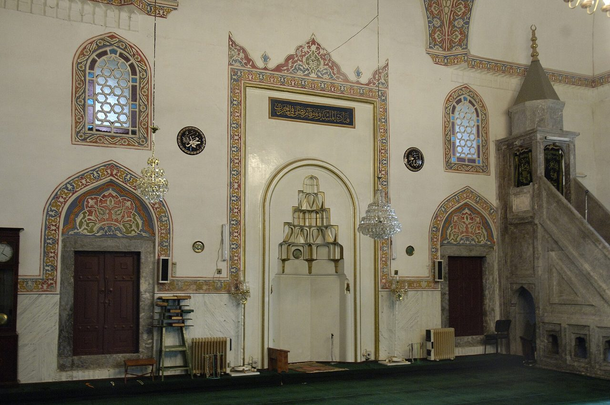

> Odunpazarı Belediye Başkanı Kurt, sosyal medya paylaşımında külliyenin belediyenin elinden alınmak istendiğini öne sürdü.

Odunpazarı Belediye Başkanı Kazım Kurt, Kurşunlu Külliyesi'ne ilişkin sosyal medya hesabından açıklama yaptı. Kurt, külliyenin yıllardır kültür ve sanat faaliyetleriyle yaşatıldığını belirterek yapının belediyenin elinden alınmak istendiğini öne sürdü.

Kurt paylaşımında, külliyenin müzeleri, atölyeleri ve uluslararası festivalleriyle Eskişehir'in önemli kültür ve sanat merkezlerinden biri haline getirildiğini, mevcut gelişmelerin bu birikimin geleceğini belirsizliğe sürüklediğini savundu. Kurt, "Biz üzerimize düşeni yaptık. Bu tarihi mirasa sahip çıktık, sanatla buluşturduk, Eskişehirlilerin hizmetine sunduk. Madem bütün bu emeğin, sanatın ve kültürel birikimin bir karşılığı yok, buyurun Kurşunlu Külliyesi de eserler de sizin olsun!" dedi. Eserlerin sorumluluğunu Kütahya Vakıflar Bölge Müdürlüğü'ne bıraktıklarını belirtti.

Haberde yer alan bilgiler Kurt'un açıklamasına dayanıyor; Vakıflar Bölge Müdürlüğü'nün bu açıklamaya yanıtı kaynakta yer almıyor. (Kaynak: Google Haberler üzerinden Odunpazarı Belediye Başkanı Kazım Kurt'un paylaşımı)

---

## ESKİ'nin ES2026 Yeni Nesil Sayaç ve Online Ödeme Sistemi tanıtıldı: Komisyon yok

**Belediye · Merkez** · 2026-10-27 00:33 UTC · Kaynak: [Google Haberler - Eskişehir](https://www.gzt26.com/ayse-unlucenin-secim-vaadi-hayata-gecti-eskisehirde-sebeke-suyu-yuklemede-yeni-donem)

> Aboneler cep telefonlarından su yükleyebilecek; mevcut sayaçlar ve su yükleme noktaları hizmet vermeyi sürdürecek.

Eskişehir Büyükşehir Belediyesi ve ESKİ Genel Müdürlüğü'nün geliştirdiği ES2026 Yeni Nesil Sayaç ve Online Ödeme Sistemi, 26 Ekim'de ESKİ İçme Suyu Arıtma Tesisleri'nde düzenlenen programla tanıtıldı. Yeni sistemle vatandaşlar su yükleme noktalarına gitmeden cep telefonlarından işlem yapabilecek. Mevcut sayaçlarını kullanmak isteyen aboneler eski sistemle devam edebilecek.

Programa Büyükşehir Belediyesi Genel Sekreter Vekili M. Recai Erdir, ESKİ Genel Müdür Vekili Niyazi Solak, belediye yöneticileri ve basın mensupları katıldı. Fransa'nın Strazburg kentinde bulunan Belediye Başkanı Ayşe Ünlüce, programa video mesaj gönderdi ve sistemin ESKİ çalışanlarının kendi mühendislik çalışmalarıyla geliştirildiğini belirterek teşekkür etti.

Yeni uygulamayla vatandaşlar aile bireylerinin aboneliklerine de uzaktan su yükleyebilecek. Mobil uygulama üzerinden yapılan işlemlerden komisyon alınmayacak. Kullanıcılar kalan su miktarını ve tahmini bitiş tarihini görebilecek; su kredisinin bitmesine bir hafta kala telefonlarına uyarı gönderilecek. Sistem Android ve iOS'ta kullanılabilecek, ESKİ'ye göre iPhone'larda su yüklenmesini sağlayan çözüm Türkiye'de bir ilk.

Nisan ayında saha testlerine başlanan yeni sayaçlar yeni yapılarda kullanılmaya başlandı. Mevcut aboneler mobil uygulamadan başvurarak sayaçlarını değiştirebilecek. İlk aşamada 5 ila 6 bin abonenin talebini karşılayacak hazırlık yapıldı, yıllık üretim kapasitesi 80 bin sayaca ulaşabilecek. (Kaynak: Anadolu Gazetesi)

---

## Türkiye ile Suudi Arabistan arasında eğitim iş birliği mutabakat zaptı imzalandı

**Eğitim · Türkiye** · 2026-10-26 20:32 UTC · Kaynak: [Milli Eğitim Bakanlığı](https://www.meb.gov.tr/bakan-tekin-suudi-arabistan-egitim-bakani-el-benyan039la-gorustu/haber/42293/tr)

> Bakan Tekin ve Suudi Arabistan Eğitim Bakanı El-Benyan, öğretmen-öğrenci değişimi ve denklik konularını içeren mutabakat zaptını imzaladı.

Millî Eğitim Bakanı Yusuf Tekin, Suudi Arabistan Eğitim Bakanı Yusuf Bin Abdullah El-Benyan ile görüştü. Görüşmenin ardından iki bakan eğitim alanında mutabakat zaptı imzaladı. Programda Millî Eğitim Bakan Yardımcısı Celile Eren Ökten de yer aldı.

Mutabakat zaptıyla öğretmen, öğrenci ve uzmanların karşılıklı ziyaretleri, eğitim personelinin mesleki gelişimi, ortak araştırmalar, eğitim materyallerinin geliştirilmesi, özel eğitim, eğitim teknolojileri ve uzaktan eğitim alanlarında iş birliğinin güçlendirilmesi hedefleniyor. Türkçe ve Arapça öğretiminin desteklenmesi, eğitim yeterlilikleri ve sertifikalarının karşılıklı tanınması ve denklikleri konusunda iş birliği, okul açılış ve izin süreçlerinin kolaylaştırılması da öngörülüyor.

Tekin, iki ülke ilişkilerinin daha iyi bir noktaya taşınması için en önemli görevin eğitim bakanlıklarına düştüğünü söyledi. Tekin ayrıca yapay zekânın eğitim süreçlerindeki olumlu ve olumsuz etkilerinin sağlıklı değerlendirilmesi gerektiğini belirtti. El-Benyan ise yapay zekânın eğitimdeki yerinin belirlenmesi gerektiğini, bu rolün Suudi Arabistan'ın dini ve ulusal değerleriyle örtüşmesi gerektiğini söyledi. (Kaynak: Millî Eğitim Bakanlığı)

---

## Valilik Cumhuriyet Bayramı programını açıkladı: 29 Ekim'de resmî geçit töreni

**Gündem · Merkez** · 2026-10-26 18:33 UTC · Kaynak: [Google Haberler - Eskişehir etkinlik](https://www.istikbalgazetesi.com/eskisehir-valiligi-duyurdu-29-ekim-cumhuriyet-bayrami-programi-belli-oldu)

> 26-29 Ekim arasında doğa yürüyüşleri, konserler, çelenk töreni, kortej ve resmî geçit var.

Eskişehir Valiliği'nin paylaştığı programa göre Cumhuriyet Bayramı kutlamaları 26 Ekim'den itibaren kentte çeşitli etkinliklerle sürecek.

26 Ekim: 09.00-17.00 arasında İl Halk Kütüphanesi giriş katında Atatürk Kitap Sergisi açık olacak. 09.00-15.00 arasında Frig Vadisi-Yazılıkaya'da doğa yürüyüşü yapılacak. 11.00'de Büyükşehir Belediyesi Sanat ve Kültür Merkezi'nde Türk Halk Müziği Korosu konseri, 17.00'de Şehit Anıl Gül Spor Salonu'nda güreş turnuvası düzenlenecek.

27 Ekim: 08.45'te Küçükelmalı Tabiat Parkı'nda doğa yürüyüşü, 10.00-15.00 arasında Sümer Mahallesi'nde oryantiring yarışı olacak. 16.00'da ESOGÜ Kongre ve Kültür Merkezi'nde halk müziği konseri ve halk oyunları gösterisi, 19.00-21.00 arasında Anadolu Üniversitesi Öğrenci Merkezi Yunus Emre Salonu'nda konser yapılacak.

28 Ekim: İlköğretim öğrencileri ETİ Arkeoloji Müzesi'ni 08.00-17.00 arasında ücretsiz gezebilecek. 10.00'da Hava Şehitliği'nde şehitlik ziyareti yapılacak. 11.00'de Tepebaşı Belediyesi başkanlık binası yanında "Atatürk ve Çocukları" adlı eserin açılışı yapılacak. 13.00'te Valilik Meydanı'nda çelenk sunma töreni, 17.00'de kortej, 19.30'da Hasan Polatkan Kültür Merkezi'nde Cumhuriyet Bayramı konseri olacak.

29 Ekim: 10.00'da Valilik Makamı'nda tebriklerin kabulü töreni, 10.30'da Atatürk Bulvarı'nda kutlama ve resmî geçit töreni yapılacak. 10.00-17.00 arasında TÜRASAŞ Bölge Müdürlüğü'ndeki Devrim Müzesi ziyaret edilebilecek. (Kaynak: İstikbal Gazetesi, Eskişehir Valiliği programı)

---

## Vali Yılmaz İstiklal Mahallesi Demirciler Sokağı esnafını ziyaret etti

**Gündem · Merkez** · 2026-10-26 14:32 UTC · Kaynak: [Eskişehir Valiliği](https://www.eskisehir.gov.tr/valimiz-dr-erdinc-yilmaz-istiklal-mahallesi-demirciler-sokak-uzerinde-faaliyet-gosteren-esnafi-ziyaret-ederek-hayirli-ve-bereketli-kazanclar-diledi)

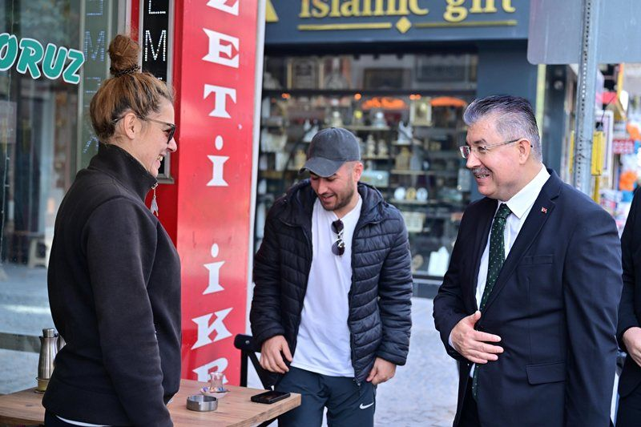

> Vali Erdinç Yılmaz esnafın sorunlarını ve önerilerini dinledi.

Eskişehir Valisi Dr. Erdinç Yılmaz, İstiklal Mahallesi Demirciler Sokağı üzerinde faaliyet gösteren esnafı ziyaret etti. Yılmaz, esnafa hayırlı ve bereketli kazançlar diledi.

Esnaf ve vatandaşlarla bir süre sohbet eden Yılmaz, iş yerlerinin durumu ve karşılaşılan sorunlar hakkında bilgi aldı, talep ve önerileri dinledi. Yılmaz, esnafın şehrin ekonomisine ve sosyal hayatına önemli katkılar sunduğunu belirterek "Esnafımızın her zaman yanındayız. Hemşehrilerimizle birlikte Eskişehir'imiz için çalışmaya devam edeceğiz" dedi. (Kaynak: Eskişehir Valiliği)

---

## Ortak Yazılı Sınav Sistemi için 'Sıkça Sorulan Sorular' rehberi hazırlandı

**Eğitim · Merkez** · 2026-10-26 14:32 UTC · Kaynak: [Eskişehir İl Milli Eğitim Müdürlüğü](https://eskisehir.meb.gov.tr/www/ortak-yazili-sinav-sistemi039yle-ilgili-quotsikca-sorulan-sorularquot-rehberi-hazirlandi/icerik/8697/tr)

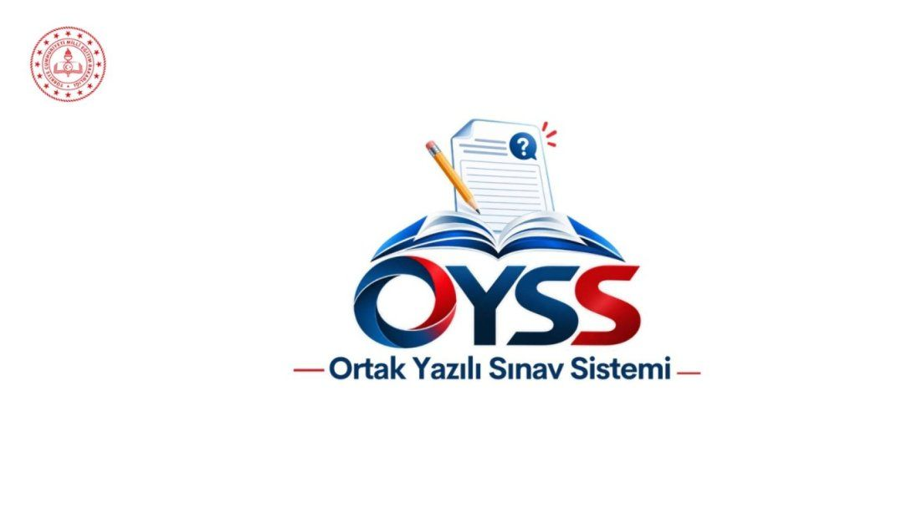

> İl Milli Eğitim Müdürlüğü, OYSS'nin hangi sınıf ve derslerde uygulanacağını açıkladı.

Eskişehir İl Milli Eğitim Müdürlüğü, Ortak Yazılı Sınav Sistemi (OYSS) ile ilgili sıkça sorulan soruları yanıtladı. Hazırlanan rehberde sistemin amacı, öğrenci başarısı ve eğitim kalitesi bakımından önemi ve nasıl uygulanacağı anlatıldı.

OYSS, okul geneli ortak yazılı sınavların hazırlanması, uygulanması ve değerlendirilmesi süreçlerini dijital ortamda yürütmek için geliştirilen bir sistem. Rehbere göre sınavların öğretim programlarındaki öğrenme çıktılarıyla uyumlu, geçerli ve güvenilir hazırlanması hedefleniyor. Sistemle Türkiye Yüzyılı Maarif Modeli ile uyumlu biçimlendirici değerlendirme uygulamalarının, açık uçlu ve beceri temelli soruların okul düzeyinde yaygınlaştırılması amaçlanıyor.

2026-2027 eğitim öğretim yılında OYSS, ortaokul 5, 6 ve 7. sınıflarda Türkçe, matematik, fen bilimleri, sosyal bilgiler, din kültürü ve ahlak bilgisi ile İngilizce derslerinde; lise 9, 10 ve 11. sınıflarda Türk dili ve edebiyatı, matematik, fizik, kimya, biyoloji, tarih, coğrafya, din kültürü ve ahlak bilgisi, felsefe ve İngilizce derslerinde uygulanacak.

Sistemin kullanımına yönelik bilgilendirme ve eğitim çalışmaları 19-23 Ekim 2026'da tamamlandı. Öğretmenler sistem üzerinde deneme uygulamaları yapabiliyor. (Kaynak: Eskişehir İl Milli Eğitim Müdürlüğü)

---

## Ankara Pursaklar'da Mehmet Akif Ersoy Çocuk Evleri Sitesi açıldı: 80 çocuk kapasitesi

**Türkiye · Türkiye** · 2026-10-26 12:42 UTC · Kaynak: [Aile ve Sosyal Hizmetler Bakanlığı](https://www.aile.gov.tr/haberler/bakanimiz-mahinur-ozdemir-goktas-mehmet-akif-ersoy-cocuk-evleri-sitesinin-acilis-toreninde-konustu/)

> Bakan Göktaş, tesisin açılışında koruma ve bakım altındaki çocuk sayılarını açıkladı.

Aile ve Sosyal Hizmetler Bakanı Mahinur Özdemir Göktaş, Ankara Pursaklar'daki Mehmet Akif Ersoy Çocuk Evleri Sitesi'nin açılış töreninde konuştu. Göktaş, tesisin hayata geçirilmesinde sağladığı iş birliği nedeniyle UNICEF'e teşekkür etti.

Göktaş'ın verdiği bilgiye göre site 0-6 yaş grubundaki kız ve erkek çocuklara ile 7-12 yaş grubundaki kız çocuklarına hizmet verecek. 80 çocuk kapasitesiyle planlanan site, 8 villa tipi yaşam birimi, bir sosyal bina ve bir idari binadan oluşuyor. Kuruluş 14 Ekim'de kapılarını açtı ve 40 kız çocuğu yeni hayatlarına bu evlerde başladı.

Bakan, koruma ve bakım altındaki 15 bin 174 çocuğun barınma, eğitim, sağlık ve psikososyal gelişiminin takip edildiğini söyledi. Göktaş'a göre 11 bin 72 çocuk 9 bin 327 koruyucu ailenin yanında büyüyor; sosyal ve ekonomik destek hizmetiyle 199 bin 889 çocuğun ailesinin yanında büyümesine katkı sağlanıyor. Ankara'da ise 6 bin 754 çocuğun ailesinin yanında büyümesi destekleniyor, 507 çocuğa koruyucu aile hizmeti, 1560 çocuğa kuruluşlarda bakım hizmeti sunuluyor. (Kaynak: Aile ve Sosyal Hizmetler Bakanlığı)

---
