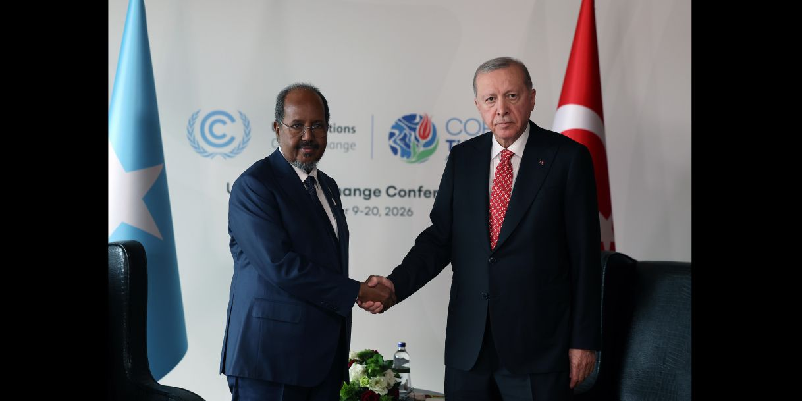
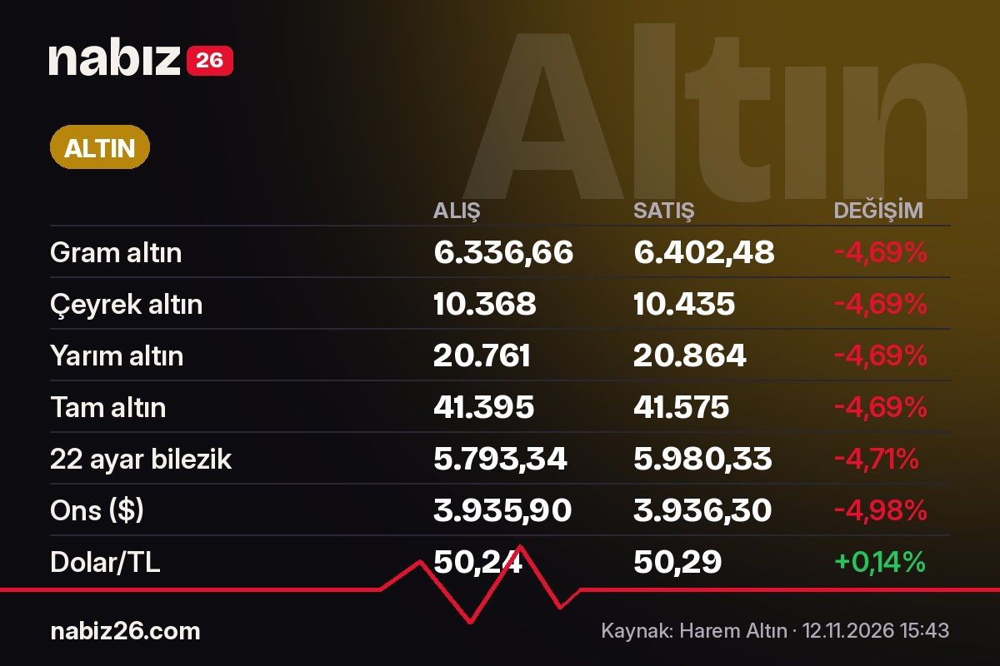
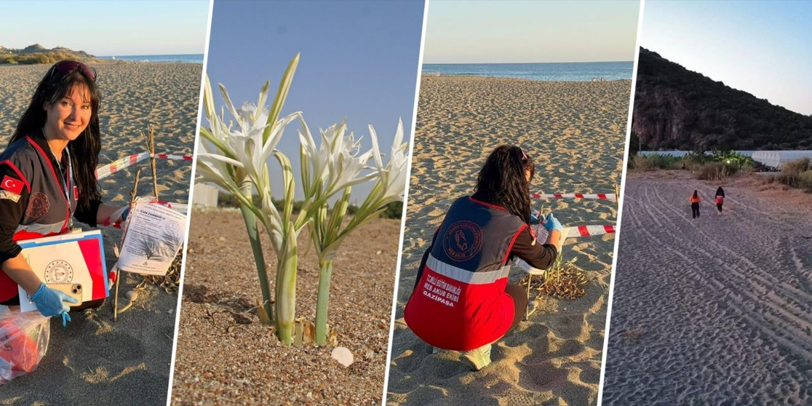
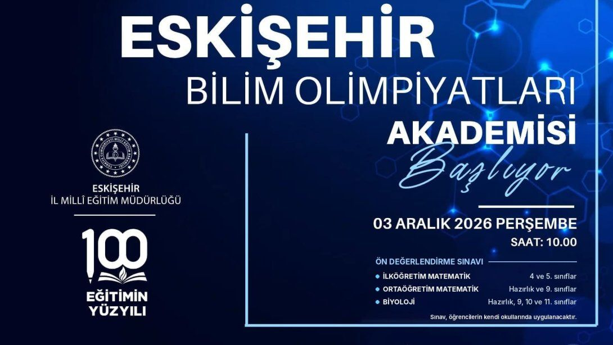
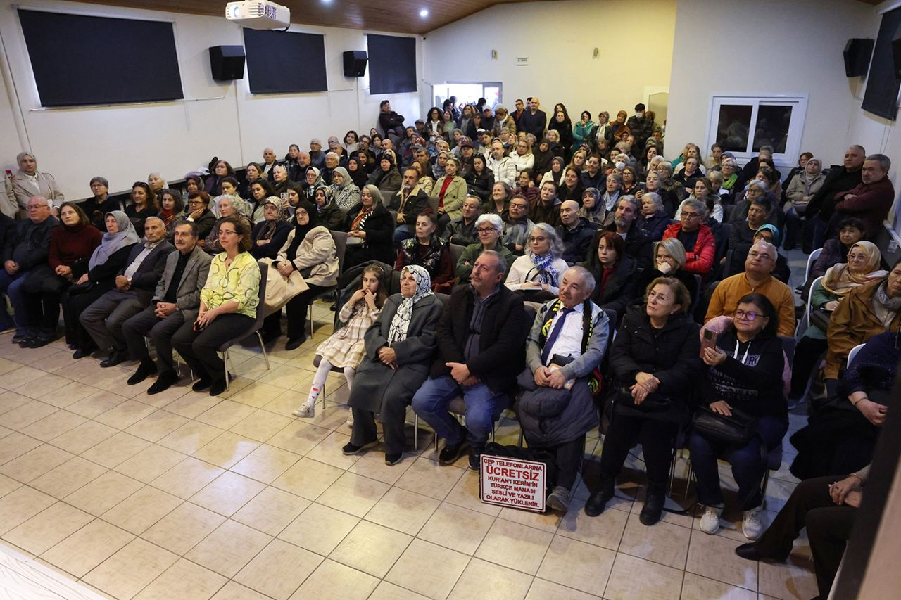
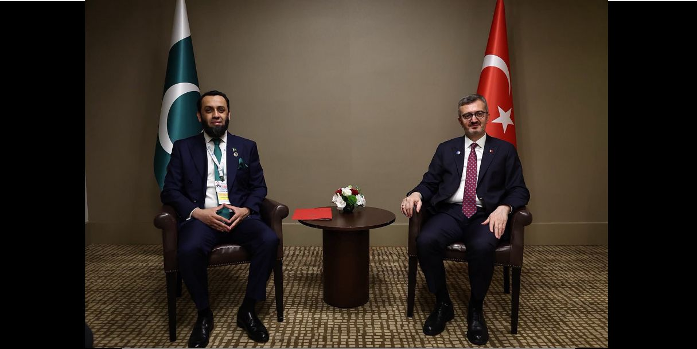
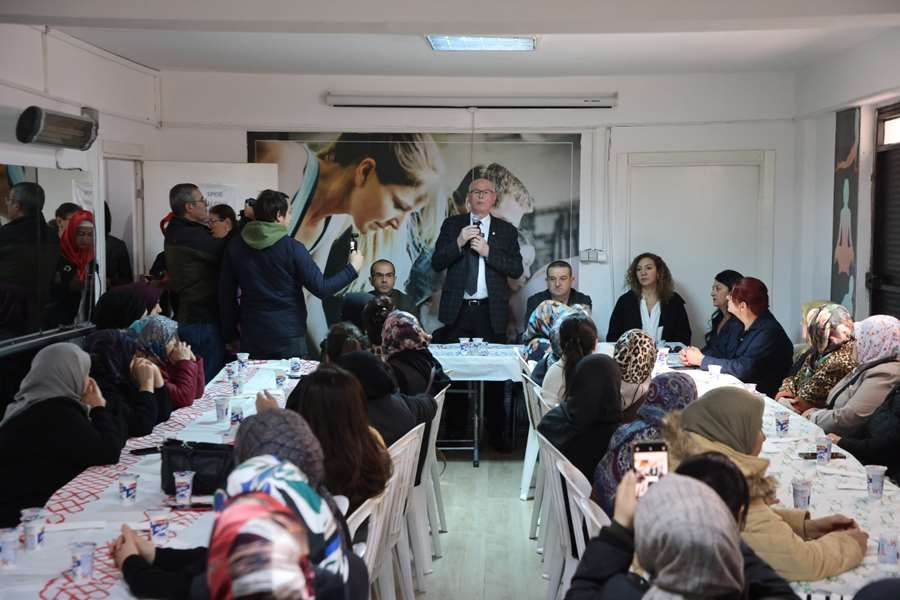
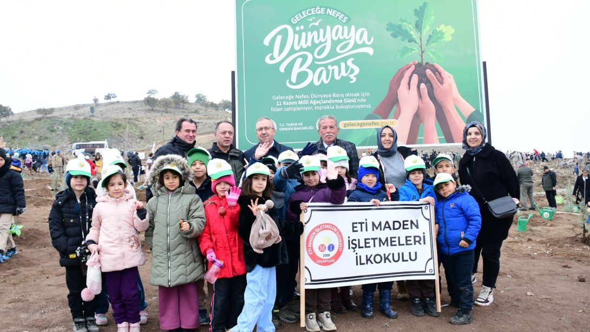

# Son haberler

Ajanın yazdığı son haberler (otomatik güncellenir).

## Türkiye ve Kanada'dan nükleer enerji hamlesi: Yeni aşamaya geçildi

**Türkiye · Türkiye** · 2026-11-12 13:53 UTC · Kaynak: [Enerji ve Tabii Kaynaklar Bakanlığı](https://enerji.gov.tr/haber-detay?id=31972)

> Türkiye ile Kanada arasında nükleer enerji santrali projeleri kapsamında fizibilite ve ön tasarım mühendisliği anlaşması imzalandı.

Türkiye ile Kanada arasında nükleer enerjide yeni bir aşamaya geçilerek önemli bir anlaşmaya imza atıldı. Türkiye Nükleer Enerji Anonim Şirketi (TÜNAŞ) ile Kanadalı Candu Energy Inc. arasında gerçekleştirilen mutabakat ile CANDU reaktör teknolojisinde fizibilite ve ön tasarım mühendisliği çalışması yapılacak.

Antalya'da devam eden BM İklim Değişikliği Çerçeve Sözleşmesi 31. Taraflar Konferansı (COP31) marjında hayata geçirilen anlaşma, Enerji ve Tabii Kaynaklar Bakanı Alparslan Bayraktar ile Kanada Çevre, İklim Değişikliği ve Doğa Bakanı Julie Dabrusin'ın huzurunda imzalandı. Sürecin, projenin teknik ve ticari açıdan olgunlaşmasını sağlayarak nihai yatırım kararları için güvenilir bir zemin oluşturması hedefleniyor.

Bakan Alparslan Bayraktar, anlaşmaya ilişkin değerlendirmesinde, fizibilite ve ön tasarım mühendisliğini kapsayan bu sürecin nükleer enerjideki uzun vadeli yol haritasını netleştireceğini ve arz güvenliğini tahkim edeceğini belirtti. Çalışmaların en kritik boyutlarından birinin yerli sanayinin projeye maksimum katılımı ve nitelikli insan kaynağının geliştirilmesi olduğunu vurguladı.

---

## Eskişehirspor - Ayvalıkgücü maçı ne zaman, saat kaçta?

**Spor · Tepebaşı** · 2026-11-12 13:53 UTC · Kaynak: [Google Haberler - Eskişehirspor](https://www.gazetevatan.com/galeri/eskisehirspor-ayvalikgucu-maci-ne-zaman-saat-kacta-canli-yayin-hangi-kanalda-2463963)

> Nesine 3. Lig 2. Grup'ta mücadele eden Eskişehirspor, 12. hafta karşılaşmasında Ayvalıkgücü Belediyespor'u konuk edecek.

Nesine 3. Lig 2. Grup'ta üst sıraları hedefleyen Eskişehirspor, ligin 12. haftasında kendi sahasında Ayvalıkgücü Belediyespor ile kozlarını paylaşacak. Futbolseverlerin merakla beklediği karşılaşmanın detayları netleşti.

TFF maç programına göre müsabaka, 15 Kasım 2026 Pazar günü Eskişehir'deki Prof. Dr. Fethi Heper Stadyumu'nda oynanacak. Kritik mücadele saat 15.30'da başlayacak.

Karşılaşmayı canlı takip etmek isteyen taraftarlar için mücadelenin Tivibu Spor ekranlarından naklen yayınlanması planlanıyor. Yayın detayları ve olası değişiklikler için maç saatinde yayın akışının kontrol edilmesi öneriliyor.

---

## Eskişehir Aile ve Sosyal Hizmetler İl Müdürlüğü'nde Koordinasyon Toplantısı

**Gündem · Merkez** · 2026-11-12 13:53 UTC · Kaynak: [Google Haberler - Eskişehir](https://www.aile.gov.tr/eskisehir/haberler/il-mueduerlueguende-koordinasyon-toplantisi-toplumda-goeruelmeyen-sikintilari-tespit-etmek-temel-gayemiz/)

> Eskişehir Aile ve Sosyal Hizmetler İl Müdürlüğü'nde gerçekleştirilen koordinasyon toplantısında, sahadaki sosyal hizmet çalışmalarının güncel ihtiyaçları ele alındı.

Eskişehir Aile ve Sosyal Hizmetler İl Müdürlüğü'nde kurum içi koordinasyon toplantısı düzenlendi.

İl Müdürü Orhan Bayrak başkanlığında yapılan toplantıya, Aile ve Toplum Hizmetlerinden sorumlu İl Müdür Yardımcısı Hatice Dost, Sosyal Hizmet Merkezi (SHM) müdürleri ve birim personelleri katıldı. Buluşmada Sosyal Hizmet Merkezlerinin güncel ihtiyaçları ve sahadan gelen talepler ayrıntılı şekilde masaya yatırıldı.

İnsan odaklı sosyal hizmet alanında mesleki körleşme riskine karşı dikkatli olunması gerektiği vurgulanan toplantıda, toplumda görülmeyen sıkıntıların zamanında tespit edilmesinin önemine dikkat çekildi. Sahadaki çalışmaların değişken yapısına değinen İl Müdürü Bayrak, tek tip çözüm yollarına sahip bir bakanlık olmadıklarını belirterek karşılaşılan her duruma karşı çok boyutlu stratejiler üretmek zorunda olduklarını ifade etti.

Toplantı, personelin görüş, talep ve önerilerinin dinlenmesinin ardından sona erdi.

---

## Erdoğan'dan Somali Cumhurbaşkanı Mahmud ile COP31'de ikili görüşme

**Siyaset · Türkiye** · 2026-11-12 13:53 UTC · Kaynak: [İletişim Başkanlığı](https://www.iletisim.gov.tr/turkce/haberler/detay/cumhurbaskani-erdoganin-somali-cumhurbaskani-mahmud-ile-gorusmesine-iliskin-aciklama-12-11-26)

> Cumhurbaşkanı Erdoğan, COP31 Liderler Zirvesi kapsamında Somali Cumhurbaşkanı Hasan Şeyh Mahmud ile bir araya geldi.

Cumhurbaşkanı Recep Tayyip Erdoğan, COP31 Liderler Zirvesi dolayısıyla Antalya'da bulunan Somali Cumhurbaşkanı Hasan Şeyh Mahmud ile görüşme gerçekleştirdi. İki lider arasındaki görüşmede Türkiye ile Somali arasındaki ikili ilişkiler ile çeşitli bölgesel konular masaya yatırıldı.

Cumhurbaşkanı Erdoğan, görüşmede Türkiye ve Somali'nin savunma ile enerji başlıkları başta olmak üzere birçok alanda iş birliğini geliştirme kararlılığında olduğunu vurguladı. İlişkilere ivme kazandıracak adımların atılmaya devam edileceğini ifade eden Erdoğan, Somali'nin huzur ve istikrarının Türkiye açısından büyük önem taşıdığını belirtti.

Erdoğan ayrıca, ulusal diyalog sürecinin başarısının, millî birliğin tesisinin ve toplumsal barışın sağlanmasının temenni edildiğini dile getirdi.

---

## Bodrum heyetinden Tepebaşı'na ziyaret: Projeler incelendi

**Belediye · Tepebaşı** · 2026-11-12 13:53 UTC · Kaynak: [Google Haberler - Tepebaşı](https://ankahaber.net/haber/bodrum-belediyesi-heyeti-tepebasi-nin-surdurulebilir-projelerini-inceledi-21036e7d)

> Bodrum Belediye Başkanı Tamer Mandalinci ve beraberindeki heyet, kardeş şehir Tepebaşı’nı ziyaret ederek sürdürülebilirlik ve sosyal projeleri yerinde inceledi.

Bodrum Belediye Başkanı Tamer Mandalinci, belediye başkan yardımcıları ve meclis üyelerinden oluşan 28 kişilik heyet, kardeş şehir Tepebaşı Belediyesi'ni ziyaret etti. Tepebaşı Belediye Başkanı Ahmet Ataç tarafından karşılanan heyet, belediye hizmet binası ile Uluslararası Eskişehir Pişmiş Toprak Sempozyumları'nda üretilen eserleri inceledi, geri dönüşüm atölyesi hakkında bilgi aldı.

Ziyaret kapsamında Melih Savaş Yaşam Köyü'nü de gezen heyete, Alzheimer Konukevleri ve AB destekli REMOURBAN projesi başta olmak üzere sürdürülebilir kent çalışmaları aktarıldı. İki belediye arasındaki deneyim paylaşımının önemine vurgu yapan Tepebaşı Belediye Başkanı Ahmet Ataç, kentlerin sorunlarına çözüm üretmek amacıyla farklı yöntemler geliştirdiklerini belirtti.

Tepebaşı Belediyesi'nin örnek çalışmaları yerinde incelediklerini ifade eden Bodrum Belediye Başkanı Tamer Mandalinci ise, projelerden Bodrum'un ihtiyaçlarına uygun olanları kendi kentlerinde hayata geçirmek istediklerini kaydetti.

---

## Bodrum heyetinden Tepebaşı'na ziyaret: İyi örnekler Bodrum'da uygulanacak

**Belediye · Tepebaşı** · 2026-11-12 13:53 UTC · Kaynak: [Tepebaşı Belediyesi](https://www.tepebasi.bel.tr/Haber/Detay/baskanmandalincitepebası’nıniyiorneklerinibodrum’dadegerlendirecegiz)

> Bodrum Belediye Başkanı Tamer Mandalinci ve beraberindeki heyet, kardeş şehir Tepebaşı Belediyesi'ni ziyaret ederek sürdürülebilirlik ve sosyal projeleri inceledi.

Bodrum Belediye Başkanı Tamer Mandalinci, belediye başkan yardımcıları ve meclis üyelerinden oluşan 28 kişilik heyetle birlikte kardeş şehir Tepebaşı Belediyesi'ni ziyaret etti. Tepebaşı Belediye Başkanı Ahmet Ataç tarafından karşılanan heyet, belediye binası ve Uluslararası Eskişehir Pişmiş Toprak Sempozyumları kapsamında üretilen eserleri inceledi. Geri dönüşüm atölyesini de gezen konuklar, sürdürülebilirlik odaklı çalışmalar hakkında bilgi aldı.

Makam ziyaretinin ardından Melih Savaş Yaşam Köyü'ne geçen heyet, Alzheimer Konukevleri ve birimlerin işleyişini yerinde inceledi. Ziyarette ayrıca Tepebaşı Belediyesinin Avrupa Birliği destekli REMOURBAN projesi ele alındı.

İki belediye arasındaki deneyim paylaşımının önemine dikkat çeken Tepebaşı Belediye Başkanı Ahmet Ataç, farklı yöntemler geliştirerek kentlerin sorunlarına çözüm aradıklarını belirtti. Bodrum Belediye Başkanı Tamer Mandalinci ise Tepebaşı'nın örnek alınacak önemli projeleri bulunduğunu ifade ederek, bu projelerden Bodrum'un ihtiyaçlarına uygun olanları kendi kentlerinde hayata geçirmek istediklerini kaydetti.

---

## Bakan Tekin: PISA sonuçları gıptayla bakılan yürüyüşe dönüştü

**Eğitim · Türkiye** · 2026-11-12 13:53 UTC · Kaynak: [Milli Eğitim Bakanlığı](https://www.meb.gov.tr/bakan-tekin-tbmm-plan-ve-butce-komisyonunda-bakanligin-2027-butcesine-iliskin-sunum-yapti/haber/42484/tr)

> Milli Eğitim Bakanı Yusuf Tekin, TBMM Plan ve Bütçe Komisyonunda bakanlığının 2027 bütçe sunumunu gerçekleştirdi.

Milli Eğitim Bakanı Yusuf Tekin, TBMM Plan ve Bütçe Komisyonunda bakanlığının 2027 yılı bütçesine ilişkin sunum yaptı.

Konuşmasında Gazi Mustafa Kemal Atatürk'ün eğitime verdiği öneme atıfta bulunan Tekin, Türkiye Yüzyılı Maarif Modeli ile erdem, değer ve eylem çerçevesinde köklerinden kopmayan bir nesil yetiştirmeyi amaçladıklarını belirtti. Tarih bilincinin önemine vurgu yapan Tekin, müfredatta yapılan güncellemelerle saldırıya saldırı, sömürgeciliğe ise sömürgecilik dediklerini ifade etti.

PISA sonuçlarına da değinen Bakan Tekin, geçmişte yapılan eleştirilerin aksine Türkiye'nin fen bilimleri ve okuma becerilerinde OECD ortalamasının üzerine çıktığını kaydetti. Eğitime ayrılan bütçenin artırıldığını ve derslik sayısının iki katına çıkarıldığını belirten Tekin, okul öncesi okullaşma oranında da önemli artışlar sağlandığını dile getirdi.

---

## Altın fiyatları 12 Kasım 2026: Gram altın 6.402,48 TL

**Ekonomi · Merkez** · 2026-11-12 12:43 UTC · Kaynak: [Harem Altın](https://www.haremaltin.com/altin-fiyatlari)

> Gram altın güne düşüşle başladı. Harem Altın verilerine göre gram altın 6.336,66 TL'den alınıyor, 6.402,48 TL'den satılıyor.

Altın piyasasında güne düşüşle başlandı. Harem Altın'ın saat 15.43 itibarıyla verilerine göre gram altının satış fiyatı 6.402,48 TL, alış fiyatı 6.336,66 TL oldu. Gram altın, önceki kapanışa göre yüzde 4,69 geriledi.

Ziynet altınlarda çeyrek altın 10.435 TL, yarım altın 20.864 TL, tam altın 41.575 TL, ata altın 42.686 TL seviyesinden satışa sunuluyor.

22 ayar bileziğin gram satış fiyatı 5.980,33 TL, has altının gram fiyatı 6.383,33 TL olarak belirlendi.

Uluslararası piyasalarda altının onsu 3.936,30 dolardan işlem görürken, dolar/TL 50,29 seviyesinde bulunuyor.

Fiyatlar Harem Altın'ın saat 15.43 itibarıyla paylaştığı verilere dayanmaktadır; kuyumcular arasında farklılık gösterebilir. Bu haber yatırım tavsiyesi değildir.

---

## Odunpazarı'nda Atatürk ve Musiki Anma Programı Düzenlendi

**Kültür-Sanat · Odunpazarı** · 2026-11-12 02:18 UTC · Kaynak: [Odunpazarı Belediyesi](https://www.odunpazari.bel.tr/guncel/haberler/genel-haberler/odunpazari-nda-ataturk-ve-musiki-anma-programi-gerceklestirildi)

> Odunpazarı Belediyesi tarafından düzenlenen "Atatürk ve Musiki" anma programında, Gazi Mustafa Kemal Atatürk'ün sanata ve müziğe verdiği önem ele alındı.

Cumhuriyetimizin kurucusu Gazi Mustafa Kemal Atatürk, aramızdan ayrılışının 88. yıl dönümünde Odunpazarı Belediyesi'nin düzenlediği anlamlı bir etkinlikle anıldı.

Yunus Emre Kültür ve Sanat Merkezi'nde gerçekleştirilen programa; Odunpazarı Belediye Başkan Vekili Cenk Sungur, belediye meclis üyeleri, başkan yardımcıları, daire müdürleri ve çok sayıda sanatsever katıldı.

Etkinlikte, Atatürk'ün müzikle kurduğu bağ, sanata ve kültüre bakış açısı katılımcılarla paylaşıldı. Ulu Önder'in yaşamından kesitlerin ve Cumhuriyet değerlerinin aktarıldığı gecede izleyiciler duygusal ve gurur dolu anlar yaşadı.

---

## MEB AKUB gönüllülerinden COP31'de kum zambağı mesaisi

**Eğitim · Türkiye** · 2026-11-12 02:18 UTC · Kaynak: [Milli Eğitim Bakanlığı](https://www.meb.gov.tr/meb-akub-gonulluleri-cop31-kapsaminda-kum-zambaklarinin-korunmasi-icin-harekete-gecti/haber/42470/tr)

> Milli Eğitim Bakanlığı AKUB ve Genç AKUB gönüllüleri, Antalya'nın Gazipaşa ilçesinde nesli tehdit altındaki kum zambaklarının korunması için farkındalık çalışması başlattı.

Akdeniz kıyılarının nadide bitki türlerinden biri olan ve beyaz çiçekleriyle kıyı ekosistemine katkı sunan kum zambakları, doğal yaşam alanlarında koruma altına alındı. Yoğun kıyı kullanımı, çevre kirliliği ve bilinçli ya da bilinçsiz insan faaliyetleri nedeniyle tehdit altında bulunan kum zambaklarının koparılması yasaklanırken, ihlallere idari para cezası uygulanıyor.

COP31 süreçleri kapsamında, biyolojik çeşitliliğin korunması ve doğayla uyumlu bir yaşam kültürünün yaygınlaştırılması amacıyla harekete geçildi. Bu kapsamda MEB AKUB ve Genç MEB AKUB gönüllüleri, "Bir Zambak Bin Nefes; Doğayı Koru, Geleceği Yaşat!" sloganıyla Gazipaşa sahillerinde çalışma başlattı.

Gerçekleştirilen faaliyetlerde çocuklara, gençlere ve bölge halkına kum zambaklarının ekolojik önemi anlatılıyor. Çalışmalarla, doğal varlıkları koruma bilincinin günlük yaşama taşınması ve gençlerin doğanın korunmasında aktif rol üstlenmesi amaçlanıyor.

---

## Eskişehir'de HABAŞ Tepkisi: Sorumlular Yargılansın

**Gündem · Odunpazarı** · 2026-11-12 02:18 UTC · Kaynak: [Google Haberler - Eskişehir](https://www.evrensel.net/haber/6009072/eskisehir-emek-ve-demokrasi-platformu-habas-katliaminin-sorumlulari-yargilansin)

> Eskişehir Emek ve Demokrasi Platformu, İzmir Aliağa'daki HABAŞ fabrikasında 19 işçinin hayatını kaybettiği patlamaya ilişkin Köprübaşı'nda eylem yaparak sorumluların yargılanmasını istedi.

Eskişehir Emek ve Demokrasi Platformu'nun çağrısıyla bir araya gelen siyasi parti ve emek örgütleri, İzmir Aliağa'da bulunan HABAŞ Demir Çelik fabrikasında 19 işçinin yaşamını yitirdiği patlama nedeniyle protesto eylemi ve basın açıklaması düzenledi.

Köprübaşı'nda toplanan kalabalık Esnaf Sarayı önüne kadar yürüdü. Platform adına açıklamayı okuyan Eskişehir Emek Partisi İl Yöneticisi Deniz Tepe, hayatını kaybeden işçilerin ailelerine başsağlığı dileyerek, yaşananların kaza değil iş cinayeti olduğunu belirtti. Tepe, fabrikada son 10 yılda en az 11 işçinin hayatını kaybettiğini, çok sayıda işçinin yaralandığını ifade ederek taşeronlaşma ve denetimsizliğe dikkat çekti.

İktidarın ve fabrika yönetiminin sorumlu olduğunu savunan Tepe, patlamanın nedenlerinin bağımsız bir heyet tarafından araştırılması, tüm denetim sonuçlarının kamuoyuna açıklanması ve sorumluların derhal yargılanması çağrısında bulundu. Açıklamada ayrıca taşeron sisteminin kaldırılması ve iş güvenliği önlemlerinin artırılması talep edildi.

---

## Eskişehir'de Bilim Olimpiyatları Akademisi Başlıyor: Son Başvuru 20 Kasım

**Eğitim · Merkez** · 2026-11-12 02:18 UTC · Kaynak: [Eskişehir İl Milli Eğitim Müdürlüğü](https://eskisehir.meb.gov.tr/www/eskisehir-bilim-olimpiyatlari-akademisi-basliyor/icerik/8708/tr)

> Eskişehir'de öğrencilerin bilimsel potansiyelini geliştirmek amacıyla hayata geçirilen Bilim Olimpiyatları Akademisi için başvurular başladı.

Eskişehir Valiliği himayelerinde, İl Millî Eğitim Müdürlüğü tarafından yürütülecek olan Eskişehir Bilim Olimpiyatları Akademisi için çalışmalar tamamlandı. Programla öğrencilerin akademik potansiyellerini ortaya çıkarmak, analitik düşünme ve problem çözme becerilerini geliştirmek hedefleniyor.

Matematik ve biyoloji alanlarında eğitim ve gelişim çalışmalarının yürütüleceği akademiye, resmî ve özel okullarda öğrenim gören 4 ve 5. sınıf öğrencileri ile hazırlık, 9, 10 ve 11. sınıf öğrencileri başvuru yapabilecek. Yetenekli öğrencilerin erken dönemde keşfedilerek bilimsel çalışmalara yönlendirilmesi amaçlanan programa katılmak isteyenlerin, 20 Kasım 2026 Cuma gününe kadar çevrim içi başvuru formunu doldurması gerekiyor.

Başvuruların tamamlanmasının ardından katılımcı öğrencilerin belirlenmesi için seçme sınavı yapılacak. Sınav, 3 Aralık 2026 Perşembe günü saat 10.00'da öğrencilerin kendi okullarında gerçekleştirilecek.

---

## YENİ Parti Odunpazarı İlçe Başkanı Yazıcı'dan Tepebaşı'na ziyaret

**Siyaset · Tepebaşı** · 2026-11-11 20:15 UTC · Kaynak: [Google Haberler - Odunpazarı](https://www.esgazete.com/yeni-parti-odunpazari-ilce-baskani-yazici-belediyede-gorustu)

> YENİ Parti Odunpazarı İlçe Başkanı Emine Cevahir Çalıkuşu Yazıcı ve yönetimi, Tepebaşı Belediye Başkanı Ahmet Ataç'ı makamında ziyaret etti.

YENİ Parti Odunpazarı İlçe Başkanı Emine Cevahir Çalıkuşu Yazıcı ile beraberindeki yönetim kurulu üyeleri, Tepebaşı Belediyesi'ni ziyaret etti. 

Gerçekleşen ziyarette, parti teşkilatının yürüttüğü çalışmalar, Eskişehir'in güncel meseleleri ve gelecek döneme yönelik hedefler masaya yatırıldı. Karşılıklı görüş alışverişinin yapıldığı buluşmada kent gündemi değerlendirildi.

Tepebaşı Belediye Başkanı Ahmet Ataç, ziyaretten duyduğu memnuniyeti dile getirerek Yazıcı ve yönetim kurulu üyelerine çalışmalarında başarılar diledi.

---

## Tepebaşı'nda 'Kur’an’da Adalet' Söyleşisine Yoğun İlgi

**Belediye · Tepebaşı** · 2026-11-11 20:15 UTC · Kaynak: [Tepebaşı Belediyesi](https://www.tepebasi.bel.tr/Haber/Detay/tepebası’ndakur’an’daadaletsoylesisineyogunilgi)

> Tepebaşı Belediyesi'nin düzenlediği Din, Tarih ve Felsefe Sohbetleri kapsamında gerçekleştirilen "Kur’an’da Adalet" söyleşisi vatandaşlardan yoğun ilgi gördü.

Tepebaşı Belediyesi tarafından hayata geçirilen etkinlikler kapsamında Özdilek Sanat Merkezi Oktay Ekinci Sahnesi'nde "Kur’an’da Adalet" söyleşisi düzenlendi. İlahiyatçı yazar Akın Karadeniz'in konuşmacı olarak katıldığı programa, Tepebaşı Belediye Başkanı Ahmet Ataç ile çok sayıda vatandaş iştirak etti.

Yoğun katılım nedeniyle salonda yer kalmazken, bazı vatandaşlar söyleşiyi ayakta takip etti. Etkinlikte konuşan Akın Karadeniz, Kur'an'ın adalet, hak ve hukuk kavramlarına dikkat çekerek, İslam'ın akıl, bilim ve ahlakla birlikte ele alınması gerektiğini ifade etti. Günlük yaşamda dürüst ve adaletli kalabilmenin önemine vurgu yapan Karadeniz, kul hakkı hassasiyetinin altını çizdi.

Programın sonunda Tepebaşı Belediye Başkanı Ahmet Ataç, ilahiyatçı yazar Akın Karadeniz'e katkılarından ötürü plaket takdim etti.

---

## Tepebaşı Belde Evleri 25. yılını 4 bin 466 kursiyerle kutluyor

**Belediye · Tepebaşı** · 2026-11-11 20:15 UTC · Kaynak: [Google Haberler - Tepebaşı](https://www.esgazete.com/tepebasi-belde-evlerinde-4-bin-466-kursiyer-egitim-aliyor)

> Tepebaşı Belediyesi Belde Evleri, kış döneminde 35 noktada binlerce vatandaşa 30 farklı branşta eğitim vermeyi sürdürüyor.

Tepebaşı Belediyesi bünyesinde mahallelerde faaliyet gösteren Belde Evleri, kuruluşunun 25. yıl dönümünü kutluyor. İlk Belde Evi 2001 yılında Fevzi Çakmak Mahallesi'nde hizmete girerken, aradan geçen sürede merkezlerin sayısı ve etki alanı genişledi.

Belediyeden yapılan açıklamaya göre, yeni kış dönemi kursları için 8 bin 151 başvuru alındı. Gerçekleştirilen değerlendirmelerin ardından 4 bin 466 kursiyer, 35 farklı hizmet noktasında eğitimlerden aktif olarak yararlanmaya başladı. Merkezlerde 30 branşta açılan 231 kurs grubu, 33 eğitmen eşliğinde çalışmalarını sürdürüyor. Ayrıca 6 Belde Evindeki oyun gruplarında 140 çocuk eğitim ve gelişim etkinliklerine katılıyor.

Tepebaşı Belediye Başkanı Dt. Ahmet Ataç, Belde Evlerinin sadece kurs verilen mekanlar olmadığını vurgulayarak, bu alanların mahalle yaşamına değer kattığını ifade etti. Ataç, merkezlerin komşuluk ilişkilerini güçlendirdiğini ve her yaştan vatandaşın üreterek kendini geliştirdiği ortak buluşma noktaları haline geldiğini belirtti.

---

## Pessinus'un binlerce yıllık tarihi Eskişehir'de sergileniyor

**Kültür-Sanat · Sivrihisar** · 2026-11-11 20:15 UTC · Kaynak: [Google Haberler - Eskişehir etkinlik](https://www.eskisehirekspres.net/pessinusun-binlerce-yillik-tarihi-eskisehirde-sergilenecek)

> Antik dönemin önemli inanç ve ticaret merkezlerinden Pessinus'un kalıntıları, Eskişehir'de açılan özel bir sergiyle tarih meraklılarıyla buluştu.

Sivrihisar ilçesine bağlı Ballıhisar mahallesinde yer alan ve toprak altında kalan binlerce yıllık geçmişe sahip Pessinus antik kentinin izleri, Eskişehir'de sergilenmeye başlandı. Antik dönemin önemli ticaret ve inanç merkezlerinden biri olan yerleşim yerinde gerçekleştirilen arkeolojik kazılardan elde edilen eserler gün yüzüne çıkarıldı.

Eskişehir Büyükşehir Belediyesi Kent Müzeleri Kompleksi Geçici Sergi Salonu'nda kapılarını açan sergide; aslanlar arasında tahtında oturan Kybele tasviri, döneme ait sikkeler ve pişmiş toprak eserler yer alıyor. Eserler aracılığıyla ziyaretçilere antik kentin inanç dünyası, Roma'nın anıtsal yapıları, Bizans ve Selçuklu döneminden günümüz Ballıhisar'ına uzanan tarihsel süreç aktarılıyor.

Eskişehir'in köklü kültürel mirasını gözler önüne seren sergi, 6 Aralık 2026 tarihine kadar ziyaret edilebilecek.

---

## MEB'den okul öncesi ailelere özel bülten: Doğayla Büyüyoruz

**Eğitim · Türkiye** · 2026-11-11 20:15 UTC · Kaynak: [Milli Eğitim Bakanlığı](https://www.meb.gov.tr/aile-egitim-bulteni-quotdogayla-buyuyoruz-gelecegi-koruyoruzquot-temasiyla-yayinda/haber/42469/tr)

> Milli Eğitim Bakanlığı Temel Eğitim Genel Müdürlüğü tarafından hazırlanan Kasım ayı Aile Eğitim Bülteni, 'Doğayla Büyüyoruz, Geleceği Koruyoruz' temasıyla yayımlandı.

Milli Eğitim Bakanlığı Temel Eğitim Genel Müdürlüğü, ailelerin eğitim sürecine katılımını güçlendirmek amacıyla her ay yayımlanan Aile Eğitim Bülteni'nin Kasım sayısını erişime açtı. Okul öncesi eğitime devam eden çocukların ailelerine yönelik hazırlanan bülten, ev ortamı ile okul programları arasında bütünlük sağlamayı hedefliyor.

Kasım ayı bülteninde, çocukların doğayla bağ kurmasının çok yönlü gelişimlerine katkıları, ormanlar ve doğal yaşamın önemi, sıfır atık ile sürdürülebilir yaşam alışkanlıkları ele alındı. İçerikte ayrıca ailelerin çocuklarıyla birlikte uygulayabileceği doğa etkinlikleri, oyunlar ve günlük yaşam önerilerine yer verildi.

Bültende doğanın çocuklar için önemli bir öğrenme alanı olduğuna dikkat çekilerek, çocukların toprak kokusunu alması, kuş seslerini dinlemesi ve tohumun filizlenişini izlemesinin merak duygusunu geliştirdiği ifade edildi. Türkiye Yüzyılı Maarif Modeli Okul Öncesi Eğitim Programı çerçevesinde, çocukların çevre bilinci kazanması için aile desteğinin önemine vurgu yapıldı.

---

## Krediler tıkandı: Eskişehir'de konut ve araçta tasarruf dönemi

**Ekonomi · Merkez** · 2026-11-11 20:15 UTC · Kaynak: [Google Haberler - Eskişehir](https://www.esgazete.com/banka-kredisi-tikandi-eskisehir-halki-tasarruf-finansmanina-yoneldi)

> Eskişehir'de banka kredilerindeki kısıtlamalar ve yüksek faizler, tüketicileri tasarruf finansman şirketlerine yöneltti. Kentteki satışların önemli bir bölümü bu sistemle yapılıyor.

Eskişehir'de banka kredilerine erişimin zorlaşması ve yüksek faiz oranları, gayrimenkul ile ikinci el araç piyasasında alternatif finansman modellerinin payını artırdı. Sektör temsilcilerinin paylaştığı bilgilere göre, kentte satılan ikinci el araçların yüzde 80'i, konutların ise yüzde 30'u tasarruf finansman şirketleri aracılığıyla alıcı buluyor.

Eskişehir Emlakçılar Odası Başkanı Gazi Çelik, konut piyasasındaki en büyük engelin tüketicilerin sıcak paraya erişimindeki güçlük olduğunu belirtti. Dar gelirli vatandaşların 2 ila 3,5 milyon lira bandındaki konut alımlarında bu sisteme yöneldiğini aktaran Çelik, inşaat sektörünün yüzlerce iş kolunu etkileyen bir çark olduğunu ve finansman akışının kritik önem taşıdığını vurguladı.

Eskişehir Oto Galericiler Kooperatifi Başkanı Ceylan Üstün ise bankaların kredi limitlerinin güncel araç fiyatlarının çok altında kaldığını ifade etti. Bankaların en fazla 400 bin lira kredi verebildiğini hatırlatan Üstün, bu durumun alıcıları zorunlu olarak tasarruf finansman sistemine yönlendirdiğini kaydetti.

Eskişehir Ticaret Odası İnşaat Meslek Komitesi Meclis Üyesi Atakan Bakılan da sistemin konut satışlarına katkı sağladığını ancak ekspertiz ve tapu devir süreçlerinde bazı aksaklıklar yaşandığını bildirdi. Bakılan, tasarruf finansmanının önemli bir alternatif olduğunu ancak inşaat sektörünün sağlıklı bir piyasa için uygun koşullu uzun vadeli banka kredilerine de ihtiyaç duyduğunu belirtti.

---

## İletişim Başkanı Duran'dan Pakistanlı Bakan Tarar ile iklim ve medya görüşmesi

**Türkiye · Türkiye** · 2026-11-11 20:15 UTC · Kaynak: [İletişim Başkanlığı](https://www.iletisim.gov.tr/turkce/haberler/detay/iletisim-baskani-duran-pakistan-enformasyon-ve-yayin-bakani-tarar-ile-bir-araya-geldi)

> İletişim Başkanı Burhanettin Duran, COP31 için Antalya'da bulunan Pakistan Enformasyon ve Yayın Bakanı Attaullah Tarar ile bir araya geldi.

Cumhurbaşkanlığı İletişim Başkanı Burhanettin Duran, Birleşmiş Milletler İklim Değişikliği Çerçeve Sözleşmesi 31. Taraflar Konferansı (COP31) dolayısıyla Türkiye'de bulunan Pakistan Enformasyon ve Yayın Bakanı Attaullah Tarar ile görüştü.

Görüşmede, Türkiye ile Pakistan arasındaki köklü dostluk ve kardeşlik bağlarının yanı sıra medya ve iletişim alanındaki iş birliği imkânları ele alındı. Kamu diplomasisi, uluslararası iletişim ve medya sektörlerinde tecrübe paylaşımı ile ortak çalışmaların önemine vurgu yapıldı.

İletişim Başkanı Duran, Cumhurbaşkanı Recep Tayyip Erdoğan'ın liderliğinde iki ülke arasındaki güçlü ilişkilerin iletişim alanındaki yeni iş birlikleriyle daha da ileriye taşınmasını temenni etti.

---

## Başkan Kurt'tan Emek'teki kadınlara: Mahallenin geleceğine birlikte karar verelim

**Belediye · Odunpazarı** · 2026-11-11 20:15 UTC · Kaynak: [Odunpazarı Belediyesi](https://www.odunpazari.bel.tr/guncel/haberler/genel-haberler/baskan-kurt-emek-halk-merkezi-nde-kadinlarla-bulustu)

> Odunpazarı Belediye Başkanı Kazım Kurt, Emek Halk Merkezi'ndeki kadın kursiyerlerle bir araya gelerek belediye hizmetlerini anlattı ve mahallenin bölünmesi konusundaki görüşleri dinledi.

Odunpazarı Belediye Başkanı Kazım Kurt, mahalle buluşmaları kapsamında Emek Halk Merkezi'nde kadın kursiyerlerle öğle yemeğinde bir araya geldi. Yoğun katılımlı buluşmada kadınlarla sohbet eden Kurt, halk merkezlerinin yalnızca kurs alanları olmadığını, mahalle sakinlerinin ortak buluşma noktaları olduğunu belirtti.

Emek Mahallesi'nin 60 bin nüfusuyla Eskişehir'in en büyük mahallesi olduğunu vurgulayan Başkan Kurt, mahallenin büyümeye devam ettiğini ifade etti. Mahallenin bölünmesine yönelik taleplerin de gündemde olduğunu belirten Kurt, bu konudaki kararların mahalle sakinleriyle birlikte alınması gerektiğini söyledi.

Buluşmada kadınlar, mahalleye ve belediye hizmetlerine ilişkin talep ve önerilerini paylaştı. Başkan Kurt, iletilen konuları not alarak Emekli kadınlarla bir arada olmaktan duyduğu memnuniyeti dile getirdi.

---

## Atatürk Caddesi'nde motokuryenin çarptığı yaya hayatını kaybetti

**Asayiş · Odunpazarı** · 2026-11-11 20:15 UTC · Kaynak: [Google Haberler - Eskişehir asayiş](https://www.hurriyet.com.tr/yerel-haberler/eskisehir/eskisehirde-motokuryenin-carptigi-kisi-oldu-43374457)

> Odunpazarı ilçesinde yolun karşısına geçerken motosikletin çarptığı 63 yaşındaki yaya, hastanedeki müdahalelere rağmen kurtarılamadı.

Eskişehir'in Odunpazarı ilçesinde meydana gelen trafik kazasında, yolun karşısına geçmeye çalışan bir yaya yaşamını yitirdi.

Alınan bilgilere göre, Kırmızıtoprak Mahallesi Atatürk Caddesi'nde seyir halinde olan O.Y. (23) yönetimindeki 26 ALV 780 plakalı motosiklet, yolun karşısına geçmek isteyen Ramazan Ş.'ye çarptı. Çarpmanın etkisiyle metrelerce savrulan yaya ağır yaralandı.

Olay yerine sevk edilen sağlık ekipleri tarafından hastaneye kaldırılan Ramazan Ş., doktorların tüm çabalarına rağmen kurtarılamadı. Kazanın ardından gözaltına alınan motosiklet sürücüsü O.Y., emniyetteki işlemlerinin ardından sevk edildiği adliyede çıkarıldığı hakimlikçe tutuklandı.

Öte yandan, kaza anının çevredeki bir iş yerinin güvenlik kamerasınca kaydedildiği öğrenildi.

---

## Uluslararası Eskişehir Şiir Buluşmaları 13 Kasım'da Başlıyor

**Kültür-Sanat · Tepebaşı** · 2026-11-11 18:42 UTC · Kaynak: [Tepebaşı Belediyesi](https://www.tepebasi.bel.tr/Haber/Detay/siirbulusmasındagerisayımbasladı)

> Tepebaşı Belediyesi tarafından bu yıl 14'üncüsü düzenlenen Uluslararası Eskişehir Şiir Buluşmaları, 13-15 Kasım tarihleri arasında edebiyatseverleri Özdilek Sanat Merkezi'nde bir araya getirecek.

Tepebaşı Belediyesi'nin geleneksel hale getirdiği ve bu yıl 14'üncüsü gerçekleştirilecek olan Uluslararası Eskişehir Şiir Buluşmaları için geri sayım tamamlandı. Türkiye'den 11 ile Mısır ve Fransa'dan iki şairin katılımıyla düzenlenecek üç günlük etkinlik, 13-15 Kasım tarihlerinde Özdilek Sanat Merkezi'nde yapılacak. Bu yıl ilk kez Mısır'dan bir şairin konuk olacağı buluşmanın onur konuğunu ise Türk şiirinin önemli isimlerinden İlhan Sami Çomak üstlenecek.

Festival direktörlüğünü Haydar Ergülen'in yürüttüğü organizasyonda Ahmad Zakaria, Sylvain Cavaillès, Begüm Şahbudak, Gülşah Demirci, Bülent Kenan Kocatürk, Efnan Ezenel, Rahmi Emeç, Erol Büyükmeriç, Yakup Kuyucu, Mahir Karayazı, Gürcan Banger ve Ömer Asaf Tosun gibi isimler yer alacak. Üç gün boyunca şiir okumalarının yanı sıra "Dünyadan Sesler" ve İlhan Sami Çomak panelleri, "Şiir ile Öykü" söyleşisi, müzik dinletileri, Ahmet Telli belgesel gösterimi ve anma etkinlikleri gerçekleştirilecek.

Etkinlik kapsamında ayrıca Özdilek Sanat Merkezi'nde şairlerin kendi el yazılarıyla Tepebaşı Belediyesi Kâğıt Geri Dönüşüm Atölyesi'nde üretilen özel kâğıtlara yazdığı şiirlerden oluşan sergi ile "Geçmişten Günümüze Şiir Buluşmaları Sergisi" sanatseverlerin ziyaretine açılacak. Program çerçevesinde şair ve yazar Erol Büyükmeriç de Melih Savaş Yaşam Köyü kreş öğrencileriyle bir araya gelerek çocuklarla buluşacak.

Tepebaşı Belediye Başkanı Dt. Ahmet Ataç, Yunus Emre'nin doğduğu topraklarda şiirin evrensel dilini paylaşmaktan onur duyduklarını belirterek tüm Eskişehirlileri etkinliğe davet etti. Türkiye Yazarlar Sendikası, PEN ve Kültürlerarası Şiir ve Çeviri Akademisi iş birliğiyle düzenlenen buluşmaların ilk günü, 13 Kasım Cuma saat 17.30'daki imza töreni ve açılış programıyla başlayacak.

---

## Tepebaşı'nda servis minibüsüyle yolcu minibüsü çarpıştı: 8 yaralı

**Asayiş · Tepebaşı** · 2026-11-11 18:42 UTC · Kaynak: [Google Haberler - Tepebaşı](https://www.haberler.com/amp/eskisehir-tepebasi-nda-ogrenci-servisi-ile-yolcu-20417703-haberi/)

> Eskişehir'in Tepebaşı ilçesinde öğrenci servisi ile yolcu minibüsünün çarpışması sonucu sürücüler, servis personeli ve öğrenciler yaralandı.

Eskişehir'in Tepebaşı ilçesinde meydana gelen trafik kazasında, öğrenci servisi ile yolcu minibüsü çarpıştı. Çarpışmanın şiddetiyle her iki araçta bulunan toplam 8 kişi yaralandı.

Edinilen bilgilere göre, A.Ç. yönetimindeki 26 M 0009 plakalı yolcu minibüsü ile M.G. idaresindeki 26 S 1806 plakalı öğrenci servisi, Aşağısöğütönü Mahallesi 1018. Sokak'ta çarpıştı. Kazada minibüs sürücüsü A.Ç. ile araçtaki yolculardan H.M.M., M.U., N.D., C.K., İ.K., öğrenci servisinde görevli personel R.S.I. ve öğrenci A.D. yaralandı.

İhbar üzerine olay yerine hızla polis ve sağlık ekipleri sevk edildi. Sağlık görevlilerinin olay yerindeki ilk müdahalelerinin ardından yaralılar, çevredeki hastanelere kaldırıldı. Tedavi altına alınan yaralıların sağlık durumlarına ilişkin bilgi verilmezken, polisin kazayla ilgili incelemesi sürüyor.

---

## Sivas ve Taşeli GES projeleri için 8 uluslararası kuruluştan imza

**Türkiye · Türkiye** · 2026-11-11 18:42 UTC · Kaynak: [Enerji ve Tabii Kaynaklar Bakanlığı](https://enerji.gov.tr/haber-detay?id=31970)

> Antalya'daki COP31 marjında, Suudi şirket ACWA'nın Türkiye'de hayata geçireceği Sivas ve Taşeli güneş enerjisi santrali projeleri için 8 uluslararası finans kuruluşu destek mektubu imzaladı.

Enerji ve Tabii Kaynaklar Bakanı Alparslan Bayraktar ile Suudi Arabistan Enerji Bakanı Abdulaziz bin Selman Al-Saud’un huzurunda, Sivas ve Taşeli Güneş Enerjisi Santrali (GES) projelerinin finansmanına yönelik destek mektupları imzalandı. Antalya’da düzenlenen BM İklim Değişikliği Çerçeve Sözleşmesi 31. Taraflar Konferansı (COP31) kapsamında gerçekleştirilen imza töreninde, toplam 5 bin megavatlık yenilenebilir enerji projesinin ilk aşaması ele alındı.

İmza töreninin ardından açıklamalarda bulunan Enerji ve Tabii Kaynaklar Bakanı Alparslan Bayraktar, 2040 yılında rüzgâr ve güneşte 175 bin megavatlık kurulu güce ulaşmayı hedeflediklerini belirtti. Anlaşmanın toplam 5 bin megavatlık paketin 2 bin megavatlık kısmını kapsadığını ifade eden Bakan Bayraktar, projelerin hayata geçirilmesi için 9 uluslararası kuruluşla finansman sağlanacağını kaydetti. Kalan 3 bin megavatlık bölümün ise rüzgâr, güneş ve depolama yatırımlarını içerebileceğini aktardı.

Her biri bin megavat kapasiteye sahip olacak Sivas ve Karaman (Taşeli) güneş enerjisi santrallerinin, toplam 1,6 milyar avroluk yatırımla 2029 yılında faaliyete geçmesi planlanıyor. Projelerin tamamlandığında 1,3 milyon haneye elektrik sağlaması ve yılda yaklaşık 1,65 milyon ton karbondioksit emisyonunu önlemesi öngörülüyor.

---

## Eskişehirspor derbisinde saat değişikliği: Anadolu SF maçı ne zaman?

**Spor · Tepebaşı** · 2026-11-11 18:42 UTC · Kaynak: [Google Haberler - Eskişehirspor](https://www.gazetevatan.com/galeri/eskisehirspor-maci-bugun-anadolu-sf-eskisehirspor-maci-saat-kacta-hangi-kanalda-2449010)

> Nesine 3. Lig 2. Grup'ta zirve yarışını yakından ilgilendiren Eskişehir derbisinin saati değiştirildi. ESOGÜ Stadyumu'ndaki karşılaşma saat 13.00'te başlayacak.

Nesine 3. Lig 2. Grup'un 11. haftasında Eskişehirspor, bugün Eskişehir Anadolu Spor Faaliyetleri ile karşı karşıya gelecek. Zirve yarışındaki iki takımın mücadelesi öncesinde yapılan son açıklamaya göre, başlangıçta saat 15.00 olarak duyurulan karşılaşma canlı yayın programı nedeniyle iki saat erkene alındı. Mücadele saat 13.00'te başlayacak.

Eskişehir Osmangazi Üniversitesi (ESOGÜ) Stadyumu'nda oynanacak derbi, Tivibu Spor ekranlarından canlı olarak yayınlanacak. Karşılaşmanın biletleri 400 TL'den satışa sunulurken, biletler maç günü saat 10.00'dan itibaren stat gişelerinden temin edilebilecek.

Üniversite yönetimi, kampüste devam eden sınavlar nedeniyle taraftarlar için özel ulaşım kuralları uygulayacağını bildirdi. Kampüsteki sınavların aksamaması ve yoğunluğun önlenmesi amacıyla taraftarların ana giriş kapıları yerine Regülatör tarafındaki kapıyı kullanması istendi.

Geride kalan 10 haftada her iki ekip de 21'er puana sahip bulunuyor. 22 puanlı liderin hemen ardından Eskişehirspor averajla ikinci, Anadolu SF ise üçüncü sırada yer alıyor.

---

## Eskişehir'de 15 bin 500 fidan toprakla buluştu

**Gündem · Odunpazarı** · 2026-11-11 18:42 UTC · Kaynak: [Eskişehir İl Milli Eğitim Müdürlüğü](https://eskisehir.meb.gov.tr/www/11-kasim-milli-agaclandirma-gunu-kapsaminda-eskisehir039de-15-bin-500-fidan-toprakla-bulustu/icerik/8709/tr)

> 11 Kasım Millî Ağaçlandırma Günü kapsamında Eskişehir genelinde 14 farklı noktada 15 bin 500 fidan toprakla buluşturuldu.

Eskişehir'de 11 Kasım Millî Ağaçlandırma Günü, "Geleceğe Nefes, Dünyaya Barış" temasıyla gerçekleştirilen etkinliklerle kutlandı. Odunpazarı ilçesi Gülpınar Mahallesi'ndeki ağaçlandırma sahasında düzenlenen programa Vali Dr. Erdinç Yılmaz, İl Millî Eğitim Müdürü Sinan Aydın, protokol üyeleri, öğretmenler ve öğrenciler katıldı.

Programda konuşan Vali Dr. Erdinç Yılmaz, günün büyük bir yeşil vatan seferberliğine dönüştüğünü belirterek ağacın barış, kardeşlik ve ortak yaşamın sembolü olduğunu ifade etti. Doğayı korumanın gelecek nesillere karşı ortak bir sorumluluk olduğunu vurgulayan Yılmaz, Eskişehir genelinde 2026 yılı sonuna kadar 1 milyon 100 bin fidanın toprakla buluşturulmasının hedeflendiğini kaydetti.

Tören alanındaki 5 hektarlık sahada 8 bin sedir ve muhtelif türde fidan dikimi yapılırken, il genelinde 14 ayrı lokasyonda yaklaşık 12 hektarlık alanda toplam 15 bin 500 fidan dikildi. Etkinlik boyunca vatandaşlara 2 bin fidan dağıtılırken, katılımcılar diktikleri fidanlara ilk can suyunu verdi.

---

## Erdoğan'dan Avustralya Başbakanı Albanese ile kritik COP31 görüşmesi

**Türkiye · Türkiye** · 2026-11-11 18:42 UTC · Kaynak: [İletişim Başkanlığı](https://www.iletisim.gov.tr/turkce/haberler/detay/cumhurbaskani-erdoganin-avustralya-basbakani-albaneseyi-kabulune-iliskin-aciklama-11-11-26)

> Cumhurbaşkanı Recep Tayyip Erdoğan, Antalya'da düzenlenen COP31 Liderler Zirvesi kapsamında Avustralya Başbakanı Anthony Albanese'yi kabul etti.

Cumhurbaşkanı Recep Tayyip Erdoğan, COP31 Liderler Zirvesi için Antalya'da bulunan Avustralya Başbakanı Anthony Albanese ile bir araya geldi. Basına kapalı gerçekleştirilen kabulde, Türkiye ile Avustralya arasındaki ikili ilişkilerin yanı sıra bölgesel ve küresel meseleler masaya yatırıldı.

Görüşme sırasında, iki ülke arasındaki mevcut ticaret potansiyelinin daha üst seviyelere taşınabileceği ifade edildi. Cumhurbaşkanı Erdoğan, bu doğrultuda pek çok farklı alanda iş birliği imkanlarının değerlendirilmesinin büyük önem taşıdığını dile getirdi.

Öte yandan Cumhurbaşkanı Erdoğan, COP31 zirvesinde Türkiye ve Avustralya'nın ortak bir sorumluluk üstlendiğine dikkati çekerek, zirveye sundukları katkılardan dolayı Avustralya Başbakanı Albanese'ye teşekkürlerini iletti.

---

## Albayrak'tan Odunpazarı tepkisi: Mağdur edebiyatının miadı doldu

**Siyaset · Odunpazarı** · 2026-11-11 18:42 UTC · Kaynak: [Google Haberler - Odunpazarı](https://www.saraymedya.com/haber/albayrak-odunpazari-nda-magdur-edebiyatinin-miadi-doldu_323159/)

> AK Parti İl Başkanı Gürhan Albayrak, Emek ve 71 Evler mahallelerinde vatandaşlarla buluşarak Odunpazarı'ndaki yerel yönetim anlayışını eleştirdi.

AK Parti Eskişehir İl Başkanı Gürhan Albayrak, Odunpazarı İlçe Başkanı Mustafa Kemal Bandırma ile birlikte Emek ve 71 Evler mahallelerini ziyaret ederek vatandaşların talep ve sorunlarını dinledi. Ziyaretler sırasında yaptığı değerlendirmelerde yerel yönetimi eleştiren Albayrak, Odunpazarı'nda mazeret siyaseti yürütüldüğünü savundu.

Siyasetlerinin temelinin vatandaşla kurulan gönül bağına dayandığını belirten Albayrak, birlikteliklerinin seçimden seçime olmadığını ifade etti. Sosyal medyada yer alan bazı tepkilere de değinen Albayrak, hizmet eksikliklerinin vatandaşlarca dile getirildiğini öne sürdü.

Odunpazarı'ndaki yerel yönetimin hizmet üretmek yerine mazeret ürettiğini iddia eden Albayrak, "Odunpazarı’nda mağdur edebiyatı yapan yerel yönetim zihniyetinin miadı doldu. Vatandaşlarımız yerel yönetimden umudunu tamamen kesmiş durumda" dedi.

---

## 81 ilden gençlerin çevre mesajları interaktif haritada yer aldı

**Eğitim · Türkiye** · 2026-11-11 18:42 UTC · Kaynak: [Milli Eğitim Bakanlığı](https://www.meb.gov.tr/quot81-ilden-81-genc-iklim-delegesiquotnin-cevreye-dair-mesajlari-quotetkilesimli-turkiye-haritasiquotnda/haber/42480/tr)

> Millî Eğitim Bakanlığınca COP31 kapsamında hayata geçirilen projede, 81 ilden genç iklim delegesinin çevreye dair mesajları etkileşimli Türkiye haritasında toplandı.

Millî Eğitim Bakanlığı tarafından COP31 çalışmaları çerçevesinde yürütülen "81 İlden 81 Genç İklim Delegesi" projesinde önemli bir aşamaya ulaşıldı. Projede görev alan gençlerin çevre bilinci ve iklim değişikliğine yönelik görüşleri, hazırlanan interaktif Türkiye haritası üzerinden erişime açıldı.

Gençlerin doğanın korunması, sürdürülebilirlik ve iklim kriziyle mücadele konularındaki düşüncelerini paylaştığı harita, projenin etki alanını genişletmeyi hedefliyor.

---

## Altın fiyatları 11 Kasım 2026: Gram altın 6.563,88 TL

**Ekonomi · Merkez** · 2026-11-11 12:42 UTC · Kaynak: [Harem Altın](https://www.haremaltin.com/altin-fiyatlari)

> Gram altın güne düşüşle başladı. Harem Altın verilerine göre gram altın 6.493,78 TL'den alınıyor, 6.563,88 TL'den satılıyor.

Altın piyasasında güne düşüşle başlandı. Harem Altın'ın saat 15.42 itibarıyla verilerine göre gram altının satış fiyatı 6.563,88 TL, alış fiyatı 6.493,78 TL oldu. Gram altın, önceki kapanışa göre yüzde 2,29 geriledi.

Ziynet altınlarda çeyrek altın 10.698 TL, yarım altın 21.390 TL, tam altın 42.623 TL, ata altın 43.762 TL seviyesinden satışa sunuluyor.

22 ayar bileziğin gram satış fiyatı 6.131,59 TL, has altının gram fiyatı 6.544,25 TL olarak belirlendi.

Uluslararası piyasalarda altının onsu 4.042,90 dolardan işlem görürken, dolar/TL 50,28 seviyesinde bulunuyor.

Fiyatlar Harem Altın'ın saat 15.42 itibarıyla paylaştığı verilere dayanmaktadır; kuyumcular arasında farklılık gösterebilir. Bu haber yatırım tavsiyesi değildir.

---
