# Son haberler

Ajanın yazdığı son haberler (otomatik güncellenir).

## Uluönder'deki teknik arıza 4 tramvay hattını etkiledi, seferler normale döndü

**Ulaşım · Merkez** · 2026-10-23 13:33 UTC · Kaynak: [Google Haberler - Eskişehir](https://www.eskisehirekspres.net/eskisehirde-4-tramvay-hattinda-seferler-normale-dondu)

> Arıza nedeniyle Uluönder, SSK ve Atatürk Lisesi durakları arasında acil durum otobüsleri çalıştırıldı.

Eskişehir'de SSK yönünde, Uluönder tramvay durağı bölgesinde teknik arıza yaşandı. Arıza nedeniyle Otogar-SSK, SSK-OGÜ, Batıkent-SSK ve Çamlıca-SSK hatlarında seferler geçici olarak durduruldu.

Yolcuların mağdur olmaması için Uluönder, SSK ve Atatürk Lisesi durakları arasında acil durum otobüsleri devreye alındı. ESTRAM'ın yaptığı yeni açıklamada teknik sorunun giderildiği ve tramvay seferlerinin yeniden normale döndüğü bildirildi.

---

## Tepebaşı Belediyesi'nde Özel Kalem Müdürlüğü'ne Banu Gümüşpala getirildi

**Belediye · Tepebaşı** · 2026-10-23 13:33 UTC · Kaynak: [Google Haberler - Tepebaşı](https://www.eskisehirekspres.net/tepebasinda-yeni-ozel-kalem-muduru-resmen-belli-oldu)

> Görevi yürüten Suat Yalnızoğlu'nun yerine atama yapıldı.

Tepebaşı Belediyesi Özel Kalem Müdürlüğü görevini yürüten Suat Yalnızoğlu'nun yerine Banu Gümüşpala getirildi. Görev değişikliği Başkan Ahmet Ataç'ın onayının ardından resmiyet kazandı. Özel Kalem Müdürlüğü görevini bundan sonra Gümüşpala yürütecek.

---

## Eskişehirspor ve UNICEF projesi: "Spor Kulüpleri için Çocuk Koruma Rehberi" tanıtılacak

**Spor · Merkez** · 2026-10-23 13:33 UTC · Kaynak: [Google Haberler - Eskişehirspor](https://www.istikbalgazetesi.com/eskisehirspor-rehberlik-yapacak)

> Toplantı Haller Gençlik Merkezi Frigya Salonu'nda saat 10.00'da başlayacak.

Avrupa Birliği'nin eş finansman desteğiyle UNICEF tarafından yürütülen ACAR Projesi kapsamında Toy Gençlik Derneği ve Eskişehirspor Kulübü iş birliğinde hazırlanan "Spor Kulüpleri için Çocuk Koruma Rehberi" için tanıtım toplantısı yapılacak.

Uluslararası ve ulusal çerçevelere ve Eskişehirspor altyapısında yürütülen saha çalışmasına dayanan rehber, 18 yaş altı sporcularla çalışan kulüplerin ölçekleri ve branşları ne olursa olsun kendi çocuk koruma sistemlerini kurmalarına yardımcı olmak için hazırlandı. Toplantıda rehberin içeriği tanıtılacak, panelde sporda çocuk koruma yaklaşımı ve uygulama yöntemleri ele alınacak.

Eskişehir'de çocuk sporcularla çalışan tüm kulüpler ve kurumlar toplantıya katılabilecek. Toplantı Haller Gençlik Merkezi Frigya Salonu'nda saat 10.00'da başlayacak.

---

## Eskişehir'de kaçak alkol ve uyuşturucu operasyonu: 1 şüpheli gözaltına alındı

**Asayiş · Merkez** · 2026-10-23 13:33 UTC · Kaynak: [Google Haberler - Eskişehir asayiş](https://www.hurriyet.com.tr/yerel-haberler/eskisehir/eskisehirde-kacakcilik-ve-uyusturucu-operasyon-43352458)

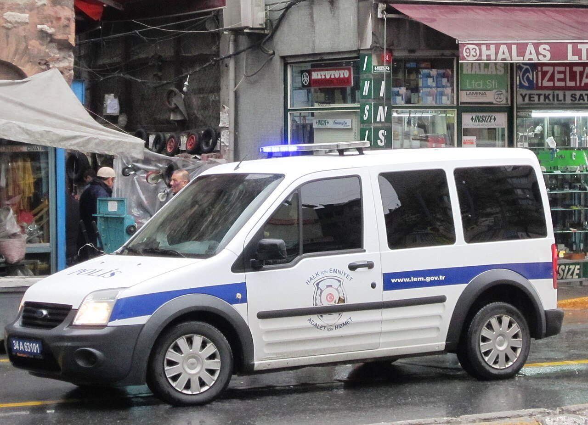

> İki adreste yapılan aramalarda hap, sentetik uyuşturucu ve kaçak içki ele geçirildi.

Eskişehir'de kaçak ve sahte alkol ticareti yaparak halk sağlığını tehlikeye düşürdükleri belirlenen şüphelilere yönelik operasyon yapıldı. Çalışma Eskişehir Cumhuriyet Başsavcılığı koordinesinde İl Emniyet Müdürlüğü Kaçakçılık ve Organize Suçlarla Mücadele Şubesi ekiplerince yürütüldü.

İki adreste yapılan aramalarda 12 bin 460 yeşil reçeteye tabi hap, 3 bin 380 gram sentetik uyuşturucu ve 61 şişe kaçak ve sahte alkollü içki ele geçirildi. Bir şüpheli gözaltına alındı. Diğer şüphelinin ise uyuşturucu veya uyarıcı madde imal ve ticareti suçundan cezaevinde bulunduğu belirlendi. Soruşturmanın sürdüğü bildirildi.

---

## Eskişehir Model Fabrika'da 9. Öğren Dönüş Programı'nın ikinci aşaması yapıldı

**Ekonomi · Merkez** · 2026-10-23 13:33 UTC · Kaynak: [Google Haberler - Eskişehir](https://www.gzt26.com/eskisehir-sanayi-odasina-bagli-eskisehir-model-fabrikadan-firmalara-onemli-destek)

> Katılımcılara performans takibi, yalın üretim ve Just in Time konularında uygulamalı eğitim verildi.

Eskişehir Sanayi Odası'na bağlı Eskişehir Model Fabrika'da düzenlenen 9. Öğren Dönüş Programı'nın ikinci aşaması gerçekleştirildi. Katılımcılara üretimde verimliliğin artırılması, performansın takip edilmesi ve süreçlerin iyileştirilmesine yönelik uygulamalı eğitimler verildi.

Eğitimlerde Performans Panosu, standart operasyon prosedürleri (SOP), tam zamanında üretim (Just in Time) yaklaşımı ve Yamazumi çalışmaları ele alındı; SOCT uygulamaları doğrudan üretim hattında gözlemlendi. Programın sonraki aşamalarında firmaların öğrendikleri yöntemleri kendi pilot üretim alanlarında uygulamaları amaçlanıyor.

---

## Tepebaşı'nda 440 lise öğrencisine iklim krizi ve COP31 anlatıldı

**Eğitim · Tepebaşı** · 2026-10-23 12:33 UTC · Kaynak: [Tepebaşı Belediyesi](https://www.tepebasi.bel.tr/Haber/Detay/440ogrenciiklimkrizivecop31’ikonustu)

> Özel Atayurt ve Özel Çağdaş Okulları'nın 9. ve 10. sınıf öğrencilerine sunum yapıldı.

Tepebaşı Belediyesi İklim Değişikliği ve Sıfır Atık Müdürlüğü, Özel Atayurt Okulları ve Özel Çağdaş Okulları'nın lise öğrencilerine "Gezegenin Geleceği ve İklim Uzlaşmaları: COP31" başlıklı sunum yaptı. Sunuma 9. ve 10. sınıflardan toplam 440 öğrenci katıldı.

Sunumda iklim krizinin nedenleri ve günlük yaşama etkileri, sera gazları, Dünya Limit Aşım Günü, su kaynaklarının korunması, su ayak izi ve kentsel ısı adası etkisi ele alındı. Rio Zirvesi'nden Kyoto Protokolü ve Paris Anlaşması'na uzanan süreç, 1,5 derece hedefi ve Taraflar Konferansı'nın işleyişi anlatıldı.

Sunumun ardından düzenlenen interaktif oyunda başarılı olan üç öğrenciye not defteri ve kalem hediye edildi.

---

## Sarıcakaya'da Dorlion zeytinyağı için erken hasat tamamlandı

**Tarım · Sarıcakaya** · 2026-10-23 12:33 UTC · Kaynak: [Google Haberler - Eskişehir gündem](https://www.urfadabugun.com/haber/263840/eskisehirde-dorlion-zeytinyaginda-erken-hasat-tamamlandi.html)

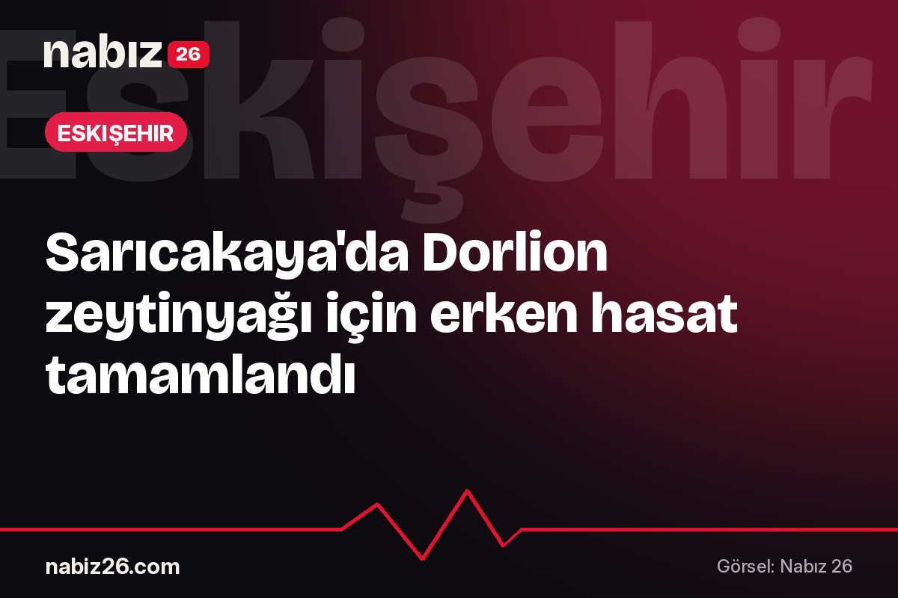

> Dorlion Özel Seri, 19. Natürel Sızma Zeytinyağı Kalite Yarışması'nda Premium Ödülü kazanmıştı.

Eskişehir Büyükşehir Belediyesi'nin Sarıcakaya ilçesinde sürdürülebilir yöntemlerle yürüttüğü zeytinyağı üretiminde erken hasat dönemi sona erdi. Sarıcakayalı çiftçilerin topladığı zeytinler, Tarımsal Hizmetler Dairesi Başkanlığı tarafından natürel sızma zeytinyağına dönüştürüldü.

Eskişehir Orta Sakarya Vadisi Zeytinciliği Geliştirme Projesi kapsamında Dorlion Özel Seri için toplanan zeytinler, Sarıcakaya Zeytin Üreticileri Birliği aracılığıyla belediyeye teslim edildi. Zeytinler hava ile teması en aza indirilerek soğuk sıkım yöntemiyle işlendi.

Dorlion Özel Seri zeytinyağı, 19. Natürel Sızma Zeytinyağı Kalite Yarışması'nda Premium Ödülü kazandı. Büyükşehir, projeyle çiftçilerin üretimini desteklemeyi ve yerel tarım ürünlerine katma değer kazandırmayı amaçlıyor.

---

## Odunpazarı Mesleki Eğitim Merkezi öğrencileri çorba ikram ederek dayanışma etkinliği yaptı

**Eğitim · Odunpazarı** · 2026-10-23 12:33 UTC · Kaynak: [Google Haberler - Odunpazarı](https://www.anadolugazetesi.com/amp/odunpazari-mesem-den-anlamli-dayanisma-etkinligi-296875.html)

> Etkinlikte "Bir tas çorba, bin tebessüm" mesajı verildi.

Odunpazarı Mesleki Eğitim Merkezi (OMEM), öğrencilerin sosyal sorumluluk bilincini geliştirmeye yönelik bir etkinlik düzenledi. Okul Müdürü Erhan Aksu'nun katkıları, öğretmenlerin rehberliği ve öğrencilerin çalışmasıyla hazırlanan çorba, paylaşma ve dayanışma amacıyla ikram edildi.

Etkinlikle öğrencilerin empati, yardımlaşma ve sorumluluk bilinci kazanmasına katkı sunulması hedeflendi. OMEM ailesi etkinliğin mesajını "Bir tas çorba, bin tebessüm! Paylaştıkça çoğalır, dayanışmayla güçleniriz" sözleriyle özetledi.

---

## Mukaddes Emanetler Sergisi Eskişehir'de açıldı, vatandaşlar kuyruk oluşturdu

**Kültür-Sanat · Merkez** · 2026-10-23 12:33 UTC · Kaynak: [Google Haberler - Eskişehir etkinlik](https://www.sakaryagazetesi.com.tr/mukaddes-emanetleri-gorebilmek-icin-metrelerce-kuyruk-olusturdular)

> 150'nin üzerinde emanetin yer aldığı sergi İl Kültür Müdürlüğü Sergi Salonu'nda.

Asrı Saadet'ten Osmanlı'ya ve günümüze uzanan 150'nin üzerinde kutsal emaneti Eskişehirlilerle buluşturan Mukaddes Emanetler Sergisi, Eskişehir İl Kültür Müdürlüğü Sergi Salonu'nda dün açıldı. Sergi, koleksiyoncu Erol Güzel ile MÜSİAD Eskişehir Şubesi iş birliğiyle düzenlendi.

Sergide Peygamber Efendimizin Sakal-ı Şerif'i ve Saç-ı Şerifi, Kabe-i Muazzama örtüleri, dünyanın en büyük ikinci el yazma Kur'an-ı Kerim'i, Ehl-i Beyt ve evliyalara ait emanetler yer alıyor. Mukaddes emanetlerin Eskişehir'de ilk kez bu kadar geniş kapsamda sergilendiği belirtildi. Sergiyi görmek isteyen vatandaşlar sergi salonunun önünde metrelerce kuyruk oluşturdu.

---

## Kız Anadolu İmam Hatip Lisesi'nde açılacak 4-6 yaş Kur'an kursunun hazırlıkları incelendi

**Eğitim · Merkez** · 2026-10-23 12:33 UTC · Kaynak: [Google Haberler - Eskişehir](https://yerel-haberler.haberturk.com/eskisehir-haberleri/eskisehirde-d-tipi-4-6-yas-kuran-kursu-hazirliklari-incelendi-119501366)

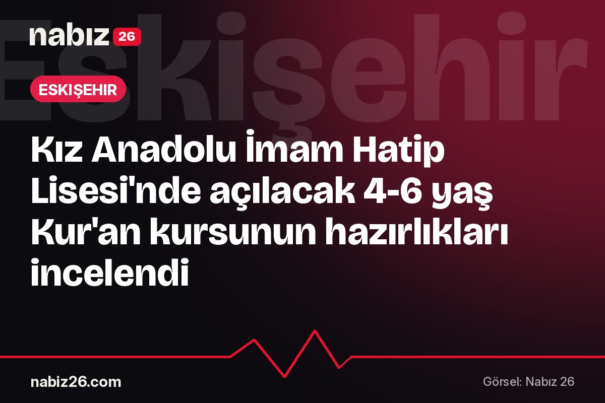

> İl Millî Eğitim Müdürü Aydın ve İl Müftüsü Gül, kurs alanını yerinde gördü.

Eskişehir İl Millî Eğitim Müdürü Sinan Aydın ve İl Müftüsü Muharrem Gül, Eskişehir Kız Anadolu İmam Hatip Lisesi bünyesinde açılması planlanan D Tipi 4-6 Yaş Kur'an Kursu'nun hazırlık çalışmalarını yerinde inceledi.

Heyet, kurs alanını ziyaret ederek Okul Müdürü Hasan Kaymakçı'dan hazırlık süreci ve kursun fiziki şartları hakkında bilgi aldı.

---

## Kılıçdaroğlu, Lüksemburg Temsilciler Meclisi Başkanı Wiseler'i kabul etti

**Siyaset · Türkiye** · 2026-10-23 12:33 UTC · Kaynak: [Google Haberler - CHP](https://ankahaber.net/haber/kemal-kilicdaroglu-luksemburg-temsilciler-meclisi-baskani-wiseler-ile-gorustu-09b1c067)

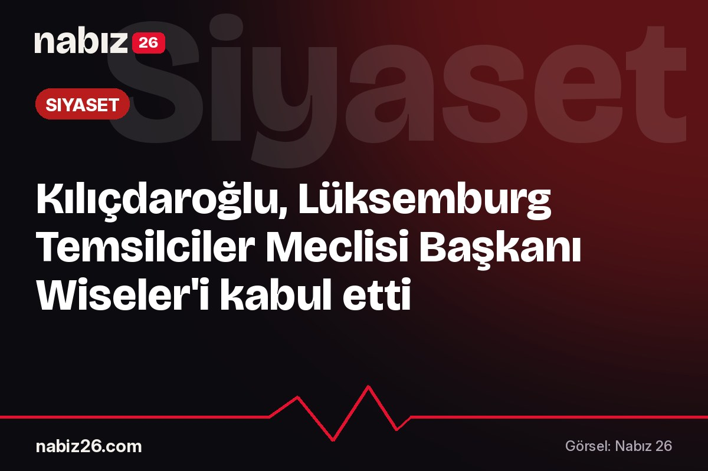

> Görüşme CHP Genel Merkezi'nde, çok partili heyetle yapıldı.

CHP Genel Başkanı Kemal Kılıçdaroğlu, Lüksemburg Temsilciler Meclisi Başkanı Claude Wiseler başkanlığındaki çok partili heyetle CHP Genel Merkezi'nde bir araya geldi.

---

## Halk Dansları Topluluğu ilk gösterisini yaptı: Ünlüce "hayalim gerçek oldu" dedi

**Kültür-Sanat · Merkez** · 2026-10-23 12:33 UTC · Kaynak: [Google Haberler - Eskişehir gündem](https://www.istikbalgazetesi.com/ayse-unluce-en-buyuk-hayalini-gerceklestirdigini-acikladi)

> "Eskiden Şehre Dorlion Zamanın Dansı" Eskişehir Yılı 2026 kapsamında sahnelendi.

Eskişehir Büyükşehir Belediyesi bünyesinde oluşturulan halk dansları topluluğu, 2026 Eskişehir Yılı etkinlikleri kapsamındaki "Eskiden Şehre Dorlion Zamanın Dansı" gösterisiyle ilk performansını sergiledi. Gösteride kentin geçmişten Cumhuriyet'e uzanan tarihi müzik ve dansla anlatıldı.

Büyükşehir Belediye Başkanı Ayşe Ünlüce, sosyal medya hesabından yaptığı paylaşımda yıllardır güçlü bir halk dansları topluluğu hayal ettiğini, ekibin ilk gösterisiyle bu hayalin gerçeğe dönüştüğünü söyledi. Ünlüce, emeği geçenlere teşekkür ederek topluluğun gelecekte de kentin kültürünü sahneye taşımasını diledi.

---

## ESMEK'ten müzede "Ben Bir İlmek Biz Bir Motif" yaratıcı drama atölyesi

**Kültür-Sanat · Merkez** · 2026-10-23 12:33 UTC · Kaynak: [Google Haberler - Eskişehir etkinlik](https://www.istikbalgazetesi.com/eskisehirde-muzede-anlamli-etkinlik-kadin-emegi-ve-dayanisma-ele-alindi)

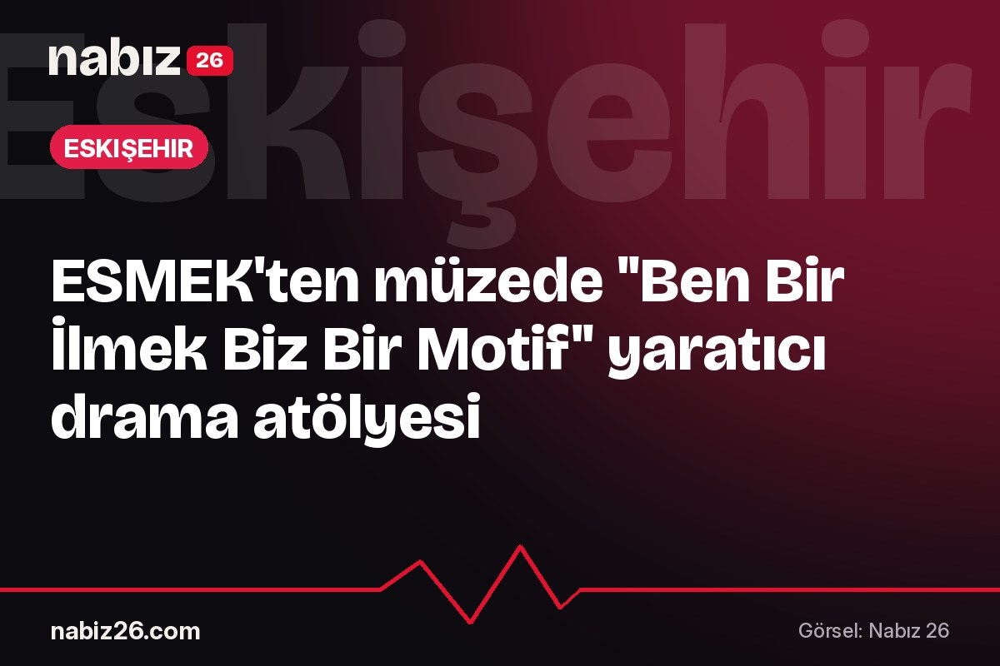

> Atölyede müze koleksiyonundaki eserlerden yola çıkılarak kadın emeği ve dayanışma ele alındı.

Eğitmen Aslıhan Aslan yürütücülüğünde düzenlenen "Ben Bir İlmek Biz Bir Motif – Müzede Yaratıcı Drama Atölyesi"nde farklı kuşaklardan katılımcılar bir araya geldi.

Atölyede müze koleksiyonundaki eserlerden yola çıkılarak kadın emeği, toplumsal roller ve ortak yaşam deneyimleri yaratıcı drama çalışmalarıyla ele alındı. Canlandırma, grup çalışmaları ve hikâye oluşturma etkinlikleriyle katılımcılar kadın dayanışması ve toplumsal eşitsizlikler üzerine düşündü. ESMEK, Kültür ve Düşünce Buluşmaları kapsamında farklı temalarda etkinlikler düzenlemeye devam edecek.

---

## Eskişehir'de minibüslere zabıta, emniyet ve Şoförler Odası ortak denetim yaptı

**Ulaşım · Merkez** · 2026-10-23 12:33 UTC · Kaynak: [Google Haberler - Eskişehir](http://yozgatgazetesi.com/iha-haberleri/eskisehir-de-minibueslere-ortak-denetim-292345.html)

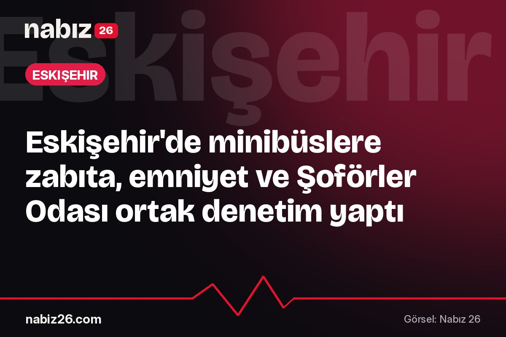

> Denetimde güzergâh, yolcu kapasitesi, sefer saatleri ve çalışma ruhsatları kontrol edildi.

Eskişehir Büyükşehir Belediyesi Zabıta Dairesi Başkanlığı trafik zabıta ekipleri, Eskişehir Emniyet Müdürlüğü ve Eskişehir Şoförler Odası iş birliğiyle kent genelinde minibüslere yönelik denetim yaptı.

Denetimlerde minibüslerin güzergâhlarına uygun hareket edip etmediği, yolcu kapasitesine uyulup uyulmadığı, sefer saatleri ve çalışma ruhsatları kontrol edildi. Büyükşehir, denetimlerin düzenli olarak sürdüreceğini belirtti.

Minibüslerle ilgili talep, öneri ve şikâyetlerini iletmek isteyen vatandaşlar 153 İç Çağrı Merkezi aracılığıyla yetkililere ulaşabiliyor.

---

## Başkan Ataç muhtarlarla buluştu: "Ekonomik kriz belediyeleri de etkiliyor"

**Belediye · Tepebaşı** · 2026-10-23 12:33 UTC · Kaynak: [Google Haberler - Tepebaşı](https://www.gzt26.com/tepebasi-belediye-baskani-ahmet-atac-ekonomik-kriz-belediyeleri-de-etkiliyor)

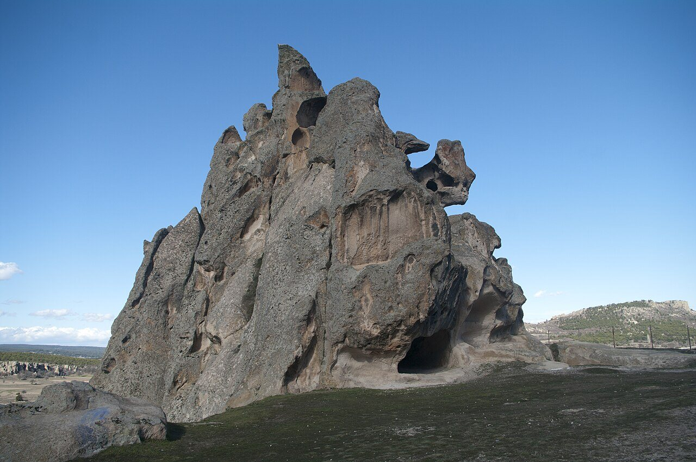

> 19 Ekim Muhtarlar Günü kahvaltısına 81 muhtar katıldı; Odunpazarı Muhtarlar Derneği Başkanı Gürdoğan anıldı.

Tepebaşı Belediyesi, 19 Ekim Muhtarlar Günü dolayısıyla ilçede görev yapan 81 muhtarı kahvaltı programında ağırladı. Programa Büyükşehir Belediyesi Başkanvekili Hasan Ünal, belediye meclis üyeleri, başkan yardımcıları ve birim müdürleri de katıldı. Başkan Ahmet Ataç muhtarlarla tek tek görüştü.

Programda, 19 Ekim'de yaşamını yitiren Odunpazarı Muhtarlar Derneği Başkanı ve Orta Mahalle Muhtarı Erol Erdal Gürdoğan anıldı. Ataç, Gürdoğan'ın ailesine başsağlığı diledi.

Ataç, 1999'dan bu yana muhtarlarla yakın çalıştıklarını söyledi. Ekonomik koşullara değinen Ataç, "Son yıllarda yaşanan enflasyon ve ekonomik kriz, herkes gibi belediyeleri de etkiliyor" dedi. Yaklaşık 400 bin kişiye hizmet verdiklerini hatırlatan Ataç, zorluklara rağmen ciddi bir sıkıntı yaşamadan bugüne geldiklerini, eksiklerin birlikte çözüleceğini söyledi.

Buluşmada ayrıca mobil fotoğrafçılık eğitimi alan 50 muhtarın mahallelerinde çektiği fotoğrafların bir araya getirildiği "Muhtarın Gözünden Mahallem" projesi tanıtıldı.

---

## Tepebaşı'nda dönüş yapan otomobil bisikletliye çarptı, bisikletli hafif yaralandı

**Gündem · Tepebaşı** · 2026-10-23 11:33 UTC · Kaynak: [Google Haberler - Eskişehir asayiş](https://www.eskisehirekspres.net/eskisehirde-kaza-donus-yapmak-istedi-bisiklet-yolunda-surucuyu-onune-katti)

> Kaza güvenlik kamerasına yansıdı; bisikletli hastaneye kaldırıldı.

Tepebaşı ilçesi Mustafa Kemal Paşa Mahallesi Sivrihisar-1 Caddesi üzerinde kaza yaşandı. Edinilen bilgilere göre sürücü İ.E. yönetimindeki otomobil, Şenlik Sokak'a dönmek için manevra yaptığı sırada bisiklet yolunda ilerleyen bisiklete çarptı. Otomobilin bisikletin ön tekerleği üzerinden geçtiği anlar güvenlik kamerasına yansıdı.

Hafif sıyrıklarla atlattığı belirtilen bisikletli, olay yerine gelen sağlık ekiplerinin ilk müdahalesinin ardından hastaneye kaldırıldı. Polis ekipleri kazayla ilgili inceleme başlattı.

---

## Tarım Bakanlığı listesine göre 11 markanın sucuk baharatında yasaklı boya çıktı

**Türkiye · Türkiye** · 2026-10-23 11:33 UTC · Kaynak: [Google Haberler - Bakanlıklar](https://www.yenicaggazetesi.com/tarim-ve-orman-bakanligi-acikladi-11-markanin-sucuk-baharatinda-yasakli-boya-cikti-1084441h.htm)

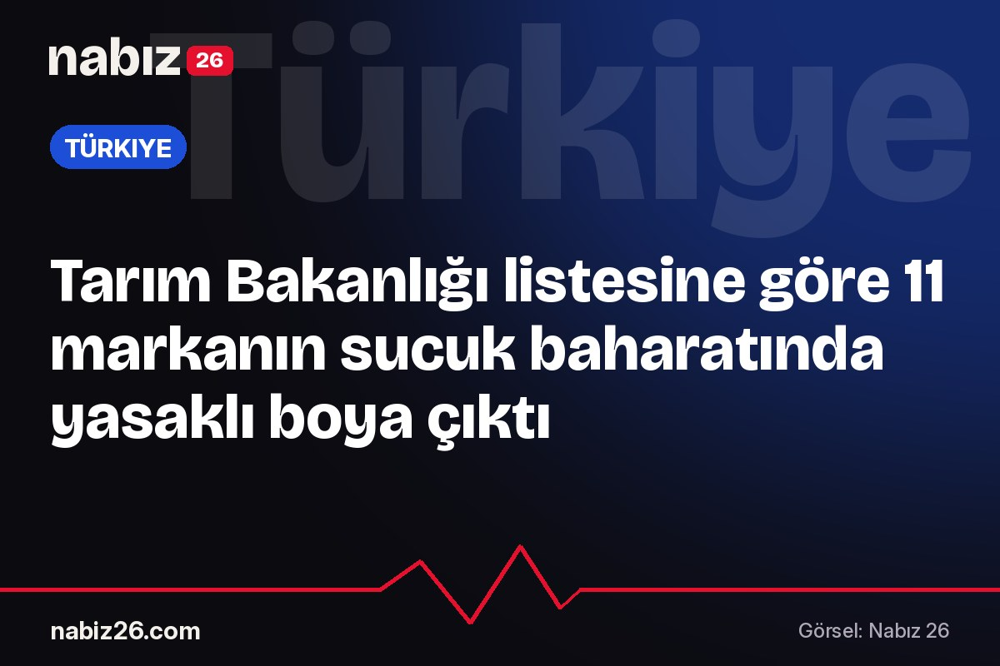

> Ürünler "Sağlığı Tehlikeye Düşürecek Gıdalar" kategorisinde 22 Ekim'de güncellenen listede yer aldı.

Tarım ve Orman Bakanlığı'nın gıda denetimlerinde sucuk üretiminde kullanılan baharatlarla ilgili mevzuata aykırı bir durum tespit edildi. Analizlerde gıda üretiminde kullanılmasına izin verilmeyen bir boya maddesi bulunan 11 markanın sucuk baharatı, tüketici sağlığı açısından risk taşıyan ürünler arasına alındı.

Bakanlığın 22 Ekim 2026'da yenilenen listesinde ürünler "Sağlığı Tehlikeye Düşürecek Gıdalar" kategorisinde kamuoyuna duyuruldu. Uygulamayla tüketicilerin piyasadaki gıdalar hakkında bilgi sahibi olması amaçlanıyor.

---

## İletişim Başkanı Duran'dan Zonguldak'taki maden ocağı kazası için taziye mesajı

**Türkiye · Türkiye** · 2026-10-23 11:33 UTC · Kaynak: [İletişim Başkanlığı](https://www.iletisim.gov.tr/turkce/haberler/detay/iletisim-baskani-durandan-zonguldakta-maden-ocaginda-meydana-gelen-gocuk-nedeniyle-taziye-mesaji)

> Duran, Kilimli'deki kazada hayatını kaybeden madencilere rahmet, yaralılara şifa diledi.

Cumhurbaşkanlığı İletişim Başkanı Burhanettin Duran, NSosyal hesabından yaptığı paylaşımla Zonguldak'ın Kilimli ilçesindeki bir maden ocağında meydana gelen kazada hayatını kaybeden işçiler için taziye dileklerini iletti.

Duran, mesajında hayatını kaybeden madencilere Allah'tan rahmet, ailelerine ve yakınlarına sabır ve başsağlığı diledi. Kazada yaralanan madencilere acil şifalar temenni etti. Duran, ilgili kurumların olay yerinde gerekli müdahale ve inceleme çalışmalarını titizlikle yürüttüğünü belirtti.

---

## Eskişehir'de kadınların siyasi temsili için AllyGround eğitim programı yapıldı

**Belediye · Merkez** · 2026-10-23 11:33 UTC · Kaynak: [Google Haberler - Eskişehir](https://ankahaber.net/haber/eskisehir-de-kadinlarin-siyasi-temsili-icin-ortak-calisma-b420ef99)

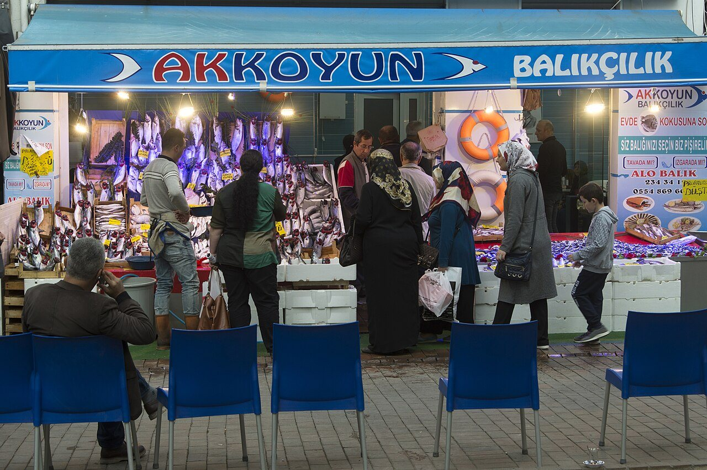

> Büyükşehir, 1984 Derneği ve İsveç Başkonsolosluğu iş birliğindeki iki günlük program Haller Gençlik Merkezi'nde düzenlendi.

Eskişehir Büyükşehir Belediyesi, 1984 Derneği (D84) ve İstanbul İsveç Başkonsolosluğu iş birliğiyle yürütülen "AllyGround - Kadınların Siyasi Yolculuğunu Destekleme Projesi" kapsamında iki günlük eğitim programı düzenledi. Program Haller Gençlik Merkezi Frigya Salonu'nda yapıldı.

Programla kadınların yerel siyasette daha güçlü temsil edilmesi, toplumsal cinsiyet eşitliğinin güçlendirilmesi ve farklı siyasi görüşler arasında dayanışmanın artırılması amaçlandı. Açılış konuşmasını Büyükşehir Genel Sekreter Yardımcısı Nergiz Abacı yaptı. Abacı, kadınların siyasette güçlü temsilinin demokratik bir toplumun temel koşullarından biri olduğunu söyledi.

Programa belediye meclis üyeleri, siyasi parti temsilcileri, kadın siyasetçiler, partilerin kadın ve gençlik kollarında görev alanlar ile sivil toplum kuruluşlarının temsilcileri katıldı. Eğitimlerde kadınların siyasi alanda karşılaştığı engellerin aşılması, liderlik ve dayanışma becerileri ele alındı.

---

## CHP Sözcüsü Sarı Gaziantep'te: Seçimlerde birlikte hareket etmenin önemini vurguluyoruz

**Siyaset · Türkiye** · 2026-10-23 11:33 UTC · Kaynak: [Google Haberler - CHP](https://yerel-haberler.haberturk.com/gaziantep-haberleri/chp-genel-baskan-yardimcisi-ve-parti-sozcusu-sari-gaziantepte-konustu-119501308)

> Sarı, belediye başkanlarına yönelik soruşturmalara ilişkin CHP Gaziantep İl Başkanlığı'nda açıklama yaptı.

CHP Genel Başkan Yardımcısı ve Parti Sözcüsü Müslim Sarı, CHP Gaziantep İl Başkanlığı'nda düzenlediği basın toplantısında belediye başkanlarına yönelik soruşturmalar ve siyasi gelişmeleri değerlendirdi.

Sarı, siyaseten ayrıştıkları arkadaşları olsa bile özellikle Cumhur İttifakı'na karşı, operasyonlardan sonra ortaya çıkacak seçimlerde birlikte hareket etmenin önemini vurguladıklarını söyledi. Belediye başkanlarının tutuksuz yargılanabileceğini belirten Sarı, tutuklamanın bir cezalandırma yöntemine dönüşmemesi gerektiğini ifade etti. Çukurova ve Milas'taki adli süreçleri takip ettiklerini, Milas Belediye Başkanı'nın adli kontrolle serbest bırakılmasını beklediklerini kaydetti.

Sarı ayrıca CHP'nin geçmişte diğer partilerle iş birliği yaptığını, ancak "sabrımızın bir sınırı var" diyerek partinin kurumsal kimliğini önceleyeceklerini söyledi.

---

## Bakan Bayraktar: Dünyanın enerjide belirsizliğe değil, güvenilir ortaklıklara ihtiyacı var

**Ekonomi · Türkiye** · 2026-10-23 11:33 UTC · Kaynak: [Enerji ve Tabii Kaynaklar Bakanlığı](https://enerji.gov.tr/haber-detay?id=31952)

> Bayraktar, İstanbul'daki 19. Verona Avrasya Ekonomik Forumu'nda konuştu.

Enerji ve Tabii Kaynaklar Bakanı Alparslan Bayraktar, İstanbul'da düzenlenen 19. Verona Avrasya Ekonomik Forumu'nda konuştu. Bayraktar, dünyanın enerjide daha fazla belirsizliğe değil, daha fazla iş birliğine, yatırıma ve güvenilir ortaklıklara ihtiyacı olduğunu söyledi; Türkiye'nin buna katkı sunmaya hazır olduğunu belirtti.

Bayraktar, ekonomilerin enerji güvenliğini sağlamak, büyüyen talebi karşılamak ve enerji dönüşümünü gerçekleştirmek şeklinde üç temel sınamayla karşı karşıya olduğunu ifade etti. Yanıtın çeşitlendirme, enerjiye yatırım ve daha geniş uluslararası iş birliği olduğunu söyledi.

Bakan, son 10 yılda günlük LNG gazlaştırma kapasitesini yaklaşık 30 milyon metreküpten 160 milyon metreküpe çıkardıklarını, doğal gaz depolama kapasitesini 15 milyar metreküpe ulaştırmak için çalışmaya devam ettiklerini aktardı. Türkiye'nin üretici ve tüketici ülkeleri birbirine bağlayan önemli bir enerji merkezi konumunda olduğunu vurguladı.

---

## Altın fiyatları 23 Ekim 2026: Gram altın 6.468,55 TL

**Ekonomi · Merkez** · 2026-10-23 10:43 UTC · Kaynak: [Harem Altın](https://www.haremaltin.com/altin-fiyatlari)

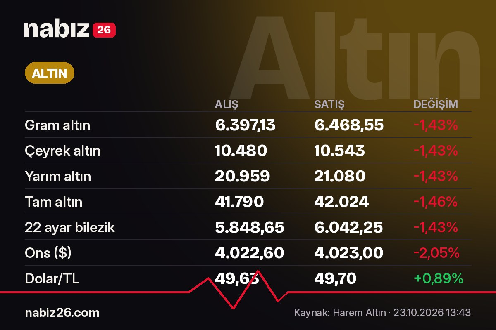

> Gram altın güne düşüşle başladı. Harem Altın verilerine göre gram altın 6.397,13 TL'den alınıyor, 6.468,55 TL'den satılıyor.

Altın piyasasında güne düşüşle başlandı. Harem Altın'ın saat 13.43 itibarıyla verilerine göre gram altının satış fiyatı 6.468,55 TL, alış fiyatı 6.397,13 TL oldu. Gram altın, önceki kapanışa göre yüzde 1,43 geriledi.

Ziynet altınlarda çeyrek altın 10.543 TL, yarım altın 21.080 TL, tam altın 42.024 TL, ata altın 42.778 TL seviyesinden satışa sunuluyor.

22 ayar bileziğin gram satış fiyatı 6.042,25 TL, has altının gram fiyatı 6.449,20 TL olarak belirlendi.

Uluslararası piyasalarda altının onsu 4.023,00 dolardan işlem görürken, dolar/TL 49,70 seviyesinde bulunuyor.

Fiyatlar Harem Altın'ın saat 13.43 itibarıyla paylaştığı verilere dayanmaktadır; kuyumcular arasında farklılık gösterebilir. Bu haber yatırım tavsiyesi değildir.

---

## Türkiye 2027'de 14 ülkede 16 uluslararası turizm fuarına katılacak

**Türkiye · Türkiye** · 2026-10-23 10:34 UTC · Kaynak: [Google Haberler - Bakanlıklar](https://www.turizmaktuel.com/haber/bakanlik-2027-de-katilacagi-uluslararasi-turizm-fuarlarini-acikladi)

> Kültür ve Turizm Bakanlığı ile TGA'nın takvimine göre ilk fuar Ocak'ta Madrid'de.

Kültür ve Turizm Bakanlığı ile Türkiye Turizm Tanıtım ve Geliştirme Ajansı (TGA) koordinasyonunda hazırlanan takvime göre Türkiye, 2027 yılında 14 ülkede düzenlenecek 16 uluslararası turizm ihtisas fuarında yer alacak.

Program İspanya, Almanya, Rusya, Hindistan, Çin, Birleşik Arap Emirlikleri, Japonya, ABD ve İngiltere gibi pazarları kapsıyor. Yılın ilk büyük organizasyonu 20-24 Ocak'ta Madrid'de yapılacak FITUR 2027 olacak. Program, aralık ayında Fransa'nın Cannes kentinde düzenlenmesi planlanan lüks turizm fuarı ILTM Cannes ile tamamlanacak. Türkiye standına oteller, seyahat acenteleri, tur operatörleri ve hava yolu şirketleri de katılabilecek.

---

## TÜİK: Yükseköğretim beyin göçünde Eskişehir 2025'te dördüncü sırada

**Gündem · Merkez** · 2026-10-23 10:34 UTC · Kaynak: [Google Haberler - Eskişehir gündem](https://www.eskisehirekspres.net/eskisehirde-dikkat-ceken-beyin-gocu-tablosu-ilk-5-sehir-arasinda)

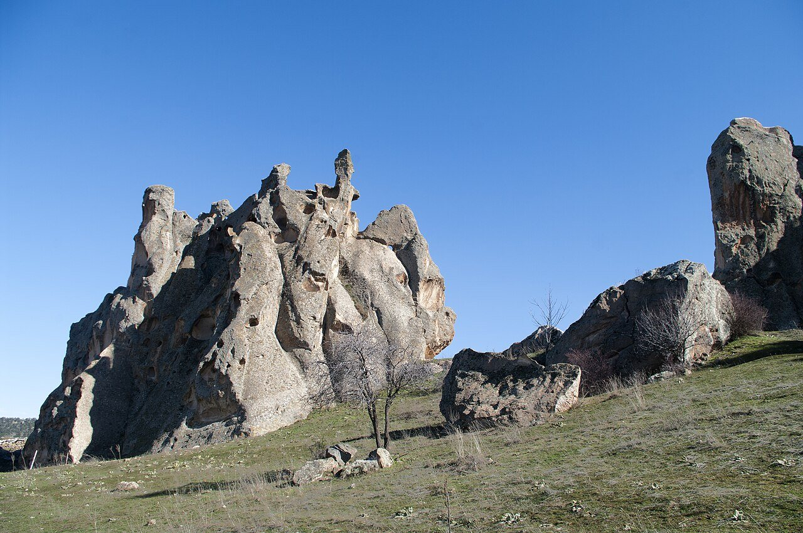

> Beyin göçü oranı Türkiye genelinde yüzde 2,2'ye çıktı; ilk üç sırada İstanbul, İzmir ve Ankara var.

Türkiye İstatistik Kurumu (TÜİK), 2025 yılı Yükseköğretim Beyin Göçü İstatistikleri'ni açıkladı. Yükseköğretim mezunlarının beyin göçü oranı bir önceki yıla göre artarak yüzde 2,2 oldu. Oran kadınlarda yüzde 1,8, erkeklerde yüzde 2,7 olarak gerçekleşti.

Beyin göçünün en yüksek olduğu il yüzde 4,0 ile İstanbul oldu. İstanbul'u sırasıyla İzmir, Ankara, Eskişehir ve Yalova izledi. Erkeklerde Eskişehir yüzde 2,9 ile dördüncü, kadınlarda yüzde 1,7 ile yine dördüncü sırada yer aldı. En düşük oran yüzde 0,2 ile Siirt'te görüldü.

Devlet üniversitesi mezunlarında oran 2025'te yüzde 1,9, vakıf üniversitesi mezunlarında yüzde 4,4 oldu. En yüksek beyin göçü oranı yüzde 7,0 ile bilişim ve iletişim teknolojileri alanında görüldü.

---

## TOGG, COP31'in "Mobilite Sektör Ortağı" oldu

**Ekonomi · Türkiye** · 2026-10-23 10:34 UTC · Kaynak: [Google Haberler - Togg](https://www.ekonomidunya.com/togg-cop31in-mobilite-sektor-ortagi-oldu/114052)

> TOGG, zirvede elektrikli mobilitenin iklim hedeflerine katkısını anlatacak.

TOGG, Türkiye'nin ev sahipliğinde yapılacak Birleşmiş Milletler İklim Değişikliği Çerçeve Sözleşmesi 31. Taraflar Konferansı'nın (COP31) "Mobilite Sektör Ortağı" oldu. Bilgi, TOGG'un yaptığı açıklamaya dayanıyor.

Kamu, özel sektör, uluslararası kuruluşlar, akademi ve sivil toplum temsilcilerini bir araya getirecek zirvede TOGG, elektrikli mobiliteye geçişin iklim hedeflerine katkısını, bu dönüşümü destekleyen enerji ve dijital hizmetlerle birlikte ortaya koyacak. Üretimden günlük kullanıma uzanan uygulamalarını paylaşacak, uluslararası paydaşlarla yeni iş birlikleri geliştirmeyi amaçlayacak.

TOGG Yönetim Kurulu Başkanı Fuat Tosyalı, Türkiye'nin COP31'e ev sahipliği yaparak iklim değişikliğiyle mücadelede küresel sorumluluk üstlenme iradesini gösterdiğini belirtti.

---

## Tepebaşı'nda Kızılinler bal kabağıyla rulo pasta ve irmikli baklava atölyesi yapıldı

**Kültür-Sanat · Tepebaşı** · 2026-10-23 10:34 UTC · Kaynak: [Google Haberler - Tepebaşı](https://www.sakaryagazetesi.com.tr/bal-kabagindan-sasirtan-lezzetler)

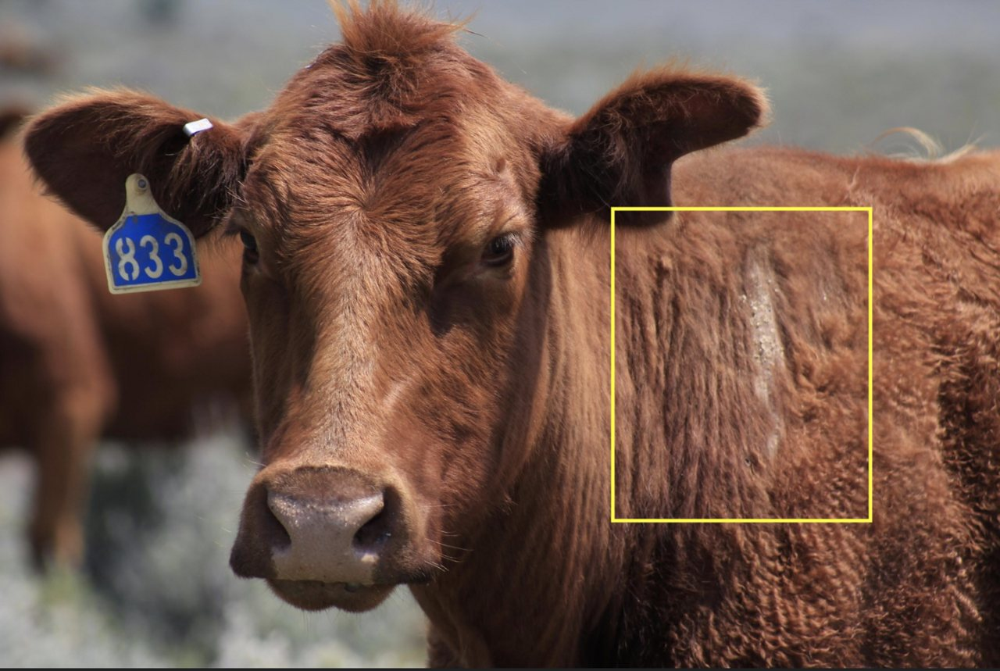

> Etkinlik, 25 Ekim'deki 4. Kızılinler Bal Kabağı Panayırı öncesinde düzenlendi.

Tepebaşı Belediyesi'nin düzenleyeceği 4. Kızılinler Bal Kabağı Panayırı ve Eskişehir Bal Kabağı Çalıştayı öncesinde Mutfak Atölyesi'nde özel bir etkinlik yapıldı. Eskişehir Aşçılar Derneği iş birliğiyle düzenlenen atölyede üretici kadınlar, kendi yetiştirdikleri Kızılinler bal kabaklarını şeflerle birlikte farklı tariflerde değerlendirdi; bal kabağından rulo pasta ve irmikli baklava hazırlandı.

Pastacı Şef Fatma Kurga Kök, bal kabağı püresini rulo pastada kullandıklarını ve çocukların da severek tüketebileceği, katkı maddesi içermeyen bir tarif geliştirdiklerini söyledi. Eskişehir Aşçılar Derneği Başkanı Kemal Kaya, coğrafi işaretli Kızılinler bal kabağının farklı ürünlere dönüştürülmesinin önemine dikkat çekti.

Tepebaşı Belediyesi yetkilileri vatandaşları 25 Ekim Pazar günü yapılacak panayıra ve 26 Ekim'deki Eskişehir Bal Kabağı Çalıştayı'na davet etti. Çalıştayın Türkiye'de ilk kez ulusal ölçekte düzenleneceği belirtildi.

---

## SAS2027 Sıfır Atık ve Sürdürülebilirlik Yarışması için başvurular 15 Ocak'a kadar

**Eğitim · Türkiye** · 2026-10-23 10:34 UTC · Kaynak: [Eskişehir İl Milli Eğitim Müdürlüğü](https://eskisehir.meb.gov.tr/www/uluslararasi-sifir-atik-ve-surdurulebilirlik-yarismasi-duzenlenecek/icerik/8687/tr)

> Yarışma "Atıktan Sanata", "Görsel Tasarım" ve "Yaşayan Okul Bahçeleri" kategorilerinde yapılacak.

Öğrencilerin sıfır atık, geri dönüşüm ve sürdürülebilirlik konularında farkındalık kazanması hedefiyle "SAS2027 Uluslararası Sıfır Atık ve Sürdürülebilirlik Yarışması" düzenlenecek. Başvurular 15 Ocak 2027 tarihine kadar yapılabilecek.

Yarışma üç kategoride yapılacak. "Atıktan Sanata" kategorisine yurt içindeki okullarda öğrenim gören tüm kademelerdeki öğrenciler katılabilecek. "Görsel Tasarım" kategorisi yurt içi ve yurt dışındaki ortaokul ve lise öğrencilerine, "Yaşayan Okul Bahçeleri" kategorisi ise yurt içi ve yurt dışındaki okullara açık olacak.

Türkçe ve İngilizce yürütülecek yarışma, yurt dışındaki eğitim temsilcilikleri, Türkiye Maarif Vakfı ve kardeş okullar aracılığıyla uluslararası katılıma da açılacak.

---

## Odunpazarı Gündoğdu'nda kavşakta kaza: Muhtar tümsek ve trafik aynası istedi

**Gündem · Odunpazarı** · 2026-10-23 10:34 UTC · Kaynak: [Google Haberler - Eskişehir asayiş](https://www.eskisehirhaber.com/eskisehirde-korkutan-kaza-sonrasi-muhtardan-onemli-cagri)

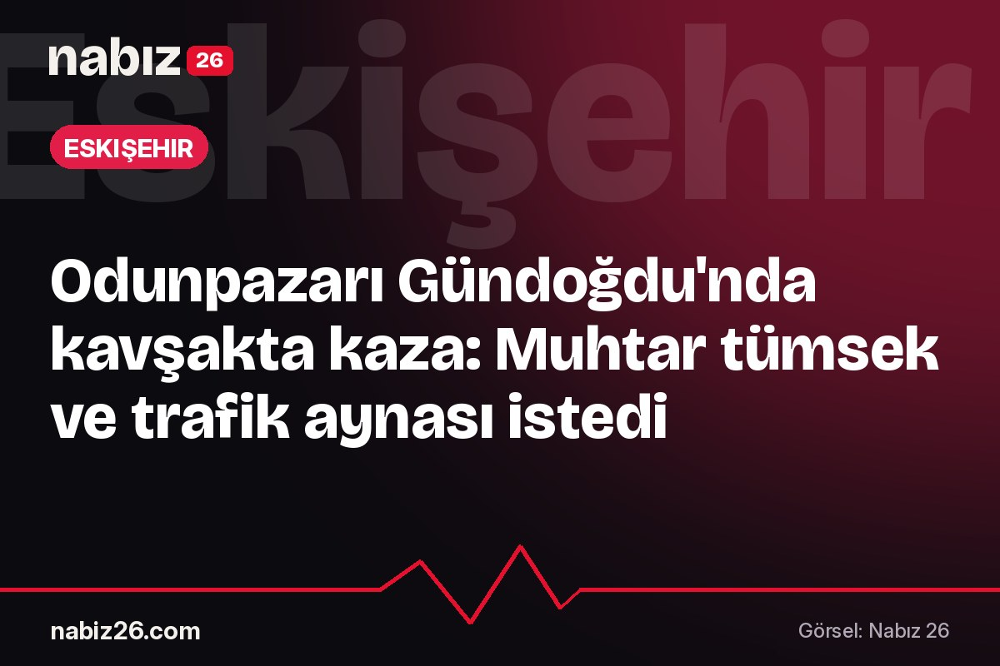

> İki aracın çarpıştığı kaza maddi hasarla atlatıldı.

Eskişehir'in Odunpazarı ilçesinde Gündoğdu Mahallesi'nde Muratcan Sokak ile Kanalyanı Sokak'ın kesiştiği noktada iki araç henüz belirlenemeyen bir nedenle çarpıştı. Kazada SUV tipi aracın ön kısmı parçalandı, diğer otomobilin sol tarafı ağır hasar gördü. Olay maddi hasarla atlatıldı.

Mahalle Muhtarı Adem Karaman, kavşakta benzer kazaların sık yaşandığını belirterek trafik güvenliğinin artırılmasını istedi. Karaman, bölgeye hız kesici tümsek yapılmasını ve sürücülerin görüşünü kolaylaştıracak bir trafik aynası yerleştirilmesini talep etti.

---

## Neapco'nun Eskişehir OSB'deki 35 milyon Euro'luk tesisi açıldı: 120 kişi çalışıyor

**Ekonomi · Merkez** · 2026-10-23 10:34 UTC · Kaynak: [Google Haberler - Eskişehir gündem](https://www.eskisehirekspres.net/neapco-eskisehir-tesisi-acildi-120-kisiye-istihdam-saglaniyor)

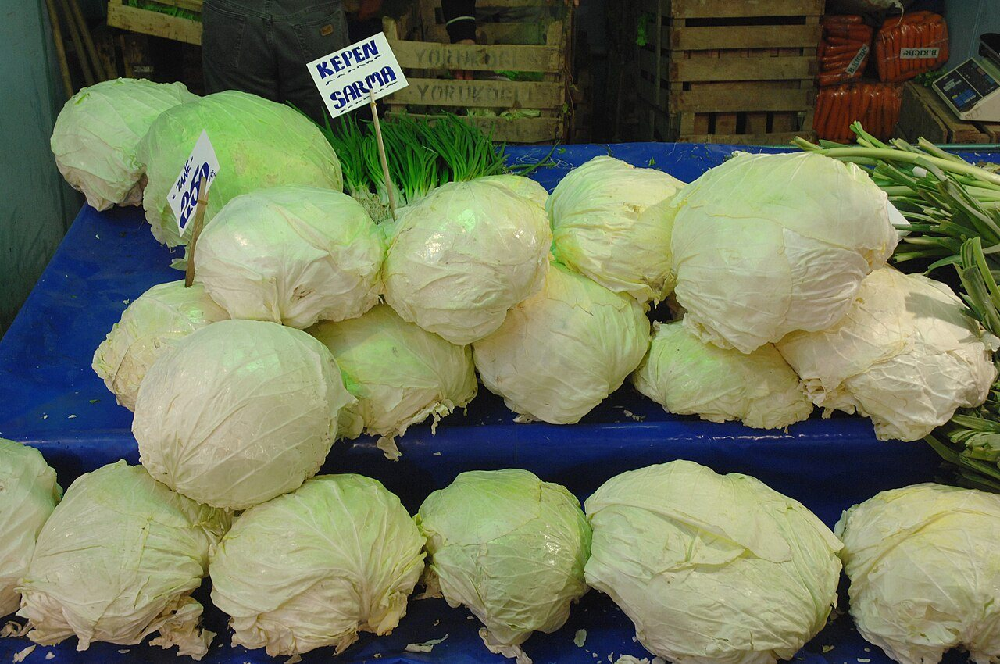

> Açılışın öncesinde şirkete Ford Q1 Kalite Ödülü töreni yapıldı.

Küresel otomotiv parça üreticisi Neapco'nun Türkiye yapılanması Neapco Turkey Otomotiv A.Ş., Eskişehir Organize Sanayi Bölgesi'ndeki yeni tesisinde önce Ford Q1 Kalite Ödülü törenini yaptı, ardından fabrikanın resmî açılışını gerçekleştirdi.

Toplam 35 milyon Euro yatırımla hayata geçirilen tesiste yıllık montaj kapasitesi 1,5 milyon adede çıkarıldı, istihdam 120 kişiye ulaştı. Genel Müdür Hüseyin Erdem, ödülün kaliteye bağlılığın göstergesi olduğunu söyledi. Neapco Holdings Küresel Başkanı ve CEO'su Kenneth Hopkins, Ford Q1 statüsünün kazanılmasının kolay olmadığını belirtti. Ford Otosan Satın Alma Direktörü Tunç Yerli de iki kurum arasındaki iş birliğine değindi.

---

## MEB'den 81 il valiliğine 24 Kasım Öğretmenler Günü genelgesi

**Eğitim · Türkiye** · 2026-10-23 10:34 UTC · Kaynak: [Eskişehir İl Milli Eğitim Müdürlüğü](https://eskisehir.meb.gov.tr/www/24-kasim-ogretmenler-gunu-genelgesi-yayimlandi/icerik/8688/tr)

> Kutlamalar merkezî programlarla sınırlı kalmayıp 81 ilde kültür, sanat ve akademik etkinliklerle zenginleştirilecek.

Millî Eğitim Bakanı Yusuf Tekin'in imzasıyla 81 il valiliğine gönderilen genelgede, 24 Kasım Öğretmenler Günü'nün öğretmenlere şükranların ifade edilmesi ve mesleğin kıymetinin hatırlanması için önemli bir vesile olduğu vurgulandı. Kutlama programlarına en üst seviyede katılım sağlanması istendi.

Bu yıl kutlama etkinliklerinin merkezî programlarla sınırlı kalmayıp 81 ilde kültür, sanat, akademik çalışmalar, sosyal etkinlikler ve uluslararası iş birlikleriyle çok yönlü biçimde gerçekleştirilmesi amaçlanıyor. İl ve ilçe millî eğitim müdürlükleri, okul ve kurum müdürlükleri ile dış temsilciliklerde kutlama kurulları oluşturulacak; programlar bu kurullarca hazırlanıp uygulanacak.

Programlara mülki erkân, şehit öğretmenlerin yakınları, emekli öğretmenler, mezun öğrenciler ve vatandaşlar davet edilecek. Şehit öğretmenler başta olmak üzere hayatını kaybetmiş öğretmenler kabirleri başında anılacak, şehit öğretmen aileleri ve emekli öğretmenler ziyaret edilecek.

---
