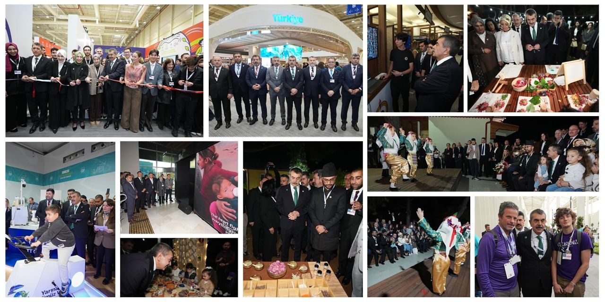
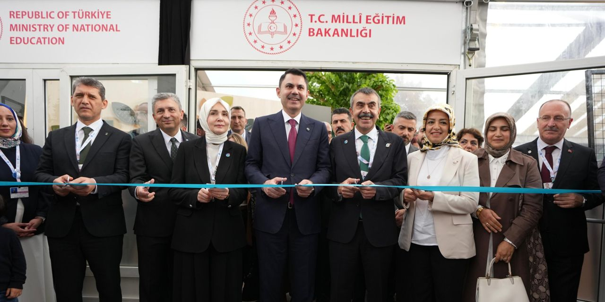
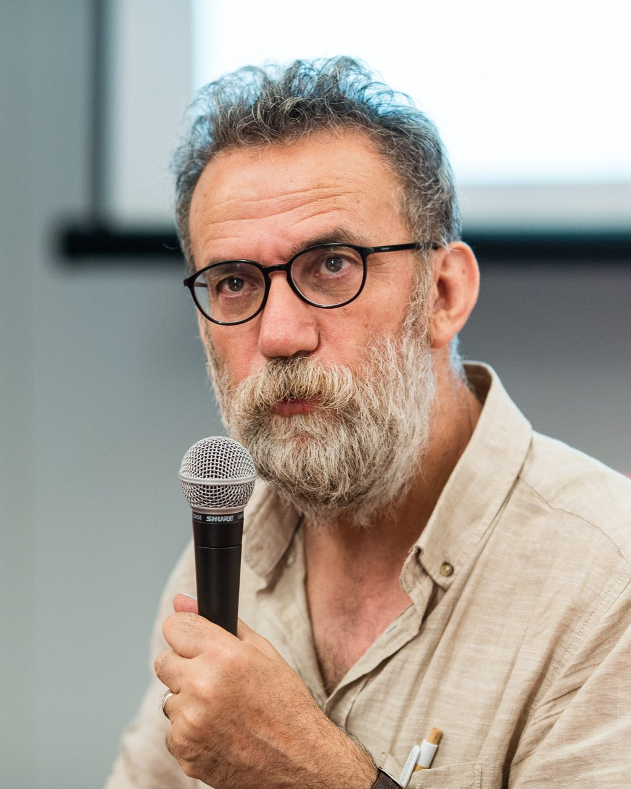
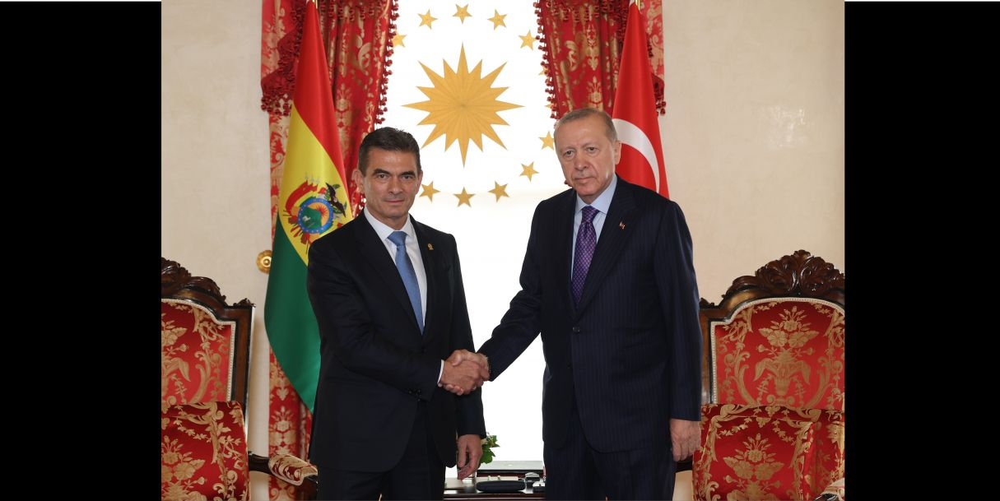
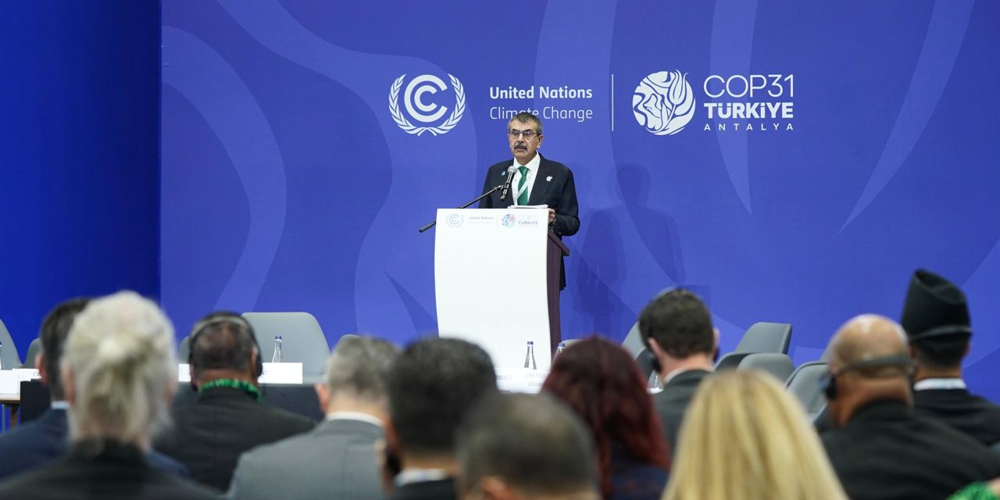

# Son haberler

Ajanın yazdığı son haberler (otomatik güncellenir).

## Yunus Emre Devlet Hastanesi'nde Dünya Diyabet Günü Standı Açıldı

**Sağlık · Tepebaşı** · 2026-11-15 07:04 UTC · Kaynak: [Google Haberler - Eskişehir etkinlik](https://www.eskisehir.net/eskisehirde-dunya-diyabet-gunune-ozel-etkinlik)

> Eskişehir Yunus Emre Devlet Hastanesi'nde 14 Kasım Dünya Diyabet Günü dolayısıyla vatandaşlara yönelik bilgilendirme ve farkındalık etkinliği gerçekleştirildi.

Eskişehir Yunus Emre Devlet Hastanesi'nde 14 Kasım Dünya Diyabet Günü kapsamında toplumsal bilinci artırmak amacıyla stant açıldı. Etkinliğe Yunus Emre Devlet Hastanesi Başhekimi Dr. Öğr. Üyesi Gamze Akın Mumcu, hastane yöneticileri, sağlık personeli ve çok sayıda vatandaş katılım sağladı.

Hastane içerisinde kurulan bilgilendirme standında görevliler tarafından vatandaşlara diyabetin risk faktörleri, hastalığın erken teşhis edilmesinin önemi ve korunma yöntemleri aktarıldı. Sağlık ekipleri, erken tanının tedavi sürecindeki kritik rolünü vurguladı.

Farkındalık çalışması kapsamında ayrıca dengeli beslenme alışkanlığı, düzenli fiziksel aktivite yapılması ve rutin kan şekeri kontrolünün diyabetle mücadeledeki önemi hatırlatılarak vatandaşlara sağlıklı yaşam tavsiyelerinde bulunuldu.

---

## Altın fiyatları 15 Kasım 2026: Gram altın 6.373,53 TL

**Ekonomi · Merkez** · 2026-11-15 06:00 UTC · Kaynak: [Harem Altın](https://www.haremaltin.com/altin-fiyatlari)

> Gram altın güne düşüşle başladı. Harem Altın verilerine göre gram altın 6.293,54 TL'den alınıyor, 6.373,53 TL'den satılıyor.

Altın piyasasında güne düşüşle başlandı. Harem Altın'ın saat 09.00 itibarıyla verilerine göre gram altının satış fiyatı 6.373,53 TL, alış fiyatı 6.293,54 TL oldu. Gram altın, önceki kapanışa göre yüzde 5,12 geriledi.

Ziynet altınlarda çeyrek altın 10.388 TL, yarım altın 20.770 TL, tam altın 41.388 TL, ata altın 42.493 TL seviyesinden satışa sunuluyor.

22 ayar bileziğin gram satış fiyatı 5.953,20 TL, has altının gram fiyatı 6.354,47 TL olarak belirlendi.

Uluslararası piyasalarda altının onsu 3.880,80 dolardan işlem görürken, dolar/TL 50,50 seviyesinde bulunuyor.

Fiyatlar Harem Altın'ın saat 09.00 itibarıyla paylaştığı verilere dayanmaktadır; kuyumcular arasında farklılık gösterebilir. Bu haber yatırım tavsiyesi değildir.

---

## Özel Eğitimde Erken Tarama Dönemi: Riskli Öğrenciler İçin Yeni Sistem Geliyor

**Eğitim · Türkiye** · 2026-11-15 05:04 UTC · Kaynak: [Milli Eğitim Bakanlığı](https://www.meb.gov.tr/ozel-egitim-ihtiyaci-bulunan-ogrenciler-icin-erken-tarama-sistemi-yayginlastirilacak/haber/42521/tr)

> Milli Eğitim Bakanlığı, özel eğitim ihtiyacı bulunan çocukların erken fark edilmesi amacıyla geliştirilen tarama bataryasını 2027'de e-Rehberlik sistemine entegre ederek yaygınlaştıracak.

Milli Eğitim Bakanlığı, özel eğitim ihtiyacı olan öğrencilerin eğitim imkânlarından tam olarak yararlanabilmesi ve bireysel gelişimlerinin desteklenmesi amacıyla erken tarama çalışmalarına hız verdi. "Temel Eğitimde Özel Eğitim Strateji Belgesi" kapsamında UNICEF iş birliğiyle hazırlanan Eğitsel Tarama ve Değerlendirme Bataryası'nın ülke genelinde kullanıma açılması planlanıyor.

Yeni sistem sayesinde okul öncesi öğretmenleri ile ilkokul 1, 2 ve 3'üncü sınıf öğretmenleri, gelişimsel risk altındaki öğrencileri erken evrede fark ederek tanılama ve destek süreçlerine yönlendirebilecek. Uygulamanın 2027 yılı itibarıyla e-Rehberlik Modülü'ne dahil edilmesi ve sahadaki öğretmenlerin tarama sürecindeki etkinliğinin artırılması hedefleniyor.

Öte yandan özel eğitimde tanı ve değerlendirme aşamalarında yerli ölçme araçları yaygınlaştırılıyor. Bilgisayar tabanlı ilk yerli zekâ testi olan ve BİLSEM yerleştirmelerinde de yararlanılan Türk Ulusal Zeka Ölçeği'nin (TUZÖ) ardından, 6-9 yaş aralığına özel sözel olmayan yeni bir zekâ testi geliştirme çalışmalarının başlatıldığı bildirildi.

---

## Bakan Tekin COP31 Heyetiyle Çevreci Anaokulunu İnceledi

**Eğitim · Türkiye** · 2026-11-14 22:59 UTC · Kaynak: [Milli Eğitim Bakanlığı](https://www.meb.gov.tr/bakan-tekin-cop31039in-quotegitimquot-temali-gununde-katilimcilarla-bir-araya-geldi/haber/42520/tr)

> Millî Eğitim Bakanı Yusuf Tekin, COP31 zirvesi kapsamında yabancı heyet üyeleriyle Antalya'daki çevreci uygulamalarıyla öne çıkan anaokulunu ziyaret etti.

Antalya'da düzenlenen Birleşmiş Milletler İklim Değişikliği Çerçeve Sözleşmesi 31. Taraflar Konferansı'nın (COP31) "Çocuklar, Gençlik, Eğitim ve Beceriler" temalı gününde çeşitli temaslar gerçekleştirildi. Millî Eğitim Bakanı Yusuf Tekin, zirve alanındaki oturumların ardından Mavi Bölge'deki Çocuk ve Gençlik pavilyonunun açılışını yaptı.

Bakan Tekin, Memur-Sen ve Uluslararası Emek Konfederasyonu tarafından hazırlanan ve Gazze'deki çevresel ile insani yıkımı anlatan "Dönüş Umudu: El-Avde-Zeytin Ağacı Hikayesi" sergisini inceledi. Zirve alanındaki stantları gezen Tekin, öğrenciler ve sivil toplum temsilcileriyle bir araya geldi.

Temaslar kapsamında Bakanlar Oturumu'na katılan yabancı heyetlerle yemekte buluşan Tekin, daha sonra konuk bakan ve temsilcilerle Muratpaşa'daki 15 Temmuz Şehitler Anaokuluna geçti. Ziyarette Nepal Eğitim ve Spor Bakanı Sasmit Pokharel, UNESCO ve OECD temsilcileri de yer aldı. Heyet, okulun mini serasını, doğa temelli öğrenme ve sürdürülebilir yaşam becerileri atölyelerini yerinde inceleyerek öğretmenlerden bilgi aldı.

---

## Lider Eskişehirspor'da Gözler Ayvalıkgücü Randevusunda: Hazırlıklar Sürüyor

**Spor · Tepebaşı** · 2026-11-14 19:05 UTC · Kaynak: [Google Haberler - Eskişehirspor](https://www.medyagazete.com/haber/eskisehirsporda-ayvalikgucu-belediyespor-maci-hazirliklari-suruyor)

> TFF 3. Lig'de zirvede yer alan Eskişehirspor, sahasında ağırlayacağı Ayvalıkgücü Belediyespor mücadelesinin taktik hazırlıklarını tamamlıyor.

TFF Nesine 3. Lig 2. Grup'ta 24 puanla liderlik koltuğunda oturan Eskişehirspor, ligin 12. haftasında oynayacağı kritik Ayvalıkgücü Belediyespor karşılaşması için çalışmalarını sürdürüyor.

Teknik Direktör Hakan Şapcı yönetiminde gerçekleştirilen antrenmanlarda siyah-kırmızılı ekip, rakibine karşı uygulayacağı taktik plan üzerinde durdu. Futbolcuların antrenmandaki istekli görüntüsü teknik heyeti memnun etti.

Zirvedeki yerini korumak isteyen Eskişehirspor ile Ayvalıkgücü Belediyespor arasındaki karşılaşma, 15 Kasım Pazar günü saat 15.30'da Prof. Dr. Fethi Heper Stadyumu'nda oynanacak.

---

## Togg'dan Kasım Kampanyası: 1,5 Milyon Liraya Kadar Sıfır Faiz Fırsatı

**Ekonomi · Türkiye** · 2026-11-14 18:47 UTC · Kaynak: [Google Haberler - Togg](https://www.haberx.com/toggtan-otomobil-almak-isteyenlere-15-milyon-tlye-kadar-faizsiz-kredi/)

> Yerli otomobil üreticisi Togg, T10X ve T10F modelleri için 1,5 milyon liraya kadar sıfır faizli finansman desteği içeren yeni kampanyasını duyurdu.

Türkiye'nin yerli otomobil üreticisi Togg, Kasım 2026 dönemine ilişkin yeni finansman desteğini açıkladı. Kampanya çerçevesinde, T10X ve sedan gövdeli T10F modellerini satın almak isteyen müşterilere 1,5 milyon liraya varan faizsiz kredi imkânı sağlanıyor. Açıklanan güncel fiyat listesine göre T10X modeli 1 milyon 909 bin 48 liradan, T10F modeli ise 1 milyon 884 bin 980 liradan alıcı bekliyor.

Her iki modelin V2 donanım seviyesinde tüketicilere farklı vade seçenekleriyle faizsiz finansman desteği veriliyor. Bu kapsamda 700 bin lira için 4 ay, 500 bin lira için 6 ay ve 300 bin lira için belirlenen vadelerde faiz uygulanmıyor. Performans odaklı 4More paketini tercih eden alıcılar ise 1,5 milyon liralık kredi desteğini 10 ay boyunca faizsiz kullanabiliyor. Bireysel başvurularda ayrıca 1 milyon 700 bin liraya kadar uzanan tutarlar için 48 ay vade ve aylık yüzde 2,95 faiz oranı seçeneği de sunuluyor.

Kampanyada şirketler ve ticari alıcılar için de özel imkânlar yer alıyor. Kurumsal müşteriler ile şahıs şirketlerine yönelik pakette, banka onayına bağlı olarak aracın fatura tutarının tamamına kadar kredi kullanılabiliyor. Şirketlerin filo yenileme maliyetlerini hafifletmeyi amaçlayan bu uygulamanın yanı sıra, 4More donanımlı modellerde kurumsal müşteriler de 1,5 milyon liraya kadar faizsiz kredi imkânından yararlanabiliyor.

---

## Kurtuluş Mahallesi'nde Kötü Kokular Üzerine Girilen Evde Acı Bulgu

**Asayiş · Odunpazarı** · 2026-11-14 17:04 UTC · Kaynak: [Google Haberler - Eskişehir](https://www.cumhuriyet.com.tr/turkiye/eskisehir-de-35-yasindaki-kisi-evinde-olu-bulundu-2556147)

> Odunpazarı'nda bir apartman dairesinden yayılan kokular üzerine adrese giren ekipler, tek başına yaşayan 35 yaşındaki kişiyi hareketsiz halde buldu. Sağlık ekipleri şahsın yaşamını yitirdiğini belirledi.

Eskişehir'in Odunpazarı ilçesine bağlı Kurtuluş Mahallesi Ziyapaşa Caddesi'ndeki bir apartmanda yaşayan vatandaşlar, binadaki bir daireden yoğun koku gelmesi üzerine durumu 112 Acil Çağrı Merkezine bildirdi.

İhbar üzerine olay yerine polis, sağlık ve itfaiye ekipleri yönlendirildi. Kapının açılmasıyla eve giren ekipler, ikamette yalnız kaldığı öğrenilen 35 yaşındaki A.T.K.'yi yerde hareketsiz yatarken buldu. Sağlık görevlilerinin yaptığı kontrollerde şahsın hayatını kaybettiği tespit edildi.

Olay yerinde incelemelerde bulunan belediye tabibi, 35 yaşındaki vatandaşın vefatını şüpheli ölüm olarak değerlendirdi. Polis ekipleri olayla ilgili geniş çaplı inceleme başlatırken, cenaze kesin ölüm nedeninin belirlenmesi amacıyla otopsi yapılmak üzere Eskişehir Şehir Hastanesi morguna kaldırıldı.

---

## Bakanlar Tekin ve Kurum Duyurdu: Türkiye İklim Okulu Kapılarını Açtı

**Eğitim · Türkiye** · 2026-11-14 17:04 UTC · Kaynak: [Milli Eğitim Bakanlığı](https://www.meb.gov.tr/bakanlar-tekin-ve-kurum039un-katilimiyla-turkiye-iklim-okulu039nun-acilisi-yapildi/haber/42516/tr)

> Millî Eğitim Bakanı Yusuf Tekin ile Çevre, Şehircilik ve İklim Değişikliği Bakanı Murat Kurum'un katılımıyla Türkiye İklim Okulu resmen açıldı.

Millî Eğitim Bakanı Yusuf Tekin ile Çevre, Şehircilik ve İklim Değişikliği Bakanı Murat Kurum'un katılımıyla Türkiye İklim Okulu hizmete girdi. Programda çevre bilincinin eğitim yoluyla yeni nesillere kazandırılması gerektiği vurgulandı.

Açılışta konuşan Millî Eğitim Bakanı Yusuf Tekin, eğitim sisteminin Türkiye Yüzyılı Maarif Modeli ile revize edildiğini belirterek merkeze insanı ve insani değerleri aldıklarını söyledi. Yaşanabilir bir çevre inşa etmek için çevre bilincine sahip nesiller yetiştirilmesinin zorunlu olduğunu ifade eden Tekin, bunun da ancak eğitim öğretim süreçleriyle mümkün olabileceğini dile getirdi.

COP31 Başkanı ve Çevre, Şehircilik ve İklim Değişikliği Bakanı Murat Kurum ise Türkiye İklim Okulu'nun kapılarını hem bir eğitim yuvası hem de ortak geleceğin temsilcisi olarak açtıklarını kaydetti. Çocukların bu mekânda iklim değişikliğini öğreneceğini ve çözümler tasarlayacağını anlatan Kurum, Antalya'dan yükselen bu girişimin tüm Türkiye'deki okullara yayılmasını arzu ettiklerini belirtti.

Törende, Maarif İklim Ideathonu ile COP31 Uluslararası Öğrenci Münazarası'nda dereceye giren öğrencilere ödülleri verildi. Açılışın ardından Bakan Tekin, okul bünyesindeki atölyeleri gezerek öğrencilerin yürüttüğü faaliyetleri yerinde inceledi.

---

## Odunpazarı Kadın Hentbol Takımı Sahadan Farklı Galibiyetle Ayrıldı: 43-22

**Spor · Odunpazarı** · 2026-11-14 15:04 UTC · Kaynak: [Google Haberler - Odunpazarı](https://www.canligaste.com/hentbol-kadinlar-super-ligi-odunpazari-ortahisar-i-43-22-yendi/949670/)

> Hentbol Kadınlar Süper Ligi'nin 10. haftasında Odunpazarı, sahasında ağırladığı Ortahisar Belediyespor'u 43-22 gibi farklı bir skorla mağlup etti.

Hentbol Kadınlar Süper Ligi 10. hafta mücadelesinde Odunpazarı, Porsuk Spor Salonu'nda Ortahisar Belediyespor ile karşı karşıya geldi.

Mücadeleye etkili başlayan ev sahibi Odunpazarı, oyunun kontrolünü ilk dakikalardan itibaren eline aldı. Hücumda ve savunmada üstün bir performans sergileyen Eskişehir temsilcisi, soyunma odasına 20-9 önde girdi.

İkinci yarıda da temposunu koruyan Odunpazarı, farkı giderek açarak salondan 43-22'lik rahat bir galibiyetle ayrılmayı başardı.

---

## Mihalıççık Yeni Salonundaki İlk Maçında Güçlü Rakibine 28-26 Mağlup Oldu

**Spor · Mihalıççık** · 2026-11-14 15:04 UTC · Kaynak: [Google Haberler - Eskişehir gündem](https://www.milliirade.com/mihaliccik-hentbol-takimi-yeni-tesisteki-ilk-maci-kaybetti)

> Mihalıççık Belediyesi Spor Kulübü hentbol takımı, ilçede hizmete giren yeni spor tesisindeki ilk maçında İstanbul Gençlik SK'ya 28-26 yenildi.

Mihalıççık Belediyesi Spor Kulübü hentbol takımı, yapımı süren spor kompleksinin tamamlanan salonunda ilk resmî müsabakasına çıktı. İlçe halkının yoğun ilgi gösterdiği karşılaşmada ev sahibi ekip, ligin güçlü takımlarından İstanbul Gençlik SK karşısında sahadan 28-26'lık mağlubiyetle ayrıldı.

Karşılaşmanın ardından açıklamalarda bulunan Mihalıççık Belediye Başkanı Haydar Çorum, skora rağmen takımın sergilediği mücadeleden memnun olduğunu belirtti. Rakibin şampiyonluk yarışında iddialı ve uzun süredir birlikte oynayan bir kadroya sahip olduğuna dikkat çeken Çorum, yeni tesisin tüm rakipler için zorlu bir deplasman olacağını gösterdiklerini dile getirdi.

Kulüp tarihinde ilk kez bu kadar yoğun bir taraftar atmosferi yaşadıklarını vurgulayan Çorum, maçta çok sayıda çocuk ve gencin bulunmasının kendileri için asıl kazanım olduğunu söyledi. Tesisin geri kalan bölümlerini de en kısa sürede tamamlayarak spor kompleksini bütünüyle hizmete açmayı hedeflediklerini belirten Çorum, gelecek hafta konuk edecekleri Bursa Nilüfer maçına tüm sporseverleri davet etti.

---

## Eskişehirspor'da Kaptan Beykan Şimşek Şoku: Ayvalıkgücü Maçında Yok

**Spor · Merkez** · 2026-11-14 15:04 UTC · Kaynak: [Google Haberler - Eskişehirspor](https://www.gazetevatan.com/sehirler/eskisehir/eskisehirspora-kotu-haber-forma-giyemeyecek-2464687)

> Ayvalıkgücü karşılaşması öncesinde Eskişehirspor'da kaptan Beykan Şimşek sakatlığı nedeniyle kadrodan çıkarılırken, Kerem Baykuş'un iyileşmesi yüzleri güldürdü.

Bölgesel Amatör Lig'de zirve mücadelesini sürdüren Eskişehirspor'a hafta sonu oynanacak kritik Ayvalıkgücü karşılaşması öncesinde kaptanından kötü haber geldi. Siyah-kırmızılı ekibin tecrübeli ismi Beykan Şimşek, sakatlığı nedeniyle bu hafta sahada yer alamayacak.

Anadolu SF ile oynanan müsabakada sağ arka adalesinden sakatlanan kaptan Şimşek'in yapılan kontrolleri ve çekilen MR tetkiklerinde küçük çaplı bir yırtık belirlendi. Sağlık ekibinin değerlendirmesi sonucunda deneyimli futbolcunun Ayvalıkgücü maçında riske edilmeyeceği bildirildi.

Kaptanın yokluğuyla sarsılan kırmızı-siyahlı ekipte orta sahadan gelen haber ise teknik heyeti sevindirdi. Sakatlığı nedeniyle son iki lig karşılaşmasında takımını yalnız bırakan Kerem Baykuş'un tedavisinin tamamlandığı ve zorlu Ayvalıkgücü deplasmanında forma giyebileceği öğrenildi.

---

## Eskişehir'de Kış Trafiği İçin Önlemler Masada: Kurumlara Koordinasyon Uyarısı

**Ulaşım · Merkez** · 2026-11-14 15:04 UTC · Kaynak: [Google Haberler - Eskişehir](https://www.haberes.com.tr/eskisehirde-kis-mevsimi-trafik-tedbirleri-masaya-yatirildi)

> Eskişehir Valisi Dr. Erdinç Yılmaz başkanlığında toplanan yetkililer, kış aylarında kent genelinde trafik güvenliğini sağlamak amacıyla alınacak tedbirleri değerlendirdi.

Eskişehir'de kış şartlarının yaklaşmasıyla birlikte trafik güvenliğini sağlamak ve kazaların önüne geçmek amacıyla Kış Mevsimi Trafik Tedbirleri Toplantısı gerçekleştirildi. Vali Dr. Erdinç Yılmaz başkanlığında düzenlenen toplantıya, kamu kurum ve kuruluşlarının temsilcileri ile emniyet ve jandarmanın trafik birimleri yetkilileri katıldı.

Toplantıda, kış boyunca vatandaşların güvenli seyahat edebilmeleri adına karayollarında ve kent içinde alınacak önlemler detaylandırıldı. Kar yağışı, gizli buzlanma ve olumsuz hava şartlarına karşı yollarda yapılacak çalışmalar ile denetim planları görüşüldü.

Kurumlar arası koordinasyonun kritik bir öneme sahip olduğunu belirten Vali Yılmaz, sahadaki tüm ekiplerin hazırlıklarını eksiksiz tamamlaması gerektiğini vurguladı. Vatandaşların can ve mal emniyetinin birinci öncelik olduğuna dikkat çeken Yılmaz, ihtiyaç anında tüm birimlerin süratli ve eşgüdüm içinde hareket etmesini istedi.

---

## 14. Şiir Buluşması Başladı: İlhan Sami Çomak ve Yabancı Şairler Tepebaşı'nda

**Kültür-Sanat · Tepebaşı** · 2026-11-14 15:04 UTC · Kaynak: [Google Haberler - Tepebaşı](https://www.haberes.com.tr/siir-bulusmasi-siirlerle-ve-muzikle-14-kez-hayat-buldu)

> Tepebaşı Belediyesi tarafından düzenlenen 14. Uluslararası Eskişehir Şiir Buluşması, Fransa ve Mısır'dan konukların da yer aldığı açılış töreniyle kapılarını açtı.

Tepebaşı Belediyesi'nin ev sahipliğinde bu yıl 14'üncüsü gerçekleştirilen Uluslararası Eskişehir Şiir Buluşması'nın açılış töreni yapıldı. Türkiye Yazarlar Sendikası, PEN ve Kültürlerarası Şiir ve Çeviri Akademisi'nin katkılarıyla düzenlenen etkinliğe; Tepebaşı Belediye Başkanı Ahmet Ataç, Büyükşehir Belediyesi Başkan Vekili Nihat Çuhadar, edebiyatçılar ve çok sayıda sanatsever katıldı.

Buluşmanın bu yılki onur konuğu olan şair İlhan Sami Çomak, törende yaptığı konuşmada Eskişehir'de edebiyatseverlerle bir arada bulunmaktan duyduğu mutluluğu dile getirerek şiirini seslendirdi. Şiir Buluşması Direktörü Haydar Ergülen ise bir kentte 14 yıl boyunca kesintisiz şiir buluşması düzenlemenin önemine dikkat çekerek emeği geçenlere teşekkür etti.

Tepebaşı Belediye Başkanı Ahmet Ataç, bu yıl ikisi yabancı olmak üzere toplam 13 şairi Eskişehir'de ağırladıklarını belirtti. Ataç, etkinlik kapsamında kâğıt geri dönüşüm atölyesinde hazırlanan özel kâğıtlara yazılan şiirlerden oluşan bir serginin de ziyarete açıldığını aktardı. Fransa'dan Sylvain Cavaillès ve Mısır'dan Ahmad Zakaria da törende konuşma yaparak şiirlerini paylaştı.

Şiir dinletileri, sergiler ve panellerle devam eden festival, Atila Özer Karikatürlü Ev'deki söyleşi ve okuma programlarıyla 15 Kasım Pazar günü tamamlanacak.

---

## Erdoğan ve Bolivya Lideri Pereira Dolmabahçe'de Görüştü: Savunma ve Madencilik Masada

**Siyaset · Türkiye** · 2026-11-14 13:04 UTC · Kaynak: [İletişim Başkanlığı](https://www.iletisim.gov.tr/turkce/haberler/detay/cumhurbaskani-erdogan-bolivya-cumhurbaskani-pereira-ile-gorusmesine-iliskin-aciklama)

> Cumhurbaşkanı Recep Tayyip Erdoğan, Bolivya Devlet Başkanı Rodrigo Paz Pereira ile Dolmabahçe Ofisi'nde bir araya geldi. Zirvede savunma sanayii ve madencilik iş birliği öne çıktı.

Cumhurbaşkanı Recep Tayyip Erdoğan, Türkiye'ye ziyarette bulunan Bolivya Devlet Başkanı Rodrigo Paz Pereira ile Cumhurbaşkanlığı Dolmabahçe Ofisi’nde bir görüşme gerçekleştirdi. İki liderin bir araya geldiği toplantıda, Türkiye ile Bolivya arasındaki ikili ilişkilerin yanı sıra bölgesel gelişmeler ele alındı.

Görüşmede Bolivya’yı Latin Amerika’da önemli bir ortak olarak gördüklerini vurgulayan Cumhurbaşkanı Erdoğan, iki ülke arasında savunma sanayii başta olmak üzere pek çok alanda iş birliğini derinleştirmenin taşıdığı önemi ifade etti. Gündemde bulunan anlaşmaların "kazan-kazan" anlayışıyla ilişkilerin ahdi zeminini kuvvetlendireceğini belirten Erdoğan, madencilik gibi potansiyel taşıyan alanlarda da yeni adımların atılabileceğini dile getirdi.

Dolmabahçe'deki kabulde Millî Savunma Bakanı Yaşar Güler, Cumhurbaşkanlığı İletişim Başkanı Burhanettin Duran ile Cumhurbaşkanlığı Savunma Sanayii Başkanı Haluk Görgün de hazır bulundu.

---

## Erdoğan'dan Malatya'da Şehit Düşen 4 Askerin Ailesine Taziye Mesajı

**Siyaset · Türkiye** · 2026-11-14 12:11 UTC · Kaynak: [Google Haberler - Cumhurbaşkanı](http://mobil.hurriyet.com.tr/gundem/cumhurbaskani-erdogandan-malatyada-sehit-olan-askerler-icin-taziye-mesaji-43378181)

> Cumhurbaşkanı Recep Tayyip Erdoğan, Malatya'da askeri helikopterin kaza kırıma uğraması sonucu şehit olan 4 askerin ailesine başsağlığı mesajı gönderdi.

Cumhurbaşkanı Recep Tayyip Erdoğan, Malatya'da meydana gelen helikopter kazasında şehit düşen askerlerin ailelerine taziye dileklerini iletti.

Edinilen bilgiye göre Cumhurbaşkanı Erdoğan, 12 Kasım'da Malatya'da S-70 tipi helikopterin kaza kırıma uğraması sonucu şehit olan Kara Pilot Binbaşı Erdem Çimen, Kara Pilot Binbaşı Orhun Pınar, Astsubay Kıdemli Üstçavuş Hüseyin Zehir ve Astsubay Kıdemli Çavuş Serkan Önder'in ailelerine başsağlığı mesajı gönderdi.

Erdoğan, mesajında şehitlerin ailelerine sabır ve başsağlığı temennisinde bulundu.

---

## Başkan Kurt'tan Kazan'da Yatırım ve Kentsel Gelişim Temasları

**Belediye · Odunpazarı** · 2026-11-14 12:11 UTC · Kaynak: [Google Haberler - Odunpazarı](https://www.esgazete.com/kazim-kurttan-kazanda-is-birligi-temaslari)

> Tataristan'ın başkenti Kazan'da temaslarda bulunan Odunpazarı Belediye Başkanı Kazım Kurt, yatırım, kentsel gelişim ve eğitim alanlarında iş birliği görüşmeleri gerçekleştirdi.

Odunpazarı Belediye Başkanı Kazım Kurt, Tataristan'ın başkenti Kazan'da yürüttüğü temaslar kapsamında çeşitli kurum ve kuruluşların temsilcileriyle bir araya geldi. Görüşmelerde Odunpazarı için yatırım olanakları, kentsel dönüşüm ve gelişim projeleri ile eğitim alanındaki ortak çalışma imkanları masaya yatırıldı.

Ziyaret programı çerçevesinde Tataristan Yatırım Geliştirme Ajansı Başkanı Taliya Minullina ile bir araya gelen Kurt, yatırım fırsatları ve teşvikleri değerlendirdi. Kurt ayrıca Türkiye Cumhuriyeti Kazan Başkonsolosu Uğur Yılmaz ile de görüşme gerçekleştirdi. Bölgedeki genç mimarlarla da buluşan Başkan Kurt, Odunpazarı'nda hayata geçirilen şehircilik uygulamalarını aktararak ortak projeler üzerine fikir alışverişinde bulundu.

Eğitim alanındaki temasları kapsamında Kazan Öğretmen Evi Müdürü Albert Ahmetov eşliğinde öğretmenlerin mesleki gelişimi için kurulan yeni merkezi inceleyen Kurt, temaslarını tamamladı. Ziyaretin ardından değerlendirmede bulunan Kurt, kente yeni fikirler, güçlü dostluklar ve Odunpazarı için uygulanabilecek iş birliği imkanlarıyla veda ettiklerini belirterek ev sahipliği yapan yetkililere teşekkür etti.

---

## Bakan Yumaklı Duyurdu: Iğdır'da 109 Bin Dekarlık Sulama Projesinde İhale Tamamlandı

**Tarım · Türkiye** · 2026-11-14 12:11 UTC · Kaynak: [Google Haberler - Bakanlıklar](https://www.yesiligdir.com/tarim-bakanligi-acikladi-igdira-dev-yatirim)

> Tarım ve Orman Bakanlığı, Iğdır'da 109 bin 820 dekar tarım arazisini modern sulama altyapısına kavuşturacak projenin ihalesinin yapıldığını duyurdu.

Tarım ve Orman Bakanı İbrahim Yumaklı, Iğdır'daki tarım arazilerini basınçlı borulu sulama sistemiyle buluşturacak kapsamlı yatırım projesinin ihale sürecinin tamamlandığını açıkladı. Proje kapsamında Ünlendi Barajı ile Kamışlı ve Göktaş regülatörlerinden temin edilen su, kapalı boru sistemiyle arazilere ulaştırılacak.

Sosyal medya hesabı üzerinden yatırımın teknik detaylarını paylaşan Bakan Yumaklı, çalışma çerçevesinde 421 bin 905 metre uzunluğunda boru hattı inşa edileceğini ve toplam 109 bin 820 dekar arazinin sulamaya açılacağını bildirdi.

Projenin arazi düzenlemesini de içerdiğini belirten Yumaklı, 143 bin 110 dekar alanda arazi toplulaştırması yürütüleceğini ve 27 yerleşim biriminde yerinde toplulaştırma faaliyeti gerçekleştirileceğini kaydetti.

---

## Yenikent'te tramvay ile otobüs çarpıştı: Seferlerde aksama yaşandı

**Ulaşım · Odunpazarı** · 2026-11-14 11:04 UTC · Kaynak: [Google Haberler - Eskişehir asayiş](https://www.anadolugazetesi.com/eskisehir-de-toplu-ulasimda-kaza-panigi--tramvay-ile-otobus-carpisti-298072.html)

> Odunpazarı'nda sabah saatlerinde tramvay ile halk otobüsünün çarpışması sonucu maddi hasar oluşurken, aksayan seferler araçların kaldırılmasıyla normale döndü.

Eskişehir'in Odunpazarı ilçesine bağlı Yenikent Mahallesi'nde toplu taşıma araçları kaza yaptı. Sabah saatlerinde Şehit Yüzbaşı Tuncer Güngör Caddesi üzerinde seyir halinde olan tramvay ile otobüs henüz belirlenemeyen bir sebeple çarpıştı.

Çarpışmanın etkisiyle her iki araçta da maddi hasar meydana geldi. Kaza nedeniyle bölgedeki tramvay hattında ulaşım bir süre durma noktasına geldi.

İhbar üzerine sevk edilen polis ekipleri cadde üzerinde güvenlik önlemleri alarak inceleme başlattı. Ekiplerin inceleme ve temizlik çalışmalarını tamamlamasının ardından kazaya karışan araçlar yoldan çekildi ve tramvay seferleri yeniden düzenli şekilde işlemeye başladı.

---

## Hamzabeyli'de 558,6 Milyon Liralık Kaçak Eşya Operasyonu

**Türkiye · Türkiye** · 2026-11-14 11:04 UTC · Kaynak: [Google Haberler - Bakanlıklar](https://www.cumhuriyet.com.tr/turkiye/ticaret-bakanligi-verileri-acikladi-558-6-milyon-lira-degerinde-kacak-esya-ele-gecirildi-2556059)

> Ticaret Bakanlığı Gümrükler Muhafaza ekiplerince Edirne Hamzabeyli Gümrük Kapısı'nda durdurulan bir tırda 558 milyon 594 bin lira değerinde kaçak ticari eşya ele geçirildi.

Ticaret Bakanlığı Gümrükler Muhafaza ekipleri, Edirne'deki Hamzabeyli Gümrük Sahası'nda kaçakçılıkla mücadele kapsamında yürüttüğü saha denetimleri sırasında şüpheli hareketler sergileyen bir tırı takibe aldı. Durdurulan araçta yapılan detaylı aramalarda, yasal gümrük işlemlerine tabi tutulmadan Türkiye'ye sokulmak istenen yüklü miktarda ticari malzeme tespit edildi.

Aramalarda 193 bin 31 adet elektronik sigara ve aksamı, 4 bin 700 adet cep telefonu, 11 bin 263 adet gözlük ve aksesuarı, 8 bin 233 adet ilaç ile 3 bin 600 adet sigara filtresi bulundu. Ele geçirilen kaçak eşyaların toplam gümrüklenmiş piyasa değerinin 558 milyon 594 bin lira olduğu açıklandı.

Bakanlık açıklamasında, haksız rekabetin önlenmesi, kamu sağlığı ile ekonomik çıkarların korunması amacıyla gümrük muhafaza ekiplerinin denetimlerinin kararlılıkla süreceği bildirildi. Ele geçirilen malzemelerle ilgili adli tahkikat Edirne Cumhuriyet Başsavcılığı koordinesinde yürütülüyor.

---

## Bakan Tekin COP31'de Duyurdu: 19 Dersin Müfredatına İklim Değişikliği Eklendi

**Eğitim · Türkiye** · 2026-11-14 11:04 UTC · Kaynak: [Milli Eğitim Bakanlığı](https://www.meb.gov.tr/bakan-tekin-cop31039de-duzenlenen-yuksek-duzeyli-bakanlar-acilis-oturumu039nda-hitap-etti/haber/42514/tr)

> Millî Eğitim Bakanı Yusuf Tekin, COP31 zirvesinde okul öncesinden liseye kadar 19 dersin öğretim programına iklim değişikliği ve sürdürülebilirlik konularının yerleştirildiğini açıkladı.

Antalya'da düzenlenen Birleşmiş Milletler İklim Değişikliği Çerçeve Sözleşmesi 31. Taraflar Konferansı (COP31) kapsamında, UNESCO iş birliğiyle "Yeşil Eğitimin Merkezinde Çocuklar, Gençler ve Öğretmenler" başlıklı Yüksek Düzeyli Bakanlar Açılış Oturumu gerçekleştirildi. Oturumda konuşan Millî Eğitim Bakanı Yusuf Tekin, çevre krizinin yalnızca yasal düzenlemelerle çözülemeyeceğini, zihniyet dönüşümünün eğitim yoluyla sağlanabileceğini vurguladı.

Türkiye Yüzyılı Maarif Modeli kapsamında yaşanabilir çevreyi odağa aldıklarını belirten Tekin, okul öncesinden ortaöğretime kadar tüm kademelerdeki zorunlu ve seçmeli 19 derse iklim değişikliği ile sürdürülebilirlik başlıklarının eklendiğini söyledi. Bakan Tekin, Çevre Dostu Okul Projesi aracılığıyla okullarda güneş enerjisi panelleri kurulduğunu ve yağmur sularının bahçe sulamasında değerlendirildiğini ifade etti. Sıfır atık uygulamalarının 29 bin 400 okulda tamamlandığı ve 9 milyon öğrencinin Sıfır Atık Sertifikası aldığı bilgisi de paylaşıldı.

Öğretmenlerin çevre bilincindeki rolüne dikkat çeken Bakan Tekin, öğretmen adaylarına yönelik 1200 saatlik iklim ve sürdürülebilirlik hazırlık eğitimi programı uygulandığını, Öğretmen Bilişim Ağı üzerinden verilen çevre eğitimlerine ise şu ana kadar 517 bin öğretmenin katıldığını kaydetti. Ayrıca 30 ilden gelen lise öğrencilerinin hazırladığı ortak gençlik iklim bildirgesinin zirve boyunca dört dilde okunacağı ve genç iklim delegelerinin karar alıcılarla doğrudan temas kuracağı aktarıldı.

Konuşmasında çatışmaların çevreye ve çocuklara verdiği zarara da değinen Tekin, Gazze'deki tahribatı hatırlatarak adalet ve barış olmadan iklim krizine kalıcı bir çözüm üretilemeyeceğini belirtti. Bakan Tekin'in konuşmasının ardından uluslararası temsilcilerin katılımıyla yeşil beceriler ve iklim eğitimi konulu panel gerçekleştirildi.

---

## MEB'den Sınav Yönetmeliğinde Değişiklik: İlkokullarda Sınav Tamamen Yasaklandı

**Eğitim · Türkiye** · 2026-11-14 09:04 UTC · Kaynak: [Milli Eğitim Bakanlığı](https://www.meb.gov.tr/olcme-ve-degerlendirme-yonetmeligi039nde-degisiklik-resmi-gazete039de-yayimlandi/haber/42511/tr)

> Milli Eğitim Bakanlığı Ölçme ve Değerlendirme Yönetmeliği'nde yaptığı değişiklikle okul öncesi ve ilkokullarda hiçbir ad altında sınav yapılamayacağını duyurdu.

Milli Eğitim Bakanlığına bağlı resmi ve özel okul öncesi, ilköğretim ile ortaöğretim kurumlarında yürütülen ölçme ve değerlendirme faaliyetlerine ilişkin yönetmelik değişikliği Resmi Gazete'de yayımlanarak yürürlüğe girdi. Yeni düzenlemeyle ölçme ve değerlendirme süreçlerinin Türkiye Yüzyılı Maarif Modeli ile uyumlu hale getirilmesi hedeflendi.

Yayımlanan yeni yönetmeliğe göre, okul öncesi eğitim kurumlarında ve ilkokullarda herhangi bir isim altında sınav uygulaması yapılamayacak. Bu kademelerde ölçme ve değerlendirmenin temel hedefi, öğrencilerin bilişsel, fiziksel, sosyal ve duygusal gelişim düzeylerinin süreç içerisinde takip edilmesi ve desteklenmesi olacak. Ayrıca elde edilen sonuçlar; öğrenciler, sınıflar, okullar ya da iller arasında kıyaslama ve sıralama amacıyla kullanılamayacak.

Düzenleme kapsamında ölçme ve değerlendirme faaliyetleri yalnızca Bakanlık tarafından uygun bulunan dijital sistemler aracılığıyla yürütülecek. Soru hazırlama ve değerlendirme aşamalarında verimliliği artırmak amacıyla Bakanlık onaylı yapay zekâ araçlarından yararlanılabilecek. Süreçte kişisel verilerin gizliliği esas alınacak.

Yönetmelikle birlikte ABİDE, Dört Beceride Türkçe Dil Gelişimi İzleme ve okul tabanlı araştırmalar tek bir mevzuat çatısı altında birleştirilirken, PISA ve TIMSS gibi uluslararası izleme araştırmalarına yönelik kurallar da yeniden düzenlendi.

---

## Tarihi Hacı Halit Konağı Etnografya Müzesi Oluyor: Çalışmalar Son Aşamada

**Kültür-Sanat · Mihalıççık** · 2026-11-14 07:03 UTC · Kaynak: [Google Haberler - Eskişehir gündem](https://www.anadolugazetesi.com/eskisehir-e-yeni-muze-geliyor--tarihi-binada-calismalar-son-asamada--297999.html)

> Eskişehir'in Mihalıççık ilçesinde yer alan tarihi Hacı Halit Konağı, etnografya müzesine dönüştürülüyor. Çalışmalarda son aşamaya gelindi.

Eskişehir'in Mihalıççık ilçe merkezine yaklaşık 32 kilometre mesafede yer alan tarihi Hacı Halit Konağı, kentin yeni etnografya müzesi olmaya hazırlanıyor. Tarihi yapının restore edilerek müzeye dönüştürülmesi sürecinde yürütülen çalışmalarda son aşamaya gelindiği bildirildi.

Müzede sergilenecek etnografik eserlerin Eskişehir Müze Müdürlüğü envanterinden karşılanacağı kaydedildi. Proje kapsamında ildeki müze depolarında ve kayıtlarında yer alan tarihi eserler, düzenlenecek sergi alanlarıyla tarihi konakta halkın ziyaretine açılacak.

Öte yandan, konağın bulunduğu mahallenin ilçe merkezine mesafesi ve ulaşım imkânlarının kısıtlı olması bazı soru işaretlerini de beraberinde getirdi. Bazı ilgililer, Eskişehir genelinde bağımsız bir etnografya müzesi bulunmazken projenin ulaşımı zor bir kırsal yerleşime kurulmasını eleştirerek ziyaretçi sayısının beklenenden düşük kalabileceği yönünde görüş bildirdi. Müzenin hizmete girmesiyle birlikte ulaşım ve ziyaretçi erişimine dönük adımların nasıl şekilleneceği bekleniyor.

---

## Dalışa Eskişehir'de Başlayan Erkan Balk Üst Üste İkinci Kez Dünya Şampiyonu

**Spor · Merkez** · 2026-11-14 07:03 UTC · Kaynak: [Google Haberler - Eskişehir](https://www.gazetevatan.com/sehirler/eskisehir/eskisehirde-basladi-dunya-sampiyonu-oldu-2464608)

> Su altı görüntüleme milli sporcusu Erkan Balk, Bali'de düzenlenen şampiyonada 'Okyanusun Senfonisi' adlı çalışmasıyla üst üste ikinci kez dünya şampiyonluğunu kazandı.

Türkiye Sualtı Sporları Federasyonu (TSSF) milli sporcusu Erkan Balk, su altı görüntüleme dalında uluslararası alanda önemli bir başarıya imza attı. 2023 yılında Küba'da dalış eşi Akın Bağcılar ile birlikte video kategorisinde dünya şampiyonu olarak Türkiye tarihinde bu alanda ilk kez podyuma çıkan Balk, bu unvanını korudu.

Endonezya'nın Bali adasında gerçekleştirilen dünya şampiyonasında doğanın seslerini arayan bir müzisyenin hikayesini konu alan "Okyanusun Senfonisi" isimli kısa filmiyle yarışan Balk, üst üste ikinci kez dünya şampiyonluğuna ulaştı. Yaklaşık 23 yıldır tüplü dalışla ilgilenen ve 4 yıldır uluslararası arenada Türkiye'yi temsil eden milli sporcu, su altı belgeselciliğinde farklı temaları işleyerek başarıya ulaştıklarını belirtti.

Elde edilen başarının 7-8 aylık yoğun bir hazırlık döneminin sonucu olduğunu ifade eden Balk, su altı dünyasında müziği bir araya getiren hikayenin jüri üzerinde derin bir etki bıraktığını söyledi. Balk, federasyonun ve bakanlığın desteğiyle elde edilen bu tecrübeleri yeni yetişen sporculara aktararak başarının kalıcı olmasını hedeflediklerini kaydetti.

---

## Altın fiyatları 14 Kasım 2026: Gram altın 6.368,49 TL

**Ekonomi · Merkez** · 2026-11-14 06:00 UTC · Kaynak: [Harem Altın](https://www.haremaltin.com/altin-fiyatlari)

> Gram altın güne düşüşle başladı. Harem Altın verilerine göre gram altın 6.277,23 TL'den alınıyor, 6.368,49 TL'den satılıyor.

Altın piyasasında güne düşüşle başlandı. Harem Altın'ın saat 09.00 itibarıyla verilerine göre gram altının satış fiyatı 6.368,49 TL, alış fiyatı 6.277,23 TL oldu. Gram altın, önceki kapanışa göre yüzde 5,20 geriledi.

Ziynet altınlarda çeyrek altın 10.380 TL, yarım altın 20.754 TL, tam altın 41.355 TL, ata altın 42.460 TL seviyesinden satışa sunuluyor.

22 ayar bileziğin gram satış fiyatı 5.948,47 TL, has altının gram fiyatı 6.349,44 TL olarak belirlendi.

Uluslararası piyasalarda altının onsu 3.880,80 dolardan işlem görürken, dolar/TL 50,46 seviyesinde bulunuyor.

Fiyatlar Harem Altın'ın saat 09.00 itibarıyla paylaştığı verilere dayanmaktadır; kuyumcular arasında farklılık gösterebilir. Bu haber yatırım tavsiyesi değildir.

---

## İlkokulda Gerçeği Aratmayan Tatbikat: Miniklere Deprem ve Yangın Eğitimi

**Eğitim · Tepebaşı** · 2026-11-14 05:03 UTC · Kaynak: [Google Haberler - Eskişehir asayiş](https://www.iha.com.tr/eskisehir-haberleri/esoguden-ilkokullarda-uygulamali-deprem-ve-yangin-egitimleri-515580824)

> ESOGÜ ve AFAD iş birliğiyle Reşat Benli İlkokulu'nda düzenlenen uygulamalı eğitimde, öğrencilere deprem ve yangın anında yapılması gerekenler tatbikatla anlatıldı.

Eskişehir Osmangazi Üniversitesi (ESOGÜ), "Dirençli Toplum İçin Erken Yaşta Afet Bilinci" sloganıyla başlattığı ilkokullara yönelik uygulamalı afet eğitimlerini sürdürüyor. 12 Kasım Afet Eğitimi Hazırlık Günü kapsamında Reşat Benli İlkokulu'nda gerçekleştirilen etkinlikte, öğrenci ve öğretmenlere afet anında sergilenecek doğru davranış modelleri ile tahliye adımları uygulamalı olarak aktarıldı.

Yükseköğretim Kurulu (YÖK) Bilim İletişimi Ofisi öncülüğünde yürütülen "Bilim Kafe" etkinlikleri çerçevesinde düzenlenen organizasyona ESOGÜ birimleri, ESOGÜ Arama Kurtarma Ekibi (ESOGÜAK), Afet ve Acil Durum Farkındalık Kulübü, Eskişehir AFAD İl Müdürlüğü ile Millî Eğitim Bakanlığı Arama ve Kurtarma Birimi (MEBAKUB) destek sağladı. Okul bahçesinde kurulan stantlar ve gerçekleştirilen tatbikatlarla öğrencilere arama kurtarma çalışmaları hakkında bilgi verildi.

Eğitim sürecinde ESOGÜ Eğitim ve Öğretimde Mükemmeliyet Merkezi Müdürü Prof. Dr. Ersin Karademir, ESOGÜAK Sivil Savunma Uzmanı Serap Bozdemir ve AFAD personeli görev aldı. Programla çocukların öğrendikleri doğru davranışları aileleri ve çevreleriyle paylaşarak afet farkındalığını yaygınlaştırması amaçlanırken, benzer bilinçlendirme çalışmalarının farklı okullarda devam edeceği kaydedildi.

---

## CHP'den Emekli Aylığı Çağrısı: En Düşük Maaş 40 Bin Lira Olmalı

**Siyaset · Türkiye** · 2026-11-14 05:03 UTC · Kaynak: [Google Haberler - CHP](https://ankara-etimesgut.chp.org.tr/haberler/muslim-sari-en-dusuk-emekli-maasi-1-ocaktan-tibaren-40-bin-liraya-cikarilmali)

> CHP Sözcüsü Müslim Sarı, açlık sınırının 38 bin lirayı aştığını belirterek en düşük emekli maaşının 1 Ocak itibarıyla 40 bin liraya yükseltilmesini önerdiklerini söyledi.

CHP Sözcüsü Müslim Sarı, Genel Başkan Yardımcısı Tahsin Tarhan ile birlikte CHP Kocaeli İl Başkanlığı'nda düzenlediği basın toplantısında ekonomi gündemine ilişkin değerlendirmelerde bulundu. Sarı, partisinin ücret politikasının "sıfır açlık" esasına dayandığını vurgulayarak hiçbir ücretin ve gelirin açlık sınırının altında kalmaması gerektiğini ifade etti.

Açlık sınırının 38 bin liraya ulaştığını ve yıl sonunda 40 bin lirayı bulmasının beklendiğini belirten Sarı, 23 bin lira seviyesindeki en düşük emekli maaşının 1 Ocak'tan itibaren yaklaşık yüzde 70 artışla 40 bin liraya çıkarılması çağrısında bulundu. Sarı, geçmiş yıllara kıyasla emekli aylıklarının kişi başına düşen milli gelir artışının oldukça gerisinde kaldığını savundu.

Ekonomide yaşanan gelişmelere de değinen Sarı; konkordato ilan eden firma sayısının 5 binin üzerine çıktığını, işsizliğin ve hayat pahalılığının yükseldiğini ifade etti. Borsadaki manipülasyon iddiaları ve fon krizine ilişkin yürütülen soruşturmaların siyasi ayağının da aydınlatılması gerektiğini dile getiren Sarı, denetim görevini ihmal eden sorumluların ortaya çıkarılmasını istedi.

Gazetecilerin sorularını da yanıtlayan CHP Sözcüsü Sarı, cumhurbaşkanlığı adaylığı ve ittifak tartışmaları için henüz erken olduğunu belirterek partinin şu aşamada bu yönde bir görüşmesi bulunmadığını, önceliklerinin saha çalışmalarıyla halkın sorunlarını dinlemek olduğunu sözlerine ekledi.

---

## Togg Engelli Raporuyla ÖTV'siz Alınabiliyor: İşte Kapsamdaki Modeller ve Şartlar

**Ekonomi · Türkiye** · 2026-11-14 01:28 UTC · Kaynak: [Google Haberler - Togg](https://www.engelolma.net/engelli-arac/togg-engelli-raporuyla-otvsiz-alinabilir-mi/400032)

> Yerli elektrikli otomobil Togg'un arkadan itişli T10X ve T10F modelleri, ÖTV muafiyeti üst sınırının altında kalarak engelli raporuyla satın alınabiliyor. Çift motorlu seçenekler ise sınırın üzerinde kalıyor.

Türkiye'de üretilen yerli elektrikli otomobil Togg modellerinde engelli muafiyetiyle araç alımı yapılabiliyor. Yüzde 40 yerli katkı şartını karşılayan T10X ve T10F modellerinin arkadan itişli versiyonları, 2 milyon 873 bin 900 TL olarak belirlenen yasal üst sınırın altında kaldığı için muafiyet kapsamına giriyor. Yaklaşık 3,2 milyon liralık liste fiyatına sahip çift motorlu 4More donanım paketleri ise üst sınırı aştığından istisnadan yararlanamıyor.

Elektrikli araçlardaki ÖTV oranının içten yanmalı motorlara kıyasla daha düşük olması, muafiyet indiriminin tutarını da doğrudan etkiliyor. Yüzde 25 ÖTV diliminde yer alan standart menzilli T10X V1 RWD modelinde muafiyet sağlandığında yaklaşık 380 bin liralık indirim elde ediliyor ve aracın maliyeti 1,53 milyon lira seviyesine iniyor.

Satın alma sürecinde genel ÖTV istisnası kuralları uygulanıyor. Yüzde 90 ve üzeri engelli raporu bulunanlar ile raporunda ve ehliyetinde özel tertibat veya otomatik vites ibaresi yer alan ortopedik engelliler haktan faydalanabiliyor. On yılda bir kullanılabilen bu istisna kapsamında alınan araçların, beş yıl dolmadan muafiyet hakkı olmayan üçüncü kişilere devredilmesi halinde tahsil edilmeyen verginin ödenmesi şart koşuluyor.

---

## ESOGÜ Hastanesi'nde Prematüre Günü: Minik Savaşçılar İçin Mor Kutlama

**Sağlık · Odunpazarı** · 2026-11-14 01:28 UTC · Kaynak: [Google Haberler - Eskişehir etkinlik](https://www.esyenigun.com/esogu-hastanesinde-dunya-premature-gunune-ozel-etkinlik)

> Eskişehir Osmangazi Üniversitesi Hastanesi'nde Dünya Prematüre Günü dolayısıyla düzenlenen etkinlikte, erken doğan bebeklerin hayata tutunma mücadelesine dikkat çekildi.

Eskişehir Osmangazi Üniversitesi (ESOGÜ) Sağlık, Uygulama ve Araştırma Hastanesi Yenidoğan Yoğun Bakım Ünitesi bünyesinde Dünya Prematüre Günü kapsamında özel bir program düzenlendi. Etkinliğe Tıp Fakültesi Dekanı Prof. Dr. Koray Harmancı, Hastane Başhekimi Prof. Dr. Haluk Hüseyin Gürsoy, Başhekim Yardımcısı Doç. Dr. Gürkan Bozan ile akademisyenler ve sağlık yöneticileri katıldı.

Programda değerlendirmelerde bulunan Çocuk Sağlığı ve Hastalıkları Ana Bilim Dalı Başkanı Prof. Dr. Özge Aydemir, günün amacının erken doğum konusunda toplumsal farkındalık oluşturmak ve ailelerin yaşadığı zorlu süreçleri gündeme taşımak olduğunu vurguladı. Prematüre Günü’nün simgesi olan mor rengin erken doğan bebeklerin hassasiyetini ve yaşama tutunma gayretini simgelediğini belirten Aydemir, bu süreçte aile desteğinin ve multidisipliner uzmanlık alanlarının koordinasyonunun hayati önemde olduğunu ifade etti.

ESOGÜ Yenidoğan Yoğun Bakım Ünitesi'nin ikinci, üçüncü ve dördüncü düzey sağlık hizmetleri sunarak bölgede önemli bir referans merkezi konumunda bulunduğuna işaret eden Prof. Dr. Aydemir, uzman hekimlerden hemşirelere kadar tüm personelin büyük bir özveriyle görev yaptığını söyledi. Etkinlik kapsamında daha önce yoğun bakımda tedavi görüp sağlığına kavuşan bebeklerin ailelerinin gönderdiği video mesajlar izlenirken, mor süslemeli pastanın kesilmesiyle program tamamlandı.

---

## Uluönder'e Yeni ESKİ Abone Merkezi ve Ücretsiz Otopark Geliyor

**Belediye · Tepebaşı** · 2026-11-13 21:03 UTC · Kaynak: [Google Haberler - Tepebaşı](https://www.haberes.com.tr/uluondere-yeni-eski-abone-servisi-geliyor)

> Eskişehir Büyükşehir Belediyesi, Uluönder Mahallesi'nde açılacak yeni ESKİ abone servisi ve 'Park Et Devam Et' otoparkı ile çevre mahalle sakinlerine kolaylık sağlayacak.

Eskişehir Büyükşehir Belediye Başkanı Ayşe Ünlüce, ESKİ Genel Müdürlüğü tarafından Tepebaşı ilçesine bağlı Uluönder Mahallesi'nde kısa süre içinde faaliyete geçirilecek olan abone servisini yerinde inceledi. ESKİ Genel Müdürü Niyazi Solak'tan yürütülen son hazırlıklar hakkında bilgi alan Ünlüce, merkezin bölge sakinlerinin işlemlerini hızlandıracağını belirtti.

Yapımında sona gelinen yeni ESKİ Uluönder Abone Servisi, Yunus Emre Halk Çarşısı'ndaki Abone İşleri Dairesi'nde gerçekleştirilen tüm hizmetleri sunacak. Merkezin hizmete girmesiyle birlikte Uluönder, Batıkent, Çamlıca ve Şirintepe mahallelerinde oturan vatandaşlar, abonelik ve ödeme gibi işlemlerini kent merkezine gitmeden mahallelerinde halledebilecek.

İncelemeler sırasında aynı noktada yer alan otopark alanını da gezen Başkan Ünlüce, 'Park Et Devam Et' modelinin devreye alınacağını açıkladı. Otobüs ve tramvay duraklarına yakın olan bu otoparkın toplu taşımayı kullanan vatandaşlara ücretsiz sunulacağı, sürücülerin araçlarını buraya bırakarak yolculuklarına toplu taşımayla devam edebileceği bildirildi.

Belediye Başkanı Ayşe Ünlüce, tesis incelemelerinin ardından Uluönder Mahalle Muhtarı Hasan Güler ile birlikte mahalle esnafını ve vatandaşları ziyaret ederek talep ve önerileri dinledi.

---

## Dede Korkut Parkı'nda Karadeniz Şöleni: 1 Ton Hamsi Dağıtılacak

**Kültür-Sanat · Odunpazarı** · 2026-11-13 21:03 UTC · Kaynak: [Google Haberler - Eskişehir etkinlik](https://www.eskisehir.net/eskisehirde-karadeniz-festivali-bugun-basliyor-kuymak-karalahana-corbasi-ve-1-ton-hamsi-dagitilacak)

> Eskişehir'de üç gün sürecek Karadeniz Festivali kapılarını açtı; etkinlikte vatandaşlara 1 ton hamsi, kuymak ve karalahana çorbası ikram edilecek.

Eskişehir Karadenizliler Derneği öncülüğünde ve B.A.S. Fuar ve Organizasyon iş birliğiyle düzenlenen Karadeniz Festivali, Vişnelik Mahallesi'ndeki Dede Korkut Parkı'nda başladı. 13-15 Kasım tarihleri arasında üç gün sürecek etkinlik, Karadeniz kültürünü ve yöresel tatlarını Eskişehirlilerle buluşturacak.

Festival kapsamında Karadeniz mutfağının lezzetleri katılımcıların beğenisine sunulacak. Etkinlik boyunca alanda karalahana çorbası ve kuymak hazırlanırken, ziyaretçilere toplam 1 ton hamsi ikramı gerçekleştirilecek.

Kemençe dinletileri ve horon gösterilerinin yer alacağı festivalde alışveriş stantları ile çocuklar için oyun alanları da kuruldu. Program çerçevesinde sanatçı Mithat Körler, 14 Kasım Cumartesi günü saat 19.00'da sahne alarak konser verecek. Organizatörler üç gün sürecek şölene tüm kent halkını davet etti.

---
