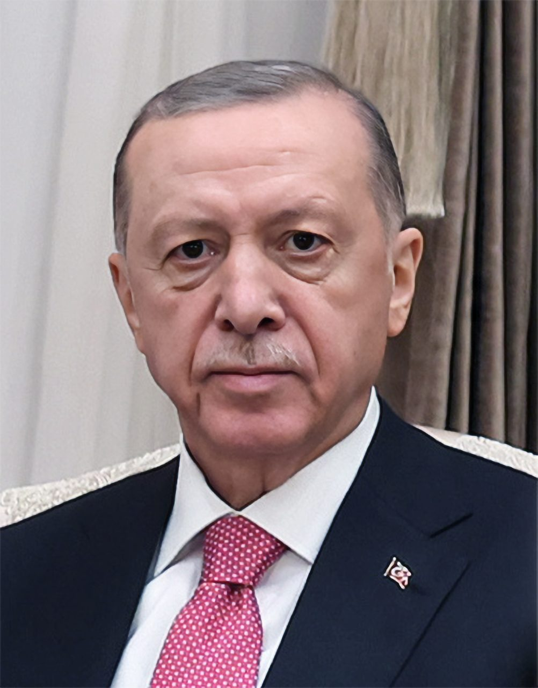

# Son haberler

Ajanın yazdığı son haberler (otomatik güncellenir).

## Erdoğan ve Aliyev Şuşa'da görüştü: Birlik ve kardeşlik mesajı

**Siyaset · Türkiye** · 2026-11-08 18:24 UTC · Kaynak: [Google Haberler - Cumhurbaşkanı](https://tr.euronews.com/2026/11/08/cumhurbaskani-erdogan-azerbaycanda-ortak-basin-toplantisinda-birlik-mesaji)

> Cumhurbaşkanı Erdoğan, Azerbaycan'ın Zafer Günü kutlamaları için gittiği Karabağ'da Aliyev ile bir araya geldi; iki lider ortak basın toplantısı düzenledi.

Cumhurbaşkanı Recep Tayyip Erdoğan, Azerbaycan'ın 8 Kasım Zafer Günü kutlamalarına katılmak üzere Karabağ'ı ziyaret etti. Ziyaret kapsamında Şuşa'da Azerbaycan Cumhurbaşkânı İlham Aliyev ile görüşen Erdoğan, ardından ortak basın toplantısına katıldı.

Şuşa'daki toplantıda konuşan Cumhurbaşkanı Erdoğan, iki ülke arasındaki ilişkilerin tarihin türlü imtihanlarından geçerek bugünkü seviyeye ulaştığını belirtti. Azerbaycan'ın haklı mücadelesini desteklediklerini vurgulayan Erdoğan, kalıcı barışın tesisine yönelik gayretlerin sürdüğünü ifade etti.

Azerbaycan Cumhurbaşkânı Aliyev ise İkinci Karabağ Savaşı döneminde Türkiye'nin verdiği desteğin unutulmayacağını kaydetti. Aliyev, Şuşa Beyannamesi'nin iki ülke arasındaki müttefiklik ilişkisini resmîleştirdiğini belirterek, birlik ve kardeşliğin sarsılmaz olduğunu dile getirdi.

---

## CHP'den Kastamonu'da Emekli Buluşması: 12 Kasım'da Ankara'da Bir Araya Gelinecek

**Siyaset · Türkiye** · 2026-11-08 18:24 UTC · Kaynak: [Google Haberler - CHP](https://www.sondakika.com/guncel/haber-chp-genel-baskan-yardimcilari-kastamonu-da-12-kasi-20407861/)

> CHP Genel Başkan Yardımcıları Demirci ve Saraç, Kastamonu'da emeklilerin ekonomik sorunlarına dikkat çekerek 12 Kasım'da Ankara'da 'Emekliler Buluşuyor' programının düzenleneceğini duyurdu.

CHP STK ve Sendikalardan Sorumlu Genel Başkan Yardımcısı Adnan Demirci ile Sosyal Politikalardan Sorumlu Genel Başkan Yardımcısı Necdet Saraç, CHP Kastamonu İl Başkanlığı'nda parti üyeleri ve basın mensuplarıyla bir araya geldi. Toplantıda Türkiye'nin ekonomik ve sosyal gündemi masaya yatırıldı.

Toplantıda konuşan Adnan Demirci, 12 Kasım'da Ankara'da gerçekleştirilecek "Emekliler Buluşuyor" programını duyurarak ilk buluşmanın ardından bölgesel toplantılarla çalışmaların Türkiye geneline yayılacağını belirtti. Yaklaşık 17 milyon emeklinin bulunduğunu hatırlatan Demirci, geçim sıkıntısı yaşayan emeklilerin önemli bir kısmının yeniden çalışmak zorunda kaldığını ifade etti.

Sosyal Politikalardan Sorumlu Genel Başkan Yardımcısı Necdet Saraç ise Kastamonu'nun göç veren yapısına ve genç işsizliğine dikkat çekti. Kentin giderek bir emekliler kentine dönüştüğünü savunan Saraç, emeklilerin büyük bölümünün açlık sınırının altında yaşam mücadelesi verdiğini söyledi. Saraç, gelir dağılımındaki adaletsizliğin giderilmesi ve kamu kaynaklarının toplum yararına kullanılması gerektiğini vurguladı.

Program kapsamında yerel basının yaşadığı ekonomik zorluklara da değinen Saraç, basının bağımsız olabilmesinin ekonomik özgürlükle doğrudan bağlantılı olduğunu belirtti. Toplantı sonunda CHP'nin ülkenin temel sorunlarına yönelik politikalarını toplumun farklı kesimleriyle birlikte geliştirmeye devam edeceği aktarıldı.

---

## Odunpazarı SK'dan üst üste aynı skorla mağlubiyet

**Spor · Odunpazarı** · 2026-11-08 18:23 UTC · Kaynak: [Google Haberler - Odunpazarı](https://www.istikbalgazetesi.com/odunpazarinda-34-30-kabusu)

> Çamlıca Spor Salonu'nda Üsküdar Belediyesi'ni ağırlayan Odunpazarı SK, ilk yarısını geride kapattığı mücadeleden 34-30 mağlup ayrıldı.

Hentbol liginde mücadele eden Odunpazarı SK, Çamlıca Spor Salonu'nda Üsküdar Belediyesi ile karşı karşıya geldi. Karşılaşmanın ilk devresini 19-15 geride kapatan Eskişehir temsilcisi, ikinci yarıda skoru lehine çevirmek için çaba gösterse de maçın sonunu getiremedi.

Mücadele konuk ekibin 34-30'luk üstünlüğüyle sona erdi. Bu sonuçla Eskişehir ekibi, ligde üst üste oynadığı son üç karşılaşmayı da aynı skorla (34-30) kaybederek puan yarışında yara aldı.

Odunpazarı SK'nın gol dağılımında Andrea Sedloska 8 golle öne çıkarken, Funda Okur ve Hatice Özdemir Ilıca beşer gol kaydetti. Ekipte ayrıca Nur Aleyna Köse 3, Halime Tuana Arslan 2, Seval Bozova, Selen Köklü, Fatma Atalar Işık, Zeynep Nur Kapaklıkaya, Ela Hüzmeli ve Hande Muhcu birer kez fileleri havalandırdı.

---

## İletişim Başkanı Duran'dan COP31 ve İklim Diplomasisi Vurgusu

**Türkiye · Türkiye** · 2026-11-08 18:23 UTC · Kaynak: [İletişim Başkanlığı](https://www.iletisim.gov.tr/turkce/haberler/detay/iletisim-baskani-durandan-cop31-ve-turkiyenin-iklim-diplomasisi-vizyonuna-iliskin-aciklama)

> İletişim Başkanı Burhanettin Duran, Antalya'da düzenlenecek COP31 zirvesinin Türkiye'nin iklim diplomasisi ve uluslararası etkinliği açısından tarihi bir fırsat olduğunu belirtti.

Cumhurbaşkanlığı İletişim Başkanı Burhanettin Duran, sosyal medya hesabı üzerinden yaptığı açıklamada, Türkiye'nin küresel iklim mücadelesinde üstlendiği sorumluluğa ve Antalya'da gerçekleştirilecek COP31 hazırlıklarına değindi. 9-20 Kasım tarihlerinde ev sahipliği ve başkanlık yapılacak zirvenin, Türkiye'nin iklim diplomasisindeki birikimini uluslararası toplumla paylaşması için önemli bir zemin sunduğunu ifade etti.

Zirve kapsamında 11-12 Kasım tarihlerinde düzenlenecek Liderler Zirvesi'nde çok sayıda devlet ve hükûmet başkanının ağırlanacağını belirten Duran, bu buluşmanın Türkiye'nin uluslararası görünürlüğüne ve diplomatik ilişkilerine katkı sağlayacağını aktardı. Ayrıca Emine Erdoğan'ın himayelerinde yürütülen Sıfır Atık Projesi'nin Türkiye'nin çevre konusundaki öncü yaklaşımını temsil ettiğini kaydetti.

Çevre, Şehircilik ve İklim Değişikliği Bakanı ve COP31 Başkanı Murat Kurum'un koordinasyonunda çalışmaların sürdüğünü belirten Duran, zirvenin taahhütlerin sahada karşılık bulduğu somut çözümler etrafında şekillenmesini hedeflediklerini bildirdi. İletişim Başkanlığı olarak yabancı gazetecileri ağırladıklarını ve medya merkezi hazırlıklarını yürüttüklerini ekledi.

---

## Eskişehirspor Kadın Futbol Takımı sahasında farklı mağlup oldu

**Spor · Tepebaşı** · 2026-11-08 18:23 UTC · Kaynak: [Google Haberler - Eskişehirspor](https://www.istikbalgazetesi.com/eskisehirspor-kadinlar-evinde-farkli-kaybetti-1-7)

> Kadınlar 2. Lig'in ikinci hafta mücadelesinde Eskişehirspor, konuk ettiği Bursa Soğanlıspor'a 7-1 yenilerek puansız kaldı.

Kadınlar 2. Lig'de mücadele eden Eskişehirspor Kadın Futbol Takımı, sezonun ikinci hafta maçında Bursa Soğanlıspor ile karşı karşıya geldi. Behiç Erkin Spor Kompleksi'nde oynanan karşılaşmada kırmızı-siyahlı ekip, rakibi karşısında beklenen oyunu sahaya yansıtamadı.

Maç boyunca defansif anlamda zorlanan Eskişehir temsilcisi, sahadan 7-1'lik farklı mağlubiyetle ayrıldı. Sezonun ilk haftasını da yenilgiyle kapatan ev sahibi ekip, bu sonuçla ligin geride kalan iki haftasında henüz puanla tanışamadı.

Kırmızı-siyahlı camiada lige yapılan bu talihsiz başlangıç üzüntü yaratırken, teknik heyet ve futbolcular ilerleyen haftalarda toparlanmak için çalışmalarını sürdürecek.

---

## Eskişehir'de seyyar tezgahta 45 bıçak ele geçirildi: Polisten tepki

**Asayiş · Odunpazarı** · 2026-11-08 18:23 UTC · Kaynak: [Google Haberler - Eskişehir asayiş](https://www.iha.com.tr/eskisehir-haberleri/45-tane-bicakla-yakalanan-saticiya-polis-gencler-bunlari-alip-suca-karisiyorlar-uyusturucu-gibi-bir-sey-512922010)

> Odunpazarı ilçesinde seyyar tezgahta bıçak satan şüpheliye zabıta ekiplerince müdahale edildi. Ele geçirilen 45 bıçakla ilgili şahsa para cezası kesilirken, polis memuru 'Bunlar uyuşturucu gibi bir şey' diyerek tepki gösterdi.

Eskişehir'de gerçekleştirilen seyyar denetimlerinde, açık alanda çok sayıda kesici alet satışı yapan bir kişi yakalandı. Alpu ilçesinden gelerek Odunpazarı ilçesi Emek Mahallesi Ertaş Bulvarı'nda seyyar tezgah açan S.Ş., Eskişehir Büyükşehir Belediyesi Zabıta Dairesi Başkanlığı ekiplerinin denetimine takıldı.

Zabıta ekiplerinin yaptığı kontrolde, seyyar tezgahta muhtelif cinslerde toplam 45 adet bıçak satışa sunulduğu belirlendi. Valiliğin 5442 sayılı İl İdaresi Kanunu uyarınca çıkardığı genel emir doğrultusunda, kamusal alanda izinsiz kesici ve delici alet taşınmasını engelleme kararı kapsamında şahsa 1.764 TL idari para cezası uygulandı. Tezgahtaki diğer eşyalarla birlikte bıçaklara el konuldu.

Olay yerine çağrılan polis ekipleri, şüpheliyi karakola götürürken duruma tepki gösterdi. Polis memuru, "Bunları gençler alıyorlar, suça karışıyorlar. Gençleri kötülüyorsun, bu uyuşturucu gibi bir şey. Suça meylettiriyorsunuz yani, küçücük çocuklardan biz bunları alıyoruz" sözleriyle tepkisini dile getirdi.

Zabıta Komiseri İbrahim Ergör, denetimlerin aralıksız sürdüğünü belirterek, "Ertaş Caddesi üzerinde yapılan denetimde seyyar tezgahta muhtelif cins bıçaklara rastlandı. Müsadere edilerek valilik makamının emirleri doğrultusunda gerekli işlemler yapılmak üzere İl Emniyet Müdürlüğü ekiplerine teslim edilmiştir" dedi. Şüpheli, adli işlemler için karakola götürüldü.

---

## Eskişehir'de kaçak tombala baskını: Çatıdan kaçmaya çalışan 40 kişiye ceza

**Asayiş · Odunpazarı** · 2026-11-08 18:23 UTC · Kaynak: [Google Haberler - Eskişehir](https://www.iha.com.tr/eskisehir-haberleri/eskisehirde-tombala-oynarken-sucustu-yakalanan-40-kisiye-464-bin-tl-ceza-kesildi-513104042)

> Odunpazarı'nda bir binanın bodrum katında yasadışı tombala oynatıldığı tespit edilen adrese baskın düzenlendi. Çatıdan kaçmaya çalışan 40 kişiye toplam 464 bin TL ceza kesildi.

Eskişehir'de emniyet ekiplerinin düzenlediği operasyonda, yasadışı kumar oynatıldığı belirlenen bir adrese baskın yapıldı. Odunpazarı ilçesindeki bir binanın bodrum katında tombala oynatıldığı ihbarı üzerine harekete geçen ekipler, adrese koordineli bir operasyon gerçekleştirdi.

Eskişehir İl Emniyet Müdürlüğü Asayiş, Narkotik Suçlarla Mücadele ve Göçmen Kaçakçılığıyla Mücadele Şube Müdürlüğü ekiplerinin katıldığı baskında renkli anlar yaşandı. Operasyon sırasında içerideki şahısların çatı katlarından kaçmaya çalıştığı ve oyun delillerini kaçırmak istediği görüldü. Ekiplerin hızlı müdahalesiyle binayı terk etmeye çalışan 40 kişi suçüstü yakalandı.

Adreste yapılan aramalarda çok sayıda masa, sandalye, çekiliş topu ve oyun kartı ele geçirildi. Suçüstü yakalanan 40 kişiye kişi başı 11 bin 604 TL olmak üzere toplam 464 bin 110 TL idari para cezası uygulandı.

Olayla ilgili olarak M.G. ve R.Z. isimli şüpheliler hakkında "kumar oynanması için yer ve imkan temin etmek" suçundan adli işlem başlatıldı. Ayrıca faaliyet yürütülen iş yerinin mühürlenmesi için de resmi işlemlerin başlatıldığı bildirildi.

---

## Elektrik faturalarında yeni dönem: 3 bin kWh sınırı geliyor

**Ekonomi · Türkiye** · 2026-11-08 18:23 UTC · Kaynak: [Google Haberler - Eskişehir gündem](https://www.eskisehir.net/1-ocakta-elektrik-faturalarinda-yeni-donem-basliyor-milyonlarca-abone-etkilenecek)

> EPDK düzenlemesiyle 1 Ocak 2027'de yürürlüğe girecek yeni uygulamayla, mesken abonelerinin Son Kaynak Tedarik Tarifesi'ne dahil edilmesindeki yıllık tüketim sınırı 3 bin kilovatsaate düşürülecek.

Enerji Piyasası Düzenleme Kurumu (EPDK) tarafından hazırlanan yeni düzenlemeyle, mesken abonelerinin Son Kaynak Tedarik Tarifesi'ne (SKTT) geçişinde esas alınan yıllık elektrik tüketim sınırında indirime gidiliyor. 1 Ocak 2027 itibarıyla yürürlüğe girecek uygulama kapsamında, mevcut 4 bin kilovatsaatlik sınır 3 bin kilovatsaate çekilecek. Türkiye genelindeki 44,2 milyon mesken abonesinin yaklaşık 6,5 milyonunun, yani yüzde 14,7'sinin bu düzenlemeden etkilenmesi bekleniyor.

Değişiklik öncesinde yüksek tüketim grubunda yer alabilecek abonelere bilgilendirme mesajları gönderilmeye başlanırken, tüketicilere farklı elektrik tedarikçilerinin sözleşme ve fiyat alternatiflerini incelemeleri tavsiye ediliyor. Yeni belirlenen 3 bin kilovatsaatlik yıllık tüketim sınırı, aylık ortalama 250 kilovatsaate denk geliyor. Bu tüketim miktarındaki elektrik faturasının yaklaşık 820 TL seviyesinde olduğu belirtilse de, uygulamada belirleyici unsur fatura tutarı değil yıllık tüketim miktarı olacak.

Yıllık elektrik tüketimi 3 bin kilovatsaat ve üzerinde olan mesken aboneleri yüksek tüketimli tüketici grubuna dahil edilecek. Başka bir elektrik tedarikçisiyle ikili anlaşma yapmayan aboneler ise Son Kaynak Tedarik Tarifesi üzerinden faturalandırılacak. Sınırı aşan abonelerin yeni tarifeye geçiş tarihi, limiti aştıkları ayı takip eden üçüncü ayın ilk günü olacak. Örneğin ekim ayında sınırı aşanlar 1 Ocak 2027'den, aralık ayında aşanlar ise 1 Mart 2027'den itibaren yeni tarifeye geçecek.

Düzenlemeden etkilenecek aboneler, EPDK tarafından yetkilendirilen şirketlerle ikili anlaşma yaparak farklı tedarikçi ve fiyat tekliflerini değerlendirme hakkına sahip olacak. Tedarikçi değişikliği, dağıtım şirketinin değişmesi veya elektrik kesintisi anlamına gelmiyor. Yetkililerden yapılan uyarılarda, SMS ile bilgilendirilen abonelerin dolandırıcılıklara karşı işlem yapmadan önce şirketlerin EPDK tarafından yetkilendirilip yetkilendirilmediğini kurumun resmi internet sitesinden doğrulaması gerektiği vurgulanıyor.

---

## Altın fiyatları 8 Kasım 2026: Gram altın 6.620,93 TL

**Ekonomi · Merkez** · 2026-11-08 12:28 UTC · Kaynak: [Harem Altın](https://www.haremaltin.com/altin-fiyatlari)

> Gram altın güne yükselişle başladı. Harem Altın verilerine göre gram altın 6.543,03 TL'den alınıyor, 6.620,93 TL'den satılıyor.

Altın piyasasında güne yükselişle başlandı. Harem Altın'ın saat 15.28 itibarıyla verilerine göre gram altının satış fiyatı 6.620,93 TL, alış fiyatı 6.543,03 TL oldu. Gram altın, önceki kapanışa göre yüzde 0,49 yükseldi.

Ziynet altınlarda çeyrek altın 10.791 TL, yarım altın 21.576 TL, tam altın 42.993 TL, ata altın 44.142 TL seviyesinden satışa sunuluyor.

22 ayar bileziğin gram satış fiyatı 6.185,06 TL, has altının gram fiyatı 6.601,13 TL olarak belirlendi.

Uluslararası piyasalarda altının onsu 4.071,20 dolardan işlem görürken, dolar/TL 50,23 seviyesinde bulunuyor.

Fiyatlar Harem Altın'ın saat 15.28 itibarıyla paylaştığı verilere dayanmaktadır; kuyumcular arasında farklılık gösterebilir. Bu haber yatırım tavsiyesi değildir.

---

## Yerli navigasyon ProtoPiri yola çıkıyor: Togg'da da yer alacak

**Ekonomi · Türkiye** · 2026-11-08 11:58 UTC · Kaynak: [Google Haberler - Togg](https://m.sabah.com.tr/gundem/2026/11/08/navigasyon-teknolojisinde-milli-rota/amp)

> Türkiye'nin milli imkânlarla geliştirdiği 'ProtoPiri' adı verilen yerli navigasyon uygulamasının 2027 yılının ilk çeyreğinde hizmete girmesi planlanıyor.

Sanayi ve Teknoloji Bakanlığı liderliğinde hazırlanan ve harita ile yön bulmanın atası Piri Reis'e atıfta bulunulan yerli navigasyon projesinin detayları netleşmeye başladı. Kamuoyu araştırmasının ardından netleşecek olan ProtoPiri isimli uygulamanın, yıl başında devreye alınması ve Togg'un içerisinde fabrika çıkışlı olarak yer alması planlanıyor.

Uygulama kapsamında kamu kurumlarıyla da entegrasyon sağlanacak. İçişleri Bakanlığı entegrasyonuyla radarların yerleri ve hız limitleri sürücülere aktarılacak, limit aşımında ise 'yavaş git' uyarısı yapılacak. Ayrıca 112 Çağrı Merkezi entegrasyonu sayesinde arkadan gelen ambulanslar navigasyon kullanan sürücülere bildirilecek. Proje, elektrikli araçlar için şarj istasyonu noktalarını da gösterecek.

Sanayi ve Teknoloji Bakanı Mehmet Fatih Kacır, veri güvenliği açısından stratejik bir alan olarak gördükleri yerli navigasyon uygulamasını önemsediklerini belirterek, 2027 yılı başından itibaren yabancı uygulamaların yerine tamamen yerli ve milli navigasyona geçiş yapılacağını kaydetti. Projede Togg'un da önemli katkıları bulunduğunu ifade etti.

---

## Maç sonu trafikte skandal: Ambulansın peşine takıldılar

**Ulaşım · Merkez** · 2026-11-08 11:58 UTC · Kaynak: [Google Haberler - Eskişehirspor](https://www.haberler.com/amp/eskisehirspor-maci-sonrasi-trafikte-bazi-suruculer-20406813-haberi/)

> Eskişehirspor maçı sonrasında Atatürk Bulvarı'nda oluşan yoğunlukta ilerlemeye çalışan ambulansın arkasına bazı sürücülerin takılması pes dedirtti.

Eskişehirspor'un oynadığı maçın ardından Atatürk Bulvarı'nda trafik yoğunluğu üst seviyeye ulaştı. Sıkışan trafikte görevine yetişmeye çalışan bir ambulans zor anlar yaşadı.

Olay sırasında bazı duyarlı sürücüler hemen sağa ve sola yanaşarak sağlık aracına geçiş koridoru oluşturdu. Ancak bazı sürücüler, oluşturulan bu güvenli yoldan faydalanarak ambulansın arkasına takıldı ve peşinden ilerlemeye çalıştı.

Trafikte yaşanan bu tehlikeli ve duyarsız anlar, çevredeki vatandaşların da dikkatini çekti ve tepki topladı.

---

## Eskişehir'de 10 Kasım anma programı belli oldu: İşte etkinlik takvimi

**Gündem · Merkez** · 2026-11-08 11:58 UTC · Kaynak: [Google Haberler - Eskişehir etkinlik](https://www.istikbalgazetesi.com/eskisehirde-10-kasim-ataturku-anma-programi-aciklandi-iste-etkinlik-takvimi)

> Gazi Mustafa Kemal Atatürk’ün ebediyete intikalinin 88’inci yıl dönümünde Eskişehir’de düzenlenecek resmi törenler ve etkinlik takvimi açıklandı.

Eskişehir'de Gazi Mustafa Kemal Atatürk’ün vefatının 88’inci yıl dönümü dolayısıyla gerçekleştirilecek 10 Kasım Atatürk’ü Anma Günü programı netleşti. Valilik koordinasyonunda düzenlenecek resmi törenlerin yanı sıra kamu kurumları, yerel yönetimler ve üniversiteler gün boyunca çeşitli etkinlikler organize edecek.

Resmi tören, 10 Kasım Salı günü saat 08.30’da Vilayet Alanı’ndaki Atatürk Anıtı önünde başlayacak. Program akışına göre saat 08.59’da çelenkler sunulacak, saat 09.05’te ise iki dakikalık saygı duruşunda bulunularak İstiklal Marşı eşliğinde bayraklar yarıya indirilecek. Bu sırada Eskişehir genelindeki binek araçlar klaksonlarını, fabrika ve işletmeler ise sirenlerini çalarak anma programına katılım sağlayacak. Tören alanındaki etkinliklerde ayrıca şiir okunacak, Anadolu Üniversitesi Öğretim Üyesi Prof. Dr. Burhan Sayılır bir konuşma yapacak ve Atatürk’ün kendi sesinden 10. Yıl Nutku dinletilecek.

Kentteki eğitim kurumları da kendi programlarını hazırladı. İl Milli Eğitim Müdürlüğü'nün resmi anma töreni saat 11.00’de Firuz Kanatlı Mesleki ve Teknik Anadolu Lisesi Konferans Salonu’nda yapılacak. Eskişehir Teknik Üniversitesi (ESTÜ) saat 08.45’teki anıt töreninin ardından Konferans Salonu’nda sahne gösterisi gerçekleştirecek. Eskişehir Osmangazi Üniversitesi (ESOGÜ) ve Anadolu Üniversitesi de saat 09.05’te kendi kampüslerindeki anıtlar önünde çelenk sunma törenleri düzenleyecek.

Belediyeler ve diğer kurumlar da gün boyunca anma etkinlikleri gerçekleştirecek. Büyükşehir Belediyesi Ulus Anıtı karşısında atölye çalışması yaparken, Odunpazarı Belediyesi belediye binası önündeki törenin ardından akşam Yunus Emre Kültür ve Sanat Merkezi’nde "Atatürk ve Musiki" konseri verecek. Tepebaşı Belediyesi Ramada Otel’de mevlit programı düzenleyecek. İl Kültür ve Turizm Müdürlüğü, Gençlik ve Spor İl Müdürlüğü ve İl Müftülüğü de sergiler, halk oyunları gösterileri ve mevit programlarıyla anma etkinliklerine katkı sunacak.

---

## Engelsiz Kültür Merkezi'nde özel öğrencilerden anlamlı Atatürk anması

**Kültür-Sanat · Odunpazarı** · 2026-11-08 11:58 UTC · Kaynak: [Google Haberler - Odunpazarı](https://www.sondakika.com/amp/haber-odunpazari-ndaki-engelsiz-kultur-ve-sanat-merkezi-20407111/)

> Odunpazarı Belediyesi Engelsiz Kültür ve Sanat Merkezi'nde eğitim alan özel öğrenciler, 10 Kasım kapsamında düzenlenen etkinlikte Atatürk'ü andı.

Odunpazarı Belediyesi'ne bağlı Engelsiz Kültür ve Sanat Merkezi'nde eğitim gören 17 yaş ve üzeri özel öğrenciler, 10 Kasım Atatürk'ü Anma Günü ve Haftası dolayısıyla özel bir programa imza attı. Etkinlikte Gazi Mustafa Kemal Atatürk'ün yaşamı, bağımsızlık mücadelesi ve Cumhuriyet'e kazandırdığı değerler ele alındı.

Anma programı, Atatürk'ün hayatını ve Kurtuluş Savaşı mücadelesini anlatan film gösterimiyle başladı. Öğrenciler film gösterimini ilgiyle takip ederken, programın devamında Atatürk'ün fotoğrafları ve anısını yaşatan görsellerden oluşan bir anma panosu hazırladı.

Etkinlik kapsamında ayrıca Atatürk'ün fikirleri, ilke ve devrimleri ile Cumhuriyet'in kuruluş süreci üzerine sohbet gerçekleştirildi. Öğrenciler düşüncelerini paylaşırken, 10 Kasım'ın Atatürk'ün mirasını anlama ve yaşatma günü olduğuna vurgu yapıldı. Merkez yetkilileri, engelli bireylerin sosyal ve kültürel yaşama katılımını destekleyen farkındalık etkinliklerinin süreceğini belirtti.

---

## Cumhurbaşkanı Erdoğan Şuşa'da resmî törenle karşılandı

**Siyaset · Türkiye** · 2026-11-08 11:58 UTC · Kaynak: [İletişim Başkanlığı](https://www.iletisim.gov.tr/turkce/haberler/detay/cumhurbaskani-erdogan-azerbaycanda-resmi-torenle-karsilandi-08-11-26)

> Azerbaycan Cumhurbaşkanı Aliyev'in davetiyle Şuşa'ya giden Cumhurbaşkanı Erdoğan, Fuzuli Uluslararası Havalimanı'nın ardından geldiği valilik binasında resmî törenle karşılandı.

Cumhurbaşkanı Recep Tayyip Erdoğan, Azerbaycan Cumhurbaşkanı İlham Aliyev'in davetine icabetle gerçekleştirdiği ziyaret kapsamında Şuşa'da resmî törenle karşılandı. 

Cumhurbaşkanı Erdoğan ve eşi Emine Erdoğan, Fuzuli Uluslararası Havalimanı'na iniş yapmalarının ardından Şuşa Valiliğine geçti. Erdoğan çifti, burada Azerbaycan Cumhurbaşkanı İlham Aliyev ve eşi Mihriban Aliyeva tarafından karşılandı.

Tören alanındaki yerlerini alan liderlerin ardından askerî bando iki ülkenin millî marşlarını çaldı. Karşılama töreninde Cumhurbaşkanı Erdoğan ve Azerbaycan Cumhurbaşkanı Aliyev, heyet üyelerini birbirine tanıttı.

Cumhurbaşkanı Erdoğan'ın heyetinde Dışişleri Bakanı Hakan Fidan, Millî Savunma Bakanı Yaşar Güler, Tarım ve Orman Bakanı İbrahim Yumaklı, MİT Başkanı İbrahim Kalın, Cumhurbaşkanlığı İletişim Başkanı Burhanettin Duran, Cumhurbaşkanı Dış Politika ve Güvenlik Başdanışmanı Akif Çağatay Kılıç, Cumhurbaşkanlığı Güvenlik ve Dış Politikalar Kurulu Başkanvekili Çağrı Erhan, AK Parti Genel Başkan Yardımcısı ve Türk Devletleri ile İlişkiler Başkanı Kürşad Zorlu ile Türk Devletleri Teşkilatı Aksakallar Konseyi Başkanı Binali Yıldırım yer aldı.

---

## Çamlıca Kapalı Pazar Yeri'nde şaşırtan soğan kıtlığı: Tek esnaf satıyor

**Ekonomi · Tepebaşı** · 2026-11-08 11:58 UTC · Kaynak: [Google Haberler - Tepebaşı](https://www.gzt26.com/eskisehir-camlica-kapali-pazar-yerinde-sasirtan-manzara)

> Eskişehir'in Tepebaşı ilçesindeki Çamlıca Kapalı Pazar Yeri'nde yüzlerce tezgah kurulmasına rağmen kuru soğan satan yalnızca bir esnaf kalması vatandaşları şaşırttı.

Tepebaşı ilçesinde her hafta kurulan Çamlıca Kapalı Pazar Yeri'nde mutfakların vazgeçilmez temel gıdalarından kuru soğan bulmakta zorlanan vatandaşlar şaşkınlık yaşıyor. Yüzlerce tezgahın yer aldığı pazarda, kuru soğan satışı yapan yalnızca bir esnafın bulunması dikkat çekti.

Pazara alışveriş yapmak için gelen vatandaşlar, tezgahlarda soğan aradı ancak farklı bölümleri dolaşmalarına rağmen ürünü bulamadı. Yalnızca tek bir tezgahta satılan kuru soğanın kilogram fiyatı ise 40 TL olarak belirlendi. Vatandaşlar, günlük yemeklerin en temel malzemelerinden biri olan soğanın pazarda bu kadar az bulunmasını sorguladı.

Pazarcı esnafı ise yaşanan bu durumun sebebini yeni mahsul ürünlerin henüz piyasaya çıkmamış olmasına bağladı. Esnaf, arz sıkıntısının geçici olduğunu ve yeni mahsulün gelmesiyle durumun düzeleceğini ifade etti. Pazarda diğer sebze ve meyvelerin satışı normal seyrinde devam ediyor.

---

## Başkan Ataç ve Faruk Eczacıbaşı'ndan Eskişehir OSB'de tesis incelemesi

**Ekonomi · Tepebaşı** · 2026-11-08 11:58 UTC · Kaynak: [Google Haberler - Eskişehir](https://ankahaber.net/haber/tepebasi-belediye-baskani-atac-ve-faruk-eczacibasi-eskisehir-osb-deki-yeni-montaj-tesisini-inceledi-939bbe4d)

> Tepebaşı Belediye Başkanı Ahmet Ataç ile Eczacıbaşı Holding Yönetim Kurulu Başkan Yardımcısı Faruk Eczacıbaşı, Eskişehir OSB'deki yeni montaj tesisini gezdi.

Tepebaşı Belediye Başkanı Ahmet Ataç ve Eczacıbaşı Holding Yönetim Kurulu Başkan Yardımcısı Faruk Eczacıbaşı, Good Sanitation Company’nin Eskişehir Organize Sanayi Bölgesi’nde kurduğu yeni montaj tesisini ziyaret ederek incelemelerde bulundu. Ziyarette firmanın kurucu ortakları ile akademik danışma kurulu üyeleri de yer aldı.

Tesisin üretim altyapısı ve kapasitesi hakkında yetkililerden bilgi alan Başkan Ataç ile Faruk Eczacıbaşı, çalışanlarla da sohbet etti. Ziyaretin sonunda Ataç, Eskişehir'in simgelerinden fabrika bacasını temsil eden bir figürü Eczacıbaşı’na takdim etti.

Belediyenin şirketin ilk müşterileri arasında yer aldığını belirten Tepebaşı Belediye Başkanı Ahmet Ataç, "Eskişehir’de böylesine yenilikçi ve çözüm odaklı bir üretimin hayata geçirilmesinden büyük mutluluk duyuyoruz. TAK için temin ettiğimiz mobil tuvaletler, firmanın geliştirdiği ürünlerin sahadaki karşılığını görmemizi sağladı. Bu yatırım ve üretim kapasitesinin seri üretime dönüşmesi, geliştirilen teknolojilerin daha geniş kesimlere ulaşması açısından önemli" dedi.

Good Sanitation Company Kurucu Ortağı ve CEO’su Dilek Turan da su, kanalizasyon ve elektrik altyapısından bağımsız çalışabilen sistemler geliştirdiklerini belirterek, yeni montaj tesislerinde yıllık bin adet üretim kapasitesine ulaştıklarını kaydetti. Şirketin kurucu ortağı ve CTO’su Halil İbrahim Kemaneci ise Tepebaşı Belediyesi’nin ilk kullanıcı olarak sunduğu desteğin kendileri için çok değerli olduğunu ifade etti.

---

## Ataç ve Eczacıbaşı'ndan Eskişehir'in üretim hamlesine ziyaret

**Belediye · Tepebaşı** · 2026-11-08 11:58 UTC · Kaynak: [Tepebaşı Belediyesi](https://www.tepebasi.bel.tr/Haber/Detay/baskanatacvefarukeczacıbası’ndaneskisehir’inuretimhamlesinedestek)

> Tepebaşı Belediye Başkanı Ahmet Ataç ve Eczacıbaşı Holding Yönetim Kurulu Başkan Yardımcısı Faruk Eczacıbaşı, Eskişehir OSB'deki yeni montaj tesisini inceledi.

Tepebaşı Belediye Başkanı Ahmet Ataç, Eczacıbaşı Holding Yönetim Kurulu Başkan Yardımcısı ve Türkiye Bilişim Vakfı Başkanı Faruk Eczacıbaşı ile birlikte Good Sanitation Company’nin Eskişehir Organize Sanayi Bölgesi’ndeki yeni montaj tesisini ziyaret etti. Ziyarette, şirketin kurucu ortakları ve akademik danışma kurulu üyeleri de hazır bulundu.

Yılda 1 bin adet üretim kapasitesine sahip tesiste incelemelerde bulunan Başkan Ataç ve Faruk Eczacıbaşı, ürünler, üretim altyapısı ve kapasite hakkında yetkililerden bilgi aldı. Ziyaret sırasında çalışanlarla da sohbet eden Ataç, Eskişehir’in simgelerinden fabrika bacasını temsil eden bir figürü Faruk Eczacıbaşı’na armağan etti.

Good Sanitation Company’nin ilk müşterilerinden olduklarını hatırlatan Başkan Ataç, Tepebaşı Arama Kurtarma Ekibi için firmadan mobil tuvalet temin ettiklerini belirterek, yenilikçi üretimlerin seri üretime geçmesinin ve geliştirilen teknolojilerin yaygınlaşmasının önemine dikkat çekti.

Şirket CEO'su Dr. Dilek Turan, su, kanalizasyon ve elektrik altyapısından bağımsız çalışabilen mobil tuvalet ve hijyen sistemleri geliştirdiklerini aktararak, patentli teknolojileriyle atık suyu geri dönüştürdüklerini ve yeni tesislerinde yıllık 1 bin adet üretim kapasitesine ulaştıklarını kaydetti. CTO Halil İbrahim Kemaneci ise Tepebaşı Belediyesi'ne ilk kullanıcı olarak verdikleri destekten ötürü teşekkür etti.

---

## Tepebaşı'nda toplumsal cinsiyet eşitliği ve şiddet semineri

**Belediye · Tepebaşı** · 2026-11-08 06:40 UTC · Kaynak: [Google Haberler - Tepebaşı](https://www.toplumsal.com.tr/haber/tepebasi-nda-seminere-40-kisi-katildi_33414/)

> Tepebaşı Belediyesi tarafından Bahçelievler Belde Evi'nde düzenlenen toplumsal cinsiyet eşitliği ve şiddet konulu seminerde 40 kursiyer bir araya geldi.

Tepebaşı Belediyesi, ilçe genelinde toplumsal cinsiyet eşitliği ve şiddet konularında farkındalığı artırmaya yönelik eğitim çalışmalarını sürdürüyor. Bu kapsamda Bahçelievler Belde Evi'nde gerçekleştirilen seminere toplam 40 kişi katılım gösterdi.

Sağlık İşleri Müdürlüğü bünyesinde görev yapan psikolog Ecem Kumaş'ın konuşmacı olarak katıldığı buluşmada, örgü grubundan 23 ve giyim grubundan 17 kursiyer yer aldı. Oturumda katılımcılara toplumsal cinsiyet eşitliği ile şiddet konularında bilgilendirme yapılarak farkındalıklarının desteklenmesi hedeflendi.

Belediye yetkilileri, benzer eğitim etkinliklerinin ay boyunca farklı noktalardaki tüm belde evleri ve deneyimli kafelerde devam edeceğini bildirdi.

---

## İletişim Başkanı Duran'dan TRT World Forum'da dijital egemenlik vurgusu

**Türkiye · Türkiye** · 2026-11-08 06:40 UTC · Kaynak: [İletişim Başkanlığı](https://www.iletisim.gov.tr/turkce/haberler/detay/iletisim-baskani-duran-algoritmik-cagda-kontrol-kimde-sirketler-devletler-vatandaslar-baslikli-oturumda-konustu)

> İletişim Başkanı Burhanettin Duran, TRT World Forum 2026'da yaptığı konuşmada, dijital dünyanın birkaç teknoloji şirketinin kontrolüne bırakılamayacağını belirterek hesap verebilirlik, adalet ve çoğulculuk çağrısı yaptı.

Cumhurbaşkanlığı İletişim Başkanı Burhanettin Duran, TRT tarafından "Merkezsiz Dünya: Kurallar Geçersiz Kaldığında Kim Liderlik Eder?" temasıyla İstanbul Kongre Merkezi'nde düzenlenen TRT World Forum etkinliğine katıldı.

Etkinliğin ikinci gününde gerçekleştirilen "Algoritmik Çağda Kontrol Kimde? Şirketler, Devletler, Vatandaşlar" başlıklı oturumda konuşan Duran, bilgi ve iletişim teknolojilerindeki dijital devrimin getirdiği sorunlara dikkat çekti. Geleneksel gazetecilikteki editöryal denetimin yerini algoritmaların aldığını belirten Duran, bu durumun doğru ve önemli haberlerin kitlelere ulaşmasını engellerken yanıltıcı paylaşımların hızla yayılmasına yol açtığını ifade etti.

Algoritmaların tarafsız olmadığını ve arkasında ticari ile siyasi çıkarlar barındırdığını vurgulayan İletişim Başkanı Duran, bir avuç şirketin insanların ne göreceğini kontrol etmesinin düşünceyi de şekillendirdiğini kaydetti. Türkiye açısından bu durumun bir dijital egemenlik meselesi olduğunun altını çizen Duran, teknolojik ilerlemenin insanlara ve toplumlara hizmet etmesi gerektiğini belirtti.

Duran, daha adil bir dijital düzen için hesap verebilirlik, algoritmik dağıtımda adalet ve çoğulculuk olmak üzere üç temel ilkenin önemine işaret etti. Ayrıca TRT ve Anadolu Ajansının farklı dillerdeki yayıncılık faaliyetleriyle hakikati dünyaya ulaştırma çabasını sürdürdüğünü, bu süreçte gazetecilerin önemli bedeller ödediğini sözlerine ekledi.

---

## Eskişehirli sanatçıların eserleri COP31'de sergileniyor

**Kültür-Sanat · Merkez** · 2026-11-08 06:40 UTC · Kaynak: [Google Haberler - Eskişehir etkinlik](https://www.ensondakika.com.tr/artik-sergisi-cop31-de-antalya-da-sanatseverlerle-bulusuyor/736394/)

> Çanakkale, Eskişehir ve İzmir'den sanatçıların atık metallerden yaptığı eserlerin yer aldığı 'ARTIK' sergisi Antalya'da sanatseverlerle buluştu.

Akfen Holding işbirliği ve Loft Art katkılarıyla hayata geçirilen "ARTIK" sergisi, Birleşmiş Milletler İklim Değişikliği Çerçeve Sözleşmesi'nin 31. Taraflar Konferansı (COP31) sürecinde Gloria Hotels & Resorts ev sahipliğinde kapılarını açtı.

Sürdürülebilirlik kavramını sanatın yaratıcı gücüyle ele alan sergi; plastik parçalar, kullanılmış elektronik cihazlar ve atık metaller gibi malzemeleri sanat aracılığıyla yeniden yorumluyor. Eserlerin büyük bölümü, endüstriyel üretim atıklarının ileri dönüşümüyle heykellere dönüştürüldü. Çanakkale, Eskişehir ve İzmir'den altı sanatçının katkı sunduğu sergi, doğanın döngüsünü ve tüketim alışkanlıklarının canlı yaşamına etkilerini gözler önüne seriyor.

Akfen Holding Yönetim Kurulu Üyesi Pelin Akın Özalp, sergiyle doğanın tahribatına ve bilinçsiz tüketime dikkat çekmek istediklerini belirterek, "Yaşamın kaynağı olan doğanın bir gün metallerden oluştuğunu düşünmek korkutucu ama bir o kadar da mümkün. Bu ihtimali sanat aracılığıyla görünür kılmak istedik" ifadelerini kullandı.

Özaltın Holding Yönetim Kurulu Başkan Yardımcısı Elif Özdemir Şankaya ise kullanım ömrünü tamamlamış malzemelerin sanatla yeniden anlam kazanmasının döngüsel ekonominin yaratıcı yönünü ortaya koyduğunu vurguladı. 29 Kasım'a kadar Gloria Serenity Resort'ta gezilebilecek olan sergi, izleyicileri tüketim alışkanlıklarını yeniden sorgulamaya davet ediyor.

---

## Eskişehir'de kışlık alışveriş hareketliliği: Termal ürünler kapışılıyor

**Ekonomi · Tepebaşı** · 2026-11-08 06:40 UTC · Kaynak: [Google Haberler - Eskişehir](https://www.gazetevatan.com/sehirler/eskisehir/eskisehirde-kislik-kiyafetlere-yogun-talep-termal-urunler-kapisiliyor-2462470)

> Havaların soğumasıyla birlikte Eskişehir'deki pazarlarda kışlık kıyafetlere talep arttı. Vatandaşlar uygun fiyatlı termal ürünlere yöneldi.

Eskişehir'de hava sıcaklıklarının düşmesi, vatandaşları kışlık kıyafet alışverişine yönlendirdi. Tepebaşı ilçesindeki Çamlıca Kapalı Pazar Yeri'nde piyasa fiyatlarının altında satışa sunulan kışlık ürünler yoğun ilgi görüyor.

Pazarda özellikle soğuk havaların vazgeçilmezi olan termal kıyafetler vatandaşlar tarafından en çok tercih edilen ürünler arasında yer alıyor. Bunun yanı sıra günlük kullanıma uygun eşofman altları, sweatshirtler ve çoraplar da tezgahlarda hareketlilik oluşturuyor.

Farklı ihtiyaçlara yönelik kıyafetleri bütçelerine uygun fiyatlarla temin etmek isteyen vatandaşlar tezgahları doldururken, kış hazırlıkları kapsamında pazar yerindeki alışveriş yoğunluğunun devam etmesi bekleniyor.

---

## Cumhurbaşkanı Erdoğan bugün Azerbaycan'a gidiyor: Karabağ'ı ziyaret edecek

**Siyaset · Türkiye** · 2026-11-08 06:40 UTC · Kaynak: [Google Haberler - Cumhurbaşkanı](https://www.ntv.com.tr/turkiye/cumhurbaskani-erdogan-bugun-azerbaycana-gidecek-1749891)

> Cumhurbaşkanı Recep Tayyip Erdoğan, 8 Kasım Zafer Günü dolayısıyla bugün Azerbaycan'ı ziyaret ederek Karabağ'da temaslarda bulunacak.

Cumhurbaşkanı Recep Tayyip Erdoğan, Azerbaycan Cumhurbaşkanı İlham Aliyev'in daveti üzerine Zafer Günü kutlamalarına katılmak üzere bugün Azerbaycan'a gidecek. Ziyaret kapsamında iki lider ikili ilişkileri ve bölgesel gelişmeleri ele alacak.

İletişim Başkanı Burhanettin Duran, ziyaretin Azerbaycan'ın Zafer Günü vesilesiyle gerçekleştirileceğini belirterek, iki liderin Türkiye-Azerbaycan iş birliğinin yanı sıra küresel ve bölgesel meseleleri istişare edeceğini açıkladı. Ziyaret öncesinde Erdoğan, Aliyev'e gönderdiği tebrik mektubunda 30 yıllık işgalin sona ermesinin ardından elde edilen zaferin Türk dünyası için gurur kaynağı olduğunu vurguladı.

Mecliste Şuşa Beyannamesi ile pekiştirilen kardeşlik vurgusu yapan Erdoğan, Güney Kafkasya'nın artık bir çatışma bölgesi değil, iş birliği ve kalkınma merkezi olarak anıldığını ifade etti. Mektupta ayrıca vatan savunmasında hayatını kaybeden şehitler rahmetle anıldı.

Azerbaycan, Karabağ'da Ermenistan işgaline son veren 2. Karabağ Savaşı'nın ardından Zafer Günü'nü 8 Kasım'da kutluyor.

---

## Yunus Emre Yurdu'nda yangın tatbikatı: Gerçeğini aratmadı

**Gündem · Merkez** · 2026-11-07 22:46 UTC · Kaynak: [Google Haberler - Eskişehir asayiş](https://www.haberler.com/amp/eskisehir-yunus-emre-yurdu-personeline-yangin-20404168-haberi/)

> Eskişehir Yunus Emre Yurdu personel kapsamlı yangın eğitimi ve uygulamalı tahliye tatbikatıyla acil durumlara karşı hazırlandı.

Gençlik ve Spor Bakanlığı Eskişehir Yurt Müdürlüğü bünyesinde faaliyet gösteren Yunus Emre Yurdu'nda görevli personele yönelik yangın güvenliği eğitimi ve uygulamalı tatbikat gerçekleştirildi.

Düzenlenen programın ilk aşamasında personele, olası bir yangın anında sergilenecek doğru hareket tarzları, güvenli tahliye adımları ve yangın söndürme cihazlarının etkin kullanımı konularında teorik bilgiler aktarıldı.

Eğitimin ardından yurt bahçesinde senaryo gereği kontrollü bir yangın çıkarıldı. Teorik bilgileri pratiğe döken yurt personeli, yangına müdahale ederek söndürme işlemlerini başarıyla tamamladı.

---

## Kasım 2026'nın en ucuz elektrikli otomobilleri: Togg da listede

**Ekonomi · Türkiye** · 2026-11-07 22:46 UTC · Kaynak: [Google Haberler - Togg](https://www.yenisafak.com/galeri/ekonomi/kasim-2026da-elektrikli-otomobil-alacaklar-dikkat-en-ucuz-10-model-siralandi-4870514)

> Türkiye'de satışa sunulan en uygun fiyatlı 10 elektrikli otomobilin kasım ayı güncel fiyatları belli oldu. Bütçe dostu listede Togg modelleri de yer aldı.

Türkiye otomobil pazarında satışta olan en uygun fiyatlı elektrikli araçların Kasım 2026 dönemi fiyatları ve teknik detayları netleşti. Şehir içi kullanıma uygun kompakt modellerden SUV segmentine kadar farklı seçeneklerin yer aldığı listede fiyatlar 1,5 milyon TL seviyesinden başlıyor.

Otomobil pazarındaki bütçe dostu seçenekler arasında Togg'un T10X ve T10F modelleri de kendine yer buldu. Listeye göre Togg T10X 1.909.048 TL'den başlayan fiyatla sunulurken, Togg T10F ise 1.884.980 TL'lik fiyat etiketiyle alıcı bekliyor. İki model de gelişmiş batarya kapasiteleri ve hızlı şarj destekleriyle dikkat çekiyor.

Sıralamada yer alan diğer modeller ve başlangıç fiyatları ise şu şekilde sıralandı: Hyundai Inster 1.520.000 TL, Fiat Grande Panda Elektrikli 1.584.900 TL, Citroën ë-C3 1.605.000 TL, Fiat 600e 1.854.900 TL, Citroën ë-C3 Aircross 1.875.000 TL, Opel Corsa Elektrik 1.890.000 TL, Opel Frontera Elektrik 1.895.000 TL ve Peugeot E-208 2.080.000 TL.

---

## Eskişehir İl Halk Kütüphanesi'nde öğrencilere yönelik drama atölyesi yapıldı

**Kültür-Sanat · Merkez** · 2026-11-07 22:46 UTC · Kaynak: [Google Haberler - Eskişehir etkinlik](https://www.anadolugazetesi.com/eskisehir-il-halk-kutuphanesi-nde-ogrenciler-icin-drama-atolyesi-duzenlendi-297707.html)

> Millî Eğitim Bakanlığı ile Kültür ve Turizm Bakanlığı protokolü kapsamında Eskişehir İl Halk Kütüphanesi'nde öğrenciler için drama atölyesi düzenlendi.

Eskişehir İl Halk Kütüphanesi, öğrencilerin kişisel gelişimlerini ve sosyal becerilerini desteklemeye yönelik renkli bir etkinliğe ev sahipliği yaptı. Millî Eğitim Bakanlığı ile Kültür ve Turizm Bakanlığı arasında hayata geçirilen "Kütüphanelerde İş Birliği Protokolü" çerçevesinde gerçekleştirilen drama atölyesi, öğrencilerden yoğun ilgi gördü.

İl Millî Eğitim Müdürlüğü koordinasyonunda kütüphane bünyesinde düzenlenen çalışmalarda uzman eğitmenler görev aldı. Etkinlik boyunca gençlerin kendilerini ifade etme yeteneklerini artırmak, iletişim güçlerini pekiştirmek ve hayal güçlerini harekete geçirmek amacıyla çeşitli uygulamalar yapıldı.

Eğlenceli ve öğretici anlara sahne olan program, öğrencilerin katıldığı ortak canlandırma çalışmalarının ardından başarıyla tamamlandı.

---

## Odunpazarı'nda otomobil bisikletle çarpıştı: Çocuk yaralandı

**Asayiş · Odunpazarı** · 2026-11-07 22:45 UTC · Kaynak: [Google Haberler - Odunpazarı](https://www.sondakika.com/3-sayfa/haber-eskisehir-odunpazari-nda-otomobil-bisikletle-carpi-20405712/)

> Eskişehir'in Odunpazarı ilçesinde otomobilin bisikletle çarpışması sonucu meydana gelen kazada bir çocuk yaralandı. Kaza anı güvenlik kameralarına yansıdı.

Eskişehir'de otomobil ile bisikletin çarpışması sonucu yaşanan kazada bir çocuk yaralandı.

Kaza, Odunpazarı ilçesi Kurtuluş Mahallesi Bilgin Sokak üzerinde meydana geldi. Alınan bilgilere göre, otomobil ile bisikletin çarpışması neticesinde bisikletten düşen çocuk yaralandı. Çevredekilerin ihbarı üzerine olay yerine 112 Acil Sağlık ve polis ekipleri yönlendirildi.

Yaralı çocuk, sağlık ekiplerinin olay yerindeki ilk müdahalesinin ardından ambulansla hastaneye kaldırılarak tedavi altına alındı. Öte yandan kaza anı çevredeki bir güvenlik kamerasının kayıtlarına anbean yansıdı.

Polis ekipleri kazayla ilgili inceleme başlattı.

---

## Eskişehirspor evinde kazandı: Kepezspor'u tek golle geçtiler

**Spor · Tepebaşı** · 2026-11-07 22:45 UTC · Kaynak: [Google Haberler - Eskişehir](https://www.akdenizgercek.com.tr/kepez/kepezspor-as-eskisehir-deplasmaninda-geriye-dustu-1-0/388805)

> Nesine 3. Lig'de Eskişehirspor, sahasında konuk ettiği Kepezspor'u 20. dakikada Hasan Kaya'nın attığı golle 1-0 mağlup etti.

Nesine 3. Lig 10. hafta mücadelesinde Eskişehirspor ile Antalya temsilcisi Kepezspor A.Ş. karşı karşıya geldi. Prof. Dr. Fethi Heper Stadyumu’nda oynanan karşılaşmada ev sahibi ekip sahadan 1-0 galibiyetle ayrıldı.

Yağmurlu hava ve yoğun taraftar desteği altında oynanan mücadelenin ilk dakikalarından itibaren hücumda etkili bir oyun ortaya koyan Eskişehirspor, aradığı golü 20. dakikada buldu. Mert Bağer’in pasını iyi değerlendiren Hasan Kaya, meşin yuvarlağı ağlarla buluşturarak takımını 1-0 öne geçirdi ve ilk yarı bu skorla tamamlandı.

Maçın ikinci devresinde erken yediği golün dezavantajını kapatmak ve beraberliği yakalamak için rakip kalede ataklar geliştiren Kepezspor A.Ş., Eskişehirspor savunmasını aşamadı. Saha ve seyirci avantajını maç sonuna kadar koruyan kırmızı-siyahlılar, skoru koruyarak hanesine 3 puan yazdırdı.

---

## Robotik Türkiye Platformu kuruldu: Togg da yer aldı

**Ekonomi · Türkiye** · 2026-11-07 18:05 UTC · Kaynak: [Google Haberler - Togg](https://www.cozumpark.com/robotik-turkiye-platformu-kuruldu-togg-thy-ve-eczacibasi-ayni-catida-bulustu/)

> Türkiye Bilişim Vakfı öncülüğünde kurulan Robotik Türkiye Platformu, yerli sanayi kuruluşları ve teknoloji girişimlerini fiziksel yapay zekâ alanında buluşturdu.

Türkiye Bilişim Vakfı öncülüğünde hayata geçirilen Robotik Türkiye Platformu, yerli sanayi kuruluşları ile teknoloji girişimlerini ortak bir ekosistemde bir araya getirdi. İstanbul Modern'de düzenlenen lansmanla tanıtılan platformun kurucu üyeleri arasında Togg'un yanı sıra Eczacıbaşı Topluluğu, Milvus Robotics, Türk Hava Yolları ve Zorlu Holding yer alıyor.

Girişim; üniversiteler, teknoloji girişimleri, yatırımcılar ve kamu kurumlarını da paydaş olarak buluşturarak robotik teknolojilerin sanayide uygulanmasını ve ticarileşmesini amaçlıyor. Odaklanılan fiziksel yapay zekâ sistemleri; depo otomasyonundan üretim hatlarına, tarımdan sağlık hizmetlerine kadar geniş bir kullanım alanı sunuyor.

Tanıtım etkinliğinde ayrıca Togg sponsorluğunda hazırlanan Türkiye Robotik Ekosistemi Raporu da açıklandı. Rapora göre Türkiye'de 2025 yılı boyunca 3 bin 194 endüstriyel robot kurulumu gerçekleştirildiği belirtildi.

Platform, ilk yılında pilot uygulamalar, bilgi ve deneyim paylaşımı ile kamu ile sektör diyaloğu olmak üzere üç temel çalışma alanına odaklanacak.

---

## Kurşunlu Külliyesi'ndeki müzeler ziyarete kapatıldı

**Belediye · Odunpazarı** · 2026-11-07 18:05 UTC · Kaynak: [Google Haberler - Odunpazarı](https://www.istikbalgazetesi.com/odunpazari-belediyesi-muzelerin-kapatildigini-ziyaretcilere-bu-pankartla-duyurdu)

> Odunpazarı Belediyesi, Vakıflar Bölge Müdürlüğü tarafından alandan çıkarıldıklarını belirterek Kurşunlu Külliyesi'ndeki dört müzenin kapandığını duyurdu.

Eskişehir'in turistik açıdan önemli merkezlerinden biri olan Kurşunlu Külliyesi bünyesindeki müzeler ve sanat merkezi kapılarını kapattı. Ahşap Eserler Müzesi, Fotoğraf Müzesi, Lületaşı Müzesi ve Cam Sanatları Merkezi'nin ziyarete kapatıldığı bildirildi.

Odunpazarı Belediyesi tarafından alana asılan pankartla durum ziyaretçilere duyuruldu. Açıklamada, kapatma kararının Vakıflar Bölge Müdürlüğü tarafından belediyenin alandan çıkarılması nedeniyle alındığı ifade edildi.

Belediye yönetimi, ziyaretçilerin yaşadığı hayal kırıklığını paylaştıklarını belirterek gösterilen anlayış için teşekkür etti.

---

## Eskişehir'de Erzurum Gastronomi ve Cağ Kebabı Festivali Başladı

**Kültür-Sanat · Merkez** · 2026-11-07 18:05 UTC · Kaynak: [Google Haberler - Eskişehir](https://www.esgazete.com/eskisehirde-erzurum-lezzetleri-bulusmasi)

> Eskişehir'de düzenlenen Erzurum Gastronomi ve Cağ Kebabı Festivali, Vali Dr. Erdinç Yılmaz'ın katılımıyla kapılarını açtı.

Eskişehir Erzurumlular Sosyal Yardımlaşma, Kültür ve Dayanışma Derneği tarafından Erzurum'un zengin mutfak kültürünü tanıtmak ve hemşehri dayanışmasını güçlendirmek amacıyla Erzurum Gastronomi ve Cağ Kebabı Festivali düzenlendi. Etkinliğe Eskişehir Valisi Dr. Erdinç Yılmaz da katılarak incelemelerde bulundu.

Erzurum'un köklü gastronomi kültürünün en önemli simgelerinden biri olan cağ kebabının ön plana çıkarıldığı festival, yöresel lezzetlerin gelecek nesillere aktarılmasını amaçlıyor. Kentte faaliyet gösteren hemşehri derneklerinin düzenlediği bu tür etkinlikler, farklı şehirlerin geleneklerinin yaşatılmasına ve kültürel bağların korunmasına katkı sağlıyor.

---
