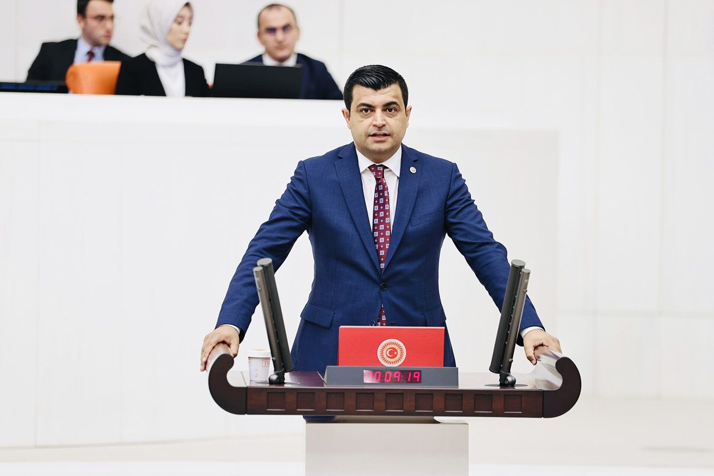
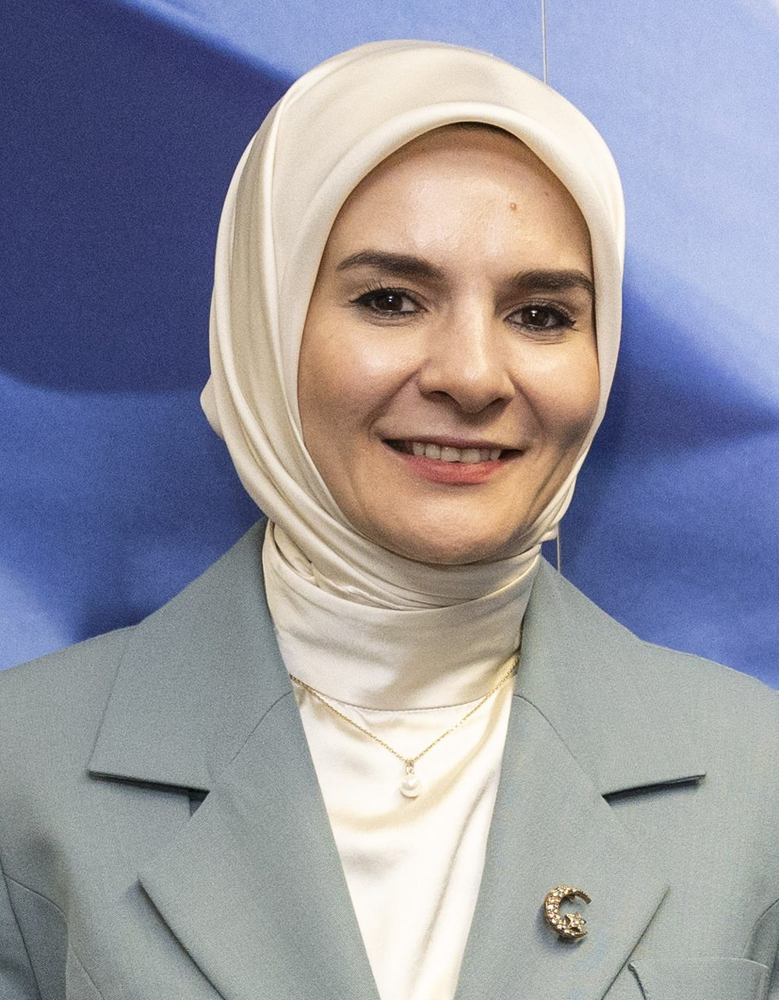
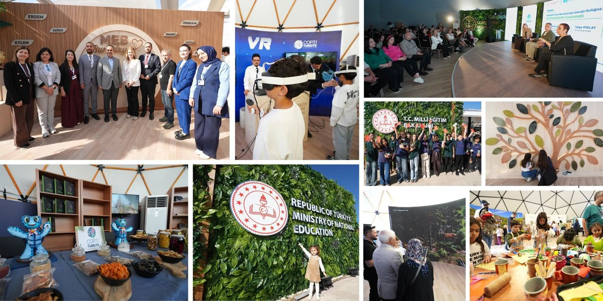
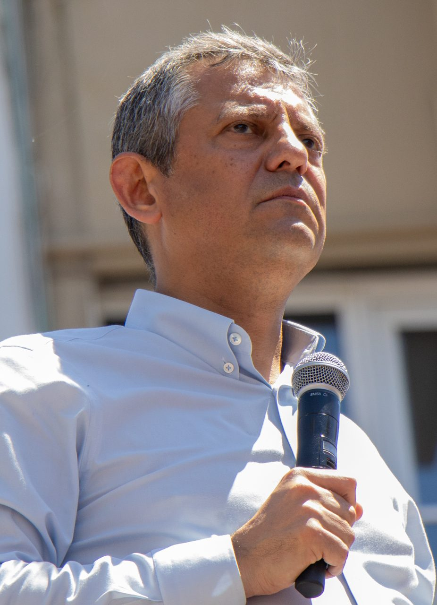
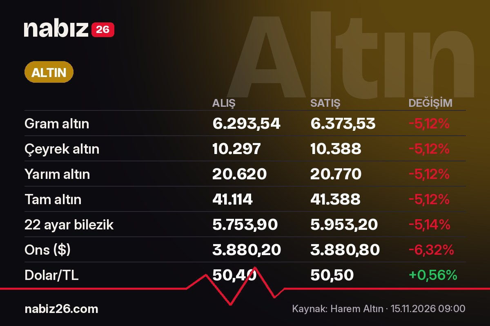
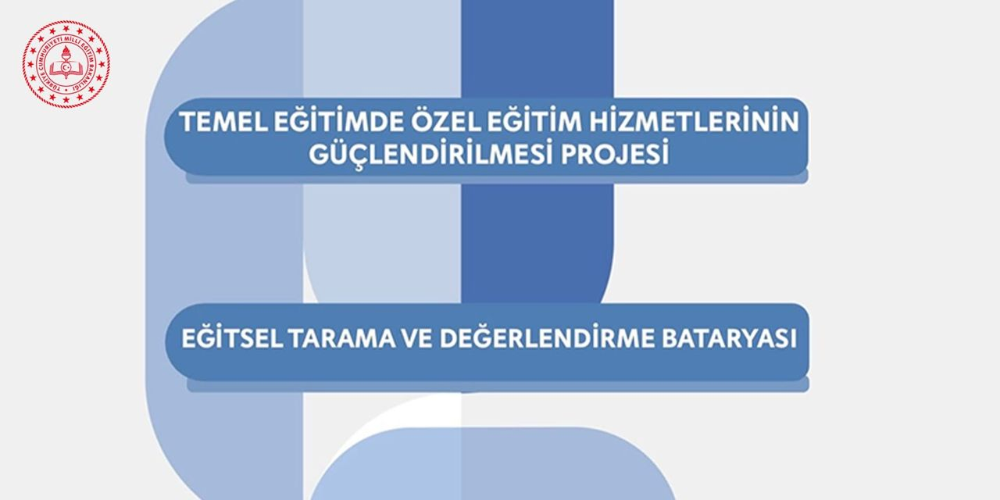

# Son haberler

Ajanın yazdığı son haberler (otomatik güncellenir).

## Sivrihisar'daki Sağlık Yatırımları İçin İl Sağlık Müdürü Bildirici'ye Teşekkür Belgesi

**Sağlık · Sivrihisar** · 2026-11-16 01:02 UTC · Kaynak: [Google Haberler - Eskişehir gündem](https://www.tv42haber.com/genel/eskisehir-il-saglik-muduru-doc-dr-yasar-bildiriciye-tesekkur-belgesi-verildi-183746)

> Eskişehir Sivrihisarlılar Derneği, ilçeye kazandırılan sağlık yatırımları dolayısıyla İl Sağlık Müdürü Doç. Dr. Yaşar Bildirici'ye teşekkür belgesi takdim etti.

Eskişehir Sivrihisarlılar Derneği (ES SİVDER) Başkanı İsmail Arslan ve yönetim kurulu üyeleri, Eskişehir İl Sağlık Müdürü Doç. Dr. Yaşar Bildirici'yi makamında ziyaret etti. Görüşmede Sivrihisar ilçesindeki sağlık hizmetleri ve tamamlanan yatırımlar ele alındı.

Ziyaretten duyduğu memnuniyeti ifade eden İl Sağlık Müdürü Doç. Dr. Bildirici, ilçedeki çalışmaları değerlendirdi. Sivrihisar Devlet Hastanesi ile Aile Sağlığı Merkezi binalarının yapılarak hizmete açıldığını belirten Bildirici, birçok branşta hekim atamasının tamamlandığını kaydetti.

İlçedeki sağlık altyapısının güçlendirildiğini vurgulayan Bildirici, "Devlet Hastanesinin tam teşekküllü hastane olmasını sağladık. Acil Merkezi yapılması için arsa temini gibi birçok güzel çalışmayı Sivrihisar'a kazandırdık" ifadelerini kullandı.

Ziyaretin sonunda ES SİVDER Başkanı İsmail Arslan, ilçeye sunulan hizmetler ve katkılarından dolayı Sivrihisarlılar adına Doç. Dr. Yaşar Bildirici'ye teşekkür belgesi verdi.

---

## Eskişehir Şehir Tiyatroları'nda Yeni Oyun: 'Karanlıktan Bahsetmek Yok' Sahnelendi

**Kültür-Sanat · Merkez** · 2026-11-16 01:02 UTC · Kaynak: [Google Haberler - Eskişehir etkinlik](https://www.2eylul.com.tr/karanliktan-bahsetmek-yok)

> Eskişehir Büyükşehir Belediyesi Şehir Tiyatroları, yeni sezon yapımlarından "Karanlıktan Bahsetmek Yok" adlı oyunu izleyiciyle buluşturdu.

Eskişehir Büyükşehir Belediyesi Şehir Tiyatroları, yeni sezonda repertuarına kattığı "Karanlıktan Bahsetmek Yok" isimli tiyatro oyununu tiyatroseverlerin beğenisine sundu. Gerçekleştirilen basın gösteriminde salonu dolduran sanatseverler oyunu ilgiyle takip etti.

Günay Ertekin'in kaleme aldığı ve Özen Yula'nın yönetmenliğini üstlendiği yapım, annelerinin vefatının ardından bir araya gelen üç kız kardeşin geçmişle yüzleşmesini konu ediniyor. Oyunda aile bağları, kardeşler arasındaki ilişkiler ve geçmişin izleri dram ve mizah ögeleriyle sahneye taşınıyor.

Yılda yaklaşık 100 bin seyirciye ulaşan Eskişehir Şehir Tiyatroları'nın yeni oyunu, sezon boyunca tiyatroseverlerle buluşmaya devam edecek.

---

## 259 Eski Parlamenterden Toplu Katılım: Özgür Özel Genel Merkezde Rozet Taktı

**Siyaset · Türkiye** · 2026-11-16 01:02 UTC · Kaynak: [Google Haberler - CHP](https://ankahaber.net/haber/ozgur-ozel-eski-chp-milletvekillerine-rozet-takti-72321020)

> Önceki dönemlerde CHP'de görev yapan 259 milletvekili partiye katıldı. Genel Başkan Özgür Özel, parlamenterleri temsilen 94 yaşındaki eski senatör Ziya Gökalp Mülayim'e rozet taktı.

Önceki dönemlerde parlamentoda görev almış 259 milletvekili, yayımladıkları ortak bildirinin ardından parti genel merkezinde Genel Başkan Özgür Özel ile buluştu. Basına kapalı olarak gerçekleştirilen ve yaklaşık üç saat süren toplantıda Genel Sekreter Yunus Emre ile Genel Başkan Yardımcısı Ensar Aytekin de yer aldı.

Toplantıda Özel, partiye verilen destek ve kongre süreçlerine sunulan katkılar nedeniyle eski milletvekillerine teşekkürlerini iletti. Görüşmede parlamenterlerin yeni döneme ilişkin değerlendirmeleri ele alındı.

Özgür Özel, katılımcıları temsilen eski Başbakan Bülent Ecevit'in davetiyle siyasete giren ve 60 yıldır siyasetin içinde bulunan 94 yaşındaki Cumhuriyet Senatörü Ziya Gökalp Mülayim'e parti rozetini taktı. Buluşma, katılımcılarla çekilen hatıra fotoğrafıyla sona erdi.

---

## Togg T10X ile Tesla Model Y Karşı Karşıya: Giriş Paketlerinde 565 Bin TL Fark

**Ekonomi · Türkiye** · 2026-11-15 21:04 UTC · Kaynak: [Google Haberler - Togg](https://www.usakhabergazetesi.com.tr/togg-t10x-mi-tesla-model-y-mi-iste-fiyatlari-ve-one-cikan-ozellikleri)

> Elektrikli araç pazarında yerli otomobil Togg T10X ile Tesla Model Y'nin kasım ayı fiyat ve teknik özellikleri karşılaştırıldı. İki modelin başlangıç versiyonları arasında 565 bin 937 liralık fark bulunuyor.

Elektrikli otomobil piyasasında araç tercihinde satın alma maliyetinin yanı sıra menzil kapasitesi, şarj süresi ve standart donanımlar belirleyici oluyor. Resmî veriler ve güncel listeler üzerinden yapılan karşılaştırmada, yerli elektrikli SUV Togg T10X ile Tesla Model Y'nin Türkiye pazarındaki başlangıç seçenekleri arasında 565 bin 937 liralık fiyat farkı göze çarpıyor.

Togg'un güncel teslimat listesinde T10X modeli dört ayrı seçenekle sunuluyor. V1 RWD standart menzil paketi 1 milyon 909 bin 48 liradan satışa çıkarken, V1 RWD uzun menzil versiyonu 2 milyon 219 bin 668 lira, V2 RWD uzun menzil paketi ise 2 milyon 411 bin lira seviyesinde yer alıyor. Serinin en üst versiyonu olan V2 4More Obsidiyen ise 3 milyon 218 bin 137 liradan listeleniyor. Arkadan çekişli T10X, 218 beygir güç sunarken uzun menzilli bataryasıyla 523 kilometreye varan menzil vadediyor ve uygun hızlı şarj istasyonlarında yüzde 20'den yüzde 80 seviyesine 26,5 dakikada ulaşabiliyor.

Tesla Model Y tarafında ise arkadan çekişli giriş paketi 2 milyon 474 bin 985 liradan başlıyor. Modelin Premium Long Range arkadan çekişli seçeneği yaklaşık 3 milyon 906 bin lira, dört çeker versiyonu 4 milyon 620 bin lira, en üst paket olan Performance versiyonu ise 4 milyon 966 bin 500 liradan alıcı buluyor. Giriş seviyesindeki Model Y, 100 kilometrede 13,1 kWh birleşik tüketim değeri sunarken batarya ve aktarma organları için 8 yıl veya 160 bin kilometre garanti kapsamında tutuluyor.

Benzer bütçelere sahip versiyonlar incelendiğinde, 2 milyon 411 bin liralık Togg T10X V2 Uzun Menzil ile Tesla Model Y'nin arkadan çekişli başlangıç paketi karşı karşıya geliyor. Togg'un bu seçeneği, Model Y'nin giriş modelinden 63 bin 985 lira daha uygun bir teslim fiyatına sahip bulunuyor. Ancak T10X'e panoramik cam tavan, kış paketi ve ses sistemi gibi ek opsiyonlar dahil edildiğinde aradaki fiyat farkı kapanıyor.

---

## CHP'li Demir Gebze'de Konuştu: Toplumsal Muhalefeti Yeniden Bir Araya Getireceğiz

**Siyaset · Türkiye** · 2026-11-15 21:04 UTC · Kaynak: [Google Haberler - CHP](https://ankahaber.net/haber/chpli-demir-toplumsal-muhalefeti-bir-araya-getirip-turkiyeye-rahat-bir-nefes-aldiracagiz)

> Kocaeli'de meslek odasını ziyaret eden CHP Genel Başkan Yardımcısı Deniz Demir, hayat pahalılığı ve parti içindeki gelişmelere ilişkin değerlendirmelerde bulundu.

Cumhuriyet Halk Partisi (CHP) Genel Başkan Yardımcısı Deniz Demir, Kocaeli temasları kapsamında Türk Mühendis ve Mimar Odaları Birliği (TMMOB) Gebze Temsilciliği’ni ziyaret etti. TMMOB Gebze Temsilcisi Dilek Birol ve oda üyeleriyle buluşan Demir, mesleki meseleler, ekonomik koşullar ve parti bünyesindeki son gelişmeleri ele aldı.

Ziyaret öncesinde ilçe pazarında esnaf ve vatandaşlarla bir araya geldiğini aktaran Demir, hayat pahalılığının yüksek seviyelere ulaştığını ve pazar yerlerinde durgunluk gözlemlediğini söyledi. Asgari ücret ve emekli aylıklarıyla geçinmenin zorlaştığına işaret eden Demir, çalışanların, dar gelirlilerin ve emeklilerin haklarını savunmak adına katkı sunmaya hazır olduklarını ifade etti.

Parti içindeki tartışmalara ve yaşanan ayrılıklara da değinen Demir, Cumhuriyet Halk Partisi kimliğinin önemini vurguladı. Parlamento grubunda 46 milletvekiliyle yollarına devam ettiklerini kaydeden Demir, ayrışmalar yerine tek çatı altında mücadele edilmesi gerektiğini belirtti. Demir, en kısa sürede toplumsal muhalefeti yeniden birleştirmeyi hedeflediklerini sözlerine ekledi.

---

## Kasım Ayı SED Yardımı Hesaplara Yattı: Toplam 2,29 Milyar Lira Destek

**Türkiye · Türkiye** · 2026-11-15 19:24 UTC · Kaynak: [Google Haberler - Bakanlıklar](https://www.bursatv.com.tr/kasim-ayi-sed-yardimi-ne-kadar-bakanlik-toplam-odemeyi-acikladi)

> Aile ve Sosyal Hizmetler Bakanı Mahinur Özdemir Göktaş, kasım ayı kapsamında ihtiyaç sahibi hanelere toplam 2 milyar 291 milyon lira Sosyal ve Ekonomik Destek (SED) ödemesi yapıldığını açıkladı.

Aile ve Sosyal Hizmetler Bakanlığı, çocukların aile ortamında yetişmelerini desteklemek ve eğitim masraflarına katkı sağlamak amacıyla yürütülen Sosyal ve Ekonomik Destek (SED) programında kasım ayı ödemelerini tamamladı. Hak sahiplerinin hesaplarına toplam 2 milyar 291 milyon liralık kaynak aktarıldı.

Aile ve Sosyal Hizmetler Bakanı Mahinur Özdemir Göktaş, çocuk odaklı sosyal hizmetlerde farklı ihtiyaçları göz önüne alarak destek modellerini çeşitlendirdiklerini belirtti. Çocukların ailelerinden kopmadan, kendi sosyal çevrelerinde büyümelerine büyük önem verdiklerini kaydeden Göktaş, SED hizmetiyle ailelerin yanında yer almayı sürdürdüklerini ifade etti.

Ekonomik açıdan zorluk yaşayan aileleri hedefleyen SED programı, çocukların hem temel ihtiyaçlarının karşılanmasını hem de eğitim hayatlarını kesintisiz sürdürebilmelerini amaçlıyor. Bakanlık, yapılan düzenli ödemelerle çocukların sağlıklı ve özgüvenli bireyler olarak topluma kazandırılmasını hedefliyor.

---

## Türkiye İklim Okulu'nda Sıfır Atık Mutfağı: Bayat Ekmek ve Meyve Kabukları Değerlendirildi

**Türkiye · Türkiye** · 2026-11-15 19:04 UTC · Kaynak: [Milli Eğitim Bakanlığı](https://www.meb.gov.tr/turkiye-iklim-okulu-quotgastronomiquot-ve-quotsifir-atikquot-etkinlikleriyle-ziyaretcilerin-ilgi-odagi-oldu/haber/42529/tr)

> Antalya'daki COP31 kapsamında kurulan Türkiye İklim Okulu'nda düzenlenen gastronomi atölyelerinde bayat ekmek ve narenciye kabukları yeniden sofraya kazandırıldı.

Antalya'da düzenlenen Birleşmiş Milletler İklim Değişikliği Çerçeve Sözleşmesi 31. Taraflar Konferansı (COP31) Yeşil Bölge alanında, Millî Eğitim Bakanlığı tarafından oluşturulan Türkiye İklim Okulu çeşitli atölye ve panellere ev sahipliği yapmayı sürdürüyor.

Etkinlikler kapsamında şefler ve gastronomi uzmanlarının katılımıyla "Anadolu'nun Bereketinden Geleceğin Mutfağına: Sürdürülebilir Gastronomi" başlıklı oturum gerçekleştirildi. Programda gıda atıklarının değerlendirilmesi, israfın önlenmesi, geleneksel üretim modellerinin korunması ve tarımsal ilaçların bilinçsiz kullanımının doğuracağı riskler ele alındı.

Yaşayan Okul ve İklim Deneyim Alanı'nda düzenlenen atölyelerde ise öğrenciler şeflerle birlikte mutfağa girdi. Gıda israfına dikkat çekilen uygulamalarda, bayat ekmekler kullanılarak fasulye paçası, narenciye kabukları değerlendirilerek ise pankek hazırlandı.

Sanayi ve Teknoloji Bakanı Mehmet Fatih Kacır da Türkiye İklim Okulu'nu ziyaret ederek yürütülen çalışmalar hakkında yetkililerden bilgi aldı. Etkinlikler kapsamında ayrıca "Yaşayan Laboratuvardan Sürdürülebilir Geleceğe: Cezeri" başlığıyla sınıflarda enerji tasarrufu ve senaryo temelli problem çözme yöntemleri uzmanlarca ele alındı.

---

## Togg T10F 600 Kilometre Üstü Menzilde Rakiplerine 1,6 Milyon Lira Fark Attı

**Ekonomi · Türkiye** · 2026-11-15 19:04 UTC · Kaynak: [Google Haberler - Togg](https://www.memleket.com.tr/togg-t10f-2-2-milyon-tl-ile-menzilinde-en-ucuzu-oldu-2367143h.htm)

> Türkiye pazarında tek şarjla 600 kilometreyi aşabilen elektrikli araçlar arasında Togg T10F, 2 milyon 195 bin liralık fiyatıyla en erişilebilir seçenek oldu.

Türkiye otomobil pazarında uzun menzilli elektrikli modeller arasındaki rekabette yerli otomobil Togg T10F öne çıktı. Tek şarjla 600 kilometre sınırını geçebilen araçların yer aldığı karşılaştırmada, Togg T10F V1 RWD Uzun Menzil versiyonu 2 milyon 195 bin 600 TL'lik satış fiyatıyla en yakın rakibine 1,6 milyon TL fark attı.

Katalog verilerine göre 623 kilometre menzil vadeden T10F modelini takip eden en uygun fiyatlı ithal alternatiflerin fiyatı 3,8 milyon TL seviyesinden başlıyor. Karşılaştırma listesinde 680 kilometre menzilli Hyundai IONIQ 6 yaklaşık 3,8 milyon TL, 622 kilometre menzil sunan Tesla Model Y Long Range ise 4,6 milyon TL düzeyinde bulunuyor. Daha üst segmentte yer alan 800 kilometre üzeri menzilli modellerin fiyatları ise 6,8 milyon TL ile 11,8 milyon TL arasında değişiyor.

Uzmanlar, kataloglarda yer alan 623 kilometrelik değerin standart karma test ölçümlerine dayandığına dikkat çekiyor. Soğuk kış koşullarında ve 120 kilometre sabit otoyol hızlarında araçların gerçek menzilinin test verilerinin yaklaşık yüzde 70'ine gerilediği, buna göre Togg T10F uzun menzil sürümünün zorlu koşullarda dahi tek şarjla 450 ila 500 kilometre civarında yol kat edebileceği belirtiliyor.

---

## Klasik Cumartesi Konserleri Başladı: Açılışı Nemeth Quartet Yaptı

**Kültür-Sanat · Merkez** · 2026-11-15 19:04 UTC · Kaynak: [Google Haberler - Eskişehir etkinlik](https://www.anadolugazetesi.com/amp/eskisehir-de-klasik-cumartesi-konserleri-nemeth-quartet-ile-basladi-298143.html)

> Eskişehir Büyükşehir Belediyesi'nin yeni sezondaki Klasik Cumartesi oda müziği konserleri, Nemeth Quartet'in sahne aldığı dinletiyle başladı.

Eskişehir Büyükşehir Belediyesi tarafından düzenlenen 2026-2027 sanat sezonu Klasik Cumartesi oda müziği konserleri müzikseverlerle buluştu. Serinin açılış etkinliğinde sahneye çıkan Nemeth Quartet, farklı dönem ve kültürlerden seçilen geniş bir repertuvar sundu.

Keman sanatçıları Gülen Ege Serter ve Şeniz Serter, viyola sanatçısı Pınar Basalak ile çello sanatçısı Mutlu Varlık Kocaili'den oluşan dörtlü; Wolfgang Amadeus Mozart, Antonio Vivaldi ve Astor Piazzolla'nın eserlerini icra etti. Programda klasik yapıtların yanı sıra aralarında "Manastır Türküsü"nün de yer aldığı anonim halk ezgilerinin yaylı çalgı düzenlemeleri seslendirildi.

Konser sırasında sanatçılar, çalınan eserler ve yaylı enstrümanlar hakkında izleyicilere tanıtıcı bilgiler aktararak etkinliği çocuklar için eğitici bir buluşmaya dönüştürdü. Çocukların küçük yaşta müzikle tanışmasını ve ailelerin kültür etkinliklerine katılımını hedefleyen konser serisi sezon boyunca sürecek.

---

## Taşbaşı Çarşısı'nda Tuvalet Çilesi: Yaklaşık Bir Haftadır Kilitli Duruyor

**Gündem · Odunpazarı** · 2026-11-15 15:04 UTC · Kaynak: [Google Haberler - Eskişehir gündem](https://www.esyenigun.com/eskisehirin-tarihi-carsisinda-tuvalet-krizi-bir-haftadir-kapali)

> Eskişehir'in en işlek ticaret noktalarından Taşbaşı Çarşısı'ndaki umumi tuvaletin günlerdir kapalı olması esnaf ve vatandaşları mağdur ediyor.

Eskişehir'in merkezi alışveriş alanlarından biri olan Taşbaşı Çarşısı'nda yer alan umumi tuvalet, yaklaşık bir haftadır hizmet vermiyor. Bölgenin en yoğun noktalarından birinde bulunan tuvaletin kapalı olması, çarşıya alışveriş için gelen vatandaşlar ile çevredeki dükkan sahiplerini zor durumda bırakıyor.

Tuvaletin hangi gerekçeyle kapatıldığına dair herhangi bir bilgilendirme yapılmazken, alandaki kilitli kapılar günlük yaşamı olumsuz etkiliyor. Gün boyu çarşıda çalışan esnaf ile ziyaretçiler temel ihtiyaçlarını gidermekte sıkıntı yaşadıklarını ifade ediyor.

Bölgedeki esnaf ve çarşı sakinleri, hijyenik ve pratik bir çözüm beklediklerini dile getirerek, kapalı tutulan umumi tuvaletin bir an önce bakımının tamamlanıp yeniden kullanıma açılmasını talep ediyor.

---

## Eskişehirspor 2-0'dan Döndü: Ayvalıkgücü Randevusunda Nefes Kesen Beraberlik

**Spor · Merkez** · 2026-11-15 15:04 UTC · Kaynak: [Google Haberler - Eskişehirspor](https://www.gazetevatan.com/galeri/eskisehirspor-ayvalikgucu-maci-canli-yayin-hangi-kanalda-eskisehirspor-ayvalikgucu-maci-nereden-izlenir-eskisehirspor-2465126)

> Nesine 3. Lig 2. Grup'ta mücadele eden Eskişehirspor, sahasında 2-0 geriye düştüğü Ayvalıkgücü Belediyespor karşılaşmasından 2-2'lik beraberlikle ayrıldı.

Nesine 3. Lig 2. Grup'un 12. haftasında Eskişehirspor, sahasında Ayvalıkgücü Belediyespor'u ağırladı. Mücadeleye etkili başlayan konuk ekip, 21. dakikada Atakan Akbulut'un kaydettiği golle 1-0 öne geçti. Baskısını sürdüren Ayvalıkgücü, 28. dakikada Emirhan Özyaşar'ın fileleri havalandırmasıyla farkı ikiye çıkardı.

Erken gelen gollerle iki farklı geriye düşen siyah-kırmızılı ekip, oyundan kopmadı. 38. dakikada sahneye çıkan Mehmet Bağlı, attığı golle skoru 2-1'e getirerek Eskişehirspor'u yeniden maça ortak etti ve ilk yarı bu sonuçla tamamlandı.

Karşılaşmanın dönüm noktası 77. dakikada yaşandı. Ayvalıkgücü Belediyespor'dan Adnan Demir, ikinci sarı kartın ardından kırmızı kart görerek takımını 10 kişi bıraktı. Faulün ardından serbest vuruşta topun başına geçen Kerem Baykuş, 78. dakikada frikikten şık bir gole imza atarak skoru 2-2'ye taşıdı.

Kalan dakikalarda başka gol olmayınca mücadele 2-2 eşitlikle sona erdi. Bu sonuçla puanını artıran Eskişehirspor, haftayı lider Etimesgut'un ardından ikinci sırada kapattı. Ayvalıkgücü Belediyespor ise 22 puanla 7. sıradaki yerini korudu.

---

## Senfoni Orkestrası'ndan 'Ateşin Dansı': Oxana Shevchenko Sahne Aldı

**Kültür-Sanat · Tepebaşı** · 2026-11-15 13:04 UTC · Kaynak: [Google Haberler - Eskişehir etkinlik](https://www.2eylul.com.tr/senfoni-orkestrasindan-atesin-dansi-konseri)

> Eskişehir Büyükşehir Belediyesi Senfoni Orkestrası, 'Ateşin Dansı' konserinde dünyaca ünlü piyanist Oxana Shevchenko'yu ağırladı.

Eskişehir Büyükşehir Belediyesi Senfoni Orkestrası, 2026-2027 sanat sezonu etkinlikleri kapsamında sanatseverleri "Ateşin Dansı" başlıklı özel konserde buluşturdu. Şef James Ross yönetiminde sahneye çıkan orkestra, farklı dönemlere ait klasik müzik yapıtlarını seslendirdi.

Konser programı Mihail Glinka'nın "Ruslan ve Ludmila Operası Uvertürü" ile açıldı. Ardından sahneye çıkan uluslararası üne sahip piyanist Oxana Shevchenko, orkestra eşliğinde Sergei Rahmaninov'un "Paganini'nin Bir Teması Üzerine Rapsodi" eserini icra etti. İzleyicilerden yoğun alkış alan sanatçı, performansının ardından bis yaparak sahneyi renklendirdi.

Programın ikinci yarısında orkestra, Anatoli Lyadov'un "Büyülü Göl" ve Igor Stravinski'nin "Ateş Kuşu Süiti" adlı eserlerini dinleyicilerin beğenisine sundu. Müzikal çeşitliliği ve sahne performansıyla dikkat çeken gece, solist ve şefe plaket takdim edilmesiyle noktalandı.

Senfoni Orkestrası bir sonraki buluşmasını 4 Aralık 2026 Cuma günü saat 20.00'de Atatürk Kültür Sanat ve Kongre Merkezi'nde gerçekleştirecek. Şefliğini Vasilii Valitov'un üstleneceği konserde keman sanatçısı Bade Daştan solist olarak sahne alacak.

---

## Özgür Özel 1154 Oyla Yeniden Genel Başkan Seçildi: Yeni Parti'de İlk Kurultay

**Siyaset · Türkiye** · 2026-11-15 13:04 UTC · Kaynak: [Google Haberler - CHP](https://tr.euronews.com/2026/11/14/ozgur-ozel-yeni-parti-kurultayinda-1154-oyla-yeniden-genel-baskan-secildi)

> Ankara'da toplanan Yeni Parti 1. Olağan Kurultayı'nda tek aday olan Özgür Özel, geçerli 1154 oyun tamamını alarak genel başkanlığa seçildi.

"Türkiye Yenileniyor" sloganıyla Ankara Spor Salonu'nda gerçekleştirilen Yeni Parti 1'inci Olağan Kurultayı'nda genel başkanlık seçimi tamamlandı. Toplam 1202 kayıtlı delegeden 1157'sinin sandık başına gittiği seçimde, geçerli sayılan 1154 oyun tamamını alan Özgür Özel yeniden genel başkanlık görevine getirildi. Kurultayın ikinci gününde Parti Meclisi ve Yüksek Disiplin Kurulu üyelerinin belirleneceği bildirildi.

Kurultay konuşmasında partinin kuruluş sürecini ve izleyecekleri yol haritasını anlatan Özel, hedeflerinin iktidar olduğunu ifade etti. Belediyelere yönelik soruşturmaları eleştiren Özel, örgütlenme modeli kapsamında mahalle, ilçe ve il meclisleri oluşturacaklarını, Parti Meclisi üye sayısının ise 150'ye yükseltileceğini açıkladı.

Ekonomi ve sosyal politikalara dair vaatlerini de sıralayan Özel; çiftçilere alım garantisi verilmesi, vergisiz mazot sağlanması ve borçların yeniden yapılandırılmasının yanı sıra temel vatandaşlık geliri ile ücretsiz okul yemeği projelerini hayata geçireceklerini söyledi. Programda ayrıca tutuklu bulunan Ekrem İmamoğlu'nun video mesajı ile Genel Sekreter Yunus Emre tarafından okunan kuruluş bildirgesi paylaşıldı.

---

## Erdoğan'dan Filistin'in 38. Kuruluş Yıl Dönümü Mesajı: Davayı Savunmaya Devam Edeceğiz

**Siyaset · Türkiye** · 2026-11-15 13:04 UTC · Kaynak: [Google Haberler - Cumhurbaşkanı](https://aa.com.tr/tr/gundem/cumhurbaskani-erdogan-filistinin-kurulusunun-38-yil-donumunu-kutladi/4125793)

> Cumhurbaşkanı Recep Tayyip Erdoğan, Filistin Devleti'nin 38'inci kuruluş yıl dönümünü kutlayarak Türkiye'nin bağımsız Filistin davasını savunmaya devam edeceğini bildirdi.

Cumhurbaşkanı Recep Tayyip Erdoğan, Filistin Devleti'nin 38'inci kuruluş yıl dönümü dolayısıyla sosyal medya hesabından tebrik mesajı yayımladı.

Mesajında Filistin halkının onurlu mücadelesine değinen Cumhurbaşkanı Erdoğan, "Dost ve kardeş Filistin Devleti'nin 38'inci kuruluş yıl dönümünü tebrik ediyor, zulme ve zalime karşı onurlu direnişini sürdüren kahraman Filistin halkına selamlarımı, muhabbetlerimi iletiyorum" ifadelerini kullandı.

Türkiye'nin Filistin davasına verdiği desteğin altını çizen Erdoğan, 1967 sınırları temelinde, başkenti Doğu Kudüs olan, bağımsız, egemen ve coğrafi bütünlüğü haiz bir Filistin Devleti'nin kurulması yönündeki kararlılığı vurguladı. Erdoğan, Filistin halkının özgür ve müreffeh bir geleceğe ulaşması adına Türkiye'nin tüm imkanlarıyla sahada kalmayı sürdüreceğini belirtti.

---

## Eski Giysiler Japon Sanatıyla Yenileniyor: Tepebaşı'nda Sashiko Atölyesi Başladı

**Belediye · Tepebaşı** · 2026-11-15 12:46 UTC · Kaynak: [Google Haberler - Tepebaşı](https://ankahaber.net/haber/tepebasi-nda-eski-tekstiller-yeniden-hayat-buluyor-886efb66)

> Tepebaşı Belediyesi Yeryüzü Ekoloji Okulu, geleneksel Japon el işleme tekniği Sashiko ile eskiyen tekstil ürünlerini yeniden hayata kazandıran ileri dönüşüm atölyesi başlattı.

Tepebaşı Belediyesi, sürdürülebilir yaşam kültürünü yaygınlaştırmak ve çevre bilincini artırmak amacıyla Yeryüzü Ekoloji Okulu bünyesinde "Tekstil Art – Sashiko ile İleri Dönüşüm Atölyesi"ni hayata geçirdi. Atölye çalışmasında, kullanılmayan veya yıpranmış giysilerin onarılarak ve süslenerek kullanım ömrünün uzatılması hedefleniyor.

Emekli resim öğretmeni Hatice Aydoğan Yılmaz rehberliğinde gerçekleştirilen eğitim programının ilk oturumuna 20 ile 63 yaşları arasındaki kursiyerler katıldı. Yılmaz, katılımcılara Japonya'nın geleneksel dikiş sanatı olan Sashiko tekniğinin inceliklerini ve altı haftalık program boyunca uygulanacak yöntemleri aktardı.

18 yaş ve üzerindeki yurttaşlara yönelik düzenlenen atölye, altı hafta süresince her cuma günü 18.00-19.00 saatleri arasında gerçekleştirilecek. Katılımcılar eğitim boyunca hem tekstil atıklarını azaltmanın yollarını öğrenecek hem de eski eşyalarına estetik ve işlevsel bir dokunuş kazandıracak.

---

## 14. Uluslararası Eskişehir Şiir Buluşması Sona Erdi: 13 Şair Katıldı

**Kültür-Sanat · Tepebaşı** · 2026-11-15 12:46 UTC · Kaynak: [Tepebaşı Belediyesi](https://www.tepebasi.bel.tr/Haber/Detay/14uluslararasıeskisehirsiirbulusmasısonaerdi)

> Tepebaşı Belediyesi tarafından düzenlenen 14. Uluslararası Eskişehir Şiir Buluşması, Atila Özer Karikatürlü Ev'deki oturum ve dinletilerle tamamlandı.

Tepebaşı Belediyesi ev sahipliğinde bu yıl 14'üncüsü gerçekleştirilen Uluslararası Eskişehir Şiir Buluşması, üç gün süren edebiyat dolu programın ardından sona erdi. İkisi yabancı, 11'i Türk olmak üzere toplam 13 şairin ağırlandığı organizasyonun kapanış etkinlikleri Atila Özer Karikatürlü Ev’de yapıldı.

Buluşma kapsamında Haydar Ergülen moderatörlüğünde Fransız şair Sylvain Cavailles ve Ahmad Zakaria’nın yer aldığı “Dünyadan Sesler” oturumu düzenlendi. Ardından Efnan Ezenel, Begüm Şahbudak, Rahmi Emeç ve Haydar Ergülen’in katılımıyla “İlhan Sami Çomak” oturumu gerçekleştirildi. Programda ayrıca Ahmet Telli belgeseli gösterilirken Ahmet Telli, Elif Sofya ve Serdar Koçak için anma oturumu yapıldı.

Etkinliğin son gününde Gürcan Banger tarafından “Şiir ile Öykü Konuşması” başlıklı oturum sunuldu ve müzik eşliğinde şiir okumaları gerçekleştirildi. Karikatürlü Ev’i ziyaret eden sanatseverler, Tepebaşı Belediyesi Kâğıt Geri Dönüşüm Atölyesi’nde üretilen özel kâğıtlara şairlerin kendi el yazılarıyla kaleme aldığı şiir sergisini de görme fırsatı buldu.

Üç günlük programın tamamlanmasıyla birlikte konuk şairler ve edebiyatseverler, gelecek yıl düzenlenecek 15. buluşmada yeniden bir araya gelme dileğinde bulundu.

---

## İskele 26 Kışa Hazırlandı: Soğuk Havalara Karşı Dome Alanları Kuruldu

**Belediye · Merkez** · 2026-11-15 11:04 UTC · Kaynak: [Google Haberler - Eskişehir](https://ankahaber.net/haber/eskisehir-de-iskele-26-kisa-hazirlandi-9fa4a339)

> Eskişehir Büyükşehir Belediyesi iştiraklerinden Belkent AŞ bünyesindeki İskele 26, kış mevsimi için özel dome alanlarıyla donatıldı.

Eskişehir Büyükşehir Belediyesi tarafından kente kazandırılan ve vatandaşların yoğun ilgi gösterdiği buluşma noktalarından İskele 26'da kış mevsimine yönelik hazırlıklar tamamlandı. Belkent AŞ tarafından işletilen tesis, yeni düzenlemeleriyle kış sezonuna hazır hale getirildi.

Soğuk havalara karşı alana yerleştirilen özel tasarımlı dome alanları, ziyaretçilerin açık hava atmosferini korurken sıcak bir ortamda vakit geçirmelerine olanak tanıyor. Farklı aydınlatma düzenlemeleriyle dikkat çeken yeni oturma alanları, mekânın kış görünümüne katkı sağladı.

Balık ekmek lezzeti ve sosyal yaşam alanlarıyla hem hafta içi hem de hafta sonu Eskişehirlilerden ilgi gören tesis, kış ayları boyunca da misafirlerini ağırlamayı sürdürecek.

---

## Eskişehirspor Ayvalıkgücü Karşısında: Maç Şifresiz Yayınlanacak

**Spor · Tepebaşı** · 2026-11-15 11:04 UTC · Kaynak: [Google Haberler - Eskişehirspor](https://www.ntvspor.net/futbol/galeri-canli-izle-eskisehirspor-ayvalikgucu-maci-ne-zaman-saat-kacta-hangi-kanalda-433047)

> TFF 3. Lig'de mücadele eden Eskişehirspor, 12. hafta randevusunda Ayvalıkgücü Belediyespor'u ağırlıyor. Mücadele Tivibu Spor'dan şifresiz olarak canlı yayınlanacak.

TFF 3. Lig 2. Grup'un 12. hafta karşılaşmasında Eskişehirspor, sahasında Ayvalıkgücü Belediyespor ile karşı karşıya geliyor. Prof. Dr. Fethi Heper Stadyumu'nda oynanacak mücadele saat 15.30'da başlayacak.

Karşılaşmayı stadyumdan izleyemeyecek futbolseverler için yayın ayrıntıları da netleşti. Mücadele, Tivibu Spor ekranlarından şifresiz ve canlı olarak futbolseverlerle buluşacak.

Karşılaşmayı uydu üzerinden takip etmek isteyenler için Türksat 4A frekans bilgileri 11853 MHz frekans, yatay (H) polarizasyon, 25000 sembol oranı ve 3/4 FEC olarak paylaşıldı.

---

## Erdoğan'dan KKTC'nin 43. Yılına Özel Mesaj: Asla Yalnız Bırakmayacağız

**Siyaset · Türkiye** · 2026-11-15 11:04 UTC · Kaynak: [Google Haberler - Cumhurbaşkanı](https://www.trthaber.com/haber/gundem/cumhurbaskani-erdogan-kibrisi-ne-olursa-olsun-asla-yalniz-birakmayacagiz-963330.html)

> Cumhurbaşkanı Erdoğan, KKTC'nin 43. kuruluş yıl dönümünü kutlayarak 'Kıbrıs bizim millî davamızdır, asla yalnız bırakmayacağız' dedi.

Cumhurbaşkanı Recep Tayyip Erdoğan, Kuzey Kıbrıs Türk Cumhuriyeti'nin (KKTC) 43'üncü kuruluş yıl dönümü dolayısıyla bir kutlama mesajı yayımladı. Sosyal medya hesabı üzerinden açıklamada bulunan Erdoğan, Kıbrıs davasına verilen desteğin kararlılıkla süreceğini kaydetti.

Mesajında şehit ve gazileri de anan Erdoğan, "Kuzey Kıbrıs Türk Cumhuriyeti’nin 43’üncü kuruluş yıl dönümünü en kalbî duygularımla tebrik ediyor; kahraman şehitlerimizi rahmetle, gazilerimizi şükranla anıyorum. Dayanışmamızı her alanda daha da güçlendirmeye devam edeceğimiz Kıbrıs Türkü kardeşlerime selam ve muhabbetlerimi iletiyorum. Kıbrıs bizim millî davamızdır. Kıbrıs’ı ne olursa olsun asla yalnız bırakmayacağız" ifadelerini kullandı.

---

## MEB'den 17 Milyon Öğrenciye Ara Tatil Rehberi ve Etkinlik Kitapları

**Eğitim · Türkiye** · 2026-11-15 09:04 UTC · Kaynak: [Milli Eğitim Bakanlığı](https://www.meb.gov.tr/ogrenciler-ara-tatilde-etkinlik-kitaplari-ve-rehberlerle-desteklenecek/haber/42522/tr)

> Milli Eğitim Bakanlığı, 16-20 Kasım tarihlerinde uygulanacak birinci dönem ara tatili için tüm kademelere yönelik etkinlik kitapları ve rehber setleri yayımladı.

İlköğretim ve ortaöğretim kurumlarındaki yaklaşık 17 milyon öğrenci, 2026-2027 eğitim öğretim yılının ilk ara tatiline 16 Kasım Pazartesi günü başlıyor. 20 Kasım Cuma gününe kadar sürecek tatil öncesinde Milli Eğitim Bakanlığı, okul öncesinden liseye kadar her kademedeki öğrencilerin tatil dönemini verimli geçirmesi amacıyla yeni materyaller hazırladı.

Türkiye Yüzyılı Maarif Modeli doğrultusunda geliştirilen etkinlik takvimi ve kitaplar; öğrencilerin aileleriyle kaliteli vakit geçirmesini, edindikleri bilgi ve becerileri günlük hayatla birleştirmesini hedefliyor. Karekodlar üzerinden dijital oyunlar, sanal müze gezileri, öyküler ve şarkılarla desteklenen içerikler öğrenme sürekliliğini ev ortamına taşımayı amaçlıyor.

Okul öncesi eğitim için hazırlanan etkinlik takviminde "Oyun Anahtarım" uygulamasıyla çocukların her güne özel tasarlanan oyunları tamamlayıp kendi anahtarlarını tasarlamaları planlandı. İlkokul ve ortaokul kademeleri için hazırlanan "Arada 1" etkinlik kitaplarında Türk dünyasının kültürel mirası, çocuk hakları, doğa sevgisi ve matematiksel düşünme becerileri ön plana çıkarıldı.

Lise kademesine hitap eden rehberde ise aile içi iletişim ve ekran süresi dengesinin yanı sıra üniversiteye hazırlanan öğrenciler için kritik yönlendirmelere yer verildi. Rehberin son bölümünde YKS kapsamındaki TYT, AYT ve YDT oturumlarına yönelik zaman yönetimi, odaklanma teknikleri ve ders bazlı uzman öğretmen tavsiyeleri paylaşıldı.

---

## İletişim Başkanı Duran'dan KKTC'nin 43. Kuruluş Yıl Dönümü Mesajı

**Türkiye · Türkiye** · 2026-11-15 09:04 UTC · Kaynak: [İletişim Başkanlığı](https://www.iletisim.gov.tr/turkce/haberler/detay/kktcnin-43-yil-donumu-icin-kutlama-mesajlari-15-11-26)

> Cumhurbaşkanlığı İletişim Başkanı Burhanettin Duran, Kuzey Kıbrıs Türk Cumhuriyeti'nin 43. kuruluş yıl dönümünü kutlayarak Türkiye'nin Kıbrıs Türk halkının haklarını kararlılıkla koruyacağını vurguladı.

Cumhurbaşkanlığı İletişim Başkanı Burhanettin Duran, Kuzey Kıbrıs Türk Cumhuriyeti’nin (KKTC) ilanının 43. yıl dönümü dolayısıyla sosyal medya hesabı üzerinden bir kutlama mesajı yayımladı.

Mesajında Kıbrıs Türk halkının bağımsızlık mücadelesine dikkat çeken Duran, "Kıbrıs Türk halkının özgürlük mücadelesinin, bağımsızlık iradesinin simgesi olan Kuzey Kıbrıs Türk Cumhuriyeti’nin ilanının 43. yıl dönümünü gönülden kutluyorum" ifadelerini kullandı.

Türkiye'nin Cumhurbaşkanı Recep Tayyip Erdoğan’ın liderliğinde Kıbrıs Türklerinin hakları, egemen eşitliği ve güvenliği için kararlılıkla çalışmaya devam edeceğini belirten Duran, KKTC Kurucu Cumhurbaşkanı Rauf Denktaş, Dr. Fazıl Küçük ve tüm şehitleri rahmet ve minnetle andı.

---

## Evde Bakım Yardımı Hesaplara Yatıyor: Bu Ay Toplam 7,8 Milyar Lira Ödenecek

**Türkiye · Türkiye** · 2026-11-15 09:04 UTC · Kaynak: [Aile ve Sosyal Hizmetler Bakanlığı](https://www.aile.gov.tr/haberler/aile-ve-sosyal-hizmetler-bakanimiz-goktas-evde-bakim-yardimi-odemesini-hesaplara-yatirmaya-basladik/)

> Aile ve Sosyal Hizmetler Bakanı Mahinur Özdemir Göktaş, evlerinde bakılan tam bağımlı vatandaşlar ve aileleri için bu ay toplam 7,8 milyar liralık desteğin hesaplara aktarılmaya başlandığını bildirdi.

Aile ve Sosyal Hizmetler Bakanı Mahinur Özdemir Göktaş, engelli bireylerin öncelikle aile ortamında bakımını desteklemek amacıyla yürütülen Evde Bakım Yardımı ödemelerinin hak sahiplerinin hesaplarına yatırılmaya başlandığını duyurdu. Göktaş, bu ay toplam 7,8 milyar liralık kaynağın aktarıldığını belirtti.

Evde Bakım Yardımı'nın 2006 yılından bu yana uygulanan temel bir sosyal hizmet modeli olduğunu hatırlatan Bakan Göktaş, engelli bireylerin aile bütünlüklerini koruyarak kendi yaşam alanlarında desteklenmesini öncelikli gördüklerini vurguladı. Bu destekle engelli bireylerin ailelerinden ayrılmadan yaşamlarını sürdürebilmelerinin amaçlandığı kaydedildi.

Program kapsamında hak sahibi başına aylık 15 bin 755 lira ödeme yapıldığını aktaran Göktaş, hâlihazırda 495 bin vatandaşın bu yardımdan faydalandığını ifade ederek ödemelerin tüm hak sahiplerine ve ailelerine hayırlı olmasını diledi.

---

## Yunus Emre Devlet Hastanesi'nde Dünya Diyabet Günü Standı Açıldı

**Sağlık · Tepebaşı** · 2026-11-15 07:04 UTC · Kaynak: [Google Haberler - Eskişehir etkinlik](https://www.eskisehir.net/eskisehirde-dunya-diyabet-gunune-ozel-etkinlik)

> Eskişehir Yunus Emre Devlet Hastanesi'nde 14 Kasım Dünya Diyabet Günü dolayısıyla vatandaşlara yönelik bilgilendirme ve farkındalık etkinliği gerçekleştirildi.

Eskişehir Yunus Emre Devlet Hastanesi'nde 14 Kasım Dünya Diyabet Günü kapsamında toplumsal bilinci artırmak amacıyla stant açıldı. Etkinliğe Yunus Emre Devlet Hastanesi Başhekimi Dr. Öğr. Üyesi Gamze Akın Mumcu, hastane yöneticileri, sağlık personeli ve çok sayıda vatandaş katılım sağladı.

Hastane içerisinde kurulan bilgilendirme standında görevliler tarafından vatandaşlara diyabetin risk faktörleri, hastalığın erken teşhis edilmesinin önemi ve korunma yöntemleri aktarıldı. Sağlık ekipleri, erken tanının tedavi sürecindeki kritik rolünü vurguladı.

Farkındalık çalışması kapsamında ayrıca dengeli beslenme alışkanlığı, düzenli fiziksel aktivite yapılması ve rutin kan şekeri kontrolünün diyabetle mücadeledeki önemi hatırlatılarak vatandaşlara sağlıklı yaşam tavsiyelerinde bulunuldu.

---

## Altın fiyatları 15 Kasım 2026: Gram altın 6.373,53 TL

**Ekonomi · Merkez** · 2026-11-15 06:00 UTC · Kaynak: [Harem Altın](https://www.haremaltin.com/altin-fiyatlari)

> Gram altın güne düşüşle başladı. Harem Altın verilerine göre gram altın 6.293,54 TL'den alınıyor, 6.373,53 TL'den satılıyor.

Altın piyasasında güne düşüşle başlandı. Harem Altın'ın saat 09.00 itibarıyla verilerine göre gram altının satış fiyatı 6.373,53 TL, alış fiyatı 6.293,54 TL oldu. Gram altın, önceki kapanışa göre yüzde 5,12 geriledi.

Ziynet altınlarda çeyrek altın 10.388 TL, yarım altın 20.770 TL, tam altın 41.388 TL, ata altın 42.493 TL seviyesinden satışa sunuluyor.

22 ayar bileziğin gram satış fiyatı 5.953,20 TL, has altının gram fiyatı 6.354,47 TL olarak belirlendi.

Uluslararası piyasalarda altının onsu 3.880,80 dolardan işlem görürken, dolar/TL 50,50 seviyesinde bulunuyor.

Fiyatlar Harem Altın'ın saat 09.00 itibarıyla paylaştığı verilere dayanmaktadır; kuyumcular arasında farklılık gösterebilir. Bu haber yatırım tavsiyesi değildir.

---

## Özel Eğitimde Erken Tarama Dönemi: Riskli Öğrenciler İçin Yeni Sistem Geliyor

**Eğitim · Türkiye** · 2026-11-15 05:04 UTC · Kaynak: [Milli Eğitim Bakanlığı](https://www.meb.gov.tr/ozel-egitim-ihtiyaci-bulunan-ogrenciler-icin-erken-tarama-sistemi-yayginlastirilacak/haber/42521/tr)

> Milli Eğitim Bakanlığı, özel eğitim ihtiyacı bulunan çocukların erken fark edilmesi amacıyla geliştirilen tarama bataryasını 2027'de e-Rehberlik sistemine entegre ederek yaygınlaştıracak.

Milli Eğitim Bakanlığı, özel eğitim ihtiyacı olan öğrencilerin eğitim imkânlarından tam olarak yararlanabilmesi ve bireysel gelişimlerinin desteklenmesi amacıyla erken tarama çalışmalarına hız verdi. "Temel Eğitimde Özel Eğitim Strateji Belgesi" kapsamında UNICEF iş birliğiyle hazırlanan Eğitsel Tarama ve Değerlendirme Bataryası'nın ülke genelinde kullanıma açılması planlanıyor.

Yeni sistem sayesinde okul öncesi öğretmenleri ile ilkokul 1, 2 ve 3'üncü sınıf öğretmenleri, gelişimsel risk altındaki öğrencileri erken evrede fark ederek tanılama ve destek süreçlerine yönlendirebilecek. Uygulamanın 2027 yılı itibarıyla e-Rehberlik Modülü'ne dahil edilmesi ve sahadaki öğretmenlerin tarama sürecindeki etkinliğinin artırılması hedefleniyor.

Öte yandan özel eğitimde tanı ve değerlendirme aşamalarında yerli ölçme araçları yaygınlaştırılıyor. Bilgisayar tabanlı ilk yerli zekâ testi olan ve BİLSEM yerleştirmelerinde de yararlanılan Türk Ulusal Zeka Ölçeği'nin (TUZÖ) ardından, 6-9 yaş aralığına özel sözel olmayan yeni bir zekâ testi geliştirme çalışmalarının başlatıldığı bildirildi.

---

## Bakan Tekin COP31 Heyetiyle Çevreci Anaokulunu İnceledi

**Eğitim · Türkiye** · 2026-11-14 22:59 UTC · Kaynak: [Milli Eğitim Bakanlığı](https://www.meb.gov.tr/bakan-tekin-cop31039in-quotegitimquot-temali-gununde-katilimcilarla-bir-araya-geldi/haber/42520/tr)

> Millî Eğitim Bakanı Yusuf Tekin, COP31 zirvesi kapsamında yabancı heyet üyeleriyle Antalya'daki çevreci uygulamalarıyla öne çıkan anaokulunu ziyaret etti.

Antalya'da düzenlenen Birleşmiş Milletler İklim Değişikliği Çerçeve Sözleşmesi 31. Taraflar Konferansı'nın (COP31) "Çocuklar, Gençlik, Eğitim ve Beceriler" temalı gününde çeşitli temaslar gerçekleştirildi. Millî Eğitim Bakanı Yusuf Tekin, zirve alanındaki oturumların ardından Mavi Bölge'deki Çocuk ve Gençlik pavilyonunun açılışını yaptı.

Bakan Tekin, Memur-Sen ve Uluslararası Emek Konfederasyonu tarafından hazırlanan ve Gazze'deki çevresel ile insani yıkımı anlatan "Dönüş Umudu: El-Avde-Zeytin Ağacı Hikayesi" sergisini inceledi. Zirve alanındaki stantları gezen Tekin, öğrenciler ve sivil toplum temsilcileriyle bir araya geldi.

Temaslar kapsamında Bakanlar Oturumu'na katılan yabancı heyetlerle yemekte buluşan Tekin, daha sonra konuk bakan ve temsilcilerle Muratpaşa'daki 15 Temmuz Şehitler Anaokuluna geçti. Ziyarette Nepal Eğitim ve Spor Bakanı Sasmit Pokharel, UNESCO ve OECD temsilcileri de yer aldı. Heyet, okulun mini serasını, doğa temelli öğrenme ve sürdürülebilir yaşam becerileri atölyelerini yerinde inceleyerek öğretmenlerden bilgi aldı.

---

## Lider Eskişehirspor'da Gözler Ayvalıkgücü Randevusunda: Hazırlıklar Sürüyor

**Spor · Tepebaşı** · 2026-11-14 19:05 UTC · Kaynak: [Google Haberler - Eskişehirspor](https://www.medyagazete.com/haber/eskisehirsporda-ayvalikgucu-belediyespor-maci-hazirliklari-suruyor)

> TFF 3. Lig'de zirvede yer alan Eskişehirspor, sahasında ağırlayacağı Ayvalıkgücü Belediyespor mücadelesinin taktik hazırlıklarını tamamlıyor.

TFF Nesine 3. Lig 2. Grup'ta 24 puanla liderlik koltuğunda oturan Eskişehirspor, ligin 12. haftasında oynayacağı kritik Ayvalıkgücü Belediyespor karşılaşması için çalışmalarını sürdürüyor.

Teknik Direktör Hakan Şapcı yönetiminde gerçekleştirilen antrenmanlarda siyah-kırmızılı ekip, rakibine karşı uygulayacağı taktik plan üzerinde durdu. Futbolcuların antrenmandaki istekli görüntüsü teknik heyeti memnun etti.

Zirvedeki yerini korumak isteyen Eskişehirspor ile Ayvalıkgücü Belediyespor arasındaki karşılaşma, 15 Kasım Pazar günü saat 15.30'da Prof. Dr. Fethi Heper Stadyumu'nda oynanacak.

---

## Togg'dan Kasım Kampanyası: 1,5 Milyon Liraya Kadar Sıfır Faiz Fırsatı

**Ekonomi · Türkiye** · 2026-11-14 18:47 UTC · Kaynak: [Google Haberler - Togg](https://www.haberx.com/toggtan-otomobil-almak-isteyenlere-15-milyon-tlye-kadar-faizsiz-kredi/)

> Yerli otomobil üreticisi Togg, T10X ve T10F modelleri için 1,5 milyon liraya kadar sıfır faizli finansman desteği içeren yeni kampanyasını duyurdu.

Türkiye'nin yerli otomobil üreticisi Togg, Kasım 2026 dönemine ilişkin yeni finansman desteğini açıkladı. Kampanya çerçevesinde, T10X ve sedan gövdeli T10F modellerini satın almak isteyen müşterilere 1,5 milyon liraya varan faizsiz kredi imkânı sağlanıyor. Açıklanan güncel fiyat listesine göre T10X modeli 1 milyon 909 bin 48 liradan, T10F modeli ise 1 milyon 884 bin 980 liradan alıcı bekliyor.

Her iki modelin V2 donanım seviyesinde tüketicilere farklı vade seçenekleriyle faizsiz finansman desteği veriliyor. Bu kapsamda 700 bin lira için 4 ay, 500 bin lira için 6 ay ve 300 bin lira için belirlenen vadelerde faiz uygulanmıyor. Performans odaklı 4More paketini tercih eden alıcılar ise 1,5 milyon liralık kredi desteğini 10 ay boyunca faizsiz kullanabiliyor. Bireysel başvurularda ayrıca 1 milyon 700 bin liraya kadar uzanan tutarlar için 48 ay vade ve aylık yüzde 2,95 faiz oranı seçeneği de sunuluyor.

Kampanyada şirketler ve ticari alıcılar için de özel imkânlar yer alıyor. Kurumsal müşteriler ile şahıs şirketlerine yönelik pakette, banka onayına bağlı olarak aracın fatura tutarının tamamına kadar kredi kullanılabiliyor. Şirketlerin filo yenileme maliyetlerini hafifletmeyi amaçlayan bu uygulamanın yanı sıra, 4More donanımlı modellerde kurumsal müşteriler de 1,5 milyon liraya kadar faizsiz kredi imkânından yararlanabiliyor.

---

## Kurtuluş Mahallesi'nde Kötü Kokular Üzerine Girilen Evde Acı Bulgu

**Asayiş · Odunpazarı** · 2026-11-14 17:04 UTC · Kaynak: [Google Haberler - Eskişehir](https://www.cumhuriyet.com.tr/turkiye/eskisehir-de-35-yasindaki-kisi-evinde-olu-bulundu-2556147)

> Odunpazarı'nda bir apartman dairesinden yayılan kokular üzerine adrese giren ekipler, tek başına yaşayan 35 yaşındaki kişiyi hareketsiz halde buldu. Sağlık ekipleri şahsın yaşamını yitirdiğini belirledi.

Eskişehir'in Odunpazarı ilçesine bağlı Kurtuluş Mahallesi Ziyapaşa Caddesi'ndeki bir apartmanda yaşayan vatandaşlar, binadaki bir daireden yoğun koku gelmesi üzerine durumu 112 Acil Çağrı Merkezine bildirdi.

İhbar üzerine olay yerine polis, sağlık ve itfaiye ekipleri yönlendirildi. Kapının açılmasıyla eve giren ekipler, ikamette yalnız kaldığı öğrenilen 35 yaşındaki A.T.K.'yi yerde hareketsiz yatarken buldu. Sağlık görevlilerinin yaptığı kontrollerde şahsın hayatını kaybettiği tespit edildi.

Olay yerinde incelemelerde bulunan belediye tabibi, 35 yaşındaki vatandaşın vefatını şüpheli ölüm olarak değerlendirdi. Polis ekipleri olayla ilgili geniş çaplı inceleme başlatırken, cenaze kesin ölüm nedeninin belirlenmesi amacıyla otopsi yapılmak üzere Eskişehir Şehir Hastanesi morguna kaldırıldı.

---

## Bakanlar Tekin ve Kurum Duyurdu: Türkiye İklim Okulu Kapılarını Açtı

**Eğitim · Türkiye** · 2026-11-14 17:04 UTC · Kaynak: [Milli Eğitim Bakanlığı](https://www.meb.gov.tr/bakanlar-tekin-ve-kurum039un-katilimiyla-turkiye-iklim-okulu039nun-acilisi-yapildi/haber/42516/tr)

> Millî Eğitim Bakanı Yusuf Tekin ile Çevre, Şehircilik ve İklim Değişikliği Bakanı Murat Kurum'un katılımıyla Türkiye İklim Okulu resmen açıldı.

Millî Eğitim Bakanı Yusuf Tekin ile Çevre, Şehircilik ve İklim Değişikliği Bakanı Murat Kurum'un katılımıyla Türkiye İklim Okulu hizmete girdi. Programda çevre bilincinin eğitim yoluyla yeni nesillere kazandırılması gerektiği vurgulandı.

Açılışta konuşan Millî Eğitim Bakanı Yusuf Tekin, eğitim sisteminin Türkiye Yüzyılı Maarif Modeli ile revize edildiğini belirterek merkeze insanı ve insani değerleri aldıklarını söyledi. Yaşanabilir bir çevre inşa etmek için çevre bilincine sahip nesiller yetiştirilmesinin zorunlu olduğunu ifade eden Tekin, bunun da ancak eğitim öğretim süreçleriyle mümkün olabileceğini dile getirdi.

COP31 Başkanı ve Çevre, Şehircilik ve İklim Değişikliği Bakanı Murat Kurum ise Türkiye İklim Okulu'nun kapılarını hem bir eğitim yuvası hem de ortak geleceğin temsilcisi olarak açtıklarını kaydetti. Çocukların bu mekânda iklim değişikliğini öğreneceğini ve çözümler tasarlayacağını anlatan Kurum, Antalya'dan yükselen bu girişimin tüm Türkiye'deki okullara yayılmasını arzu ettiklerini belirtti.

Törende, Maarif İklim Ideathonu ile COP31 Uluslararası Öğrenci Münazarası'nda dereceye giren öğrencilere ödülleri verildi. Açılışın ardından Bakan Tekin, okul bünyesindeki atölyeleri gezerek öğrencilerin yürüttüğü faaliyetleri yerinde inceledi.

---
