# Son haberler

Ajanın yazdığı son haberler (otomatik güncellenir).

## MEB'den PISA Zirvesi: Türkiye'nin Başarı Grafiği Başkentte Masaya Yatırılacak

**Eğitim · Türkiye** · 2026-11-19 07:09 UTC · Kaynak: [Milli Eğitim Bakanlığı](https://www.meb.gov.tr/quotturkiye039nin-pisa-performansi-degisim-donusum-ve-gelisimquot-sempozyumu-ankara039da-duzenlenecek/haber/42583/tr)

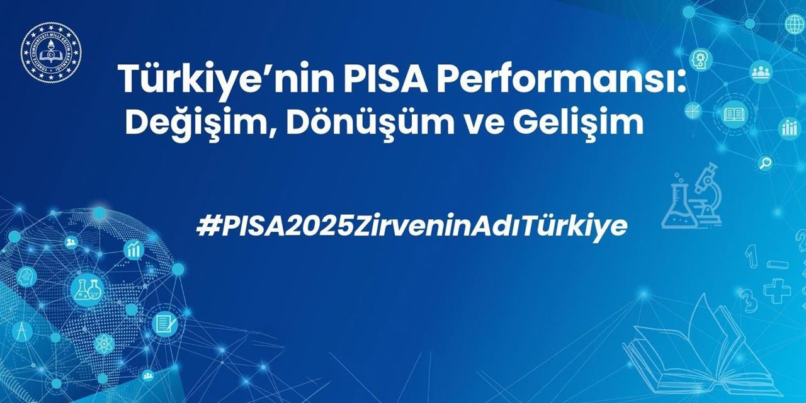

> Millî Eğitim Bakanlığı, Türkiye'nin uluslararası eğitim göstergelerindeki değişim ve gelişimini Ankara'da düzenlenecek sempozyumla mercek altına alacak.

Millî Eğitim Bakanlığı tarafından organize edilen "Türkiye'nin PISA Performansı: Değişim, Dönüşüm ve Gelişim" sempozyumu, Talim ve Terbiye Kurulu Başkanlığı Maarif Konferans Salonu'nda gerçekleştirilecek. Programa Millî Eğitim Bakanı Yusuf Tekin'in yanı sıra OECD Eğitim ve Beceriler Direktörü Andreas Schleicher da katılım sağlayacak.

Eğitim yöneticileri, akademisyenler ve araştırmacıları buluşturacak etkinlikte, Türkiye'nin geçmişten bugüne PISA sınavlarında sergilediği performans ve farklı yeterlik alanlarında kaydettiği ilerlemeler çok boyutlu olarak masaya yatırılacak.

Sempozyum oturumlarında fen bilimleri, matematik ve okuma becerilerine dair verilerin yanı sıra öğrenci başarısına etki eden bireysel, ailesel ve okul temelli faktörler uzmanlar tarafından değerlendirilecek.

---

## Heykel ve Banka Çarpan Kamyonet Sürücüsü Yunus Timlerince Yakalandı

**Asayiş · Tepebaşı** · 2026-11-19 07:09 UTC · Kaynak: [Google Haberler - Eskişehir asayiş](https://hurgun.com/haber/eskisehirde-heykel-ve-bankaya-carpan-kamyonet-surucusu-polis-tarafindan-yakalandi-172349)

> Eskişehir İsmet İnönü Caddesi'nde heykel ve banka çarparak zarar veren kamyonet sürücüsü, güvenlik kameralarının incelenmesiyle yakalandı.

İsmet İnönü Caddesi üzerinde manevra yaptığı esnada kontrolden çıkan kamyonet, yol kenarındaki heykele ve oturma bankına çarptı. Çarpmanın etkisiyle heykel ve kamusal kullanımda olan bankta maddi hasar meydana geldi.

Olayın ardından Eskişehir Büyükşehir Belediyesi tarafından yapılan açıklamada, kent mobilyalarına ve ortak alandaki sanat eserlerine zarar verilmemesi gerektiği vurgulanarak sorumluların bulunması için kamera kayıtlarının incelendiği duyuruldu.

Bölgedeki güvenlik kamerası görüntülerini detaylı şekilde inceleyen emniyet ekipleri, kamyonetin ve sürücünün kimliğini belirledi. Şüpheli sürücü, Eskişehir İl Emniyet Müdürlüğü bünyesindeki Yunus timleri tarafından kısa sürede yakalanarak hakkında adli işlem başlatıldı.

---

## Eskişehirspor Türkiye'nin En Golcü 3. Takımı Oldu: Süper Lig Devlerini Geride Bıraktı

**Spor · Merkez** · 2026-11-19 07:09 UTC · Kaynak: [Google Haberler - Eskişehirspor](https://www.bolgegundemi.com/eskisehir/eskisehirspor-turkiye-profesyonel-liglerinde-en-golcu-3-takim-oldu-238692.html)

> Türkiye profesyonel ligleri gol ortalaması verilerine göre Eskişehirspor, maç başına ulaştığı 2,71 gol ortalamasıyla en skorer üçüncü ekip unvanını elde etti.

Transfermarkt verileri doğrultusunda hazırlanan profesyonel ligler gol istatistiklerinde Eskişehirspor, hücum performansıyla dikkat çekti. Siyah-kırmızılı ekip, 2026-2027 sezonunda maç başına yakaladığı 2,71 gol ortalamasıyla Türkiye genelinde en çok gol atan üçüncü takım oldu ve Süper Lig kulüpleri dahil çok sayıda rakibini geride bıraktı.

Profesyonel ligler genelinde yapılan değerlendirmede zirvede, 3. Lig temsilcisi Malatya Yeşilyurt SK yer aldı. Mehmet Ak yönetimindeki Malatya ekibi, sezonun ilk 13 haftasında mağlubiyet yüzü görmezken 3,79 gol ortalamasına ulaştı. Sıralamanın ikinci basamağında ise maç başına 2,75 gol ortalaması tutturan 2. Lig ekibi Muş SK kendine yer buldu.

Süper Lig temsilcileri arasında en golcü 10 takım arasına girebilen tek ekip, 2,55 ortalamayla dördüncü sırada yer alan Amed SK oldu. Süper Lig'in diğer ekiplerinden Galatasaray 2,33 ortalamayla 12'nci, Kayserispor 2,27 ortalamayla 16'ncı, Fenerbahçe ise 2,05 ortalamayla 21'inci sırada kaldı. Beşiktaş, Trabzonspor ve Göztepe ise 2,00 gol ortalamasında yer aldı.

---

## Altın fiyatları 19 Kasım 2026: Gram altın 6.199,49 TL

**Ekonomi · Merkez** · 2026-11-19 06:00 UTC · Kaynak: [Harem Altın](https://www.haremaltin.com/altin-fiyatlari)

> Gram altın güne düşüşle başladı. Harem Altın verilerine göre gram altın 6.108,90 TL'den alınıyor, 6.199,49 TL'den satılıyor.

Altın piyasasında güne düşüşle başlandı. Harem Altın'ın saat 09.00 itibarıyla verilerine göre gram altının satış fiyatı 6.199,49 TL, alış fiyatı 6.108,90 TL oldu. Gram altın, önceki kapanışa göre yüzde 7,71 geriledi.

Ziynet altınlarda çeyrek altın 10.101 TL, yarım altın 20.202 TL, tam altın 40.280 TL, ata altın 41.329 TL seviyesinden satışa sunuluyor.

22 ayar bileziğin gram satış fiyatı 5.784,51 TL, has altının gram fiyatı 6.175,01 TL olarak belirlendi.

Uluslararası piyasalarda altının onsu 3.741,40 dolardan işlem görürken, dolar/TL 50,55 seviyesinde bulunuyor.

Fiyatlar Harem Altın'ın saat 09.00 itibarıyla paylaştığı verilere dayanmaktadır; kuyumcular arasında farklılık gösterebilir. Bu haber yatırım tavsiyesi değildir.

---

## Togg'dan Kadınlara Özel Finansman Paketi: Garanti BBVA ile Yeni Kampanya Yolda

**Ekonomi · Türkiye** · 2026-11-19 05:09 UTC · Kaynak: [Google Haberler - Togg](https://istanbulticaretgazetesi.com/togg-kadinlara-ozel-kampanya-2026-togg-kadinlara-ozel-kampanya-ne-zaman-baslayacak)

> Togg ve Garanti BBVA, kadınların elektrikli araç sahibi olmasını kolaylaştırmak için özel bir taşıt kredisi paketi hazırlıyor. Detayların yıl sonuna kadar duyurulması bekleniyor.

Türkiye'nin yerli otomobil üreticisi Togg, kadın müşterilere yönelik avantajlı ödeme seçenekleri sunacak yeni bir finansman paketi için Garanti BBVA ile hazırlıklarını sürdürüyor. İş birliği, Antalya'da düzenlenen COP31 İklim Zirvesi kapsamındaki panelde gündeme taşındı.

Zirvede gerçekleştirilen "Sürdürülebilir Mobilite Dönüşümünün Finansmanı" paneline katılan Togg CEO'su Gürcan Karakaş ile Garanti BBVA Genel Müdürü Mahmut Akten, elektrikli araçlara erişimin kolaylaştırılması ve finansman çözümleri üzerine değerlendirmelerde bulundu. Hazırlanan yeni paketle kadınların elektrikli araç ediniminin desteklenmesi amaçlanıyor.

Kredi limitleri, faiz oranları, vade seçenekleri ve başvuru kriterleri henüz kesinleşmeyen kampanyanın ayrıntılarının 2026 yılı sona ermeden açıklanması planlanıyor. Togg, kasım ayı boyunca bireysel müşterilerine T10X ve T10F modellerinde sunduğu mevcut faizsiz finansman seçeneklerini de sürdürüyor.

---

## Meslek Öğrenene Nakdi Destek: MEGEM ve Kızılay'dan İstihdam Protokolü

**Ekonomi · Odunpazarı** · 2026-11-19 05:09 UTC · Kaynak: [Google Haberler - Eskişehir](https://www.gazetevatan.com/sehirler/eskisehir/eskisehirde-ihtiyac-sahipleri-icin-yeni-uygulama-hem-egitim-hem-para-verilecek-2466280)

> Eskişehir'de MEGEM bünyesinde 10 meslek dalında eğitim görecek ihtiyaç sahibi kursiyerlere, eğitim süreleri boyunca Türk Kızılay tarafından maddi yardım sağlanacak.

Türk Kızılay ile Eskişehir Organize Sanayi Bölgesi (EOSB) iştiraki Mesleki Edindirme ve Geliştirme Merkezi (MEGEM) A.Ş. arasında iş birliği protokolü imzalandı. Sosyo-Ekonomik Güçlendirme Kapsamında İstihdama Yönlendirme ve Mesleki Eğitim Projesi çerçevesinde yürütülen çalışmayla, ekonomik desteğe ihtiyaç duyan kişilerin mesleki beceriler kazanarak iş gücüne katılması hedefleniyor.

İmzalanan protokole göre MEGEM'de 10 ayrı alanda mesleki eğitime hak kazanan kursiyerler arasından ihtiyaç sahipleri belirlenecek. İlgili mevzuat uyarınca şartları taşıyan adaylara kurs süresince Türk Kızılay tarafından doğrudan nakdi destek verilecek. Eğitim sürecini başarıyla tamamlayan kişilerin sanayi kuruluşlarında istihdama yönlendirilmesi planlanıyor.

Eskişehir OSB Yönetim Kurulu Başkanı Nadir Küpeli, MEGEM'in hem sanayinin nitelikli personel ihtiyacını karşıladığını hem de toplumsal fayda üreten projelere imza attığını dile getirdi. Daha önce dezavantajlı kadınlara, otizmli gençlere ve denetimli serbestlik yükümlülerine yönelik istihdam adımları atıldığını hatırlatan Küpeli, yeni protokolün bu sosyal sorumluluk halkasının bir parçası olduğunu kaydetti.

MEGEM A.Ş. Yönetim Kurulu Başkanı Samet Özkaya, eğitim altyapısıyla kursiyerlerin üretim süreçlerine katılımına zemin hazırladıklarını aktarırken; Türk Kızılay Afet ve Toplum Hizmetleri Genel Müdürü Nurdal Durmuş da bireylerin mesleki beceri edinerek kendi ayakları üzerinde durmalarının sosyal güçlenme açısından taşıdığı öneme dikkat çekti.

---

## Eskişehir'de Çocuklar Kentpark'ta Buluşuyor: Doğa Atölyesi Başlıyor

**Belediye · Odunpazarı** · 2026-11-19 05:09 UTC · Kaynak: [Google Haberler - Eskişehir etkinlik](https://www.istikbalgazetesi.com/eskisehirde-cocuklar-icin-heyecanlandiran-etkinlik-yarin-kentparkta-bulusacaklar)

> Eskişehir Büyükşehir Belediyesi, 8-12 yaş grubundaki çocuklara yönelik doğa temalı farkındalık atölyesi düzenliyor.

Eskişehir Büyükşehir Belediyesi, çocukların çevre bilincini artırmak amacıyla yeni bir etkinliğe imza atıyor. "Doğa Bize mi Ait, Biz mi Doğaya Aidiz?" başlığıyla hazırlanan programda çocuklar, doğayla kurdukları bağı eğitici aktiviteler ve çeşitli hikâyeler eşliğinde yeniden değerlendirecek.

Kentpark Sosyal Kütüphane bünyesinde saat 15.30'da başlayacak atölye, Büşra Aydemir yürütücülüğünde gerçekleştirilecek. Etkinlik boyunca oyunlar ve hikâyeler aracılığıyla çocukların doğaya bakış açılarını zenginleştirmeleri ve çevre farkındalığı kazanmaları hedefleniyor.

8-12 yaş aralığındaki çocukların ücretsiz olarak katılabileceği buluşmanın kayıt formuna belediyenin 'EBB Etkinlik' sosyal medya hesabı üzerinden ulaşılabiliyor.

---

## Erdoğan: Sermaye Piyasalarına Organize Kötülük Yapanlardan Hesap Soruluyor

**Siyaset · Türkiye** · 2026-11-19 05:09 UTC · Kaynak: [Google Haberler - Cumhurbaşkanı](https://www.hurriyet.com.tr/yazarlar/abdulkadir-selvi/cumhurbaskani-erdoganin-mesajlarinin-kodlari-43383154)

> Cumhurbaşkanı Recep Tayyip Erdoğan, fon soruşturmasına ilişkin değerlendirmesinde, Türkiye ekonomisine ve sermaye piyasalarına organize kötülük yapanlardan hesap sorulduğunu ifade etti.

Cumhurbaşkanı Recep Tayyip Erdoğan, AK Parti TBMM Grup Toplantısı'nda gündemdeki fon soruşturması ve ekonomik gelişmelere ilişkin açıklamalarda bulundu. Erdoğan, sermaye piyasalarında yaşanan sürece dair sorumlulardan hesap sorulacağını vurguladı.

Türkiye ekonomisine ve sermaye piyasalarına kasıtlı zararlar verildiğini belirten Erdoğan, organize kötülük yapanlardan işledikleri cürümlerin hesabının tek tek sorulduğunu kaydetti. AK Parti'nin siyaset yolculuğuna başladığı ilk günden bu yana milletin belirlediği istikametten ayrılmadığını dile getiren Erdoğan, tek pusulalarının milletin vicdanı olduğunu söyledi.

Muhalefet kanadından gelen eleştirilere de değinen Erdoğan, sosyal medya üzerinden yürütülen iddialara ve algı çalışmalarına itibar etmediklerini ifade etti. Erdoğan, parti teşkilatlarına seslenerek umutsuzluğa ve yılgınlığa teslim olunmaması yönünde çağrıda bulundu.

Öte yandan TBMM Genel Kurulu'nda, İzmir'de 19 işçinin hayatını kaybettiği fabrika kazası ve patronun ev hapsinde tutulması kararı da gündeme geldi. AK Parti Grup Başkanvekili Özlem Zengin, konuya ilişkin yaptığı açıklamada söz konusu durumdan rahatsızlık duyduklarını belirterek kamuoyu vicdanını rahatlatacak bir uygulamanın hayata geçirilmesi gerektiğini ifade etti.

---

## MHP'den Eskişehir İçin 5 Kritik Çağrı: Hastane, Çevre Yolu ve Külliye Öne Çıktı

**Siyaset · Merkez** · 2026-11-18 21:09 UTC · Kaynak: [Google Haberler - Eskişehir](https://www.esgazete.com/mhpli-sezerden-eskisehir-icin-5-kritik-cagri)

> MHP Eskişehir İl Başkanı Ayhan Sezer, kentin öncelikli sorunlarını 5 maddede sıralayarak siyasi ayrılıkların bir kenara bırakılması ve ortak hareket edilmesi çağrısında bulundu.

Milliyetçi Hareket Partisi (MHP) Eskişehir İl Başkanı Ayhan Sezer, kentin geleceğine yön verecek temel ihtiyaçlara dair açıklamalarda bulundu. Sorunların çözümünde siyasi ayrılıkların gözetilmemesi gerektiğini belirten Sezer, öncelikli gördükleri konuları belediye projeleri, sağlık yatırımları, turizm, ulaşım ve spor olmak üzere beş ana başlıkta topladıklarını ifade etti.

İlk olarak yerel yönetimlere çağrıda bulunan Sezer, belediyelerin devam eden ve planlanan projelerini kamuoyuyla şeffaf şekilde paylaşmasını istedi. 2026 yılı içinde tamamlanamayan çalışmaların gerekçelerinin açıklanması gerektiğini kaydeden Sezer, 2027 hedeflerinin de netleşmesini beklediklerini aktardı. Sağlık alanında ise Eskişehir Osmangazi Üniversitesi (ESOGÜ) Tıp Fakültesi Hastanesi'nin durumuna değinen Sezer, mevcut yapının yerine modern ve güncel standartlara uygun yeni bir hastane inşa edilmesinin kentin en acil yatırımlarından biri olduğunu vurguladı.

Ulaşım ve turizm konularında da değerlendirmeler yapan Sezer, mevcut çevre yolunun trafik yükünü artık kaldıramadığını belirterek Kuzey Çevre Yolu projesinin Eskişehir hattında vakit kaybedilmeden hayata geçirilmesi gerektiğini söyledi. Tarihi Kurşunlu Külliyesi çevresindeki tartışmalara da değinen Sezer, bölgedeki esnaf ve vatandaşların mağdur edilmeden sürecin Vakıflar Bölge Müdürlüğü koordinesinde turizme katkı sağlayacak biçimde sonuçlandırılmasını talep etti.

Son olarak Eskişehirspor'un kentin marka değeri olduğuna dikkat çeken MHP İl Başkanı Sezer, siyah-kırmızılı kulübün bulunduğu ligi hak etmediğini, üst liglere dönebilmesi için kentin tüm dinamiklerinin takıma destek vermesi gerektiğini dile getirdi. Sezer, gündeme getirdikleri maddelerin Eskişehir'in ortak menfaati olduğunu ve her türlü yapıcı iş birliğine hazır olduklarını sözlerine ekledi.

---

## Çamlıcalı Kadınlar Sivrihisar'ı Keşfetti: Tarih ve Gastronomi Dolu Gezi

**Belediye · Sivrihisar** · 2026-11-18 21:09 UTC · Kaynak: [Eskişehir Büyükşehir Belediyesi](https://www.eskisehir.bel.tr/icerik-detay.php?icerik_id=13570&cat_icerik=1&menu_id=24)

> Eskişehir Büyükşehir Belediyesi'nin kültürel miras projesi kapsamında Çamlıca Mahallesi sakini kadınlar, Sivrihisar'ın simge yapılarını ve yöresel lezzetlerini yerinde tanıdı.

Eskişehir Büyükşehir Belediyesi tarafından kentin kültürel değerlerini tanıtmak ve kadınların sosyal yaşama katılımını artırmak amacıyla yürütülen “Eskişehir Kültürel Mirası ile Buluşuyor” projesi sürüyor. Etkinlik kapsamında bu kez Çamlıca Mahallesi'nde yaşayan kadınlar Sivrihisar ilçesine konuk oldu. Kafileyi mahalleden Büyükşehir Belediye Başkanı Ayşe Ünlüce ile Çamlıca Mahalle Muhtarı Savaş Hancı uğurladı.

Kültürel gezilerin hem kentin köklü mirasını tanıma hem de mahalle içi komşuluk ve dayanışma bağlarını güçlendirme açısından önem taşıdığını belirten Başkan Ünlüce, muhtarlıklarla iş birliği içinde bu buluşmaların süreceğini ifade etti.

Sivrihisar'a ulaşan kafile, gün boyunca ilçenin öne çıkan tarihi ve mimari duraklarını ziyaret etti. Gezi rotasında Metin Yurdanur Açık Hava Müzesi, Sivrihisar Saat Kulesi, Seyir Terası, Surp Yerortutyun Kilisesi, Alemşah Türbesi ve UNESCO Dünya Mirası Listesi'nde yer alan Sivrihisar Ulu Camii incelendi. Kadınlar ayrıca Zaimağa Konağı, Sivrihisar Kilim Müzesi, Nasreddin Hoca Anıt Parkı, Hazinedar Camii, Kurşunlu Camii, Kılıç Mescid Minaresi, Aziz Mahmud Hüdayi Camii ve tarihi Arastalar Çarşısı'nı da gezdi.

Tarihi sokaklardaki gezi programı, ilçenin meşhur bamya çorbası ve yöresel lezzetlerinin tadılmasıyla tamamlandı. Büyükşehir Belediyesi, farklı mahallelerden kadınların katılımıyla ilçelere dönük tanıtım turlarını sürdürecek.

---

## Anadolu Üniversitesi'nden Gazetecilikte Yapay Zekâya Etik Kılavuz Geliyor

**Eğitim · Tepebaşı** · 2026-11-18 21:09 UTC · Kaynak: [Anadolu Üniversitesi](https://anahaber.anadolu.edu.tr/tr/haber-detay/tess101mnvhlvomd4gv37ggk)

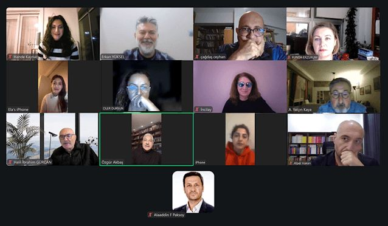

> Anadolu Üniversitesi İletişim Bilimleri Fakültesi Gazetecilik Bölümü, öğrencilerin haber üretiminde ve akademik çalışmalarında yapay zekâ araçlarını nasıl kullanacağını belirleyen bir rehber hazırlıyor.

Anadolu Üniversitesi İletişim Bilimleri Fakültesi Gazetecilik Bölümü Liderlik Komisyonu tarafından çevrim içi düzenlenen toplantıda, yapay zekânın mesleki pratiklere etkileri ve gazetecilik eğitimindeki rolü tartışıldı. Toplantıda, bölümün hazırladığı "Üretken Yapay Zekâ Kullanım Kılavuzu" taslağı akademisyenler ve basın mensuplarının görüşüne sunuldu.

Prof. Dr. Erkan Yüksel yönetiminde gerçekleşen oturumda; hız ve kolaylık sağlayan yapay zekâ teknolojilerinin editoryal sorumluluk, haber doğrulama ve telif gibi konularda yol açtığı sorunlar masaya yatırıldı. Toplantıda konuşan Esgazete Yazı İşleri Müdürü Şenay Bilik Yıldırım yapay zekânın haber hazırlık süreçlerinde insan emeği ihtiyacını azalttığına değinirken, NTV Parlamento Muhabiri Özgür Akbaş ise sahadaki muhabirin özgün katkısının ve imzasının yerini yapay zekânın tutamayacağını vurguladı.

Gazetecilik Bölüm Başkanı Prof. Dr. İncilay Cangöz, taslak kılavuzun gelen öneriler doğrultusunda son şeklini alacağını açıkladı. Hazırlanan rehber; insan denetimi, şeffaflık, kaynak gizliliği ve algoritmik yanlılık gibi ilkeleri temel alarak öğrencilere yapay zekâyı yalnızca yardımcı bir araç olarak kullanma sınırlarını çizecek.

---

## 81 İlden Öğretmenler Ankara'da Buluşuyor: MEB 24 Kasım Kutlama Programını Açıkladı

**Eğitim · Türkiye** · 2026-11-18 21:09 UTC · Kaynak: [Milli Eğitim Bakanlığı](https://www.meb.gov.tr/24-kasim-ogretmenler-gunu-cesitli-etkinliklerle-kutlanacak/haber/42570/tr)

> Millî Eğitim Bakanlığı, 24 Kasım Öğretmenler Günü'nü "Hep Sen Varsın Diye" temasıyla tüm yıla yayılacak etkinliklerle kutlamaya hazırlanıyor. 81 ilden temsilci eğitimciler Ankara'da ağırlanacak.

Millî Eğitim Bakanlığı, 24 Kasım Öğretmenler Günü kapsamında eğitimcilerin toplumdaki yerini vurgulamak ve mesleki dayanışmayı güçlendirmek amacıyla "Hep Sen Varsın Diye" temasıyla geniş kapsamlı bir kutlama takvimi hazırladı. Bakanlığın koordinasyonunda yürütülecek faaliyetlerin yalnızca 24 Kasım ile sınırlı kalmayıp yıl geneline yayılması hedefleniyor.

Kutlamalar çerçevesinde 81 ilden belirlenen temsilci öğretmenler, 23-24 Kasım tarihlerinde Ankara'da bir araya gelecek. Millî Eğitim Bakanı Yusuf Tekin'in katılımıyla gerçekleşecek programda öğretmenler; Türk Havacılık ve Uzay Sanayii (TUSAŞ) tesislerini, Şehit Öğretmenler Anıtı'nı ve Öğretmen Hatıra Ormanı'nı ziyaret edecek. Temsilciler ayrıca CSO Ada Ankara'da düzenlenecek "Bir Öğretmen Bin Yürek" konserini takip edecek.

Öğretmenler Günü, 24 Kasım sabahı Anıtkabir ziyaretiyle başlayacak. Bakan Tekin ve öğretmen heyetinin mozoleye çelenk sunmasının ardından sergi açılışları ve söyleşiler düzenlenecek. Heyet akşam saatlerinde ise Cumhurbaşkanlığı Külliyesi'nde gerçekleştirilecek "Öğretmene Saygı Gecesi" programına katılacak. Geceye şehit öğretmen yakınları, emekli ve depremzede eğitimcilerin de aralarında bulunduğu yaklaşık 2 bin kişinin katılması öngörülüyor.

Kutlama programı kapsamında ayrıca 81 ilde "ÖğretmenİZ" söyleşileri gerçekleştirilecek. Ankara'da 25-27 Kasım'da 3. Maarif Kongresi düzenlenecek; İstanbul'da ise Türk Dünyası Öğretmen Buluşması ve emekli öğretmenlere yönelik vefa günleri organize edilecek. Farklı bakanlıklarla yapılan iş birlikleriyle fidan dikimi, spor turnuvaları, askeri bando dinletileri ve sosyal tesis indirimleri gibi birçok etkinlik de hayata geçirilecek.

---

## Sivrihisar'a Ücretsiz Nostaljik Tramvay Geliyor: Merkez ile Otogar Arasında Çalışacak

**Ulaşım · Sivrihisar** · 2026-11-18 19:10 UTC · Kaynak: [Google Haberler - Eskişehir gündem](https://www.gazetevatan.com/galeri/eskisehirde-bir-ilk-daha-o-ilceye-ucretsiz-tramvay-geliyor-2465649)

> Sivrihisar Belediyesi, ilçe merkezi ile otogar arasında tamamen ücretsiz hizmet verecek nostaljik tramvay projesi için ilk adımı attı.

Eskişehir'in "Sakin Şehir" unvanlı tarihi ilçesi Sivrihisar'da ilçe içi ulaşımı ve turizmi destekleyecek nostaljik tramvay projesi başlatıldı. İlçe merkezi ile otogar hattı arasında sefer yapacak olan tramvaydan hem yöre halkı hem de ilçeye gelen turistler ücretsiz yararlanacak.

Sivrihisar Belediye Başkanı Habil Dökmeci, nostaljik tramvay projesinin hayata geçirilmesi kapsamında Denizli'de üretim yapan bir firma ile temaslara başladı. İlçenin tarihi dokusuna uyumlu şekilde tasarlanması hedeflenen hat için ilçe merkezindeki güzergâh belirleme çalışmaları yürütülüyor.

Yılda 1 milyondan fazla ziyaretçiyi ağırlayan ilçede hizmete girecek tramvayın son durağı Sivrihisar Şehirlerarası Otobüs Terminali olacak. Proje, tarihi sokaklara görsel zenginlik kazandırmanın yanı sıra otogar ile ilçe merkezi arasındaki yolcu taşımacılığını da kolaylaştıracak.

Güzergâh planlaması ve araç teminine yönelik görüşmelerin tamamlanmasının ardından uygulama takvimi netleşecek.

---

## MEB COP31'de Açıkladı: Çevre ve İklim Farkındalığı Aile Okullarına Taşınıyor

**Eğitim · Türkiye** · 2026-11-18 19:10 UTC · Kaynak: [Milli Eğitim Bakanlığı](https://www.meb.gov.tr/cop31039de-quotiklim-degisikligine-direncli-toplumlar-icin-egitim-kultur-ve-hayat-boyu-ogrenmequot-paneli-duzenlendi/haber/42571/tr)

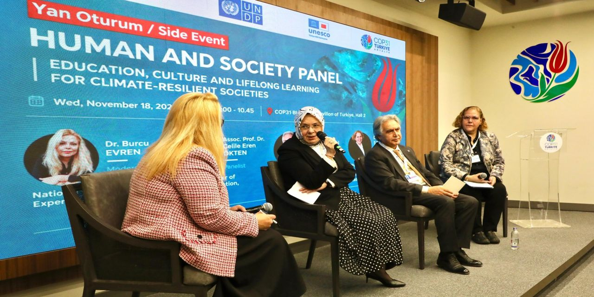

> Millî Eğitim Bakan Yardımcısı Celile Eren Ökten, COP31 panelinde iklim ve çevre bilincinin aile okulları ve halk eğitimi atölyeleriyle kalıcı alışkanlıklara dönüştürülmesini hedeflediklerini bildirdi.

Antalya'da devam eden Birleşmiş Milletler İklim Değişikliği Çerçeve Sözleşmesi 31. Taraflar Konferansı (COP31) bünyesinde, "İklim Değişikliğine Dirençli Toplumlar İçin Eğitim, Kültür ve Hayat Boyu Öğrenme" başlıklı panel düzenlendi.

Mavi Bölge'deki Türkiye Pavilyonu'nda, Millî Eğitim Bakanlığı uzmanı Burcu Evren'in moderatörlüğünde gerçekleşen oturuma Millî Eğitim Bakan Yardımcısı Celile Eren Ökten, UNESCO Türkiye Millî Komisyonu Yönetim Kurulu Başkanı Mehmet Öcal Oğuz ve ekonomist Şebnem Şahin konuşmacı olarak katıldı.

Panelde konuşan Bakan Yardımcısı Ökten, Türkiye Yüzyılı Maarif Modeli kapsamında sürdürülebilir okuryazarlığa büyük önem verdiklerini ve öğrencilerin çevresel konuları çok boyutlu bakış açısıyla ele aldığını belirtti. Bilgi birikimini eyleme dökmeyi amaçladıklarını vurgulayan Ökten; halk eğitimi merkezlerinde tekstil dikimi ve ileri dönüşüm atölyeleri açıldığını, bu kurslar sayesinde sürdürülebilir malzeme kullanımının günlük yaşamın bir parçası haline gelmesini hedeflediklerini kaydetti.

Eğitim sürecinde en temel unsurun aile kurumu olduğuna dikkati çeken Ökten, ilköğretimden ortaöğretime kadar uzanan aile okulu programlarıyla çevre farkındalığının evlerde yerleşik bir kültüre dönüşmesi için çalışmaların sürdüğünü ifade etti.

---

## KOOP-İŞ Heyetinden ESTÜ Rektörü Prof. Dr. Adnan Özcan'a Tebrik Ziyareti

**Eğitim · Tepebaşı** · 2026-11-18 19:10 UTC · Kaynak: [Eskişehir Teknik Üniversitesi](https://www.eskisehir.edu.tr/tr/Haber/Detay/koop-is-sendikasi-eskisehir-bolge-sorumlusu-erdal-esir-ve-is-yeri-temsilcilerinden-rektor-prof-dr-adnan-ozcana-hayirli-olsun-ziyareti)

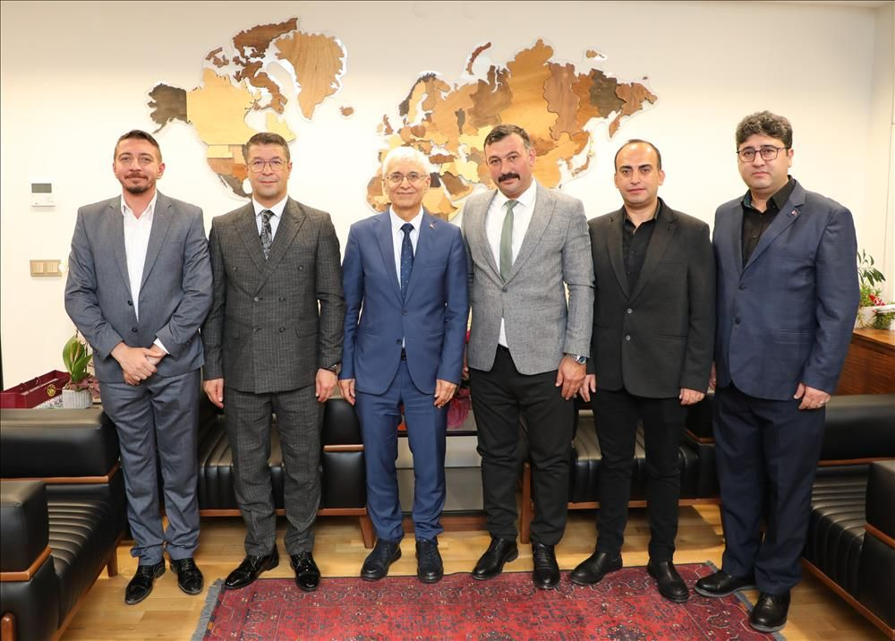

> KOOP-İŞ Sendikası Eskişehir Bölge Sorumlusu Erdal Esir ve heyeti, yeniden rektörlüğe atanan Prof. Dr. Adnan Özcan'a hayırlı olsun ziyaretinde bulundu.

Cumhurbaşkanlığı Kararı ile Eskişehir Teknik Üniversitesi (ESTÜ) Rektörlüğü görevine yeniden atanan Prof. Dr. Adnan Özcan'a yönelik hayırlı olsun ziyaretleri devam ediyor.

KOOP-İŞ Sendikası Eskişehir Bölge Sorumlusu Erdal Esir ve beraberindeki iş yeri temsilcileri, ESTÜ Rektörlük Ofisinde Prof. Dr. Özcan'ı ziyaret etti. Esir, ikinci dönemine başlayan Özcan'ı tebrik ederek yeni çalışma döneminde başarılar diledi.

Ziyaretten ötürü memnuniyetini dile getiren Rektör Prof. Dr. Adnan Özcan ise nezaketleri ve iyi niyet temennileri dolayısıyla heyete teşekkür etti.

---

## Eskişehirspor Söke Deplasmanına Odaklandı: Hazırlıklar Başladı

**Spor · Merkez** · 2026-11-18 19:10 UTC · Kaynak: [Google Haberler - Eskişehirspor](https://www.medyagazete.com/haber/eskisehirsporda-soke-1970-sk-maci-hazirliklari-basladi)

> Nesine 3. Lig 2. Grup’ta zirve mücadelesi veren Eskişehirspor, 13. hafta kapsamında deplasmanda oynayacağı Söke 1970 SK maçının antrenmanlarına start verdi.

Nesine 3. Lig 2. Grup'ta mücadele eden Eskişehirspor, ligin 13. haftasında deplasmanda konuk olacağı Söke 1970 SK karşılaşmasının hazırlıklarına başladı.

Siyah-kırmızılı kulübün resmî kanallarından yapılan bilgilendirmeye göre, takım 22 Kasım Pazar günü deplasmanda oynanacak kritik müsabaka öncesi antrenman takvimini uygulamaya koydu. Teknik heyet gözetiminde sahaya çıkan futbolcular, zorlu randevudan galibiyetle ayrılmak amacıyla taktik ve kondisyon ağırlıklı çalışmalar gerçekleştirdi.

---

## Eskişehir'de Caz Günleri Coşkusu: Duygu Soylu Jazz Band Dinleyicilerle Buluştu

**Kültür-Sanat · Merkez** · 2026-11-18 19:10 UTC · Kaynak: [Eskişehir Büyükşehir Belediyesi](https://www.eskisehir.bel.tr/icerik-detay.php?icerik_id=13571&cat_icerik=1&menu_id=24)

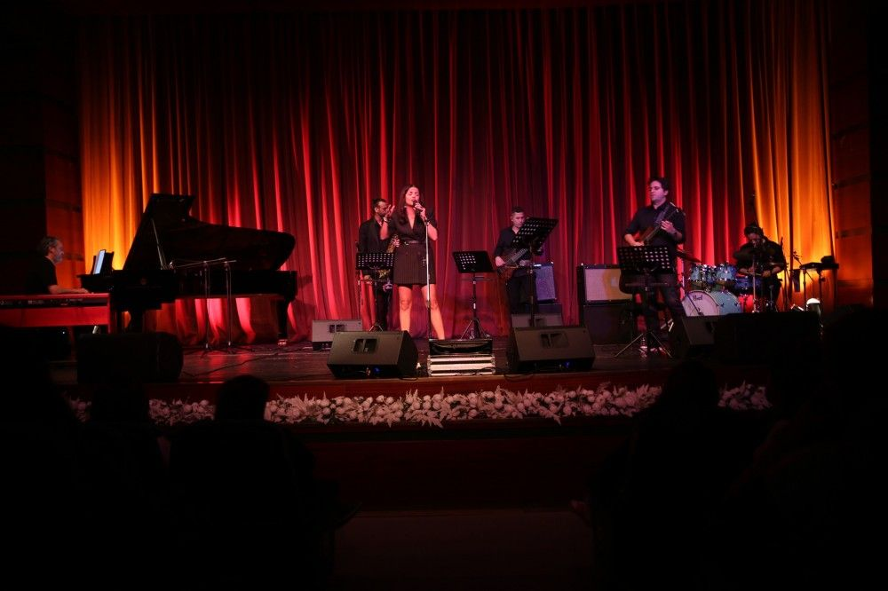

> Eskişehir Büyükşehir Belediyesi tarafından düzenlenen Caz Günleri kapsamında sahne alan Duygu Soylu Jazz Band, sanatseverlere müzik dolu bir akşam yaşattı.

Eskişehir Büyükşehir Belediyesi Caz Günleri etkinlikleri hız kesmeden devam ediyor. Etkinlikler çerçevesinde Sanat ve Kültür Merkezi Opera Sahnesi'nde dinleyicilerin karşısına çıkan Duygu Soylu Jazz Band, geniş repertuvarı ve sahne performansıyla Eskişehirli müzikseverlerden tam not aldı.

Vokalde Duygu Soylu’nun yer aldığı konserde piyanoda Erdem Yörük, saksafonda Serkan Altınok, elektrik basta Buğra Kılıçak, davulda Nedim Ruacan ve gitarda Eylül Biçer sahne aldı. Konserde caz dünyasının klasikleşmiş bestelerinin yanı sıra Brian Alexander Morgan, Stevie Wonder, Antonio Carlos Jobim ve David Foster gibi müzisyenlerin eserleri ile Duygu Soylu’nun "Kara Elmas" albümünden şarkılar seslendirildi.

Konser öncesi müziğinde çeşitliliğin önemine değinen Duygu Soylu, farklı tarzlardan beslenmenin yorumculuğuna önemli katkılar sağladığını belirtti. Büyükşehir Belediyesi Caz Günleri, 1 Aralık 2026 tarihinde Opera Sahnesi'nde gerçekleşecek Çağrı Sertel Trio konseriyle sürecek.

---

## Anadolu Üniversitesi'nde Google Türkiye ile Yapay Zekâ ve Habercilik Eğitimi

**Eğitim · Tepebaşı** · 2026-11-18 19:10 UTC · Kaynak: [Anadolu Üniversitesi](https://anahaber.anadolu.edu.tr/tr/haber-detay/trojotopsaj2r40o9tfufk7h)

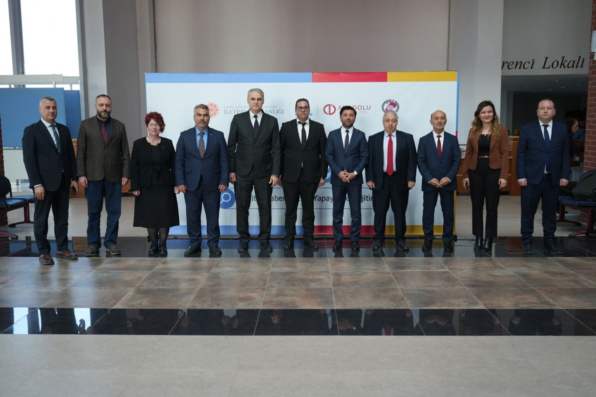

> Anadolu Üniversitesi'nde düzenlenen eğitimde yapay zekâ teknolojilerinin medya sektörüne etkileri ve dijital habercilik araçları ele alındı.

Cumhurbaşkanlığı İletişim Başkanlığı Afyonkarahisar Bölge Müdürlüğü, Anadolu Üniversitesi Stratejik Araştırmalar Merkezi (ANASAM), Basın İlan Kurumu Bursa Bölge Müdürlüğü ve Google Türkiye iş birliğiyle "Dijital Habercilik ve Yapay Zekâ Eğitimi" gerçekleştirildi. Öğrenci Merkezi Yunus Emre Salonu'nda düzenlenen programa Eskişehir basınının yanı sıra çevre illerden medya temsilcileri, akademisyenler ve öğrenciler katıldı.

Eğitimin açılışında konuşan Anadolu Üniversitesi Rektörü Prof. Dr. Yusuf Adıgüzel, gazeteciliğin dijitalleşmeyle birlikte biçim değiştirdiğini belirterek mesleğin özünün gerçeğin peşinden gitmek olduğunu vurguladı. Adıgüzel, yapay zekânın doğru kullanılması durumunda mesleği geliştireceğini, her zaman insan vicdanına ve gözüne ihtiyaç duyulacağını kaydetti. Basın İlan Kurumu Bursa Bölge Müdürü Gökhan Eren de programın hayata geçirilmesinde katkı sunan kurumlara teşekkür etti.

Google Türkiye Eğitim Danışmanı Özgür Mehmet Kütküt tarafından verilen eğitimde; veri odaklı gazetecilik, araştırma, redaksiyon ve haber üretim süreçlerinde yapay zekâ araçlarının kullanımı anlatıldı. Kütküt, üretken yapay zekânın içerik üretiminde önemli bir araç olduğunu ve insan odaklı kaliteli içerik üretiminin hedeflenmesi gerektiğini ifade etti.

Eğitim öncesinde heyet Rektör Adıgüzel'i makamında ziyaret ederken, programın sonunda Rektör Yardımcısı Prof. Dr. Erkan Erdemir tarafından Kütküt'e teşekkür belgesi verildi.

---

## AK Parti Tepebaşı Heyetinden Milletvekili Ayşen Gürcan'a TBMM Ziyareti

**Siyaset · Tepebaşı** · 2026-11-18 19:10 UTC · Kaynak: [Google Haberler - Tepebaşı](https://www.medyamidas.com/gundem/serhat-tunc-ve-yonetiminden-aysen-gurcana-tbmm-ziyareti)

> AK Parti Tepebaşı İlçe Başkanı Serhat Tunç ve ilçe yönetimi, AK Parti Eskişehir Milletvekili Ayşen Gürcan'ı TBMM'deki makamında ziyaret ederek ilçedeki çalışmaları değerlendirdi.

AK Parti Tepebaşı İlçe Başkanı Serhat Tunç ve yönetim kurulu üyeleri, AK Parti Eskişehir Milletvekili Prof. Dr. Ayşen Gürcan ile Türkiye Büyük Millet Meclisi'ndeki (TBMM) makamında bir araya geldi.

Ziyarette Tepebaşı'nın güncel ihtiyaçları, ilçede süren projeler ve teşkilatın sahada sürdürdüğü çalışmalar kapsamlı şekilde ele alındı. İlçe gündemine dair karşılıklı fikir alışverişinde bulunuldu.

Ziyaretten duyduğu memnuniyeti dile getiren Milletvekili Ayşen Gürcan, ilçe başkanı ve beraberindeki heyete nazik ziyaretleri ile ilçeye dönük gayretlerinden dolayı teşekkür etti.

---

## Gençlik ve Spor İl Müdürü Kalın'dan ESTÜ Rektörü Özcan'a Tebrik Ziyareti

**Eğitim · Tepebaşı** · 2026-11-18 17:10 UTC · Kaynak: [Eskişehir Teknik Üniversitesi](https://www.eskisehir.edu.tr/tr/Haber/Detay/eskisehir-genclik-ve-spor-il-muduru-hasan-kalindan-rektor-prof-dr-adnan-ozcana-hayirli-olsun-ziyareti)

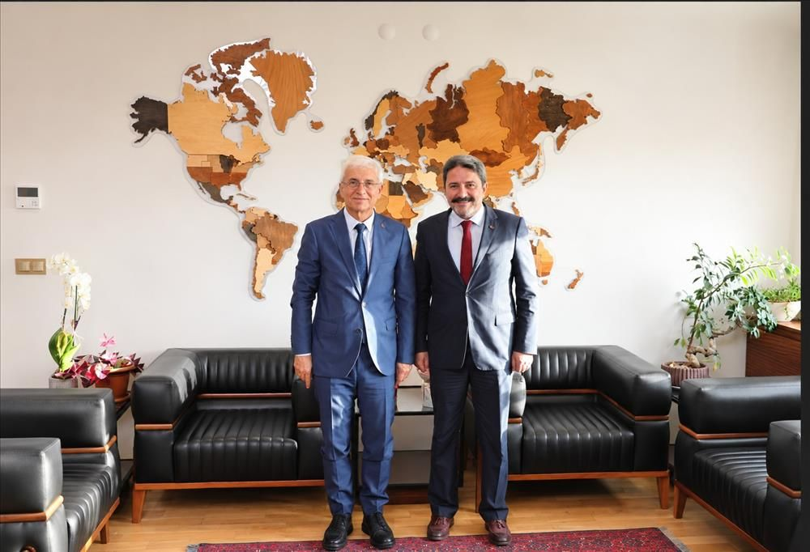

> Eskişehir Gençlik ve Spor İl Müdürü Hasan Kalın, ESTÜ Rektörlüğü görevine yeniden atanan Prof. Dr. Adnan Özcan'ı makamında ziyaret etti.

Eskişehir Gençlik ve Spor İl Müdürü Hasan Kalın, 6 Kasım 2026 tarihli Cumhurbaşkanlığı Kararı ile Eskişehir Teknik Üniversitesi (ESTÜ) Rektörlüğü görevine yeniden getirilen Prof. Dr. Adnan Özcan'a hayırlı olsun ziyaretinde bulundu.

Rektörlük ofisinde gerçekleşen görüşmede İl Müdürü Kalın, Prof. Dr. Özcan'ı ikinci dönem rektörlük görevi dolayısıyla tebrik ederek yeni çalışma döneminde başarılar diledi.

Ziyaretten duyduğu memnuniyeti ifade eden ESTÜ Rektörü Prof. Dr. Adnan Özcan ise nazik tebriki ve temennileri için Kalın'a teşekkür etti.

---

## Eskişehir'in Simgesi 'Dedikoducu Kadınlar' Heykeline ve Banklara Çirkin Saldırı

**Gündem · Tepebaşı** · 2026-11-18 17:10 UTC · Kaynak: [Eskişehir Büyükşehir Belediyesi](https://www.eskisehir.bel.tr/icerik-detay.php?icerik_id=13572&cat_icerik=1&menu_id=24)

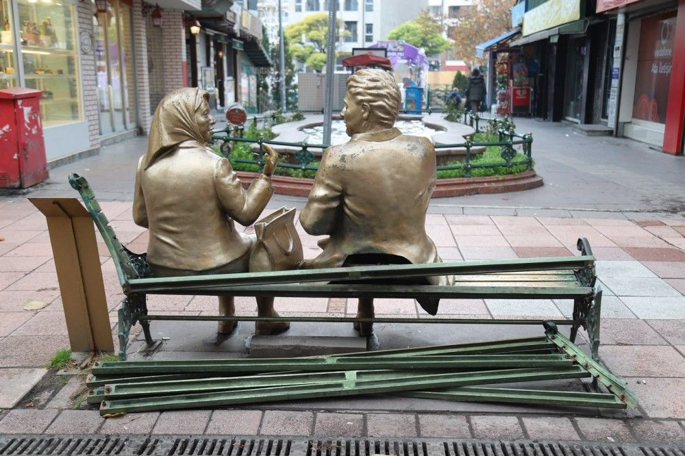

> İsmet İnönü 1 Caddesi'ndeki 'Dedikoducu Kadınlar' heykeli ile çevresindeki banklar kimliği belirsiz kişi ya da kişilerce tahrip edildi.

Eskişehir Büyükşehir Belediyesi tarafından yıllar önce İsmet İnönü 1 Caddesi'ne yerleştirilen ve kentin simgelerinden biri haline gelen "Dedikoducu Kadınlar" heykeli saldırıya uğradı. Kimliği henüz belirlenemeyen kişi veya kişiler, heykelin yanı sıra cadde üzerindeki bankları da kırarak kamu malına zarar verdi.

Kentin ortak kullanım alanlarında yaşanan tahribat çevredekilerin tepkisine yol açarken, olayın sorumlularının tespit edilmesi için bölgedeki güvenlik kamerası kayıtları incelemeye alındı.

Eskişehir Büyükşehir Belediyesi tarafından yapılan açıklamada, ortak yaşam alanları ve sanat eserlerine sahip çıkılması gerektiği vurgulandı. Açıklamada, "Yılların emeğiyle güzelleşen, sanatla ve kültürle değer kazanan Eskişehir’in simgelerini korumak hepimizin görevi. Unutulmamalı ki bu kent hepimizin; sokakları, parkları, heykelleri ve banklarıyla hepimize emanet" ifadelerine yer verildi.

---

## Edebiyat Fakültesinde COST ve TÜBİTAK 2515 Destekleri Anlatıldı

**Eğitim · Tepebaşı** · 2026-11-18 17:10 UTC · Kaynak: [Anadolu Üniversitesi](https://anahaber.anadolu.edu.tr/tr/haber-detay/pd3b40lzodypkoco7u6k4kbo)

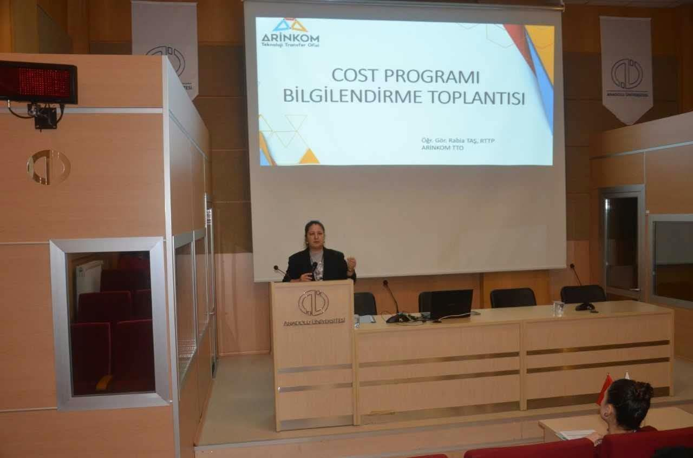

> Anadolu Üniversitesi Edebiyat Fakültesi'nde düzenlenen toplantıda, akademisyenlere uluslararası araştırma ağları COST ve TÜBİTAK 2515 programının detayları aktarıldı.

Anadolu Üniversitesi Edebiyat Fakültesi Ar-Ge Birimi koordinasyonunda, fakültede görev yapan öğretim elemanlarına yönelik "COST Aksiyonları ve TÜBİTAK 2515 – COST Aksiyon Üyeleri Ar-Ge Destek Programı" bilgilendirme toplantısı düzenlendi. Etkinlikte ARİNKOM Teknoloji Transfer Ofisi Yöneticisi Öğr. Gör. Dr. Rabia Taş, uluslararası araştırma iş birliği fırsatları ve sunulan destekler hakkında sunum yaptı.

Toplantıda, Avrupa Bilim ve Teknolojide İş Birliği (COST) çerçevesinde oluşturulan uluslararası araştırma ağlarının yapısı ve araştırmacılara sağladığı imkanlar ele alındı. Aksiyonlara katılım şartları, mevcut çalışma ağlarına dahil olma yöntemleri ile Yönetim Komitesi ve Çalışma Grubu üyelik süreçleri hakkında katılımcılara bilgi verildi.

Programın devamında, COST Aksiyonlarında yer alan araştırmacıların ulusal düzeydeki projelerini destekleyen TÜBİTAK 2515 programının başvuru koşulları ve uygunluk kriterleri değerlendirildi. Uluslararası ortaklıkların ve disiplinler arası çalışmaların öneminin vurgulandığı toplantı, akademisyenlerin sorularının yanıtlanmasıyla tamamlandı.

---

## Cumhurbaşkanı Erdoğan, Vatikan Devlet Sekreteri Parolin'i Külliye'de Kabul Etti

**Siyaset · Türkiye** · 2026-11-18 17:10 UTC · Kaynak: [İletişim Başkanlığı](https://www.iletisim.gov.tr/turkce/haberler/detay/cumhurbaskani-erdogan-vatikan-devlet-sekreteri-parolini-kabul-etti-18-11-26)

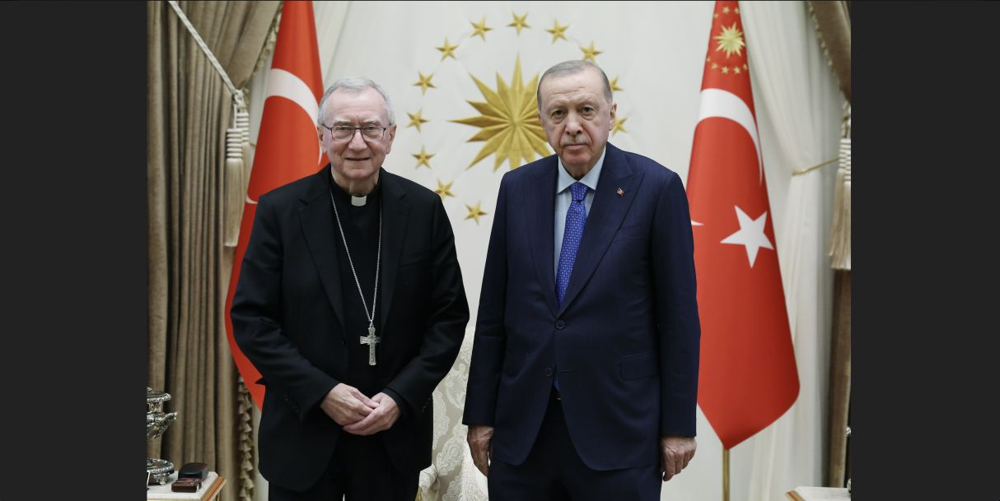

> Cumhurbaşkanı Recep Tayyip Erdoğan, Vatikan Devlet Sekreteri Kardinal Pietro Parolin ile Cumhurbaşkanlığı Külliyesi'nde bir araya geldi.

Cumhurbaşkanı Recep Tayyip Erdoğan, Vatikan Devlet Sekreteri Kardinal Pietro Parolin'i Cumhurbaşkanlığı Külliyesi'nde kabul etti.

Gerçekleştirilen kabulde Dışişleri Bakanı Hakan Fidan ile Vatikan Büyükelçisi Fahrettin Altun da hazır bulundu.

---

## COP31'de 'Çocuk İklim Bildirgesi': Yağmur Suyu ve Enerji Saati Önerisi

**Eğitim · Türkiye** · 2026-11-18 17:10 UTC · Kaynak: [Milli Eğitim Bakanlığı](https://www.meb.gov.tr/quotcocuk-iklim-zirvesiquotnde-ogrencilerin-iklim-ve-cevre-sorunlarina-iliskin-cozum-onerileri-sunuldu/haber/42575/tr)

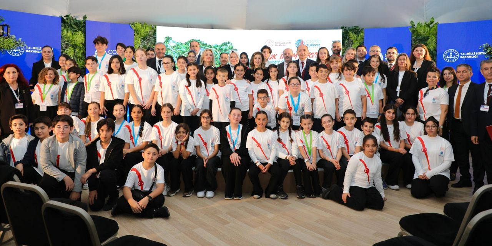

> Antalya'da düzenlenen COP31 zirvesinde bir araya gelen öğrenciler, 34 ilde hazırlanan Türkiye Çocuk İklim Bildirgesi'ni kamuoyuna sundu.

Birleşmiş Milletler İklim Değişikliği Konferansı (COP31) çerçevesinde kurulan Türkiye İklim Okulu, Çocuk İklim Zirvesi'ne ev sahipliği yaptı. Millî Eğitim Bakan Yardımcısı Celile Eren Ökten'in katılımıyla düzenlenen etkinlikte, öğrencilerin çevre krizine yönelik çözüm önerilerini içeren bildirge paylaşıldı.

Bakan Yardımcısı Ökten, maarif ailesinin tüm paydaşlarıyla dayanışma içinde yürütülen projelerin geleceğe katkı sunduğunu ifade etti. Öğretmenlerin azim ve rehberliğiyle milli ve manevi değerlerine bağlı, çevre bilinci gelişmiş nesillerin yetiştiğini kaydetti.

Zirvede sunulan "Türkiye Çocuk İklim Bildirgesi", 34 ilde ilkokul 4. sınıf ile ortaokul 7 ve 8. sınıf öğrencilerinin yürüttüğü tematik atölye çalışmaları sonucunda oluşturuldu. Bildirgede okullarda ve kamu binalarında yağmur suyunun depolanması, öğle aralarında cihazların kapatıldığı bir "Enerji Saati" uygulanması, okul ormanlarının kurulması ve her okulda öğrencilerin söz sahibi olacağı Çocuk İklim Meclislerinin teşkil edilmesi gibi somut adımlar yer aldı.

---

## GTA 6 bu gece Türkiye'de oynanabilir oluyor: PlayStation Store fiyatı 3.999 TL

**Türkiye · Türkiye** · 2026-11-18 15:47 UTC · Kaynak: [Xbox / PlayStation Store Türkiye](https://www.xbox.com/en-US/games/grand-theft-auto-vi)

> Rockstar Games'in Grand Theft Auto VI oyunu 19 Kasım'da PlayStation 5 ve Xbox Series X|S için çıkıyor. Oyunun Türkiye'de gece 00.00'da erişime açılması bekleniyor.

Rockstar Games'in merakla beklenen oyunu Grand Theft Auto VI (GTA 6), 19 Kasım 2026 Perşembe günü PlayStation 5 ve Xbox Series X|S için satışa çıkıyor. Şirket çıkış tarihini 6 Kasım 2025'te açıklamıştı.

Oyun her bölgede yerel saatle gece yarısı açılıyor. Bu nedenle ilk olarak Yeni Zelanda'daki oyuncuların erişimine açıldı. Türkiye'de ise oyunun 19 Kasım saat 00.00'da oynanabilir olması bekleniyor. Ön sipariş verenler oyunu önceden indirebiliyor ancak erişim saatinden önce açamıyor.

PlayStation Store Türkiye'de oyunun dijital Standard Edition sürümü 3.999 TL, Ultimate Edition sürümü ise 4.999 TL'den listeleniyor. Dijital ön sipariş verenlere bir aylık GTA+ üyeliği ve Vintage Vice City paketi veriliyor.

Oyunun bilgisayar (PC) sürümü ve çevrim içi modu GTA Online için henüz bir tarih açıklanmadı.

---

## Vali Erdinç Yılmaz'dan Hane Ziyareti: Kılıç Ailesinin Taleplerini Dinledi

**Gündem · Merkez** · 2026-11-18 15:09 UTC · Kaynak: [Eskişehir Valiliği](https://www.eskisehir.gov.tr/valimiz-dr-erdinc-yilmaz-hane-ziyaretleri-kapsaminda-fatma-kilic-ve-kizi-ayse-kilici-evlerinde-ziyaret-etti)

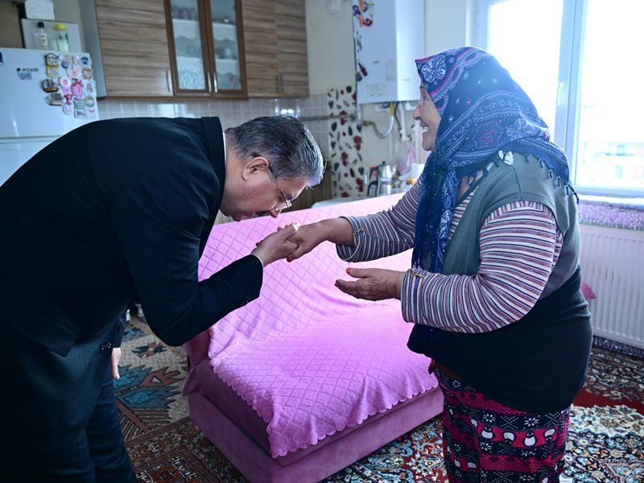

> Eskişehir Valisi Dr. Erdinç Yılmaz, hane ziyaretleri kapsamında Fatma Kılıç ve kızı Ayşe Kılıç'ı evlerinde ziyaret ederek ihtiyaç ve taleplerini dinledi.

Eskişehir Valisi Dr. Erdinç Yılmaz, kentte sürdürdüğü hane ziyaretleri doğrultusunda Fatma Kılıç ve kızı Ayşe Kılıç'ın evine konuk oldu.

Ziyarette aile bireyleriyle bir süre sohbet eden Vali Yılmaz, Kılıç ailesinin hâl ve hatırını sorarak iletilen talep ve ihtiyaçları not aldı.

Vatandaşlarla doğrudan bir araya gelmeye ve onların sorunlarını yerinde dinlemeye büyük önem verdiklerini vurgulayan Vali Yılmaz, devletin tüm imkânlarıyla her zaman vatandaşların yanında olduğunu kaydetti.

---

## Tepebaşı ile Belçika Arasında Yeni AB Projesi: Başkan Ataç Büyükelçiyle Görüştü

**Belediye · Tepebaşı** · 2026-11-18 15:09 UTC · Kaynak: [Tepebaşı Belediyesi](https://www.tepebasi.bel.tr/Haber/Detay/baskanatacbelcikaileisbirligimiziabprojesiylebuyutecegiz)

> COP31 için Antalya'da bulunan Tepebaşı Belediye Başkanı Ahmet Ataç, Belçika'nın Ankara Büyükelçisi Hendrik Van de Velde ile bir araya gelerek ortak AB projesi hazırlıklarını görüştü.

Antalya'da düzenlenen COP31 İklim Zirvesi kapsamında temaslarını sürdüren Tepebaşı Belediye Başkanı Ahmet Ataç, Belçika'nın Ankara Büyükelçisi Hendrik Van de Velde ile bir toplantı gerçekleştirdi. Görüşmeye Tepebaşı Belediye Başkan Yardımcısı Suat Yalnızoğlu da katıldı.

Toplantıda Tepebaşı Belediyesi ile Belçika Büyükelçiliği arasında sürdürülebilirlik alanında geliştirilebilecek ortak çalışmalar ve yeni iş birliği olanakları ele alındı. Başkan Ataç, yerel yönetimlerin uluslararası temaslar üzerinden kurduğu bilgi ve deneyim paylaşımının kentlerin sürdürülebilir kalkınmasına güç kattığını dile getirdi.

İki taraf arasındaki diyaloğun somut adımlarla ileriye taşınacağını ifade eden Başkan Ataç, çevre ve iklim alanındaki birikimlerini uluslararası düzleme taşımayı hedeflediklerini belirtti. Ataç, daha önce Eskişehir Caz Festivali ve Jazz Network buluşmasıyla kurulan temasların, Belçika Büyükelçiliği ortaklığında hazırlanacak yeni bir Avrupa Birliği projesiyle sürdürüleceğini kaydetti.

Büyükelçi Hendrik Van de Velde ise iş birliğinden duyduğu memnuniyeti dile getirerek Başkan Ataç ve Başkan Yardımcısı Yalnızoğlu'nu Belçika Büyükelçiliği tarafından organize edilecek resepsiyona davet etti.

---

## Millî Mücadele'nin Lojistik Kahramanı Behiç Erkin Eskişehir'de Anıldı

**Kültür-Sanat · Tepebaşı** · 2026-11-18 15:09 UTC · Kaynak: [Eskişehir Büyükşehir Belediyesi](https://www.eskisehir.bel.tr/icerik-detay.php?icerik_id=13573&cat_icerik=1&menu_id=24)

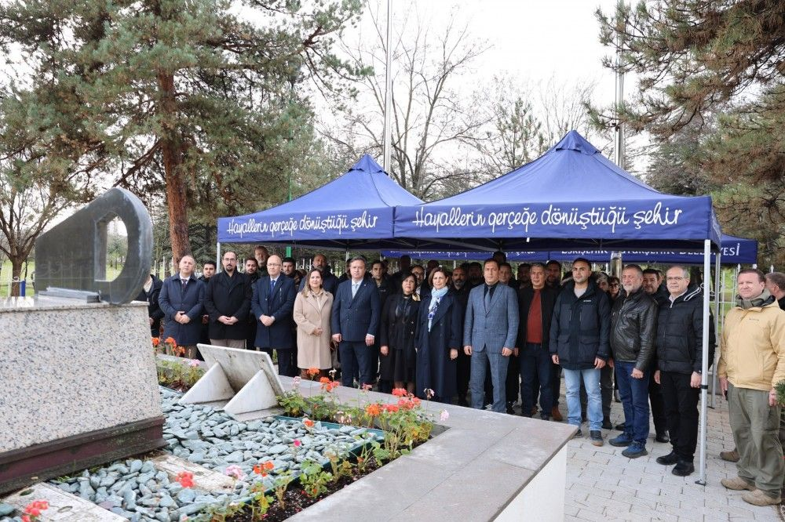

> Cumhuriyetin ilk Demiryolları Genel Müdürü Behiç Erkin, Eskişehir'deki anıt mezarı başında anıldı ve ardından düzenlenen panelle tarihî rolü ele alındı.

Eskişehir Büyükşehir Belediyesi ile Eskişehir Kent Konseyi ortaklığında, Cumhuriyet tarihinin simge isimlerinden Behiç Erkin için anma programı düzenlendi. Etkinlikler kapsamında ilk olarak Enveriye Tren İstasyonu sınırlarında yer alan Behiç Erkin'in anıt mezarı ziyaret edildi.

Anma programı daha sonra Haller Gençlik Merkezi'nde gerçekleştirilen "Demiryollarının Babası: Behiç Erkin – Cepheye Giden Yol" başlıklı panelle devam etti. Paneli Gazeteci Kerem Akyıl yönetirken, Prof. Dr. Burhan Sayılır ile Prof. Dr. Volkan Marttin konuşmacı olarak Erkin'in Türk demiryolu tarihindeki öncülüğünü ve Millî Mücadele'ye katkılarını aktardı.

Etkinlikte konuşan Eskişehir Büyükşehir Belediye Başkanı Ayşe Ünlüce, Behiç Erkin'in çok yönlü kariyerine dikkat çekerek, mühimmat ve askerin cepheye taşınmasında üstlendiği stratejik rolü vurguladı. Ünlüce, ülkeyi demir ağlarla ören kadrolara ve Gazi Mustafa Kemal Atatürk başta olmak üzere tüm mücadele kahramanlarına minnet duyduklarını ifade etti.

Eskişehir Kent Konseyi Başkanı İnci Ülüğ ve Kent Tarihi Çalışma Grubu Başkanı Kemal Güner Poyraz da kentin tarihî hafızasını canlı tutmak ve gelecek kuşaklara taşımak adına benzer anma programlarını sürdüreceklerini kaydetti.

---

## Eğitim-Bir-Sen Heyetinden ESTÜ Rektörü Özcan'a Hayırlı Olsun Ziyareti

**Eğitim · Tepebaşı** · 2026-11-18 15:09 UTC · Kaynak: [Eskişehir Teknik Üniversitesi](https://www.eskisehir.edu.tr/tr/Haber/Detay/egitim-bir-sen-eskisehir-2-nolu-sube-baskani-ertugrul-baki-ve-yonetim-kurulu-uyeleri-rektor-prof-dr-adnan-ozcana-hayirli-olsun-ziyaretinde-bulundu-)

> Eğitim-Bir-Sen Eskişehir 2 No’lu Şube Başkanı Ertuğrul Baki ve yönetim kurulu üyeleri, rektörlük görevine yeniden atanan Prof. Dr. Adnan Özcan'ı ziyaret etti.

Eğitimciler Birliği Sendikası (Eğitim-Bir-Sen) Eskişehir 2 No’lu Şube Başkanı Ertuğrul Baki ve beraberindeki yönetim kurulu üyeleri, Eskişehir Teknik Üniversitesi (ESTÜ) Rektörlüğü görevine yeniden atanan Prof. Dr. Adnan Özcan’a tebrik ziyaretinde bulundu.

Cumhurbaşkanlığı Kararı ile yeniden ESTÜ Rektörlüğü görevine getirilen Prof. Dr. Özcan'ı Rektörlük Toplantı Salonu'nda ziyaret eden heyet, yeni dönem çalışmaları için başarı dileklerini iletti. Şube Başkanı Baki, Özcan'a görevinde muvaffakiyet temennisinde bulundu.

Ziyaretten duyduğu memnuniyeti belirten Rektör Prof. Dr. Adnan Özcan ise nazik ziyaretleri ve tebrikleri dolayısıyla Şube Başkanı Baki ve sendika yönetimine teşekkür etti.

---

## 1072 Sosyal Medya Hesabına Erişim Engeli: FETÖ İncelemesi Başlatıldı

**Türkiye · Türkiye** · 2026-11-18 15:09 UTC · Kaynak: [İletişim Başkanlığı](https://www.iletisim.gov.tr/turkce/haberler/detay/iletisim-baskani-durandan-feto-iltisakli-sosyal-medya-hesaplarina-erisim-engeli-getirilmesine-iliskin-aciklama)

> İletişim Başkanı Burhanettin Duran, kamuoyunu yanıltmaya yönelik faaliyet yürüttüğü belirlenen FETÖ iltisaklı 1072 sosyal medya hesabına erişim engeli getirildiğini açıkladı.

Cumhurbaşkanlığı İletişim Başkanlığı koordinasyonunda ve Ankara Cumhuriyet Başsavcılığı iş birliğinde yürütülen çalışmalar sonucunda, dijital mecralarda dezenformasyon yürüttüğü tespit edilen hesaplara yönelik işlem yapıldı. Kamuoyunu yanıltmayı ve toplumsal güveni zedelemeyi amaçlayan FETÖ iltisaklı 1072 sosyal medya hesabına erişim engeli getirilirken, hesap kullanıcıları hakkında da adli inceleme başlatıldı.

İletişim Başkanı Burhanettin Duran, sosyal medya hesabından yaptığı açıklamada, son üç ayda ulaşılan bu rakamın, terör örgütlerinin dijital platformları propaganda, manipülasyon ve psikolojik harekât aracı olarak kullanma girişimlerine karşı verilen kararlı mücadelenin somut bir göstergesi olduğunu belirtti.

Dijital alanın bir istismar sahasına dönüştürülmesine izin verilmeyeceğini vurgulayan Duran; hakikati çarpıtarak milli güvenliği tehdit eden ve toplumsal huzuru hedef alan her türlü faaliyete karşı hukuk çerçevesinde, ilgili kurumlarla eş güdüm içinde mücadelenin kesintisiz süreceğini kaydetti.

---
