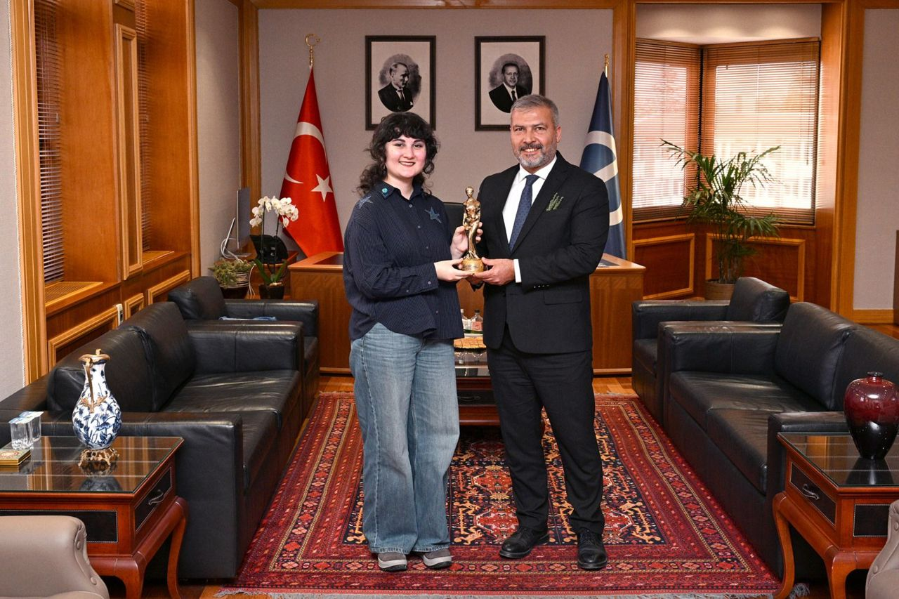
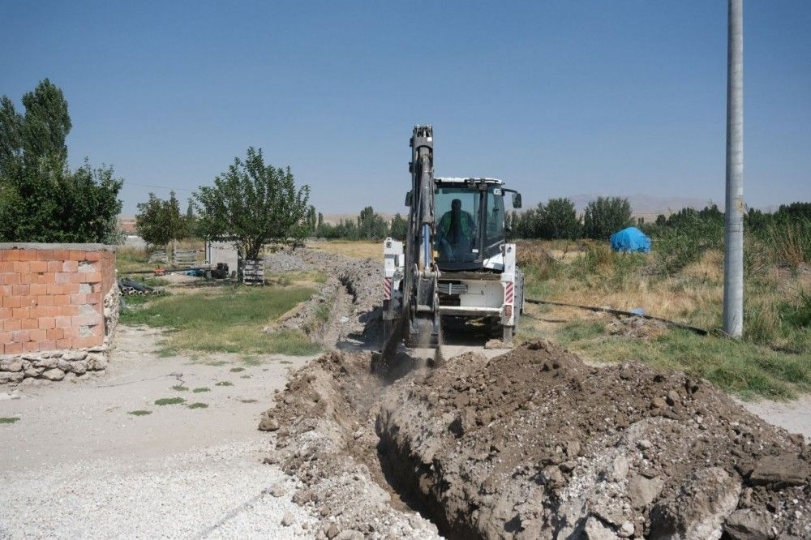
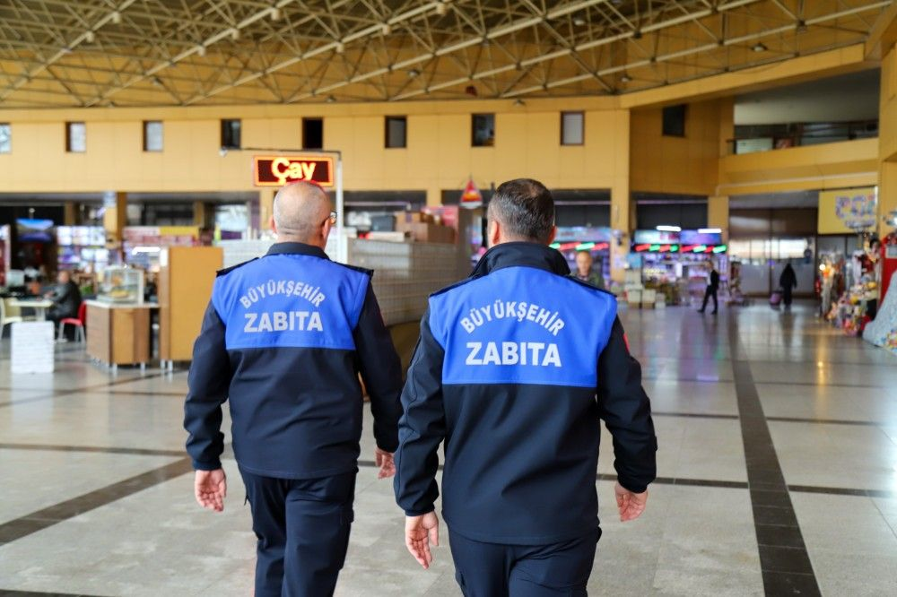
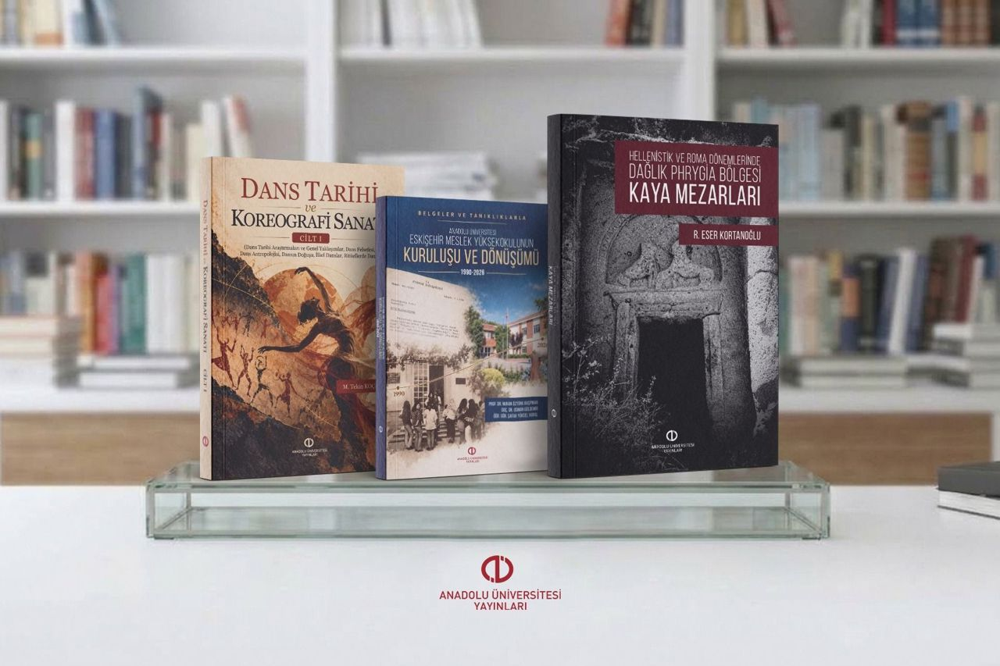

# Son haberler

Ajanın yazdığı son haberler (otomatik güncellenir).

## 23. Film Festivali'nde Onur Ödülleri Feyzi Tuna ve Nilüfer Aydan'a Verilecek

**Kültür-Sanat · Tepebaşı** · 2026-11-17 11:10 UTC · Kaynak: [Google Haberler - Eskişehir etkinlik](https://www.hurriyet.com.tr/yazarlar/gozde-hatunoglu/haftanin-kultur-sanat-ajandasi-43381119)

> 19-27 Kasım tarihlerinde düzenlenecek 23. Eskişehir Uluslararası Film Festivali'nde onur ödülleri usta yönetmen Feyzi Tuna ile oyuncu Nilüfer Aydan'a sunulacak.

Kültür ve Turizm Bakanlığı Sinema Genel Müdürlüğü desteğiyle Anadolu Üniversitesi İletişim Bilimleri Fakültesi tarafından düzenlenen 23. Eskişehir Uluslararası Film Festivali, 19-27 Kasım 2026 tarihleri arasında sinemaseverlerle buluşuyor. Festivalin açılışı, 19 Kasım'da Sinema Anadolu'da yapılacak tören ve yönetmenliğini Morgan Matthews'un üstlendiği "500 Mil" filminin Türkiye prömiyeriyle gerçekleştirilecek.

Festival kapsamında bu yılki onur ödülleri, Türk sinemasına önemli yapıtlar kazandıran yönetmen Feyzi Tuna ile 100'ü aşkın filmde rol alan usta oyuncu Nilüfer Aydan'a takdim edilecek. Emek ödüllerinin sahipleri ise yönetmen ve yapımcı Biket İlhan ile sinema ses çalışmaları ve yapımcılığıyla tanınan Necip Sarıcı olacak.

Görsel teması Jean-Luc Godard'ın sözünden ilhamla "Sinemada hareket" olarak belirlenen etkinlikte, 34 ülkeden 37 uzun metraj ve 18 kısa metraj yapım yer alıyor. Gösterimlerin yanı sıra usta sinemacıların katılımıyla söyleşiler ve sinema dersleri de festival programında yer bulacak.

---

## Tepebaşı'nda Yüzme Kayıtları Başlıyor: Başvurular 18-20 Kasım'da Online Yapılacak

**Spor · Tepebaşı** · 2026-11-17 11:09 UTC · Kaynak: [Tepebaşı Belediyesi](https://www.tepebasi.bel.tr/Haber/Detay/tepebası’ndayuzmeprogramlarıicinkayıtlarbaslıyor)

> Tepebaşı Belediyesi Su Sporları Merkezi'nde çocuk ve yetişkinlere yönelik yeni dönem yüzme programları için online kayıtlar 18 Kasım'da açılıyor.

Tepebaşı Belediyesi Mustafa Kemal Atatürk Spor Tesisleri Su Sporları Merkezi, farklı yaş gruplarına yönelik yüzme eğitimleri için kapılarını açıyor. Çocuk ve yetişkinleri su sporlarıyla buluşturacak yeni dönem programları için başvurular 18 Kasım Çarşamba günü başlayıp 20 Kasım Cuma günü sona erecek.

Eğitimler kapsamında 6-17 yaş grubundaki çocuklara temel ve ileri düzey yüzme kursları verilecek. 18 yaş ve üzeri yetişkinler ise yüzme eğitiminin yanı sıra serbest yüzme saatleri ve su jimnastiği branşlarından faydalanabilecek.

Kontenjanların sınırlı tutulduğu yüzme programlarında dersler 24 Kasım Salı günü başlayacak. Başvuruların belediyenin tesis.tepebasi.bel.tr internet adresi üzerinden alınacağı, detaylı bilgi edinmek isteyenlerin 0222 310 39 45 numaralı hattı arayabileceği bildirildi.

---

## Odunpazarı Sanat Merkezi'nde Resim Mesaisi: 104 Kursiyer Tuval Başına Geçti

**Kültür-Sanat · Odunpazarı** · 2026-11-17 11:09 UTC · Kaynak: [Google Haberler - Odunpazarı](https://www.karsmanset.com/service/amp/haber/odunpazari-sanat-merkezinde-104-kisi-resim-ogreniyor-1829168.htm)

> Odunpazarı Sanat Merkezi'nde haftanın beş günü düzenlenen resim kursu, farklı yaş gruplarından 104 kursiyerin katılımıyla devam ediyor.

Odunpazarı Belediyesi bünyesinde faaliyetlerini sürdüren Odunpazarı Sanat Merkezi'nde (OSM) açılan resim eğitimi yoğun ilgi görüyor. Sanat eğitimini kentin geneline yaymayı hedefleyen çalışma kapsamında 104 kursiyer atölye çalışmalarına katılıyor.

Eğitmen Melek Tan yönetiminde sürdürülen dersler pazar ve pazartesi günleri dışında haftanın beş günü gerçekleştiriliyor. Katılımcılar eğitim sürecinde resim sanatının temel tekniklerini uygulayarak kendi sanatsal becerilerini geliştirme imkânı buluyor.

Farklı yaş ve tecrübe düzeyinden yurttaşları bir araya getiren kurs programı, kursiyerlere hem kendilerini ifade edebilecekleri sanatsal bir alan hem de üretmenin keyfini yaşayabilecekleri bir ortam sunuyor.

---

## Kaligrafi ve Tipografide Atölye Heyecanı: Çalıştaylar Cuma Gününe Kadar Sürecek

**Kültür-Sanat · Tepebaşı** · 2026-11-17 11:09 UTC · Kaynak: [Anadolu Üniversitesi](https://anahaber.anadolu.edu.tr/tr/haber-detay/fdeml5ogqoy921ryzvtn6cqb)

> Anadolu Üniversitesi Güzel Sanatlar Fakültesi tarafından düzenlenen 18. Uluslararası Anadolu Kaligrafi ve Tipografi Festivali kapsamında akademisyen ve sanatçıların katıldığı uygulamalı çalıştaylar başladı.

Anadolu Üniversitesi Güzel Sanatlar Fakültesi Grafik Sanatlar Bölümü ev sahipliğinde gerçekleştirilen 18. Uluslararası Anadolu Kaligrafi ve Tipografi Festivali kapsamında düzenlenen çalıştaylar, akademisyenleri, sanatçıları ve öğrencileri bir araya getirdi. Süleyman Demirel Üniversitesi öğretim üyesi Prof. Yusuf Keş, Eskişehir Osmangazi Üniversitesi öğretim üyesi Doç. Bilge Kınam, Eskişehir Teknik Üniversitesi öğretim elemanı Öğr. Gör. Onur Kuran ve sanatçı Dilruba Güneysu’nun katılımıyla yapılan atölyelerde öğrenciler, alanında deneyimli isimlerle birlikte üretim yapma imkânı buldu.

Düzenlenen çalıştaylar, öğrencilerin derslerde edindikleri kuramsal bilgileri uygulamaya dökerek farklı üretim yöntemlerini deneyimlemelerine katkı sağlıyor. Sanatçı ve akademisyenlerle doğrudan çalışma fırsatı yakalayan öğrenciler, kaligrafi ve tipografi alanındaki becerilerini pekiştirirken özgün tasarımlar ortaya koyuyor.

Hafta boyunca devam edecek uygulamalı atölyeler cuma gününe kadar çeşitli oturumlarla sürecek. Çalıştaylar sürecinde üretilen eserler ise cuma günü düzenlenecek sergiyle sanatseverlerin beğenisine sunulacak. Festival kapsamındaki Yunus Emre sergisi ise 11 Aralık Cuma gününe kadar Anadolu Üniversitesi Çağdaş Sanatlar Müzesinde ziyarete açık kalmaya devam edecek.

---

## Hakan Şapcı'dan 2-2'lik Maç Sonrası Açıklama: 'Oynanan Oyundan Çok Memnunum'

**Spor · Tepebaşı** · 2026-11-17 11:09 UTC · Kaynak: [Google Haberler - Eskişehirspor](https://www.gazetevatan.com/sehirler/eskisehir/eskisehirspor-2-puan-kaybetti-hakan-sapci-cok-memnunum-dedi-2465696)

> Eskişehirspor Teknik Direktörü Hakan Şapcı, 2-2 sona eren Ayvalıkgücü karşılaşmasının ardından yaptığı değerlendirmede kaybedilen puana üzüldüklerini ancak sergilenen futboldan memnun olduğunu söyledi.

Bölgesel Amatör Lig temsilcisi Eskişehirspor'da, Ayvalıkgücü deplasmanında alınan 2-2'lik beraberliğin yankıları sürüyor. Karşılaşmanın ardından teknik direktör Hakan Şapcı, maçta sergilenen oyun ve kaybedilen puanlara ilişkin değerlendirmelerde bulundu.

Karşılaşmanın başında bireysel hatalar nedeniyle kalelerinde iki gol gördüklerini belirten Şapcı, oyuncularının geriye düşmelerine karşın sahada iyi bir direnç ortaya koyduğunu ifade etti. Çok pozisyon ürettiklerini dile getiren tecrübeli teknik adam, yenmemesi gereken basit goller yediklerine dikkat çekti.

Savunma hattındaki talihsizliklere değinen Şapcı, "Sezon başından bu yana büyük talihsizlikler ve hatalar oluyor, özellikle savunma bölgesinde yaşanıyor. Buna rağmen oyuncularımız müthiş bir karakter gösterdi. Kaybedilen 2 puana elbette üzgünüz ancak oynanan oyundan çok memnunum" şeklinde konuştu.

---

## Bakanlıktan 'Verimli Ev' Uygulaması: Fatura ve Cihaz Tüketimi Takip Edilecek

**Türkiye · Türkiye** · 2026-11-17 11:09 UTC · Kaynak: [Enerji ve Tabii Kaynaklar Bakanlığı](https://enerji.gov.tr/haber-detay?id=31975)

> Enerji ve Tabii Kaynaklar Bakanlığı, hanelerdeki elektrik ve doğal gaz tüketiminin analiz edilmesini sağlayan "Verimli Ev" mobil uygulamasını kullanıma sundu.

Enerji ve Tabii Kaynaklar Bakanlığı tarafından geliştirilen "Verimli Ev" mobil uygulaması vatandaşların erişimine açıldı. Uygulama sayesinde kullanıcılar, evlerinde kullandıkları elektrikli cihazların ve ısıtma sistemlerinin enerji tüketimini ayrıntılı biçimde analiz edebilecek.

Kullanıcılar uygulamaya e-posta adresiyle ya da e-Devlet kapısı üzerinden giriş yapabilecek. Sisteme elektrik ve doğal gaz fatura bilgileri girildikten sonra; buzdolabı, çamaşır makinesi, bulaşık makinesi, kombi ve klima gibi temel cihazların enerji sınıfı, motor gücü ve günlük çalışma süreleri tanımlanabilecek.

Sistem, girilen verileri işleyerek her bir cihazın toplam enerji tüketimindeki payını ve maliyetini hesaplayacak. Tüketimin yol açtığı karbon emisyonu miktarını da gösteren uygulama, kullanıcılara cihaz bazında özel tasarruf ve verimlilik önerileri sunacak.

Enerji ve Tabii Kaynaklar Bakanı Alparslan Bayraktar, Milli Enerji 2040 vizyonunun temel ayaklarından birinin enerji verimliliği olduğunu belirtti. Enerjide tam bağımsızlığın sadece üretimi artırmakla değil, tüketimi verimli kılmakla mümkün olacağını vurgulayan Bayraktar, enerji tasarrufu bilincinin evlerden başladığını ve uygulamanın aile bütçesine katkı sağlayacağını ifade etti.

"Verimli Ev" mobil uygulaması, akıllı telefon ve tablet kullanıcıları için uygulama mağazalarından ücretsiz olarak indirilebiliyor.

---

## Odunpazarı'nda Sanat ve Kitap Günleri: 21-22 Kasım'da Kapılarını Açıyor

**Kültür-Sanat · Odunpazarı** · 2026-11-17 09:09 UTC · Kaynak: [Google Haberler - Eskişehir](https://www.cumhuriyet.com.tr/yerel-gundem/odunpazari-belediyesi-cumhuriyet-sanat-ve-kitap-gunleri-21-22-kasim-da-eskisehir-de-2556827)

> Cumhuriyet gazetesi ve Odunpazarı Belediyesi iş birliğiyle düzenlenen Sanat ve Kitap Günleri, 21-22 Kasım tarihlerinde 100. Yıl Kültür Merkezi'nde gerçekleştirilecek.

Odunpazarı Belediyesi ile Cumhuriyet gazetesinin ortaklaşa düzenlediği Sanat ve Kitap Günleri, 21-22 Kasım tarihlerinde Eskişehir'deki 100. Yıl Kültür Merkezi'nde kitapseverler ve sanatseverlerle buluşacak.

Etkinlik programı, 21 Kasım Cumartesi günü saat 13.00'te Cumhuriyet Sanat Galerisi Koleksiyonu'nda yer alan eserlerden oluşan karma resim sergisinin açılışıyla başlayacak. Sergide çok sayıda usta sanatçının fırçasından çıkan yapıtlar Eskişehirlilerin beğenisine sunulacak.

İki gün boyunca sürecek organizasyonda Cumhuriyet Kitapları Yayınevi bünyesindeki yazarlar düzenlenecek söyleşi ve imza günlerinde okurlarıyla bir araya gelecek. Etkinlik dizisi, 22 Kasım Pazar günü saat 17.00'de Odunpazarı Belediye Başkanı Kazım Kurt ile gazeteci-yazar Mustafa Balbay'ın katılımıyla gerçekleştirilecek "Yerel Siyaset, Yerel Yönetim" başlıklı söyleşiyle tamamlanacak.

---

## AÖF'te Mikro Yeterlilik Dönemi: Alınan Eğitimler 12 Krediye Kadar Sayılabilecek

**Eğitim · Tepebaşı** · 2026-11-17 09:08 UTC · Kaynak: [Anadolu Üniversitesi](https://anahaber.anadolu.edu.tr/tr/haber-detay/xh5qv6cxeepbo68x9f0xwzk8)

> Anadolu Üniversitesi Açıköğretim Fakültesi, yapay zekâ odaklı Mikro Yeterlilik Programlarını başlattı. Başarılı olan öğrenciler lisans düzeyinde 12 AKTS'ye kadar ders kredisinden muaf olabilecek.

Anadolu Üniversitesi Açıköğretim Fakültesi (AÖF), öğrencilerin mesleki becerilerini geliştirmeleri amacıyla yapay zekâ odaklı Mikro Yeterlilik Programlarını uygulamaya aldı. Yükseköğretim Kurulunun (YÖK) yetkinlik odaklı dönüşüm vizyonu doğrultusunda örgün eğitimin ardından AÖF öğrencilerine de açılan sistemle, katılımcılara ilgi duydukları alanlarda esnek öğrenme olanakları sunuluyor.

Program kapsamında ölçme ve değerlendirme aşamalarını geçen öğrenciler, kazandıkları yetkinlikleri doğrulanabilir dijital rozetlerle tescilleyebilecek. Dijital cüzdan altyapısında saklanabilen bu rozetler, LinkedIn ve benzeri profesyonel ağlarda paylaşılarak istihdam süreçlerinde referans olarak kullanılabilecek.

Avrupa Kredi Transfer Sistemi (AKTS) ile uyumlu yürütülen eğitimler transkriptlere ve diploma eklerine de yansıtılabilecek. Değerlendirme sınavlarında başarı gösteren öğrenciler, aldıkları mikro yeterlilikler sayesinde ön lisans programlarında 6, lisans programlarında ise 12 AKTS'ye kadar seçmeli ders kredisi elde ederek eğitim yüklerini hafifletebilecek.

Program dahilinde ilk etapta “Yapay Zekâ Araçları ile Ofis Verimliliği”, “Yapay Zekâ Çağında Telif Hukuku ve Dijital İçerik Hakları”, “Veri Okuryazarlığı ve Temel Veri Analizi” ile “Yapay Zekâ ve Habercilik” gibi 1 ila 3 kredi değerindeki çevrim içi dersler erişime açıldı. Önümüzdeki süreçte 4 kredilik derslerin de sisteme dahil edileceği bildirildi. Sürece ilişkin başvuruların "my.anadolu.edu.tr" adresi üzerinden kabul edildiği kaydedildi.

---

## Mezuniyet Filmiyle 3 Ödül Birden: Anadolu Üniversitesi Mezununa Tebrik

**Kültür-Sanat · Tepebaşı** · 2026-11-17 07:09 UTC · Kaynak: [Anadolu Üniversitesi](https://anahaber.anadolu.edu.tr/tr/haber-detay/h2jq0e9daova2kyy7zfx4ty7)

> Anadolu Üniversitesi Çizgi Film ve Animasyon Bölümü mezunu Selin Toprak, hazırladığı kısa filmle Altın Portakal dâhil üç ayrı festivalden ödülle döndü.

Anadolu Üniversitesi Güzel Sanatlar Fakültesi Çizgi Film ve Animasyon Bölümünden bu yıl mezun olan Selin Toprak, mezuniyet projesi olan "Dünya Günü Kutlu Olsun (Happy Earth Day)" isimli animasyon filmiyle önemli başarılara imza attı.

Toprak, 12. TRT Geleceğin İletişimcileri Yarışması Animasyon Film kategorisinde ikincilik derecesi elde ederken, 14. Uluslararası Canlandıranlar Film Festivali'nde "En İyi Senaryo" ve 63. Uluslararası Antalya Altın Portakal Film Festivali'nde ise "Jüri Özel Ödülü" kazandı. Film, elverişsiz hâle gelen Dünya'dan ayrılarak uzay gemisinde yeni bir yaşam kuran insanların öyküsünü ve Dünya Günü kutlaması sırasında uzaylıların gizemli planıyla yüzleşmelerini konu ediniyor.

Elde edilen ulusal ve uluslararası başarıların ardından Anadolu Üniversitesi Rektörü Prof. Dr. Yusuf Adıgüzel, genç animatörü makamında ağırlayarak tebrik etti. Ziyarette Güzel Sanatlar Fakültesi Dekanı Prof. Duygu Kahraman, Bölüm Başkanı Prof. Dr. Çiğdem Taş Alicenap ile proje danışmanları Prof. Fethi Kaba ve Doç. Sabahattin Çalışkan da yer aldı.

---

## MEB Türkiye'nin Eğitim Dönüşümünü Kitaplaştırdı: 2026 Görünümü Yayımlandı

**Eğitim · Türkiye** · 2026-11-17 07:09 UTC · Kaynak: [Milli Eğitim Bakanlığı](https://www.meb.gov.tr/turkiye039nin-egitimdeki-gelisimi-kitaplastirildi/haber/42554/tr)

> Millî Eğitim Bakanlığı, geçmişten bugüne eğitim sisteminde kaydedilen gelişmeleri ve uluslararası göstergeleri dokuz bölümlük kapsamlı bir eserde bir araya getirdi.

Millî Eğitim Bakanlığı Strateji Geliştirme Başkanlığı tarafından hazırlanan "Türkiye'de Eğitim: Politikalar, Uygulamalar, Gelişmeler - 2026 Görünümü" adlı çalışma yayımlandı. Kitapta, Türk eğitim sisteminin yıllar içindeki dönüşümü sayısal veriler, tablolar ve grafiklerle ayrıntılı şekilde ortaya konuldu.

Dokuz ana bölümden oluşan çalışmada; öğrenci, öğretmen ve derslik sayılarındaki değişimden okullaşma oranlarına, bütçe imkanlarından fiziki yatırımlara kadar birçok başlık ele alındı. Okul binalarındaki deprem güçlendirme çalışmaları, enerji verimliliği ve yeşil dönüşüm projelerine dair detaylar da veriler eşliğinde paylaşıldı.

Eğitimde fırsat eşitliği başlığı altında ücretsiz ders kitabı dağıtımı, taşımalı eğitim, bursluluk ve destekleme kurslarına değinilen eserde; FATİH Projesi, etkileşimli tahtalar ve dijital eğitim platformlarındaki teknolojik altyapı adımları özetlendi. Eserde ayrıca TIMSS ve PISA sonuçları ışığında Türkiye'nin uluslararası eğitim göstergelerindeki performansına yer verildi.

Kitabın sunuş yazısını kaleme alan Millî Eğitim Bakanı Yusuf Tekin, köklü birikimle geleceğin harmanlandığını belirterek, Türkiye Yüzyılı Maarif Modeli ile teoriden pratiğe aktarılan ve insanı merkeze alan esnek bir eğitim yapısının hedeflendiğini ifade etti.

---

## Eskişehirspor Kadın Futbol Takımı Tekirdağ GSK'yı 2-1 Mağlup Etti

**Spor · Tepebaşı** · 2026-11-17 07:09 UTC · Kaynak: [Google Haberler - Eskişehirspor](https://www.gzt26.com/maddi-imkansizliklarla-da-mucadele-eden-eskisehirspor-kadin-futbol-takimindan-onemli-galibiyet)

> Kadınlar 2. Lig'de mücadele eden Eskişehirspor Kadın Futbol Takımı, sahasında ağırladığı Tekirdağ GSK'yı 2-1 yenerek üç puanı hanesine yazdırdı.

Kadınlar 2. Lig'in 3. haftasında Eskişehirspor Kadın Futbol Takımı, Behiç Erkin Spor Kompleksi'nde Tekirdağ GSK ile karşılaştı. Maddi imkânsızlıklara rağmen sahaya galibiyet parolasıyla çıkan siyah-kırmızılı ekip, zorlu mücadeleden üstünlükle ayrılmayı başardı.

Karşılaşmada Eskişehirspor'a galibiyeti getiren golleri Esin Demirtürk ve Eylül Naz Kurt kaydetti. Konuk ekip Tekirdağ GSK'nın tek golüne rağmen skor üstünlüğünü maçın son düdüğüne kadar koruyan ev sahibi ekip, sahadan 2-1'lik skorla galip ayrıldı.

Ligin üçüncü haftasını kayıpsız geçen ve puanını artıran siyah-kırmızılı ekipte, maç sonu futbolcular ve teknik heyet galibiyet sevincini birlikte yaşadı. Eskişehirspor Kadın Futbol Takımı, gelecek haftalarda da çıkışını sürdürerek üst sıralara tırmanmayı hedefliyor.

---

## Altın fiyatları 17 Kasım 2026: Gram altın 6.370,23 TL

**Ekonomi · Merkez** · 2026-11-17 06:00 UTC · Kaynak: [Harem Altın](https://www.haremaltin.com/altin-fiyatlari)

> Gram altın güne düşüşle başladı. Harem Altın verilerine göre gram altın 6.293,65 TL'den alınıyor, 6.370,23 TL'den satılıyor.

Altın piyasasında güne düşüşle başlandı. Harem Altın'ın saat 09.00 itibarıyla verilerine göre gram altının satış fiyatı 6.370,23 TL, alış fiyatı 6.293,65 TL oldu. Gram altın, önceki kapanışa göre yüzde 5,17 geriledi.

Ziynet altınlarda çeyrek altın 10.383 TL, yarım altın 20.759 TL, tam altın 41.366 TL, ata altın 42.471 TL seviyesinden satışa sunuluyor.

22 ayar bileziğin gram satış fiyatı 5.950,11 TL, has altının gram fiyatı 6.351,18 TL olarak belirlendi.

Uluslararası piyasalarda altının onsu 3.880,50 dolardan işlem görürken, dolar/TL 50,51 seviyesinde bulunuyor.

Fiyatlar Harem Altın'ın saat 09.00 itibarıyla paylaştığı verilere dayanmaktadır; kuyumcular arasında farklılık gösterebilir. Bu haber yatırım tavsiyesi değildir.

---

## Günyüzü Kayakent'te 2 Kilometrelik Su Terfi Hattı Yenilendi

**Belediye · Günyüzü** · 2026-11-17 05:09 UTC · Kaynak: [Eskişehir Büyükşehir Belediyesi](https://www.eskisehir.bel.tr/icerik-detay.php?icerik_id=13562&cat_icerik=1&menu_id=24)

> ESKİ, Günyüzü ilçesine bağlı Kayakent Mahallesi Topal Yayla mevkisinde ekonomik ömrünü tamamlayan yaklaşık 2 kilometrelik içme suyu terfi hattını baştan sona yeniledi.

Eskişehir Büyükşehir Belediyesi Su ve Kanalizasyon İdaresi (ESKİ) Genel Müdürlüğü, kırsal mahallelerde içme ve kullanma suyu altyapısını güçlendirmeye yönelik çalışmalarına devam ediyor. Bu kapsamda Günyüzü ilçesi Kayakent Mahallesi Topal Yayla mevkisindeki su iletim altyapısı kapsamlı bir çalışmayla yenilendi.

Türbe Caddesi Topal Yayla mevkisinde yürütülen çalışmalarda, bölgedeki kuyudan su deposuna iletim sağlayan ve kullanım ömrünü tamamlamış olan yaklaşık 2 kilometrelik terfi hattı yenilendi. İmalat işlemlerinin tamamlanmasıyla birlikte su iletim sisteminin güvenilirliği artırılarak olası arızaların önüne geçildi.

Yürütülen çalışmadan duyduğu memnuniyeti ifade eden Kayakent Mahalle Muhtarı Fatih Olçay, suyun yaklaşık 17 kilometre uzaklıktan ulaştığını ve hat üzerinde sık sık yaşanan arızaların yıllardır mağduriyete yol açtığını aktardı. Taleplerini değerlendirerek sorunu çözen Büyükşehir Belediye Başkanı Ayşe Ünlüce'ye ve ESKİ ekiplerine teşekkür eden Olçay, hattın yenilenmesiyle mahallede önemli bir ihtiyacın karşılandığını vurguladı.

---

## Göç İdaresi Heyetinden Anadolu Üniversitesi Rektörü Adıgüzel'e Ziyaret

**Eğitim · Tepebaşı** · 2026-11-17 05:09 UTC · Kaynak: [Anadolu Üniversitesi](https://anahaber.anadolu.edu.tr/tr/haber-detay/uy1yzj33k92434w1a2lrtvmm)

> Göç İdaresi Başkanlığı heyeti, Anadolu Üniversitesi Rektörü Prof. Dr. Yusuf Adıgüzel'i ziyaret ederek göç yönetimi ve ortak projeler üzerine görüştü.

İçişleri Bakanlığı Göç İdaresi Başkanlığı Uyum ve İletişim Genel Müdürü Ahmet Dalkıran ve beraberindeki heyet, Anadolu Üniversitesi Rektörü Prof. Dr. Yusuf Adıgüzel'e makamında ziyarette bulundu.

Ziyarete Uyum ve İletişim Grup Başkanı Ali Rıza Beşkat, Göç Uzmanı Ekrem Demir, Eskişehir İl Göç İdaresi Müdür Vekili Özkan Çetin ile İl Göç Uzmanı Gülşan Dolgun da eşlik etti.

Görüşmede göç yönetimi, uyum ve iletişim faaliyetleri kapsamındaki çalışmalar masaya yatırıldı. Üniversite ile göç alanında hayata geçirilebilecek ortak projeler ve iş birliği olanakları değerlendirildi. Rektör Prof. Dr. Adıgüzel, konuklarına teşekkür ederken ziyaret hediye takdimiyle tamamlandı.

---

## Erdoğan'dan Üniversiteli Gençlere: 'Bugün Dünyada Artık Türkiye Konuşuluyor'

**Siyaset · Türkiye** · 2026-11-17 05:09 UTC · Kaynak: [Google Haberler - Cumhurbaşkanı](https://www.trthaber.com/haber/gundem/cumhurbaskani-erdogan-bugun-dunyada-artik-turkiye-konusuluyor-963424.html)

> Cumhurbaşkanı Erdoğan, AK Parti Gençlik Kolları Üniversiteli Gençlik Buluşması'nda yaptığı konuşmada, Türkiye'nin iç ve dış politikada attığı adımlarla uluslararası alanda öne çıktığını belirtti.

Cumhurbaşkanı Recep Tayyip Erdoğan, partisinin Kongre Merkezi'nde düzenlenen AK Parti Gençlik Kolları Üniversiteli Gençlik Buluşması'na katılarak gençlere hitap etti. Türkiye genelindeki 81 ilde ve 208 üniversitede yürütülen çalışmalara değinen Erdoğan, üniversiteye yeni kayıt yaptıran 450 bin öğrencinin ÜniAK teşkilatına katıldığını ifade etti.

Konuşmasında muhalefet ile aralarında gençliğe bakış konusunda temel bir vizyon farkı bulunduğunu savunan Erdoğan, iktidar olarak gençleri siyasetin nesnesi değil doğrudan aktörü olarak konumlandırdıklarını söyledi. Erdoğan, gençlerin eğitim, teknoloji, kültür ve sanat başta olmak üzere her alanda kendilerini geliştirmeleri adına çalışmalar yürüttüklerini kaydetti.

Türkiye'nin ev sahipliğinde gerçekleşen uluslararası organizasyonlara da değinen Cumhurbaşkanı Erdoğan, Antalya'da düzenlenen COP31 Zirvesi'nde 96 dünya liderinin ağırlandığını hatırlattı. Erdoğan, Türk Devletleri Teşkilatı Zirvesi ve NATO toplantılarının ardından Türkiye'nin bölgesel ve küresel ölçekteki etkinliğinin arttığını, dünyada artık Türkiye'nin hamlelerinin konuşulduğunu ifade etti.

Gençlere özgüven çağrısında bulunan Erdoğan, karşılaşılan ekonomik ve sosyal engellerin hiçbirinin umutsuzluğa yol açacak büyüklükte olmadığını dile getirdi. Geçmişte yaşanan kutuplaşmaların ve 28 Şubat sürecindeki hak gasplarının geride bırakıldığını belirten Erdoğan, gençlerin Türkiye Yüzyılı vizyonunun ana taşıyıcısı olacağını sözlerine ekledi.

---

## Ayşe Ünlüce Derince'de Kent Lokantası Açılışına Katıldı

**Belediye · Merkez** · 2026-11-17 05:09 UTC · Kaynak: [Eskişehir Büyükşehir Belediyesi](https://www.eskisehir.bel.tr/icerik-detay.php?icerik_id=13561&cat_icerik=1&menu_id=24)

> Eskişehir Büyükşehir Belediye Başkanı Ayşe Ünlüce, Kocaeli'nin Derince ilçesinde Kent Lokantası açılışına katılarak tarımsal üretim tesislerinde incelemelerde bulundu.

Türkiye Belediyeler Birliği Başkan Vekili ve Eskişehir Büyükşehir Belediye Başkanı Ayşe Ünlüce, Derince Belediye Başkanı Sertif Gökçe’nin ev sahipliğinde düzenlenen açılış programı kapsamında Kocaeli’yi ziyaret etti. Programda ilçe sakinlerine uygun fiyatlı ve sağlıklı yemek sunulması hedeflenen Kent Lokantası ile Senin Kafen Çenesuyu sosyal tesisinin açılışı yapıldı.

Ziyaret kapsamında İshakçılar bölgesinde yer alan DERTAŞ Tarım Ürünleri tesislerini de gezen Ünlüce, süt ve süt ürünleri üretim süreçlerini yerinde takip etti. Tesis yetkililerinden kapasite ve yeni dönem projelerine ilişkin bilgi alan Ünlüce, yerel tarım ve üretimin güçlendirilmesi gerektiğine dikkat çekti.

Sosyal dayanışmayı artıran ve yerel üreticiye katkı sağlayan uygulamaların önemine değinen Ünlüce, Derince'de hayata geçirilen projeler dolayısıyla emeği geçenleri tebrik etti. Açılış törenine katılan ilçe sakinleri de Ünlüce ile hatıra fotoğrafı çektirdi.

---

## Anadolu Üniversitesi'nden AB Destekli Proje: Yeşil İnsan Kaynakları Başlatıldı

**Eğitim · Tepebaşı** · 2026-11-17 05:09 UTC · Kaynak: [Anadolu Üniversitesi](https://anahaber.anadolu.edu.tr/tr/haber-detay/p3dul1fx5oho8xwq6g42vykc)

> Anadolu Üniversitesi, Avrupa Birliği Jean Monnet Faaliyetleri kapsamında desteklenen ve 36 ay sürecek olan ECO-HRM projesini tanıttı.

Anadolu Üniversitesi yürütücülüğünde hayata geçirilen "Ekolojik Dönüşüm İçin Yeşil İnsan Kaynakları Yönetimi" (ECO-HRM) projesinin açılış toplantısı, İktisadi ve İdari Bilimler Fakültesi Yüzüncü Yıl Toplantı Salonu'nda yapıldı. Proje; üniversite, mesleki eğitim kurumları ve sanayi kesimini yeşil dönüşümün insan kaynağı boyutunda bir araya getirmeyi amaçlıyor.

Toplantının açılışında konuşan Proje Yürütücüsü Doç. Dr. Seda Tekeli, ekolojik dönüşümün yalnızca çevresel politikalar ve teknolojik adımlardan ibaret olmadığını belirterek, istihdam yapısı ve nitelikli insan kaynağının sürecin temel taşlarından biri olduğunu vurguladı. Tekeli, yeşil insan kaynakları yaklaşımının işe alımdan eğitime ve performans yönetimine kadar geniş bir alanı kapsadığını, meslek lisesi öğrencilerinin de projenin öncelikli hedef grupları arasında yer aldığını kaydetti.

Üç yıl boyunca devam edecek proje çerçevesinde, farklı disiplinlerden üniversite öğrencilerinin seçebileceği "Yeşil İnsan Kaynakları Yönetimi" dersi açılacak. İl Millî Eğitim Müdürlüğü ve Eskişehir Sanayi Odası iş birliğiyle yürütülecek çalışmada; eğitimler, araştırmalar ve çalıştaylarla ekolojik dönüşümün çalışma hayatına etkilerine yönelik farkındalık artırılacak.

---

## Otogarda Sıkı Denetim: Sefer Saatleri ve Belgeler İncelendi

**Belediye · Tepebaşı** · 2026-11-16 21:09 UTC · Kaynak: [Eskişehir Büyükşehir Belediyesi](https://www.eskisehir.bel.tr/icerik-detay.php?icerik_id=13563&cat_icerik=1&menu_id=24)

> Eskişehir Şehirlerarası Otobüs Terminali'nde denetime çıkan zabıta ekipleri, otobüs firmalarının yetki belgelerini, sefer saatlerini ve terminal düzenini kontrol etti.

Eskişehir Büyükşehir Belediyesi Zabıta Dairesi Başkanlığı ekipleri, kamu düzenini korumak ve yolcuların güvenli hizmet almasını temin etmek amacıyla Eskişehir Şehirlerarası Otobüs Terminali’nde geniş kapsamlı denetim gerçekleştirdi.

Çalışmalar kapsamında otogarda faaliyet gösteren esnaf ve otobüs işletmeleri incelendi. Ekipler, firmaların bulundurması zorunlu yetki belgelerini kontrol ederek mevzuata uygunluğu denetledi. Şehirlerarası otobüslerin ilan edilen kalkış saatlerine uyup uymadığını da yerinde takip eden zabıta, otogar dışındaki noktalarda yolcu indirme ve bindirme yapılmaması hususunda sürücüler ile firma yetkililerine uyarılarda bulundu.

Terminal binası içindeki işletmeleri de denetleyen ekipler, ortak kullanım alanlarının işgal edilmemesi ve yolcuların yaya geçiş yollarının kapatılmaması gerektiğini hatırlattı. Belediye yetkilileri, hem yolcu güvenliğinin sağlanması hem de kent içi düzenin korunması hedefiyle denetimlerin aralıksız sürdürüleceğini bildirdi.

---

## Eskişehir Film Festivali'nde Bilet Fiyatları Belli Oldu: Öğrenci 50, Tam 150 TL

**Kültür-Sanat · Merkez** · 2026-11-16 21:09 UTC · Kaynak: [Google Haberler - Eskişehir etkinlik](https://www.eskisehir.net/eskisehir-film-festivali-bilet-fiyatlari-50-tlden-satisa-cikaril)

> 23. Uluslararası Eskişehir Film Festivali için biletler satışa çıktı. Festivalde öğrenci biletleri 50 TL, tam biletler ise 150 TL olarak belirlendi.

Eskişehir'de sinemaseverlerin heyecanla beklediği 23. Uluslararası Eskişehir Film Festivali'nin bilet tarifesi ve satış detayları açıklandı. Festival kapsamında gösterilecek yapımları izlemek isteyen öğrenciler için bilet fiyatı 50 TL, tam bilet ücreti ise 150 TL olarak duyuruldu.

Festival yönetiminin paylaştığı bilgilere göre Cinemapink salonlarında gerçekleştirilecek gösterimlerin biletleri 16 Kasım itibarıyla satışa sunuldu. İzleyiciler bu salondaki filmlerin biletlerini hem internet üzerinden çevrim içi olarak hem de doğrudan sinema gişelerinden temin edebilecek.

Sinema Anadolu'daki gösterimlerde ise farklı bir uygulama geçerli olacak. Bu salonda izleyiciyle buluşacak filmlerin biletleri internet üzerinden satılmayacak; biletler yalnızca gösterim günü sinema gişesinden satın alınabilecek.

23. Uluslararası Eskişehir Film Festivali, 19-27 Kasım 2026 tarihleri arasında düzenlenecek. Dokuz gün sürecek etkinlik boyunca zengin bir film seçkisi Eskişehirli izleyicilerle buluşacak.

---

## Anadolu Üniversitesi'nden Üç Yeni Eser: Arkeolojiden Dans Tarihine Açık Erişimde

**Eğitim · Tepebaşı** · 2026-11-16 21:08 UTC · Kaynak: [Anadolu Üniversitesi](https://anahaber.anadolu.edu.tr/tr/haber-detay/nh3nn1blf90ntly1iehy1ezl)

> Anadolu Üniversitesi Yayınları; dans sanatı, Eskişehir Meslek Yüksekokulu tarihi ve Dağlık Phrygia kaya mezarlarını konu alan üç yeni akademik eseri dijital ortamda açık erişime açtı.

Anadolu Üniversitesi Yayınları, farklı alanlarda hazırlanan üç yeni yayını okurlarla buluşturdu. Dans tarihi, yükseköğretim tarihi ve Anadolu arkeolojisine odaklanan eserler dijital ortamda açık erişimle sunuldu.

Yayımlanan çalışmalardan ilki olan ve M. Tekin Koçkar tarafından kaleme alınıp Prof. Dr. Sernaz Demirel'in editörlüğünü üstlendiği "Dans Tarihi ve Koreografi Sanatı – Cilt I", dansın kültürel gelişimini felsefe, sanat ve antropoloji disiplinleriyle inceliyor. Eserde ilkel ritüellerden toplumsal törenlere uzanan tarihsel süreç mercek altına alınıyor.

İkinci eser ise yükseköğretim tarihine ışık tutuyor. Prof. Dr. Nuran Öztürk Başpınar ve Öğr. Gör. Şafak Yüksel Vural imzalı, Doç. Dr. Osman Güldemir editörlüğündeki "Kurumsal Hafızadan Geleceğe" adlı kitap, Eskişehir Meslek Yüksekokulunun 1990'dan 2026'ya kadar uzanan 36 yıllık gelişimini arşiv belgeleri ve 27 sözlü tarih görüşmesiyle aktarıyor.

Üçüncü yayın olarak sunulan Prof. Dr. R. Eser Kortanoğlu'na ait "Hellenistik ve Roma Dönemlerinde Dağlık Phrygia Bölgesi Kaya Mezarları" ise bölgedeki kaya mezarlarının mimari tiplerini ve cephe özelliklerini görsel kataloglarla belgeliyor. Üniversiteden yapılan açıklamada, eserlerin tamamına kurumun dijital platformu üzerinden ücretsiz erişilebildiği bildirildi.

---

## Kaligrafi ve Tipografiyle Yunus Emre: 18. Festival Sergisi Kapılarını Açtı

**Kültür-Sanat · Tepebaşı** · 2026-11-16 19:43 UTC · Kaynak: [Anadolu Üniversitesi](https://anahaber.anadolu.edu.tr/tr/haber-detay/wb4odbkemtj1p5utywg0t8c3)

> Anadolu Üniversitesi Çağdaş Sanatlar Müzesi'nde açılan 'Yunus Emre' sergisinde, büyük düşünürün sözleri kaligrafi ve tipografinin estetik olanaklarıyla sanatseverlerle buluştu.

Anadolu Üniversitesi Güzel Sanatlar Fakültesi Grafik Sanatlar Bölümü tarafından düzenlenen 18. Uluslararası Anadolu Kaligrafi ve Tipografi Festivali kapsamında hazırlanan “Yunus Emre” sergisi, Anadolu Üniversitesi Çağdaş Sanatlar Müzesi'nde ziyarete açıldı. Yunus Emre’nin felsefesini yazının sanatsal gücüyle buluşturan serginin açılışına 1'inci Ana Jet Üs Komutanı Tuğgeneral Erol Gökmen, Anadolu Üniversitesi Rektörü Prof. Dr. Yusuf Adıgüzel, Güzel Sanatlar Fakültesi Dekanı Prof. Duygu Kahraman, akademisyenler ve öğrenciler katıldı.

Açılışta konuşan Anadolu Üniversitesi Rektörü Prof. Dr. Yusuf Adıgüzel, Yunus Emre'nin barış ve sevgi felsefesini gelecek kuşaklara aktarmada sanatın kritik rol oynadığını vurguladı. Sanatçıların ve öğrencilerin Yunus'un sözlerini estetik bir dille yeniden yorumladığını belirten Adıgüzel, üniversitede geçen yılın Yunus Emre Yılı, bu eğitim öğretim yılının ise Nasreddin Hoca Yılı ilan edildiğini hatırlattı.

Güzel Sanatlar Fakültesi Dekanı Prof. Duygu Kahraman da Yunus Emre’nin insanın ortak değerlerine seslenen evrensel bir miras bıraktığına dikkat çekti. Festival organizasyon komitesi üyesi Dr. Öğr. Üyesi Mehtap Uygungöz ise 2009'dan beri süren etkinliğin Latin harfli modern yazı sanatı ile geleneksel hat sanatını harmanlayan özgün bir modele dönüştüğünü ve öğrencilerin bizzat üretim sürecine katıldığını aktardı.

Yunus Emre’nin düşünce dünyasını yazı sanatıyla harmanlayan sergi, 11 Aralık Cuma gününe kadar Anadolu Üniversitesi Çağdaş Sanatlar Müzesi'nde gezilebilecek.

---

## Eskişehir'de Kadim Tohum Kavılca Buğdayı Ekim Alanı 3 Katına Çıktı: 210 Dekara Ulaştı

**Tarım · Seyitgazi** · 2026-11-16 19:43 UTC · Kaynak: [Eskişehir Büyükşehir Belediyesi](https://www.eskisehir.bel.tr/icerik-detay.php?icerik_id=13565&cat_icerik=1&menu_id=24)

> Eskişehir Büyükşehir Belediyesi, binlerce yıllık geçmişe sahip kavılca buğdayının ekim alanını 70 dekardan 210 dekara çıkardı. Tohumlar Seyitgazi'de de toprakla buluştu.

Eskişehir Büyükşehir Belediyesi Tarımsal Hizmetler Dairesi Başkanlığı, Anadolu'nun köklü tarım miraslarından kavılca buğdayını yeniden kente kazandırmak için ekim sahalarını genişletiyor. Geçtiğimiz üretim sezonunda yaklaşık 70 dekar alanda yapılan ve bölge ortalamasının üzerinde verim sağlanan üretimden elde edilen tohumluklar, bu yılki ekim alanının 210 dekara yükselmesini sağladı.

Proje kapsamında Seyitgazi Belediyesi ile ortak bir çalışma da hayata geçirildi. İki belediye arasındaki iş birliği protokolü çerçevesinde, Seyitgazi ilçesine bağlı Yenikent Mahallesi'nde Küllüoba kazı çalışmalarının sürdüğü bölgedeki 10 dekarlık belediye arazisine kavılca buğdayı ekildi.

Yerel tarımsal çeşitliliği korumayı ve ata tohumlarını gelecek nesillere aktarmayı hedefleyen Büyükşehir Belediyesi, hasat edilecek yeni ürünleri tohumluk olarak değerlendirerek kavılca buğdayının Eskişehir genelindeki yaygınlığını artırmayı sürdürecek.

---

## Erdoğan Vefatının 5. Yılında Sezai Karakoç'u Andı: 'Hürmetle Yad Ediyorum'

**Siyaset · Türkiye** · 2026-11-16 19:43 UTC · Kaynak: [Google Haberler - Cumhurbaşkanı](https://www.aa.com.tr/tr/gundem/cumhurbaskani-erdogan-vefatinin-5-yilinda-sezai-karakocu-andi/4126829)

> Cumhurbaşkanı Recep Tayyip Erdoğan, şair, yazar ve düşünce insanı Sezai Karakoç'u vefatının 5. yıl dönümünde yayımladığı mesajla andı.

Cumhurbaşkanı Recep Tayyip Erdoğan, Türk edebiyatının ve düşünce dünyasının önemli isimlerinden Sezai Karakoç'un vefatının 5. yılı dolayısıyla bir anma mesajı paylaştı.

Sosyal medya hesabı üzerinden açıklamada bulunan Cumhurbaşkanı Erdoğan, "Ebediyete irtihalinin 5'inci yılında Diriliş Şairimiz Üstat Sezai Karakoç'u rahmetle, hürmetle yad ediyorum." ifadelerine yer verdi.

---

## 3. Lig 2. Grup'ta 12. Hafta Geride Kaldı: Eskişehirspor Zirve Takibini Sürdürüyor

**Spor · Merkez** · 2026-11-16 19:43 UTC · Kaynak: [Google Haberler - Eskişehirspor](https://www.habercitv.com.tr/3-lig-2-grup-puan-durumu-ve-12-hafta-mac-sonuclari)

> Nesine 3. Lig 2. Grup'ta 12. hafta maçlarının ardından Eskişehirspor, lider Etimesgut Spor'un bir puan gerisinde 25 puanla ikinci sıradaki yerini korudu.

Nesine 3. Lig 2. Grup'ta 12. hafta karşılaşmaları tamamlandı. Sahasında Ayvalıkgücü Belediyespor ile 2-2 berabere kalan Eskişehirspor, haftayı 25 puanla ikinci sırada kapattı. Gaziemir G.O.G. Spor'u 5-0 mağlup eden Etimesgut Spor ise 26 puana yükselerek liderlik koltuğuna oturdu.

Grupta zirve mücadelesi büyük çekişmeye sahne oluyor. Lider Etimesgut Spor'u 25'er puanla Eskişehirspor ve Gemlik Sümerbey takip ederken, Balıkesirspor ile Karşıyaka 24'er puanla sıralandı. Rakip fileleri 33 kez havalandıran Eskişehirspor, 12 hafta sonunda grubun en golcü takımı unvanını elinde bulunduruyor.

Eskişehir'in gruptaki bir diğer temsilcisi Eskişehir Anadolu Spor ise deplasmanda Balıkesirspor ile 1-1 berabere kalarak puanını 22'ye yükseltti ve haftayı 7. sırada tamamladı.

Ligin 13. haftasında Eskişehirspor, 22 Kasım Pazar günü saat 13.00'te deplasmanda Söke 1970 Spor ile karşılaşacak. Aynı gün Eskişehir Anadolu Spor ise sahasında 1922 Akşehir Spor'u konuk edecek.

---

## ESTÜ Kamu İletişimi Eğitiminde: 'Hassas Verileri Yapay Zekâya Vermeyin' Uyarısı

**Eğitim · Tepebaşı** · 2026-11-16 19:14 UTC · Kaynak: [Eskişehir Teknik Üniversitesi](https://www.eskisehir.edu.tr/tr/Haber/Detay/eskisehir-teknik-universitesi-iletisimin-yuzyili-guclu-iletisim-etkin-kamu-egitim-programina-katildi)

> Eskişehir Teknik Üniversitesi, Afyonkarahisar'da kamu kurumlarına yönelik düzenlenen "İletişimin Yüzyılı: Güçlü İletişim, Etkin Kamu" eğitim programına katıldı.

Cumhurbaşkanlığı İletişim Başkanlığı Afyonkarahisar Bölge Müdürlüğü tarafından düzenlenen "İletişimin Yüzyılı: Güçlü İletişim, Etkin Kamu" eğitim programı gerçekleştirildi. Afyon Kocatepe Üniversitesi Ahmet Necdet Sezer Kampüsü İbrahim Küçükkurt Konferans Salonu'ndaki programa Eskişehir Teknik Üniversitesi'ni (ESTÜ) temsilen Kurumsal İletişim Koordinatörlüğü personeli İhsan Tarık Çelik katıldı.

Kamu kurumlarının basın ve halkla ilişkiler çalışanları ile yerel basın mensuplarını bir araya getiren programın açılışında konuşan Cumhurbaşkanlığı İletişim Başkan Yardımcısı İlhami Giray Şahin, kamu iletişiminin stratejik önem taşıdığını belirtti. Dijitalleşmeyle birlikte bilgi akışının hızlandığına işaret eden Şahin; dezenformasyonla mücadele, kriz iletişimi ve kurumlar arası koordinasyonun gerekliliğine değindi. Yapay zekâ teknolojilerinin veri güvenliği riskleri barındırdığına dikkat çeken Şahin, kurumsal bilgilerin ve hassas verilerin üçüncü taraf yapay zekâ uygulamalarıyla paylaşılmaması gerektiği uyarısında bulundu.

Eğitimler kapsamında Dezenformasyonla Mücadele Merkezi tarafından dezenformasyonla mücadele yöntemleri, Bilgi İşlem Dairesi Başkanlığı tarafından yapay zekâ ile araştırma ve bilgi sentezleme teknikleri aktarıldı. Programda ayrıca halkla ilişkiler, CİMER süreçleri ve basında sosyal medya kullanımı başlıklarında sunumlar yapılarak kurumlar arası bilgi ve deneyim paylaşımı sağlandı.

---

## Eskişehirspor'da Hakan Şapcı Tartışılıyor: Gündemde Barış Filiz İsmi Var

**Spor · Tepebaşı** · 2026-11-16 19:14 UTC · Kaynak: [Google Haberler - Eskişehirspor](https://www.esgazete.com/eskisehirsporda-baris-filiz-sesleri)

> Ayvalıkgücü beraberliği sonrası tribünlerin istifaya çağırdığı teknik direktör Hakan Şapcı'nın ardından siyah-kırmızılı kulüpte Barış Filiz ismi öne çıktı.

Nesine 3. Lig'de şampiyonluk mücadelesi veren Eskişehirspor'da son haftalarda yaşanan puan kayıpları teknik heyeti eleştirilerin hedefine yerleştirdi. Son olarak Ayvalıkgücü Belediyespor karşılaşmasında tribünlerden teknik direktör Hakan Şapcı'ya yönelik yükselen istifa sesleri, camiadaki huzursuzluğu gün yüzüne çıkardı.

Taraftarların sahadaki oyun anlayışı, oyuncu tercihleri ve maç içi hamleler nedeniyle tepki gösterdiği Şapcı'nın durumu belirsizliğini korurken, kulüp yönetiminin teknik direktör alternatifleri üzerinde durduğu iddia edildi. Bu kapsamda gündeme gelen isimlerden biri de Türkiye Futbol Federasyonu bünyesinde antrenör eğitimciliği yapan Barış Filiz oldu.

UEFA Elit A antrenörlük lisansına sahip olan 38 yaşındaki Barış Filiz, antrenörlük kariyerinde Bursaspor'da A takım antrenörlüğü, Fenerbahçe Kadın Futbol Takımı'nda yardımcı antrenörlük, Bodrum FK, Bandırmaspor ve Tuzlaspor altyapılarında çeşitli görevler üstlendi. TFF'de yeni antrenör adaylarına eğitim veren Filiz ile kulüp yönetimi arasında henüz resmî bir temas kurulduğu doğrulanmazken, teknik heyet konusunun önümüzdeki günlerde netleşmesi bekleniyor.

---

## COP31'de İklim ve Afet Eğitimi Masaya Yatırıldı: Türkiye İklim Okulu'na Yoğun İlgi

**Eğitim · Türkiye** · 2026-11-16 19:14 UTC · Kaynak: [Milli Eğitim Bakanlığı](https://www.meb.gov.tr/turkiye-iklim-okulunda-quotafet-risklerinin-azaltilmasinda-egitimin-roluquot-masaya-yatirildi/haber/42545/tr)

> Antalya'da düzenlenen COP31 kapsamında Millî Eğitim Bakanlığının kurduğu Türkiye İklim Okulunda afet risklerinin azaltılmasında eğitimin rolü uluslararası uzmanlarla ele alındı.

Antalya'da devam eden Birleşmiş Milletler İklim Değişikliği Konferansı (COP31) çerçevesinde Millî Eğitim Bakanlığı tarafından oluşturulan Türkiye İklim Okulu, uzmanların katıldığı kapsamlı panellere ve atölyelere ev sahipliği yaptı.

İçişleri Bakanlığı AFAD Eğitim ve Farkındalık Dairesi Başkanı, Japonya Uluslararası İş Birliği Ajansı (JICA) Türkiye Ofisi temsilcileri ve akademisyenlerin yer aldığı panelde, iklim krizine bağlı aşırı hava olayları, sel ve heyelan gibi afetlerin oluşturduğu tehditler ele alındı. Türkiye, Japonya ve Çin örnekleri üzerinden afet risklerine karşı dayanıklılığın artırılmasında okul müfredatları ile öğretmen kapasitesinin kritik rol oynadığı vurgulandı.

Program kapsamında ayrıca yeşil becerilerin hayat boyu öğrenme süreçlerine dahil edilmesi ve gençlerin mücadeledeki rolü üzerine oturumlar düzenlendi. Okul alanındaki çölleşmeyi önleme simülatörleri, yenilenebilir enerji tasarımları ve muz lifi dokuma atölyesi yabancı katılımcılardan yoğun ilgi gördü.

---

## Eskişehirspor'da Atalay Yıldırım Şoku: Köprücük Kemiği Kırıldı, Ameliyat Edildi

**Spor · Merkez** · 2026-11-16 13:39 UTC · Kaynak: [Google Haberler - Eskişehirspor](https://www.gazetevatan.com/sehirler/eskisehir/eskisehirspora-kotu-haber-kemigi-kirildi-ameliyat-oldu-2465371)

> Ayvalıkgücü maçında sakatlanan Eskişehirsporlu futbolcu Atalay Yıldırım'ın sol köprücük kemiğinde kırık tespit edilerek ameliyata alındığı bildirildi.

Nesine 3. Lig 2. Grup'un 12. haftasında Prof. Dr. Fethi Heper Stadyumu'nda oynanan ve 2-2 eşitlikle tamamlanan Ayvalıkgücü Belediyespor karşılaşmasında sakatlanan genç futbolcu Atalay Yıldırım'dan kötü haber geldi.

Siyah-kırmızılı kulübün sosyal medya hesabından yayımlanan sağlık bilgilendirmesine göre, maç sırasında girdiği ikili mücadelede sakatlanan futbolcunun yapılan ayrıntılı kontrollerinde sol köprücük kemiğinde kırık belirlendi.

Tetkiklerin ardından vakit kaybedilmeden ameliyata alınan Atalay Yıldırım'ın operasyonunun başarılı geçtiği belirtildi. Eskişehirspor Kulübü, operasyon sonrası oyuncuya geçmiş olsun dileklerini iletti.

---

## CHP'li Yıldırım Kaya: 'Halil İbrahim Sofrasını Yeniden Kurmak Zorundayız'

**Siyaset · Türkiye** · 2026-11-16 13:39 UTC · Kaynak: [Google Haberler - CHP](https://yerel-haberler.haberturk.com/hatay-haberleri/chp-genel-baskan-yardimcisi-yildirim-kaya-hatayda-konustu-119523905)

> CHP Genel Başkan Yardımcısı Yıldırım Kaya, Hatay'da erken seçime hazır olduklarını belirterek iktidara hazırlığın tüm muhalefetin ortak görevi olduğunu söyledi.

Cumhuriyet Halk Partisi (CHP) Genel Başkan Yardımcısı Yıldırım Kaya, partisinin Hatay'da bir otelde düzenlediği "Yönetici Eğitimleri" programında partililere hitap etti.

Hatay'ın 15 ilçesinin üretim ve kalkınma potansiyeline sahip olduğunu ifade eden Kaya, 6 Şubat 2023 depremlerinden etkilenen bölgede üretici ve esnafın zorluklar yaşadığını belirtti. CHP'nin tek rakibinin mevcut siyasal iktidar olduğunu kaydeden Kaya, muhalefet partileriyle herhangi bir tartışma gündemlerinin bulunmadığını söyledi.

Erken seçim istediklerini ve buna hazır olduklarını dile getiren Kaya, partiden ayrılanlara kapılarının açık olduğunu vurguladı. Tek başına iktidar iddiasının gerçekçi olmadığını savunan Kaya, "Halil İbrahim sofrasını yeniden kurmak zorundayız. Sofraya oturan her yurttaşımız eşit kaşıkla o sofrada yemeğini yiyecek. İktidara hazırlık, muhalefetin bütün olarak görevidir" ifadelerini kullandı.

İlçe yöneticileri ve parti üyelerinin yer aldığı eğitim programına CHP Hatay İl Başkanı Derya Altunay da katılarak konuşma yaptı.

---

## 2027'de 46 Yeni Hastane Açılacak: 5'i Şehir Hastanesi Olacak

**Sağlık · Türkiye** · 2026-11-16 13:39 UTC · Kaynak: [Google Haberler - Bakanlıklar](https://haberton.com/saglik-bakanligi-acikladi-2027de-46-yeni-hastane-acilacak-5i-sehir-hastanesi/)

> Sağlık Bakanı Kemal Memişoğlu, 2027 yılında 5'i şehir hastanesi olmak üzere toplam 46 yeni hastanenin hizmete girmesinin planlandığını duyurdu.

Sağlık Bakanı Kemal Memişoğlu, TBMM Plan ve Bütçe Komisyonunda bakanlığın 2027 yılı bütçe teklifine ilişkin yaptığı sunumda Türkiye genelindeki sağlık yatırımlarına dair ayrıntıları paylaştı. Bakan Memişoğlu, 2027 yılı içinde 5'i şehir hastanesi niteliğinde toplam 46 hastanenin faaliyete geçirilmesinin hedeflendiğini bildirdi.

Son 10 yıllık süreçte 42 bini aşkın yatak kapasiteli 28 şehir hastanesinin açıldığını hatırlatan Memişoğlu, 11 şehir hastanesinin açılışı için de hazırlıkların devam ettiğini aktardı. İnşaatı tamamlanma aşamasına gelen Trabzon Şehir Hastanesinde ise kasım ayı sonunda hasta kabulüne başlanmasının öngörüldüğü ifade edildi. Son bir yılda ise Samsun, Aydın, Şanlıurfa ve Ordu'dakiler dahil toplam 9 bin 540 yatak kapasitesine sahip 34 hastane hizmete alındı.

Kamudaki toplam yatak kapasitesinin 178 bin 66'ya, erişkin ve çocuk dahil yoğun bakım yatak sayısının da 26 bin 228'e ulaştığını belirten Memişoğlu, 81 ilde 486'sı inşaat halinde olan toplam 1.217 birinci basamak sağlık tesisinin yatırım sürecinin sürdüğünü kaydetti. Deprem bölgesindeki yatak kapasitesinin afet öncesine kıyasla yüzde 26 artırılarak 30 binin üzerine çıkarıldığı, bölgede 4 bin 381 yatak kapasiteli 24 sağlık tesisinin inşasının sürdüğü açıklandı.

---
