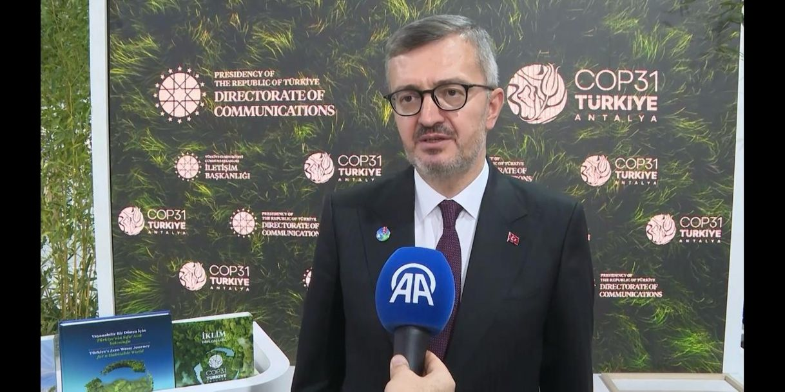
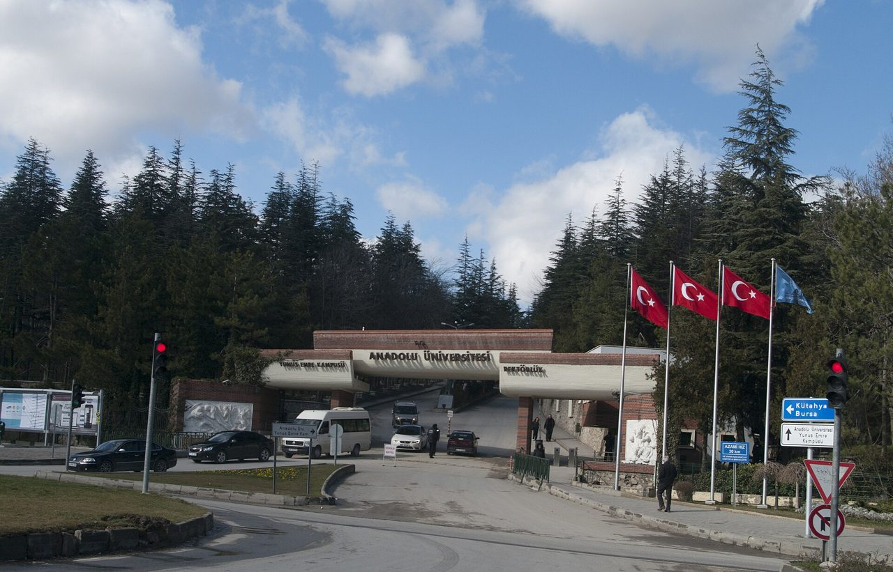
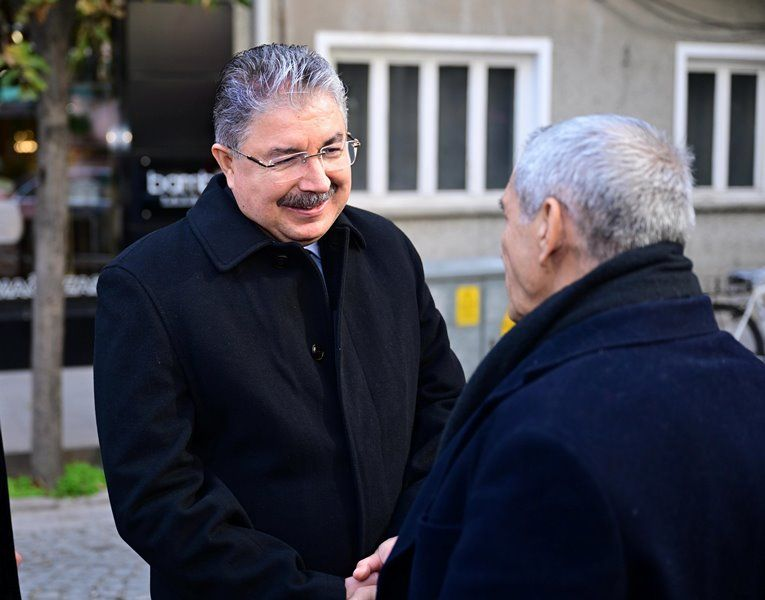
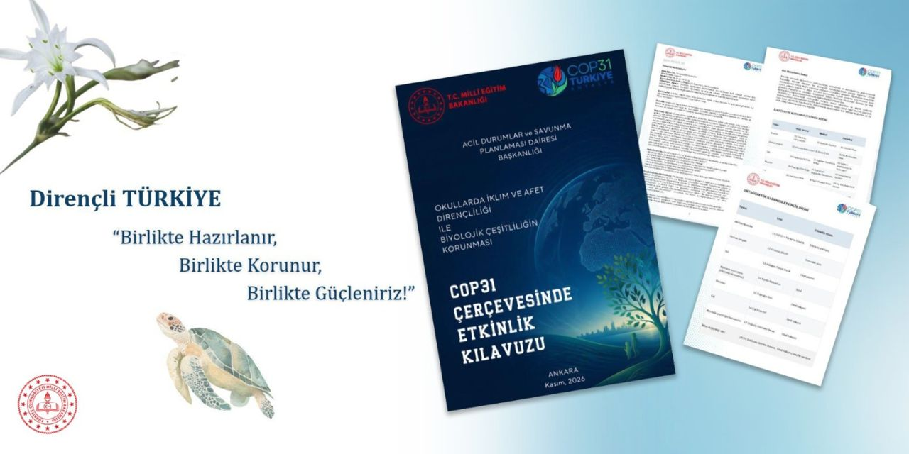
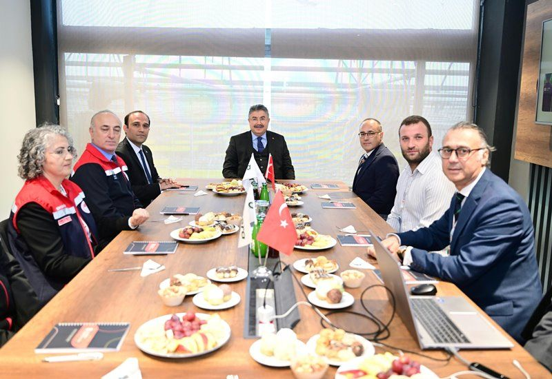

# Son haberler

Ajanın yazdığı son haberler (otomatik güncellenir).

## Vali Yılmaz'dan Esgazete'ye Ziyaret

**Gündem · Merkez** · 2026-11-13 07:44 UTC · Kaynak: [Eskişehir Valiliği](https://www.eskisehir.gov.tr/valimiz-dr-erdinc-yilmaz-esgazete-internet-haber-merkezini-ziyaret-etti)

> Eskişehir Valisi Dr. Erdinç Yılmaz, Esgazete İnternet Haber Merkezi'ni ziyaret ederek kurum çalışmaları hakkında bilgi aldı.

Eskişehir Valisi Dr. Erdinç Yılmaz, yerel medyanın çalışmalarını yerinde incelemek amacıyla Esgazete İnternet Haber Merkezi'ni ziyaret etti.

Ziyaret sırasında Esgazete İmtiyaz Sahibi Mustafa Yıldırım ve Yazı İşleri Müdürü Şenay Yıldırım ile bir araya gelen Vali Yılmaz, yürütülen faaliyetler ve haber çalışmaları hakkında yetkililerden bilgi aldı.

Basın mensuplarıyla bir süre sohbet eden Vali Yılmaz, gazetecilik faaliyetlerinin önemine değinerek tüm çalışanlara görevlerinde başarılar diledi.

---

## Ünlü Edebiyatçı Feridun Andaç'tan Tepebaşı'nın Kültür Vizyonuna Övgü

**Kültür-Sanat · Tepebaşı** · 2026-11-13 07:44 UTC · Kaynak: [Google Haberler - Tepebaşı](https://www.haber26.com.tr/eskisehir/unlu-edebiyatci-feridun-andactan-tepebasinin-kultur-ve-sanat-vizyonuna-ovgu)

> Yazar ve akademisyen Feridun Andaç, Tepebaşı Belediyesi'ni ziyaret ederek kültür ve sanat projelerini inceledi, Başkan Ataç'ın çalışmalarının örnek olduğunu belirtti.

Ünlü edebiyatçı ve akademisyen Feridun Andaç, Tepebaşı Belediye Başkanı Dt. Ahmet Ataç’ı makamında ziyaret etti. Ziyarette belediyenin kültür ve sanat alanında hayata geçirdiği projeler masaya yatırıldı.

Başkan Ataç'ın kamuoyu anketlerinde yüzde 60,7 oy oranıyla İç Anadolu Bölgesi’nin en beğenilen ilçe belediye başkanı seçilmesinin tesadüf olmadığını ifade eden Feridun Andaç, Tepebaşı’nda insanı ve sanatı merkeze alan belediyecilik anlayışının Türkiye geneline örnek teşkil ettiğini dile getirdi. Hizmetlerin yalnızca altyapıyla sınırlı kalmaması gerektiğini vurgulayan Andaç, sanat ve edebiyat etkinliklerinin kente kazandırdığı değere dikkat çekti.

Tepebaşı Belediye Başkanı Dt. Ahmet Ataç ise ziyaretten duyduğu memnuniyeti belirterek kültür ve sanatın bir toplumun nefesi, hafızası ve geleceği olduğunu söyledi. Kentte çocukların, gençlerin ve kadınların sanata kolayca ulaşabileceği bir yaşam alanı yaratmak için çalıştıklarını ifade eden Ataç, sanat odaklı projelerin artarak devam edeceğini kaydetti.

Ziyaretin ardından Feridun Andaç ve Başkan Ataç; atık kâğıtların yeniden üretime kazandırıldığı Kâğıt Geri Dönüşüm Atölyesi’ni, Uluslararası Pişmiş Toprak Sempozyumu eserlerini ve Milli Mücadele dönemini anlatan sergiyi gezerek incelemelerde bulundu.

---

## Togg'dan COP31'de 2035 karbon nötr hedefi açıklaması

**Ekonomi · Türkiye** · 2026-11-13 07:44 UTC · Kaynak: [Google Haberler - Togg](https://www.platinonline.com/otomotiv/togg-ceosu-gurcan-karakas-toggun-2035-hedefini-paylasti-1100759)

> Togg CEO'su Gürcan Karakaş, Antalya'da düzenlenen COP31 İklim Zirvesi'nde şirketin 2035 yılına kadar karbon nötr olma hedefini duyurdu.

Çevre, Şehircilik ve İklim Değişikliği Bakanlığı'nın ev sahipliğinde Antalya'da gerçekleştirilen COP31 İklim Zirvesi'nde Togg da küresel sahnede yerini aldı. Zirvede açıklamalarda bulunan Togg CEO'su M. Gürcan Karakaş, şirketin sürdürülebilirlik vizyonunu ve çevre hedeflerini paylaştı.

Gemlik'teki üretim üssünün tam anlamıyla bir teknoloji merkezi olduğunu belirten Karakaş, tesisi ilk günden itibaren bu vizyonla kurguladıklarını ifade etti. Karakaş, "2035 yılında karbon nötr olma hedefimiz var. Bunu ilk günden itibaren böyle kurguladık" diyerek gelecek planlamasında yarından sonrasını hedeflediklerini kaydetti.

Üretim süreçlerinde tamamen kağıtsız ve dijital bir model uyguladıklarını aktaran Karakaş, aynı yaklaşımın tedarik zincirinde de sürdürüldüğünü belirtti. Karbon emisyonlarının yapay zeka destekli altyapıyla takip edilip doğrulandığını ifade eden Karakaş, yollardaki 130 bine yakın Togg akıllı cihazı sayesinde yaklaşık 600 bin ton karbondioksit emisyonunun önüne geçildiğini bildirdi.

Zirvedeki uluslararası ilgiye de değinen Karakaş, katılımcılardan büyük bir merak ve şaşkınlık gördüklerini, özellikle Türkiye'nin bu sistemi bu kadar kısa sürede nasıl kurduğunu öğrenmek istediklerini sözlerine ekledi.

---

## Pessinus'un Binlerce Yıllık Tarihi Kent Müzeleri'nde Ziyarete Açıldı

**Kültür-Sanat · Odunpazarı** · 2026-11-13 07:44 UTC · Kaynak: [Google Haberler - Eskişehir etkinlik](https://www.esgazete.com/eskisehirde-pessinus-sergisi-kent-muzelerinde-acildi)

> Antik Pessinus'un köklü geçmişini ve Ballıhisar köyündeki yaşamı buluşturan sergi, Kent Müzeleri Kompleksi'nde kapılarını açtı.

Eskişehir Büyükşehir Belediyesi Kent Müzeleri Kompleksi Geçici Sergi Salonu, tarih ve arkeoloji meraklılarını buluşturan yeni bir sergiye ev sahipliği yapıyor. “Toprağın Altındaki Kent, Üstündeki Köy: Pessinus” başlığıyla hazırlanan serginin açılışı yoğun bir katılımla gerçekleştirildi.

Anadolu'nun en önemli inanç ve ticaret merkezlerinden biri olan antik Pessinus'un tarihini ziyaretçilere aktaran sergi; Tanrılar Ana'nın kutsal merkezinden Roma dönemi yapılarına, Bizans ve Selçuklu izlerinden günümüz Ballıhisar köyüne uzanan hikâyeyi gözler önüne seriyor. Arkeolojik çalışmalarla gün ışığına çıkan kültürel mirası görünür kılmayı hedefleyen sergi, toprağın altındaki tarih ile üstünde süren yaşamı aynı çatı altında buluşturuyor.

Açılışta konuşan Eskişehir Büyükşehir Belediyesi Başkan Vekili Hasan Ünal, Pessinus'ta yürütülen kazı çalışmalarının önemine vurgu yaparak, araştırmaların daha güçlü kaynaklarla desteklenmesi gerektiğini dile getirdi. Ünal, belediye olarak kazı ekiplerine desteği sürdüreceklerini belirtti.

Pessinus Kazı Başkanı Doç. Dr. Adem Yurtsever ise antik kentin kültürel değerinin kentte daha geniş kitlelerce tanınması gerektiğini kaydetti. Sergi, 6 Aralık 2026 tarihine kadar Kent Müzeleri Kompleksi'nde ziyaret edilebilecek.

---

## Minikler ÇEDES Projesi ile hem eğlendi hem tarihi keşfetti

**Eğitim · Odunpazarı** · 2026-11-13 07:44 UTC · Kaynak: [Google Haberler - Eskişehir gündem](https://www.medyagazete.com/haber/cedes-projesi-kapsaminda-minikler-hem-eglendi-hem-tarihi-ogrendi)

> Eskişehir'de ÇEDES Projesi kapsamında bir araya gelen ilkokul öğrencileri, atölye çalışmalarına katıldı ve Odunpazarı'nda kültür gezisi yaptı.

Eskişehir Gençlik ve Spor İl Müdürlüğü bünyesindeki Yunus Emre Gençlik Merkezi, "Çevreme Duyarlıyım Değerlerime Sahip Çıkıyorum" (ÇEDES) Projesi çerçevesinde Şehit Mehmet Taş İlkokulu öğrencilerini misafir etti.

Merkezi ziyaret eden minikler, gençlik liderleri ve eğitmenlerin rehberliğinde hazırlanan çeşitli atölye ve farkındalık çalışmalarına katıldı. Programda çocukların katılımıyla "Aile Bütünlüğü" temalı eğitici drama oyunları sahnelendi ve bilgilendirici sunumlar yapıldı. Ardından resim atölyesinde boyama yapan öğrenciler, müzik etkinliğinde şarkılar söyleyerek keyifli anlar yaşadı.

Merkezdeki etkinliklerin tamamlanmasının ardından öğrenciler ve gençlik merkezi ekibi, tarihi Odunpazarı bölgesine doğru kültür gezisi gerçekleştirdi. Bölgedeki sanat atölyelerini gezerek zanaatkarların çalışmalarını yerinde inceleyen çocuklar, tarihi mekanları ziyaret edip hatıra fotoğrafı çektirerek günü tamamladı.

---

## İletişim Başkanı Duran'dan COP31 Açıklaması: Türkiye'nin Çabaları Takdir Ediliyor

**Türkiye · Türkiye** · 2026-11-13 07:44 UTC · Kaynak: [İletişim Başkanlığı](https://www.iletisim.gov.tr/turkce/haberler/detay/iletisim-baskani-duran-cop31-liderler-zirvesine-dair-aciklamalarda-bulundu)

> İletişim Başkanı Burhanettin Duran, Antalya'da düzenlenen COP31 Liderler Zirvesi'ne ilişkin yaptığı açıklamada, Türkiye'nin iklim adaleti ve Sıfır Atık Hareketi'ndeki öncü rolüne dikkat çekti.

Cumhurbaşkanlığı İletişim Başkanı Burhanettin Duran, Antalya'da ev sahipliği yapılan Birleşmiş Milletler (BM) İklim Değişikliği Çerçeve Sözleşmesi 31. Taraflar Konferansı (COP31) Liderler Zirvesi'nin ardından değerlendirmelerde bulundu. Zirvenin başarılı bir şekilde sürdüğünü belirten Duran, Cumhurbaşkanı Recep Tayyip Erdoğan'ın zirvedeki temaslarına ve konuşmasına liderlerin yoğun ilgi gösterdiğini ifade etti.

Cumhurbaşkanı Erdoğan'ın konuşmasındaki iklim adaleti vurgusunun ve Gazze'deki çevre ve insanlık dramına dikkat çeken mesajlarının uluslararası alanda büyük yankı uyandırdığını aktaran Duran, gelişmekte olan ülkelerin iklim mücadelesindeki finans ve teknoloji ihtiyaçlarının somut adımlarla desteklenmesi gerektiğini vurguladı. Duran, Türkiye'nin Emine Erdoğan'ın liderliğinde hayata geçirdiği Sıfır Atık Hareketi'nin tüm dünyaya örnek teşkil ettiğini belirtti.

İletişim Başkanlığı'nın zirvedeki faaliyetlerine de değinen Duran, etkinlik alanında kurulan geniş pavilyonda 5 panel düzenlediklerini ve iklim diplomasisi, Türkiye'nin COP31 tecrübesi ile Sıfır Atık konularını ele alan 3 temel eser hazırladıklarını kaydetti. Duran, Anadolu Ajansı ve TRT'nin de zirvede etkin bir görev üstlendiğini belirterek, SETA standını da ziyaret ettiğini sözlerine ekledi.

---

## Eskişehir'de kontrolden çıkan otomobil yan yattı: Sürücü ve yolcular ucuz kurtuldu

**Asayiş · Tepebaşı** · 2026-11-13 07:44 UTC · Kaynak: [Google Haberler - Eskişehir asayiş](https://www.haber26.com.tr/asayis/eskisehir-de-kontrolden-cikan-otomobil-yan-yatti)

> Tepebaşı ilçesinde sürücüsünün direksiyon hakimiyetini kaybettiği otomobilin yan yattığı kazada araçta bulunanlar hafif sıyrıklarla kurtuldu.

Eskişehir'de gece saatlerinde meydana gelen trafik kazasında kontrolden çıkan otomobil yan yattı. Şans eseri kazada yaralanan olmadı.

Kaza, Tepebaşı ilçesi Hoşnudiye Mahallesi İstasyon Caddesi üzerinde yaşandı. Alınan bilgilere göre, Z.Ö. yönetimindeki 16 LP 113 plakalı otomobil, sürücüsünün direksiyon hakimiyetini yitirmesi neticesinde savrulmaya başladı. Kontrolden çıkan araç cadde üzerinde devrilerek yan yattı.

Olayda sürücü ile otomobildeki yolcular kazayı hafif sıyrıklarla atlattı. İhbar üzerine olay yerine gelen polis ekipleri güvenlik önlemleri alırken, devrilen araç çekici marifetiyle kaldırıldı. Kazayla ilgili inceleme başlatıldı.

---

## Çatıda mahsur kalan kedi DAK ekiplerince kurtarıldı

**Gündem · Odunpazarı** · 2026-11-13 07:44 UTC · Kaynak: [Google Haberler - Odunpazarı](https://www.haber26.com.tr/news/eskisehir-de-binanin-catisinda-mahsur-kalan-kediyi-dak-ekipleri-kurtardi)

> Odunpazarı ilçesinde apartman çatısında mahsur kalan kedi, Doğal Afetler Arama Kurtarma ekiplerinin müdahalesiyle kurtarıldı.

Eskişehir'de bir binanın çatısında mahsur kalan kedi, Doğal Afetler Arama Kurtarma (DAK) ekiplerinin operasyonuyla kurtarılarak güvenli bir şekilde sokağa bırakıldı.

Olay, Odunpazarı ilçesi Kurtuluş Mahallesi Bahçeler Sokak'ta yaşandı. Bir apartmanın çatısına çıkan kedinin uzun süre miyav seslerini duyan mahalle sakinleri, hayvanı kendi imkanlarıyla indiremeyince durumu ekiplere bildirdi. İhbar üzerine olay yerine yönlendirilen DAK görevlileri, gerekli güvenlik önlemlerini alarak çatıya çıktı.

Ekiplerin titiz çalışması sonucu bulunduğu yerden alınan kedi, sağ salim aşağı indirilerek doğal yaşam alanına bırakıldı.

---

## Vali Yılmaz'dan Eskişehir.Net'e Ziyaret

**Gündem · Merkez** · 2026-11-13 07:05 UTC · Kaynak: [Eskişehir Valiliği](https://www.eskisehir.gov.tr/valimiz-dr-erdinc-yilmaz-eskisehirnet-sedef-medya-as-internet-haber-sitesini-ziyaret-etti)

> Eskişehir Valisi Dr. Erdinç Yılmaz, Eskişehir.Net Sedef Medya A.Ş.'yi ziyaret ederek çalışmalar hakkında bilgi aldı.

Eskişehir Valisi Dr. Erdinç Yılmaz, yerel medyanın çalışmalarını yerinde incelemek amacıyla Eskişehir.Net Sedef Medya A.Ş. İnternet haber sitesini ziyaret etti.

Ziyaret kapsamında İmtiyaz Sahibi Fatih Sezer ve Sorumlu Yazı İşleri Müdürü Cihan Yıldırım ile bir araya gelen Vali Yılmaz, kurumun yürüttüğü faaliyetler hakkında bilgi aldı. Görüşmede basının kamuoyunu doğru ve hızlı bir şekilde bilgilendirmedeki kritik rolüne dikkat çekildi.

Vali Yılmaz, buluşmanın sonunda medya çalışanlarına görevlerinde başarılar diledi.

---

## Togg T6X ne zaman çıkacak? Fiyatı ne kadar olacak?

**Ekonomi · Türkiye** · 2026-11-13 07:05 UTC · Kaynak: [Google Haberler - Togg](https://www.yenisafak.com/galeri/ozgun/togg-t6x-ne-zaman-cikacak-togg-t6x-modeli-ne-kadar-kac-lira-olacak-4860677)

> Togg Yönetim Kurulu Başkanı Fuat Tosyalı, daha ekonomik yeni model T6X'i önümüzdeki yılın ortasında piyasaya sunmayı hedeflediklerini açıkladı.

Türkiye'nin yerli otomobil üreticisi Togg, C-SUV modeli T10X ve sedan modeli T10F'in ardından A/B segmentindeki yeni modeli T6X için hazırlıklarını sürdürüyor. Bireysel kullanıcılar ve şehir içi mobiliteye yönelik geliştirilen B-SUV/Crossover konseptindeki T6X modeli, haziran ayında kullanıcılarla buluşturulacak.

Togg Yönetim Kurulu Başkanı Fuat Tosyalı, Anadolu Ajansı Finans Masası'nda yaptığı açıklamada, yeni modelin mevcut fiyatlara kıyasla çok daha hesaplı olacağını belirtti. Tosyalı, "T10X ve T10F'den sonra T6X'i özellikle geliştirdik ki neredeyse şu anki cari fiyatlara göre çok çok daha hesaplı. Buna uygun kampanya süreçlerimiz de olacak" ifadelerini kullandı.

"Ucuz Togg" olarak da anılan T6X modelinin, kompakt boyutları ve optimize edilmiş batarya seçenekleriyle Türkiye'deki en düşük ÖTV diliminde yer alması ve erişilebilir bir fiyat etiketi sunması öngörülüyor. Trumore uygulaması üzerinden e-Devlet entegrasyonuyla gerçekleştirilecek talep toplama sürecinde hak sahipleri kura veya sıra ile belirlenecek.

Seri üretim öncesi test ve geliştirme süreçleri devam eden aracın batarya kapasitesi, sürüş menzili, motor gücü ve donanım paketleri gibi teknik detaylarının satış tarihine yakın bir zamanda kamuoyuyla paylaşılması bekleniyor.

---

## Sazova'daki dev tesis atıl kaldı: Halkın hizmetine açılsın

**Gündem · Tepebaşı** · 2026-11-13 07:05 UTC · Kaynak: [Google Haberler - Eskişehir gündem](https://www.eskisehirekspres.net/nihat-cuhadardan-cagri-yeniden-eskisehir-halkinin-hizmetine-kazandirilmali)

> Eskişehir Büyükşehir Belediye Meclisi'nde konuşan YENİ Parti Meclis Üyesi Nihat Çuhadar, kapalı tutulan Türk Dünyası Bilim Kültür ve Sanat Merkezi'nin yeniden halkın hizmetine sunulmasını istedi.

Eskişehir Büyükşehir Belediye Meclisi Başkanvekili Hasan Ünal yönetiminde gerçekleştirilen toplantıda, Sazova Bilim Kültür ve Sanat Parkı içindeki Türk Dünyası Bilim Kültür ve Sanat Merkezi'nin durumu gündeme taşıdı. Mecliste söz alan YENİ Parti Meclis Üyesi Nihat Çuhadar, tesisin güncel durumu hakkında değerlendirmelerde bulundu.

Merkezin 2013 Türk Dünyası Kültür Başkenti ajandası kapsamında kalıcı bir eser olarak tasarlandığını hatırlatan Çuhadar, 15 bin metrekarelik kapalı alana sahip yapının bugün kapalı tutulduğunu belirtti. Tesisin günümüzdeki yeniden yapım maliyetinin yaklaşık 850 milyon ile 1 milyar lira arasında değerlendirildiğini ifade eden Çuhadar, kamu yatırımlarının korunması ve işlevsel kılınması gerektiğini vurguladı.

Merkezin Gençlik ve Spor İl Müdürlüğü'ne devredildiği yönündeki bilgileri hatırlatan Çuhadar, devir sürecine ve tesisin geleceğine ilişkin resmi mercilere sorular yöneltti. Çuhadar, merkezin neden kapatıldığını, eserlerin nerede korunduğunu ve yeni kullanım planının ne olduğunu sordu.

Konunun siyasi tartışmalardan uzak tutulması gerektiğini belirten Çuhadar, ilgili tüm kurumların ortak bir akistle hareket ederek tesisin yeniden bilim, kültür ve sanat faaliyetleri için açılmasını talep etti.

---

## Odunpazarı'nda Sanat ve Kitap Günleri için geri sayım

**Kültür-Sanat · Odunpazarı** · 2026-11-13 07:05 UTC · Kaynak: [Google Haberler - Odunpazarı](https://www.esgazete.com/odunpazarinda-sanat-ve-kitap-gunleri-21-kasimda-basliyor)

> Odunpazarı Belediyesi ve Cumhuriyet Gazetesi iş birliğiyle düzenlenecek Sanat ve Kitap Günleri, 21-22 Kasım tarihlerinde kapılarını açacak.

Odunpazarı Belediyesi, Cumhuriyet Gazetesi ve Cumhuriyet Kitapları iş birliğiyle hayata geçirilen Sanat ve Kitap Günleri, 21-22 Kasım 2026 tarihlerinde 100. Yıl Kültür Merkezi'nde kitapseverlerle buluşacak. Yenikent Mahallesi'nde yer alan merkezde gerçekleştirilecek etkinlik, edebiyat, sanat ve düşünce dünyasından pek çok ismi Eskişehirlilerle bir araya getirecek.

İki gün sürecek organizasyon; söyleşiler, imza etkinlikleri ve Cumhuriyet Gazetesi Koleksiyon Sergisi'ne ev sahipliği yapacak. Program kapsamında edebiyattan şiire, resimden Cumhuriyet tarihine, Atatürk'ten yerel yönetimlere kadar geniş bir yelpazede başlıklar ele alınacak.

Etkinlik, 21 Kasım Cumartesi günü saat 13.00'te sergi açılışı ve açılış konuşmalarıyla başlayacak ve gün boyunca sürecek söyleşi ve imza etkinlikleriyle devam edecek. Programın ikinci gününde ise çeşitli yazarlar ve şairler okurlarıyla buluşacak.

Organizasyonun kapanış bölümünde Odunpazarı Belediye Başkanı Kazım Kurt ve gazeteci-yazar Mustafa Balbay, "Yerel Siyaset, Yerel Yönetim" başlıklı söyleşide yerel siyasetin dinamiklerini değerlendirecek.

---

## İletişim Başkanı Duran'dan Malatya'daki şehit Mehmetçikler için taziye

**Türkiye · Türkiye** · 2026-11-13 07:05 UTC · Kaynak: [İletişim Başkanlığı](https://www.iletisim.gov.tr/turkce/haberler/detay/iletisim-baskani-duran-milletimizin-basi-sag-olsun)

> Cumhurbaşkanlığı İletişim Başkanı Burhanettin Duran, Malatya'da askerî helikopterin kaza kırıma uğraması sonucu şehit olan Mehmetçikler için başsağlığı diledi.

Cumhurbaşkanlığı İletişim Başkanı Burhanettin Duran, sosyal medya hesabından yaptığı paylaşımda, Malatya'da S-70 tipi askerî helikopterin kaza kırıma uğraması neticesinde şehit düşen kahraman askerler için taziye mesajı yayımladı.

Duran paylaşımında, şehitlere Allah'tan rahmet dileyerek, kederli ailelere, yakınlara ve Türk Silahlı Kuvvetleri'ne başsağlığı dileklerini iletti.

---

## Eskişehirspor taraftarından yüksek bilet fiyatına para atarak protesto

**Spor · Merkez** · 2026-11-13 07:05 UTC · Kaynak: [Google Haberler - Eskişehirspor](https://www.haber26.com.tr/spor/valizi-toplayip-gidin)

> Nesine 3. Lig 2. Grup'taki Anadolu SF maçında 400 TL'lik bilet fiyatına tepki gösteren Eskişehirspor taraftarları, tribünlerden para atarak yönetimi protesto etti.

Nesine 3. Lig 2. Grup'ta oynanan Anadolu Spor Faaliyetleri ile Eskişehirspor karşılaşmasında siyah-kırmızılı taraftarlar tribünlerde dikkat çeken bir protestoya imza attı. Ev sahibi ekibin bilet fiyatlarını 400 TL olarak belirlemesi maç öncesinde tepki toplarken, siyah-kırmızılılar yüksek ücrete rağmen ESOGÜ Stadyumu'ndaki yerini aldı.

Maç öncesinde bilet fiyatlarına tepki gösteren taraftarlar, tribünlerden para atarak ev sahibi yönetimi protesto etti. Siyah-kırmızılılar, "Bu kadar ihtiyaç mı var paraya? Valizi toplayıp gidin Ankara'ya" tezahüratlarıyla tepkilerini dile getirdi.

Karşılaşma boyunca takımlarını desteklemeyi sürdüren Eskişehirspor taraftarı, 90 dakika boyunca bilet fiyatlarına yönelik protestolarına devam etti.

---

## Eskişehir Anadolu Lisesi önündeki çöpler tepki çekti

**Gündem · Tepebaşı** · 2026-11-13 07:05 UTC · Kaynak: [Google Haberler - Eskişehir](https://www.eskisehirekspres.net/eskisehirde-lise-onunde-cop-manzarasi)

> Sümer Mahallesi'nde bulunan Eskişehir Anadolu Lisesi'nin önünde biriken çöpler çevre kirliliğine yol açarken, vatandaşlar bölgede temizlik çalışmalarının artırılmasını talep ediyor.

Eskişehir'de çevre kirliliğiyle ilgili şikayetlere bir yenisi daha eklendi. Sümer Mahallesi Kızılyer mevkiinde yer alan Eskişehir Anadolu Lisesi'nin önündeki atıklar, bölgede bakımsız bir görüntü oluşturdu.

Öğrencilerin yoğun olarak kullandığı okul çevresinde biriken çöpler hem çevre sağlığını tehdit ediyor hem de kötü bir görüntü ortaya çıkarıyor. Mahalle sakinleri ve veliler, öğrencilerin eğitim gördüğü bu alanda temizlik çalışmalarının sıklaştırılmasını ve çöplerin düzenli bir şekilde toplanmasını istiyor.

---

## 23. Eskişehir Uluslararası Film Festivali 55 filmle başlıyor

**Kültür-Sanat · Tepebaşı** · 2026-11-13 07:05 UTC · Kaynak: [Google Haberler - Eskişehir etkinlik](https://www.haberler.com/amp/23-eskisehir-uluslararasi-film-festivali-19-27-20420720-haberi/)

> Anadolu Üniversitesi tarafından bu yıl 23'üncüsü düzenlenecek Eskişehir Uluslararası Film Festivali, 19-27 Kasım tarihleri arasında sinemaseverlerle buluşacak.

Anadolu Üniversitesi ev sahipliğinde gerçekleştirilecek 23. Eskişehir Uluslararası Film Festivali, 37'si uzun metraj olmak üzere toplam 55 filmi sinemaseverlerin beğenisine sunacak. Festival programı, Rektör Prof. Dr. Yusuf Adıgüzel ve heyetinin düzenlediği basın toplantısıyla kamuoyuna duyuruldu.

Üniversitenin eğitim misyonu doğrultusunda genç sinemacılarla ustaları bir araya getirmeyi amaçladıklarını belirten Rektör Prof. Dr. Yusuf Adıgüzel, festivalde film gösterimlerinin yanı sıra atölye çalışmalarının da yer alacağını kaydetti. Organizasyon kapsamında Netflix iş birliğiyle düzenlenecek özel programda seçilen öğrenciler, senaryo ve yönetmenlik alanında uzman isimlerle çalışma fırsatı bulacak.

Eskişehir'in kültür-sanat yaşamına hareketlilik katacak etkinlikler arasında, 26-27 Kasım tarihlerinde sinema festivallerinin sektöre etkilerinin ele alınacağı bir sempozyum da yer alıyor. Ayrıca Buster Keaton'ın "The General" filmi, gösteriminin 100'üncü yılı dolayısıyla piyanist Hakan Ali Toker'in canlı piyano eşliğinde izleyiciyle buluşacak.

Festivalin açılış töreninde Türk sinemasına katkı sunan Nilüfer Aydan ve Feyzi Tuna'ya Sinema Onur Ödülü takdim edilecek. Etkinlik hakkında ayrıntılı bilgiye ve gösterim programına resmi internet sitesi üzerinden ulaşılabiliyor.

---

## Altın fiyatları 13 Kasım 2026: Gram altın 6.371,12 TL

**Ekonomi · Merkez** · 2026-11-13 06:00 UTC · Kaynak: [Harem Altın](https://www.haremaltin.com/altin-fiyatlari)

> Gram altın güne düşüşle başladı. Harem Altın verilerine göre gram altın 6.283,77 TL'den alınıyor, 6.371,12 TL'den satılıyor.

Altın piyasasında güne düşüşle başlandı. Harem Altın'ın saat 09.00 itibarıyla verilerine göre gram altının satış fiyatı 6.371,12 TL, alış fiyatı 6.283,77 TL oldu. Gram altın, önceki kapanışa göre yüzde 5,16 geriledi.

Ziynet altınlarda çeyrek altın 10.384 TL, yarım altın 20.762 TL, tam altın 41.372 TL, ata altın 42.477 TL seviyesinden satışa sunuluyor.

22 ayar bileziğin gram satış fiyatı 5.950,80 TL, has altının gram fiyatı 6.351,92 TL olarak belirlendi.

Uluslararası piyasalarda altının onsu 3.899,20 dolardan işlem görürken, dolar/TL 50,35 seviyesinde bulunuyor.

Fiyatlar Harem Altın'ın saat 09.00 itibarıyla paylaştığı verilere dayanmaktadır; kuyumcular arasında farklılık gösterebilir. Bu haber yatırım tavsiyesi değildir.

---

## Vali Yılmaz'dan İstiklal Mahallesi esnafına ziyaret

**Gündem · Odunpazarı** · 2026-11-13 05:05 UTC · Kaynak: [Eskişehir Valiliği](https://www.eskisehir.gov.tr/valimiz-dr-erdinc-yilmaz-istiklal-mahallesinde-faaliyet-gosteren-esnafi-ziyaret-ederek-hayirli-ve-bereketli-kazanclar-diledi)

> Eskişehir Valisi Dr. Erdinç Yılmaz, İstiklal Mahallesi'ndeki esnafı iş yerlerinde ziyaret ederek taleplerini dinledi ve hayırlı kazançlar diled.

Eskişehir Valisi Dr. Erdinç Yılmaz, kentteki esnaf buluşmalarını sürdürüyor. Bu kapsamda İstiklal Mahallesi'nde faaliyet gösteren esnafı ziyaret eden Vali Yılmaz, işletme sahipleriyle bir süre sohbet etti.

Ziyaret sırasında iş yerlerinin durumu hakkında bilgi alan Vali Yılmaz, esnafın talep ve önerilerini tek tek dinledi. Esnafın Eskişehir'in ekonomisine ve sosyal hayatına değer kattığını vurgulayan Vali Yılmaz, "Esnafımızın her zaman yanındayız. Hemşehrilerimizle birlikte Eskişehir’imiz için çalışmaya devam edeceğiz" dedi.

Esnaf da ziyaretten duydukları memnuniyeti belirterek Vali Yılmaz'a teşekkürlerini iletti.

---

## Okullarda İklim Değişikliği ve Afet Dirençliliği Kılavuzu Hazırlandı

**Eğitim · Türkiye** · 2026-11-13 05:05 UTC · Kaynak: [Milli Eğitim Bakanlığı](https://www.meb.gov.tr/okullarda-iklim-degisikligine-bagli-afet-risklerine-karsi-farkindalik-olusturulacak/haber/42483/tr)

> Milli Eğitim Bakanlığı, COP31 kapsamında okullarda iklim değişikliği ve afet risklerine karşı farkındalık oluşturmak amacıyla etkinlik kılavuzu hazırladı.

Milli Eğitim Bakanlığı, Antalya'da düzenlenen Birleşmiş Milletler İklim Değişikliği Konferansı (COP31) çerçevesinde okullar için yeni bir etkinlik kılavuzu oluşturdu. Acil Durumlar ve Savunma Planlaması Dairesi Başkanlığı tarafından hazırlanan kılavuzla, öğrencilerin iklim değişikliğinin etkilerine karşı bilinçli ve afetlere hazırlıklı bireyler olarak yetişmesi hedefleniyor.

"Okullarda İklim ve Afet Dirençliliği ile Biyolojik Çeşitliliğin Korunması Etkinlik Kılavuzu", tüm öğretim kademeleri için yaş ve gelişim düzeyleri dikkate alınarak 6 farklı temada hazırlandı. Çalışma; iklim değişikliğine bağlı afet risklerine karşı farkındalığın artırılması, biyolojik çeşitliliğin korunması, dayanışma ve ortak hareket etme kültürünün desteklenmesini amaçlıyor.

Türkiye Yüzyılı Maarif Modeli'nin erdem-değer-eylem çerçevesinde hazırlanan etkinlikler, öğrencilerin edinilen bilgileri somut davranışlara dönüştürmesini hedefliyor. Kılavuzda deprem, orman yangını, sel, heyelan, çığ ve biyolojik çeşitlilik temalarına yer verilirken; "Toprağın yolculuğu", "Okulun yaşam ağı", "Yağmur şiddetlenirse ne yapacağız" ve "Bir kıvılcımdan önce" gibi başlıklar altında ailelerin de katılımının destekleneceği bildirildi.

---

## Odunpazarı'nda Sanat ve Kitap Günleri Heyecanı Başlıyor

**Kültür-Sanat · Odunpazarı** · 2026-11-13 05:05 UTC · Kaynak: [Google Haberler - Odunpazarı](https://www.haberes.com.tr/odunpazarinda-sanat-ve-kitap-gunleri-heyecani)

> Odunpazarı Belediyesi ve Cumhuriyet iş birliğiyle düzenlenecek Sanat ve Kitap Günleri, 21-22 Kasım tarihlerinde edebiyatseverleri ve yazarları bir araya getirecek.

Odunpazarı Belediyesi, kültür ve sanat faaliyetleri kapsamında yeni bir etkinliğe ev sahipliği yapmaya hazırlanıyor. Cumhuriyet Gazetesi ve Cumhuriyet Kitapları iş birliğiyle hayata geçirilen Sanat ve Kitap Günleri, 21-22 Kasım 2026 tarihlerinde Yenikent Mahallesi'ndeki 100. Yıl Kültür Merkezi'nde gerçekleştirilecek.

İki gün sürecek etkinlik boyunca edebiyat, şiir, öykü, resim, Cumhuriyet tarihi, Atatürk ve yerel yönetimler gibi pek çok farklı başlık ele alınacak. Program kapsamında gazeteciler, yazarlar, şairler ve araştırmacılar okurlarla söyleşilerde buluşacak ve ardından imza etkinlikleri düzenlenecek. Ayrıca katılımcılar, etkinlik süresince Cumhuriyet Gazetesi Koleksiyon Sergisi'ni ziyaret etme imkanı bulacak.

Etkinliğin ilk günü olan 21 Kasım Cumartesi günü sergi açılışı ile başlayıp, "Yurdu Gezen Ressamlar", "Cumhuriyetin Cumhuriyeti", "Şiir ve Şairler" ile "Evimizin Dostları" söyleşileriyle devam edecek. Pazar günü ise "Acının Anatomisi", "Öykü", "Atatürk’ün Çağdaşlaşma Adımları" ve "Yunus Emre" başlıklarının yanı sıra, Odunpazarı Belediye Başkanı Kazım Kurt ve gazeteci-yazar Mustafa Balbay'ın katılacağı "Yerel Siyaset, Yerel Yönetim" söyleşisi gerçekleştirilecek.

---

## Eskişehirspor derbiyi kazandı, liderlik koltuğuna oturdu

**Spor · Merkez** · 2026-11-13 05:05 UTC · Kaynak: [Google Haberler - Eskişehirspor](https://gundem11.com/derbiyi-eskisehirspor-kazandi/)

> Eskişehir Osmangazi Üniversitesi Stadyumu'nda oynanan derbide Anadolu Spor Faaliyetleri'ni 2-0 mağlup eden Eskişehirspor, puan cetvelinde zirveye yerleşti.

Eskişehirspor, Eskişehir Osmangazi Üniversitesi Stadyumu'nda oynanan heyecan dolu derbi karşılaşmasında Eskişehir Anadolu Spor Faaliyetleri ile kozlarını paylaştı. Siyah-kırmızılı ekip, maç boyunca sergilediği üstün performansla rakibini 2-0 mağlup etmeyi başardı.

Kritik mücadelede Eskişehirspor'a galibiyeti getiren golleri Mert Başer ve İsmail Kulet kaydetti. Sahadan 3 puanla ayrılan siyah-kırmızılılar, maç sonrasında tribünleri dolduran taraftarlarıyla büyük sevinç yaşadı.

Bu galibiyetle puanını yükselten Eskişehirspor, rakiplerinin de puan kaybetmesiyle birlikte ligde liderlik koltuğuna oturdu.

---

## Erdoğan'dan COP31 İş Forumu'nda çağrı: Ekonomi ekolojiye feda edilmemeli

**Türkiye · Türkiye** · 2026-11-13 05:05 UTC · Kaynak: [İletişim Başkanlığı](https://www.iletisim.gov.tr/turkce/haberler/detay/cumhurbaskani-erdogan-cop31-is-forumunda-konustu)

> Antalya'da düzenlenen COP31 İş Forumu'nda konuşan Cumhurbaşkanı Erdoğan, iklim değişikliğiyle mücadelede iş dünyasının sorumluluk üstlenmesi gerektiğini vurguladı.

Cumhurbaşkanı Recep Tayyip Erdoğan, Antalya'da gerçekleştirilen Birleşmiş Milletler İklim Değişikliği Çerçeve Sözleşmesi 31. Taraflar Konferansı (COP31) kapsamındaki "COP31 İş Forumu"nda iş dünyasına hitap etti. Tarihin ve turizmin buluşma noktası Antalya'da yeryüzünün geleceğine sahip çıkmak için bir araya geldiklerini belirten Erdoğan, 20 Kasım'a kadar sürecek olan konferansa yaklaşık 100 bin kişinin katılımını beklediklerini kaydetti.

İklim krizinin ulaştığı boyutların küresel ölçekte kararlı adımlar atılmasını zorunlu kıldığını ifade eden Erdoğan, COP31'in taahhütlerin somut sonuçlara dönüşmesine imkân verecek bir uygulama konferansı olarak tasarlandığını aktardı. Konferansın ilk gününü "sıfır atık", ikinci gününü ise "dirençli şehirler ve sürdürülebilir çevre" temalarına ayırdıklarını hatırlatan Erdoğan, 6 Şubat 2023 depremlerinin ardından üç yıldan kısa sürede 455 bin konut ve iş yeri inşa ederek bölgeyi yeniden ayağa kaldırdıklarını, bu tecrübeyi de zirvede paylaştıklarını belirtti.

Gelişmiş ülkelerin emisyon azaltımı ve finansmanda daha fazla sorumluluk üstlenmesi gerektiğine dikkati çeken Erdoğan, "Eğer bugün biz de aynı hataları tekrarlar, ekolojiyi ekonomiye feda edersek bunun bedelini evlatlarımız ödeyecektir. Böyle bir yanlışa zaten biz izin vermeyiz" dedi. Türkiye'nin 2053 "net sıfır emisyon" hedefine değinen Erdoğan, yeşil kalkınma yolculuğunda rüzgâr, güneş ve nükleer enerji yatırımlarını artıracaklarını bildirdi.

Uluslararası yatırımcıların Türkiye'ye güveninin arttığını vurgulayan Erdoğan, bu sabah 4 büyük kalkınma bankasıyla toplam 5,1 milyar dolarlık 10 anlaşma imzalandığını duyurdu. Kaynakların çiftçilere, ihracatçılara ve KOBİ'lere aktarılacağını belirten Erdoğan, HIT-30 programı ve Eximbank ile her zaman iş dünyasının yanında olacaklarını sözlerine ekledi.

---

## AK Parti İl Başkanı Albayrak'tan ESTÜ Rektörü Özcan'a Ziyaret

**Eğitim · Tepebaşı** · 2026-11-13 05:05 UTC · Kaynak: [Eskişehir Teknik Üniversitesi](https://www.eskisehir.edu.tr/tr/Haber/Detay/ak-parti-eskisehir-il-baskani-gurhan-albayrak-ve-beraberindeki-heyetten-rektorumuz-prof-dr-adnan-ozcana-tebrik-ziyareti)

> AK Parti Eskişehir İl Başkanı Gürhan Albayrak ve beraberindeki heyet, yeniden rektörlüğe atanan Prof. Dr. Adnan Özcan'ı makamında ziyaret etti.

AK Parti Eskişehir İl Başkanı Gürhan Albayrak ve beraberindeki heyet, Eskişehir Teknik Üniversitesi (ESTÜ) Rektörlüğüne yeniden atanan Prof. Dr. Adnan Özcan’a tebrik ziyaretinde bulundu.

Rektörlük makamında gerçekleşen buluşmada İl Başkanı Albayrak ve heyeti, Özcan’ı kutlayarak yeni görev döneminde başarı dileklerini iletti.

Rektör Prof. Dr. Adnan Özcan, nazik ziyaretleri ve iyi dilekleri dolayısıyla İl Başkanı Gürhan Albayrak ile beraberindeki heyete teşekkür etti.

---

## Mahmudiye'deki modern serada domates hasadı yapıldı

**Tarım · Mahmudiye** · 2026-11-12 21:54 UTC · Kaynak: [Eskişehir Valiliği](https://www.eskisehir.gov.tr/valimiz-dr-erdinc-yilmaz-mahmudiye-ilcesinde-faaliyet-gosteren-nata-tarima-ait-sera-alanini-ziyaret-ederek-uretim-calismalari-hakkinda-bilgi-aldi)

> Eskişehir Valisi Dr. Erdinç Yılmaz, Mahmudiye'de termal suyla ısıtılan ve topraksız tarım yapılan 100 dönümlük serayı inceleyerek domates hasadına katıldı.

Eskişehir Valisi Dr. Erdinç Yılmaz, tarımsal üretim faaliyetlerini yerinde incelemek üzere Mahmudiye ilçesinde bulunan Nata Tarım'a ait sera alanını ziyaret etti.

Vali Yılmaz, yaklaşık 100 dönümlük alanda salkım domates üretimi yapılan tesisi gezerek yetkililerden çalışmalar hakkında bilgi aldı. Tesisin termal suyla ısıtıldığını ve ileri teknoloji sistemleriyle donatıldığını belirten Yılmaz, topraksız tarım uygulamalarını yerinde inceledi.

İncelemelerinin ardından serada çalışanlarla bir araya gelen Vali Dr. Erdinç Yılmaz, domates hasadına katılarak üreticilere çalışmalarında başarılar diledi.

---

## ESTÜ'de savunma sanayii ve bulut bilişim iş birliği görüşmesi

**Eğitim · Tepebaşı** · 2026-11-12 21:54 UTC · Kaynak: [Eskişehir Teknik Üniversitesi](https://www.eskisehir.edu.tr/tr/Haber/Detay/eskisehir-teknik-universitesi-ile-savunma-sanayii-arasinda-bulut-bilisim-alaninda-is-birligi-gorusmesi)

> Millî Savunma Bakanlığı, SSB ve HAVELSAN heyeti, Eskişehir Teknik Üniversitesi'ni ziyaret ederek bulut bilişim ve millîleştirme çalışmalarını ele aldı.

Millî Savunma Bakanlığı (MSB) Muhabere ve Bilgi Sistem Dairesi Başkanı Tuğgeneral Mustafa Murat Kabukçu başkanlığındaki heyet, Eskişehir Teknik Üniversitesi'ni (ESTÜ) ziyaret etti. Ziyarette, Millî Savunma Bakanlığı, Cumhurbaşkanlığı Savunma Sanayii Başkanlığı (SSB) ve HAVELSAN temsilcileri bir araya geldi.

Toplantıda, bulut bilişim sistemlerinin millîleştirilmesine yönelik yürütülen çalışmalar ve bu alanda ihtiyaç duyulan nitelikli insan kaynağının yetiştirilmesi konuları ele alındı. Heyet, ESTÜ ile bu alanda ortak iş birliği yapmayı hedeflediklerini belirtti.

ESTÜ Rektörü Prof. Dr. Adnan Özcan, üniversitenin savunma sanayii alanındaki Ar-Ge projelerine ve sektörel iş birliklerine değinerek araştırma altyapısıyla sürece katkı sunmaya hazır olduklarını ifade etti. Bilişim Teknolojileri Meslek Yüksekokulu Müdürü Prof. Dr. Tansu Filik ise yüksekokulun eğitim programları ve Bulut Bilişim Operatörlüğü Programı'nın altyapısı hakkında sunum gerçekleştirdi.

Öğrencilerin mesleki yetkinliklerinin artırılması, staj ve istihdam olanaklarının değerlendirildiği buluşma, hatıra fotoğrafı çekimiyle sona erdi.

---

## Eskişehirspor Maçı Sonrası Statta 220 Koltuk Kırıldı

**Spor · Tepebaşı** · 2026-11-12 21:54 UTC · Kaynak: [Google Haberler - Eskişehirspor](https://www.gazetevatan.com/sehirler/eskisehir/eskisehirspor-maci-sonrasi-rezalet-ortaya-cikti-2464209)

> Anadolu SF ile Eskişehirspor karşılaşmasının ardından Osmangazi Üniversitesi Sahası'nda yapılan incelemede 220 koltuğun kırıldığı belirlendi.

Anadolu Spor Faaliyetleri ile Eskişehirspor arasında oynanan müsabakanın ardından Osmangazi Üniversitesi Sahası'nda hasar tespit çalışması gerçekleştirildi.

TFF temsilcisi ve stadyum yöneticileri tarafından yapılan kontrollerde, tribünlerde bulunan toplam 220 koltuğun kırıldığı ve kullanılamaz hale geldiği tespit edildi. Oluşan hasar, her iki kulüp temsilcilerinin imzaladığı raporla kayıt altına alındı.

Müsabakaya ev sahipliği yapan Anadolu Spor Faaliyetleri yönetiminin, Eskişehirspor taraftarlarını yalnızca misafir tribünüyle sınırlı tutmayarak tüm tribünlere alması ve sorumluluğu üstlenmesi nedeniyle hasarın faturasının ev sahibi kulübe kesileceği öğrenildi.

---

## Eskişehir'de Küçükbaş Hayvan Islahı Projesi Masaya Yatırıldı

**Tarım · Merkez** · 2026-11-12 21:54 UTC · Kaynak: [Eskişehir İl Tarım ve Orman Müdürlüğü](https://eskisehir.tarimorman.gov.tr/Haber/1763/Eskisehirde-Halk-Elinde-Kucukbas-Hayvan-Islahi-Projesi-Degerlendirme-Toplantisi-Yapildi)

> Eskişehir İl Tarım ve Orman Müdürlüğü ev sahipliğinde düzenlenen toplantıda, kent genelinde sürdürülen küçükbaş hayvan ıslahı projelerinin mevcut durumu ve verimlilik çalışmaları ele alındı.

Eskişehir'de tarım ve hayvancılık faaliyetlerini geliştirmek amacıyla Halk Elinde Küçükbaş Hayvan Islahı Ülkesel Projesi değerlendirme toplantısı gerçekleştirildi.

İl Tarım ve Orman Müdürlüğü'nde düzenlenen buluşmaya; İl Müdürü Yüksel Çil, il müdür yardımcıları, şube müdürleri, Tarımsal Araştırmalar ve Politikalar Genel Müdürlüğü'nden (TAGEM) Dr. Serdar Yağcı, akademisyenler, proje koordinatörleri ve Eskişehir İli Damızlık Koyun Keçi Yetiştiricileri Birliği Başkanı ile teknik personel katılım sağladı.

Toplantıda, kentte yürütülen Orta Anadolu Merinosu ile Ramlıç alt projelerinin mevcut durumu masaya yatırıldı. Islah çalışmaları ve uygulama süreçlerinin detaylı şekilde ele alındığı toplantıda, kurumlar arası iş birliğinin güçlendirilmesine yönelik görüş alışverişinde bulunuldu.

Eskişehir'de dört alt proje çerçevesinde 66 taban ve 2 elit olmak üzere toplam 68 sürüde bulunan 17 bin 344 anaç koyunla çalışmalar sürdürülüyor. Yürütülen bu projelerle hayvanların verim özelliklerinin geliştirilmesi, damızlık kalitesinin artırılması ve küçükbaş hayvancılığın sürdürülebilirliğine katkı sağlanması hedefleniyor.

---

## Eskişehir Barosu'ndan TBB'ye ziyaret: Mesleki sorunlar masada

**Gündem · Merkez** · 2026-11-12 21:54 UTC · Kaynak: [Google Haberler - Eskişehir](https://www.barobirlik.org.tr/Haberler/eskisehir-barosu-baskani-ve-kurullarindan-tbbye-ziyaret-86833)

> Eskişehir Barosu Başkanı Av. Barış Günaydın ve yeni dönem kurul üyeleri, Türkiye Barolar Birliği'ni ziyaret ederek mesleki sorunlar üzerine görüş alışverişinde bulundu.

Eskişehir Barosu Başkanı Av. Barış Günaydın, yeni dönem Yönetim ve Disiplin Kurulu üyeleri ile TBB delegelerinden oluşan heyetle birlikte Türkiye Barolar Birliği'ni ziyaret etti. Ziyarette, TBB Başkanı Av. R. Erinç Sağkan ve yönetim kurulu üyeleriyle bir araya gelindi.

Gerçekleştirilen görüşmede avukatlık mesleğinin güncel sorunları, savunma hakkının güçlendirilmesi ve mesleğin geleceğine yönelik yapılabilecek çalışmalar ele alındı. Toplantıda karşılıklı değerlendirmelerde bulunuldu.

---

## Erdoğan'dan COP31 açıklaması: Ortak zemin iklim mücadelesine güç katıyor

**Türkiye · Türkiye** · 2026-11-12 21:54 UTC · Kaynak: [İletişim Başkanlığı](https://www.iletisim.gov.tr/turkce/haberler/detay/cumhurbaskani-erdoganin-cop31-liderler-zirvesine-iliskin-aciklamasi-12-11-26)

> Cumhurbaşkanı Erdoğan, Antalya'da düzenlenen COP31 Liderler Zirvesi'ne katılan liderlere teşekkür ederek, zirvede oluşan ortak zeminin iklim kriziyle mücadelede kıymetli bir temel oluşturduğunu belirtti.

Antalya'da gerçekleştirilen COP31 Liderler Zirvesi'ne katılan devlet ve hükümet başkanlarına teşekkür eden Cumhurbaşkanı Recep Tayyip Erdoğan, uluslararası sınamaların yaşandığı bu dönemde liderlerin bir araya gelmesinin iklim eylemine yönelik siyasi taahhüdü açıkça gösterdiğini vurguladı.

Paris Anlaşması'nın ikinci on yılında yapılan fikir alışverişlerinin, iklim değişikliğiyle mücadelenin hem bilimsel hem de ahlaki bir zorunluluk olduğunu yeniden teyit ettiğini belirten Erdoğan, zirvede ortaya çıkan geniş ortak zeminin kendisini cesaretlendirdiğini ifade etti. Farklı ulusal koşullara sahip ülkelerin Antalya'da ortak bir zeminde buluşmasının diyalog ve iş birliği için önemli bir temel oluşturduğunu kaydetti.

Zirve kapsamında elektrifikasyon, yeşil sanayileşme, dayanıklılık, sıfır atık ve iklim finansmanı gibi konuların etraflıca ele alındığını aktaran Erdoğan, son dönemde yaşanan afetlerin çalışmaların aciliyetini gözler önüne serdiğini bildirdi. En çok ihtiyaç duyanlar için finansmana erişimin önemine dikkat çeken Erdoğan, "İklim Uygulama Köprüsü" mekanizmasının mevcut taahhütleri somut sonuçlara dönüştürmeyi amaçladığını belirtti.

Türkiye ile Avustralya ortaklığının çok taraflılığa duyulan güvenin bir ifadesi olduğunu dile getiren Erdoğan, devam eden müzakerelerde tüm tarafları zirvenin yapıcı ruhunu sürdürmeye ve 1,5 derece hedefini ulaşılabilir kılmaya davet etti.

---

## COP31'de Gazzeli öğrencilerin gözünden Gazze sergisi

**Eğitim · Türkiye** · 2026-11-12 21:54 UTC · Kaynak: [Milli Eğitim Bakanlığı](https://www.meb.gov.tr/filistinli-ogrencilerin-quotumut-aciya-direnirkenquot-temali-resimleri-cop31039de-sergileniyor/haber/42489/tr)

> Antalya'da düzenlenen COP31 kapsamında, Millî Eğitim Bakanlığına bağlı kurumlarda eğitim gören Gazzeli öğrencilerin resimsergisi ziyaretçilerle buluştu.

Türkiye'nin ev sahipliğinde Antalya'da gerçekleştirilen Birleşmiş Milletler İklim Değişikliği Çerçeve Sözleşmesi 31. Taraflar Konferansı (COP31) çerçevesinde anlamlı bir sergi kapılarını açtı. Millî Eğitim Bakanlığına bağlı eğitim kurumlarında öğrenim gören Gazzeli öğrencilerin hazırladığı tablolardan oluşan "Filistinli Öğrencilerin Gözünden Gazze: Umut Acıya Direnirken" resim sergisi ziyaretçilerin beğenisine sunuldu.

Yağlı boya ve akrilik çalışmalarından oluşan sergide, Gazze'deki savaşın izleri, çocukların yaşadığı zorluklar ve geleceğe dair umutları tuvale yansıtıldı. Sergiyle savaşın çocuklar üzerindeki yıkıcı etkilerine dikkat çekilmesi, barış, insan hakları ve çocukların korunmasına yönelik farkındalığın artırılması amaçlandı. Etkinlikte öğrenciler, tablolarının hikâyelerini ve eserlerinde vermek istedikleri mesajları katılımcılara aktardı.

Eserlerde savaşın getirdiği kayıpların yanı sıra kefiye, zeytin dalı, tarihî evler ve barış güvercinleri gibi simgelerle özgürlük, barış ve vatan özlemi vurgulandı. Öğrenciler, evlerine dönme umutlarını ve topraklarına olan bağlılıklarını eserleriyle ortaya koydu. Sergi, konferans süresince ziyaretçilerini ağırlamaya devam edecek.

Öte yandan COP31 etkinlik alanındaki sergiye katılan Filistinli öğrenciler, organizasyon kapsamındaki Türkiye İklim Okulunu da ziyaret etti. Öğrenciler burada Millî Eğitim Bakanlığının yürüttüğü faaliyetler hakkında bilgi alarak atölye alanlarını gezdiler.

---
