# Son haberler

Ajanın yazdığı son haberler (otomatik güncellenir).

## Mihalıççık'ta Et Entegre Tesisi İçin Temel Atıldı: 2027'de Açılacak

**Tarım · Mihalıççık** · 2026-11-21 17:09 UTC · Kaynak: [Google Haberler - Eskişehir](https://yerel-haberler.haberturk.com/eskisehir-haberleri/dsp-genel-baskani-aksakal-eskisehirde-temel-atma-torenine-katildi-119528833)

> Eskişehir'in Mihalıççık ilçesinde TKDK desteğiyle hayata geçirilecek Et Entegre Tesisi'nin temeli, DSP Genel Başkanı Önder Aksakal'ın da katıldığı törenle atıldı.

Mihalıççık Belediyesi Küçük Sanayi Sitesi'nde düzenlenen temel atma töreni, saygı duruşunda bulunulması ve İstiklal Marşı'nın okunmasıyla başladı. Programa DSP Genel Başkanı Önder Aksakal, Mihalıççık Belediye Başkanı Haydar Çorum, Yunusemre Tarımsal Kalkınma Kooperatifi Başkanı İsmail Hakkı Yavuz ile TKDK Eskişehir İrtibat Sorumlusu Uğur Tanrıverdi katıldı.

Törende konuşan DSP Genel Başkanı Önder Aksakal, ilçeye kazandırılan yatırımdan memnuniyet duyduğunu ifade etti. Aksakal, Mihalıççık'ta birlik ve beraberlik içinde hizmet üretildiğini belirterek kalkınmanın köyden ve üreticiden başladığını vurguladı.

Mihalıççık Belediye Başkanı Haydar Çorum ise tesisin hem ilçe hem de kent ekonomisi için önemli bir adım olduğunu dile getirdi. Tesisin Haziran 2027'de faaliyete geçmesini planladıklarını aktaran Çorum, temel belediyecilik faaliyetlerinin yanı sıra tarım ve hayvancılığın gelişmesine de katkı sunmaya devam edeceklerini kaydetti.

Konuşmaların ardından dua edilip kurban kesildi. Tören, tesisin temeline ilk harcın dökülmesiyle sona erdi.

---

## Mihalıççık Belediyesi Araç Filosuna Yerli Otomobil Togg'u Dahil Etti

**Belediye · Mihalıççık** · 2026-11-21 17:09 UTC · Kaynak: [Mihalıççık Belediyesi](https://www.mihaliccik.bel.tr/haberler/468-mihalıççık-belediyemize-yeni-hizmet-aracı.html)

> Mihalıççık Belediyesi, ilçe genelindeki hizmet kalitesini artırmak amacıyla araç filosuna belediye bütçesiyle alınan yerli otomobil Togg'u kattı.

Mihalıççık Belediyesi, ilçe halkına sunulan hizmetlerin daha hızlı ve etkin bir şekilde yürütülmesi hedefiyle araç filosunu genişletmeyi sürdürüyor. Bu kapsamda, belediyenin kendi bütçe imkânları kullanılarak yerli üretim Togg marka yeni bir hizmet aracı envantere kazandırıldı.

Belediyeden yapılan açıklamada, çevreci ve yenilikçi teknolojisiyle dikkat çeken aracın ilçe genelindeki hizmet süreçlerine güç katacağı belirtildi. Yeni aracın Mihalıççık halkına hayırlı olması temennisinde bulunulurken, ilçenin ihtiyaçları doğrultusunda yatırımların ve çalışmaların devam edeceği kaydedildi.

---

## Eskişehirspor Söke Hazırlıklarını Tamamladı: Kafile Aydın Yolcusu

**Spor · Tepebaşı** · 2026-11-21 17:09 UTC · Kaynak: [Google Haberler - Eskişehirspor](https://www.gazetevatan.com/sehirler/eskisehir/eskisehirspor-soke-1970-sk-maci-oncesi-dugmeye-basti-2467071)

> Söke 1970 SK deplasmanına hazırlanan Eskişehirspor, kentteki son taktik çalışmasını tamamlayarak maç için Aydın'a hareket etti.

Bölgesel Amatör Lig temsilcisi Eskişehirspor, deplasmanda oynayacağı Söke 1970 SK karşılaşmasının hazırlık sürecini noktaladı. Siyah-kırmızılı ekip, kritik müsabaka öncesindeki son antrenmanını kendi tesislerinde gerçekleştirdi.

Teknik heyet yönetiminde gerçekleştirilen idmanda futbolcular, ısınma hareketlerinin ardından sahada taktik ağırlıklı varyasyonlar üzerinde durdu. Karşılaşmanın taktik planını sahaya yansıtan ekip, çalışmayı tamamlayarak maç saatine odaklandı.

Kulübün resmî sosyal medya hesabından yapılan açıklamada, müsabaka hazırlıklarının tamamlandığı ve siyah-kırmızılı kafilenin Aydın deplasmanına doğru yola çıkacağı duyuruldu.

---

## Ünlü Yapımların Ses Tasarımcısı Levent İntepe Eskişehirli Gençlerle Buluştu

**Kültür-Sanat · Tepebaşı** · 2026-11-21 15:09 UTC · Kaynak: [Anadolu Üniversitesi](https://anahaber.anadolu.edu.tr/tr/haber-detay/ncka0dc3kxrlqt6d7lfdtcaf)

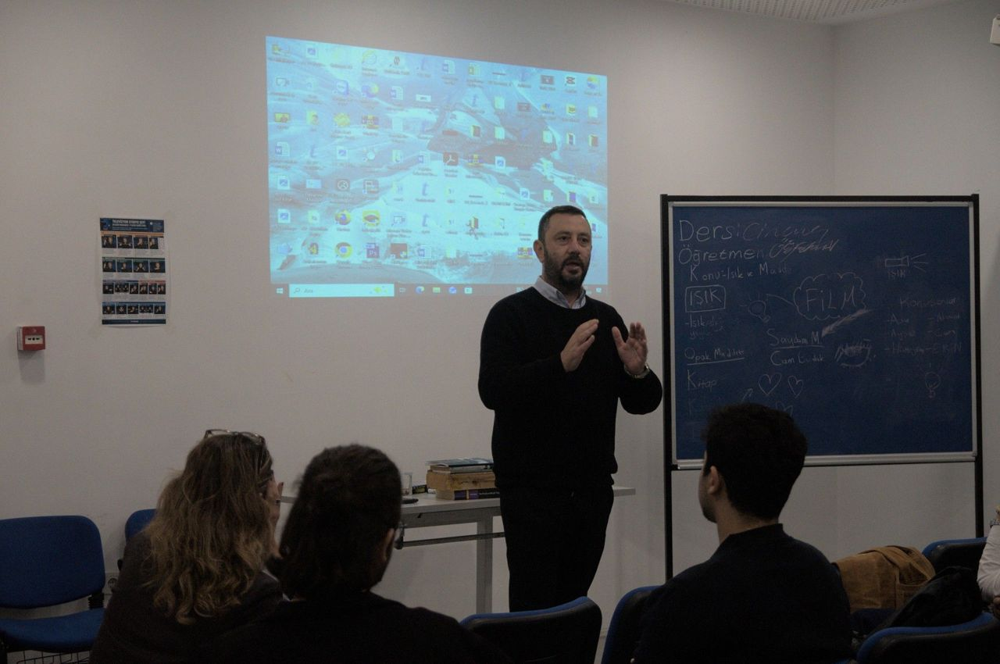

> 23. Eskişehir Uluslararası Film Festivali kapsamında düzenlenen atölyede ses mühendisi Levent İntepe, sinema ve televizyon öğrencilerine sektör deneyimlerini aktardı.

Eskişehir'de devam eden 23. Uluslararası Film Festivali kapsamında, "Bir Filmin Yolculuğu – Yaratıcılık, Ses ve Yapım Süreçleri" başlıklı özel bir atölye çalışması gerçekleştirildi. Anadolu Üniversitesi İletişim Bilimleri Fakültesi Öğrenci Stüdyosunda düzenlenen etkinliğe mezunlardan, ses mühendisi ve ses tasarımcısı Levent İntepe konuk oldu. Festival Yönetmeni Prof. Dr. Sırrı Serhat Serter ile çok sayıda öğrencinin katıldığı buluşmada, sinema sektörünün yaratıcı ve teknik yönleri ele alındı.

G.O.R.A., Babam ve Oğlum, Kelebeğin Rüyası, Organize İşler ve Hokkabaz gibi Türk sinemasının önemli yapımlarında görev alan İntepe, öğrencilere mesleğin inceliklerini anlattı. Sinemacılığın meşakkatli bir yolculuk ve ruh meselesi olduğunu vurgulayan deneyimli ses tasarımcısı, bu alanın tıp ya da mühendislik gibi tek bir formülle açıklanamayacağını belirterek tutkunun önemine dikkat çekti.

Kendisinin de mezun olduğu üniversitenin olanaklarının çok değerli olduğunu ifade eden İntepe, öğrencilere okulun teknik altyapısından azami ölçüde faydalanmaları ve mezuniyeti beklemeden set ortamında tecrübe edinmeleri tavsiyesinde bulundu. Program, öğrencilerden gelen soruların yanıtlanması, pratik uygulamalar ve toplu fotoğraf çekimiyle tamamlandı.

---

## Tepebaşı'nda 'Şiddetsiz Geçit': Vatandaşlar Mesajlarını Tül Perdelere Astı

**Belediye · Tepebaşı** · 2026-11-21 15:09 UTC · Kaynak: [Google Haberler - Tepebaşı](https://ankahaber.net/haber/tepebasi-nda-kadina-yonelik-siddete-siddetsiz-gecit-ile-farkindalik-3fc6e4fb)

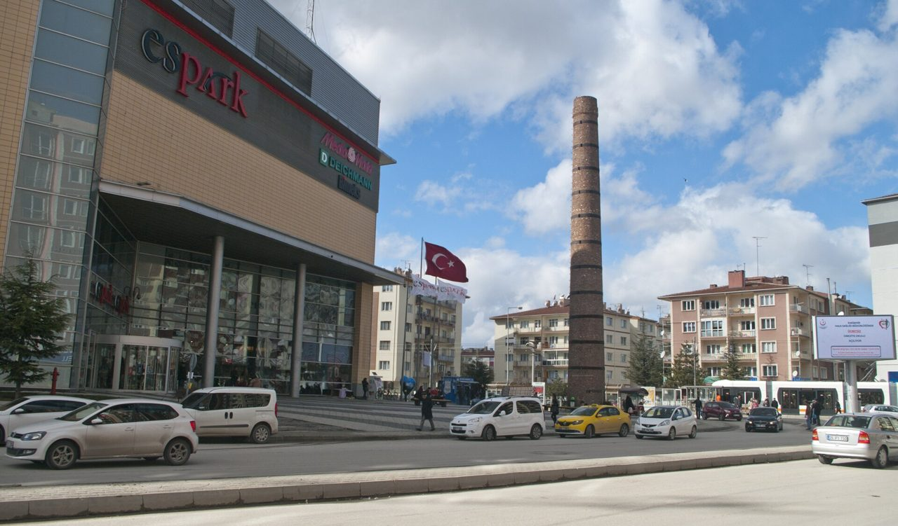

> Tepebaşı Belediyesi ve Kent Konseyi iş birliğiyle Espark'ta düzenlenen 'Şiddetsiz Geçit' etkinliğinde, kadına yönelik şiddete dikkat çekmek amacıyla vatandaşların yazdığı mesajlar sergilendi.

Tepebaşı Belediyesi ile Tepebaşı Kent Konseyi, 25 Kasım Kadına Yönelik Şiddete Karşı Uluslararası Mücadele Günü kapsamında Espark Alışveriş Merkezi'nde "Şiddetsiz Geçit" etkinliği başlattı. 20 Kasım'da kapılarını açan ve 25 Kasım'a kadar sürecek etkinlikte Eskişehirliler, şiddete karşı duygu ve düşüncelerini kâğıtlara dökerek alandaki tül perdelere astı.

Etkinlik alanını ziyaret ederek sergilenen mesajları inceleyen Tepebaşı Belediye Başkanı Ahmet Ataç'a belediye meclis üyeleri de eşlik etti. Vatandaşlarla bir araya gelen Ataç, kadına yönelik şiddetin önlenmesinde toplumsal duyarlılığın yanı sıra yasal güvencelerin hayati önem taşıdığını ifade etti.

Kadına yönelik şiddet ve kadın cinayetlerinin toplumda derin yaralar açtığını belirten Ataç, İstanbul Sözleşmesi'nin yeniden yürürlüğe girmesi gerektiğine inandığını dile getirdi. Ataç, hiç kimsenin şiddete maruz kalmadığı bir toplum temenni ettiklerini, şiddet faillerinin de hukuk çerçevesinde en ağır şekilde cezalandırılması gerektiğini kaydetti.

---

## Odunpazarı'nda Sanat ve Kitap Günleri Başladı: Koleksiyon Sergisi Kapılarını Açtı

**Kültür-Sanat · Odunpazarı** · 2026-11-21 15:09 UTC · Kaynak: [Google Haberler - Odunpazarı](https://www.egealternatif.com/haber/odunpazari-sanat-ve-kitap-gunleri-basladi_102980/)

> Odunpazarı Belediyesi ve Cumhuriyet Gazetesi iş birliğiyle düzenlenen Sanat ve Kitap Günleri, açılan özel sergi, yazar buluşmaları ve imza etkinlikleriyle başladı.

Odunpazarı Belediyesi ve Cumhuriyet Gazetesi ortaklığıyla hayata geçirilen Sanat ve Kitap Günleri, Odunpazarı 100. Yıl Kültür Merkezi'nde Cumhuriyet Gazetesi Koleksiyon Sergisi'nin açılışıyla kapılarını açtı. Etkinliğin ilk gününde edebiyatseverler söyleşi ve imza programlarına yoğun ilgi gösterdi.

Açılış programına Odunpazarı Belediye Başkanı Kazım Kurt, gazeteci-yazar Işık Kansu, Cumhuriyet Gazetesi Ankara Temsilcisi Sertaç Eş ve Odunpazarı Kent Konseyi Başkanı İsmail Kumru katıldı. Gazeteci-yazar Işık Kansu, sanatçıların bağışlarıyla oluşan koleksiyon sergisinin Türkiye'deki özgün örneklerden biri olduğunu belirterek edebiyat, sanat ve kitabı Anadolu'nun geneline ulaştırmayı hedeflediklerini ifade etti.

Cumhuriyet Gazetesi'nin Türk aydınlanmasının ve toplum bilincinin vazgeçilmez kaynaklarından biri olduğunu vurgulayan Odunpazarı Belediye Başkanı Kazım Kurt, tüm Eskişehirlileri buluşmaya davet etti. Kurt, demokrasi, adalet ve hukuk değerlerinin korunduğu bir dönemde kitapların toplumsal dayanışma için büyük önem taşıdığını dile getirdi.

Açılışın ardından A. Celal Binzet, Güven Baykan, Işık Kansu, Adnan Gerger, Ahmet Antman, Eren Aysan, Gülay Ertürk ve Gürbüz Ertürk okurlarıyla imza ve söyleşilerde bir araya geldi. 22 Kasım Pazar günü Seyfettin Araç, Halil Genç, İsa Küçük, Tolga Aydoğan ve Yüksel Işık'ın söyleşileriyle sürecek olan program, Başkan Kazım Kurt ve gazeteci-yazar Mustafa Balbay'ın yer alacağı 'Yerel Siyaset, Yerel Yönetim' başlıklı oturumla tamamlanacak.

---

## EMEP Eskişehir İl Kongresi Yapıldı: Yeni Başkan Deniz Tepe Oldu

**Siyaset · Merkez** · 2026-11-21 15:09 UTC · Kaynak: [Google Haberler - Eskişehir](https://www.evrensel.net/haber/6010580/emep-eskisehir-11-olagan-il-kongresi-ekmek-baris-ve-ozgurluk-mucadelesini-buyutme-cagrisi)

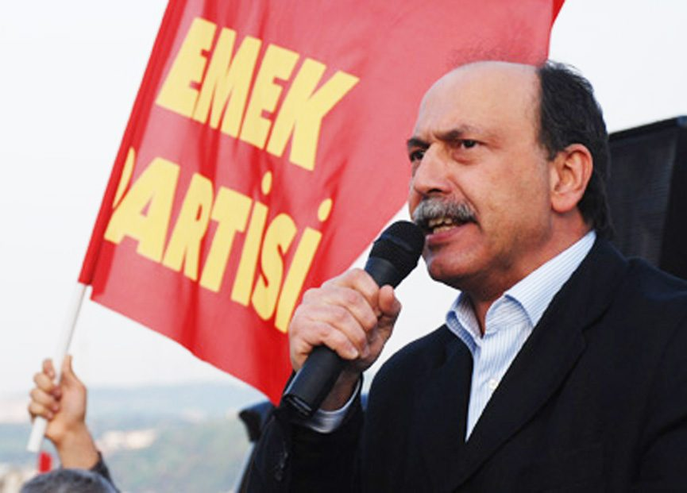

> Emek Partisi Eskişehir İl Örgütü 11. Olağan Kongresi'ni tamamladı. Genel Başkan Yardımcısı Levent Tüzel'in de katıldığı kongrede yapılan seçimle Deniz Tepe il başkanı seçildi.

Emek Partisi (EMEP) Eskişehir İl Örgütü, 11. Olağan Kongresi'ni parti üyeleri ile çeşitli siyasi parti ve kitle örgütü temsilcilerinin katılımıyla gerçekleştirdi. Programda devrim ve sosyalizm mücadelesinde hayatını kaybedenler anısına saygı duruşunda bulunulurken, EMEP Genel Başkanı Seyit Aslan’ın gönderdiği mesaj okundu.

Kongrede konuşan EMEP Genel Başkan Yardımcısı Levent Tüzel; çalışma yaşamı, iş güvenliği ve ekonomik gelişmelere dair değerlendirmelerde bulundu. İşçi ve emeklilerin yaşadığı geçim sıkıntılarına dikkat çeken Tüzel, sendikal örgütlenmenin önemine değinerek ortak mücadele vurgusu yaptı. Konuşmasında çevre politikaları ve yer altı kaynakları konusundaki tartışmalara da değinen Tüzel, dış politika ve bölgesel gelişmeler hakkındaki görüşlerini aktardı.

Açılış konuşmasını Ceren Kökoğlu'nun yaptığı kongrede; siyasi parti sözcüleri, sendika temsilcileri ve fabrikalardan işçiler kürsüye çıkarak deneyimlerini paylaştı. Kongre kapsamında yapılan seçimler sonucunda partinin yeni Eskişehir İl Başkanı Deniz Tepe oldu.

---

## Beylikova İlçe Mezarlığında Mevlit Programı Düzenlenecek

**Belediye · Beylikova** · 2026-11-21 15:09 UTC · Kaynak: [Beylikova Belediyesi](https://www.beylikova.bel.tr/haberler/468/ahirete-intikal-etmis-tum-yakinlarimiz-icin-mevlidi-serif-okutulacaktir)

> Beylikova Belediyesi ve İlçe Müftülüğü iş birliğiyle, vefat eden vatandaşlar için ilçe mezarlığında mevlit programı gerçekleştirilecek.

Beylikova'da ebediyete irtihal eden ilçe sakinleri ve yakınlar için anma ve dua programı tertip edilecek. Beylikova Belediyesi ile İlçe Müftülüğü ortaklığında düzenlenen program, İlçe Mezarlığı bünyesinde yapılacak.

Belediyeden yapılan bilgilendirmede, arife günü ikindi namazının ardından başlayacak Mevlid-i Şerif programına tüm ilçe halkının davetli olduğu bildirildi.

---

## Evlenecek Gençlere Kasımda 1,2 Milyar Liralık Destek: 11 Bin Çift Yararlandı

**Türkiye · Türkiye** · 2026-11-21 13:09 UTC · Kaynak: [Aile ve Sosyal Hizmetler Bakanlığı](https://www.aile.gov.tr/haberler/aile-ve-genclik-fonu-kapsaminda-yeni-yuva-kuran-11-bin-224-genc-icin-kasim-ayinda-1-milyar-277-milyon-lira-odeme-yapildi/)

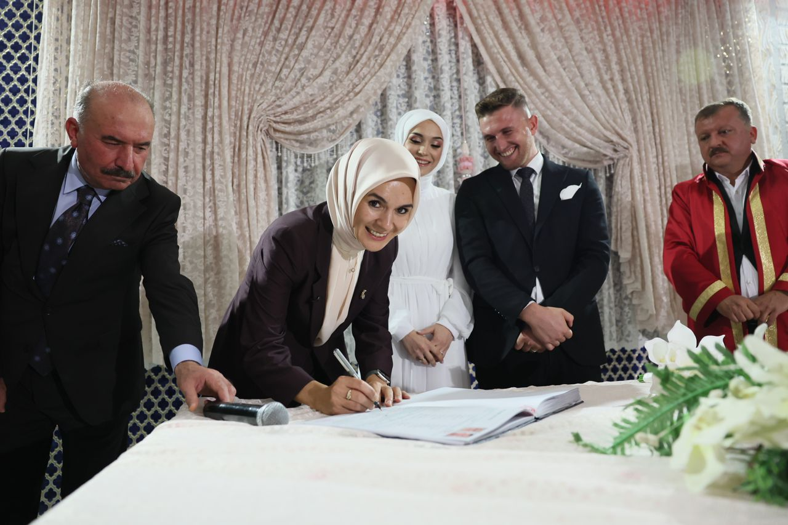

> Aile ve Sosyal Hizmetler Bakanlığı, Aile ve Gençlik Fonu kapsamında kasım ayında 11 bin 224 gence toplam 1 milyar 277 milyon lira faizsiz kredi ödendiğini bildirdi.

Aile ve Sosyal Hizmetler Bakanı Mahinur Özdemir Göktaş, aile kurumunu desteklemek ve genç çiftlerin yuva kurma süreçlerini kolaylaştırmak amacıyla yürütülen Aile ve Gençlik Fonu ödemelerine ilişkin bilgi verdi. Göktaş, Türkiye genelinde 81 ili kapsayan uygulama doğrultusunda kasım ayında 11 bin 224 gence 1 milyar 277 milyon lira tutarında finansman aktarıldığını belirtti.

Fondan yararlanma şartlarına değinen Bakan Göktaş, her iki eşin de 18-25 yaş aralığında yer alması durumunda 250 bin lira, 26-29 yaş grubunda bulunmaları halinde ise 200 bin liralık kredi verildiğini hatırlattı. Başvurusu kabul edilen çiftlere söz konusu desteğin 2 yıl geri ödemesiz ve 48 ay vadeli olarak sunulduğu, başvuru için aranan azami gelir sınırının da asgari ücretin 2,5 katına çıkarıldığı kaydedildi.

Program kapsamında çocuk sahibi olan çiftlere hibe ve taksit erteleme imkânı tanındığını vurgulayan Göktaş, ilk bebekle birlikte 12 aylık taksitin hibe edilip borcun ertelendiğini, ikinci çocukta ise kalan tüm borcun silindiğini aktardı. Bugüne kadar fon aracılığıyla toplam 249 bin 686 gence 24 milyar 83 milyon liralık sıfır faizli kredi ulaştırıldığı bildirildi.

---

## Eskişehir Demirspor Son Dakikalarda Yıkıldı: Sahasında 1 Puana Razı Oldu

**Spor · Merkez** · 2026-11-21 13:09 UTC · Kaynak: [Google Haberler - Eskişehir](https://www.abamedya.com/arit-kayadibi-eskisehir-deplasmanindan-puan-cikardi/66966/)

> Profesyonelliğe Geçiş Ligi'nde mücadele eden Eskişehir Demirspor, sahasında ağırladığı Arıt Kayadibispor ile 1-1 berabere kaldı.

Profesyonelliğe Geçiş Ligi'nin (PGL) 7. haftasında Eskişehir Demirspor, evinde Bartın temsilcisi Arıt Kayadibispor'u konuk etti. Çekişmeli geçen mücadele karşılıklı atılan gollerle 1-1'lik eşitlikle tamamlandı.

Karşılaşmaya hızlı başlayan ev sahibi Eskişehir Demirspor, 23. dakikada Miren Örenç'in kaydettiği golle 1-0 öne geçti. İlk yarıda üstünlüğünü koruyan Eskişehir ekibi, soyunma odasına önde girdi.

Mücadelenin ikinci yarısında konuk ekip beraberlik için yüklenirken, maçın son anlarında tansiyon yükseldi. Eskişehir Demirspor'da 86. dakikada Özkan Can ikinci sarı kartın ardından kırmızı kart görerek takımını 10 kişi bıraktı. Pozisyonun ardından kazanılan penaltıyı Arıt Kayadibispor adına Yusuf Oyit gole çevirdi ve skora denge geldi.

Kalan dakikalarda başka gol olmayınca taraflar sahadan birer puanla ayrıldı.

---

## Cumhurbaşkanı Erdoğan Yeni Adalet Sarayını Açtı: 1,8 Milyon Kişiye Hizmet Verecek

**Siyaset · Türkiye** · 2026-11-21 13:09 UTC · Kaynak: [İletişim Başkanlığı](https://www.iletisim.gov.tr/turkce/haberler/detay/cumhurbaskani-erdogan-gaziosmanpasa-adalet-sarayi-acilis-toreninde-konustu)

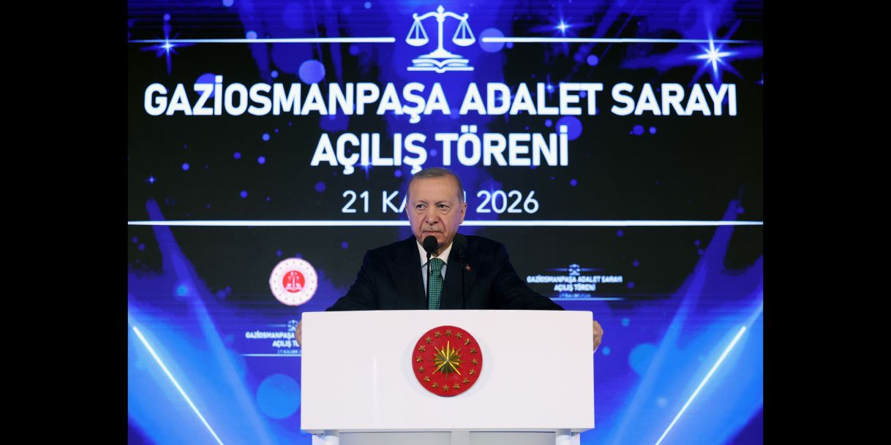

> Cumhurbaşkanı Recep Tayyip Erdoğan, Gaziosmanpaşa Adalet Sarayı'nın resmî açılış töreninde konuşarak 29 katlı yeni binanın 4 ilçeye hizmet sunacağını belirtti.

Cumhurbaşkanı Recep Tayyip Erdoğan, Eyüpsultan sınırları içinde inşa edilen Gaziosmanpaşa Adalet Sarayı'nın resmî açılış töreninde açıklamalarda bulundu. Daha önce üç ayrı binada faaliyet gösteren birimlerin tek çatı altında toplandığını aktaran Erdoğan, modern altyapıyla adalet hizmetlerinin daha hızlı ve etkin yürütülmesinin amaçlandığını söyledi.

Yeni adliye kompleksinin yaklaşık 90 bin metrekare kapalı alana sahip olduğunu ve 29 kattan oluştuğunu bildiren Cumhurbaşkanı Erdoğan, binada 160 savcı odası, 136 hâkim odası, 14 ağır ceza mahkemesi başkanı odası ile 113 duruşma salonu ve 360 kişilik iki büyük duruşma salonunun bulunduğunu kaydetti. Tesiste ayrıca 317 araçlık otopark ve çeşitli sosyal donatı alanları yer alıyor.

İleri teknoloji bilişim altyapısıyla donatılan adalet sarayının Gaziosmanpaşa, Sultangazi, Eyüpsultan ve Arnavutköy ilçelerindeki 1 milyon 791 bin kişiyi kapsayan yargı çevresine hitap edeceğini belirten Erdoğan, adil ve etkili işleyen bir yargı sisteminin toplumsal barışın temeli olduğunu vurguladı.

---

## Biket İlhan Sinemaseverlerle Buluştu: 'Geçmişi Bilmezsek Geleceği Anlayamayız'

**Kültür-Sanat · Tepebaşı** · 2026-11-21 13:09 UTC · Kaynak: [Anadolu Üniversitesi](https://anahaber.anadolu.edu.tr/tr/haber-detay/bqcwziy4ogid42hsrh896is3)

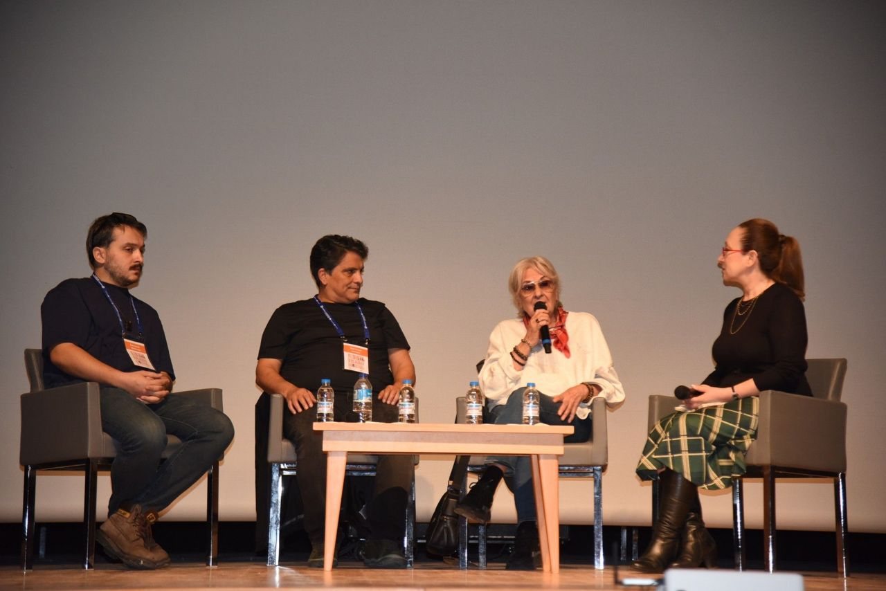

> 23. Eskişehir Uluslararası Film Festivali kapsamında gösterilen "Tatlı Maya" filminin ardından yönetmen Biket İlhan ve oyuncular izleyicilerle söyleşide bir araya geldi.

23. Eskişehir Uluslararası Film Festivali kapsamında, yönetmenliğini Biket İlhan’ın üstlendiği "Tatlı Maya" filminin özel gösterimi gerçekleştirildi. Sinema Anadolu’da yapılan gösterimin ardından usta yönetmen Biket İlhan ile oyuncular Erdem Ergüney ve Fatih Serdar Yılmaz, izleyicilerle bir araya gelerek yapımın perde arkasını anlattı. Moderatörlüğünü Anadolu Üniversitesi İletişim Bilimleri Fakültesi Öğretim Üyesi Prof. Dr. Nesrin Aysun Akıncı’nın üstlendiği söyleşide; kadın sorunları, ataerkil düzen, göç ve yabancılık temaları masaya yatırıldı.

Filmlerinde yakın geçmişe ve tarihi olaylara ağırlık verdiğini dile getiren yönetmen Biket İlhan, geçmişi bilmeden geleceğin doğru değerlendirilemeyeceğini vurguladı. Eserlerinde genç kuşağın ve günümüz toplumunun yakın tarihe dikkatini çekmeyi amaçladığını belirten İlhan, toplumsal hafızayı diri tutan hikâyelere odaklanmayı sürdürdüğünü ifade etti.

Projeye dahil olma sürecini aktaran oyuncu Erdem Ergüney, senaryodaki güçlü kadın dayanışmasının kendisini çok etkilediğini ve kısıtlanmış hayatlar karşısında insanların sarılmayı unuttuğu gerçeğinin filmde başarıyla işlendiğini belirtti. Oyuncu Fatih Serdar Yılmaz ise tiyatro sahnesi ile kamera önü oyunculuğunun tamamen farklı iki disiplin olduğunu vurgulayarak filmdeki deneyimlerini paylaştı. Etkinlik, izleyicilerin sorularının yanıtlanmasıyla tamamlandı.

---

## Usta Sanatçı Gülen Karaman Eskişehir'de Gençlerle Buluştu: 'Umutsuzluğa Kapılmayın'

**Kültür-Sanat · Tepebaşı** · 2026-11-21 11:09 UTC · Kaynak: [Anadolu Üniversitesi](https://anahaber.anadolu.edu.tr/tr/haber-detay/axji4d50tw6imia9xiv3s1rj)

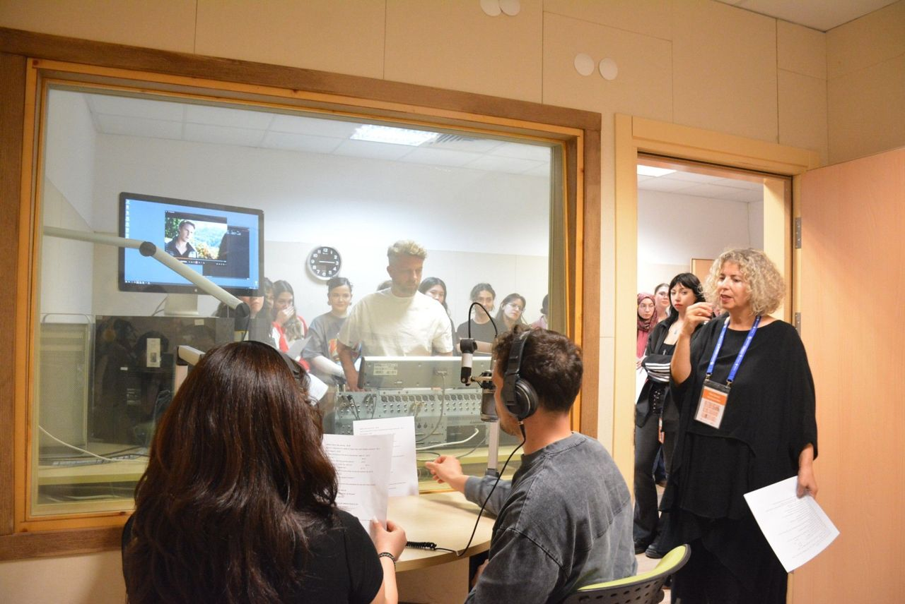

> 23. Eskişehir Uluslararası Film Festivali kapsamında düzenlenen atölyede öğrencilerle buluşan oyuncu ve seslendirme sanatçısı Gülen Karaman, mesleki tecrübelerini aktararak kariyer tavsiyelerinde bulundu.

23. Eskişehir Uluslararası Film Festivali çerçevesinde gerçekleştirilen “Oyunculuk ve Seslendirme Atölyesi”, Anadolu Üniversitesi İletişim Bilimleri Fakültesi Şener Şen Salonunda yapıldı. Etkinliğe konuk olan usta tiyatrocu ve seslendirme sanatçısı Gülen Karaman, meslek hayatındaki birikimlerini ve sektörel deneyimlerini üniversite öğrencileriyle paylaştı.

Kendi öğrencilik yıllarındaki koşulların günümüzden oldukça farklı olduğuna dikkat çeken Karaman, eğitim hayatı boyunca çalışmak zorunda kaldığını belirtti. Karaman, genç iletişimcilere meslek yolculuklarında karşılaşacakları zorluklar karşısında pes etmemeleri çağrısında bulunarak, "Hiç umutsuzluğa kapılmayın. Umut her şeyin kapısını aralayan bir şey. Bir yerden reddedildiğiniz zaman devam edin, başka bir yere başvurun. Eğitiminize ve mesleğinize asla sırtınızı dönmeyin" ifadelerini kullandı.

Seslendirme sanatına tiyatronun ardından başladığını aktaran Karaman, kariyeri boyunca önemli karakterleri seslendirmekten büyük keyif aldığını ve işini severek yapmanın başarıdaki en kritik unsur olduğunu vurguladı. Atölye çalışması, öğrencilerin sorularının yanıtlanmasının ardından Radyo A stüdyolarında yapılan uygulamalı seslendirme faaliyetiyle sona erdi.

---

## Üniversiteli Genç Kadınlara Kariyer Desteği: TÜKD Akademisi Başladı

**Eğitim · Odunpazarı** · 2026-11-21 11:09 UTC · Kaynak: [Google Haberler - Eskişehir](https://yerel-haberler.haberturk.com/eskisehir-haberleri/tukd-eskisehir-subesi-universiteli-genc-kadinlara-kariyer-destegi-sagliyor-119528541)

> Türk Üniversiteli Kadınlar Derneği Eskişehir Şubesi, bursiyer öğrencilerin iş hayatına hazırlanması amacıyla Kariyer Akademisi eğitim programını başlattı.

Türk Üniversiteli Kadınlar Derneği (TÜKD) Eskişehir Şubesi tarafından, burs desteği sağlanan üniversite öğrencisi genç kadınların profesyonel yaşama hazırlanmasına katkı sunmak amacıyla Kariyer Akademisi hayata geçirildi. Sivil Toplum için Destek Vakfı ile Pusula Destek Çemberi'nin hibe desteğiyle düzenlenen program, Ergin Orbey Sahnesi'nde gerçekleştirilen açılışla başladı.

Açılışa Eskişehir Büyükşehir Belediye Başkanı ve Türkiye Belediyeler Birliği Başkanvekili Ayşe Ünlüce de katıldı. Programın açılışında konuşan TÜKD Eskişehir Şube Başkanı Doç. Dr. Zeynep Tunalıer, derneğin kadınların eğitim hakkı ve toplumsal yaşama eşit katılımı için uzun yıllardır mücadele ettiğini belirterek, genç kadınların iş hayatında hak ettikleri yeri almalarını ve geleceğin karar mekanizmalarında lider olarak yer almalarını hedeflediklerini kaydetti.

İş yaşamında ve yönetim kademelerinde kadın temsilini artırmak için gençleri doğru bilgi ve özgüvenle donatmanın önemine değinen Tunalıer, ilk etapta bursiyerlerle başlatılan bu akademinin ilerleyen süreçte daha geniş kitlelere ulaştırılmasının planlandığını aktardı.

İki gün sürecek eğitimler kapsamında katılımcılara zihinsel iyi oluş, 21. yüzyıl becerileri, sosyal sermaye, yapay zekâ çağında kariyer planlaması, özgeçmiş hazırlama ve iş görüşmesi teknikleri gibi başlıklarda eğitimler verilecek.

---

## ESOGÜ'den Çığır Açan Araştırma: Göz Muayenesi Demans Türlerini Ayırt Edebilir

**Sağlık · Odunpazarı** · 2026-11-21 11:09 UTC · Kaynak: [Eskişehir Osmangazi Üniversitesi](https://www.ogu.edu.tr/Web/HaberDetay/2026?tur=AkademikMakale)

> ESOGÜ Tıp Fakültesi araştırmacıları, retina görüntüleme teknikleriyle Alzheimer ve vasküler demans hastalıklarının birbirinden ayırt edilebileceğini bilimsel olarak kanıtladı.

Eskişehir Osmangazi Üniversitesi (ESOGÜ) Tıp Fakültesi Göz Hastalıkları Anabilim Dalı Öğretim Üyesi Doç. Dr. Eray Atalay, Nöroloji Anabilim Dalı Öğretim Üyesi Doç. Dr. Nazlı Durmaz Çelik, Dr. Semih Ceylan ve İntörn Dr. Mert Egemen Çalışkan’ın imzasını taşıyan araştırma uluslararası bilim dünyasında geniş yankı buldu. TÜBİTAK 2209-A programı kapsamında desteklenen ve ESOGÜ kliniklerinde yürütülen çalışma, saygın bilimsel dergilerden 'Scientific Reports'ta yayımlandı.

Araştırma kapsamında 50 ile 90 yaş aralığındaki Alzheimer hastaları, vasküler demans hastaları ve sağlıklı bireylerden oluşan toplam 118 katılımcı incelendi. Katılımcılara yüksek çözünürlüklü ve cerrahi müdahale gerektirmeyen optik koherens tomografi (OCT) ile OCT-anjiyografi (OCTA) yöntemleri uygulandı. Yapılan ölçümlerde vasküler demans tanılı hastalarda retina sinir lifi tabakası ve makula kalınlığında belirgin incelme kaydedildi. Alzheimer hastalarında ise belirgin bir yapısal incelme görülmemesine rağmen parafoveal bölgedeki damar yoğunluğunda düşüş tespit edildi.

Elde edilen sonuçlar, merkezi sinir sistemiyle doğrudan bağlantılı olan retinanın incelenmesi sayesinde iki farklı demans türünün klinik olarak kolaylıkla ayırt edilebileceğini ortaya koydu. Uzmanlar, göz arkası görüntüleme yöntemlerinin mevcut nörogörüntüleme ve nöropsikolojik testlere hızlı, güvenli ve pratik bir tamamlayıcı katkı sunacağını belirtiyor.

---

## Büyükşehir Yol Dairesinden Beylikova Belediyesi'ne Ziyaret

**Belediye · Beylikova** · 2026-11-21 11:09 UTC · Kaynak: [Beylikova Belediyesi](https://www.beylikova.bel.tr/haberler/470/eskisehir-buyuksehir-belediyesi-yol-yapim-bakim-ve-onarim-dairesi-baskani-niyazi-solak-belediye-baskanimiz-av-hakan-karabacak-a-hayirli-olsun-ziyaretinde-bulundu)

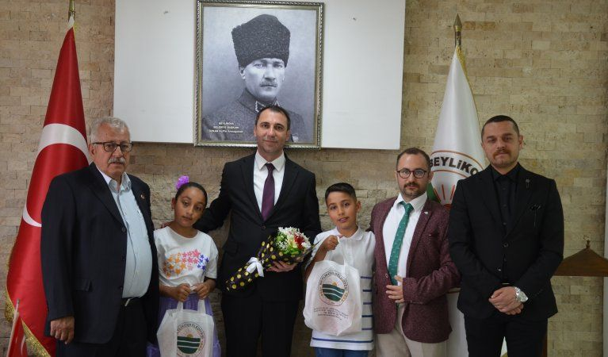

> Eskişehir Büyükşehir Belediyesi Yol Yapım Bakım ve Onarım Dairesi Başkanı Niyazi Solak ve beraberindeki heyet, Beylikova Belediye Başkanı Hakan Karabacak'ı makamında ziyaret etti.

Eskişehir Büyükşehir Belediyesi Yol Yapım Bakım ve Onarım Dairesi Başkanı Niyazi Solak, Kırsal Şube Müdürü Didem Tiryaki ve kırsal şube bölge sorumlularıyla birlikte Beylikova Belediye Başkanı Av. Hakan Karabacak'ı makamında ziyaret etti.

Gerçekleşen ziyarette ilçe genelindeki çalışmalar üzerine temaslarda bulunuldu.

Beylikova Belediye Başkanı Hakan Karabacak, nazik ziyaretlerinden dolayı Daire Başkanı Niyazi Solak ve beraberindeki çalışma arkadaşlarına teşekkürlerini iletti.

---

## ESOGÜ'den Çevreci İşletmelere Yol Haritası: 'Yeşil Örgüt Kültürü' Ölçeği Geliştirildi

**Eğitim · Odunpazarı** · 2026-11-21 09:09 UTC · Kaynak: [Eskişehir Osmangazi Üniversitesi](https://www.ogu.edu.tr/Web/HaberDetay/2037?tur=AkademikMakale)

> ESOGÜ Turizm Fakültesi Öğretim Üyesi Doç. Dr. Mert Gürlek'in geliştirdiği 'Yeşil Örgüt Kültürü' ölçeği, uluslararası saygın dergide yayımlandı.

Eskişehir Osmangazi Üniversitesi (ESOGÜ) Turizm Fakültesi Turizm İşletmeciliği Bölümü öğretim üyesi Doç. Dr. Mert Gürlek tarafından hazırlanan araştırma, alanın önde gelen bilimsel yayınlarından The Service Industries Journal’da yayımlandı.

Küresel ısınma, çevre kirliliği ve doğal kaynakların azalması karşısında işletmelerin sürdürülebilirlik çabalarını ele alan çalışmada, yasal ve teknolojik adımların davranış ve alışkanlıklar değişmedikçe tek başına yetersiz kaldığı vurgulandı. Çevresel sürdürülebilirliğin ön koşulu kabul edilen yeşil örgüt kültürünün kuramsal çerçevesi oluşturularak bu alandaki ölçüm eksikliğini giderecek bir araç geliştirildi.

Biri nitel üçü nicel olmak üzere 4 aşamalı karma yöntemle yürütülen araştırmanın verileri, yeşil otellerin yönetici ve çalışanlarından elde edildi. Çalışma neticesinde 9 boyut ve 36 ifadeden oluşan kapsamlı bir ölçek ortaya konuldu. Literatürde yeşil örgüt kültürü ölçeği geliştirmeye yönelik ilk ve en kapsamlı çalışma olma özelliğini taşıyan araştırma, işletmelere çevreye duyarlı bir kurum kültürü inşa etmeleri için somut bir yol haritası sunuyor.

---

## Eli Titremesin Diye Sağ Eliyle Ağır Taşımıyor: Eskişehir'de 15 Yıllık Tezhip Yolculuğu

**Kültür-Sanat · Odunpazarı** · 2026-11-21 09:09 UTC · Kaynak: [Anadolu Üniversitesi](https://anahaber.anadolu.edu.tr/tr/haber-detay/pffzn4j1q6mf4xgfj73uv91d)

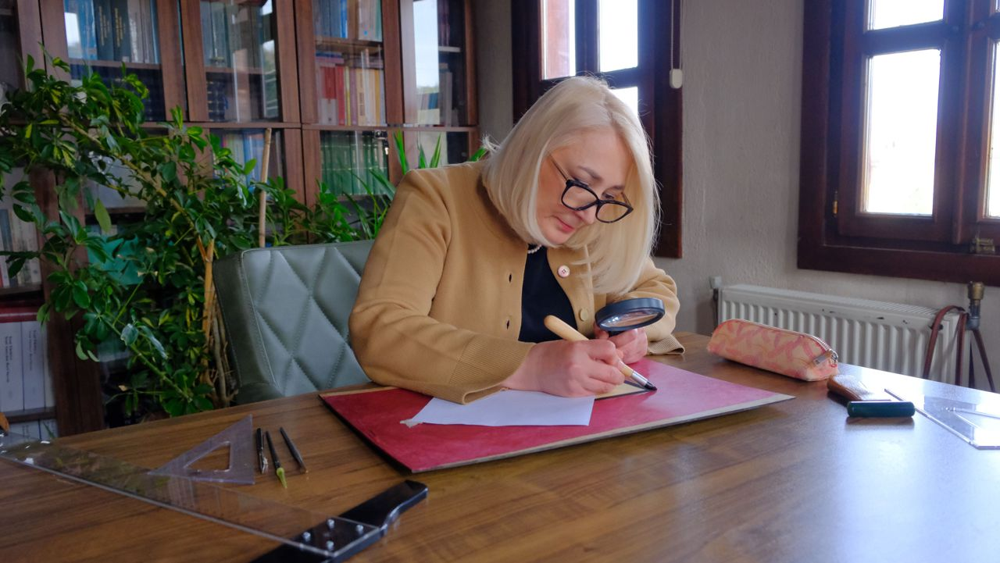

> Eskişehir Türk Ocağı'ndaki atölyesinde 55 öğrenci yetiştiren tezhip sanatçısı Nuray Çeliksoy, ince hatları çizerken eli titremesin diye günlük yaşamında sağ eliyle ağır eşya taşımıyor.

Yaklaşık 15 yıldır geleneksel Türk süsleme sanatlarından tezhibi icra eden sanatçı Nuray Çeliksoy, usta-çırak geleneğini Eskişehir Türk Ocağı bünyesindeki atölyesinde yaşatıyor. Sanat yolculuğunun hocası Cemile Baybura ile başladığını ve icazet aldığını aktaran Çeliksoy, tezhibin teknik beceriden önce sabır ve ahlak gerektiren disiplinli bir edep süreci olduğunu belirtti.

Tezhip sanatının hata kabul etmeyen hassas yapısına dikkat çeken Çeliksoy, tek bir su damlasının dahi aylarca emek verilen bir çalışmayı yok edebileceğini söyledi. Sanatın beraberinde getirdiği fiziksel disiplinden bahseden Çeliksoy, en ince hatları çizerken elinin titremesini önlemek amacıyla günlük hayatında sağ eliyle ağır hiçbir eşya taşımadığını ifade etti.

Atölyesinde 55 öğrenciye yüz yüze eğitim sunan Çeliksoy, tecrübesine rağmen usta-çırak bağının kesintisiz devam ettiğini ve öğrenme sürecinin son bulmadığını dile getirdi. Sanatçı ayrıca klasik motifleri takı sanatına uyarlamak üzere, İngiliz Kraliyet Ailesi ve Japon İmparatoru için üretim yapan uluslararası bir mücevher tasarımcısıyla ortak proje hazırlığı yürüttüğünü kaydetti.

---

## Beylikova Belediyesi Hizmet Binası Tabelasına 'T.C.' İbaresi Eklendi

**Belediye · Beylikova** · 2026-11-21 09:09 UTC · Kaynak: [Beylikova Belediyesi](https://www.beylikova.bel.tr/haberler/471/beylikova-belediyesi-tabelasina-t-c-ibaresi-eklendi)

> Beylikova Belediyesi hizmet binasının girişinde yer alan kurumsal tabelaya, Başkan Hakan Karabacak'ın talimatıyla Türkiye Cumhuriyeti'nin kısaltması olan 'T.C.' ibaresi yerleştirildi.

Eskişehir'in Beylikova ilçesinde belediye hizmet binasının girişindeki tabelada düzenlemeye gidildi. Beylikova Belediye Başkanı Av. Hakan Karabacak’ın talimatı doğrultusunda, bina girişindeki mevcut belediye yazısına Türkiye Cumhuriyeti’nin kısaltması olan 'T.C.' ibaresi ilave edildi.

Yapılan değişikliğin ardından yeni tabela hizmet binasındaki yerini alırken, belediye yönetimi uygulamanın ilçe halkına hayırlı olmasını diledi.

---

## Başkan Ataç'tan 22 Kasım Mesajı: Diş Kontrollerini İhmal Etmeyin

**Gündem · Tepebaşı** · 2026-11-21 09:09 UTC · Kaynak: [Google Haberler - Tepebaşı](https://www.haber26.com.tr/eskisehir/tepebasi-baskani-atac-dis-kontrollerini-ihmal-etmeyin)

> Tepebaşı Belediye Başkanı Ahmet Ataç, 22 Kasım Diş Hekimleri Günü dolayısıyla yayımladığı mesajda ağız ve diş sağlığının ihmal edilmemesi çağrısında bulundu.

Tepebaşı Belediye Başkanı Ahmet Ataç, 22 Kasım Diş Hekimleri Günü kapsamında bir mesaj yayımlayarak meslektaşlarının gününü tebrik etti. Ataç, ağız ve diş sağlığının genel sağlık durumu ile yaşam kalitesinin temel unsurlarından biri olduğunu vurguladı.

Kendisi de diş hekimi olan Başkan Ataç, mesleğin yalnızca tedavi odaklı görülmemesi gerektiğini belirterek koruyucu sağlık uygulamalarının ve erken yaşta kazandırılan bakım alışkanlıklarının önemine dikkat çekti. Diş hekimliğinin sabır, dikkat ve sorumluluk gerektirdiğini ifade eden Ataç, toplum sağlığı için fedakârca çalışan tüm diş hekimlerine teşekkür etti.

Belediyeye bağlı Çocuk Ağız ve Diş Sağlığı Polikliniği bünyesinde sürdürülen çalışmaların bu bilinçle hayata geçirildiğini hatırlatan Ataç, tüm vatandaşlara düzenli diş hekimi kontrollerini aksatmama çağrısında bulundu.

---

## ESOGÜ'den Boşanma Araştırması: Zorlu Süreç Ergenlerde Gelişim Fırsatına Dönüşebilir

**Eğitim · Odunpazarı** · 2026-11-21 07:08 UTC · Kaynak: [Eskişehir Osmangazi Üniversitesi](https://www.ogu.edu.tr/Web/HaberDetay/2057?tur=AkademikMakale)

> ESOGÜ Öğretim Üyesi Doç. Dr. Fatma Altınsoy'un boşanmış ailelerde yetişen ergenlerin psikolojik dönüşümünü ele alan çalışması uluslararası hakemli dergide yayımlandı.

Eskişehir Osmangazi Üniversitesi (ESOGÜ) Eğitim Fakültesi Eğitim Bilimleri Bölümü Rehberlik ve Psikolojik Danışmanlık Anabilim Dalı öğretim üyesi Doç. Dr. Fatma Altınsoy, boşanmış ailelerde yetişen ergenlerin travma sonrası büyüme süreçlerini inceleyen kapsamlı bir araştırmaya imza attı. Çalışma, çocuk ve ergen çalışmaları alanındaki saygın uluslararası yayınlardan Children and Youth Services Review dergisinde yayımlandı.

Araştırma, ebeveyn ayrılığının yalnızca olumsuz sonuçlar doğurmadığını, uygun psikososyal destek mekanizmalarıyla kişisel bir dönüşüm sürecine evrilebileceğini ortaya koydu. Ergenlerin ilk tepkilerinden zamanla geliştirdikleri başa çıkma yöntemlerine kadar uzanan çok boyutlu deneyimlerin analiz edildiği çalışmada, travma sonrası büyümenin beş temel boyutta gerçekleştiği saptandı. Bu boyutlar; ilişkilerde olumlu değişim, ayrılık sonrası yaşamda anlam oluşturma, kendilik algısında değişim, maneviyata yönelme ve ayrılığın fırsata dönüşümü olarak belirlendi.

Elde edilen veriler doğrultusunda ergenlerin psikolojik dönüşümünü açıklayan "Ayrılık Sonrası Büyüme Modeli" geliştirildi. Araştırma sonuçlarının, aile ve okul psikolojik danışmanlığı ile koruyucu ruh sağlığı uygulamalarının geliştirilmesine önemli katkılar sunması hedefleniyor.

---

## Altın fiyatları 21 Kasım 2026: Gram altın 6.059,59 TL

**Ekonomi · Merkez** · 2026-11-21 06:00 UTC · Kaynak: [Harem Altın](https://www.haremaltin.com/altin-fiyatlari)

> Gram altın güne düşüşle başladı. Harem Altın verilerine göre gram altın 5.914,99 TL'den alınıyor, 6.059,59 TL'den satılıyor.

Altın piyasasında güne düşüşle başlandı. Harem Altın'ın saat 09.00 itibarıyla verilerine göre gram altının satış fiyatı 6.059,59 TL, alış fiyatı 5.914,99 TL oldu. Gram altın, önceki kapanışa göre yüzde 0,83 geriledi.

Ziynet altınlarda çeyrek altın 9.939 TL, yarım altın 19.867 TL, tam altın 39.613 TL, ata altın 40.699 TL seviyesinden satışa sunuluyor.

22 ayar bileziğin gram satış fiyatı 5.653,32 TL, has altının gram fiyatı 6.035,45 TL olarak belirlendi.

Uluslararası piyasalarda altının onsu 3.534,80 dolardan işlem görürken, dolar/TL 50,82 seviyesinde bulunuyor.

Fiyatlar Harem Altın'ın saat 09.00 itibarıyla paylaştığı verilere dayanmaktadır; kuyumcular arasında farklılık gösterebilir. Bu haber yatırım tavsiyesi değildir.

---

## Togg'dan Kadınlara Özel Finansman Paketi: Garanti BBVA ile İş Birliği Yolda

**Ekonomi · Türkiye** · 2026-11-21 05:09 UTC · Kaynak: [Google Haberler - Togg](https://istanbulticaretgazetesi.com/togg-kampanya-2026-kadinlara-ozel-finansman-destegi-togg-kadinlara-ozel-kampanya-ne-zaman-baslayacak)

> Togg, kadınların elektrikli araçlara erişimini kolaylaştırmak amacıyla Garanti BBVA ortaklığıyla yeni bir taşıt kredisi paketi hazırlıyor. Detayların yıl sonuna kadar açıklanması hedefleniyor.

Türkiye'nin yerli elektrikli otomobil üreticisi Togg, kadın tüketicilerin elektrikli araç sahibi olmasını desteklemek amacıyla yeni bir finansman modeli üzerinde çalışıyor. Garanti BBVA iş birliğiyle hayata geçirilmesi planlanan taşıt kredisi paketi, Antalya'da düzenlenen COP31 İklim Zirvesi kapsamındaki oturumda gündeme taşındı.

Zirvede bir araya gelen Togg Üst Yöneticisi (CEO) Gürcan Karakaş ile Garanti BBVA Genel Müdürü Mahmut Akten, sürdürülebilir mobilitenin geniş kitlelere ulaştırılmasında erişilebilir finansman modellerinin önemine dikkat çekti. İki kurumun üzerinde çalıştığı paketin, kadın sürücülere yönelik avantajlı ödeme koşulları sunması hedefleniyor.

Hazırlık aşamasındaki yeni finansman modelinin faiz oranı, vade süresi, kredi üst limiti ve başvuru koşulları henüz kesinleşmedi. Paketin T10X ve T10F modellerini kapsayıp kapsamayacağı ile başvuru kanallarına ilişkin tüm detayların 2026 yılı sona ermeden kamuoyuna duyurulması planlanıyor.

---

## Mihalıççık'a Yüzde 70 AB Hibeli Et Entegre Tesisi: Temeli Cumartesi Atılıyor

**Tarım · Mihalıççık** · 2026-11-21 05:09 UTC · Kaynak: [Google Haberler - Eskişehir](https://www.gazetevatan.com/sehirler/eskisehir/eskisehirin-yeni-sev-tesisi-kuruluyor-yuzde-70i-hibe-olacak-2467019)

> Mihalıççık'ta hayvancılıkla uğraşan üreticilerin kesim sorununu çözecek et entegre tesisi için ilk kazma vuruluyor. Yüzde 70 Avrupa Birliği hibesiyle yapılacak tesis 2027 yılında hizmete girecek.

Eskişehir'in Mihalıççık ilçesinde üreticilerin uzun süredir beklediği et entegre tesisi projesinde somut adım atılıyor. Mihalıççık Belediyesi ve Yunus Emre Kalkınma Kooperatifi iş birliğiyle Tarım ve Kırsal Kalkınmayı Destekleme Kurumu (TKDK) üzerinden hazırlanan ve yüzde 70 Avrupa Birliği hibesi almaya hak kazanan tesisin temel atma töreni cumartesi günü gerçekleştirilecek.

İlçedeki mezbaha eksikliğine dikkat çeken Mihalıççık Belediye Başkanı Haydar Çorum, Büyükşehir Yasası ile ilçelerdeki tesislerin kapandığını hatırlattı. Eskişehir genelinde Keskin dışında bir kesim tesisi bulunmadığını belirten Çorum, üreticilerin mesafe uzaklığı nedeniyle kaçak kesim yapmak zorunda kaldığını ifade etti.

Yeni tesisin standartları yüksek modern bir entegre tesis olacağını vurgulayan Çorum, projenin sadece Mihalıççık için değil tüm bölge üreticileri için büyük bir ihtiyacı karşılayacağını söyledi. Tesisin 2027 yılının mayıs veya haziran ayında tamamlanarak hizmete açılması hedefleniyor.

Öte yandan ilçe yatırımlarına da değinen Çorum, geçtiğimiz hafta sonu kapalı spor salonunun açılışını yaptıklarını ve Erkekler Hentbol Süper Ligi'nde mücadele eden Mihalıççık Belediyespor'un yeni salonunda yoğun taraftar desteğiyle maça çıktığını aktardı.

---

## Erdoğan 'Kadim Dostlar' ile Buluştu: 1994 Yılına Ait Özel Fotoğraf Hediye Edildi

**Siyaset · Türkiye** · 2026-11-21 05:09 UTC · Kaynak: [Google Haberler - Cumhurbaşkanı](https://www.aa.com.tr/tr/gundem/cumhurbaskani-erdogan-kadim-dostlar-bulusmasina-katildi/4132464)

> Cumhurbaşkanı Recep Tayyip Erdoğan, Dolmabahçe Ofisi'nde Kadim Dostlar Derneği üyeleriyle bir araya geldi.

Cumhurbaşkanı Recep Tayyip Erdoğan, Cumhurbaşkanlığı Dolmabahçe Ofisi'nde düzenlenen Kadim Dostlar Buluşması'na katıldı. Dernek üyeleriyle bir araya gelen Erdoğan, davetlilerle tek tek selamlaşarak derneğin yürüttüğü çalışmalar hakkında bilgi aldı.

Ziyaret sırasında Kadim Dostlar Derneği Başkanı Yakup Sucuoğlu, Cumhurbaşkanı Erdoğan'a 1994 yılındaki İstanbul Büyükşehir Belediye Başkanlığı adaylığı döneminde Üsküdar Vapuru'nun kaptan köşkünde çektirmiş olduğu bir fotoğrafı hediye etti. Görüşme, toplu hatıra fotoğrafı çekimiyle tamamlandı.

Programa AK Parti Genel Başkan Yardımcısı ve Parti Sözcüsü Ömer Çelik, AK Parti Genel Başkan Yardımcıları Ahmet Büyükgümüş ve Faruk Acar, AK Parti Grup Başkanvekili Muhammet Emin Akbaşoğlu, Mersin Milletvekili Nureddin Nebati, AK Parti Genel Sekreteri Eyyüp Kadir İnan, İstanbul Valisi Davut Gül, AK Parti İstanbul İl Başkanı Abdullah Özdemir ve Esenler Belediye Başkanı Tevfik Göksu da katıldı.

---

## CHP'li Kaya'dan Erken Seçim ve Komisyon Çıkışı: 'Sonuna Kadar Yer Alacağız'

**Siyaset · Türkiye** · 2026-11-21 05:09 UTC · Kaynak: [Google Haberler - CHP](https://www.indyturk.com/node/785460)

> CHP Genel Başkan Yardımcısı Yıldırım Kaya, Van'da yaptığı açıklamada kurulacak İzleme Komisyonu'nda partisinin sonuna kadar yer alacağını belirterek derhal erken seçim çağrısında bulundu.

CHP Genel Başkan Yardımcısı Yıldırım Kaya, çeşitli temaslarda bulunmak üzere gittiği Van'da partisinin il başkanlığında basın toplantısı düzenledi. Kaya, gündemdeki siyasi gelişmelere, Meclis sürecine ve erken seçim tartışmalarına ilişkin değerlendirmelerde bulundu.

Sürece ilişkin soruları yanıtlayan Kaya, kalıcı barış ve demokratikleşmenin adresinin Türkiye Büyük Millet Meclisi olduğunu vurguladı. Kaya, "Bu çerçeve yasanın hayata geçmesi için İzleme Komisyonu kurulacak. Parlamentonun bu işi çözmekten başka çıkar yolu yoktur. Bu sorunun çözümü için Cumhuriyet Halk Partisi'nin on yıllardır söylediği politika hayata geçiyor. Biz sonuna kadar İzleme Komisyonu'nda yer alacağız. TBMM'nin bu sorunu çözmesi için elimizden gelen tüm gereğini yapacağız" ifadelerini kullandı.

Van'daki kayyum uygulamalarını da eleştiren Kaya, halkın sandıkta ortaya koyduğu iradenin korunması gerektiğini belirtti. Demokrasinin yalnızca kazanılan seçimlerin sonucunu kabul etmek olmadığını söyleyen Kaya, kayyum siyasetinin sona erdirilerek seçme ve seçilme hakkının güvence altına alınması gerektiğini savundu.

Erken seçim konusuna da değinen Kaya, iktidara çağrıda bulunarak "Bir an önce erken seçim kararı alınmalıdır. Yarın değil bugün, hemen erken seçim diyoruz. Bir hafta öne alınan seçim erken seçim değildir. CHP olarak biz her an yapılacak seçime hazırız" dedi.

Kaya ayrıca Van'ın sınır ticareti potansiyelinden yeterince yararlanamadığını, kentte bin 763 ücretli öğretmenin görev yaptığını ve ücretli öğretmenlik yerine kadrolu atama yapılması gerektiğini ifade ederek öğrencilere ücretsiz beslenme ve temiz su sağlanması çağrısında bulundu.

---

## Vali Yılmaz'dan EHA'ya Ziyaret: Kent Gündemi ve Medya Çalışmaları Ele Alındı

**Gündem · Merkez** · 2026-11-20 21:08 UTC · Kaynak: [Eskişehir Valiliği](https://www.eskisehir.gov.tr/valimiz-dr-erdinc-yilmaz-eskisehir-haber-ajansi-eha-internet-sitesini-ziyaret-etti)

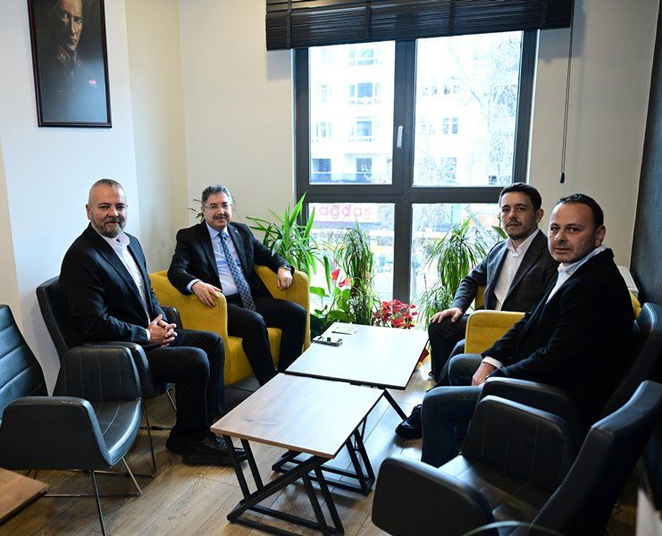

> Eskişehir Valisi Dr. Erdinç Yılmaz, Eskişehir Haber Ajansı (EHA) internet sitesini ziyaret ederek kurum yöneticileriyle bir araya geldi.

Eskişehir Valisi Dr. Erdinç Yılmaz, yerel medya temasları kapsamında Eskişehir Haber Ajansı (EHA) internet sitesine ziyarette bulundu.

Gerçekleşen ziyarette EHA Medya Grup Başkanı Soner Yüksel ve İmtiyaz Sahibi Yusuf Melih Turan ile görüşen Vali Yılmaz, ajansın yürüttüğü yayın faaliyetleri hakkında bilgi aldı.

Ziyaret sırasında Eskişehir'in güncel konuları ve basın çalışmaları üzerine fikir alışverişinde bulunuldu.

---

## Vali Yılmaz'dan Kuzey Kafkas Kültür Derneği'ne Ziyaret: Çalışmalar Ele Alındı

**Gündem · Merkez** · 2026-11-20 19:09 UTC · Kaynak: [Eskişehir Valiliği](https://www.eskisehir.gov.tr/valimiz-dr-erdinc-yilmaz-eskisehir-kuzey-kafkas-kultur-ve-dayanisma-dernegini-ziyaret-etti)

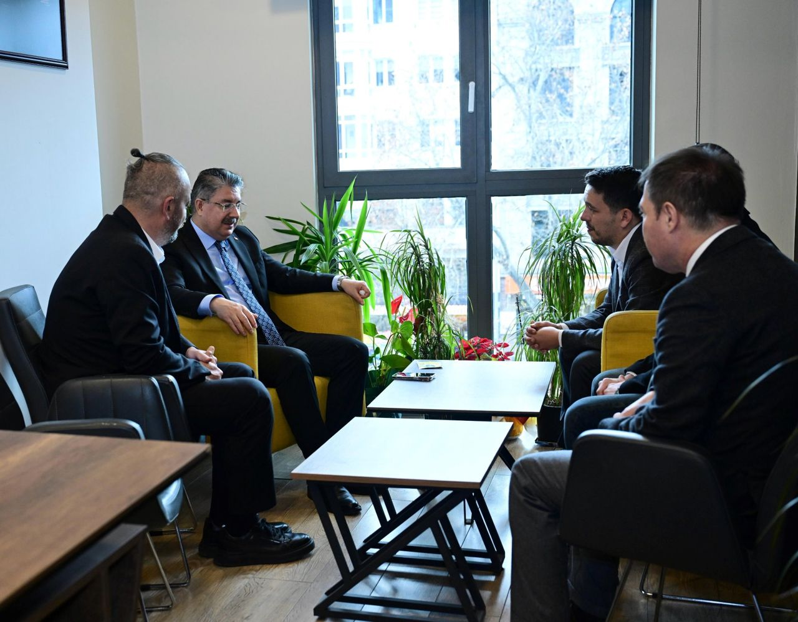

> Eskişehir Valisi Dr. Erdinç Yılmaz, Eskişehir Kuzey Kafkas Kültür ve Dayanışma Derneği'ni ziyaret ederek yürütülen faaliyetler hakkında bilgi aldı.

Eskişehir Valisi Dr. Erdinç Yılmaz, kentte faaliyet gösteren Eskişehir Kuzey Kafkas Kültür ve Dayanışma Derneği'ne ziyarette bulundu.

Ziyaret kapsamında Dernek Başkanı Jankat Yelbaşı ve yönetim kurulu üyeleriyle bir araya gelen Vali Yılmaz, derneğin yürüttüğü çalışmalar ve kültürel değerlerin korunup yaşatılmasına yönelik faaliyetler hakkında sohbet etti.

Vali Yılmaz, buluşmada gösterdikleri misafirperverlik dolayısıyla Dernek Başkanı Jankat Yelbaşı ile yönetim kurulu üyelerine teşekkür etti.

---

## Odunpazarı'na Bakanlıktan Tescil: 'Mavi Su Verimliliği Belgesi' Verildi

**Belediye · Odunpazarı** · 2026-11-20 19:09 UTC · Kaynak: [Google Haberler - Odunpazarı](https://www.esgazete.com/odunpazari-belediyesi-mavi-su-verimliligi-belgesi-aldi)

> Su tasarrufuna yönelik adımlar atan Odunpazarı Belediyesi, Tarım ve Orman Bakanlığından Mavi Su Verimliliği Belgesi almaya hak kazandı.

Odunpazarı Belediyesi, su kaynaklarının korunması ve tasarruflu kullanılması amacıyla yürüttüğü uygulamaların ardından Tarım ve Orman Bakanlığı Su Yönetimi Genel Müdürlüğü tarafından verilen Mavi Su Verimliliği Belgesi'nin sahibi oldu.

İki yıl önce yürürlüğe giren Su Verimliliği Yönetmeliği kapsamında bünyesinde Su Verimliliği Sistemi Kurulu kuran belediye, hizmet binalarında yüzde 25 su tasarrufu hedefiyle çeşitli önlemler aldı. Musluklara su tüketimini azaltan perlatörler monte edilirken, çevre düzenlemelerinde su ihtiyacı düşük olan kurakçıl peyzaj bitkileri tercih edildi ve personele yönelik bilinçlendirme çalışmaları yapıldı.

Belgenin alınmasından memnuniyet duyduğunu ifade eden Odunpazarı Belediye Başkanı Kazım Kurt, su kaynaklarının sınırsız olmadığını belirterek iklim değişikliği ve kuraklık tehdidi karşısında suyun her damlasını korumanın ortak bir sorumluluk olduğunu vurguladı.

---

## Eskişehirspor'un Söke Maçına Mersinli Hakem: Burak Filik Düdük Çalacak

**Spor · Merkez** · 2026-11-20 19:09 UTC · Kaynak: [Google Haberler - Eskişehirspor](https://yenisokegazetesi.com/haber/29193465/sokede-gozler-eskisehirspor-macinda-hakem-kadrosu-aciklandi)

> Nesine 3. Lig'de deplasmanda Söke 1970 Spor ile karşılaşacak Eskişehirspor'un maçını yönetecek hakem heyeti açıklandı. Mücadelede Mersin bölgesi hakemi Burak Filik görev yapacak.

Nesine 3. Lig'de mücadele eden Eskişehirspor'un hafta sonu Söke 1970 Spor Kulübü'ne konuk olacağı karşılaşmanın hakem kadrosu Türkiye Futbol Federasyonu (TFF) tarafından belirlendi.

22 Kasım 2026 Pazar günü saat 13.00'te Söke İlçe Stadı'nda oynanacak kritik randevuda Mersin bölgesinden Burak Filik düdük çalacak. Karşılaşmada Filik'in yardımcılıklarını Kahramanmaraş bölgesinden Enes Demirel ile Niğde bölgesinden Enes Ahmetler üstlenecek. Mücadelenin dördüncü hakemi ise yine Mersin bölgesinden Harun Kaan Yıldırım olacak.

1988 doğumlu olan ve 2012 yılından bu yana TFF liglerinde görev yapan orta hakem Burak Filik, bu sezon farklı organizasyonlarda 5 karşılaşma yönetti. Söz konusu maçlarda 27 sarı ve 1 kırmızı kartına başvuran Filik, Söke deplasmanıyla birlikte 2026-2027 sezonundaki 6. orta hakemlik görevine çıkacak.

---
