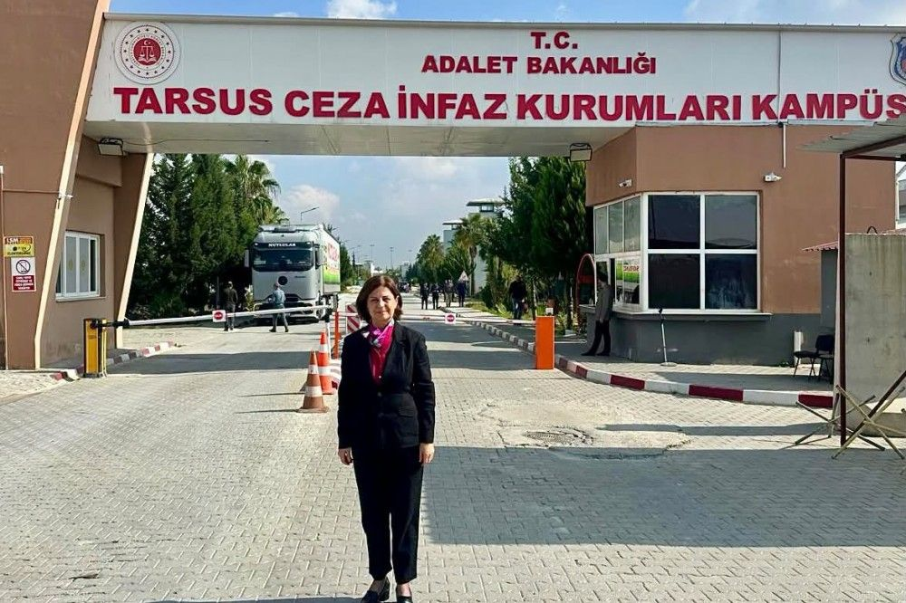
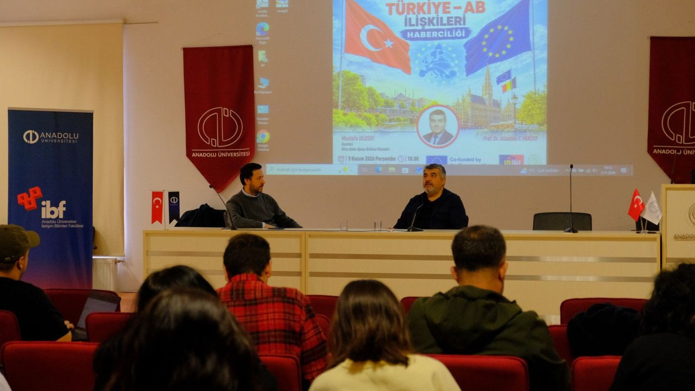
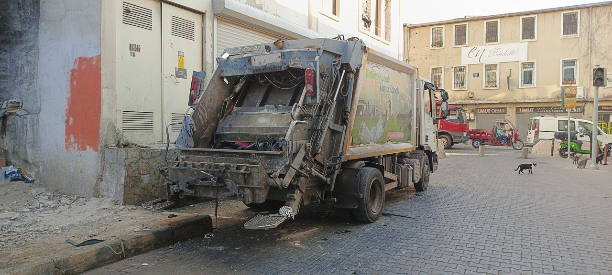
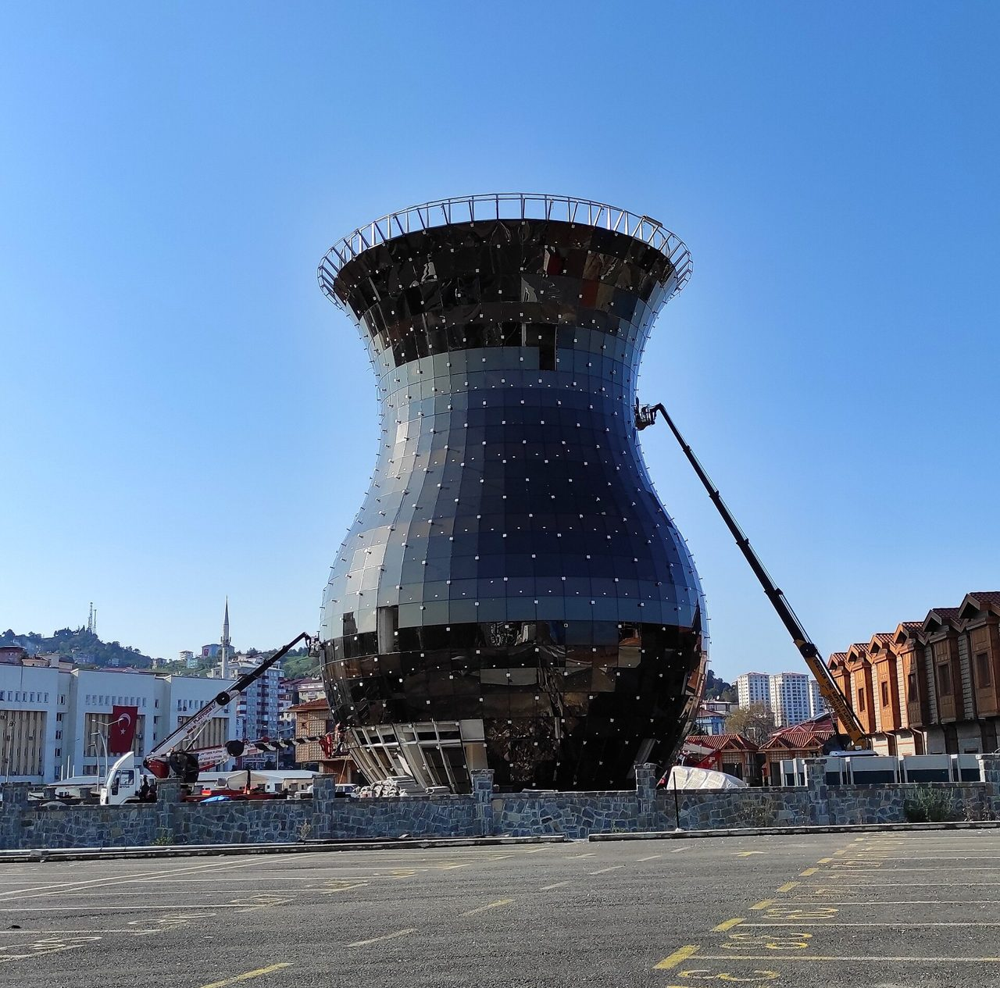
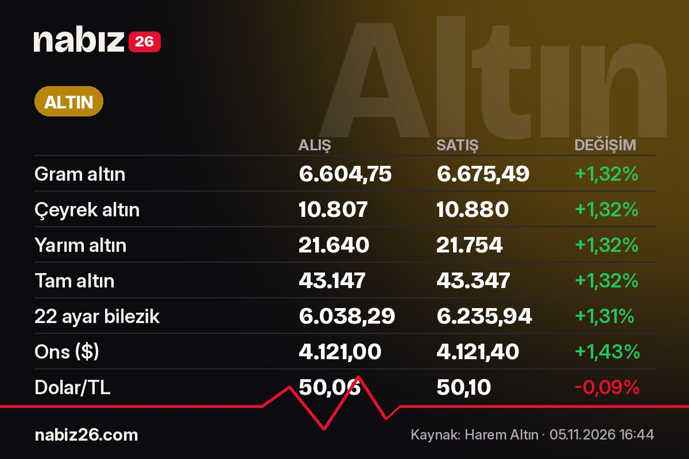
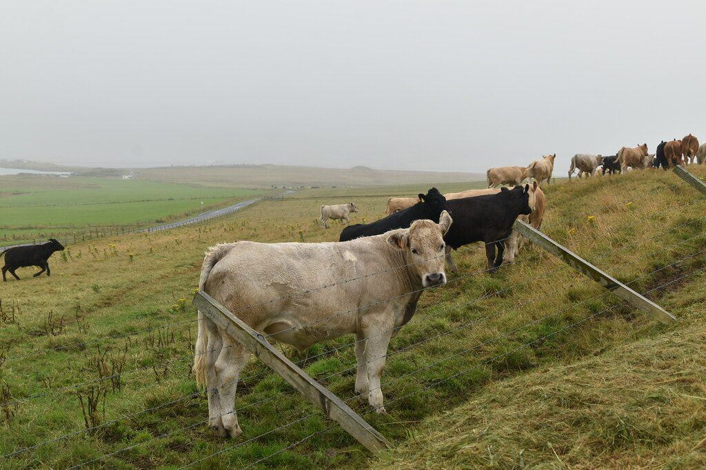
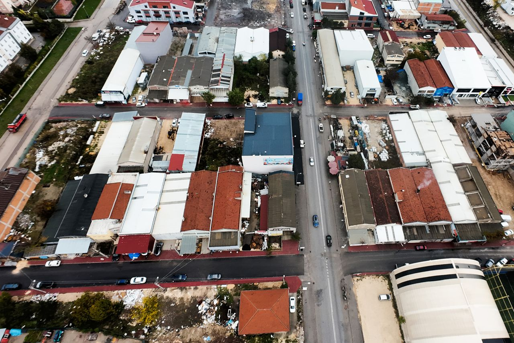
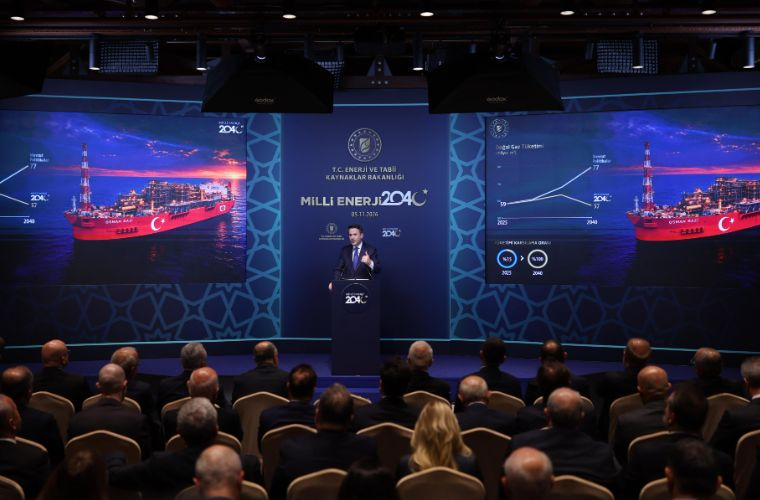

# Son haberler

Ajanın yazdığı son haberler (otomatik güncellenir).

## GSB burs ve öğrenim kredisi sonuçları açıklandı: Son tarih 11 Kasım

**Eğitim · Türkiye** · 2026-11-06 08:49 UTC · Kaynak: [Google Haberler - Bakanlıklar](https://gazetekalem.com.tr/genclik-ve-spor-bakanligi-burs-ve-ogrenim-kredisi-basvuru-sonuclarini-acikladi/)

> Gençlik ve Spor Bakanlığı burs ve öğrenim kredisi başvuru sonuçları duyuruldu. Öğrencilerin taahhütnamelerini e-Devlet üzerinden onaylaması gerekiyor.

Gençlik ve Spor Bakanlığı (GSB) tarafından yürütülen burs ve öğrenim kredisi başvuru sonuçları ilan edildi.

Gençlik ve Spor Bakanı Osman Aşkın Bak, sosyal medya hesabı üzerinden yaptığı açıklamada sonuçların açıklandığını belirterek öğrencilere başarı dileklerini iletti.

Bakan Bak, başvuru sonucu hak kazanan öğrencilerin 11 Kasım saat 23.59’a kadar e-Devlet üzerinden taahhütnamelerini onaylamaları gerektiğini vurguladı.

---

## ESTÜ mensupları "Ortak Gelecekte Biriz" kampanyasında yer aldı

**Eğitim · Tepebaşı** · 2026-11-06 08:49 UTC · Kaynak: [Eskişehir Teknik Üniversitesi](https://www.eskisehir.edu.tr/tr/Haber/Detay/eskisehir-teknik-universitesi-mensuplari-ortak-gelecekte-biriz-iletisim-kampanyasi-lansmanina-katildi)

> Cumhurbaşkanlığı İletişim Başkanlığı'nın düzenlediği "Ortak Gelecekte Biriz İletişim Kampanyası" lansmanına Eskişehir Teknik Üniversitesi de katıldı.

Cumhurbaşkanlığı İletişim Başkanlığı tarafından hayata geçirilen "Ortak Gelecekte Biriz İletişim Kampanyası"nın lansman programı gerçekleştirildi. Düzenlenen programa Eskişehir Teknik Üniversitesi (ESTÜ) mensupları da katılım sağladı.

5 Kasım 2026 tarihinde yapılan programa, ESTÜ Bilişim Teknolojileri Meslek Yüksekokulu öğretim elemanı Öğr. Gör. Dr. Gökben Karaağaç ile Kurumsal İletişim Koordinatörlüğünden İhsan Tarık Çelik katıldı. Türkiye Büyük Millet Meclisi Başkanı Numan Kurtulmuş ve Cumhurbaşkanlığı İletişim Başkanı Burhanettin Duran'ın da iştirak ettiği programda, toplumsal dayanışmanın güçlendirilmesi, ortak gelecek bilincinin pekiştirilmesi ve kesimler arası diyalog konuları ele alındı.

Lansmanda, kampanyanın temel amaçları ile önümüzdeki dönemde hayata geçirilmesi planlanan faaliyetler hakkında katılımcılara ayrıntılı bilgi verildi.

---

## Eskişehirsporlu eski futbolcular seçimli genel kurula gidiyor

**Spor · Tepebaşı** · 2026-11-06 08:49 UTC · Kaynak: [Google Haberler - Eskişehirspor](https://www.gzt26.com/eskisehirsporlu-eski-futbolcular-secimli-genel-kurula-gidiyor)

> Eskişehirsporlu Profesyonel Futbolcular Dayanışma Derneği, seçimli genel kurulunu 19 Kasım'da gerçekleştirecek.

Eskişehirspor'da geçmiş yıllarda forma giymiş profesyonel futbolcuları bir araya getiren Eskişehirsporlu Profesyonel Futbolcular Dayanışma Derneği, seçimli genel kurul hazırlıklarını sürdürüyor. Dernek yönetim kurulu tarafından yapılan açıklamaya göre, genel kurul 19 Kasım 2026 Perşembe günü saat 18.30'da Tepebaşı Belediyesi Özdilek Sanat Merkezi'nde yapılacak.

İlk toplantıda çoğunluğun sağlanamaması durumunda ikinci buluşma 26 Kasım 2026 Perşembe günü aynı yer ve saatte gerçekleştirilecek. Dernek yönetimi, yapılacak seçimlerin üyeler arasındaki dayanışmayı güçlendirmesini ve kulübün tarihine sahip çıkılmasını hedefliyor.

Yönetim kurulundan yapılan açıklamada, Eskişehirspor'un kentin ortak değeri olduğuna dikkat çekilerek, tüm üyeler genel kurula davet edildi.

---

## Eskişehir'de hafta sonu kültür-sanat maratonu: Konser ve tiyatrolar

**Kültür-Sanat · Merkez** · 2026-11-06 08:49 UTC · Kaynak: [Google Haberler - Eskişehir etkinlik](https://www.dogayidinle.com/etkinlikler/eskisehir-6-8-kasim-konserleri-emre-aydin-ceren-gundogdu-no-land-ve-ertelenen-konser/9877)

> Eskişehir'de 6-8 Kasım tarihlerinde Emre Aydın, Ceren Gündoğdu ve No Land konserlerinin yanı sıra çok sayıda tiyatro oyunu sanatseverlerle buluşacak.

Eskişehir, kasım ayının ilk hafta sonunda konserler, tiyatro oyunları ve geleneksel etkinliklerle hareketli bir döneme giriyor. Kent genelindeki farklı sahnelerde müzik ve tiyatro buluşmaları izleyicilere yoğun bir program sunuyor.

Türk rock müziğinin sevilen isimlerinden Emre Aydın, cuma akşamı Milyon Performance Hall'da sahne alırken, Ceren Gündoğdu Runa Stage Art Cafe'de akustik performansıyla dinleyici karşısına çıkacak. Pazar günü ise No Land, F/Stop Salon'da müzikseverlerle buluşacak. Hafta sonu takviminde ayrıca Turgut Özakman'ın "Kanaviçe" oyunu ile "Mi Rosa Sonradan Arabesk Olan Müzikal" gibi yapımlar da sahnelenecek.

Öte yandan, 7 Kasım'da Milyon Performance Hall'da yapılması planlanan Manuş Baba konseri ertelendi. Etkinliklere katılmak isteyenler bilet satış platformları üzerinden güncel programları takip edebilecek.

---

## Özgür Özel'den Ecevit'in kabrinde anma ve hukuk eleştirisi

**Siyaset · Türkiye** · 2026-11-05 19:24 UTC · Kaynak: [Google Haberler - CHP](https://www.dha.com.tr/politika/ozgur-ozel-bulent-ecevitin-kabrini-ziyaret-etti-2975595)

> Yeni Parti Genel Başkanı Özgür Özel, vefatının 20'nci yıl dönümünde Bülent Ecevit'in kabrini ziyaret ederek anma törenine katıldı. Ziyaretin ardından açıklamalarda bulunan Özel, fon soruşturması ve hukuk sistemine ilişkin değerlendirmeler yaptı.

Yeni Parti Genel Başkanı Özgür Özel, vefatının 20'nci yıl dönümünde eski Başbakan Bülent Ecevit'in Devlet Mezarlığı'ndaki kabrini ziyaret etti. Töhrene Genel Sekreter Yunus Emre, Grup Başkanvekili Murat Emir, Kadın Kolları Genel Başkanı Asu Kaya, Gençlik Kolları Genel Başkanı Cem Aydın, Genel Başkan Yardımcısı Utku Çakırözer, milletvekilleri, Mamak Belediye Başkanı Veli Gündüz Şahin, eski CHP Genel Sekreteri Önder Sav ve partililer katıldı. Kur'an-ı Kerim tilaveti okunup dua edilmesinin ardından kabre çelenk ve karanfiller bırakıldı. Heyet daha sonra eski TBMM Başkanı Deniz Baykal’ın kabrini de ziyaret etti.

Törenin ardından basına açıklamalarda bulunan Özgür Özel, Ecevit'in siyasi kariyerine ve emekçi dostu kimliğine vurgu yaparak, "Genel Sekreterimizi, Bakanımızı, Başbakanımızı, Genel Başkanımızı bir kez daha rahmetle ve minnetle anıyorum" ifadelerini kullandı. 

Açıklamasında fon soruşturmasına da değinen Özel, hukuk sisteminde çifte standart uygulandığını öne sürdü. Fatma Betül Sayan Kaya'nın ifadeye davet usulüyle çağrılmasını eleştiren Özel, "Eğer bu ülkede hukuk varsa herkese eşit işlemeli. Böyle bir ikili hukuk sisteminin ne kadar haksızca olduğunu, ne kadar partizanlık yapıldığını milletimizin vicdanlarına havale ediyorum" dedi.

Adalet Bakanı Akın Gürlek’in fon soruşturmasına yönelik açıklamalarının Cumhurbaşkanı Recep Tayyip Erdoğan'a sorulması gerektiğini belirten Özel, soruşturmadaki örgüt tanımlaması üzerinden iktidara eleştiriler yöneltti. Özel ayrıca ABD'deki ara seçim sonuçlarına ilişkin değerlendirmelerde de bulundu.

---

## Kaymakam Şahin’den Ahmet Sezer Ortaokulu’na ziyaret

**Eğitim · Odunpazarı** · 2026-11-05 19:24 UTC · Kaynak: [Google Haberler - Odunpazarı](https://www.haberes.com.tr/odunpazari-kaymakami-sahinden-ahmet-sezer-ortaokuluna-ziyaret)

> Odunpazarı Kaymakamı Ahmet Hikmet Şahin ve İlçe Millî Eğitim Müdürü Barış Hancı, Ahmet Sezer Ortaokulu’nu ziyaret ederek eğitim faaliyetlerini inceledi.

Odunpazarı Kaymakamı Ahmet Hikmet Şahin ile İlçe Millî Eğitim Müdürü Barış Hancı, Ahmet Sezer Ortaokulu'nu ziyaret etti. Ziyaret sırasında okulun genel durumu ve yürütülen eğitim öğretim faaliyetleri yerinde incelendi.

Okul yönetimi ve öğretmenlerle bir araya gelen Kaymakam Şahin ve İlçe Millî Eğitim Müdürü Hancı, eğitim ortamları ile öğrencilerin akademik, sosyal ve kültürel gelişimlerini desteklemeye yönelik çalışmalar hakkında bilgi aldı.

---

## Eskişehirspor'da sakatlıkları süren oyuncuların durumu netleşiyor

**Spor · Merkez** · 2026-11-05 19:24 UTC · Kaynak: [Google Haberler - Eskişehirspor](https://www.istikbalgazetesi.com/hasan-antrenmanda-kerem-ve-bagli-tedavide)

> Kırmızı-siyahlı ekipte Ahmet Dereli ve Mustafa Eren Damar forma giyemezken, Hasan Kaya takımla çalışmalara başladı.

TFF 3. Lig mücadelesine hazırlanan Eskişehirspor'da zorlu karşılaşma öncesi sakat oyuncuların son durumu netlik kazanıyor. Karşılaşmada favori gösterilen kırmızı-siyahlılar, sürprize izin vermeden galibiyet hedefliyor.

Takımda sportif sakatlıkları bulunan Ahmet Dereli ve Mustafa Eren Damar bu maçta forma giyemeyecek. Tedavileri süren Mehmet Bağlı ile Kerem Baykuş'un durumları ise maç günü yapılacak son kontrollerin ardından kesinleşecek.

Öte yandan sakatlığını atlatan Hasan Kaya'nın takımla birlikte antrenmanlarda yer aldığı bildirildi. Teknik heyet, eksik oyuncuların yerini doldurmak ve maça en iyi şekilde hazırlanmak için çalışmalarını sürdürüyor.

---

## Eskişehir'de işçi servisi devrildi: 18 yaralı

**Asayiş · Sivrihisar** · 2026-11-05 19:24 UTC · Kaynak: [Google Haberler - Eskişehir](https://www.akdenizgercek.com.tr/gundem/eskisehirde-can-pazari-isci-servisi-devrildi-18-yarali/388727)

> Eskişehir-Sivrihisar kara yolunda kontrolden çıkan işçi servisinin devrilmesi sonucu 18 kişi yaralandı.

Eskişehir'den Sivrihisar istikametine seyir halindeki işçi servisi, ilçe merkezine yaklaşık 20 kilometre kala sürücüsünün direksiyon hakimiyetini yitirmesiyle kontrolden çıktı. Savrulan araç devrilirken, içerideki 18 yolcu yaralandı.

Çevredeki sürücülerin ihbarı üzerine kaza mahalline çok sayıda sağlık, jandarma ve polis ekibi yönlendirildi. Sağlık personeli, yaralılara ilk müdahaleyi olay yerinde gerçekleştirdi.

İlk müdahalelerinin ardından ambulanslarla bölgedeki hastanelere sevk edilen yaralıların tedavisine başlandı. Güvenlik güçleri kazayla ilgili soruşturma başlattı.

---

## Vali Yılmaz ve heyeti, Görgün ile Eskişehir’in sanayi potansiyelini görüştü

**Ekonomi · Merkez** · 2026-11-05 19:03 UTC · Kaynak: [Google Haberler - Eskişehir gündem](https://www.urfadabugun.com/haber/267823/gorgun-eskisehirin-sanayi-ve-teknoloji-potansiyelini-degerlendirdi.html)

> Savunma Sanayii Başkanlığındaki buluşmada kentin sanayi, teknoloji ve savunma alanlarındaki birikimi ele alındı.

Savunma Sanayii Başkanı Prof. Dr. Haluk Görgün, Eskişehir Valisi Erdinç Yılmaz ve beraberindeki heyetle başkanlıkta bir araya geldi. Görüşmenin gündemini Eskişehir’in sanayi, teknoloji ve savunma sanayisindeki imkânları oluşturdu.

Görgün, kentin üniversiteleri, sanayi altyapısı ve teknoloji firmalarının taşıdığı birikime dikkat çekti. Üretim, mühendislik ve akademik çalışmaların yeni proje ve iş birlikleriyle destekleneceğini ifade etti.

Görgün, görüşmenin ardından Vali Yılmaz ile heyete ziyaretleri için teşekkür etti.

---

## Togg T10X ve T10F için 300 bin liralık krediye 10 ay faizsiz ödeme seçeneği

**Ekonomi · Türkiye** · 2026-11-05 19:03 UTC · Kaynak: [Google Haberler - Togg](https://www.teknolojioku.com/otomobil/toggdan-yeni-kampanya-30-bin-lira-taksitle-satiliyor-6aecd0d600b9958ea604d5e1)

> Sınırlı sayıdaki araç için duyurulan kampanyada, T10X V2 ve T10F V2’de 300 bin liralık kredi aylık 30 bin lira taksitle sunuluyor.

Togg’un T10X V2 ve T10F V2 modellerine yönelik finansman kampanyasında, 300 bin liralık kredi için 10 ay vade ve yüzde 0 faiz seçeneği bulunuyor. Bu seçenekte aylık taksit tutarı 30 bin lira olarak belirtiliyor.

Teknolojioku’nun aktardığı kampanya, sınırlı sayıdaki araçları kapsıyor. T10X ve T10F’nin 4More sürümleri için de 1,5 milyon lira krediye 10 ay vade, yüzde 0 faiz ve aylık 150 bin lira taksit seçeneği duyuruluyor.

---

## Erdoğan, 8 Kasım’da Azerbaycan’ı ziyaret etmeyi planladığını açıkladı

**Siyaset · Türkiye** · 2026-11-05 19:03 UTC · Kaynak: [Google Haberler - Cumhurbaşkanı](https://www.agos.com.tr/tr/haber/erdogan-azerbaycan-i-ziyaret-edecek-42414)

> Cumhurbaşkanı Erdoğan, olağanüstü bir durum yaşanmaması halinde Zafer Günü için Azerbaycan’a gideceğini söyledi.

Cumhurbaşkanı Recep Tayyip Erdoğan, 8 Kasım’da Azerbaycan’a ziyaret planladığını açıkladı. Güney Kore dönüşünde gazetecilerin sorularını yanıtlayan Erdoğan, olağanüstü bir gelişme olmaması durumunda Zafer Günü dolayısıyla bu ülkeye gideceğini belirtti.

Erdoğan, Azerbaycan Cumhurbaşkanı İlham Aliyev ile telefonla görüştüğünü, dışişleri bakanı ve istihbarat başkanını da Azerbaycan’a gönderdiğini aktardı. Ziyaretin temasları ilerletmek için bir fırsat olacağını ifade etti.

İki ülke arasındaki ilişkiler hakkındaki soruya da yanıt veren Erdoğan, ortak tarih ve kültüre vurgu yaparak Türkiye ile Azerbaycan arasındaki bağların diplomatik ilişkilerin ötesinde olduğunu söyledi.

---

## Eğitim Gücü Sen, eğitim çalışanlarının taleplerini Kılıçdaroğlu’na iletti

**Siyaset · Türkiye** · 2026-11-05 19:03 UTC · Kaynak: [Google Haberler - CHP](https://ankahaber.net/haber/egitim-gucu-sen-den-kilicdaroglu-na-ziyaret-0cf1bcc8)

> Sendika heyeti, bütçe görüşmelerinde eğitim çalışanlarının sorunlarının gündeme taşınmasını istedi.

Eğitim ve Bilim Gücü Dayanışma Sendikası heyeti, Kemal Kılıçdaroğlu ile görüşerek eğitim çalışanlarının ekonomik koşulları, sosyal ve özlük haklarına ilişkin taleplerini sundu. Sendikadan yapılan açıklamaya göre görüşmede eğitim sistemindeki sorunlar da ele alındı.

Genel Başkan Oğuz Özat ve genel başkan yardımcılarından oluşan heyete Yıldırım Kaya eşlik etti. Heyet, eğitim çalışanlarının taleplerinin TBMM’deki bütçe görüşmelerinde değerlendirilmesini istedi.

Sendika temsilcileri çözüm önerilerini içeren dosyayı Kılıçdaroğlu’na iletti. Ziyarette eğitimin niteliğinin artırılması ve çalışanların sorunlarının çözümü konusunda görüş alışverişinde bulunuldu; sendika adına plaket takdim edildi.

---

## Başkan Ünlüce, Mersin’de Vahap Seçer’i ve belediye yönetimini ziyaret etti

**Belediye · Merkez** · 2026-11-05 19:03 UTC · Kaynak: [Eskişehir Büyükşehir Belediyesi](https://www.eskisehir.bel.tr/icerik-detay.php?icerik_id=13532&cat_icerik=1&menu_id=24)

> Ayşe Ünlüce’nin Mersin programında Tarsus Cezaevi, belediye ve parti il örgütü ziyaretleri yer aldı.

Eskişehir Büyükşehir Belediye Başkanı Ayşe Ünlüce, Mersin’deki temasları kapsamında Türkiye Belediyeler Birliği Başkanı ve Mersin Büyükşehir Belediye Başkanı Vahap Seçer’i Tarsus Cezaevi’nde ziyaret etti. Eskişehir Büyükşehir Belediyesinin açıklamasına göre Ünlüce, Seçer’in özgürlüğüne kavuşması dileğini iletti.

Ünlüce daha sonra Meral Seçer’i evinde ziyaret etti. Burada Adana Büyükşehir Belediye Başkanı Zeydan Karalar ve Ankara Büyükşehir Belediye Başkanı Mansur Yavaş ile de bir araya geldi.

Programda Mersin Büyükşehir Belediyesi Başkan Vekili Gülşah Yıldırım Genç ve belediye çalışanlarıyla da görüşüldü. Ünlüce, Yeni Parti Mersin İl Başkanlığında İl Başkanı Cengiz Gökçel, yöneticiler ve meclis üyeleriyle çalışmalar hakkında fikir alışverişinde bulundu. Bölgede çiftçilerle buluşmak üzere bulunan Sencer Solakoğlu da il başkanlığındaki temaslara katıldı.

---

## Anadolu Üniversitesinde AB haberciliği ve haber doğrulama atölyesi yapıldı

**Eğitim · Merkez** · 2026-11-05 19:03 UTC · Kaynak: [Anadolu Üniversitesi](https://anahaber.anadolu.edu.tr/tr/haber-detay/a82vpgkpzazbebl0j2a4ppx0)

> İHA Brüksel Temsilcisi Mustafa Ulusoy, gazetecilik öğrencilerine uluslararası ajans haberciliğini ve dijital dönüşümü anlattı.

Anadolu Üniversitesi İletişim Bilimleri Fakültesi Gazetecilik Bölümü, Avrupa Birliği ve Türkiye-AB ilişkileri haberciliğine yönelik konferans ve atölye düzenledi. İhlas Haber Ajansı Brüksel Temsilcisi Mustafa Ulusoy, öğrencilerle gazetecilik deneyimlerini paylaştı.

JOIN Projesi kapsamındaki programın moderatörlüğünü Prof. Dr. Alaaddin Faruk Paksoy üstlendi. Ulusoy, Avrupa Birliği kurumlarına erişim, akreditasyon işlemleri ve kaynaklarla iletişimde yaşanan değişimleri anlattı. Dijitalleşmenin gazetecileri daha fazla doğrulama yapmaya yönelttiğini belirtti.

Atölyede uluslararası haber ajanslarının günlük işleyişi, haber önerilerinin hazırlanması ve merkeze iletilmesi üzerinde duruldu. Dezenformasyon, yapay zekâyla üretilen sahte görüntüler ve açık kaynak istihbaratı da ele alındı. Program, öğrencilerin sorularının yanıtlanmasıyla sona erdi.

---

## Hakan Şapcı, Eskişehirspor’da 39 maçta 27 galibiyete ulaştı

**Spor · Merkez** · 2026-11-05 19:02 UTC · Kaynak: [Google Haberler - Eskişehirspor](https://www.istikbalgazetesi.com/sapci-son-10-sezonda-zirvede)

> Şapcı, son 10 sezonda Eskişehirspor’un başında en fazla maça çıkan teknik direktörler sıralamasında ilk sırada yer aldı.

Eskişehirspor Teknik Direktörü Hakan Şapcı, takımın başında çıktığı 39 karşılaşmada 27 galibiyet, 8 beraberlik ve 4 yenilgi aldı. Bu sonuçlarla galibiyet oranı yüzde 69’a ulaşırken siyah-kırmızılı ekip 35 maçta yenilmedi.

İstikbal Gazetesi’nin derlediği verilere göre Şapcı, son 10 sezonda Eskişehirspor’da en fazla karşılaşmada görev yapan teknik direktör oldu. Onu 38 maçla Fuat Çapa, 28 maçla Suat Kaya, 23 maçla Yücel İldiz ve 21 maçla Mustafa Özer izledi.

Son 20 sezonun maç sayısı sıralamasında ise Şapcı beşinci basamakta bulunuyor. Bu listede Rıza Çalımbay 84, Ersun Yanal 75, Ertuğrul Sağlam 68 ve Michael Skibbe 47 karşılaşmayla önünde yer alıyor.

---

## Eskişehir’de proje okulları Fatih Fen Lisesi’nde eğitim süreçlerini görüştü

**Eğitim · Merkez** · 2026-11-05 19:02 UTC · Kaynak: [Google Haberler - Eskişehir etkinlik](https://www.aksiyon.com.tr/proje-okullari-eskisehir-de-bir-araya-geldi-egitim-surecleri-degerlendirildi-388700)

> İl Millî Eğitim Müdürü Sinan Aydın başkanlığındaki toplantıda akademik çalışmaların yanı sıra okul güvenliği ve etkinlik planları değerlendirildi.

Eskişehir’de proje okullarının koordinasyon toplantısı Fatih Fen Lisesi’nin ev sahipliğinde yapıldı. İl Millî Eğitim Müdürü Sinan Aydın’ın başkanlık ettiği buluşmaya birim amirleri ve okul müdürleri katıldı.

Her ay farklı bir okulda gerçekleştirilen toplantının bu ayki gündeminde eğitim faaliyetleri, akademik başarıyı destekleyen uygulamalar ve okulların projeleri yer aldı. Yöneticiler, çalışmaların sonuçlarını ve paylaşılabilecek iyi örnekleri değerlendirdi.

Öğrencilere yönelik yarışma ve gezi planları da görüşüldü. Okul güvenliği, iş sağlığı ve güvenliği ile farkındalık çalışmaları ele alınarak kurumlar arasındaki koordinasyonun güçlendirilmesi konusunda görüş birliğine varıldı.

---

## Anadolu Üniversitesinde öğrenciler turşu kurdu, fermantasyonun bilimini öğrendi

**Eğitim · Merkez** · 2026-11-05 19:02 UTC · Kaynak: [Anadolu Üniversitesi](https://anahaber.anadolu.edu.tr/tr/haber-detay/id6hqo4qjzeujwbd2q209o04)

> EMYO’daki atölyede aşçılık öğrencileri turşu yapımını uygulayarak öğrendi; gastronomi, beslenme ve biyokimya birlikte ele alındı.

Anadolu Üniversitesi Eskişehir Meslek Yüksekokulunda düzenlenen turşu atölyesi, geleneksel mutfak bilgisini bilimsel yaklaşımlarla buluşturdu. Ocak ve Çörek Mutfaklarında yapılan etkinlikte Rektör Prof. Dr. Yusuf Adıgüzel de öğrencilerle turşu hazırladı.

EMYO Müdürü Doç. Dr. Osman Güldemir’in koordinasyonundaki programa Selçuk Üniversitesinden Prof. Dr. Fatma Hümeyra Yerlikaya Aydemir ve Prof. Dr. Nazan Aktaş konuk oldu. Öğrenciler malzeme seçimi ve hazırlama aşamalarının yanı sıra fermantasyonda yaşanan biyokimyasal değişimleri de ele aldı.

Atölyede mevsimlik ürünlerin saklanması, gıda israfının azaltılması ve sürdürülebilir mutfak uygulamaları üzerinde duruldu. Aktaş, turşunun tuz içeriği nedeniyle tüketim miktarına dikkat edilmesi gerektiğini belirtti. Program, soruların yanıtlanması ve konuk akademisyenlere teşekkür belgelerinin verilmesiyle tamamlandı.

---

## Afyon'daki saldırıların şüphelisi Seyitgazi'de yakalandı, 2 jandarma hafif yaralandı

**Asayiş · Merkez** · 2026-11-05 18:32 UTC · Kaynak: [Google Haberler - Eskişehir](https://www.aa.com.tr/tr/gundem/afyonkarahisarda-silahla-8-kisiyi-olduren-1-kisiyi-agir-yaralayan-zanli-eskisehirde-yakalandi/4113099)

> Valilik, failin Eskişehir sınırlarında jandarma ve emniyetin ortak çalışmasıyla yakalandığını açıkladı.

Afyonkarahisar'da silahlı saldırılarda 8 kişinin ölümüne, 1 kişinin ağır yaralanmasına yol açan şüpheli Eskişehir'de yakalandı. Eskişehir Valiliği, saldırıları gerçekleştiren kişinin İl Jandarma Komutanlığı ve İl Emniyet Müdürlüğü ekiplerinin ortak çalışmasıyla "sağ olarak yakalandığını" duyurdu.

Yerel haberlere göre şüpheli, gasp ettiği aracı Seyitgazi'nin Taşlık Mahallesi'nde çamura saplanınca bırakarak yaya kaçmaya devam etti. Jandarma ekipleri şüphelinin Seyitgazi'ye bağlı Kuyucak Mahallesi'ndeki bir maden ocağı yakınlarında olduğunu belirledi. Haberlerde şüphelinin adı Ali Sefa Ö. olarak geçti. Bölgeyi çevreleyen ekiplerin "teslim ol" ihtarına şüphelinin tüfekle ateş ederek karşılık verdiği, çıkan çatışmada 2 jandarma personelinin hafif yaralandığı bildirildi. Şüpheli gözaltına alınarak karakola götürüldü.

Anadolu Ajansı'nın aktardığına göre Afyonkarahisar Cumhuriyet Başsavcılığı soruşturma başlattı ve 1 başsavcıvekili ile 3 cumhuriyet savcısı görevlendirdi. Hayatını kaybedenler arasında Yukarıtandır Ortaokulu'nda görevli iki öğretmen de bulunuyor; İl Milli Eğitim Müdürlüğü başsağlığı diledi.

Şüpheli hakkındaki yargı süreci sürüyor; haber, resmî açıklamalara ve yayımlandığı sıradaki haberlere dayanıyor.

---

## Başkan Kurt çöp tarifesi iddialarına yanıt verdi: Temizlik işlerinde 420 işçi çalışıyor

**Belediye · Odunpazarı** · 2026-11-05 17:32 UTC · Kaynak: [Google Haberler - Odunpazarı](https://www.istikbalgazetesi.com/odunpazari-belediyesi-haksiz-yere-hicbir-seyden-para-almaz)

> Kurt, Tepebaşı ile Odunpazarı hesaplarının aynı yöntemle yapıldığını söyledi.

Odunpazarı Belediye Başkanı Kazım Kurt, kasım ayı meclis toplantısında 2027 Yılı Evsel Katı Atık Tarife Raporu'na ilişkin AK Parti meclis üyelerinin eleştirilerine yanıt verdi. Rapor, AK Parti üyelerinin karşı oyuna rağmen oy çokluğuyla kabul edilmişti.

Kurt, raporun şeffaf olduğunu ve herkesin inceleyebileceğini söyledi. Temizlik işlerinde başka yerde çalışan, işe gelmeden maaş alan kimsenin bulunmadığını belirten Kurt, personelin giriş ve çıkışını kaydeden bir takip sistemleri olduğunu anlattı. Temizlik işlerinde 10 yıl önce 430 küsur işçi çalışırken bugün 420 işçi ve 10 memur bulunduğunu, bu sürede nüfusun 70-80 bin arttığını söyledi.

Kurt, Tepebaşı ve Odunpazarı belediyelerinin bürokratlarının raporu birlikte hazırladığını, iki belediyenin hesabı arasında fark bulunmadığını ve konutlarda yıllık bedelin yaklaşık 970 lira olduğunu belirtti. Artış oranlarına ilişkin istatistik tartışmalarının yoruma açık olduğunu söyledi.

AK Parti Meclis Üyesi Berke Akyel ise toplantıda, Odunpazarı'nın toplam katı atık maliyetindeki artışın Tepebaşı'ndan yüksek olduğunu ve temizlik kadrosunda görünüp başka birimlerde çalıştırılan personelin maaşlarının bedele yansıtılıp yansıtılmadığını sormuştu.

---

## Afyon'daki saldırının firari şüphelisi Seyitgazi'de aranıyor, ekipler dron kullanıyor

**Asayiş · Merkez** · 2026-11-05 17:32 UTC · Kaynak: [Google Haberler - Eskişehir](https://www.eskisehirekspres.net/olu-sayisi-7ye-yukseldi-afyondaki-kanli-olay-sonrasi-eskisehirde-alarma-gecildi)

> Şüphelinin aracını Taşlık yakınlarında bıraktığı bildirildi; Eskişehir-Seyitgazi yolunda güvenlik noktası kuruldu.

Afyonkarahisar'ın İhsaniye ilçesinde 8 kişinin silahlı saldırıda öldüğü olayın firari şüphelisi, Eskişehir'in Seyitgazi ilçesinde aranıyor. Haberlerde şüphelinin aracını Seyitgazi'nin Taşlık Mahallesi yakınlarında bırakıp kırsal alana kaçtığı belirtildi.

Afyonkarahisar Valiliği, silahlı saldırılarda 8 kişinin hayatını kaybettiğini, 1 kişinin ağır yaralandığını açıkladı. Haberlerde olayın İhsaniye'ye bağlı Ayazini ve Kıyır mahallelerinde yaşandığı, üç ayrı araçta cansız bedenlerin bulunduğu, hayatını kaybedenlerden ikisinin öğretmen olduğu aktarıldı. Şüphelinin kırmızı renkli bir hafif ticari aracı gasp ederek kaçtığı, Seyitgazi-Çifteler yolu üzerinde bir otomobili de aldığı iddia edildi.

Eskişehir İl Emniyet Müdürlüğü ekipleri, şüphelinin Eskişehir istikametine yönelebileceği ihtimaline karşı Eskişehir-Seyitgazi karayolunda güvenlik noktası kurdu ve yola araç durdurucu kapan yerleştirdi. Polis ve jandarma ekipleri kırsal alanda termal kameralı dronlarla arama yapıyor; metruk yapılar, tarım arazileri ve ormanlık alanlar tek tek kontrol ediliyor. Kütahya, Eskişehir ve Afyonkarahisar çevresinde geniş çaplı operasyon sürüyor.

Haber, yayımlandığı sıradaki bilgilere dayanıyor; şüpheli hakkında yargı süreci sonuçlanmadı.

---

## Tepebaşı ve Odunpazarı'nda 2027 evsel katı atık tarifesi meclislerden geçti

**Belediye · Tepebaşı** · 2026-11-05 15:32 UTC · Kaynak: [Google Haberler - Tepebaşı](https://www.eskisehirekspres.net/tepebasinda-cop-ucretlerine-zam-2027-tarifesi-belli-oldu)

> Tepebaşı'nda konut başına yıllık 970 TL, Odunpazarı'nda 973,40 TL alınacak.

Tepebaşı ve Odunpazarı belediye meclisleri, 2027 Yılı Evsel Katı Atık Tarife Raporu'nu kasım ayı toplantılarında oy çokluğuyla kabul etti.

Tepebaşı'nda kabul edilen tarifeye göre konutlardan yıllık 970 TL evsel katı atık bedeli alınacak. Aynı tarifede eğitim kurumlarında öğrenci başına yıllık 128 TL 10 kuruş, kamu binalarında personel başına 600 TL, hastane ve yataklı sağlık kuruluşlarında yatak başına 1.400 TL, otel ve pansiyonlarda yatak başına 1.000 TL, restoran ve kafelerde metrekare başına 115 TL 54 kuruş, sanayi kuruluşlarında iş yeri başına 3.600 TL, pazarlarda tezgâh başına 1.750 TL öngörülüyor. Tepebaşı'nda 2025 yılında toplam 142 bin 408 ton çöp oluştuğu meclis verilerinde yer aldı.

Odunpazarı'nda ise konutlardan 2027'de yıllık 973,40 lira evsel katı atık bedeli alınacak. Rapor, AK Parti meclis üyelerinin karşı oyuyla oy çokluğuyla kabul edildi.

AK Parti Odunpazarı Meclis Üyesi Berke Akyel, Tepebaşı'nın toplam katı atık maliyetinin 2026'da 272 milyon liradan 2027'de 365 milyona (yüzde 34), Odunpazarı'nınkinin ise 271 milyon liradan 435 milyona (yüzde 61) çıktığını öne sürdü. Akyel, temizlik kadrosunda görünüp başka birimlerde çalışan personelin maaşlarının bedele yansıtılıp yansıtılmadığını sordu.

Tepebaşı'nda AK Parti Meclis Üyesi Ali Semih Ünlü, başka müdürlüklerde çalışan personelin 19 milyon 542 bin 687 liralık maliyetinin Plan ve Bütçe Komisyonunda yeni tarife hesabından çıkarıldığını söyledi ve önceki yıllarda fazla ücret alınmış olabileceğini gündeme getirdi.

İki belediye yönetiminin bu iddialara yanıtı kaynak metinlerde yer almıyor.

---

## Anadolu Üniversitesi e-Sertifika programı başvuruları 8 Kasım'a uzatıldı

**Eğitim · Tepebaşı** · 2026-11-05 15:31 UTC · Kaynak: [Google Haberler - Eskişehir gündem](https://www.istikbalgazetesi.com/eskisehir-anadolu-universitesinde-e-sertifika-basvurulari-uzatildi-iste-son-basvuru-tarihi)

> Güz dönemi dersleri 9 Kasım'da başlayacak; başvurular sinavbasvuru.anadolu.edu.tr üzerinden yapılıyor.

Anadolu Üniversitesi Sürekli Eğitim Merkezi (ANADOLUSEM) tarafından yürütülen e-Sertifika Programları'na başvurular 8 Kasım 2026'ya kadar uzatıldı. Başvurular sinavbasvuru.anadolu.edu.tr adresi üzerinden yapılabiliyor.

Herkesin başvurusuna açık programlar uzaktan eğitim olarak sunuluyor. Katılımcılar, Anadolum eKampüs Sistemi üzerinden dijital ders materyallerinden yararlanıyor. Sağlıktan iletişime, işletmeden turizme, siyasetten çocuk gelişimine, yabancı dillerden bilişim teknolojilerine kadar geniş bir yelpazede sunulan programlarda bir ila üç arasında ders bulunuyor ve ders kitapları dijital ortamda veriliyor.

2026 Güz Dönemi e-Sertifika Programlarının dersleri 9 Kasım 2026'da başlayacak. Ayrıntılı bilgiler esertifika.anadolu.edu.tr adresinde yer alıyor.

---

## Tepebaşı Belediyesi asfaltı kendi imkânlarıyla yapacak: meclis makine alımını kabul etti

**Belediye · Tepebaşı** · 2026-11-05 14:33 UTC · Kaynak: [Google Haberler - Tepebaşı](https://www.gzt26.com/tepebasi-belediyesi-asfalt-calismalarini-kendi-imkanlariyla-yapacak-meclisten-oy-birligiyle-gecti)

> Meclis, asfalt serme makinesi, silindir ve dorse alımını oy birliğiyle onayladı.

Tepebaşı Belediyesi, asfalt kaplama ve yol bakım çalışmalarını kendi imkânlarıyla yapabilmek için yeni iş makineleri alacak. Fen İşleri Müdürlüğünün hazırladığı teklif, belediye meclisinin ikinci toplantısında oy birliğiyle kabul edildi.

Müdürlüğün yazısında, mevcut makine parkında asfalt serme makinesi, lastik tekerlekli silindir ve havuz tipi dorse bulunmadığı, bu nedenle asfalt kaplama ve yama çalışmalarının ihaleyle yüklenici firmalara yaptırıldığı belirtildi. Dışarıdan hizmet alınmasının maliyetleri artırdığı, piyasa fiyatlarındaki yükselişin yol yapım, bakım ve onarım bütçesini olumsuz etkileyebileceği kaydedildi.

Kabul edilen teklifle bir asfalt serme makinesi, bir lastik tekerlekli silindir ve bir havuz tipi dorse alınması planlanıyor. Araçların mevcut bütçe ödeneğiyle alınması öngörülüyor. Belediye, dışarıdan hizmet alma ihtiyacını azaltmayı, yol onarımlarına daha kısa sürede müdahale etmeyi ve uzun vadede tasarruf sağlamayı hedefliyor.

---

## Kahveciler Odası Başkanı Karatay: Kahvehanelerde çay yılbaşından itibaren 20 lira olacak

**Ekonomi · Odunpazarı** · 2026-11-05 14:33 UTC · Kaynak: [Google Haberler - Eskişehir etkinlik](https://www.eskisehirekspres.net/karatay-acikladi-kahvehanelerde-caya-zam-geliyor)

> Karatay, çayın 15 liradan 20 liraya çıkacağını söyledi.

Eskişehir Kahveciler Odası Başkanı Mehmet Karatay, kahvehane esnafının sorunları ve yeni fiyat tarifesi hakkında açıklama yaptı. Karatay'a göre her yıl ekim ayında belirlenen fiyat tarifesi bu yıl ertelendi; yeni tarife için üst birliğe başvurdular ancak bir süre beklemeleri istendi ve mevcut tarifenin süresi uzatıldı.

Yönetim olarak yeni fiyat konusunda karar aldıklarını söyleyen Karatay, şu anda işletmelerde 15 liraya satılan çayın fiyatını 20 liraya güncelleyeceklerini belirtti. Karatay, yeni tarifenin yılbaşından itibaren uygulanmaya başlayacağını söyledi. Kahvehane esnafının artan maliyetler nedeniyle zor bir dönemden geçtiğini de kaydetti.

Karatay ayrıca Odunpazarı'nda Emek Mahallesi'ndeki muhtarlığın bulunduğu parkın arkasında sıralanan yaklaşık 9 kahvehanenin işgaliye sorununu Odunpazarı Belediye Başkanı Kazım Kurt ile görüştüklerini anlattı. İşletmelerin daha düzenli bir görünüme kavuşması için yeni bir çalışma yapılacağını, düzenlemenin yaya geçişini engellemeyecek şekilde olacağını ve geçici işgaliye izinlerinin bu yıl da uzatıldığını söyledi.

---

## Altın fiyatları 5 Kasım 2026: Gram altın 6.675,49 TL

**Ekonomi · Merkez** · 2026-11-05 13:44 UTC · Kaynak: [Harem Altın](https://www.haremaltin.com/altin-fiyatlari)

> Gram altın güne yükselişle başladı. Harem Altın verilerine göre gram altın 6.604,75 TL'den alınıyor, 6.675,49 TL'den satılıyor.

Altın piyasasında güne yükselişle başlandı. Harem Altın'ın saat 16.44 itibarıyla verilerine göre gram altının satış fiyatı 6.675,49 TL, alış fiyatı 6.604,75 TL oldu. Gram altın, önceki kapanışa göre yüzde 1,32 yükseldi.

Ziynet altınlarda çeyrek altın 10.880 TL, yarım altın 21.754 TL, tam altın 43.347 TL, ata altın 44.512 TL seviyesinden satışa sunuluyor.

22 ayar bileziğin gram satış fiyatı 6.235,94 TL, has altının gram fiyatı 6.655,26 TL olarak belirlendi.

Uluslararası piyasalarda altının onsu 4.121,40 dolardan işlem görürken, dolar/TL 50,10 seviyesinde bulunuyor.

Fiyatlar Harem Altın'ın saat 16.44 itibarıyla paylaştığı verilere dayanmaktadır; kuyumcular arasında farklılık gösterebilir. Bu haber yatırım tavsiyesi değildir.

---

## "Bir Sürü Olsun" projesinde etçi ırk sığır başvuruları 13 Kasım'a kadar sürecek

**Tarım · Merkez** · 2026-11-05 13:33 UTC · Kaynak: [Eskişehir İl Tarım ve Orman Müdürlüğü](https://eskisehir.tarimorman.gov.tr/Haber/1758/Bir-Suru-Olsun-Projesi-Kapsaminda-Etci-Irk-Sigir-Basvurulari-Basladi)

> Başvurular il veya ilçe tarım müdürlüklerine yapılacak; liste 30 Kasım'da açıklanacak.

Tarım ve Orman Bakanlığı'nın "Bir Sürü Olsun" Projesi kapsamında 2027 yılı etçi ırk hayvan tahsis başvuruları başladı. Eskişehir İl Tarım ve Orman Müdürlüğünün duyurusuna göre üreticiler 4-13 Kasım 2026 tarihleri arasında işletmenin bulunduğu yerdeki il veya ilçe tarım ve orman müdürlüğüne başvurabilecek.

Et ve Süt Kurumu tarafından temin edilecek hayvanlar, 15 gebe dişi etçi ırk sığır ve 1 damızlık erkek sığırdan oluşan 16 başlık gruplar hâlinde sunulacak. Üreticiler bir, iki veya üç grup, yani 16, 32 veya 48 baş için başvurabilecek.

Projeye 18 yaşını dolduran Türkiye Cumhuriyeti vatandaşı gerçek kişiler başvurabilecek; kamu kurum ve kuruluşları, tüzel kişiler, devlet memurları ve diğer kamu görevlileri yararlanamayacak. Başvuru yapılacak işletmenin başvuru sahibi adına TÜRKVET sisteminde kesintisiz en az bir yıldır kayıtlı olması ve toplam büyükbaş kapasitesinin en fazla 200 baş olması gerekiyor.

Başvurular şahsen veya noter onaylı vekâletnameyle yapılabilecek. Başvuruda dilekçe, kimlik fotokopisi, teminat dekontu ve noter onaylı taahhütname istenecek. Başvurulan her hayvan için 3.000 TL teminat yatırılacak.

Başvuru listeleri 18-19 Kasım'da askıya çıkarılacak ve itirazlar alınacak. Asil ve yedek listeler 30 Kasım 2026'da açıklanacak.

---

## Tepebaşı'nda 7 Kasım'da "Kur'an'da Adalet" söyleşisi yapılacak

**Kültür-Sanat · Tepebaşı** · 2026-11-05 12:32 UTC · Kaynak: [Tepebaşı Belediyesi](https://www.tepebasi.bel.tr/Haber/Detay/tepebası’ndakur’an’daadaletsoylesisi)

> Etkinlik 14.30'da Özdilek Sanat Merkezi'nde ücretsiz.

Tepebaşı Belediyesi'nin "Din, Tarih ve Felsefe Sohbetleri" kapsamında düzenlediği söyleşide ilahiyatçı yazar Akın Karadeniz "Kur'an'da Adalet" konusunu ele alacak.

Etkinlik 7 Kasım Cumartesi günü saat 14.30'da Özdilek Sanat Merkezi Oktay Ekinci Sahnesi'nde ücretsiz olarak yapılacak. Belediye yetkilileri söyleşiye bütün Eskişehirlileri davet etti.

---

## Tepebaşı, BAKSAN Sanayi Sitesi'nde üstyapı çalışmalarını tamamladı

**Belediye · Tepebaşı** · 2026-11-05 12:32 UTC · Kaynak: [Tepebaşı Belediyesi](https://www.tepebasi.bel.tr/Haber/Detay/esnaftanhizmetetesekkur)

> Yatırım yüzde 20 büyütüldü; esnaf yol ve çamur sorununun çözülmesinden memnun.

Tepebaşı Belediyesi, BAKSAN Sanayi Sitesi'nde bu yıl için planladığı üstyapı çalışmalarını tamamladı. Belediyenin açıklamasına göre altyapı düzenlemelerinin ardından yol, asfalt ve kaldırım çalışmalarıyla bölgenin ulaşım koşulları yenilendi.

Planlanan yatırım, ihtiyaçlar doğrultusunda keşif artışıyla yüzde 20 büyütüldü; çalışmalar ilk planlamanın yüzde 120'sine ulaştı. Belediye Başkanı Ahmet Ataç, çalışmaların farklı aşamalarında sahada ilerlemeyi yerinde takip etti, Fen İşleri Müdürlüğü yetkililerinden bilgi aldı ve esnafla görüştü.

Esnaftan Göksal Günaydın, çalışmaların uzun sürmesine rağmen kapsamlı bir sürecin yürütüldüğünü ve kış gelmeden tamamlanmasından memnun olduklarını söyledi. Günaydın, BAKSAN'ın özel hukuki statüsünün hizmet sürecini kendine özgü hale getirdiğini, bazı gecikmelerde yönetim yapısından kaynaklanan etkenlerin de bulunduğunu belirtti. Ömer Gürhastan ve Ahmet Yıldız da asfaltın yenilenmesinden ve yıllardır süren yol ile çamur sorununun giderilmesinden memnun olduklarını söyledi.

Belediye, üstyapı çalışmalarının bölgenin ihtiyaçları doğrultusunda etaplar halinde sürdürüleceğini bildirdi.

---

## Kurtuluş Kapalı Pazar Yeri'nde yüzde 80 tamamlandı: Ünlüce çalışmaları yerinde inceledi

**Belediye · Odunpazarı** · 2026-11-05 12:32 UTC · Kaynak: [Google Haberler - Eskişehir etkinlik](https://www.eskisehirekspres.net/kurtulus-kapali-pazar-yerinde-yuzde-80lik-bolum-tamamlandi-unluceden-yerinde-inceleme)

> Yaklaşık 500 milyon TL yatırım bedelli projede kapalı otopark da yer alacak.

Eskişehir Büyükşehir Belediye Başkanı Ayşe Ünlüce, Kurtuluş Kapalı Pazar Yeri inşaatında incelemelerde bulunarak çalışmaların son durumu hakkında bilgi aldı. Ünlüce, projenin yüzde 80'inin tamamlandığını belirtti.

Yaklaşık 500 milyon TL yatırım bedeline sahip projede kapalı otoparkın yanı sıra modern pazar alanı, şarküteri ve balıkçı dükkânları ile farklı ihtiyaçlara yönelik özel alanlar yer alacak. Yeni pazar yerinin tamamlanmasıyla vatandaşların daha modern ve konforlu bir ortamda alışveriş yapması, pazarcı esnafının da daha uygun koşullarda hizmet vermesi amaçlanıyor.

Ünlüce, hemşehrilerinin ve pazarcı esnafının uzun süredir beklediği pazar yerini hizmete açmak için çalışmaların hızla sürdüğünü, en kısa sürede tamamlanacağını söyledi.

---

## Bakan Bayraktar 2040 enerji vizyonunu açıkladı: hedef yüzde 36 elektrikleşme

**Ekonomi · Türkiye** · 2026-11-05 12:32 UTC · Kaynak: [Enerji ve Tabii Kaynaklar Bakanlığı](https://enerji.gov.tr/haber-detay?id=31962)

> Kurulu gücün 2040'ta 281 bin megavata çıkarılması hedefleniyor.

Enerji ve Tabii Kaynaklar Bakanı Alparslan Bayraktar, Antalya'da yapılacak COP31 öncesinde Milli Enerji 2040 vizyonunu açıkladı. Bayraktar, hedeflerinin Türkiye'yi enerjide bağımsız kılmak olduğunu söyledi.

Bakan Bayraktar, 2040'ta yüzde 36 elektrikleşmeye ulaşılacağını belirtti. Elektrik kurulu gücünün 2025 itibarıyla 123 bin megavat olduğunu, 2040'ta yaklaşık 160 bin megavatlık artışla 281 bin megavata çıkmasının hedeflendiğini aktardı. Yenilenebilirin payının yüzde 63'ten yüzde 77'ye çıkması hedefleniyor; bunun için yaklaşık 190 milyar dolarlık yatırım gerektiği söylendi.

Bayraktar, programı enerji verimliliği, nükleer enerji, yenilenebilir enerji, petrol ve doğal gaz ile madenlerden oluşan beş temel başlık üzerine kurduklarını anlattı. İletim tarafında 36 milyar dolarlık yatırım öngörüldüğünü, yüksek gerilim hatlarının yaklaşık 77 bin kilometreden 112 bin kilometreye çıkarılacağını söyledi. Bakan ayrıca bir megavatın altındaki küçük santrallerin daha yoğun kurulmasını hedeflediklerini belirtti.

---
