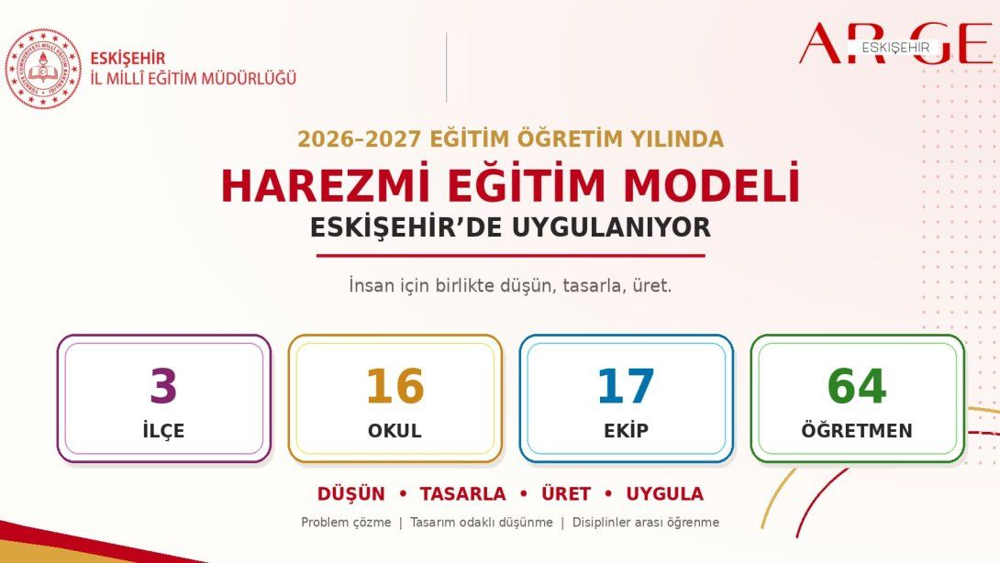
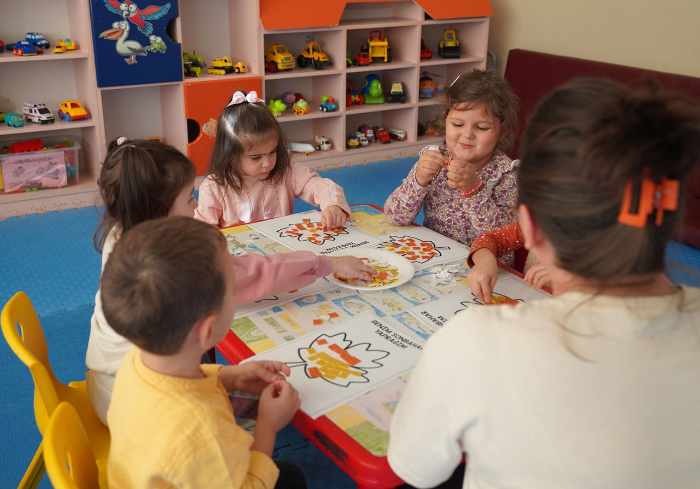
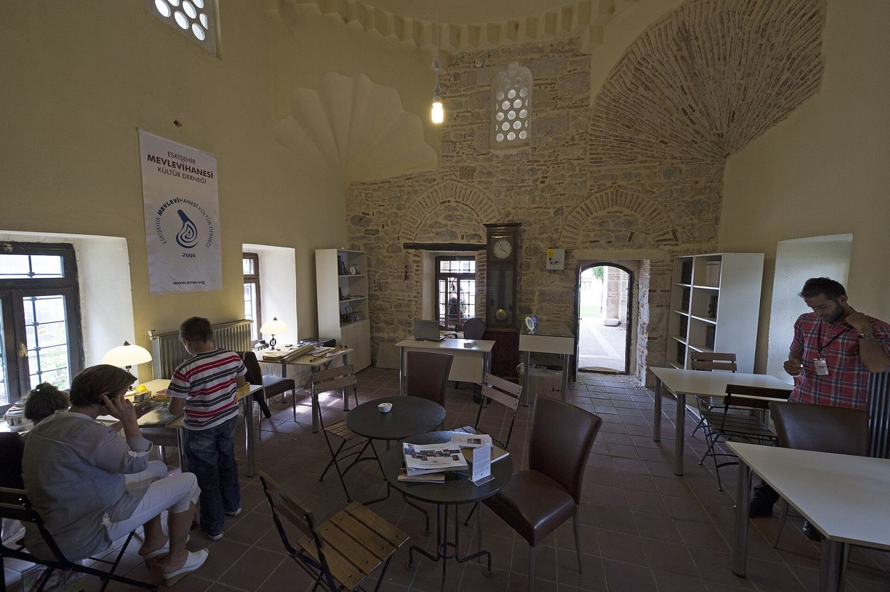
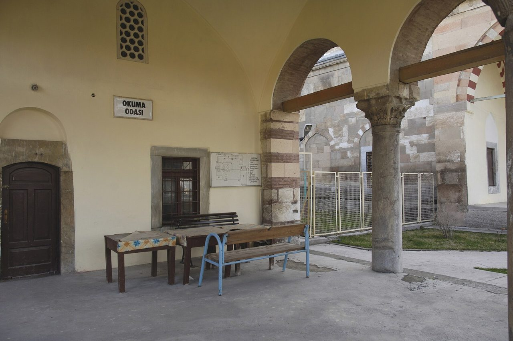
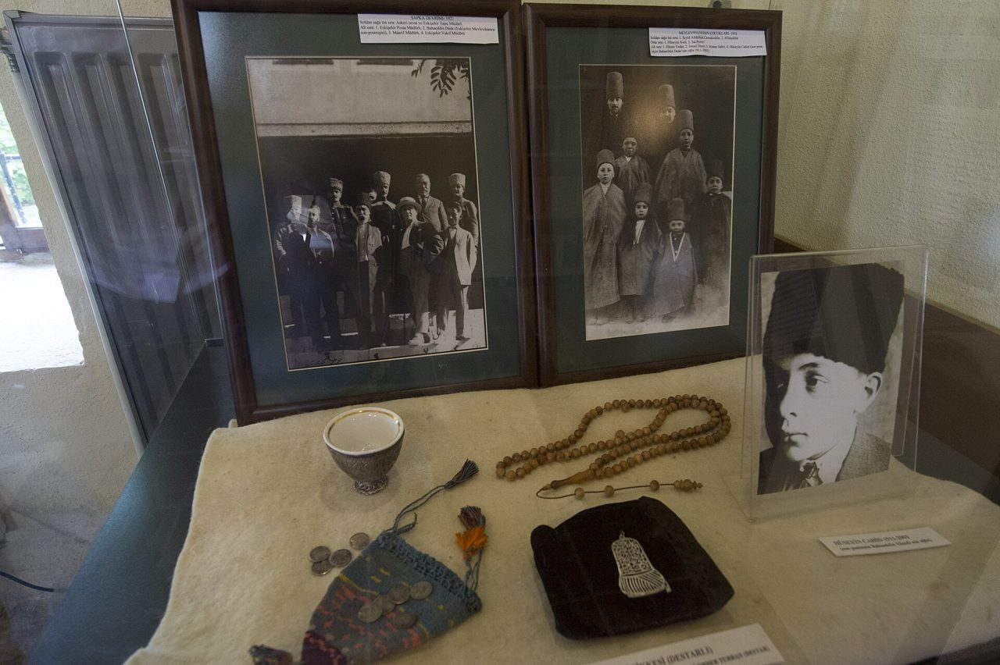
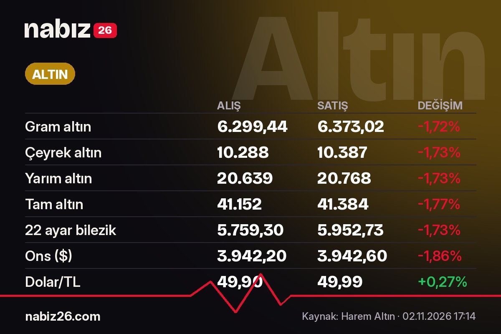

# Son haberler

Ajanın yazdığı son haberler (otomatik güncellenir).

## Tepebaşı'nın "Gel Beraber Olsun" yemek projesi yeni adresinde 2 bin 30 öğrenciye ulaştı

**Belediye · Tepebaşı** · 2026-11-03 11:32 UTC · Kaynak: [Google Haberler - Tepebaşı](https://gazetekalem.com.tr/tepebasi-belediyesinin-gel-beraber-olsun-projesi-yeni-adresinde-ogrencileri-agirliyor/)

> Proje 19 Ekim'den bu yana Ali Rıza Efendi Deneyimli Kafe'de hizmet veriyor.

Tepebaşı Belediyesi'nin üniversite öğrencilerine yönelik "Gel Beraber Olsun" projesi, 19 Ekim 2026'dan bu yana Ali Rıza Efendi Deneyimli Kafe'de hizmet veriyor. Hafta içi her gün saat 18.00-19.00 arasında sunulan akşam yemeği desteğinden yeni dönemin başlangıcından bu yana 2 bin 30 öğrenci yararlandı.

Projeyi ziyaret eden Belediye Başkanı Ahmet Ataç, öğrencilerle yemek yedi, sohbet etti ve görüşlerini dinledi. Ataç, gençlerin barınma, ulaşım ve beslenme gibi ihtiyaçları için zorlandığını belirterek belediyenin öğrencilerin bir öğün yemeğini üstlenmek istediğini söyledi. Belediyenin 2022'den bu yana on binlerce öğrenciyle aynı sofrayı paylaştığını ifade eden Ataç, tüm üniversiteli gençleri sofraya davet etti.

---

## Kurşunlu Külliyesi'nde tahliye bildirildi: Kurt "Kararı tanımıyoruz" dedi

**Gündem · Odunpazarı** · 2026-11-03 11:32 UTC · Kaynak: [Google Haberler - Odunpazarı](https://www.medyagazete.com/haber/kursunlu-kulliyesinde-tahliye-gerginligi)

> Odunpazarı Belediye Başkanı Kurt, külliyede basın açıklaması yaptı.

Medya Gazete'nin aktardığına göre Kurşunlu Külliyesi'nin tahliyesi 3 Kasım'da saat 11.00 itibarıyla belediye ekiplerine tebliğ edildi. Külliyeye gelen Odunpazarı Belediye Başkanı Kazım Kurt basın açıklaması yaptı.

Kurt, kararın kanuna aykırı olduğunu savundu. Vakıflar Kanunu'na eklenen maddenin belediyeye 5 yıl daha kiracı olma hakkı verdiğini, bu başvurunun idare mahkemesinde beklediğini, iki gün önce yürütmeyi durdurma kararı verilinceye kadar beklenileceğinin bildirildiğini söyledi. Kurt, "Biz şu anda burada hiçbir şeyi imzalamayacağız, çünkü bu kararı tanımıyoruz" dedi.

Külliyedeki müze ve sanat eserlerinin 400 sayfalık envanterle kayıtlı olduğunu belirten Kurt, eserlerden birine zarar gelirse hesabını soracaklarını söyledi. Külliyenin kapatılması halinde çalışanların işsiz kalacağını ve esnafın ticari yaşamının sıkıntıya düşeceğini ifade etti.

Haber Kurt'un açıklamasına dayanıyor; Kaymakamlığın ve Vakıflar Bölge Müdürlüğü'nün görüşü kaynakta yer almıyor.

---

## Başkan Ünlüce Porsuk Barajı'nda inceleme yaptı: "Eskişehir'in suyuna sahip çıkacağız"

**Gündem · Merkez** · 2026-11-03 11:32 UTC · Kaynak: [Google Haberler - Eskişehir](https://ankahaber.net/haber/eskisehir-buyuksehir-belediye-baskani-unluce-den-porsuk-baraji-nda-inceleme-710bfb95)

> Ünlüce, ESKİ yetkilileriyle barajdaki mevcut durumu değerlendirdi.

Eskişehir Büyükşehir Belediye Başkanı Ayşe Ünlüce, ESKİ Genel Müdürü Niyazi Solak, Genel Müdür Yardımcısı Erdem Uslu ve Su Arıtma ve İşletme Dairesi Başkanı Eylem Sıla Özer ile birlikte Porsuk Barajı'nda inceleme yaptı. Ünlüce, kentin içme suyu ihtiyacının karşılanmasında önemli olan barajdaki mevcut durumu değerlendirdi ve su kaynaklarının korunması ile sürdürülebilir su yönetimi kapsamında yürütülen çalışmalar hakkında yetkililerden bilgi aldı.

Ünlüce, "Eskişehir'imizin tek su kaynağı olan Porsuk Barajı'nda ekiplerimizle birlikte incelemelerde bulunduk" dedi. Önceliklerinin suyu kaynağından başlayarak korumak, sağlıklı ve güvenli biçimde kente ulaştırmak, kayıp ve kaçakları azaltmak, atık suyu doğru yönetmek ve gelecek kuşakların su hakkını gözetmek olduğunu söyledi.

---

## Harezmi Eğitim Modeli Eskişehir'de 16 okulda uygulanacak

**Eğitim · Merkez** · 2026-11-03 11:31 UTC · Kaynak: [Eskişehir İl Milli Eğitim Müdürlüğü](https://eskisehir.meb.gov.tr/www/harezmi-egitim-modeli-2026-2027-egitim-ogretim-yilinda-eskisehir039de-16-okulda-uygulanacak/icerik/8701/tr)

> Model 3 ilçede, 17 ekiple ve 64 öğretmenle yürütülecek.

Eskişehir İl Millî Eğitim Müdürlüğü'nün açıklamasına göre disiplinler arası öğrenmeyi, üretkenliği ve problem çözme becerilerini merkeze alan Harezmi Eğitim Modeli, 2026-2027 eğitim öğretim yılında Eskişehir'de 3 ilçede, 16 okulda ve 17 ekiple uygulanacak. Modelde 64 öğretmen görev alacak.

Model kapsamında öğrenciler günlük yaşamla bağlantılı sorunları belirleyerek çözüm önerileri geliştirecek, tasarımlar yapacak ve ürünlerini uygulamaya dönüştürecek. Bilişim teknolojileri, matematik, fen bilimleri, sosyal bilimler ve sanat gibi farklı disiplinler bir araya getirilecek; öğrencilerin araştırma, sorgulama, eleştirel düşünme, iş birliği, tasarlama ve üretme becerilerinin geliştirilmesi hedefleniyor. Çalışmalar "Düşün, Tasarla, Üret ve Uygula" anlayışıyla yürütülecek.

---

## Tepebaşı'nda belde evlerindeki oyun gruplarında 15 çocuk bir araya geliyor

**Belediye · Tepebaşı** · 2026-11-03 10:32 UTC · Kaynak: [Tepebaşı Belediyesi](https://www.tepebasi.bel.tr/Haber/Detay/tepebası’ndacocuklaroyungruplarındabulusuyor)

> Belde Evleri Eylül 2026 itibarıyla 35 hizmet noktasında 230 kursla sürüyor.

Tepebaşı Belediyesi'nin belde evlerinde düzenlediği çocuk oyun grupları, yaşa uygun etkinliklerle çocukların gelişimine katkı sunuyor. Hasan Ali Yücel ve Hedef Batıkent belde evlerindeki iki grupta toplam 15 çocuk bir araya geliyor.

Hasan Ali Yücel Belde Evi'nde 36-42 aylık 6 çocuk pazartesi ve çarşamba günleri saat 10.00-12.00 arasında, Hedef Batıkent Belde Evi'nde 42-46 aylık 9 çocuk yine pazartesi ve çarşamba günleri 13.00-15.00 arasında etkinliklere katılıyor. Buluşmaların çocukların akranlarıyla iletişim kurmasına, birlikte hareket etmesine ve oyunla öğrenmesine olanak sağladığı belirtildi.

Tepebaşı Belediye Başkanı Ahmet Ataç, çocukların gelişimini desteklemenin geleceğe yapılan yatırım olduğunu söyledi. Belediyeye göre Belde Evleri Eylül 2026 itibarıyla 35 hizmet noktasında, 29 branşta ve 230 kursta sürüyor; başvuruların toplamı 8 bin 151'e, aktif yararlanıcı sayısı 4 bin 466'ya ulaştı.

---

## Kurşunlu Külliyesi'nde Kaymakamlık yetkilileri inceleme yaptı: tutanak imzalanmadı

**Gündem · Odunpazarı** · 2026-11-03 10:33 UTC · Kaynak: [Google Haberler - Odunpazarı](https://www.istikbalgazetesi.com/kursunlu-kulliyesi-odunpazari-belediyesinden-alindi-tutanak-imzalanmadi-eserler-kaydedildi)

> Belediye yetkilileri tutanağı imzalamayacaklarını, 400 eserin kaydedilmesini istedi.

Kurşunlu Külliyesi'nin 3 Kasım saat 11.00'de Vakıflar Bölge Müdürlüğü'ne teslimi istenmişti. İstikbal Gazetesi'nin aktardığına göre külliyeye gelen Odunpazarı Kaymakamlığı yetkilileri içeri girerek alanı incelemek istedi. Kaymakamlık Yazı İşleri Müdürü Muzaffer Kaptan'ı Odunpazarı Belediyesi Başkan Yardımcısı Emre Genç karşıladı.

İncelemede tutanak tutulması konusunda bir kriz yaşandığı belirtildi. Genç ve belediye yetkilileri tutanağa imza atmayacaklarını, ancak bir örneğini istediklerini söyledi. Genç, külliyede 400 sanat eseri bulunduğunu belirterek eserlerin tek tek kayıt altına alınmasını talep etti. Bunun üzerine polis kameraları, belediye ve kaymakamlık görevlileri eserleri tek tek video çekimi eşliğinde kayıt altına aldı.

Haber tek bir gazetenin aktardığı bilgilere dayanıyor; Kaymakamlığın ve Vakıflar Bölge Müdürlüğü'nün konuya ilişkin açıklaması kaynakta yer almıyor.

---

## Eskişehirli Murat Cırık Dünya Bilek Güreşi Şampiyonası'nda +80 kiloda dünya şampiyonu oldu

**Spor · Merkez** · 2026-11-03 10:32 UTC · Kaynak: [Google Haberler - Eskişehir](https://www.sondakika.com/amp/haber-eskisehir-valisi-yilmaz-hindistan-da-80-kiloda-dun-20390059/)

> Vali Yılmaz ve Gençlik ve Spor İl Müdürlüğü şampiyonu tebrik etti.

Eskişehirli milli sporcu Murat Cırık, Hindistan'da düzenlenen 2026 Dünya Bilek Güreşi Şampiyonası'nda ayakta +80 kilogram kategorisinde dünya şampiyonu oldu.

Eskişehir Valisi Dr. Erdinç Yılmaz ve Eskişehir Gençlik ve Spor İl Müdürlüğü, Cırık için tebrik mesajı yayımladı. Gençlik ve Spor İl Müdürlüğü mesajında "Ay-yıldızlı bayrağımızı zirveye taşıyan sporcumuzu yürekten tebrik ediyor, başarılarının devamını diliyoruz. Gururumuzsun Murat Cırık" ifadelerini kullandı. Vali Yılmaz da Cırık'ın tüm rakiplerini geride bırakarak dünya şampiyonu olduğunu belirterek "Seninle gurur duyuyoruz Murat! Bileğin kavi, başarıların daim olsun" dedi.

---

## Eskişehir'de "Kale'm Ailem" projesi kapsamında öğrenciler arası üç yarışma yapılacak

**Eğitim · Merkez** · 2026-11-03 10:32 UTC · Kaynak: [Eskişehir İl Milli Eğitim Müdürlüğü](https://eskisehir.meb.gov.tr/www/quotkale039m-ailemquot-projesi-kapsaminda-ogrenciler-arasi-yarismalar-duzenlenecek/icerik/8699/tr)

> Resim, şiir ve kısa film yarışmalarına son başvuru 23 Kasım.

Eskişehir İl Millî Eğitim Müdürlüğü'nün hazırladığı "Kale'm Ailem" Projesi kapsamında öğrenciler arası yarışmalar düzenlenecek. Proje, 2026-2035 yıllarının "Aile ve Nüfus On Yılı" ilan edilmesi ve Millî Eğitim Bakanlığı'nın aile kurumunun korunması ve güçlendirilmesine yönelik hedefleri doğrultusunda hazırlandı. Eskişehir genelindeki resmî okul öncesi, ilkokul, ortaokul ve liselerde öğrenim gören öğrenciler, öğretmenler ve velileri kapsıyor. İstanbul Aile Vakfı, üniversiteler ve Eskişehir İl Müftülüğü gibi paydaşlar katkı sunuyor.

Üç yarışma yapılacak: ilkokul öğrencileri arasında aile temalı resim yarışması, ortaokul öğrencileri arasında şiir yazma ve okuma yarışması, lise öğrencileri arasında kısa film yarışması.

Takvim: başvuru ilanı 2 Kasım 2026, son başvuru 23 Kasım 2026, okul dereceleri 25 Kasım 2026, ilçe dereceleri 1 Aralık 2026, il dereceleri 10 Aralık 2026. Ödül töreni Nisan 2027'de yapılacak.

---

## Eskişehirspor'un Türkiye Kupası 4. tur rakibi 4 Kasım'daki kurada belli olacak

**Spor · Merkez** · 2026-11-03 09:32 UTC · Kaynak: [Google Haberler - Eskişehirspor](https://www.gazetevatan.com/galeri/ziraat-turkiye-kupasi-4-tur-kurasi-ne-zaman-saat-kacta-hangi-kanalda-eskisehirspor-rakibini-bekliyor-2447351)

> Kura 4 Kasım Çarşamba günü saat 15.30'da çekilecek.

Ziraat Türkiye Kupası 4. eleme turu kura çekimi 4 Kasım 2026 Çarşamba günü yapılacak. Türkiye Futbol Federasyonu önce kuranın saat 14.00'te yapılacağını duyurmuştu; ertelenen Fethiyespor-Eyüpspor 3. tur maçının tamamlanması için düzenleme yapılması nedeniyle saat 15.30'a alındı.

Kura, İstanbul Riva'daki TFF Hasan Doğan Millî Takımlar Kamp ve Eğitim Tesisleri'nde, Orhan Saka Konferans Salonu'nda kulüp temsilcilerinin katılımıyla yapılacak. Kaynakta, önceki turların kura çekimlerinin A Spor'dan canlı ve şifresiz yayınlandığı, yayın bilgisi için resmî yayın akışının kontrol edilmesi gerektiği belirtiliyor.

Eskişehirspor, 3. turda Alagöz Holding Iğdır FK'yı Prof. Dr. Fethi Heper Stadı'nda 1-0 yenerek 4. tura çıktı. Golü 90+7. dakikada Kerem Baykuş attı. Eskişehirspor'un bir sonraki rakibi kurada belli olacak.

---

## Eskişehir'de Aile ve Sosyal Hizmetler personeline afet psikososyal destek eğitimi başladı

**Gündem · Merkez** · 2026-11-03 09:32 UTC · Kaynak: [Google Haberler - Eskişehir](https://yerel-haberler.haberturk.com/eskisehir-haberleri/eskisehirde-sosyal-hizmet-personeline-afet-ve-acil-durumlarda-psikososyal-destek-egitimi-119510916)

> Üç gün sürecek eğitimin açılışını İl Müdürü Orhan Bayrak yaptı.

Eskişehir Aile ve Sosyal Hizmetler İl Müdürlüğü personeline yönelik "Afet ve Acil Durumlarda Psikososyal Destek Eğitimi" başladı. Eğitim üç gün sürecek.

Açılışta konuşan İl Müdürü Orhan Bayrak, Türkiye'nin deprem ve diğer afet riskleriyle karşı karşıya olduğunu, kurum personelinin afet bölgelerinde önemli görevler üstlendiğini söyledi. Bayrak, Gölcük ve Kahramanmaraş merkezli depremlerde ve Ağrı'daki trafik kazasında sahada edindiği tecrübeleri paylaştı.

Afetlerde emniyet, jandarma ve sağlık ekipleri başta olmak üzere farklı kurumların görev yaptığını belirten Bayrak, sosyal hizmet personelinin engelli bireyler, kronik hastalar ve bebekli aileler gibi desteğe ihtiyaç duyan grupların belirlenmesi ve ihtiyaçlarının karşılanmasında rol aldığını anlattı. Bayrak, eğitimin interaktif bir çalışma olarak verimli geçmesini diledi.

---

## Kurşunlu Külliyesi'nde kursiyerler tahliye öncesi eşyalarını toplamaya başladı

**Gündem · Odunpazarı** · 2026-11-03 08:34 UTC · Kaynak: [Google Haberler - Odunpazarı](https://www.eskisehir.net/kursunlu-kulliyesinde-kursiyerler-esyalarini-toplamaya-basladi)

> Odunpazarı Belediyesi tahliyeyi 3 Kasım saat 11.00'de yapacağını bildirdi.

Eskişehir Odunpazarı'ndaki tarihi Kurşunlu Külliyesi'nin boşaltılmasına ilişkin süreç sürerken, külliyedeki atölyelerde sanat ve el emeği çalışmaları yapan kursiyerler eşyalarını toplamaya başladı. Kursiyerler, çalışmalarında kullandıkları malzemelerin yanı sıra el emeği ürünlerini ve kişisel eşyalarını bulundukları alanlardan çıkarıyor.

Odunpazarı Kaymakamlığı, 30 Ekim'de mahkeme sürecini beklemek üzere durdurulan tahliye için iki gün sonra yeni bir yazı göndererek külliyenin 3 Kasım 2026 Salı günü saat 11.00'de Kütahya Vakıflar Bölge Müdürlüğü'ne teslim edilmesini istemişti. Kaynakta, Odunpazarı Belediyesi'nin bu yazı üzerine belirtilen tarihte tahliye işlemini gerçekleştireceğini bildirdiği aktarılıyor.

---

## Ekim ayında en çok satan otomobil Togg T10X oldu: Togg iki modelle ilk dörtte

**Ekonomi · Türkiye** · 2026-11-03 08:34 UTC · Kaynak: [Google Haberler - Togg](https://www.donanimhaber.com/ekim-ayinda-en-cok-satan-otomobil-togg-t10x-oldu--212395)

> Togg T10X 4.059, T10F 2.702 adetle ekimde elektrikli pazarın ilk iki sırasında.

Otomobil gazetecisi Emre Özpeynirci'nin paylaştığı verilere göre Togg T10X, ekim ayında 4.059 adetlik satışla en çok satan otomobil oldu. Volkswagen T-Roc 3.324 adetle ikinci, Renault Boreal 2.779 adetle üçüncü sırada yer aldı. Togg T10F ise 2.702 adetle dördüncü oldu. İki Togg modelinin toplam satışı 6.761 adede ulaştı.

Türkiye otomobil ve hafif ticari araç pazarı ekimde yıllık bazda yüzde 30,84 azalarak 80 bin 334 adet oldu; otomobil satışları 64 bin 939, hafif ticari araç satışları 15 bin 395 adet olarak aktarıldı. Yılın ilk 10 ayında pazar geçen yılın aynı dönemine göre yüzde 15,33 daralarak 883 bin 799 adede geriledi.

Ocak-ekim döneminde en çok satan otomobil 35.844 adetle Renault Clio oldu. Toyota Corolla 26.455 adetle ikinci, Togg T10X 26.079 adetle üçüncü sırada yer aldı; Togg T10F 18.108 adetle ilk 10'da dokuzuncu sırada. İki modelin 10 aylık toplam satışı 44.187 adet.

Togg modelleri ekimde ve ocak-ekim döneminde elektrikli otomobil pazarında da ilk iki sırada yer aldı.

---

## UKOME kararı: Tepebaşı'nda Akbal Sokak tek yön olacak, 4 araçlık park yeri yapılacak

**Ulaşım · Tepebaşı** · 2026-11-03 05:32 UTC · Kaynak: [Google Haberler - Eskişehir](https://www.gazetevatan.com/sehirler/eskisehir/eskisehirdeki-sokak-tek-yon-oluyor-4-araclik-park-yeri-yapilacak-2446330)

> Sokaktaki Şehit Aileleri ve Gazilere Yönelik Sosyal Tesis'in girişine yaya geçidi de yapılacak.

Eskişehir Büyükşehir Belediyesi Ulaşım Koordinasyon Merkezi (UKOME), Tepebaşı ilçesi Şarhöyük Mahallesi'ndeki Akbal Sokak için trafik düzenlemesi kararı aldı. Karar toplantıda oy birliğiyle alındı.

Karara göre Şehit Aileleri ve Gazilere Yönelik Sosyal Tesis'in bulunduğu sokak, Gazi Yakup Satar Caddesi'nden Özkan Sokak'a doğru tek yön olarak düzenlenecek. Tesise gelenlerin araçlarını park edebilmesi için giriş kapısının karşısına 4 araçlık park yeri ayrılacak, giriş kapısına yakın noktada yaya geçidi yapılacak. Düzenlemeyle şehit yakınları, gaziler ve diğer yayalar için trafik güvenliğinin artırılması amaçlanıyor.

UKOME kararına göre yeni düzenleme, gerekli yatay ve düşey trafik işaretleri ile levhaların yapılmasının ardından uygulanmaya başlanacak.

---

## Ali Güven Turizm Lisesi öğrencileri Antalya'daki gastronomi festivalinde 15 madalya aldı

**Eğitim · Merkez** · 2026-11-03 04:32 UTC · Kaynak: [Google Haberler - Eskişehir](https://yerel-haberler.haberturk.com/eskisehir-haberleri/eskisehirli-ogrenciler-gastronomi-festivalinde-15-madalya-kazandi-119510006)

> Öğrenciler 6 altın, 7 gümüş ve 2 bronz madalya aldı.

Eskişehir'deki Ali Güven Turizm Mesleki ve Teknik Anadolu Lisesi öğrencileri, Antalya'da bu yıl 7'ncisi düzenlenen Game of Food Konyaaltı Uluslararası Gastronomi Festivali'nde 15 madalya kazandı.

İl Milli Eğitim Müdürlüğü'nün açıklamasına göre farklı kategorilerde yarışan öğrenciler 6 altın, 7 gümüş ve 2 bronz madalya elde etti.

---

## Tepebaşı'nda Kırım Caddesi 3-4 Kasım'da asfalt çalışması için trafiğe kapanacak

**Ulaşım · Tepebaşı** · 2026-11-03 04:32 UTC · Kaynak: [Google Haberler - Eskişehir](https://www.gzt26.com/eskisehirin-islek-caddesi-2-gun-trafige-kapatilacak)

> Kapatma saat 08.30-17.30 arasında uygulanacak, alternatif güzergah açıklandı.

Eskişehir Büyükşehir Belediyesi, Tepebaşı ilçesindeki Kırım Caddesi'nde asfalt bakım ve onarım çalışması yapılacağını duyurdu. Caddenin Gazi Yakup Satar Caddesi ile Sakarya 1 Caddesi arasında kalan bölümü 3 Kasım Salı ve 4 Kasım Çarşamba günleri saat 08.30 ile 17.30 arasında araç trafiğine kapalı olacak.

Çalışmayı Yol Yapım Bakım ve Onarım Dairesi Başkanlığı yürütecek. Belediye sürücülerden alternatif güzergah olarak İsmail Gaspıralı Caddesi üzerinden Hasan Polatkan Caddesi'ni kullanmalarını ve trafik işaret ve işaretçilerine uymalarını istedi. Yolun kapalı olduğu saatlerde acil durum araçlarının geçişi trafik güvenlik ekiplerince sağlanacak.

---

## Bakan Kacır: Togg 2026'da 60 bine yakın teslimat hedefliyor, gelecek yıl kapasite 100 bin

**Ekonomi · Türkiye** · 2026-11-03 02:32 UTC · Kaynak: [Google Haberler - Togg](https://www.toplumsal.com.tr/haber/togg-da-gelecek-yil-100-bin-kapasite-hedefleniyor_32622/)

> Kacır, Togg'un 2025'te 39 bin araç teslim ettiğini ve segmentinde yüzde 31 pazar payına sahip olduğunu söyledi.

Sanayi ve Teknoloji Bakanı Mehmet Fatih Kacır, TBMM Plan ve Bütçe Komisyonu'nda milletvekillerinin sorularını yanıtlarken Togg'a ilişkin rakamlar paylaştı.

Kacır, Togg'un 2026'da 60 bine yakın teslimat hedeflediğini, gelecek yıl piyasaya çıkacak yeni modelle kapasitenin 100 bin adede ulaşmasının planlandığını söyledi. Bakan, "Hep birlikte TOGG'a güçlü şekilde sahip çıkıyoruz" dedi.

Kacır'ın aktardığına göre Togg 2023'te 19 bin 600, 2024'te 30 bin, 2025'te 39 bin araç teslim etti. Bakan, markanın kendi segmentinde yüzde 31 pazar payıyla en çok satan otomobil olduğunu belirtti. ÖTV iadesi dahil çeşitli teşviklerin Togg'a sunulduğunu, maliyetleri düşürme tedbirleri ve batarya teknolojilerindeki gelişmelerle şirketin kârlılığa yaklaştığını da ifade etti.

---

## Togg'da ortaklık yapısı değişiyor: Anadolu Grubu ve Vestel paylarını devrediyor

**Ekonomi · Türkiye** · 2026-11-02 23:32 UTC · Kaynak: [Google Haberler - Togg](https://www.hurriyet.com.tr/gundem/toggda-anadolu-grubu-ve-vestelin-paylari-tvf-ve-turkcelle-geciyor-43363874)

> Turkcell'in Togg'daki payı işlem tamamlanınca yüzde 34'e çıkacak.

Kamuyu Aydınlatma Platformu'na (KAP) yapılan açıklamalara göre Togg'un ortaklık yapısında değişiklik olacak.

AG Anadolu Grubu Holding, Togg'daki yüzde 23'lük payının sermayenin yüzde 11'ine karşılık gelen bölümünü Turkcell'e, yüzde 12'sine karşılık gelen bölümünü Türkiye Varlık Fonu'na (TVF) devretmek üzere sözleşme imzaladı. Devir bedeli toplam 184 milyon avro olarak açıklandı ve kapanış tarihinde nakit ödenecek.

Vestel Elektronik ise Togg'daki yüzde 23'lük payının tamamını 184 milyon avro karşılığında TVF'ye satacağını bildirdi. Vestel, satıştan elde edilecek tutarın en az yüzde 90'ının, elde edilme tarihinden itibaren 30 gün içinde nakdi banka kredilerine ilişkin vadesi gelmiş borçların ödenmesinde kullanılacağını açıkladı.

Turkcell'in açıklamasına göre sözleşmedeki ön şartların tamamlanmasının ardından işlemin kapanışı planlanıyor; işlem tamamlandığında Turkcell'in Togg'daki payı yüzde 34'e yükselecek. Turkcell, yatırımın teknoloji altyapısı ve dijital hizmetler alanındaki yetkinlikleriyle stratejik uyum gösterdiğini belirtti.

---

## Eskişehir Şehir Hastanesi'nin yeni başhekimi Prof. Dr. Mustafa Cem Algın oldu

**Sağlık · Merkez** · 2026-11-02 22:32 UTC · Kaynak: [Google Haberler - Eskişehir](https://www.gzt26.com/eskisehir-sehir-hastanesinin-yeni-bashekimi-belli-oldu)

> Algın, görevi Dr. Öğr. Üyesi Fatih Alper Ayyıldız'dan devraldı.

Eskişehir Şehir Hastanesi'nde başhekimlik görevinde değişikliğe gidildi. Dr. Öğr. Üyesi Fatih Alper Ayyıldız'ın yürüttüğü başhekimlik görevine, Genel Cerrahi Uzmanı Prof. Dr. Mustafa Cem Algın atandı. Daha önce aynı hastanede genel cerrahi uzmanı olarak görev yapan Algın, Kasım 2026 itibarıyla hastanenin yeni başhekimi oldu.

Kaynakta aktarılan özgeçmişine göre Algın, Eskişehir doğumlu. Hacettepe Üniversitesi Tıp Fakültesi'nden 1991'de mezun oldu, meslek hayatına Eskişehir Devlet Hastanesi'nde pratisyen hekim olarak başladı. Genel cerrahi uzmanlığını Eskişehir Osmangazi Üniversitesi Tıp Fakültesi'nde tamamladı, akademik kariyerine Dumlupınar Üniversitesi ve Kütahya Sağlık Bilimleri Üniversitesi'nde devam ederek profesörlük unvanını aldı. 2018-2023 arasında dekanlık yaptı, rektör yardımcılığı görevinde de bulundu. Sindirim sistemi, safra yolları, karaciğer, tiroid ve meme hastalıklarının cerrahi tedavisi üzerine çalıştı.

---

## TFF 3. Lig 2. Grup'ta Eskişehir Anadolu Alanya'yı 5-1, Eskişehirspor Gaziemir'i 5-0 yendi

**Spor · Merkez** · 2026-11-02 21:32 UTC · Kaynak: [Google Haberler - Eskişehir](https://www.usakport.com.tr/usakin-yenildigi-haftanin-en-kazanclisi-eskisehirin-2-ekibi-oldu)

> Eskişehirspor 7 Kasım'da Kepezspor'u konuk edecek.

TFF 3. Lig 2. Grup'un 9. haftasında Eskişehir'in iki takımı da farklı galibiyet aldı. Evinde Alanya 1221 FK'yı konuk eden Eskişehir Anadolu rakibini 5-1 yendi. Ligin ikincisi Eskişehirspor ise Gaziemir G.O.G.'yi deplasmanda 5-0 mağlup etti.

Haftanın diğer sonuçları şöyle: Kepezspor-Uşakspor 2-0, Altay 1922-Akşehir Spor 1-1, Etimesgutspor 1-0 (rakibi kaynakta Bigaspor olarak geçiyor), Ayvalıkgücü Belediyespor-Bucaspor 1928 2-1, Bursa Yıldırımspor-Balıkesirspor 1-1, Denizli İdmanyurdu-Karşıyaka 0-6, Söke 1970-Gemlik Sümerbey 1-7.

Gelecek hafta, 7 Kasım Cumartesi günü Eskişehirspor Kepezspor'u, Uşakspor ise Eskişehir Anadolu'yu konuk edecek.

---

## AK Partili meclis üyeleri: Kurşunlu Külliyesi kapanmıyor, belediye bilgi versin

**Gündem · Odunpazarı** · 2026-11-02 20:32 UTC · Kaynak: [Google Haberler - Odunpazarı](https://www.esgazete.com/ak-partiden-kursunlu-cikisi-belediye-gercekleri-aciklasin)

> Üyeler belediyeden gelir-gider tablosu ve Vakıflar'a verilen yanıtları açıklamasını istedi.

Kurşunlu Külliyesi'nin tahliyesiyle ilgili tartışmalar sürerken AK Parti Odunpazarı Belediye Meclis Üyeleri yeni bir açıklama yaptı. Üyeler, külliyenin kapatılacağı ve müzelerin ortadan kaldırılacağı yönündeki iddiaları reddederek tartışmaların hukuki belgeler üzerinden yürütülmesi gerektiğini söyledi. Açıklamada "Kurşunlu Külliyesi kapanmıyor. Kapanan şey, kirada anlaşmayan ve sözleşme imzalamayan bir yönetimin 'mağduriyet siyaseti'dir" denildi.

AK Partili üyeler, belediyenin yürütmeyi durdurma talebinin mahkeme tarafından reddedildiğini ve bu kararın istinaf aşamasında kesinleştiğini ileri sürdü; Kaymakamlığın keyfî bir işlem yapmadığını, yargı kararını uyguladığını savundu. Kira sözleşmesinin uzatılmasına ilişkin Geçici 15. maddeye değinen üyeler, bunun için Vakıflar'a borç bulunmaması, açılan davalardan vazgeçilmesi, belirlenen kira bedelinin kabul edilmesi ve süresi içinde başvuru yapılması gerektiğini, belediyenin bu şartları yerine getirmediğini öne sürdü.

Üyeler, bazı kaynaklara göre belediyenin külliyedeki kiracılardan yıllık 419 bin lira kira toplayıp Vakıflar'a 123 bin lira ödediğini iddia etti. Tahliye sürecinin 2024 sonunda başladığını, belediyenin müzelerdeki eserler için alternatif plan hazırlamadığını savundular. Kaymakamlık yazısında mevcut kiracı ve kullanıcıların durumunun korunacağının belirtildiğini, esnafın ve sanatçıların faaliyetlerinin sürebileceğini ifade ettiler.

AK Partili üyeler belediyeden üç konuda açıklama istedi: külliyenin gelir-gider tablosu, Vakıflar'ın gönderdiği ihtarlara verilen yanıtlar ve 2014'ten bu yana ecrimisil nedeniyle çıkarıldığı öne sürülen kiracıların listesi. Bu konuları Belediye Meclisi'ne yazılı soru önergesi olarak sunacaklarını belirttiler.

Haber AK Partili meclis üyelerinin açıklamasına dayanıyor. Odunpazarı Belediyesi'nin bu iddialara yanıtı kaynakta yer almıyor; belediyenin görüşleri için bu sitedeki önceki haberlere bakılabilir.

---

## Tepebaşı Belediyesi'nin üniversite öğrencilerine ücretsiz akşam yemeği bu yıl da sürüyor

**Belediye · Tepebaşı** · 2026-11-02 19:32 UTC · Kaynak: [Google Haberler - Tepebaşı](https://www.gzt26.com/ahmet-atac-duyurdu-universite-ogrencilerine-desteklerimiz-devam-ediyor)

> Başkan Ataç öğrencilerle Ali Rıza Efendi Deneyimli Kafe'de yemek yedi.

Tepebaşı Belediye Başkanı Ahmet Ataç, üniversite öğrencilerine yönelik 2022'de başlatılan ücretsiz akşam yemeği uygulamasının bu yıl da devam ettiğini açıkladı. Ataç, Ali Rıza Efendi Deneyimli Kafe'de öğrencilerle bir araya geldi, eğitim hayatı ve günlük yaşam üzerine sohbet etti.

Ataç, "Üniversite okumak bugünün Türkiye'sinde hiç kolay değil. Ekonomik zorluklar ortada. Gençlerimizin bir öğün yemeğini biz düşünelim, ailelerin bütçesine de bir nebze katkımız olsun istiyoruz" dedi. Öğrencilere seslenen Ataç, "Afiyet olsun gençler, soframız, kapımız sizlere daima açık" ifadelerini kullandı.

Açıklamada uygulamadan bugüne kaç öğrencinin yararlandığına ve günlük dağıtılan yemek sayısına ilişkin bilgi verilmedi.

---

## Odunpazarı Meclisi'nde Kurşunlu Külliyesi tartışması: Kurt ve Kepez farklı görüşte

**Gündem · Odunpazarı** · 2026-11-02 18:33 UTC · Kaynak: [Google Haberler - Odunpazarı](https://www.gzt26.com/kazim-kurt-sert-konustu-hic-kimseye-bir-sey-teslim-etmiyoruz)

> Kurt belediyenin külliye giderlerini açıkladı, Kepez Vakıflar'ın mülk sahipliğini vurguladı.

Odunpazarı Belediyesi kasım ayı meclis toplantısında Kurşunlu Külliyesi'nin tahliyesi gündeme geldi. Belediye Başkanı Kazım Kurt ve AK Parti Grup Başkanvekili Mehmet Kepez farklı görüşler dile getirdi.

Kurt'un anlattığına göre külliye 2004'ten bu yana Odunpazarı Belediyesi tarafından kültür ve sanat hizmetlerine tahsis edilen bir alan. Belediyenin 1 Ocak-30 Ekim 2026 arasındaki külliye harcamalarını açıklayan Kurt, ortak alanların, müzenin ve işyerlerinin elektriği için 409 bin 523 lira, doğal gaz için 443 bin 366 lira, temizlik personeli için 794 bin 873 lira, güvenlik personeli için 3 milyon 238 bin 286 lira ve cam sanatları atölyesinin oksijen tesisatı ile diğer giderleri için yaklaşık 134 bin lira harcandığını, toplamın 6 milyon 26 bin liraya ulaştığını söyledi. Kurt, külliyede 18 kurs öğretmeni, teknisyen ve cam sanatçısının çalıştığını, 14 küçük işletmenin bulunduğunu belirtti.

Kurt, kira sözleşmesinin beş yıl uzatılmasına olanak tanıyan düzenlemeye süresi içinde başvurduklarını, Vakıflar'ın yanıt vermemesi üzerine "zımnen ret" kabul ederek dava açtıklarını, yargılamanın sürdüğünü ve mahkemenin yürütmeyi durdurma kararı vermediğini söyledi. Kaymakamlığın 3 Kasım 2026'da külliyenin boşaltılmasını bildirdiğini, ortada mahkeme kararı bulunmadığını savundu.

Kepez ise külliyenin boşaltılmasının AK Parti'yle ilgisi olmadığını söyledi. Külliye yargı kararıyla belediyeden alınsa bile AK Parti'nin orayı bir derneğe vermek gibi bir düşüncesi ve yetkisi bulunmadığını belirten Kepez, Vakıfların mülk sahibi olduğunu, kendi envanterini çıkararak kiraları tahsil etmeye çalıştığını, İl Tarım Müdürlüğü binasından ve bazı valiliklerden de kira istediğini ifade etti. Kepez, Vakıflarla kira konusunda uzlaşı sağlanamamasının belediyenin sorunu olduğunu ve bunun AK Parti'ye fatura edilmesinin doğru olmadığını söyledi.

Haber meclis konuşmalarına dayanıyor; Vakıflar Bölge Müdürlüğü'nün ve Kaymakamlığın bu açıklamalara ilişkin görüşü kaynakta yer almıyor.

---

## ESKİ: Çankaya'daki hat çalışması nedeniyle 6 mahallede su kesintisi sürecek

**Gündem · Merkez** · 2026-11-02 18:32 UTC · Kaynak: [Google Haberler - Eskişehir](https://www.gzt26.com/eski-duyurdu-eskisehirde-6-mahallede-su-kesintisi-devam-edecek)

> Bağlantı tamamlanınca sisteme kademeli olarak su verilecek.

Eskişehir Büyükşehir Belediyesi Su ve Kanalizasyon İdaresi Genel Müdürlüğü (ESKİ), Çankaya Mahallesi Özlem Caddesi'nde yürütülen içme ve kullanma suyu isale hattı bağlantı çalışmalarının sürdüğünü bildirdi.

ESKİ'nin yazılı açıklamasına göre çalışmalar nedeniyle Çankaya, Emek, Ihlamurkent, Erenköy, 71 Evler ve Vadişehir mahallelerinde yaşanan su kesintisi ve basınç düşüklüğü bir süre daha devam edecek. Ekiplerin çalışmaları güvenli şekilde tamamlamak ve bölgeye yeniden su vermek için sahada aralıksız çalıştığı belirtildi.

Bağlantı işlemleri tamamlandıktan sonra sisteme kademeli olarak su verilecek, şebeke basıncının dengelenmesine bağlı olarak su akışı aşamalı şekilde normal seviyesine ulaşacak. ESKİ, vatandaşlara anlayış ve sabırları için teşekkür etti. Açıklamada kesintinin ne zaman sona ereceğine dair bir saat verilmedi.

---

## Eskişehir Uluslararası Polifonik Koro Şenliği İstanbul Avrupa Korosu konseriyle bitti

**Kültür-Sanat · Merkez** · 2026-11-02 17:55 UTC · Kaynak: [Google Haberler - Eskişehir](https://ankahaber.net/haber/2-eskisehir-uluslararasi-polifonik-koro-senligi-ozel-konserle-sona-erdi-a838140a)

> Şenliğe 30 Ekim-1 Kasım'da 37 koro katıldı.

Eskişehir Büyükşehir Belediyesi ve Eskişehir Polifonik Korosu Derneği iş birliğiyle düzenlenen 2. Eskişehir Uluslararası Polifonik Koro Şenliği, İstanbul Avrupa Korosu'nun özel konseriyle sona erdi. Kapanış konserine Eskişehir Büyükşehir Belediye Başkan Vekili Vural Yörük ile Tepebaşı Belediye Başkanı Ahmet Ataç katıldı.

30 Ekim-1 Kasım tarihlerinde yapılan şenliğe farklı şehir ve ülkelerden toplam 37 koro katıldı. Konserlerin yanı sıra atölye çalışmaları ve ortak performanslar yapıldı. Koroların performansları uluslararası değerlendirme kurulu üyeleri tarafından sanatsal açıdan ele alındı; yarışma ve sıralama yerine gelişim ve paylaşım esas alındı, kurul üyeleri korolara repertuvar, yorum, teknik ve müzikal ifade konusunda görüş ve önerilerini aktardı.

Şenliğin sanat yönetmenliğini Ender Sakpınar üstlendi. Uluslararası değerlendirme kurulunda Turgay Erdener, Francesco Di Mauro, Nikos Haliassas, Özlem Erdoğan, Mete Gökçe, Çiğdem Aytepe, Atilla Çağdaş Değer, Zeynep Göknur Yıldız ve Hakan Bağcı yer aldı.

---

## Eskişehir Büyükşehir 8 yeni tramvay için ihaleye çıktı: ihale 6 Kasım'da

**Ulaşım · Merkez** · 2026-11-02 17:55 UTC · Kaynak: [Google Haberler - Eskişehir gündem](https://www.eskisehirhaberajansi.com/eskisehirde-tramvay-filosu-yenileniyor-ihale-tarihi-belli-oldu)

> Belediye ayrıca ESTÜ'ye tramvay bağlantısı için kurumlarla görüşüyor.

Eskişehir Büyükşehir Belediyesi, toplu ulaşım hizmetlerini geliştirmek amacıyla 8 yeni tramvay aracı alımı için ihale sürecini başlattı. İhale 6 Kasım 2026'da yapılacak. Yeni araçlarla tramvay seferlerinin sıklığının artırılması, yolculuk konforunun iyileştirilmesi ve araç filosunun yaş ortalamasının düşürülmesi amaçlanıyor.

Belediyenin açıklamasına göre 315 araçlık otobüs filosu 116 hatta hizmet veriyor. Okulların açık olduğu dönemde hafta içi günlük yaklaşık 105-110 bin yolcu otobüsleri kullanırken hafta sonu bu sayı 55-60 bin düzeyinde. Gece ulaşımında 00.00-05.00 arası hizmet veren araç sayısı Mayıs 2024'ten bu yana 3'ten 7'ye çıkarıldı. Ocak ayında 25 adet 8 metrelik otobüs filoya katıldı, Otobes26 Eskişehir Turistik Hattı oluşturuldu.

Belediye, "Türkiye'nin Ulaşımda Net Sıfır Emisyon Yol Haritası Projesi" kapsamında 20 elektrikli otobüs alımına yönelik proje başvurusunun kazanıldığını, Bakanlık nezdindeki görüşmelerin sürdüğünü bildirdi.

Opera-Kumlubel hattından Eskişehir Teknik Üniversitesi'ne tramvay bağlantısı için de çalışma başlatıldı. Projenin hava mania planı ve Karayolları Genel Müdürlüğü'nün sorumluluk alanında bulunması nedeniyle ilgili kurumlara yazı gönderildi; Büyükşehir, ESTÜ, Karayolları Genel Müdürlüğü ve Devlet Hava Meydanları İşletmesi ile irtibat halinde ve yanıtlar bekleniyor.

---

## Odunpazarı Belediyesinde yeni atamalar: Sibel Yeşildal başkan yardımcılığına getirildi

**Belediye · Odunpazarı** · 2026-11-02 17:15 UTC · Kaynak: [Google Haberler - Odunpazarı](https://www.gzt26.com/odunpazari-belediyesinde-yeni-atamalar-kazim-kurt-isimleri-acikladi)

> Başkan Kurt, atamaları belediye meclisinin bilgisine sundu.

Odunpazarı Belediye Başkanı Kazım Kurt, belediye meclisinde geçen ay yapılan bazı atamaları meclisin bilgisine sundu.

Kurt'un aktardığına göre belediye meclis üyesi Sibel Yeşildal belediye başkan yardımcılığına atandı. Gençlik ve Spor Hizmetleri Müdürü Soner Onrat Engelli ve Yaşlı Hizmetleri Müdürlüğü'ne, İşletme ve İştirakler Müdürü Ahmet Boz ise Gelirler Müdürlüğü'ne getirildi.

Müdür vekilliklerine Merve Sadıç (Gençlik ve Spor Hizmetleri), Alper Eseroğlu (İşletme ve İştirakler), İhsan Araz (Ruhsat ve Denetim), Ercan Temel (Afet İşleri ve Risk Yönetimi) ve İlker Ardıç (Bilgi İşlem) atandı. Kurt, atananların görevlerine başladığını söyledi.

Kurt ayrıca belediyede yapılan denetimlere ilişkin raporları grup başkanvekillerine sunduklarını, raporları meclisin bilgisine de sunduklarını belirtti.

---

## Eskişehir'de Karadeniz Festivali 13-15 Kasım'da: 1 ton hamsi ikram edilecek

**Kültür-Sanat · Merkez** · 2026-11-02 15:56 UTC · Kaynak: [Google Haberler - Eskişehir etkinlik](https://www.eskisehirhaber.com/eskisehirde-karadeniz-festivali-basliyor-1-ton-hamsi-ikram-edilecek)

> Festivalde İsmail Türüt ve Onay Şahin sahne alacak.

Eskişehir Karadenizliler Derneği öncülüğünde düzenlenecek Karadeniz Festivali, 13-14-15 Kasım 2026 tarihlerinde Vişnelik Mahallesi'ndeki Dede Korkut Parkı'nda yapılacak. Festival, Baş Fuar ve Organizasyon iş birliğiyle düzenleniyor.

Üç gün sürecek etkinlikte İsmail Türüt, Onay Şahin, Mithat Körler, Hakan Köntek, Filiz Yıldırım, Efe Karagüzel, Hamit Çakıcı ve Mehmet Durak sahne alacak. Program şöyle: 13 Kasım Cuma İsmail Türüt ve Filiz Yıldırım; 14 Kasım Cumartesi Onay Şahin, Hamit Çakıcı ve Mithat Körler; 15 Kasım Pazar Hakan Köntek ve Efe Karagüzel.

Ziyaretçilere 13 Kasım'da karalahana çorbası, 14 Kasım'da 1 ton hamsi, 15 Kasım'da kuymak ikram edilecek. Festival alanında horon, kemençe ve tulum gösterileri, Karadeniz'in yöresel ürünlerinin satıldığı stantlar ve çocuklar için oyun alanları da bulunacak.

---

## Odunpazarı Belediye Meclisi Sağlıklı Kentler Birliği'nden ayrılma kararı aldı

**Belediye · Odunpazarı** · 2026-11-02 14:33 UTC · Kaynak: [Google Haberler - Odunpazarı](https://www.gzt26.com/odunpazari-belediyesinden-flas-ayrilik-karari-mecliste-karar-alindi)

> Karar oy çokluğuyla kabul edildi; AK Parti grubu ret oyu kullanacağını açıkladı.

Odunpazarı Belediye Meclisi, belediyenin Sağlıklı Kentler Birliği üyeliğinden ayrılmasına ilişkin gündem maddesini oy çokluğuyla kabul etti.

Yeni Parti Grup Başkanvekili Emre Genç, birliğin bundan sonraki süreçte sağlıklı bir şekilde faaliyet sürdüremeyeceğini düşündüklerini söyledi. Genç, birçok belediyenin birlik toplantılarına katılmadığını ve ayrılma kararı aldığını belirterek maddeye kabul oyu vereceklerini açıkladı.

AK Parti Grup Başkanvekili Mehmet Kepez ise maddenin siyasi bir tavır olarak gündeme geldiğini düşündüklerini belirtti. Kepez, birliğin başkanının siyasi parti değiştirerek önce bağımsız olmasına, ardından AK Parti'ye geçmesine tepki olarak karar getirildiğini savundu. Kepez, birlik başkanları farklı partiden olduğunda iyi çalışacağı, AK Partili olduğunda çalışamayacağı yönündeki anlayışı doğru bulmadıklarını söyleyerek AK Parti grubunun ret oyu kullanacağını ifade etti.

Haber, Odunpazarı Belediye Meclisi'ndeki konuşmalara dayanıyor; birliğin görüşü kaynakta yer almıyor.

---

## ESOGÜ'de "Bilinçli Anneler, Güvende Nesiller" projesinin açılışı yapıldı

**Eğitim · Merkez** · 2026-11-02 14:33 UTC · Kaynak: [Eskişehir Osmangazi Üniversitesi](https://www.ogu.edu.tr/Web/HaberDetay/2149)

> Proje annelerin hukuki ve sosyal donanımını, çocukların güvenli yaşam farkındalığını hedefliyor.

Eskişehir Osmangazi Üniversitesi (ESOGÜ), Kadın ve Demokrasi Derneği (KADEM) Eskişehir Temsilciliği ve Eskişehir İl Milli Eğitim Müdürlüğü iş birliğinde yürütülen "Bilinçli Anneler, Güvende Nesiller" projesinin açılış programı ve ihtiyaç belirleme çalıştayı ESOGÜ ev sahipliğinde yapıldı. Etkinliğe Rektör Prof. Dr. Emine Gümüşsoy ile Rektör Yardımcısı Prof. Dr. Şerife Yücesoy Özkan katıldı. Kongre ve Kültür Merkezi'ndeki programda KADEM Eskişehir İl Temsilcisi Mehtap Özkaya ve İl Milli Eğitim Müdürü Sinan Aydın açılış konuşması yaptı.

Rektör Gümüşsoy'un aktardığına göre proje, Eskişehir'in merkez dışındaki ilçelerinde yaşayan annelerin hukuki ve sosyal donanımını artırmayı, şiddetsiz ve sağlıklı iletişim becerilerini geliştirmeyi, çocukların ise kişisel sınırlarını, beden güvenliklerini ve duygusal becerilerini desteklemeyi amaçlıyor. Anne ve çocuk eş zamanlı bir güçlenme modeliyle ele alınıyor: Anneler hukuki haklar, KADES, ŞÖNİM ve olumlu ebeveynlik konularında bilinçlenirken çocuklar oyun temelli eğitimlerle güvenli yaşam farkındalığı kazanacak. Eğitimlerin ardından tematik sanat atölyeleri yapılacak.

Gümüşsoy, ESOGÜ'nün akademisyen kadrosu ve gönüllü gençleriyle projenin bilimsel ve akademik paydaşı olduğunu söyledi.

---

## Altın fiyatları 2 Kasım 2026: Gram altın 6.373,02 TL

**Ekonomi · Merkez** · 2026-11-02 14:14 UTC · Kaynak: [Harem Altın](https://www.haremaltin.com/altin-fiyatlari)

> Gram altın güne düşüşle başladı. Harem Altın verilerine göre gram altın 6.299,44 TL'den alınıyor, 6.373,02 TL'den satılıyor.

Altın piyasasında güne düşüşle başlandı. Harem Altın'ın saat 17.14 itibarıyla verilerine göre gram altının satış fiyatı 6.373,02 TL, alış fiyatı 6.299,44 TL oldu. Gram altın, önceki kapanışa göre yüzde 1,72 geriledi.

Ziynet altınlarda çeyrek altın 10.387 TL, yarım altın 20.768 TL, tam altın 41.384 TL, ata altın 42.490 TL seviyesinden satışa sunuluyor.

22 ayar bileziğin gram satış fiyatı 5.952,73 TL, has altının gram fiyatı 6.353,96 TL olarak belirlendi.

Uluslararası piyasalarda altının onsu 3.942,60 dolardan işlem görürken, dolar/TL 49,99 seviyesinde bulunuyor.

Fiyatlar Harem Altın'ın saat 17.14 itibarıyla paylaştığı verilere dayanmaktadır; kuyumcular arasında farklılık gösterebilir. Bu haber yatırım tavsiyesi değildir.

---
