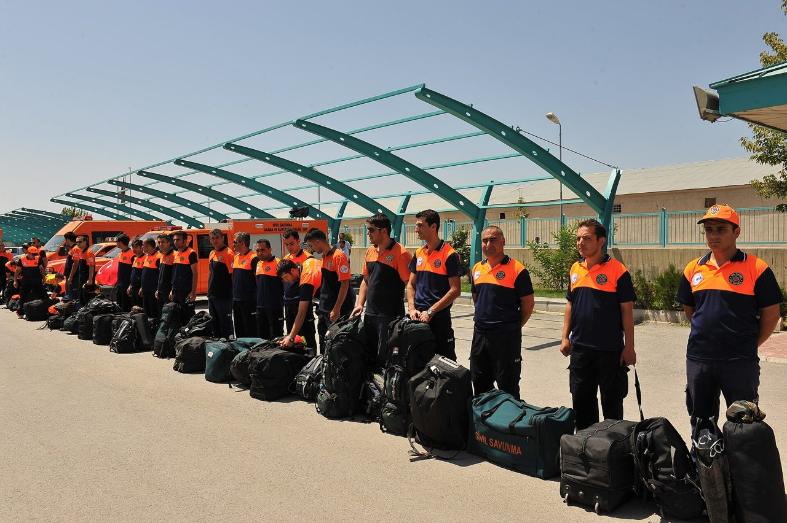
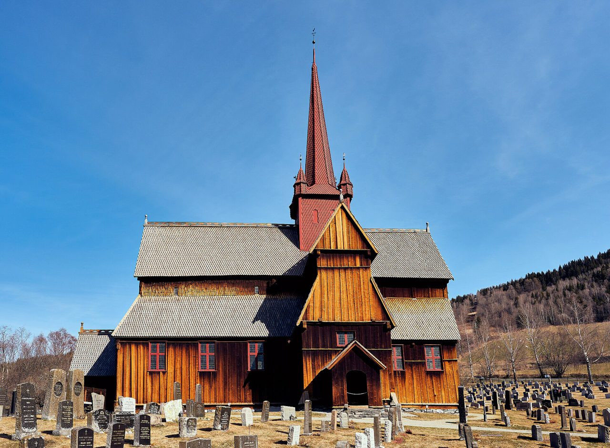
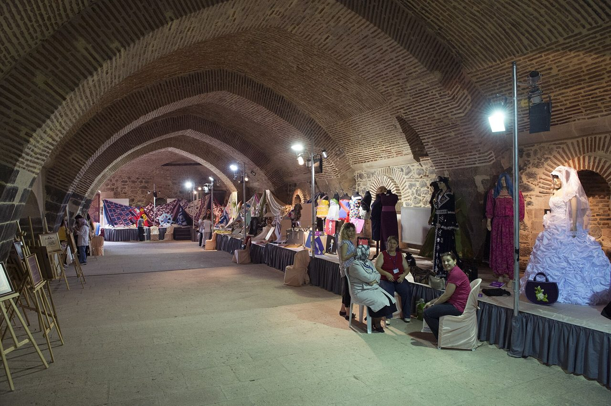

# Son haberler

Ajanın yazdığı son haberler (otomatik güncellenir).

## Kurşunlu Külliyesi mühürlendi, iki habere erişim engeli geldi; Kurt tepki gösterdi

**Gündem · Odunpazarı** · 2026-11-04 09:34 UTC · Kaynak: [Google Haberler - Odunpazarı](https://www.anadolugazetesi.com/amp/kazim-kurt-ve-yeni-parti-den-kursunlu-kulliyesi-tepkisi---muhru-de-sansuru-de-kabul-etmiyoruz--297512.html)

> Haberes'te yayımlanan iki habere Sulh Ceza Hâkimliği kararıyla erişim engeli getirildi.

Odunpazarı Belediye Başkanı Kazım Kurt ve YENİ Parti Odunpazarı İlçe Yönetimi, Kurşunlu Külliyesi'nin mühürlenmesine ve Haberes'in Genel Yayın Yönetmeni Ayhan Aydıner'in külliyeyle ilgili iki haberine erişim engeli getirilmesine tepki gösterdi. Anadolu Gazetesi'nin aktardığına göre YENİ Parti açıklamasında külliyenin Vakıflar Bölge Müdürlüğü ve Odunpazarı Kaymakamlığı nezaretinde mühürlendiği, işlemin mahkeme kararı beklenmeden yapıldığı öne sürüldü.

Aydıner'in 30 Ekim ve 1 Kasım'da Haberes'te yayımlanan "Külliye Olayının Gölgesindeki Rant Çarkı: Vakıflar'dan Adrese Teslim İhaleler!" ve "Yurt İçin Vakıflar'a Bağışlanan Bina Nasıl Lüks Otel Oldu?" başlıklı iki haberi, Eskişehir 3. Sulh Ceza Hâkimliği kararıyla erişime engellendi.

Kurt, gazetecilerin kamu adına soru sorma ve haber yapma hakkının engellenemeyeceğini söyledi: "Gazetecilik suç değildir. Kamu adına soru sormak suç değildir." YENİ Parti ilçe yönetimi de külliyenin mühürlenmesine ve habere getirilen erişim engeline tepki gösterdi, "Gazetecilik suç değildir" dedi.

Haber Kurt'un ve YENİ Parti'nin açıklamalarına dayanıyor; Vakıflar Bölge Müdürlüğü'nün, Kaymakamlığın ve erişim engelini talep edenlerin görüşü kaynakta yer almıyor. Erişim engeline konu haberlerdeki iddiaları bu site doğrulamamıştır.

---

## EOSB heyeti yeni açılan Hampton by Hilton Eskişehir'i ziyaret etti

**Ekonomi · Merkez** · 2026-11-04 09:33 UTC · Kaynak: [Google Haberler - Eskişehir](https://www.esgazete.com/hampton-by-hilton-eskisehirin-cazibesini-artiracak)

> Eskişehir OSB ile Köksal Şirketler Grubu arasında iş birliği protokolü de imzalanmıştı.

Eskişehir Organize Sanayi Bölgesi (EOSB) Yönetim Kurulu Başkanı Nadir Küpeli ve yönetim kurulu üyeleri, Köksal Şirketler Grubu bünyesinde faaliyet gösteren ve kısa süre önce hizmete açılan Hampton by Hilton Eskişehir'i ziyaret etti. Heyeti Köksal Şirketler Grubu Yönetim Kurulu Başkanı Orhan Köksal ve Yönetim Kurulu Üyesi İlhan Köksal ağırladı; görüşmede otelin fiziki imkânları, konaklama hizmetleri ile toplantı ve organizasyon alanları hakkında bilgi verildi.

Küpeli, otelin şehre gelen iş insanlarının, yatırımcıların ve misafirlerin konaklama ihtiyacına katkı sunacağını, toplantı ve seminer imkânlarıyla iş ve organizasyon turizmine değer katacağını söyledi. Eskişehir OSB ile Köksal Şirketler Grubu arasında geçtiğimiz günlerde imzalanan iş birliği protokolünün de bölgedeki sanayi kuruluşlarının çalışanları ve misafirlerine yönelik olduğunu belirtti.

---

## ESOGÜ Yüzme Havuzu'ndaki bakım ve onarım çalışmaları tamamlandı

**Spor · Merkez** · 2026-11-04 08:32 UTC · Kaynak: [Google Haberler - Eskişehirspor](https://www.anadolugazetesi.com/osmangazi-universitesi-havuzu-yenilendi-297492.html)

> Üniversite, tesislerin yenilenmesine ve geliştirilmesine devam edileceğini açıkladı.

Eskişehir Osmangazi Üniversitesi Yüzme Havuzu'nda bir süredir sürdürülen bakım ve onarım çalışmaları sona erdi. Yenileme çalışmalarıyla tesisin kullanım koşulları iyileştirildi.

Üniversitenin açıklamasında, sporculara ve vatandaşlara daha kaliteli hizmet sunabilmek amacıyla tesislerin yenilenmesine ve geliştirilmesine devam edileceği belirtildi. Kaynakta çalışmaların kapsamı, maliyeti ve havuzun yeniden açılış tarihi konusunda ayrıntı yer almıyor.

---

## ESOGÜ Hastanesi'nde Organ Bağışı Haftası için bilgilendirme standı kuruldu

**Sağlık · Merkez** · 2026-11-04 07:33 UTC · Kaynak: [Google Haberler - Eskişehir etkinlik](https://www.eskisehirhaber.com/esogu-hastanesinden-organ-bagisi-icin-anlamli-etkinlik)

> ESOGÜ Hastanesi'nde 2017'den bu yana karaciğer ve böbrek nakli yapılıyor.

Eskişehir Osmangazi Üniversitesi (ESOGÜ) Sağlık Uygulama ve Araştırma Hastanesi'nde 3-9 Kasım Organ Bağışı Haftası dolayısıyla farkındalık etkinliği düzenlendi. ESOGÜ Tıp Fakültesi Genel Cerrahi Ana Bilim Dalı Transplantasyon Ünitesi'nin kurduğu standda organ bağışının önemi anlatıldı, vatandaşların soruları yanıtlandı. Hasta ve hasta yakınlarına süreç hakkında bilgi verildi, broşür dağıtıldı, bağış yapmak isteyenlere başvuru işlemlerinde yardımcı olundu.

Etkinlikte yapılan açıklamaya göre ESOGÜ Hastanesi'nde 2017'den bu yana karaciğer ve böbrek nakilleri yapılıyor; nakil sonrası taburcu edilen hastalar düzenli kontrollerle izleniyor. Etkinliğe Dr. Öğr. Üyesi Yavuz Selim Angın, Hastane Başmüdürü Ayşe Kırcı, Halkla İlişkiler Sorumlusu Esin Gökalp ile organ nakli koordinatörleri Tarık Uca ve Elif Hiçyılmaz katıldı.

---

## AB destekli projede gençler geleneksel tarım bilgisini dijital hikayeye çeviriyor

**Tarım · Merkez** · 2026-11-04 07:33 UTC · Kaynak: [Google Haberler - Eskişehir](https://yerel-haberler.haberturk.com/eskisehir-haberleri/eskisehirde-gencler-geleneksel-tarim-bilgilerini-dijital-hikayelere-donusturmeye-119511755)

> Proje 20 genci Yunus Emre ve Yörük Kırka mahallelerindeki çiftçi ailelerle buluşturdu.

Avrupa Birliği Sivil Düşün Programı finansmanıyla yürütülen "Kadim Tarım Bilgisinin Dijital Hikaye Anlatıcılığı Yoluyla Kuşaklararası Aktarımı" projesi kapsamında, Eskişehir Teknik Üniversitesi, Anadolu Üniversitesi ve Eskişehir Osmangazi Üniversitesi öğrencilerinin de aralarında bulunduğu 20 genç, kırsalda yaşayan deneyimli çiftçilerden geleneksel tarım bilgilerini öğreniyor.

Proje yürütücüsü İhsan Tarık Çelik, 24-25 Ekim'de Eskişehir Teknik Üniversitesi TÜBİTAK Milli Teknoloji Atölyesi'nde dijital hikaye anlatıcılığı, röportaj teknikleri, mobil gazetecilik, görsel anlatım ve dijital içerik üretimi eğitimi verdi. 31 Ekim ve 1 Kasım'da gençler Yunus Emre ve Yörük Kırka mahallelerinde çiftçi ailelerle günlük üretim faaliyetlerine katıldı; hayvan bakımı, süt sağımı, ekşi maya ve bazlama yapımı ile hasat çalışmalarını gözlemleyip görüntü ve ses kaydı aldı.

Saha çalışmasının ardından kurgu ve montaj aşamasına geçildi. Görüntüler farklı temalarda dijital hikayelere dönüştürülecek; yatay ve dikey formatlı filmlerin YouTube'da ve projenin internet sitesinde, kısa videoların sosyal medyada yayımlanması planlanıyor.

---

## Eskişehirspor Kadın Futbol Takımı İstanbul deplasmanında 2-1 yenildi

**Spor · Merkez** · 2026-11-04 06:34 UTC · Kaynak: [Google Haberler - Eskişehirspor](https://www.gzt26.com/eskisehirspor-kadin-futbol-takiminda-yurekleri-burkan-tablo)

> Antrenör Konca, otobüs ücretini borçlanarak günübirlik gittiklerini söyledi.

TFF Kadınlar Futbol 2. Ligi A Grubu'nda mücadele eden Eskişehirspor Kadın Futbol Takımı, İstanbul deplasmanında Büyükçekmece Karadeniz İdman Ocağı'na 2-1 yenildi. Sabah saat 06.00'da Eskişehir'den yola çıkan takım konaklama yapmadan günübirlik gitti. Eskişehirspor, 2. dakikada Esin Demirtürk'ün golüyle öne geçti ancak üstünlüğünü koruyamadı.

Maçın ardından konuşan Antrenör Pınar Konca, kulübün maddi sıkıntı yaşadığını, deplasman yolculuğunda kullanılan otobüsün ücretini sonradan ödemek üzere borçlandıklarını söyledi. Konca, futbolcularının performansından memnun olduğunu, takımın mücadeleden vazgeçmeyeceğini belirtti; kentte kadın futboluna ve amatör kulüplere verilen desteği değerlendirirken duyarsızlığın arttığını dile getirdi ve maddi sorunların yalnızca kendi takımlarına özgü olmadığını söyledi.

Haber Konca'nın açıklamalarına dayanıyor; kulüp yönetiminin konuya ilişkin görüşü kaynakta yer almıyor.

---

## Sivrihisar-2 Caddesi'nin bir bölümü 4 Kasım'da asfalt çalışması için kapatılıyor

**Ulaşım · Tepebaşı** · 2026-11-04 06:34 UTC · Kaynak: [Google Haberler - Tepebaşı](https://www.eskisehir.net/sivrihisar-2-caddesinin-bir-bolumu-trafige-kapaniyor)

> Kapatma saat 08.30-17.30 arasında uygulanacak.

Eskişehir Büyükşehir Belediyesi, Tepebaşı ilçesindeki Sivrihisar-2 Caddesi'nin Abdülhamid Dedelek Caddesi ile Kırım Caddesi arasında kalan bölümünü 4 Kasım 2026 Çarşamba günü saat 08.30 ile 17.30 arasında araç trafiğine kapatacak. Neden, Yol Yapım Bakım ve Onarım Dairesi Başkanlığı'nın yürüteceği asfalt bakım ve onarım çalışması.

Belediye sürücülerden alternatif güzergahları kullanmalarını ve trafik işaretleri ile işaretçilerine dikkat etmelerini istedi. Acil durumlarda ulaşım trafik güvenlik ekiplerince sağlanacak.

---

## ESKİ, Çankaya'da yenilenen 1.400 metrelik içme suyu isale hattını devreye aldı

**Gündem · Merkez** · 2026-11-04 05:32 UTC · Kaynak: [Google Haberler - Eskişehir](https://www.basingazetesi.net/amp/gundem/eskisehir-in-icme-suyu-altyapisi-gucleniyor-77804)

> Bağlantı çalışması gece boyunca sürdü; iletim sistemi normal işletme düzenine döndü.

Eskişehir Büyükşehir Belediyesi Su ve Kanalizasyon İdaresi (ESKİ), Çankaya Mahallesi Özlem Caddesi güzergâhında ekonomik ömrünü tamamlayan içme suyu isale hattını yenileyerek devreye aldı. Yaklaşık 1.400 metre uzunluğundaki yeni hat, Çankaya Mahallesi'ndeki D21 su deposundan çıkıyor ve Özlem Caddesi boyunca uzanıyor.

ESKİ'nin açıklamasına göre hat, dayanıklılığı yüksek spiral çelik borularla yeniden inşa edildi; yapımda kazı, boru yerleştirme, kaynak ve izolasyon işlemleri yapıldı. Yeni hattın mevcut içme suyu iletim sistemine bağlanması için ekipler gece boyunca aralıksız çalıştı. Bağlantıların tamamlanmasının ardından hatta kademeli olarak su verildi, şebeke basıncı dengelendi ve iletim sistemi yeniden normal işletme düzenine kavuştu.

Çalışma sırasında Çankaya, Emek, Ihlamurkent, Erenköy, 71 Evler ve Vadişehir mahallelerinde su kesintisi ve basınç düşüklüğü yaşanmıştı. ESKİ, yatırımla olası arıza risklerinin azaltılmasını ve su iletiminde sürekliliğin sağlanmasını amaçladığını belirtti.

---

## Anadolu Üniversitesi mezunu Selin Toprak'a Altın Portakal'da Jüri Özel Ödülü

**Kültür-Sanat · Merkez** · 2026-11-04 03:32 UTC · Kaynak: [Google Haberler - Eskişehir etkinlik](https://www.mersinhaber.com/amp/haber/834997)

> Ödüllü film, Anadolu Üniversitesi'nde mezuniyet projesi olarak hazırlandı.

Anadolu Üniversitesi Güzel Sanatlar Fakültesi mezunu Selin Toprak, "Dünya Günü Kutlu Olsun (Happy Earth Day)" adlı kısa animasyon filmiyle 63. Uluslararası Antalya Altın Portakal Film Festivali'nde Sinema Okulları Öğrenci Filmleri Yarışması kapsamında Jüri Özel Ödülü'nü kazandı. Festival 24-31 Ekim 2026 tarihlerinde yapıldı.

Yedi dakikalık iki boyutlu bilim kurgu animasyonu, Dünya'daki yaşam koşullarının kötüleşmesinin ardından bir uzay gemisine yerleşen insanların hikâyesini anlatıyor; Ivy ve Willow karakterleri üzerinden ortak yaşam, kayıp ve nostalji temalarını işliyor.

Film, Anadolu Üniversitesi Güzel Sanatlar Fakültesi Çizgi Film ve Animasyon Bölümü'nde ANİ473 Çizgi Film Proje I dersi kapsamında mezuniyet projesi olarak hazırlandı. Danışmanlığını fakültenin öğretim üyeleri Prof. Fethi Kaba, Prof. Hikmet Sofuoğlu ve Doç. Sabahattin Çalışkan üstlendi.

---

## KYK erkek öğrenci yurtlarında AFAD eğitmenleri afet bilinci eğitimi verdi

**Gündem · Merkez** · 2026-11-04 02:33 UTC · Kaynak: [Google Haberler - Eskişehir](https://www.sondakika.com/yerel/haber-eskisehir-de-kyk-erkek-yurtlarinda-afad-egitmenler-20392025/)

> Eğitimler Sivrihisar ve Tepebaşı Gündüzalp yurtlarında verildi.

Eskişehir'de Kredi ve Yurtlar Kurumu'na (KYK) bağlı erkek öğrenci yurtlarında İl Afet ve Acil Durum (AFAD) Müdürlüğü eğitmenleri afet bilinci eğitimi verdi. Eğitimler 30 Ekim'de Sivrihisar Erkek Öğrenci Yurdu'nda başladı, 2 Kasım'da Tepebaşı Gündüzalp Erkek Öğrenci Yurdu'nda devam etti.

---

## Odunpazarı Belediyesi çiftçilere Yunus çeşidi tohumluk buğday dağıtacak

**Tarım · Odunpazarı** · 2026-11-04 01:32 UTC · Kaynak: [Google Haberler - Odunpazarı](https://www.2eylul.com.tr/eskisehirde-ciftcilere-tohumluk-bugday-destegi)

> Dağıtım 5 Kasım Perşembe günü Emek Kapalı Pazar Yeri'nde yapılacak.

Odunpazarı Belediyesi, tarımsal üretimi desteklemek ve verimliliği artırmak amacıyla çiftçilere tohumluk buğday dağıtımı yapacak. Belediyenin duyurusuna göre üreticilere Yunus çeşidi tohumluk buğday verilecek.

Dağıtım programı 5 Kasım 2026 Perşembe günü saat 12.30'da Emek Kapalı Pazar Yeri'nde yapılacak. Belediye tüm üreticileri programa davet etti.

---

## Özel gereksinimli bireyler ÇİDEM'de domates hasadına katıldı

**Gündem · Merkez** · 2026-11-04 00:31 UTC · Kaynak: [Google Haberler - Eskişehir etkinlik](https://baskentpostasi.com/eskisehirde-ozel-gereksinimli-bireyler-cidemde-domates-hasadina-katilarak-tarimsal-uretimi-deneyimledi)

> Etkinliği Büyükşehir Sosyal Hizmetler Dairesi Başkanlığı düzenledi.

Eskişehir Büyükşehir Belediyesi Sosyal Hizmetler Dairesi Başkanlığı Özel Gereksinimliler Şube Müdürlüğü'nün düzenlediği etkinlikte, Zihinsel Engelli Gündüz Yaşam Merkezi'nden hizmet alan özel gereksinimli bireyler Seyitgazi ilçesi Taşlık Mahallesi'ndeki Çiftçi Destekleme ve Eğitim Merkezi'ni (ÇİDEM) ziyaret etti.

Katılımcılar domates hasadına katılarak tarımsal üretim sürecini yerinde deneyimledi. Etkinlikle özel gereksinimli bireylerin sosyal yaşama katılımlarının desteklenmesi ve yeni deneyimler kazanmaları amaçlandı.

---

## 20. Eskişehir Uluslararası Film Festivali 16-24 Kasım'da, onur ödülleri açıklandı

**Kültür-Sanat · Merkez** · 2026-11-03 23:32 UTC · Kaynak: [Google Haberler - Eskişehir gündem](https://m.haber7.com/kultur/haber/2737858-eskisehir-uluslararasi-film-festivali)

> Onur ödülleri Itır Esen ve Macit Koper'e verilecek; festival bu yıl ilk kez iki yeni yarışma düzenleyecek.

Kültür ve Turizm Bakanlığı Sinema Genel Müdürlüğü desteğiyle Anadolu Üniversitesi (AÜ) ve AÜ İletişim Bilimleri Fakültesi tarafından bu yıl 20'ncisi düzenlenecek Eskişehir Uluslararası Film Festivali 16-24 Kasım'da yapılacak. Festivalin onur ödüllerini kazananlar açıklandı: ödüller oyuncular Itır Esen ve Macit Koper'e verilecek. Her iki oyuncu ödülünü festivalin açılış töreninde alacak.

Türkiye'nin üniversite kimliği taşıyan uluslararası tek uzun metraj film festivali olarak tanıtılan etkinlik, bu yıl ilk kez "Kısa Film Yapım Destek" ve "Sinema Kültürüne Katkı" yarışmalarına yer verecek.

Kaynakta Itır Esen'in 1975'ten itibaren Bizim Aile, Gülen Gözler, Aile Şerefi ve Cennetin Çocukları dahil toplam 8 filmde rol aldığı, Macit Koper'in ise sinemada hem oyuncu hem senarist olarak çalıştığı belirtiliyor.

---

## Eskişehir'de Organ Bağışı Haftası kapsamında 5 Kasım'da yürüyüş düzenlenecek

**Sağlık · Merkez** · 2026-11-03 22:32 UTC · Kaynak: [Google Haberler - Eskişehir etkinlik](https://www.eskisehir.net/eskisehirde-organ-bagisi-icin-yuruyus-duzenlenecek)

> Yürüyüş İl Sağlık Müdürlüğü Ek Hizmet Binası önünden başlayacak.

Eskişehir İl Sağlık Müdürlüğü, Organ Bağışı Haftası kapsamında organ bağışının önemine dikkat çekmek ve toplumsal farkındalığı artırmak amacıyla yürüyüş ve basın açıklaması düzenleyecek. Etkinlik 5 Kasım Perşembe günü saat 13.50'de başlayacak.

Başlangıç noktası İl Sağlık Müdürlüğü Ek Hizmet Binası önü olacak; katılımcılar Doktorlar Caddesi güzergâhında yürüyecek. Etkinlikte İl Sağlık Müdürü Doç. Dr. Yaşar Bildirici ile Sağlık Hizmetleri Başkanı Op. Dr. Ersin Işıldı organ bağışının önemi hakkında açıklama yapacak.

---

## Eskişehir Anadolu SF-Eskişehirspor maçının saati 13.00'e alındı

**Spor · Merkez** · 2026-11-03 20:32 UTC · Kaynak: [Google Haberler - Eskişehirspor](https://www.istikbalgazetesi.com/anadolu-spor-faaliyetleri-eskisehirspor-macinin-saati-degisti)

> Saat değişikliği canlı yayın programı nedeniyle yapıldı; stat görüşmeleri sürüyor.

11 Kasım Çarşamba günü saat 15.00'te oynanacağı duyurulan Eskişehir Anadolu Spor Faaliyetleri-Eskişehirspor karşılaşmasının başlama saati 13.00 olarak güncellendi. İstikbal Gazetesi'nin aktardığına göre TFF'nin Anadolu Spor Faaliyetleri kulübüne yaptığı bildirimde saat değişikliğinin canlı yayın programı nedeniyle yapıldığı belirtildi.

Maçın ESOGÜ Stadyumu yerine Fethi Heper Stadyumu'nda oynanması için görüşmelerin sürdüğü bildirildi.

---

## Odunpazarı'ndaki bentonit ocağının ÇED olumlu kararı mahkemece iptal edildi

**Gündem · Odunpazarı** · 2026-11-03 19:35 UTC · Kaynak: [Google Haberler - Odunpazarı](https://www.istikbalgazetesi.com/eskisehirde-iki-koyu-ilgilendiren-maden-ocagi-davasinda-karar-cikti)

> TEMA Vakfı, bilirkişi raporuna dayanarak sahanın rehabilite edilmesini istedi.

Eskişehir'in Odunpazarı ilçesine bağlı Demirli ve Seklice köylerindeki bentonit ocağında planlanan kapasite artışına ilişkin ÇED olumlu kararı, açılan dava sonucunda iptal edildi. Bilgi TEMA Vakfı'nın sosyal medya açıklamasına dayanıyor.

TEMA Vakfı'na göre dava kapsamında hazırlanan bilirkişi raporu projenin çevresel etkilerine ilişkin önemli tespitler içeriyor. Vakfın aktardığına göre 8 Mayıs'taki bilirkişi keşfinde ocak sahasındaki pasa yığınlarının yağış nedeniyle çöktüğü görüldü. Bilirkişi raporunda ÇED raporundaki teknik hatalar ile projenin doğal ve kültürel varlıklar üzerinde olumsuz etkiler yaratabileceği belirtildi. TEMA Vakfı, ÇED kararının iptalinin ardından proje sahasının vakit kaybedilmeden rehabilite edilmesi ve yeniden doğaya kazandırılması gerektiğini vurguladı.

Haber TEMA Vakfı'nın açıklamasına dayanıyor; ocağı işleten firmanın ve ilgili kurumların görüşü kaynakta yer almıyor.

---

## Ünlüce: Numbeo güvenlik endeksinde Eskişehir Türkiye'de ilk sırada

**Gündem · Merkez** · 2026-11-03 19:36 UTC · Kaynak: [Google Haberler - Eskişehir gündem](https://www.ajans04.net/eskisehir-turkiye-nin-en-guvenli-sehri-oldu)

> Numbeo verileri kitle kaynaklı; endeks 1 Kasım 2026'da güncellendi.

Eskişehir Büyükşehir Belediye Başkanı Ayşe Ünlüce, uluslararası kitle kaynaklı veri tabanı Numbeo'nun 1 Kasım 2026'da güncellenen güvenlik endeksinde Eskişehir'in Türkiye'de değerlendirilen şehirler arasında ilk sırada yer aldığını sosyal medya hesabından duyurdu.

Ünlüce, Eskişehir'in yalnızca kültür, sanat ve çağdaş yaşamıyla değil, güvenli ve huzurlu kent kimliğiyle de öne çıktığını belirtti, sonucun kent adına sevindirici olduğunu söyledi. Başarıda emeği bulunan kurum ve kuruluşları kutlayan Ünlüce, Eskişehir'in huzuruna ve güvenliğine katkı sunan vatandaşlara teşekkür etti. Haber Ünlüce'nin paylaşımına dayanıyor; endeksin ayrıntıları ve puanları kaynakta yer almıyor.

---

## Perma grubu 15 Ocak 2027'de Eskişehir'de konser verecek

**Kültür-Sanat · Merkez** · 2026-11-03 19:34 UTC · Kaynak: [Google Haberler - Eskişehir etkinlik](https://www.eskisehir.net/perma-eskisehire-geliyor)

> Konser Permaverse Tour kapsamında Holly Stone'da yapılacak.

Perma grubu, "Permaverse Tour" turne takvimini duyurdu ve rotaya Eskişehir'i de ekledi. Yayımlanan resmî turne afişine göre grup 15 Ocak 2027'de Eskişehir'de, Holly Stone'da sahne alacak.

Turne kasım ayının son günlerinde İstanbul'da başlayacak; Bursa, Ankara, İzmir, Antalya, Trabzon ve Adana gibi şehirler de rotada yer alıyor. Kaynağa göre biletler henüz satışa çıkmadı; bilet detayları ve etkinlik saatlerine ilişkin duyurular bilet satış platformlarından takip edilebilecek.

---

## Başkan Ünlüce Büyükşehir'in ekim ayı çalışmalarını açıkladı: 170 bin ton asfalt üretildi

**Belediye · Merkez** · 2026-11-03 18:34 UTC · Kaynak: [Google Haberler - Eskişehir](https://www.gzt26.com/ayse-unluce-eskisehirde-ekim-ayinda-yapilan-calismalari-acikladi)

> Ünlüce, yeni nesil su sayaçlarından Bilim Fest'e kadar ekim ayının öne çıkan işlerini sıraladı.

Eskişehir Büyükşehir Belediye Başkanı Ayşe Ünlüce, belediyenin ekim ayındaki çalışmalarını açıkladı. Aşağıdaki bilgiler Ünlüce'nin kendi açıklamasına dayanıyor.

Ünlüce, ekim ayına bu yıl ilk kez düzenlenen Uluslararası Eskişehir Yunus Emre Edebiyat Şenliği ile başladıklarını, dört gün süren şenlikte sanatçı, yazar ve şairleri "neşe" temasında buluşturduklarını söyledi. Kent Edebiyat Ödülü'nün özel ödülü Latife Tekin'e verildi. 15-17 Ekim'de Bilim Fest Eskişehir düzenlendi.

26 Ekim'de tanıtılan yeni nesil su sayaçlarıyla cep telefonlarından su yüklenebilir hale geldi; başvuru yapan tüm abonelere yeni sayaç takılacak. Ünlüce, ekim sonuna kadar kent genelinde 170 bin ton asfalt üretildiğini, kırsalda yaklaşık 70 kilometrelik sathi kaplama yapıldığını ve yılbaşından ekim sonuna kadar kırsal ilçelerde yaklaşık 850 milyon TL'lik altyapı ve üstyapı yatırımı gerçekleştirildiğini belirtti. ESKİ, ekimde Sazova, 71 Evler ve Emek mahallelerinde toplam 160 milyon TL değerinde altyapı yatırımı yaptı.

Ünlüce ayrıca 6 Şubat depremlerinin ardından Adıyaman'la kurulan dayanışma bağının Eskişehir Parkı ile kalıcı bir esere dönüştürüldüğünü, kaldırım ve yol işgalleri ile çevre kirliliğine yönelik denetimlerin artırıldığını, tiyatro, senfoni, müze ve Otobüs 26 biletlerinin ESBilet uygulamasından alınabildiğini söyledi. Halk Dansları Grubu ilk gösterisini yaptı; Şehir Tiyatroları ve Senfoni Orkestrası yeni sezona başladı.

---

## Eskişehirspor 9 günde 3 maç oynayacak: Kepezspor, Anadolu SF ve Ayvalıkgücü

**Spor · Merkez** · 2026-11-03 17:32 UTC · Kaynak: [Google Haberler - Eskişehirspor](https://www.istikbalgazetesi.com/eskisehirsporda-zorlu-donemec-9-gunde-3-mac)

> Eskişehirspor 11 Kasım'da Eskişehir Anadolu SF'ye konuk olacak.

Eskişehirspor, Gaziemir deplasmanında aldığı 5-0'lık galibiyetin ardından 9 günde üç maça çıkacak. 10. haftada 7 Kasım Cumartesi günü saat 15.30'da Kepezspor'u ağırlayacak. 11. haftada 11 Kasım Çarşamba günü saat 15.00'te zirve mücadelesi veren Eskişehir Anadolu SF'ye konuk olacak. 12. haftada ise 15 Kasım Pazar günü saat 15.00'te Ayvalıkgücü Belediyespor'u konuk edecek; İstikbal Gazetesi'ne göre rakip geçen sezon olduğu gibi bu sezon da grupta zirve mücadelesi veriyor.

Teknik direktör Hakan Şapcı'nın öğrencilerinin üç maçı da kazanarak 9 puan almayı hedeflediği belirtildi. Aynı hafta Eskişehir Anadolu SF, 7 Kasım'da saat 15.00'te Uşakspor ile deplasmanda oynayacak.

---

## Bayraktar, Beylikova'daki nadir toprak elementleri için Güney Koreli şirketle görüştü

**Ekonomi · Merkez** · 2026-11-03 17:33 UTC · Kaynak: [Google Haberler - Eskişehir](https://www.cumhuriyet.com.tr/siyaset/bakan-bayraktar-eskisehir-deki-nadir-toprak-elementleri-icin-guney-koreli-sirketle-gorustu-2552995)

> Görüşme, cevherden nihai ürüne uzanan entegre değer zinciri üzerine yapıldı.

Enerji ve Tabii Kaynaklar Bakanı Alparslan Bayraktar, Güney Koreli kalıcı mıknatıs üreticisi JS Link'in Yönetim Kurulu Başkanı J.S. Park ve beraberindeki yetkililerle Güney Kore'de bir araya geldi. Bayraktar sosyal medya hesabından yaptığı açıklamada, görüşmede Eskişehir Beylikova'daki nadir toprak elementleri kaynağının cevherden nihai ürüne uzanan entegre bir değer zinciriyle ekonomiye kazandırılmasına yönelik iş birliği imkânlarının değerlendirildiğini söyledi.

Bayraktar, nadir toprak elementlerinden yenilenebilir enerji teknolojilerine kadar enerjinin ve madenciliğin tüm alanlarında kaynak potansiyelini yüksek katma değerli üretime dönüştürecek yatırımlara ve uluslararası iş birliklerine açık olduklarını vurguladı. Açıklamada somut bir anlaşma veya yatırım tutarı yer almadı.

---

## AK Partili Sivri, Tepebaşı Meclisi'nde SSK Blokları'nda kentsel dönüşümü istedi

**Belediye · Tepebaşı** · 2026-11-03 16:34 UTC · Kaynak: [Google Haberler - Tepebaşı](https://www.eskisehirekspres.net/ahmet-sivriden-ssk-bloklari-icin-acil-donusum-cagrisi-10-bin-kisi-risk-altinda)

> Bölgede yaklaşık 3 bin 600 hane ve 10 bin kişi yaşıyor.

Tepebaşı Belediye Meclisi, Belediye Başkanı Ahmet Ataç başkanlığında toplandı. Gündem dışı söz alan AK Parti Meclis Üyesi Ahmet Sivri, ilçedeki SSK Blokları'nın kentsel dönüşüm sürecini gündeme getirdi.

Sivri, SSK Blokları'nda yaklaşık 3 bin 600 hanenin yaşadığını, bölgenin yaklaşık 10 bin kişilik nüfusa sahip olduğunu ve yapıların yaklaşık 50 yıllık olduğunu belirtti. Türkiye'nin farklı bölgelerinden hemen her gün deprem haberleri geldiğine dikkat çeken Sivri, dönüşüm çalışmalarının bir an önce hızlandırılması gerektiğini söyledi. Ataç'a seslenen Sivri, Cumhur İttifakı meclis üyelerinin yapılacak çalışmalara destek vermeye hazır olduğunu, önceliklerinin vatandaşların can güvenliği olduğunu ifade etti. Hasta, yaşlı ve engelli vatandaşların da depreme dayanıklı ve konforlu konutlarda yaşamasını istediklerini söyledi.

Haber meclis üyesinin konuşmasına dayanıyor; Tepebaşı Belediyesi'nin konuya ilişkin yanıtı kaynakta yer almıyor.

---

## Odunpazarıspor kadınlar hentbol liginde 8 Kasım'da Üsküdar Belediyesi'ne konuk olacak

**Spor · Odunpazarı** · 2026-11-03 16:32 UTC · Kaynak: [Google Haberler - Eskişehir](https://www.istikbalgazetesi.com/eskisehir-odunpazari-cikis-ariyor)

> Eskişehir ekibi 8 haftada 2 galibiyetle 4 puanla altıncı sırada.

Kadınlar Hentbol Süper Ligi'nde mücadele eden Eskişehir Odunpazarıspor, son maçında MC Sistem Yozgat GSK'ye 34-30 yenildi. Antrenör Mehmet Fatih Işık yönetimindeki takım, sekiz haftada 2 galibiyet ve 6 yenilgiyle 4 puanla altıncı sırada bulunuyor. Arkasındaki Göztepe 3 puanda, beşinci sıradaki Manisa Büyükşehir Belediyesi ile arasında 7 puan fark var.

Odunpazarıspor, 8 Kasım Pazar günü saat 16.00'da Çamlıca Spor Salonu'nda 12 puanla ikinci sıradaki Üsküdar Belediyesi'ne konuk olacak. 14 Kasım Cumartesi günü saat 15.00'te ise sahasında Ortahisar Belediyesi ile karşılaşacak.

---

## Tepebaşı Meclisi kıyafet bağış kutuları için Kızılay'la 3 yıllık iş birliğini kabul etti

**Belediye · Tepebaşı** · 2026-11-03 14:33 UTC · Kaynak: [Google Haberler - Tepebaşı](https://www.gzt26.com/tepebasinda-kiyafet-bagis-kutulari-icin-yeni-karar-alindi)

> Karar oy birliğiyle alındı; Ataç, mevcut firmanın işi bıraktığını söyledi.

Tepebaşı Belediye Meclisi kasım ayı toplantısında, ilçedeki kıyafet bağış kutularına ilişkin Türk Kızılay ile üç yıllık iş birliği yapılmasını oy birliğiyle kabul etti. Konu, Türk Kızılay Eskişehir İl Başkanlığı'nın belediyeye gönderdiği yazı üzerine gündeme geldi. Kızılay'ın yürüttüğü "İkinci El Tekstil Projesi", kullanılabilir durumdaki kıyafetlerin yeniden değerlendirilmesini, atık miktarının azaltılmasını ve insani yardım faaliyetlerine düzenli kaynak oluşturulmasını amaçlıyor.

Düzenlemeye göre belediyenin uygun göreceği noktalara Kızılay Kıyafet Bağış Kutuları yerleştirilecek; kutuların yerlerini belediye belirleyecek. Meclis, Belediye Başkanı Ahmet Ataç'a protokolü imzalaması için yetki verdi. Ataç, görüşme sırasında kıyafet toplama faaliyetlerini yürüten mevcut firmanın işi bıraktığını açıkladı.

---

## Kurşunlu Külliyesi'nde tahliye işlemleri başladı: kadın girişimciler kapıları açmadı

**Gündem · Odunpazarı** · 2026-11-03 14:32 UTC · Kaynak: [Google Haberler - Odunpazarı](https://www.birgun.net/haber/kapisina-kilit-vuruldu-744323)

> BirGün'e göre eserler kayıt altına alındı, külliyenin kapısına kilit vuruldu.

BirGün'ün aktardığına göre Kurşunlu Külliyesi'nin 3 Kasım saat 11.00'e kadar boşaltılmasını isteyen tebligatın süresinin dolmasıyla tahliye işlemleri başladı. İlk olarak Ahşap Eserler Müzesi'nin bulunduğu binada işlem yapıldı, ardından diğer müze ve atölyelere geçildi. Eserlerin kayıt altına alınmasını isteyen belediye yetkilileri, sayım yapılmadan tahliye edilmek istenmesine itiraz etti; eserler cep telefonlarıyla görüntülenerek tutanak tutuldu. Bazı noktalarda esnafın tepkisi üzerine görevliler tutanak tuttu.

Külliyede faaliyet gösteren kadın girişimciler, Lületaşı Müzesi'nin boşaltılmasına tepki göstererek Vakıflar Bölge Müdürlüğü ve Kaymakamlık yetkililerini içeri almadı. Yetkililerin polis çağırmak istemesi üzerine belediye görevlileri araya girdi. Osman Yaşar Tanaçan'ın kızı Vicdan Tanaçan, kendi atölyesinin fotoğraflarını çekerek kayıt altına aldığını ve anahtarı yetkililere teslim ettiğini söyledi.

Odunpazarı Belediye Başkanı Kazım Kurt, tahliyenin hukuka aykırı olduğunu savundu. Vakıflar Kanunu'na eklenen düzenlemeyle belediyeye beş yıl daha kiracı olma hakkı tanındığını, bu kapsamdaki başvurunun sonuçlandırılmadığını söyledi. Kurt, "Hiçbir şeyi imzalamayacağız, çünkü bu kararı tanımıyoruz" dedi; Vakıflar ve Kültür Bakanlığı'nın külliye için planının belli olmadığını belirtti. Külliyede Ahşap Eserler Müzesi, Osman Yaşar Tanaçan Fotoğraf Müzesi, Lületaşı Müzesi, Cam Sanatları Merkezi ve Canan Atasoy Müzesi ile kurs ve atölyeler bulunuyor.

Haber BirGün'ün aktardığı bilgilere ve belediye yetkililerinin açıklamalarına dayanıyor; Vakıflar Bölge Müdürlüğü'nün ve Kaymakamlığın görüşü kaynakta yer almıyor.

---

## Eskişehir'de "Erken Tanı ile Kuzularım Ölmüyor" projesi için protokol imzalandı

**Tarım · Merkez** · 2026-11-03 14:32 UTC · Kaynak: [Google Haberler - Eskişehir](https://www.esgazete.com/eskisehirde-kuzu-olumlerini-azaltacak-protokol-imzalandi)

> Proje 2027-2028'de 5 ilçede uygulanacak.

Eskişehir İl Tarım ve Orman Müdürlüğü ile Eskişehir Bilecik Bölgesi Veteriner Hekimler Odası, kuzu ölümlerinin azaltılması ve hayvansal verimliliğin artırılması amacıyla iş birliği protokolü imzaladı. Protokol, "Erken Tanı ile Kuzularım Ölmüyor" projesi kapsamında imzalandı.

2027-2028 yıllarında uygulanması planlanan proje Sivrihisar, Günyüzü, Çifteler, Seyitgazi ve Tepebaşı ilçelerini kapsayacak. Kuzularda doğum sonrası erken dönemde görülen hastalıkların hızlı teşhis edilmesi, uygun tedavi yöntemlerinin uygulanması ve koruyucu veteriner hekimlik hizmetlerinin yaygınlaştırılması hedefleniyor. Protokolle veteriner hekimlere akademisyenler ve uzmanlar tarafından eğitim verilecek, standart teşhis ve tedavi yöntemleri geliştirilecek. Projenin temel hedefi kuzu ölümlerini azaltmak, yetiştiricilerin ekonomik kayıplarını önlemek ve küçükbaş hayvancılığın sürdürülebilirliğine katkıda bulunmak.

---

## Kırım Kavşağı'ndaki kaza tramvay seferlerini yaklaşık 40 dakika aksattı

**Ulaşım · Merkez** · 2026-11-03 13:34 UTC · Kaynak: [Google Haberler - Eskişehir asayiş](https://www.gzt26.com/eskisehirde-trafik-kazasi-tramvay-seferlerini-durdurdu)

> ESTRAM alternatif işletim ve acil durum otobüsleri devreye aldı.

Eskişehir'de Şehir Hastanesi yönündeki Kırım Kavşağı'nın ardından bir karayolu aracının kaza yapması tramvay ulaşımını aksattı. ESTRAM'ın duyurusuna göre Şehir Hastanesi-Kumlubel ile Otogar-Opera-OGÜ hatlarında işletim yapılamadı.

ESTRAM, Şehir Hastanesi ile Otogar arasında tramvay seferlerini alternatif işletim düzeniyle sürdürdü, Kumlubel ile Es-Es arasında acil durum otobüslerini devreye aldı. Aksama yaklaşık 40 dakika sürdü ve seferler yeniden normal düzenine döndü. Kaynakta kazaya karışan aracın sürücüsünün durumu, yaralanan olup olmadığı ve kazanın nasıl meydana geldiği konusunda bilgi paylaşılmadığı belirtiliyor.

---

## YENİ Partili meclis üyeleri Kurşunlu Külliyesi için uzlaşma çağrısı yaptı

**Gündem · Odunpazarı** · 2026-11-03 13:34 UTC · Kaynak: [Google Haberler - Odunpazarı](https://www.istikbalgazetesi.com/yeni-partili-meclis-uyelerinden-kursunlu-kulliyesi-icin-uzlasma-cagrisi)

> Üyeler külliyenin Odunpazarı Belediyesi'nde kalmasını talep etti.

Odunpazarı Belediye Meclisi'ndeki YENİ Parti üyeleri, Kurşunlu Külliyesi önünde basın açıklaması yaptı. Açıklamayı üyeler adına İnci Şentuna okudu. Üyeler külliyenin Odunpazarı Belediyesi'nde kalmasını talep etti ve tahliye kararını tanımadıklarını söyledi.

Şentuna, belediyenin 2004'ten bu yana kira sözleşmeleri kapsamında kullandığı alanda Ahşap Eserler Müzesi, Lületaşı Müzesi, Osman Yaşar Tanaçan Fotoğraf Müzesi ve Cam Sanatları Merkezi gibi kültürel değerleri kazandırdığını belirtti. Konunun sıradan bir kira veya tahliye meselesi olmadığını söyledi. Belediyenin hukuki hak arayışını ve Belediye Başkanı Kazım Kurt'un yaklaşımını desteklediklerini ifade eden Şentuna, müzelerin ve atölyelerin taşınmasının ciddi kamu maliyeti doğuracağını savundu.

Üyeler, mülkiyet hakkını ortadan kaldırmayı değil, vakıf hukukuna saygılı bir çözümü istediklerini belirtti. Vakıflar Genel Müdürlüğü'nü, Kültür ve Turizm Bakanlığı'nı, Eskişehir Valiliği'ni ve ilgili kurumları uzlaşmaya davet ederek külliyenin Odunpazarı Belediyesi'nin kullanımında kalmasını sağlayacak, uzun vadeli, şeffaf ve denetlenebilir bir kira ve kullanım protokolü oluşturulmasını talep etti.

Haber YENİ Parti meclis üyelerinin açıklamasına dayanıyor; Kaymakamlığın ve Vakıflar Bölge Müdürlüğü'nün görüşü kaynakta yer almıyor.

---

## Altın fiyatları 3 Kasım 2026: Gram altın 6.383,19 TL

**Ekonomi · Merkez** · 2026-11-03 13:17 UTC · Kaynak: [Harem Altın](https://www.haremaltin.com/altin-fiyatlari)

> Gram altın güne düşüşle başladı. Harem Altın verilerine göre gram altın 6.314,41 TL'den alınıyor, 6.383,19 TL'den satılıyor.

Altın piyasasında güne düşüşle başlandı. Harem Altın'ın saat 16.17 itibarıyla verilerine göre gram altının satış fiyatı 6.383,19 TL, alış fiyatı 6.314,41 TL oldu. Gram altın, önceki kapanışa göre yüzde 1,57 geriledi.

Ziynet altınlarda çeyrek altın 10.404 TL, yarım altın 20.802 TL, tam altın 41.450 TL, ata altın 42.558 TL seviyesinden satışa sunuluyor.

22 ayar bileziğin gram satış fiyatı 5.962,82 TL, has altının gram fiyatı 6.364,70 TL olarak belirlendi.

Uluslararası piyasalarda altının onsu 3.935,80 dolardan işlem görürken, dolar/TL 50,12 seviyesinde bulunuyor.

Fiyatlar Harem Altın'ın saat 16.17 itibarıyla paylaştığı verilere dayanmaktadır; kuyumcular arasında farklılık gösterebilir. Bu haber yatırım tavsiyesi değildir.

---

## Kızılinler bal kabağı coğrafi işaret olarak tescillendi

**Tarım · Merkez** · 2026-11-03 12:33 UTC · Kaynak: [Google Haberler - Eskişehir](https://yerel-haberler.haberturk.com/eskisehir-haberleri/eskisehirin-kizilinler-bal-kabagi-cografi-isaret-olarak-tescil-edildi-119511141)

> Eskişehir'in tescilli coğrafi işaret sayısı 15'e çıktı, 5 ürünün başvurusu sürüyor.

Eskişehir'in "Kızılinler bal kabağı", Türk Patent ve Marka Kurumu (TÜRKPATENT) tarafından coğrafi işaret olarak tescillendi. Eskişehir Ticaret Borsası'nda yapılan Coğrafi İşaret Tescil Belgesi Takdim Töreni'nde konuşan Vali Erdinç Yılmaz, coğrafi işaretin ürünün yetiştiği toprağı, iklimi, ustasının emeğini ve itibarını korumak olduğunu söyledi.

Yılmaz, "Artık başka bir yerin kabağı 'Kızılinler' diye, başka bir yerin sucuğu 'Sivrihisar' diye satılamayacaktır" dedi. Eskişehir'in 15 tescilli coğrafi işareti bulunduğunu, 5 ürünün başvuru sürecinin ise devam ettiğini belirtti.

TBMM Yapay Zeka Araştırma Komisyonu Başkanı ve AK Parti Eskişehir Milletvekili Fatih Dönmez, Türkiye'de 13 bin 700 bitki türü bulunduğunu, bunlardan 3 bin 700'ünün endemik olduğunu, Eskişehir'de bu sayının 221 olduğunu söyledi. Dönmez, tescil sürecinde emeği geçen Eskişehir Ticaret Borsası Başkanı Ahmet Oğuz'a teşekkür etti. TÜRKPATENT Başkanı Muhammed Zeki Durak da Türkiye'nin coğrafi işaret sayısında dünyada ikinci sırada yer aldığını dile getirdi.

---
