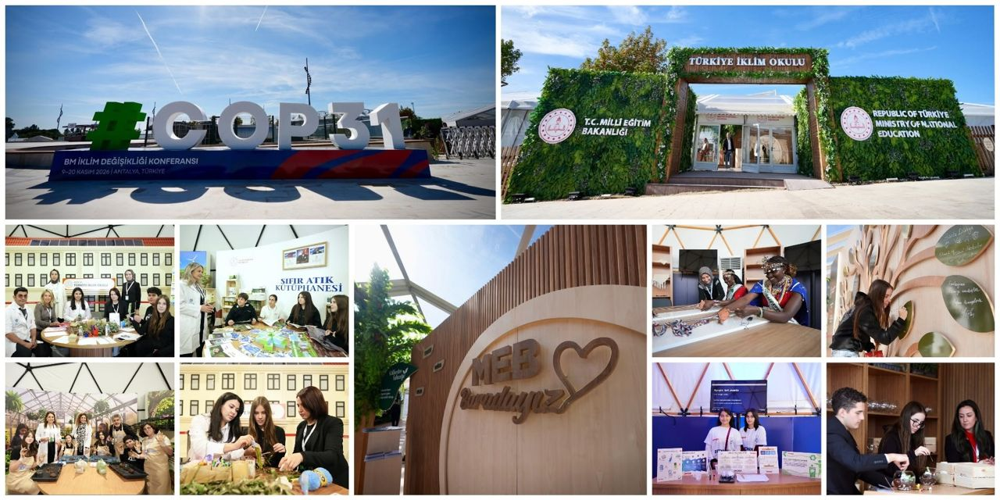
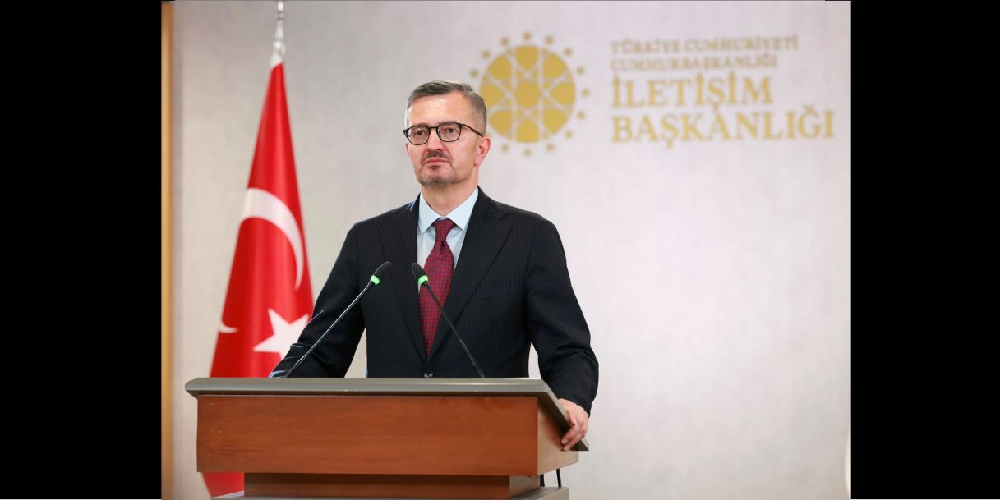
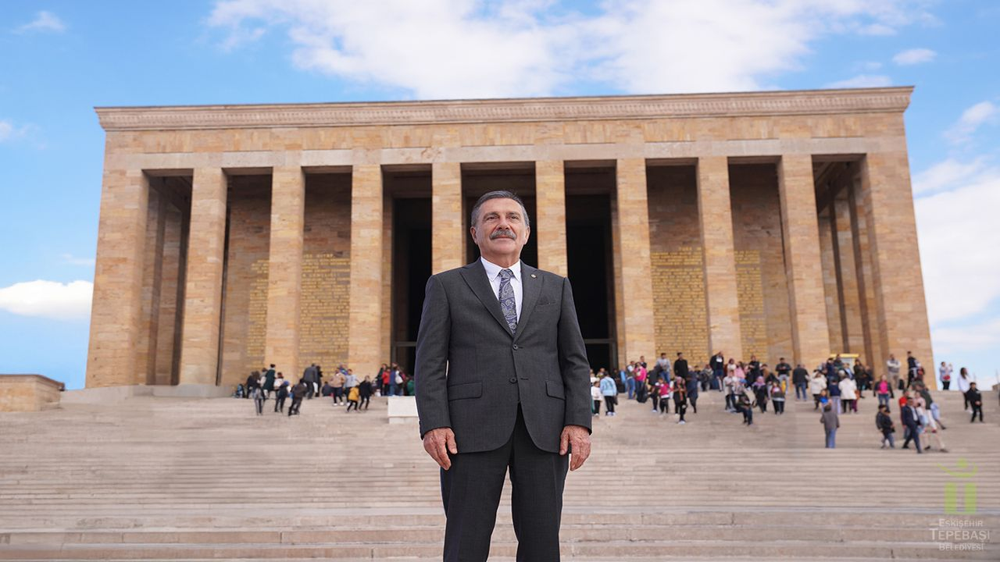
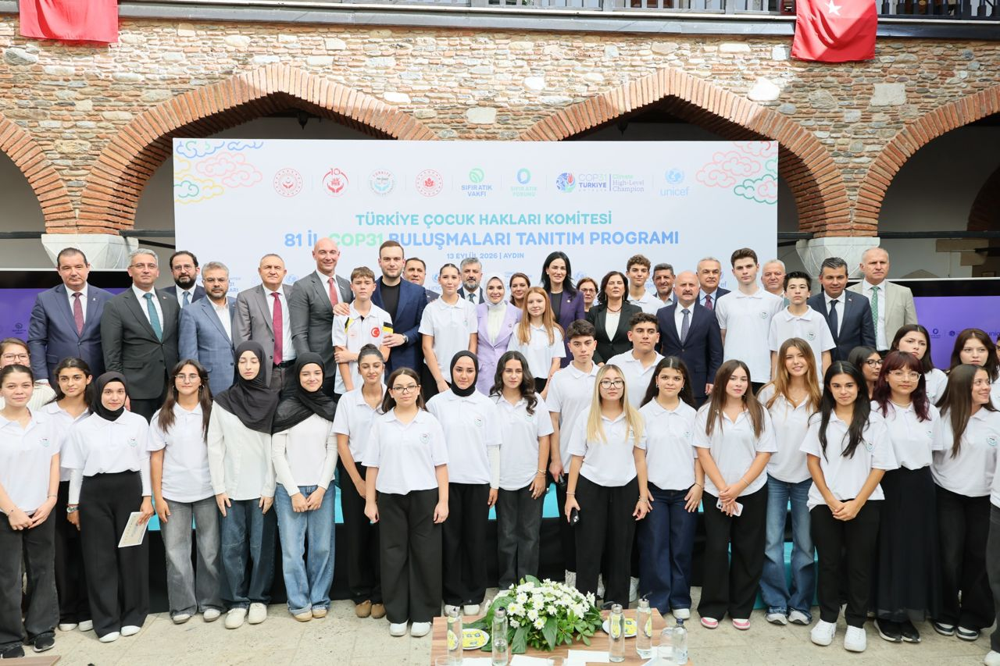
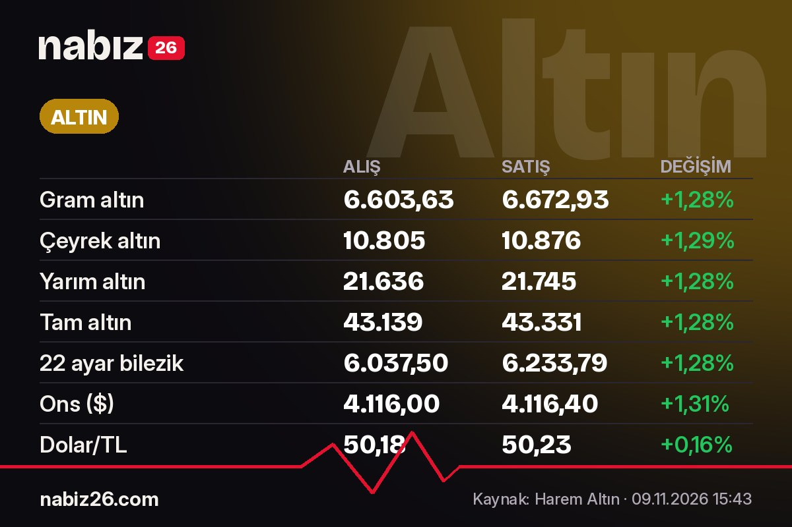
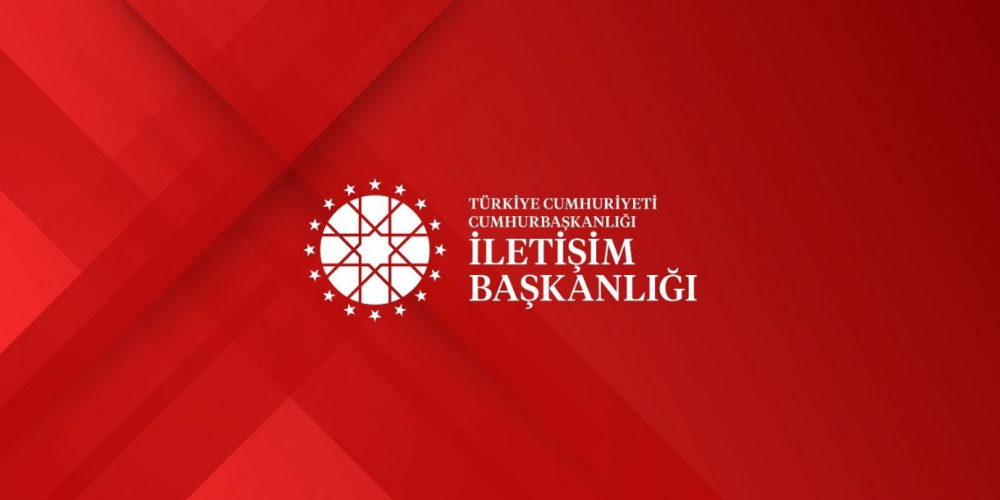
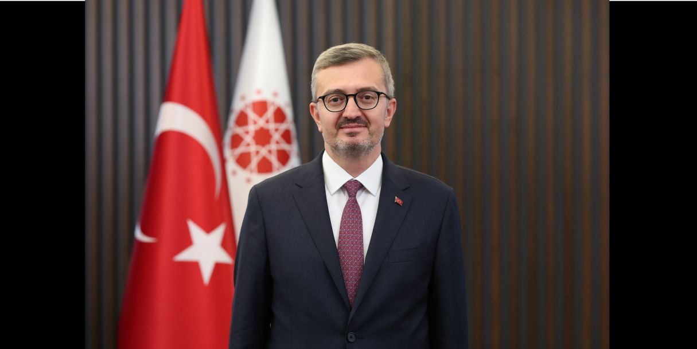

# Son haberler

Ajanın yazdığı son haberler (otomatik güncellenir).

## Tepebaşı'nda 3 katlı işçi binasında yangın çıktı

**Asayiş · Tepebaşı** · 2026-11-09 23:51 UTC · Kaynak: [Google Haberler - Tepebaşı](https://www.sondakika.com/amp/haber-eskisehir-tepebasi-nda-3-katli-isci-binasindaki-ya-20409376/)

> Eskişehir'in Tepebaşı ilçesinde inşaat işçilerinin kaldığı 3 katlı binada çıkan yangın, itfaiye ekiplerinin zamanında müdahalesiyle büyümeden söndürüldü.

Eskişehir'in Tepebaşı ilçesine bağlı Muttalip Emirler Mahallesi Sarıcakaya Caddesi üzerinde, inşaat işçilerinin konakladığı 3 katlı binada henüz belirlenemeyen bir nedenle yangın çıktı. Binadan yükselen alevleri fark eden çevredeki vatandaşlar durumu 112 Acil Çağrı Merkezi'ne bildirdi.

İhbar üzerine olay yerine çok sayıda itfaiye, polis, AFAD ve sağlık ekibi sevk edildi. Kısa sürede adrese ulaşan itfaiye ekipleri, alevlere müdahale ederek yangını kontrol altına aldı ve söndürdü.

Olayda şans eseri yaralanan olmazken, binada maddi hasar meydana geldi. Ekipler, yangının çıkış nedenini belirlemek için detaylı inceleme başlattı.

---

## Rektör Özcan’dan Vali Yılmaz’a Ziyaret

**Eğitim · Merkez** · 2026-11-09 23:51 UTC · Kaynak: [Eskişehir Valiliği](https://www.eskisehir.gov.tr/valimiz-dr-erdinc-yilmaz-yeniden-rektorluge-atanan-prof-dr-adnan-ozcani-kabul-etti)

> Cumhurbaşkanlığı Kararnamesi ile Eskişehir Teknik Üniversitesi Rektörlüğüne yeniden atanan Prof. Dr. Adnan Özcan, Vali Dr. Erdinç Yılmaz’ı makamında ziyaret etti.

Eskişehir Teknik Üniversitesi (ESTÜ) Rektörlüğü görevine Cumhurbaşkanlığı Kararnamesi ile yeniden atanan Prof. Dr. Adnan Özcan, Eskişehir Valisi Dr. Erdinç Yılmaz’a nezaket ziyaretinde bulundu.

Valilik makamında gerçekleşen görüşmede Vali Dr. Erdinç Yılmaz, Rektör Özcan’ı yeniden atanmasından dolayı kutlayarak yeni dönemin üniversite ve kent için hayırlı olması temennisinde bulundu ve çalışmalarında başarılar diledi.

Prof. Dr. Adnan Özcan ise kabulünden ve iyi dileklerinden dolayı Vali Yılmaz’a teşekkürlerini iletti.

---

## Lokantacılar Odası Başkanı Arnik'ten festival tepkisi: Esnaf mağdur

**Ekonomi · Tepebaşı** · 2026-11-09 23:51 UTC · Kaynak: [Google Haberler - Eskişehir etkinlik](https://www.sakaryagazetesi.com.tr/arnikten-festival-tepkisi)

> Eskişehir Lokantacılar ve Kasaplar Esnaf Odası Başkanı Murat Arnik, art arda düzenlenen gastronomi festivallerinin yerel esnafı mağdur ettiğini belirterek denetim ve şeffaflık çağrısında bulundu.

Eskişehir Lokantacılar ve Kasaplar Esnaf Odası (ESLOK) Başkanı Murat Arnik, kentte son dönemde sıkça düzenlenen gastronomi festivalleri hakkında yazılı bir açıklama yaparak tepkisini dile getirdi. Organizasyonların yerel esnafın ticari hayatını olumsuz etkilediğini savunan Arnik, artan maliyetler karşısında ayakta kalmaya çalışan yaklaşık 5 bin yiyecek ve içecek işletmesinin haklarını savunacaklarını kaydetti.

Festivallerin ticari yapısının şeffaf bir şekilde kamuoyuyla paylaşılmasını isteyen Arnik, stant kiralama bedelleri, ücret toplama süreçleri ve elde edilen gelirlerin akıbetinin araştırılması gerektiğini ifade etti. Yetkililere çağrıda bulunan Arnik, kamu arazilerinin özel kazanç kapısı haline getirilmemesi gerektiğini vurguladı.

Özellikle Dede Korkut Parkı'nda gerçekleştirilen organizasyonları eleştiren Arnik, kamu arazisinin hangi şartlar altında tahsis edildiğinin incelenmesini talep etti. Festivallere karşı olmadıklarını, aksine haksız rekabete ve esnafın haklarının göz ardı edilmesine itiraz ettiklerini belirten Arnik, "Eskişehir esnafı sahipsiz değildir" dedi.

---

## Eskişehir'de yurt personeline yangın ve tahliye eğitimi

**Gündem · Merkez** · 2026-11-09 23:51 UTC · Kaynak: [Google Haberler - Eskişehir asayiş](https://www.haberler.com/amp/itfaiye-ekipleri-eskisehir-de-yurt-calisanlarina-20410713-haberi/)

> Eskişehir'de Mükrime Hatun Yurdu çalışanlarına itfaiye ekipleri tarafından yangın güvenliği, tahliye süreçleri ve söndürme ekipmanlarının kullanımı konulu eğitim verildi.

Eskişehir'de olası acil durumlara karşı hazırlık çalışmalarını sürdüren itfaiye ekipleri, yurt personelini bilgilendirdi.

Gençlik ve Spor Bakanlığı'na bağlı Mükrime Hatun Yurdu'nda görevli personele yönelik düzenlenen eğitimde, yangın anında alınması gereken kritik önlemler, güvenli tahliye süreçleri ve yangın söndürme ekipmanlarının doğru kullanım yöntemleri aktarıldı.

---

## Eskişehir'de planlı elektrik kesintisi: Hangi mahalleler etkilenecek?

**Gündem · Merkez** · 2026-11-09 23:51 UTC · Kaynak: [Google Haberler - Odunpazarı](https://www.sakaryagazetesi.com.tr/eskisehirliler-dikkat-yarin-bu-mahallelerde-elektrik-olmayacak)

> OEDAŞ duyurdu: Eskişehir'in merkez ve çevre ilçelerinde bakım ve onarım çalışmaları nedeniyle yarın uzun süreli elektrik kesintileri uygulanacak.

Osmangazi Elektrik Dağıtım AŞ (OEDAŞ) tarafından yürütülen şebeke, bakım ve onarım çalışmaları kapsamında Eskişehir genelinde planlı elektrik kesintileri yaşanacak. Yeni haftanın ilk gününde yapılacak çalışmalar nedeniyle merkez ve çevre ilçelerdeki birçok mahallede elektrik verilemeyecek.

Planlamaya göre Odunpazarı ilçesinde İstiklal ve Kırmızıtoprak mahallelerinin bazı bölümlerinde saat 09.00 - 15.00 arasında kesinti yapılacak. Akarbaşı, Dede, Kırmızıtoprak ve Vişnelik mahallelerinin belirli kesimlerinde ise kesintiler 09.00 ile 17.00 saatleri arasında uygulanacak. Tepebaşı ilçesinde de Bahçelievler, Esentepe, Fatih, Kumlubel, Sütlüce, Tunalı ve Zafer mahallelerinin bazı bölgelerinde saat 09.00 - 17.00 saatleri arasında elektrik kesintisi yaşanacak. Hisar, Yeşilyurt ve Zemzemiye mahallelerinde ise kesinti saatleri 10.00 ile 12.00 olarak belirlendi.

Kesintiler çevre ilçeleri de kapsayacak. Alpu'da 10.00 - 16.00, Beylikova'da 11.00 - 13.00 saatleri arasında kesinti yapılacak. Çifteler'de farklı bölgelerde 09.00-16.00, 09.00-17.00 ve 13.30-17.30 saatleri arasında elektrik kesintisi uygulanacak. Mahmudiye'de 13.30 - 17.30, Mihalıççık'ta 10.00 - 16.00, Seyitgazi'de 13.30 - 17.30 ve Sivrihisar'da 09.00 - 16.00 saatleri arasında belirli noktalarda elektrik verilemeyecek.

Yetkililer, kesintilerin mahallelerin tamamını değil belirli sokak ve bölgeleri kapsayacağını belirtti. Çalışmaların planlanan saatten önce tamamlanması durumunda elektriklerin erken verilebileceği ifade edilirken, vatandaşların tedbirli olmaları ve güncel bilgileri OEDAŞ'ın internet sitesi ile ALO 186 hattından takip etmeleri istendi.

---

## Eskişehir'de gelecek nesillere anlamlı mesaj: Zaman kapsülü temele atıldı

**Belediye · Merkez** · 2026-11-09 23:51 UTC · Kaynak: [Google Haberler - Eskişehir](https://www.esgazete.com/unluce-eskisehirden-gelecege-mesaj-birakti)

> Kentpark'taki İklim Adası projesi kapsamında inşa edilen Ekolojik Çocuk Evi'nin temeline, gelecek kuşaklara bırakılmak üzere zaman kapsülü yerleştirildi.

Eskişehir'de iklim değişikliğiyle mücadele çalışmaları kapsamında hayata geçirilen İklim Adası'nın açılış etkinlikleri sürerken, Ekolojik Çocuk Evi alanında dikkat çeken bir tören gerçekleştirildi. Gelecek nesillere duyulan güvenin ve sürdürülebilir bir dünya idealinin simgesi olan zaman kapsülü, binanın temeline bırakıldı.

Törene Eskişehir Büyükşehir Belediye Başkanı Ayşe Ünlüce'nin yanı sıra Pınar Akıskalıoğlu, iklim bilimci Profesör Sir David King, Dünya Meteoroloji Örgütü temsilcisi Roberta Boscolo ve İklim Çalışma Grubu üyeleri katıldı.

Tören öncesinde konuşan Büyükşehir Belediye Başkanı Ayşe Ünlüce, zaman kapsülü fikrinin İklim Çalışma Grubu'ndan çıktığını belirterek, geleceğin yöneticilerine, gençlere ve ailesine özel mektuplar hazırladığını ifade etti. Ünlüce, "Onlarca yıl, belki de asırlar sonra gelecek kuşaklar bunları bulup okursa 2026 yılının Eskişehir’inde İklim Çalışma Grubu’nun gelecekten ne dilediğini görsünler istedik. Atalarımız bizim için çalışmış diyebilsinler diye bu hayalle bırakıyoruz" dedi.

İklim Adası projesinin bir kütüphane düşüncesiyle başlayıp zamanla genişlediğini anlatan Ünlüce, Eskişehir'i iklim değişikliğiyle mücadelenin ulusal ve uluslararası merkezlerinden biri yapmayı hedeflediklerini vurguladı. Konuşmaların ardından hazırlanan kapsül, katılımcıların eşliğinde Ekolojik Çocuk Evi'nin temeline atıldı.

---

## Başkan Kurt'tan 10 Kasım Mesajı: Cumhuriyet'i Yaşatmak Sorumluluğumuzdur

**Gündem · Odunpazarı** · 2026-11-09 23:51 UTC · Kaynak: [Odunpazarı Belediyesi](https://www.odunpazari.bel.tr/guncel/haberler/genel-haberler/kurt-ataturk-un-en-buyuk-eseri-cumhuriyeti-yasatmak-gelecege-tasimak-hepimizi)

> Odunpazarı Belediye Başkanı Kazım Kurt, Atatürk'ün en büyük eseri olan Cumhuriyet'i korumanın ve gelecek kuşaklara aktarmanın tarihsel bir sorumluluk olduğunu vurguladı.

Odunpazarı Belediye Başkanı Kazım Kurt, Türkiye Cumhuriyeti'nin kurucusu Gazi Mustafa Kemal Atatürk'ün aramızdan ayrılışının 88'inci yıl dönümü dolayısıyla bir anma mesajı yayımladı.

Atatürk'ün aklı ve bilimi rehber edinen çağdaş, demokratik ve özgür bir toplumun temellerini attığını belirten Kurt, mesajında Cumhuriyet'in önemine dikkat çekti. Başkan Kurt, "En büyük eseri olan Cumhuriyet, halkın kendi geleceğine sahip çıkmasının, eşit yurttaşlığın ve özgür bir yaşamın güvencesidir" ifadelerini kullandı.

Bugün düşen en büyük görevin Atatürk'ün ilke ve devrimlerine sahip çıkmak olduğunu ifade eden Kurt, Cumhuriyet'in demokrasi, hukuk ve laiklik temelinde güçlendirilmesi gerektiğinin altını çizdi. Kurt, açıklamasında Atatürk'ü, silah arkadaşlarını ve tüm bağımsızlık kahramanlarını saygı, rahmet ve minnetle andığını kaydetti.

---

## Antalya'daki COP31'de Türkiye İklim Okulu kapılarını açtı

**Türkiye · Türkiye** · 2026-11-09 23:51 UTC · Kaynak: [Milli Eğitim Bakanlığı](https://www.meb.gov.tr/quotturkiye-iklim-okuluquot-cop31039de-kapilarini-acti/haber/42445/tr)

> Millî Eğitim Bakanlığınca COP31 kapsamında kurulan Türkiye İklim Okulu, ilk gününde ziyaretçilerine atölye ve panellerle kapılarını açtı.

Türkiye'nin ev sahipliğinde Antalya'da düzenlenen COP31 kapsamında, Millî Eğitim Bakanlığı tarafından hayata geçirilen "Türkiye İklim Okulu" ilk gününde ziyaretçi akınına uğradı. Yeşil Bölge'de kurulan okul; öğrenci, öğretmen, akademisyen ve uzmanları bir araya getirdi.

"Yaşayan bir okul" anlayışıyla tasarlanan alanda teknoloji, yaşayan okul ve iklim deneyimi alanları yer aldı. Gün boyunca düzenlenen atölye çalışmalarında katılımcılar; "Atığa Yeni Hayat Ver", "Doğayla Üretiyorum ve Tohum Topu Yapımı" ile "İklim Dostu Şehrimi Tasarlıyorum" gibi etkinliklerde geri dönüşüm ve sürdürülebilir yaşam becerilerini deneyimledi. Çocuklar, tasarladıkları çevre dostu şehir modelleriyle iklim sorunlarına yönelik çözüm önerileri geliştirdi.

Okul bünyesinde kurulan Sıfır Atık Kütüphanesi, teraryum ve muz lifi dokuma atölyeleri de büyük ilgi gördü. Ayrıca ilk gün gerçekleştirilen konferans ve panellerde, uydu teknolojileriyle su kaynaklarının izlenmesi, geleceğin yeşil meslekleri ve eğitimcilerin toplumsal dönüşümdeki rolü ele alındı.

Türkiye İklim Okulu, COP31 boyunca farklı kurum ve kuruluşların katkılarıyla söyleşi, proje sunumları ve uygulamalı atölye çalışmalarına ev sahipliği yapmaya devam edecek.

---

## Uluslararası Eskişehir Şiir Buluşmaları 13 Kasım'da başlıyor

**Kültür-Sanat · Tepebaşı** · 2026-11-09 13:55 UTC · Kaynak: [Google Haberler - Eskişehir](https://ankahaber.net/haber/eskisehir-de-siir-bulusmasi-13-sair-3-gun-boyunca-sanatseverlerle-bir-araya-gelecek-2a5ff9d9)

> Tepebaşı Belediyesi tarafından bu yıl 14'üncüsü düzenlenecek Uluslararası Eskişehir Şiir Buluşmaları, Türkiye'den ve dünyadan 13 şairi Eskişehirlilerle buluşturacak.

Tepebaşı Belediyesi'nin ev sahipliğinde gerçekleştirilecek 14. Uluslararası Eskişehir Şiir Buluşmaları, 13-15 Kasım tarihlerinde edebiyatseverleri bir araya getirecek. Etkinliğe Türkiye'den 11, Mısır ve Fransa'dan birer şair katılırken, bu yılın onur konuğu ise İlhan Sami Çomak olacak. Haydar Ergülen'in direktörlüğünü üstlendiği organizasyonda şiir okumaları, paneller ve söyleşiler düzenlenecek.

Tepebaşı Belediye Başkanı Ahmet Ataç, Yunus Emre'nin doğduğu topraklarda şiirin evrensel dilini paylaşmaktan onur duyduklarını belirtti. 2011 yılından bu yana 35 ülkeden 352 şairi kentte ağırladıklarını hatırlatan Ataç, tüm vatandaşları 13-15 Kasım tarihlerinde düzenlenecek etkinliklere davet etti.

Özdilek Sanat Merkezi'nde gerçekleştirilecek buluşma, İlhan Sami Çomak'ın imza töreni ve açılış programıyla başlayacak. Üç gün sürecek etkinlikler kapsamında "Dünyadan Sesler" paneli, şiir ve öykü söyleşileri, müzik dinletileri, Ahmet Telli belgesel gösterimi ile şairlerin el yazılarından oluşan özel sergiler sanatseverlerin beğenisine sunulacak.

---

## MEB'den 'Geleceğe Sözümüz Var' temalı ÖğretmenİZ dergisi COP31 özel sayısı

**Eğitim · Türkiye** · 2026-11-09 13:55 UTC · Kaynak: [Milli Eğitim Bakanlığı](https://www.meb.gov.tr/quotogretmenizquot-dergisinin-quotcop31quot-ozel-sayisi-yayimlandi/haber/42433/tr)

> Millî Eğitim Bakanlığı, Türkiye'nin ev sahipliğinde düzenlenen COP31 kapsamında 'Geleceğe Sözümüz Var' temalı ÖğretmenİZ dergisinin özel sayısını yayımladı.

Millî Eğitim Bakanlığında görev yapan öğretmenlerin kültürel, sanatsal ve entelektüel çalışmalarını paylaşmak, eğitimde iyi uygulamaları yaygınlaştırmak ve mesleki gelişimlerini desteklemek amacıyla hazırlanan ÖğretmenİZ dergisinin COP31 özel sayısı okurlarla buluştu.

Türkiye'nin ev sahipliğinde 9-20 Kasım 2026 tarihlerinde Antalya'da gerçekleştirilen Birleşmiş Milletler İklim Değişikliği Konferansı (COP31) kapsamında hazırlanan dergi, Türkçe ve İngilizce olarak yayımlandı. Özel sayı, konferansın Yeşil Bölgesi'nde yer alan Türkiye İklim Okulunda ziyaretçilere de sunulacak.

"Geleceğe Sözümüz Var" temasıyla hazırlanan özel sayıda, iklim değişikliğiyle mücadelede eğitimin rolü, çevre bilinci, iklim okuryazarlığı, yeşil beceriler ve sürdürülebilirlik konuları ele alındı. Dergide ayrıca Bolkar Dağları, Diyarbakır'daki Hevsel Bahçeleri ve Rize yaylalarını konu alan gezi yazılarının yanı sıra öğretmenlerin doğa ve çevre temalı şiir, anı ve öykülerine yer verildi.

Farklı illerde görev yapan öğretmenlerin çevre eğitimi alanındaki iyi uygulama örneklerinin paylaşıldığı dergide; atıkların geri dönüştürülmesi, güneş enerjisinden yararlanılması ve öğrencilerde çevre bilincinin geliştirilmesine yönelik çalışmalar da aktarıldı.

---

## İletişim Başkanı Duran'dan Aliağa'daki fabrika kazası açıklaması

**Türkiye · Türkiye** · 2026-11-09 13:55 UTC · Kaynak: [İletişim Başkanlığı](https://www.iletisim.gov.tr/turkce/haberler/detay/iletisim-baskani-durandan-aliagadaki-fabrika-kazasina-iliskin-aciklama)

> İletişim Başkanı Burhanettin Duran, İzmir Aliağa'daki demir çelik fabrikasında meydana gelen kazada hayatını kaybedenler için başsağlığı diledi.

Cumhurbaşkanlığı İletişim Başkanı Burhanettin Duran, İzmir'in Aliağa ilçesindeki bir demir çelik fabrikasında gerçekleşen kazaya ilişkin sosyal medya hesabından açıklama yaptı.

Yaşanan olaydan duyduğu derin üzüntüyü dile getiren Duran, kazada hayatını kaybeden vatandaşlara Allah'tan rahmet, ailelerine başsağlığı ve yaralılara acil şifalar diledi. İlgili kurumların bölgedeki arama kurtarma ve müdahale çalışmalarını titizlikle sürdürdüğünü vurgulayan Duran, milletin her türlü kazadan ve felaketten korunması temennisinde bulundu.

---

## Eskişehirspor'un rakibinde flaş ayrılık: Namağlup liderlik yetmedi

**Spor · Merkez** · 2026-11-09 13:55 UTC · Kaynak: [Google Haberler - Eskişehirspor](https://www.gzt26.com/eskisehirsporun-grubunda-flas-ayrilik-liderlik-bile-kurtarmadi)

> Eskişehirspor'un mücadele ettiği grupta yer alan Gemlik Sümerbey FSK, sezon başından beri yenilgi yüzü görmeyen teknik direktör İsmail Güldüren ile yollarını ayırdı.

Eskişehirspor'un da aralarında bulunduğu grupta şampiyonluk mücadelesi veren Gemlik Sümerbey FSK'da sürpriz bir teknik direktör ayrılığı yaşandı. Sezon başından bu yana takımı çalıştıran ve namağlup unvanını koruyan İsmail Güldüren ile karşılıklı anlaşarak yollar ayrıldı.

Kulüp yönetiminden yapılan açıklamada, ayrılığın temel nedeninin gelecek planlaması ve vizyon farklılıkları olduğu belirtildi. Açıklamada, "Yönetim Kurulumuz ile Sayın Güldüren arasında, kulübümüzün orta ve uzun vadeli hedefleri ile gelecek planlamaları üzerine yapılan istişareler neticesinde ortaya çıkan vizyon farklılıkları, her iki tarafın ortak menfaatleri doğrultusunda bu ayrılığı zaruri kılmıştır" denildi.

Takımın sahadaki başarılı sonuçlarına karşın alınan bu karar spor camiasında şaşkınlık yaratırken, yönetim kulübe katkılarından dolayı Güldüren'e teşekkür etti. Gemlik Sümerbey FSK'da yeni teknik direktörün kim olacağı ise henüz açıklanmadı.

---

## Eskişehir'de tarım arazilerinin korunması ve mevzuat masaya yatırıldı

**Tarım · Merkez** · 2026-11-09 13:55 UTC · Kaynak: [Eskişehir İl Tarım ve Orman Müdürlüğü](https://eskisehir.tarimorman.gov.tr/Haber/1760/Toprak-Koruma-Ve-Arazi-Kullanimina-Iliskin-Mevzuat-Kapsaminda-Personel-Toplantisi-Gerceklestirildi)

> Eskişehir İl Tarım ve Orman Müdürlüğü tarafından düzenlenen toplantıda, 5403 ve 3083 sayılı kanunlar kapsamında yürütülen arazi yönetimi ve mevzuat uygulamaları ele alındı.

Eskişehir İl Tarım ve Orman Müdürlüğü Tarımsal Altyapı ve Arazi Değerlendirme Şube Müdürlüğü öncülüğünde, arazi kullanımı ve toprak koruma süreçlerine yönelik değerlendirme toplantısı yapıldı.

İl Müdürlüğü Kütahya Yolu Yerleşkesi'nde gerçekleştirilen toplantıya İl Tarım ve Orman Müdürü Yüksel Çil, Şube Müdürü Nizamettin Çetiner ile il ve ilçe müdürlüklerinde görevli personel katılım sağladı.

Toplantı boyunca tarım arazilerinin korunması ve verimli kullanılması amacıyla miras yoluyla intikal, arazi devirleri, ifraz, vasıf değişikliği ve yabancıların arazi edinimi gibi başlıklar masaya yatırıldı.

Yetkililer, uygulamada karşılaşılan durumları değerlendirerek mevzuatın etkin uygulanması ve birliğin sağlanması adına kurum içi koordinasyonun önemine dikkat çekti.

---

## Başkan Ataç'tan 10 Kasım Mesajı: Cumhuriyet'e Sahip Çıkmalıyız

**Gündem · Tepebaşı** · 2026-11-09 13:55 UTC · Kaynak: [Tepebaşı Belediyesi](https://www.tepebasi.bel.tr/Haber/Detay/baskanatacataturk’ebaglılıkcumhuriyetdegerlerinesahipcıkmaktır)

> Tepebaşı Belediye Başkanı Dt. Ahmet Ataç, Atatürk'ü anma mesajında Cumhuriyet değerlerini yaşatmanın önemine vurgu yaptı.

Tepebaşı Belediye Başkanı Dt. Ahmet Ataç, Gazi Mustafa Kemal Atatürk'ün aramızdan ayrılışının yıl dönümü vesilesiyle bir anma mesajı yayımladı.

Mesajında Atatürk'e bağlılık ve saygının, emanet edilen Cumhuriyet'in değerlerini yaşatmak, aklı ve bilimi rehber edinmekle anlam kazandığını belirten Ataç, farklılıklarla bir arada, ortak gelecek için omuz omuza durmanın önemine dikkat çekti.

Ataç açıklamasında, Atatürk'ün gösterdiği çağdaş uygarlık hedefi doğrultusunda çalışmayı sürdüreceklerini ifade ederek, silah arkadaşlarını ve Cumhuriyet'in kuruluşunda emeği geçenleri saygı ve rahmetle andı.

---

## Bakanlık COP31'de kadın ve çocukların iklim politikalarındaki rolünü büyütecek

**Türkiye · Türkiye** · 2026-11-09 13:55 UTC · Kaynak: [Aile ve Sosyal Hizmetler Bakanlığı](https://www.aile.gov.tr/haberler/aile-ve-sosyal-hizmetler-bakanligi-cop31de-kadinlarin-guclenmesi-ve-cocuklarin-iklim-politikalarina-katilimini-gundeme-tasiyacak/)

> Aile ve Sosyal Hizmetler Bakanlığı, Antalya'da düzenlenecek COP31'de iklim krizinin sosyal boyutuna odaklanarak kadınların güçlenmesi ve çocukların katılımı için uluslararası etkinlikler gerçekleştirecek.

Aile ve Sosyal Hizmetler Bakanlığı, Antalya'nın ev sahipliğinde 9-20 Kasım tarihlerinde gerçekleştirilecek Birleşmiş Milletler İklim Değişikliği Çerçeve Sözleşmesi 31. Taraflar Konferansı'nda (COP31) iklim değişikliğinin sosyal etkilerini masaya yatıracak.

Bakan Mahinur Özdemir Göktaş, zirvede iklim politikalarının sosyal boyutunu güçlü bir şekilde gündeme taşıyacaklarını belirtti. 81 ilde kadın sıfır atık elçileri belirleneceğini açıklayan Göktaş, kadın kooperatiflerinin üretim süreçlerine sıfır atık anlayışının entegre edileceğini kaydetti. Ayrıca BM kuruluşları ve sivil toplum iş birliğiyle çocukların iklim politikalarına katılımı, yaşlı ve engelli bireylerin korunması ile aşırı sıcakların kırılgan gruplar üzerindeki etkileri ele alınacak.

---

## 5. Doğan Avcıoğlu Ödülleri'nin kazananları açıklandı

**Kültür-Sanat · Odunpazarı** · 2026-11-09 13:55 UTC · Kaynak: [Odunpazarı Belediyesi](https://www.odunpazari.bel.tr/guncel/haberler/genel-haberler/5-dogan-avcioglu-odulleri-nin-kazananlari-aciklandi)

> Odunpazarı Belediyesi ve Tekin Yayınevi tarafından bu yıl beşincisi düzenlenen Doğan Avcıoğlu Ödülleri'nin kazananları belli oldu.

Odunpazarı Belediyesi ve Tekin Yayınevi iş birliğiyle hayata geçirilen Doğan Avcıoğlu Ödülleri'nin 2026 yılı sahipleri açıklandı. Türkiye'nin bilim, düşünce ve kültür hayatına katkı sunan isimleri onurlandıran organizasyonda, farklı kategorilerde ödül alacak isimler duyuruldu.

Bilim Onur Ödülü, nisan ayında yaşamını yitiren Prof. Dr. Yalçın Küçük'e verilirken; Bilim Ödülleri Dr. Ezgi Akyol, Dr. Selman Saç ve Dr. Soner Kavuncuoğlu'nun oldu. Mansiyon Ödülü Battal Niyazi Şahin'e, Saygı Ödülü şair ve yazar Ataol Behramoğlu'na, Jüri Özel Ödülü ise gazeteci İsmail Arı'ya layık görüldü.

Ödüller, 29 Kasım Pazar günü Yunus Emre Kültür ve Sanat Merkezi'nde düzenlenecek törenle sahiplerine takdim edilecek.

---

## Altın fiyatları 9 Kasım 2026: Gram altın 6.672,93 TL

**Ekonomi · Merkez** · 2026-11-09 12:43 UTC · Kaynak: [Harem Altın](https://www.haremaltin.com/altin-fiyatlari)

> Gram altın güne yükselişle başladı. Harem Altın verilerine göre gram altın 6.603,63 TL'den alınıyor, 6.672,93 TL'den satılıyor.

Altın piyasasında güne yükselişle başlandı. Harem Altın'ın saat 15.43 itibarıyla verilerine göre gram altının satış fiyatı 6.672,93 TL, alış fiyatı 6.603,63 TL oldu. Gram altın, önceki kapanışa göre yüzde 1,28 yükseldi.

Ziynet altınlarda çeyrek altın 10.876 TL, yarım altın 21.745 TL, tam altın 43.331 TL, ata altın 44.488 TL seviyesinden satışa sunuluyor.

22 ayar bileziğin gram satış fiyatı 6.233,79 TL, has altının gram fiyatı 6.652,97 TL olarak belirlendi.

Uluslararası piyasalarda altının onsu 4.116,40 dolardan işlem görürken, dolar/TL 50,23 seviyesinde bulunuyor.

Fiyatlar Harem Altın'ın saat 15.43 itibarıyla paylaştığı verilere dayanmaktadır; kuyumcular arasında farklılık gösterebilir. Bu haber yatırım tavsiyesi değildir.

---

## Togg Kasım 2026 kampanyası açıklandı: Aylık 30 bin TL taksit fırsatı

**Ekonomi · Türkiye** · 2026-11-08 22:55 UTC · Kaynak: [Google Haberler - Togg](https://www.gzt.com/teknoloji/aylik-30-bin-tl-taksitle-togg-sahibi-olunabilecek-togg-kasim-2026-kampanyasi-belli-oldu-4276723)

> Yerli otomobil üreticisi Togg, T10X ve T10F modelleri için Kasım 2026 finansman kampanyasını duyurdu. Kampanya kapsamında sıfır faizli kredi ve uzun vadeli ödeme seçenekleri sunuluyor.

Yerli otomobil üreticisi Togg, T10X ve T10F modellerinde sınırlı sayıdaki araç için geçerli olan Kasım 2026 finansman kampanyasının detaylarını paylaştı. Bireysel ve kurumsal kullanıcılara yönelik hazırlanan kampanya, farklı kredi ve vade seçenekleriyle alıcılara kolaylık sağlıyor.

Bireysel kullanıcılara özel hazırlanan T10F V2 modelinde 300 bin TL kredi için 10 ay vade ve sıfır faiz imkânıyla aylık 30 bin TL taksit ödeme seçeneği sunuluyor. Aynı model için 500 bin TL krediye 6 ay vade ve sıfır faizle aylık 83.334 TL, 700 bin TL krediye ise 4 ay vade ve sıfır faizle aylık 175.667 TL taksit imkânı sağlanıyor. Kurumsal ve filo alımlarına özel %100 finansman desteğinde ise T10F 4More versiyonu için 1,5 milyon TL krediye 10 ay vade ve sıfır faiz (aylık 150.000 TL taksit) fırsatı kampanyaya dahil edildi.

T10X modellerinde de sıfır faiz avantajı sürerken, bireysel alıcılar için T10X V2 modelinde 700 bin TL krediye 4 ay vade (aylık 175.000 TL), 500 bin TL krediye 6 ay vade (aylık 83.334 TL) ve 300 bin TL krediye 10 ay vade (aylık 30.000 TL) seçenekleri sunuluyor. T10X 4More versiyonunda ise 1,5 milyon TL kredi için 10 ay vade ve sıfır faiz uygulanıyor.

Kampanya kapsamında ayrıca uzun vadeli finansman seçenekleri de yer alıyor. %2,95 faiz oranıyla sunulan paketlerde T10X V2 için 1,7 milyon TL krediye 48 ay vade (aylık 78.008 TL taksit) ve T10X 4More için 1,5 milyon TL krediye 36 ay vade (aylık 77.527 TL taksit) imkânı tanınıyor.

---

## Kılıçdaroğlu'ndan Mekke Anlaşması ve siyasi gelişmeler açıklaması

**Siyaset · Türkiye** · 2026-11-08 22:55 UTC · Kaynak: [Google Haberler - CHP](https://ankahaber.net/haber/kemal-kilicdaroglu-mekke-anlasmasi-na-yonelik-kaygilarinin-iran-tarafindan-giderildigini-acikladi-7674e0d8)

> CHP Genel Başkanı Kemal Kılıçdaroğlu, katıldığı bir programda Mekke Anlaşması'na ilişkin kaygılarının İran tarafından giderildiğini belirterek gündeme dair değerlendirmelerde bulundu.

CHP Genel Başkanı Kemal Kılıçdaroğlu, katıldığı televizyon programında TBMM Genel Kurulu'nda kabul edilen Mekke Anlaşması'na değindi. Anlaşmanın imzalandığı dönemde bazı kaygıları bulunduğunu aktaran Kılıçdaroğlu, "Ama kaygımı İran giderdi. İran'ın karşı çıkmaması, üç ülkenin dışişleri bakanının Tahran'ı ziyaret etmesi, bizim açımızdan çok değerli. Bu proje aslında CHP'nin projesi. Ortadoğu Barış ve İşbirliği Teşkilatı kurulmalı diye bir iddiamız vardı. İran'ın buna sıcak bakması fikrimizi değiştirdi" dedi.

Siyasi etik ve dokunulmazlıklar konusuna da değinen Kılıçdaroğlu, düşünce özgürlüğünü savunduğunu ancak halkın parasını yiyen veya iş takipçiliği yapan isimlerin parlamentoda yer almaması gerektiğini vurguladı. Siyasi Etik Kanunu'nun mutlaka çıkması gerektiğini ifade eden Kılıçdaroğlu, fon soruşturmasıyla ilgili olarak ise sürecin üzerine gidildiğini söyleyen iktidarın vurgun yapanların listelerini açıklaması gerektiğini kaydetti.

Kürt sorununun çözümüne yönelik sürece de değinen Kılıçdaroğlu, konunun çözüm adresinin TBMM olduğunu belirtti ve yasanın sağlıklı bir şekilde sonuçlanmasını beklediklerini ifade etti. Yeniden CHP Genel Başkanı olmasının ardından yöneltilen eleştirilere de yanıt veren Kılıçdaroğlu, partisinin kuruluşundaki ahlaki kodlara dönmesi ve arınmanın sağlanmasının ardından yarışın yeniden gerçekleşeceğini belirtti.

---

## Türkiye ve Irak'tan Ortak Açıklama: Sincar'da Süreç Sürüyor

**Türkiye · Türkiye** · 2026-11-08 22:54 UTC · Kaynak: [İletişim Başkanlığı](https://www.iletisim.gov.tr/turkce/haberler/detay/turkiye-cumhuriyeti-ve-irak-cumhuriyeti-ortak-basin-aciklamasi)

> Türkiye ve Irak makamları, Sincar'da devlet otoritesinin tesisi ve terör örgütü PKK'nın varlığına son verilmesi yönündeki adımların kararlılıkla sürdürüleceğini açıkladı.

İletişim Başkanlığından yapılan açıklamaya göre, iki ülke makamları, liderlerin 23 Eylül 2026 tarihinde vardıkları mutabakat çerçevesinde atılan adımları değerlendirdi. Irak makamlarının Sincar'da devlet otoritesinin bütünüyle tesisi ve PKK terör örgütü unsurlarının varlığına son verilmesi yönünde bugüne kadar attığı adımların sürdürülmesi hususunda ortak irade teyit edildi.

Türk tarafı, liderler düzeyindeki mutabakat uyarınca Başika-Zilikan yerleşkesinin Irak Federal Hükümetine kademeli olarak devrine yönelik üzerine düşen adımları atmaya başlayacağını beyan etti.

Öte yandan taraflar, PKK terör örgütünün mevcudiyetinin tamamen sonlandırılmasına yönelik Sincar'da başlayan sürecin ilerlemesinin müştereken teyit ve denetlenmesi amacıyla Ortak Güvenlik Koordinasyon Komitesinin faaliyete geçirilmesi yönünde karar aldı.

---

## Serpil Akyıl'ın 60 yıllık sanat birikimi Eskişehir'de sergileniyor

**Kültür-Sanat · Tepebaşı** · 2026-11-08 22:54 UTC · Kaynak: [Google Haberler - Eskişehir etkinlik](https://ankahaber.net/haber/eskisehir-de-60-yilda-serpil-akyil-sergisi-sanatseverlerle-bulustu-17231448)

> Sanatçı Serpil Akyıl'ın altı on yıllık sanat yolculuğunu gözler önüne seren sergi, Sanat Sokağı Geçici Sergi Salonu'nda kapılarını açtı.

Eskişehir Büyükşehir Belediyesi, sanatçı Serpil Akyıl’ın 60 yıllık sanat birikimini yansıtan eserlerini sanatseverlerle buluşturdu. Sanat Sokağı Geçici Sergi Salonu’nda açılan "60 Yılda Serpil Akyıl" adlı sergi, sanatçının farklı dönemlerde ürettiği eserleri izleyicilerin beğenisine sundu.

Geleneksel kültürün izlerini, masalsı figürleri ve mitolojik öğeleri çağdaş bir anlatımla bir araya getiren serginin açılışına Büyükşehir Belediye Başkan Vekili Hasan Ünal, önceki dönem Büyükşehir Belediye Başkanı Yılmaz Büyükerşen, sanatçı Serpil Akyıl ve çok sayıda vatandaş katıldı. Bedri Rahmi Eyüboğlu Atölyesi’nde yetişen ve uzun yıllar Anadolu Üniversitesi’nde öğretim üyesi olarak görev yapan Akyıl, 53. kişisel sergisinde sanat yaşamının farklı dönemlerinden eserlerini bir araya getirdi.

Farklı toplumların yaşam biçimlerinden, geleneklerinden ve inançlarından beslenen eserler, özgün renkleri ve düşsel anlatımlarıyla dikkat çekiyor. Geleneksel kültür ile çağdaş sanat arasında köprü kuran sergi, ziyaretçileri sanatçının zengin hayal dünyasında yolculuğa çıkarıyor.

"60 Yılda Serpil Akyıl" sergisi, 6 Aralık 2026 tarihine kadar Sanat Sokağı Geçici Sergi Salonu’nda ziyaretçilerini ağırlamaya devam edecek.

---

## Kırım Tatar Akademik İş Birliği Çalıştayı Eskişehir'de sona erdi

**Kültür-Sanat · Merkez** · 2026-11-08 22:54 UTC · Kaynak: [Google Haberler - Eskişehir gündem](https://www.qha.com.tr/amp/diaspora/kirim-tatar-akademik-is-birligi-calistayi-sonuc-bildirileri-ile-sona-erdi-537491)

> Eskişehir Osmangazi Üniversitesinde düzenlenen Kırım Tatar Akademik İş Birliği Çalıştayı, üç günlük oturumların ardından hazırlanan sonuç bildirileriyle tamamlandı.

Eskişehir Osmangazi Üniversitesinde 6-8 Kasım tarihleri arasında gerçekleştirilen Kırım Tatar Akademik İş Birliği Çalıştayı, Türkiye ve Ukrayna'dan birçok bilim insanını bir araya getirdi. Programın son gününde Kırım Tatar tarihi, kültürü, dili ve edebiyatına yönelik değerlendirmeler yapılarak sonuç bildirileri hazırlandı.

Tarih bildirisini sunan Dr. Hande Gündüz, Kırım Tatar tarihi yazımının Türkiye, Ukrayna ve Rusya merkezli bakış açılarından bağımsız ele alınması gerektiğini vurguladı. Çalıştay kapsamında Kırım Tatar kültürünün korunması ve unsurlarının sisteme dâhil edilmesi için müzik, mutfak ve sanat alanında ortak çalışmalar yapılması önerildi. Kültür grubu temsilcisi İsmail Kurt-Umer, kültür elçilerinin altı ayda bir bir araya gelmesi çağrısında bulundu.

Dil ve edebiyat oturumlarında ise Doç. Dr. Nariye Seydametova, Kırım Tatarcanın kapsamlı bir bilimsel incelemeden geçirilmesi ve standartlaşma alanında uluslararası iş birliği geliştirilmesi gerektiğini kaydetti. Eğitmenlere destek olunması ve ortak dijital kütüphaneler kurulması yönündeki teklifler de katılımcılarla paylaşıldı.

Etkinliğin kapanışında konuşan Ukrayna’nın Ankara Büyükelçisi Nariman Celâl, Kırım Tatarlarının geleceği için ortak fikir üretmenin önemine dikkat çekerek benzer çalıştayların özgür Kırım'da da gerçekleştirileceğini ifade etti. Eskişehir Kırım Derneği Başkanı Recep Şen ise Kırım'ın kültürü ve dili için büyük bir ilgi ve ihtiyaç olduğunu vurguladı.

---

## Eskişehir Sanayi Odası'na Filipinler'de büyük ödül

**Ekonomi · Merkez** · 2026-11-08 22:54 UTC · Kaynak: [Google Haberler - Eskişehir](https://www.iha.com.tr/eskisehir-haberleri/eskisehir-sanayi-odasina-dunya-capinda-en-iyi-oda-odulu-513130471)

> Eskişehir Sanayi Odası, yeşil dönüşüm ve verimlilik alanındaki çalışmalarıyla CACCI Ödülleri'nde Büyük Oda Kategorisi'nde dünya birincisi oldu.

Eskişehir Sanayi Odası'nın (ESO) yeşil dönüşüm ve verimlilik çalışmalarındaki başarısı uluslararası alanda taçlandırıldı. Asya-Pasifik Ticaret ve Sanayi Odaları Konfederasyonu (CACCI) Ödülleri'nde Büyük Oda Kategorisi birinciliğine layık görülen ESO, ödülünü Filipinler'de düzenlenen törenle teslim aldı.

Çin, Hindistan, Japonya, Güney Kore ve Avustralya'nın da aralarında bulunduğu 27 ülkeyi kapsayan CACCI bünyesinde kazanılan ödül, odanın üyelerine yönelik yeşil dönüşüm, yalın üretim, dijitalleşme ve verimlilik çalışmalarının başarısını gözler önüne serdi.

Ödüle ilişkin değerlendirmede bulunan ESO Yönetim Kurulu Başkanı Celalettin Kesikbaş, Eskişehir'in üretim gücünü uluslararası platformlarda temsil etmekten gurur duyduklarını belirtti. Kesikbaş, "Bu ödül, fabrikalarımızda başlayan dönüşümün, üretime yansıyan bilginin ve ortak emeğin dünyadaki karşılığıdır" ifadelerini kullandı.

Öte yandan ESO, Model Fabrikası ve Sürdürülebilir Yeşil Sanayi Birimi aracılığıyla son dört yılda 100'den fazla firmaya karbon ayak izi hesaplaması ve sürdürülebilirlik raporlamasında doğrudan destek sağladı. Yeşil Yakalı Akademisi'nde 200'ün üzerinde lider yetiştirilirken, farklı kurumlardan sağlanan 4,5 milyon avronun üzerindeki kaynak üyelerin yeşil ve dijital dönüşümü için kullanıldı.

---

## Erdoğan ve Aliyev Şuşa'da görüştü: Birlik ve kardeşlik mesajı

**Siyaset · Türkiye** · 2026-11-08 18:24 UTC · Kaynak: [Google Haberler - Cumhurbaşkanı](https://tr.euronews.com/2026/11/08/cumhurbaskani-erdogan-azerbaycanda-ortak-basin-toplantisinda-birlik-mesaji)

> Cumhurbaşkanı Erdoğan, Azerbaycan'ın Zafer Günü kutlamaları için gittiği Karabağ'da Aliyev ile bir araya geldi; iki lider ortak basın toplantısı düzenledi.

Cumhurbaşkanı Recep Tayyip Erdoğan, Azerbaycan'ın 8 Kasım Zafer Günü kutlamalarına katılmak üzere Karabağ'ı ziyaret etti. Ziyaret kapsamında Şuşa'da Azerbaycan Cumhurbaşkânı İlham Aliyev ile görüşen Erdoğan, ardından ortak basın toplantısına katıldı.

Şuşa'daki toplantıda konuşan Cumhurbaşkanı Erdoğan, iki ülke arasındaki ilişkilerin tarihin türlü imtihanlarından geçerek bugünkü seviyeye ulaştığını belirtti. Azerbaycan'ın haklı mücadelesini desteklediklerini vurgulayan Erdoğan, kalıcı barışın tesisine yönelik gayretlerin sürdüğünü ifade etti.

Azerbaycan Cumhurbaşkânı Aliyev ise İkinci Karabağ Savaşı döneminde Türkiye'nin verdiği desteğin unutulmayacağını kaydetti. Aliyev, Şuşa Beyannamesi'nin iki ülke arasındaki müttefiklik ilişkisini resmîleştirdiğini belirterek, birlik ve kardeşliğin sarsılmaz olduğunu dile getirdi.

---

## CHP'den Kastamonu'da Emekli Buluşması: 12 Kasım'da Ankara'da Bir Araya Gelinecek

**Siyaset · Türkiye** · 2026-11-08 18:24 UTC · Kaynak: [Google Haberler - CHP](https://www.sondakika.com/guncel/haber-chp-genel-baskan-yardimcilari-kastamonu-da-12-kasi-20407861/)

> CHP Genel Başkan Yardımcıları Demirci ve Saraç, Kastamonu'da emeklilerin ekonomik sorunlarına dikkat çekerek 12 Kasım'da Ankara'da 'Emekliler Buluşuyor' programının düzenleneceğini duyurdu.

CHP STK ve Sendikalardan Sorumlu Genel Başkan Yardımcısı Adnan Demirci ile Sosyal Politikalardan Sorumlu Genel Başkan Yardımcısı Necdet Saraç, CHP Kastamonu İl Başkanlığı'nda parti üyeleri ve basın mensuplarıyla bir araya geldi. Toplantıda Türkiye'nin ekonomik ve sosyal gündemi masaya yatırıldı.

Toplantıda konuşan Adnan Demirci, 12 Kasım'da Ankara'da gerçekleştirilecek "Emekliler Buluşuyor" programını duyurarak ilk buluşmanın ardından bölgesel toplantılarla çalışmaların Türkiye geneline yayılacağını belirtti. Yaklaşık 17 milyon emeklinin bulunduğunu hatırlatan Demirci, geçim sıkıntısı yaşayan emeklilerin önemli bir kısmının yeniden çalışmak zorunda kaldığını ifade etti.

Sosyal Politikalardan Sorumlu Genel Başkan Yardımcısı Necdet Saraç ise Kastamonu'nun göç veren yapısına ve genç işsizliğine dikkat çekti. Kentin giderek bir emekliler kentine dönüştüğünü savunan Saraç, emeklilerin büyük bölümünün açlık sınırının altında yaşam mücadelesi verdiğini söyledi. Saraç, gelir dağılımındaki adaletsizliğin giderilmesi ve kamu kaynaklarının toplum yararına kullanılması gerektiğini vurguladı.

Program kapsamında yerel basının yaşadığı ekonomik zorluklara da değinen Saraç, basının bağımsız olabilmesinin ekonomik özgürlükle doğrudan bağlantılı olduğunu belirtti. Toplantı sonunda CHP'nin ülkenin temel sorunlarına yönelik politikalarını toplumun farklı kesimleriyle birlikte geliştirmeye devam edeceği aktarıldı.

---

## Odunpazarı SK'dan üst üste aynı skorla mağlubiyet

**Spor · Odunpazarı** · 2026-11-08 18:23 UTC · Kaynak: [Google Haberler - Odunpazarı](https://www.istikbalgazetesi.com/odunpazarinda-34-30-kabusu)

> Çamlıca Spor Salonu'nda Üsküdar Belediyesi'ni ağırlayan Odunpazarı SK, ilk yarısını geride kapattığı mücadeleden 34-30 mağlup ayrıldı.

Hentbol liginde mücadele eden Odunpazarı SK, Çamlıca Spor Salonu'nda Üsküdar Belediyesi ile karşı karşıya geldi. Karşılaşmanın ilk devresini 19-15 geride kapatan Eskişehir temsilcisi, ikinci yarıda skoru lehine çevirmek için çaba gösterse de maçın sonunu getiremedi.

Mücadele konuk ekibin 34-30'luk üstünlüğüyle sona erdi. Bu sonuçla Eskişehir ekibi, ligde üst üste oynadığı son üç karşılaşmayı da aynı skorla (34-30) kaybederek puan yarışında yara aldı.

Odunpazarı SK'nın gol dağılımında Andrea Sedloska 8 golle öne çıkarken, Funda Okur ve Hatice Özdemir Ilıca beşer gol kaydetti. Ekipte ayrıca Nur Aleyna Köse 3, Halime Tuana Arslan 2, Seval Bozova, Selen Köklü, Fatma Atalar Işık, Zeynep Nur Kapaklıkaya, Ela Hüzmeli ve Hande Muhcu birer kez fileleri havalandırdı.

---

## İletişim Başkanı Duran'dan COP31 ve İklim Diplomasisi Vurgusu

**Türkiye · Türkiye** · 2026-11-08 18:23 UTC · Kaynak: [İletişim Başkanlığı](https://www.iletisim.gov.tr/turkce/haberler/detay/iletisim-baskani-durandan-cop31-ve-turkiyenin-iklim-diplomasisi-vizyonuna-iliskin-aciklama)

> İletişim Başkanı Burhanettin Duran, Antalya'da düzenlenecek COP31 zirvesinin Türkiye'nin iklim diplomasisi ve uluslararası etkinliği açısından tarihi bir fırsat olduğunu belirtti.

Cumhurbaşkanlığı İletişim Başkanı Burhanettin Duran, sosyal medya hesabı üzerinden yaptığı açıklamada, Türkiye'nin küresel iklim mücadelesinde üstlendiği sorumluluğa ve Antalya'da gerçekleştirilecek COP31 hazırlıklarına değindi. 9-20 Kasım tarihlerinde ev sahipliği ve başkanlık yapılacak zirvenin, Türkiye'nin iklim diplomasisindeki birikimini uluslararası toplumla paylaşması için önemli bir zemin sunduğunu ifade etti.

Zirve kapsamında 11-12 Kasım tarihlerinde düzenlenecek Liderler Zirvesi'nde çok sayıda devlet ve hükûmet başkanının ağırlanacağını belirten Duran, bu buluşmanın Türkiye'nin uluslararası görünürlüğüne ve diplomatik ilişkilerine katkı sağlayacağını aktardı. Ayrıca Emine Erdoğan'ın himayelerinde yürütülen Sıfır Atık Projesi'nin Türkiye'nin çevre konusundaki öncü yaklaşımını temsil ettiğini kaydetti.

Çevre, Şehircilik ve İklim Değişikliği Bakanı ve COP31 Başkanı Murat Kurum'un koordinasyonunda çalışmaların sürdüğünü belirten Duran, zirvenin taahhütlerin sahada karşılık bulduğu somut çözümler etrafında şekillenmesini hedeflediklerini bildirdi. İletişim Başkanlığı olarak yabancı gazetecileri ağırladıklarını ve medya merkezi hazırlıklarını yürüttüklerini ekledi.

---

## Eskişehirspor Kadın Futbol Takımı sahasında farklı mağlup oldu

**Spor · Tepebaşı** · 2026-11-08 18:23 UTC · Kaynak: [Google Haberler - Eskişehirspor](https://www.istikbalgazetesi.com/eskisehirspor-kadinlar-evinde-farkli-kaybetti-1-7)

> Kadınlar 2. Lig'in ikinci hafta mücadelesinde Eskişehirspor, konuk ettiği Bursa Soğanlıspor'a 7-1 yenilerek puansız kaldı.

Kadınlar 2. Lig'de mücadele eden Eskişehirspor Kadın Futbol Takımı, sezonun ikinci hafta maçında Bursa Soğanlıspor ile karşı karşıya geldi. Behiç Erkin Spor Kompleksi'nde oynanan karşılaşmada kırmızı-siyahlı ekip, rakibi karşısında beklenen oyunu sahaya yansıtamadı.

Maç boyunca defansif anlamda zorlanan Eskişehir temsilcisi, sahadan 7-1'lik farklı mağlubiyetle ayrıldı. Sezonun ilk haftasını da yenilgiyle kapatan ev sahibi ekip, bu sonuçla ligin geride kalan iki haftasında henüz puanla tanışamadı.

Kırmızı-siyahlı camiada lige yapılan bu talihsiz başlangıç üzüntü yaratırken, teknik heyet ve futbolcular ilerleyen haftalarda toparlanmak için çalışmalarını sürdürecek.

---

## Eskişehir'de seyyar tezgahta 45 bıçak ele geçirildi: Polisten tepki

**Asayiş · Odunpazarı** · 2026-11-08 18:23 UTC · Kaynak: [Google Haberler - Eskişehir asayiş](https://www.iha.com.tr/eskisehir-haberleri/45-tane-bicakla-yakalanan-saticiya-polis-gencler-bunlari-alip-suca-karisiyorlar-uyusturucu-gibi-bir-sey-512922010)

> Odunpazarı ilçesinde seyyar tezgahta bıçak satan şüpheliye zabıta ekiplerince müdahale edildi. Ele geçirilen 45 bıçakla ilgili şahsa para cezası kesilirken, polis memuru 'Bunlar uyuşturucu gibi bir şey' diyerek tepki gösterdi.

Eskişehir'de gerçekleştirilen seyyar denetimlerinde, açık alanda çok sayıda kesici alet satışı yapan bir kişi yakalandı. Alpu ilçesinden gelerek Odunpazarı ilçesi Emek Mahallesi Ertaş Bulvarı'nda seyyar tezgah açan S.Ş., Eskişehir Büyükşehir Belediyesi Zabıta Dairesi Başkanlığı ekiplerinin denetimine takıldı.

Zabıta ekiplerinin yaptığı kontrolde, seyyar tezgahta muhtelif cinslerde toplam 45 adet bıçak satışa sunulduğu belirlendi. Valiliğin 5442 sayılı İl İdaresi Kanunu uyarınca çıkardığı genel emir doğrultusunda, kamusal alanda izinsiz kesici ve delici alet taşınmasını engelleme kararı kapsamında şahsa 1.764 TL idari para cezası uygulandı. Tezgahtaki diğer eşyalarla birlikte bıçaklara el konuldu.

Olay yerine çağrılan polis ekipleri, şüpheliyi karakola götürürken duruma tepki gösterdi. Polis memuru, "Bunları gençler alıyorlar, suça karışıyorlar. Gençleri kötülüyorsun, bu uyuşturucu gibi bir şey. Suça meylettiriyorsunuz yani, küçücük çocuklardan biz bunları alıyoruz" sözleriyle tepkisini dile getirdi.

Zabıta Komiseri İbrahim Ergör, denetimlerin aralıksız sürdüğünü belirterek, "Ertaş Caddesi üzerinde yapılan denetimde seyyar tezgahta muhtelif cins bıçaklara rastlandı. Müsadere edilerek valilik makamının emirleri doğrultusunda gerekli işlemler yapılmak üzere İl Emniyet Müdürlüğü ekiplerine teslim edilmiştir" dedi. Şüpheli, adli işlemler için karakola götürüldü.

---

## Eskişehir'de kaçak tombala baskını: Çatıdan kaçmaya çalışan 40 kişiye ceza

**Asayiş · Odunpazarı** · 2026-11-08 18:23 UTC · Kaynak: [Google Haberler - Eskişehir](https://www.iha.com.tr/eskisehir-haberleri/eskisehirde-tombala-oynarken-sucustu-yakalanan-40-kisiye-464-bin-tl-ceza-kesildi-513104042)

> Odunpazarı'nda bir binanın bodrum katında yasadışı tombala oynatıldığı tespit edilen adrese baskın düzenlendi. Çatıdan kaçmaya çalışan 40 kişiye toplam 464 bin TL ceza kesildi.

Eskişehir'de emniyet ekiplerinin düzenlediği operasyonda, yasadışı kumar oynatıldığı belirlenen bir adrese baskın yapıldı. Odunpazarı ilçesindeki bir binanın bodrum katında tombala oynatıldığı ihbarı üzerine harekete geçen ekipler, adrese koordineli bir operasyon gerçekleştirdi.

Eskişehir İl Emniyet Müdürlüğü Asayiş, Narkotik Suçlarla Mücadele ve Göçmen Kaçakçılığıyla Mücadele Şube Müdürlüğü ekiplerinin katıldığı baskında renkli anlar yaşandı. Operasyon sırasında içerideki şahısların çatı katlarından kaçmaya çalıştığı ve oyun delillerini kaçırmak istediği görüldü. Ekiplerin hızlı müdahalesiyle binayı terk etmeye çalışan 40 kişi suçüstü yakalandı.

Adreste yapılan aramalarda çok sayıda masa, sandalye, çekiliş topu ve oyun kartı ele geçirildi. Suçüstü yakalanan 40 kişiye kişi başı 11 bin 604 TL olmak üzere toplam 464 bin 110 TL idari para cezası uygulandı.

Olayla ilgili olarak M.G. ve R.Z. isimli şüpheliler hakkında "kumar oynanması için yer ve imkan temin etmek" suçundan adli işlem başlatıldı. Ayrıca faaliyet yürütülen iş yerinin mühürlenmesi için de resmi işlemlerin başlatıldığı bildirildi.

---
