# Son haberler

Ajanın yazdığı son haberler (otomatik güncellenir).

## Tepebaşı'nda dönüş yapan otomobil bisikletliye çarptı, bisikletli hafif yaralandı

**Gündem · Tepebaşı** · 2026-10-23 11:33 UTC · Kaynak: [Google Haberler - Eskişehir asayiş](https://www.eskisehirekspres.net/eskisehirde-kaza-donus-yapmak-istedi-bisiklet-yolunda-surucuyu-onune-katti)

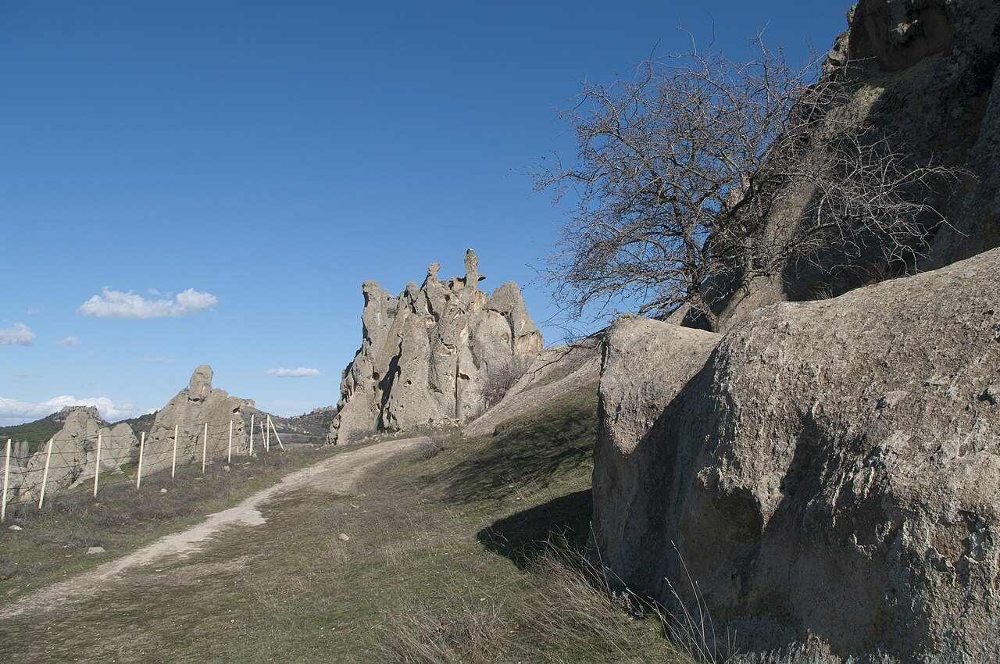

> Kaza güvenlik kamerasına yansıdı; bisikletli hastaneye kaldırıldı.

Tepebaşı ilçesi Mustafa Kemal Paşa Mahallesi Sivrihisar-1 Caddesi üzerinde kaza yaşandı. Edinilen bilgilere göre sürücü İ.E. yönetimindeki otomobil, Şenlik Sokak'a dönmek için manevra yaptığı sırada bisiklet yolunda ilerleyen bisiklete çarptı. Otomobilin bisikletin ön tekerleği üzerinden geçtiği anlar güvenlik kamerasına yansıdı.

Hafif sıyrıklarla atlattığı belirtilen bisikletli, olay yerine gelen sağlık ekiplerinin ilk müdahalesinin ardından hastaneye kaldırıldı. Polis ekipleri kazayla ilgili inceleme başlattı.

---

## Tarım Bakanlığı listesine göre 11 markanın sucuk baharatında yasaklı boya çıktı

**Türkiye · Türkiye** · 2026-10-23 11:33 UTC · Kaynak: [Google Haberler - Bakanlıklar](https://www.yenicaggazetesi.com/tarim-ve-orman-bakanligi-acikladi-11-markanin-sucuk-baharatinda-yasakli-boya-cikti-1084441h.htm)

> Ürünler "Sağlığı Tehlikeye Düşürecek Gıdalar" kategorisinde 22 Ekim'de güncellenen listede yer aldı.

Tarım ve Orman Bakanlığı'nın gıda denetimlerinde sucuk üretiminde kullanılan baharatlarla ilgili mevzuata aykırı bir durum tespit edildi. Analizlerde gıda üretiminde kullanılmasına izin verilmeyen bir boya maddesi bulunan 11 markanın sucuk baharatı, tüketici sağlığı açısından risk taşıyan ürünler arasına alındı.

Bakanlığın 22 Ekim 2026'da yenilenen listesinde ürünler "Sağlığı Tehlikeye Düşürecek Gıdalar" kategorisinde kamuoyuna duyuruldu. Uygulamayla tüketicilerin piyasadaki gıdalar hakkında bilgi sahibi olması amaçlanıyor.

---

## İletişim Başkanı Duran'dan Zonguldak'taki maden ocağı kazası için taziye mesajı

**Türkiye · Türkiye** · 2026-10-23 11:33 UTC · Kaynak: [İletişim Başkanlığı](https://www.iletisim.gov.tr/turkce/haberler/detay/iletisim-baskani-durandan-zonguldakta-maden-ocaginda-meydana-gelen-gocuk-nedeniyle-taziye-mesaji)

> Duran, Kilimli'deki kazada hayatını kaybeden madencilere rahmet, yaralılara şifa diledi.

Cumhurbaşkanlığı İletişim Başkanı Burhanettin Duran, NSosyal hesabından yaptığı paylaşımla Zonguldak'ın Kilimli ilçesindeki bir maden ocağında meydana gelen kazada hayatını kaybeden işçiler için taziye dileklerini iletti.

Duran, mesajında hayatını kaybeden madencilere Allah'tan rahmet, ailelerine ve yakınlarına sabır ve başsağlığı diledi. Kazada yaralanan madencilere acil şifalar temenni etti. Duran, ilgili kurumların olay yerinde gerekli müdahale ve inceleme çalışmalarını titizlikle yürüttüğünü belirtti.

---

## Eskişehir'de kadınların siyasi temsili için AllyGround eğitim programı yapıldı

**Belediye · Merkez** · 2026-10-23 11:33 UTC · Kaynak: [Google Haberler - Eskişehir](https://ankahaber.net/haber/eskisehir-de-kadinlarin-siyasi-temsili-icin-ortak-calisma-b420ef99)

> Büyükşehir, 1984 Derneği ve İsveç Başkonsolosluğu iş birliğindeki iki günlük program Haller Gençlik Merkezi'nde düzenlendi.

Eskişehir Büyükşehir Belediyesi, 1984 Derneği (D84) ve İstanbul İsveç Başkonsolosluğu iş birliğiyle yürütülen "AllyGround - Kadınların Siyasi Yolculuğunu Destekleme Projesi" kapsamında iki günlük eğitim programı düzenledi. Program Haller Gençlik Merkezi Frigya Salonu'nda yapıldı.

Programla kadınların yerel siyasette daha güçlü temsil edilmesi, toplumsal cinsiyet eşitliğinin güçlendirilmesi ve farklı siyasi görüşler arasında dayanışmanın artırılması amaçlandı. Açılış konuşmasını Büyükşehir Genel Sekreter Yardımcısı Nergiz Abacı yaptı. Abacı, kadınların siyasette güçlü temsilinin demokratik bir toplumun temel koşullarından biri olduğunu söyledi.

Programa belediye meclis üyeleri, siyasi parti temsilcileri, kadın siyasetçiler, partilerin kadın ve gençlik kollarında görev alanlar ile sivil toplum kuruluşlarının temsilcileri katıldı. Eğitimlerde kadınların siyasi alanda karşılaştığı engellerin aşılması, liderlik ve dayanışma becerileri ele alındı.

---

## CHP Sözcüsü Sarı Gaziantep'te: Seçimlerde birlikte hareket etmenin önemini vurguluyoruz

**Siyaset · Türkiye** · 2026-10-23 11:33 UTC · Kaynak: [Google Haberler - CHP](https://yerel-haberler.haberturk.com/gaziantep-haberleri/chp-genel-baskan-yardimcisi-ve-parti-sozcusu-sari-gaziantepte-konustu-119501308)

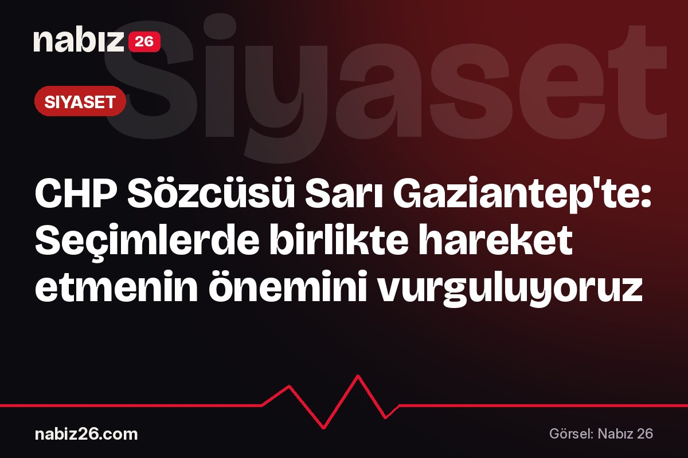

> Sarı, belediye başkanlarına yönelik soruşturmalara ilişkin CHP Gaziantep İl Başkanlığı'nda açıklama yaptı.

CHP Genel Başkan Yardımcısı ve Parti Sözcüsü Müslim Sarı, CHP Gaziantep İl Başkanlığı'nda düzenlediği basın toplantısında belediye başkanlarına yönelik soruşturmalar ve siyasi gelişmeleri değerlendirdi.

Sarı, siyaseten ayrıştıkları arkadaşları olsa bile özellikle Cumhur İttifakı'na karşı, operasyonlardan sonra ortaya çıkacak seçimlerde birlikte hareket etmenin önemini vurguladıklarını söyledi. Belediye başkanlarının tutuksuz yargılanabileceğini belirten Sarı, tutuklamanın bir cezalandırma yöntemine dönüşmemesi gerektiğini ifade etti. Çukurova ve Milas'taki adli süreçleri takip ettiklerini, Milas Belediye Başkanı'nın adli kontrolle serbest bırakılmasını beklediklerini kaydetti.

Sarı ayrıca CHP'nin geçmişte diğer partilerle iş birliği yaptığını, ancak "sabrımızın bir sınırı var" diyerek partinin kurumsal kimliğini önceleyeceklerini söyledi.

---

## Bakan Bayraktar: Dünyanın enerjide belirsizliğe değil, güvenilir ortaklıklara ihtiyacı var

**Ekonomi · Türkiye** · 2026-10-23 11:33 UTC · Kaynak: [Enerji ve Tabii Kaynaklar Bakanlığı](https://enerji.gov.tr/haber-detay?id=31952)

> Bayraktar, İstanbul'daki 19. Verona Avrasya Ekonomik Forumu'nda konuştu.

Enerji ve Tabii Kaynaklar Bakanı Alparslan Bayraktar, İstanbul'da düzenlenen 19. Verona Avrasya Ekonomik Forumu'nda konuştu. Bayraktar, dünyanın enerjide daha fazla belirsizliğe değil, daha fazla iş birliğine, yatırıma ve güvenilir ortaklıklara ihtiyacı olduğunu söyledi; Türkiye'nin buna katkı sunmaya hazır olduğunu belirtti.

Bayraktar, ekonomilerin enerji güvenliğini sağlamak, büyüyen talebi karşılamak ve enerji dönüşümünü gerçekleştirmek şeklinde üç temel sınamayla karşı karşıya olduğunu ifade etti. Yanıtın çeşitlendirme, enerjiye yatırım ve daha geniş uluslararası iş birliği olduğunu söyledi.

Bakan, son 10 yılda günlük LNG gazlaştırma kapasitesini yaklaşık 30 milyon metreküpten 160 milyon metreküpe çıkardıklarını, doğal gaz depolama kapasitesini 15 milyar metreküpe ulaştırmak için çalışmaya devam ettiklerini aktardı. Türkiye'nin üretici ve tüketici ülkeleri birbirine bağlayan önemli bir enerji merkezi konumunda olduğunu vurguladı.

---

## Altın fiyatları 23 Ekim 2026: Gram altın 6.468,55 TL

**Ekonomi · Merkez** · 2026-10-23 10:43 UTC · Kaynak: [Harem Altın](https://www.haremaltin.com/altin-fiyatlari)

> Gram altın güne düşüşle başladı. Harem Altın verilerine göre gram altın 6.397,13 TL'den alınıyor, 6.468,55 TL'den satılıyor.

Altın piyasasında güne düşüşle başlandı. Harem Altın'ın saat 13.43 itibarıyla verilerine göre gram altının satış fiyatı 6.468,55 TL, alış fiyatı 6.397,13 TL oldu. Gram altın, önceki kapanışa göre yüzde 1,43 geriledi.

Ziynet altınlarda çeyrek altın 10.543 TL, yarım altın 21.080 TL, tam altın 42.024 TL, ata altın 42.778 TL seviyesinden satışa sunuluyor.

22 ayar bileziğin gram satış fiyatı 6.042,25 TL, has altının gram fiyatı 6.449,20 TL olarak belirlendi.

Uluslararası piyasalarda altının onsu 4.023,00 dolardan işlem görürken, dolar/TL 49,70 seviyesinde bulunuyor.

Fiyatlar Harem Altın'ın saat 13.43 itibarıyla paylaştığı verilere dayanmaktadır; kuyumcular arasında farklılık gösterebilir. Bu haber yatırım tavsiyesi değildir.

---

## Türkiye 2027'de 14 ülkede 16 uluslararası turizm fuarına katılacak

**Türkiye · Türkiye** · 2026-10-23 10:34 UTC · Kaynak: [Google Haberler - Bakanlıklar](https://www.turizmaktuel.com/haber/bakanlik-2027-de-katilacagi-uluslararasi-turizm-fuarlarini-acikladi)

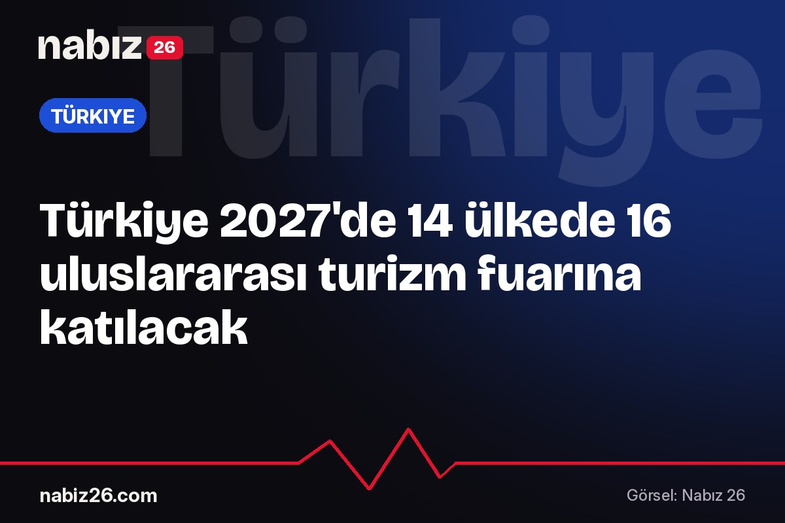

> Kültür ve Turizm Bakanlığı ile TGA'nın takvimine göre ilk fuar Ocak'ta Madrid'de.

Kültür ve Turizm Bakanlığı ile Türkiye Turizm Tanıtım ve Geliştirme Ajansı (TGA) koordinasyonunda hazırlanan takvime göre Türkiye, 2027 yılında 14 ülkede düzenlenecek 16 uluslararası turizm ihtisas fuarında yer alacak.

Program İspanya, Almanya, Rusya, Hindistan, Çin, Birleşik Arap Emirlikleri, Japonya, ABD ve İngiltere gibi pazarları kapsıyor. Yılın ilk büyük organizasyonu 20-24 Ocak'ta Madrid'de yapılacak FITUR 2027 olacak. Program, aralık ayında Fransa'nın Cannes kentinde düzenlenmesi planlanan lüks turizm fuarı ILTM Cannes ile tamamlanacak. Türkiye standına oteller, seyahat acenteleri, tur operatörleri ve hava yolu şirketleri de katılabilecek.

---

## TÜİK: Yükseköğretim beyin göçünde Eskişehir 2025'te dördüncü sırada

**Gündem · Merkez** · 2026-10-23 10:34 UTC · Kaynak: [Google Haberler - Eskişehir gündem](https://www.eskisehirekspres.net/eskisehirde-dikkat-ceken-beyin-gocu-tablosu-ilk-5-sehir-arasinda)

> Beyin göçü oranı Türkiye genelinde yüzde 2,2'ye çıktı; ilk üç sırada İstanbul, İzmir ve Ankara var.

Türkiye İstatistik Kurumu (TÜİK), 2025 yılı Yükseköğretim Beyin Göçü İstatistikleri'ni açıkladı. Yükseköğretim mezunlarının beyin göçü oranı bir önceki yıla göre artarak yüzde 2,2 oldu. Oran kadınlarda yüzde 1,8, erkeklerde yüzde 2,7 olarak gerçekleşti.

Beyin göçünün en yüksek olduğu il yüzde 4,0 ile İstanbul oldu. İstanbul'u sırasıyla İzmir, Ankara, Eskişehir ve Yalova izledi. Erkeklerde Eskişehir yüzde 2,9 ile dördüncü, kadınlarda yüzde 1,7 ile yine dördüncü sırada yer aldı. En düşük oran yüzde 0,2 ile Siirt'te görüldü.

Devlet üniversitesi mezunlarında oran 2025'te yüzde 1,9, vakıf üniversitesi mezunlarında yüzde 4,4 oldu. En yüksek beyin göçü oranı yüzde 7,0 ile bilişim ve iletişim teknolojileri alanında görüldü.

---

## TOGG, COP31'in "Mobilite Sektör Ortağı" oldu

**Ekonomi · Türkiye** · 2026-10-23 10:34 UTC · Kaynak: [Google Haberler - Togg](https://www.ekonomidunya.com/togg-cop31in-mobilite-sektor-ortagi-oldu/114052)

> TOGG, zirvede elektrikli mobilitenin iklim hedeflerine katkısını anlatacak.

TOGG, Türkiye'nin ev sahipliğinde yapılacak Birleşmiş Milletler İklim Değişikliği Çerçeve Sözleşmesi 31. Taraflar Konferansı'nın (COP31) "Mobilite Sektör Ortağı" oldu. Bilgi, TOGG'un yaptığı açıklamaya dayanıyor.

Kamu, özel sektör, uluslararası kuruluşlar, akademi ve sivil toplum temsilcilerini bir araya getirecek zirvede TOGG, elektrikli mobiliteye geçişin iklim hedeflerine katkısını, bu dönüşümü destekleyen enerji ve dijital hizmetlerle birlikte ortaya koyacak. Üretimden günlük kullanıma uzanan uygulamalarını paylaşacak, uluslararası paydaşlarla yeni iş birlikleri geliştirmeyi amaçlayacak.

TOGG Yönetim Kurulu Başkanı Fuat Tosyalı, Türkiye'nin COP31'e ev sahipliği yaparak iklim değişikliğiyle mücadelede küresel sorumluluk üstlenme iradesini gösterdiğini belirtti.

---

## Tepebaşı'nda Kızılinler bal kabağıyla rulo pasta ve irmikli baklava atölyesi yapıldı

**Kültür-Sanat · Tepebaşı** · 2026-10-23 10:34 UTC · Kaynak: [Google Haberler - Tepebaşı](https://www.sakaryagazetesi.com.tr/bal-kabagindan-sasirtan-lezzetler)

> Etkinlik, 25 Ekim'deki 4. Kızılinler Bal Kabağı Panayırı öncesinde düzenlendi.

Tepebaşı Belediyesi'nin düzenleyeceği 4. Kızılinler Bal Kabağı Panayırı ve Eskişehir Bal Kabağı Çalıştayı öncesinde Mutfak Atölyesi'nde özel bir etkinlik yapıldı. Eskişehir Aşçılar Derneği iş birliğiyle düzenlenen atölyede üretici kadınlar, kendi yetiştirdikleri Kızılinler bal kabaklarını şeflerle birlikte farklı tariflerde değerlendirdi; bal kabağından rulo pasta ve irmikli baklava hazırlandı.

Pastacı Şef Fatma Kurga Kök, bal kabağı püresini rulo pastada kullandıklarını ve çocukların da severek tüketebileceği, katkı maddesi içermeyen bir tarif geliştirdiklerini söyledi. Eskişehir Aşçılar Derneği Başkanı Kemal Kaya, coğrafi işaretli Kızılinler bal kabağının farklı ürünlere dönüştürülmesinin önemine dikkat çekti.

Tepebaşı Belediyesi yetkilileri vatandaşları 25 Ekim Pazar günü yapılacak panayıra ve 26 Ekim'deki Eskişehir Bal Kabağı Çalıştayı'na davet etti. Çalıştayın Türkiye'de ilk kez ulusal ölçekte düzenleneceği belirtildi.

---

## SAS2027 Sıfır Atık ve Sürdürülebilirlik Yarışması için başvurular 15 Ocak'a kadar

**Eğitim · Türkiye** · 2026-10-23 10:34 UTC · Kaynak: [Eskişehir İl Milli Eğitim Müdürlüğü](https://eskisehir.meb.gov.tr/www/uluslararasi-sifir-atik-ve-surdurulebilirlik-yarismasi-duzenlenecek/icerik/8687/tr)

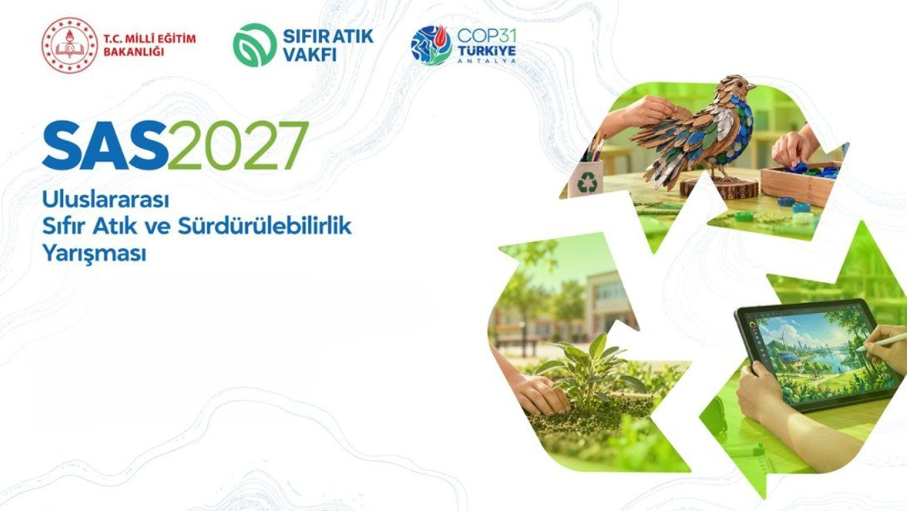

> Yarışma "Atıktan Sanata", "Görsel Tasarım" ve "Yaşayan Okul Bahçeleri" kategorilerinde yapılacak.

Öğrencilerin sıfır atık, geri dönüşüm ve sürdürülebilirlik konularında farkındalık kazanması hedefiyle "SAS2027 Uluslararası Sıfır Atık ve Sürdürülebilirlik Yarışması" düzenlenecek. Başvurular 15 Ocak 2027 tarihine kadar yapılabilecek.

Yarışma üç kategoride yapılacak. "Atıktan Sanata" kategorisine yurt içindeki okullarda öğrenim gören tüm kademelerdeki öğrenciler katılabilecek. "Görsel Tasarım" kategorisi yurt içi ve yurt dışındaki ortaokul ve lise öğrencilerine, "Yaşayan Okul Bahçeleri" kategorisi ise yurt içi ve yurt dışındaki okullara açık olacak.

Türkçe ve İngilizce yürütülecek yarışma, yurt dışındaki eğitim temsilcilikleri, Türkiye Maarif Vakfı ve kardeş okullar aracılığıyla uluslararası katılıma da açılacak.

---

## Odunpazarı Gündoğdu'nda kavşakta kaza: Muhtar tümsek ve trafik aynası istedi

**Gündem · Odunpazarı** · 2026-10-23 10:34 UTC · Kaynak: [Google Haberler - Eskişehir asayiş](https://www.eskisehirhaber.com/eskisehirde-korkutan-kaza-sonrasi-muhtardan-onemli-cagri)

> İki aracın çarpıştığı kaza maddi hasarla atlatıldı.

Eskişehir'in Odunpazarı ilçesinde Gündoğdu Mahallesi'nde Muratcan Sokak ile Kanalyanı Sokak'ın kesiştiği noktada iki araç henüz belirlenemeyen bir nedenle çarpıştı. Kazada SUV tipi aracın ön kısmı parçalandı, diğer otomobilin sol tarafı ağır hasar gördü. Olay maddi hasarla atlatıldı.

Mahalle Muhtarı Adem Karaman, kavşakta benzer kazaların sık yaşandığını belirterek trafik güvenliğinin artırılmasını istedi. Karaman, bölgeye hız kesici tümsek yapılmasını ve sürücülerin görüşünü kolaylaştıracak bir trafik aynası yerleştirilmesini talep etti.

---

## Neapco'nun Eskişehir OSB'deki 35 milyon Euro'luk tesisi açıldı: 120 kişi çalışıyor

**Ekonomi · Merkez** · 2026-10-23 10:34 UTC · Kaynak: [Google Haberler - Eskişehir gündem](https://www.eskisehirekspres.net/neapco-eskisehir-tesisi-acildi-120-kisiye-istihdam-saglaniyor)

> Açılışın öncesinde şirkete Ford Q1 Kalite Ödülü töreni yapıldı.

Küresel otomotiv parça üreticisi Neapco'nun Türkiye yapılanması Neapco Turkey Otomotiv A.Ş., Eskişehir Organize Sanayi Bölgesi'ndeki yeni tesisinde önce Ford Q1 Kalite Ödülü törenini yaptı, ardından fabrikanın resmî açılışını gerçekleştirdi.

Toplam 35 milyon Euro yatırımla hayata geçirilen tesiste yıllık montaj kapasitesi 1,5 milyon adede çıkarıldı, istihdam 120 kişiye ulaştı. Genel Müdür Hüseyin Erdem, ödülün kaliteye bağlılığın göstergesi olduğunu söyledi. Neapco Holdings Küresel Başkanı ve CEO'su Kenneth Hopkins, Ford Q1 statüsünün kazanılmasının kolay olmadığını belirtti. Ford Otosan Satın Alma Direktörü Tunç Yerli de iki kurum arasındaki iş birliğine değindi.

---

## MEB'den 81 il valiliğine 24 Kasım Öğretmenler Günü genelgesi

**Eğitim · Türkiye** · 2026-10-23 10:34 UTC · Kaynak: [Eskişehir İl Milli Eğitim Müdürlüğü](https://eskisehir.meb.gov.tr/www/24-kasim-ogretmenler-gunu-genelgesi-yayimlandi/icerik/8688/tr)

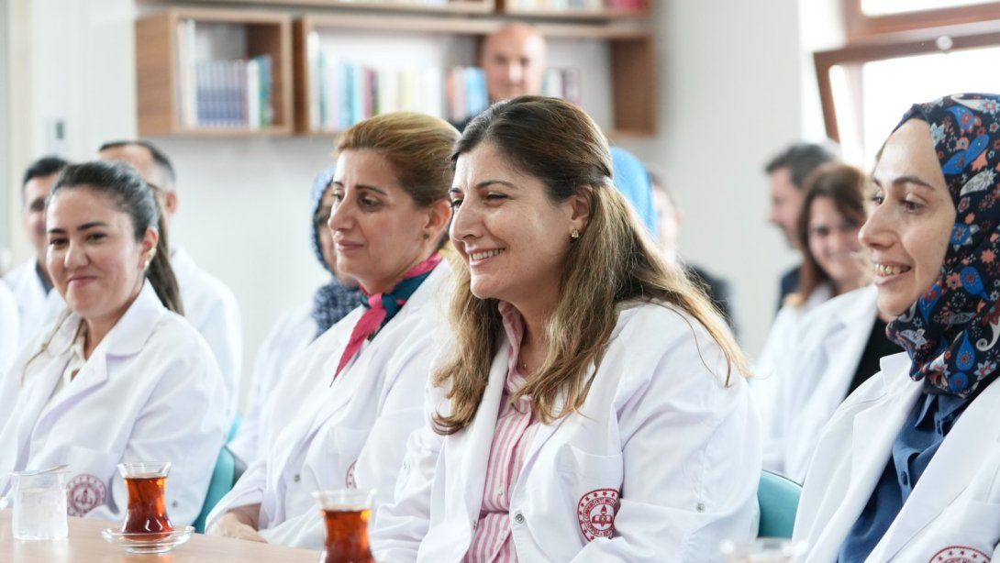

> Kutlamalar merkezî programlarla sınırlı kalmayıp 81 ilde kültür, sanat ve akademik etkinliklerle zenginleştirilecek.

Millî Eğitim Bakanı Yusuf Tekin'in imzasıyla 81 il valiliğine gönderilen genelgede, 24 Kasım Öğretmenler Günü'nün öğretmenlere şükranların ifade edilmesi ve mesleğin kıymetinin hatırlanması için önemli bir vesile olduğu vurgulandı. Kutlama programlarına en üst seviyede katılım sağlanması istendi.

Bu yıl kutlama etkinliklerinin merkezî programlarla sınırlı kalmayıp 81 ilde kültür, sanat, akademik çalışmalar, sosyal etkinlikler ve uluslararası iş birlikleriyle çok yönlü biçimde gerçekleştirilmesi amaçlanıyor. İl ve ilçe millî eğitim müdürlükleri, okul ve kurum müdürlükleri ile dış temsilciliklerde kutlama kurulları oluşturulacak; programlar bu kurullarca hazırlanıp uygulanacak.

Programlara mülki erkân, şehit öğretmenlerin yakınları, emekli öğretmenler, mezun öğrenciler ve vatandaşlar davet edilecek. Şehit öğretmenler başta olmak üzere hayatını kaybetmiş öğretmenler kabirleri başında anılacak, şehit öğretmen aileleri ve emekli öğretmenler ziyaret edilecek.

---

## Eskişehirspor, Bursa Yıldırım SK maçı hazırlıklarını sürdürüyor

**Spor · Merkez** · 2026-10-23 10:34 UTC · Kaynak: [Google Haberler - Eskişehirspor](https://www.medyamidas.com/spor/eskisehirspor-bursa-yildirim-sk-macina-hazirlaniyor)

> Kırmızı-siyahlı ekip hafta sonu oynayacağı maçın hazırlıklarını kulüp tesislerinde yaptığı antrenmanla sürdürdü.

TFF 3. Lig'de mücadele eden Eskişehirspor, hafta sonu oynayacağı Bursa Yıldırım SK karşılaşmasının hazırlıklarını sürdürüyor. Kulüp tesislerinde teknik heyet yönetiminde yapılan çalışmada futbolcular pas ve taktik varyasyonları üzerinde durdu.

Kırmızı-siyahlı ekip antrenmanın ardından maç saatini beklemeye geçecek.

---

## CHP, 5 Aralık'ta Ankara'da yapılacak "Engelli Buluşması" için toplantı yaptı

**Siyaset · Türkiye** · 2026-10-23 10:34 UTC · Kaynak: [Google Haberler - CHP](https://ankahaber.net/haber/chp-den-engelliler-bulusmasi-efc8bda2)

> Toplantıya CHP Genel Başkan Yardımcısı Necdet Saraç başkanlık etti.

CHP, 5 Aralık'ta Ankara'da yapılması planlanan "CHP Engelli Buluşması" için CHP Genel Merkezi'nde koordinasyon toplantısı yaptı. Toplantıya CHP Sosyal Politikalardan Sorumlu Genel Başkan Yardımcısı Necdet Saraç başkanlık etti.

Toplantıya CHP Engelliler Kurulu Başkanı Cemal Kaman, CHP Ankara İl Başkan Yardımcısı Burak Bilici, Türkiye Sakatlar Derneği Genel Başkanı Şükrü Poyraz, sivil toplum kuruluşları ve engelli derneklerinin temsilcileri katıldı.

Saraç, engelli bireylerin toplumsal yaşamın dışında bırakılmadığı, eğitimden istihdama, ulaşımdan dijital hizmetlere her alanda eşit katılımın sağlandığı bir düzenin kurulması gerektiğini söyledi. Saraç, buluşmanın Kemal Kılıçdaroğlu'nun da katılımıyla gerçekleşeceğini belirtti.

---

## Bakan Tekin İstanbul'da Güngören Güneşlitepe İlkokulu'nu ziyaret etti

**Eğitim · Türkiye** · 2026-10-23 10:34 UTC · Kaynak: [Milli Eğitim Bakanlığı](https://www.meb.gov.tr/bakan-tekin-istanbul039da-gungoren-guneslitepe-ilkokulunu-ziyaret-etti/haber/42271/tr)

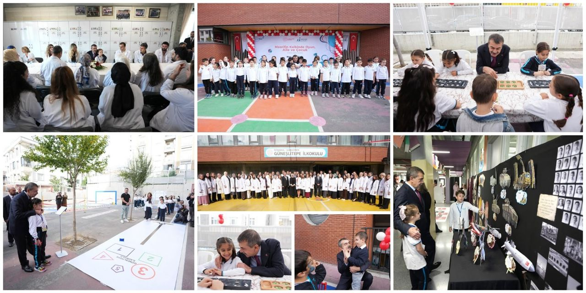

> Tekin, "Maarifin Kalbinde Oyun" temalı etkinlik alanlarında öğrencilerle bir araya geldi.

Millî Eğitim Bakanı Yusuf Tekin, İstanbul'da Güngören Güneşlitepe İlkokulu'nu ziyaret etti. Tekin, "Maarifin Kalbinde Oyun" temasıyla kurulan etkinlik alanlarında öğrencilerle bir araya geldi; halat çekme, yüz boyama ve topaç çevirme gibi geleneksel oyunlarda çocuklara eşlik etti. Okulun öğretmenler odasında eğitimcilerle de görüştü.

Basına açıklama yapan Tekin, oyunu çocukların okulda eğlenerek öğrenmesi ve geleneksel kültürün, ortak değerlerin aktarılması için önemli bir araç olarak gördüklerini söyledi. Geleneksel çocuk oyunlarının gelecek kuşaklara aktarılması için 2023 yazındaki genelgeyle bir başlangıç yaptıklarını belirtti.

---

## TİHEK, görme engelli başvuru üzerine Büyükşehir ve Tepebaşı'na 50'şer bin lira ceza verdi

**Belediye · Merkez** · 2026-10-23 09:33 UTC · Kaynak: [Google Haberler - Tepebaşı](https://www.memurlar.net/haber/1181773/gorme-engelliye-ayrimcilik-tihek-ten-iki-belediyeye-ceza.html)

> Kurum, erişilebilirlik koşullarının sağlanmamasını engellilik temelinde ayrımcılık saydı.

Türkiye İnsan Hakları ve Eşitlik Kurumu (TİHEK), görme engelli bir kişinin işe gidiş ve dönüşlerinde kullandığı güzergâhta erişilebilirlik koşullarının sağlanmaması nedeniyle Eskişehir Büyükşehir Belediyesi ile Tepebaşı Belediyesi'ne 50'şer bin lira idari para cezası verdi.

Yüzde 52 oranında görme engeli bulunan başvuran, güzergâhta hız kesici kasis ve yaya geçidi bulunmadığını, kaldırımların erişilebilirlik standartlarına uygun olmadığını öne sürdü. UKOME'ye yaptığı kasis talebinin reddedildiğini savundu. Büyükşehir, bölgenin komisyonca incelendiğini, kasise gerek olmadığı görüşüne varıldığını ve kaldırımlardan sorumlu Tepebaşı Belediyesi'ne konunun bildirildiğini savundu.

Erişilebilirlik İzleme ve Denetleme Komisyonu'nun teknik incelemesinde kaldırımlarda 150 santimetre genişliğinde kesintisiz geçişin sağlanamadığı, elektrik direkleri ve trafik tabelalarının yaya geçişini engellediği, bazı noktalarda rampa, yaya geçidi ve hissedilebilir yüzey işaretlerinin bulunmadığı tespit edildi.

TİHEK, Büyükşehir'in aldığı alternatif tedbirlerin etkili bir çözüm oluşturmadığını, Tepebaşı'nın ise erişilebilir çevre koşullarını makul sürede sağlayamadığını belirterek engellilik temelinde ayrımcılık yasağının ihlal edildiğine hükmetti.

---

## Mahalle AFAD Gönüllü Ekipleri için ESTÜ'de belge takdim töreni yapıldı

**Gündem · Tepebaşı** · 2026-10-23 09:33 UTC · Kaynak: [Eskişehir İl Milli Eğitim Müdürlüğü](https://eskisehir.meb.gov.tr/www/13-ekim-uluslararasi-afet-risklerinin-azaltilmasi-gunu-kapsaminda-belge-takdim-toreni-estu039de-gerceklestirildi/icerik/8691/tr)

> 13 Ekim Afet Risklerinin Azaltılması Günü kapsamındaki törende 103 gönüllü ve ekipler ödüllendirildi.

13 Ekim Uluslararası Afet Risklerinin Azaltılması Günü kapsamında Eskişehir Valiliği öncülüğünde ve İl AFAD Müdürlüğü koordinasyonunda Mahalle AFAD Gönüllü Ekipleri ve Akredite Arama Kurtarma Ekipleri Belge Takdim Töreni düzenlendi. Tören, Eskişehir Teknik Üniversitesi (ESTÜ) Yabancı Diller Yüksekokulu Konferans Salonu'nda yapıldı.

Törene Vali Yardımcısı Yakup Güney, ESTÜ Rektör Yardımcısı Prof. Dr. Onur Kaya, İl AFAD Müdürü Aslan Mehmet Coşkun ve İl Millî Eğitim Müdür Yardımcısı Ali Türkal katıldı. Deliklitaş, Emek, Kurtuluş, Şirintepe ve Uluönder mahallelerinde toplam 103 gönüllü projeye katıldı.

Projeye katkı sunan beş mahalle muhtarına plaket verildi. MEB AKUB, İHH Eskişehir ve Arçelik bünyesindeki akredite arama kurtarma ekiplerinin temsilcilerine başarı belgesi takdim edildi. Eskişehir MEB AKUB adına İl Millî Eğitim Müdürlüğü'ne plaket verildi.

---

## CHP İstanbul İl Başkanı olarak görevlendirilen Yüksel: CHP vesayet kabul etmez

**Siyaset · Türkiye** · 2026-10-23 09:33 UTC · Kaynak: [Google Haberler - CHP](https://www.babaocagi.com.tr/mehmet-ali-yukselden-vesayet-cikisi-chp-vesayet-kabul-etmez-edemez)

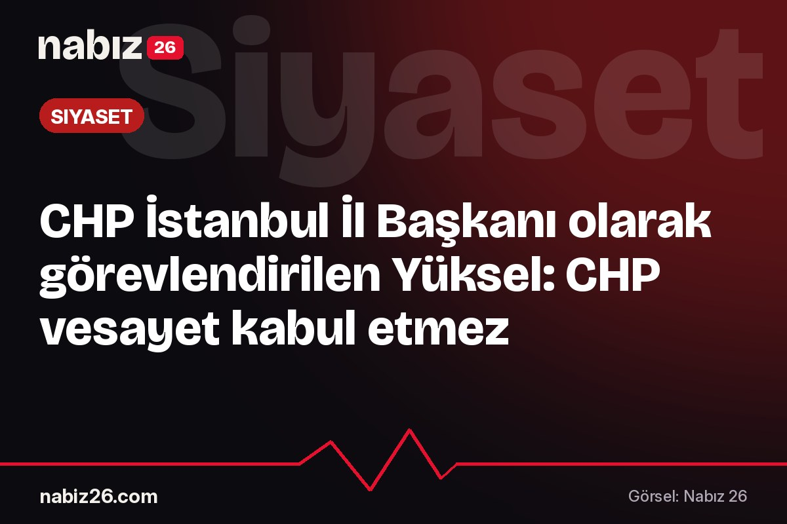

> Mehmet Ali Yüksel, il binası önünde partililerle bir araya gelerek göreve başladı.

CHP İstanbul İl Başkanı olarak görevlendirilen Mehmet Ali Yüksel, il binası önünde partililerle bir araya gelerek göreve başladı. Yüksel konuşmasında "CHP, vesayet kabul etmez, edemez" dedi.

Görevi sona eren Gürsel Tekin'e teşekkür eden Yüksel, Kemal Kılıçdaroğlu'na da saygı ve sevgilerini ilettiğini söyledi. Siyasi iradenin özgürlüğüne vurgu yapan Yüksel, siyasetin satın alınan sadakatler üzerine kurulmaması gerektiğini savundu.

Yüksel, CHP'nin herhangi bir kişi ya da kurumun kontrolüne giremeyeceğini, partiye hiçbir sermaye gücünün sahip olamayacağını söyledi ve partinin farklı kesimleri kapsayan bir anlayışla hareket edeceğini kaydetti.

---

## Büyükşehir'in Caz Günleri Art Baden Quartet konseriyle başladı

**Kültür-Sanat · Merkez** · 2026-10-23 09:33 UTC · Kaynak: [Google Haberler - Eskişehir gündem](https://www.urfadabugun.com/haber/263187/eskisehirde-caz-gunleri-art-baden-quartet-konseriyle-basladi.html)

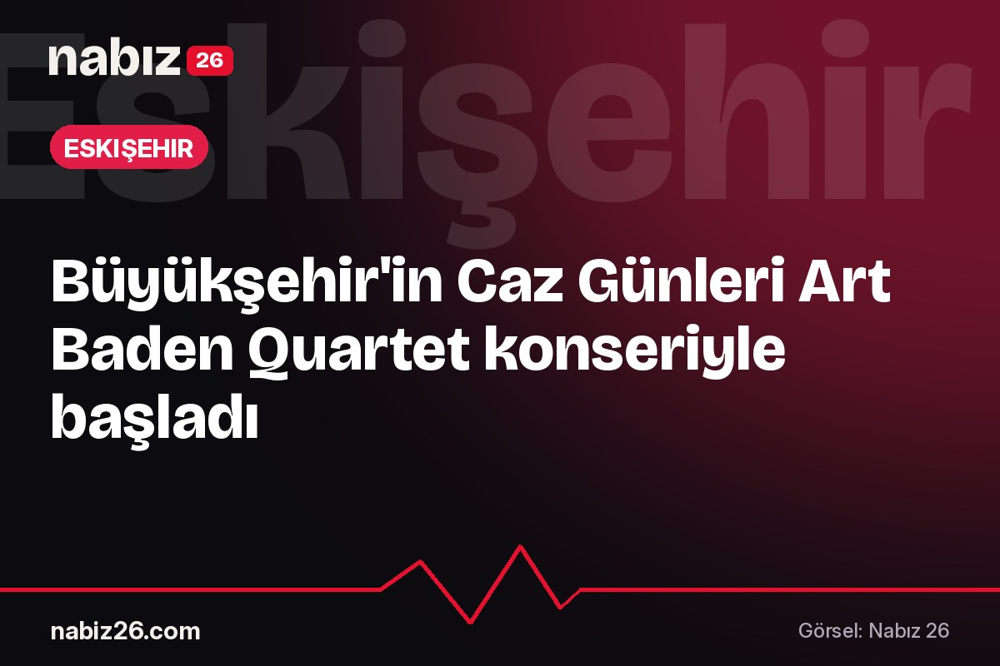

> Grup Türkiye turnesinin ilk konserini Eskişehir'de verdi; Coltrane doğumunun 100. yılında anıldı.

Eskişehir Büyükşehir Belediyesi'nin 2026-2027 sanat sezonu kapsamındaki Caz Günleri, Art Baden Quartet konseriyle başladı. Türkiye turnesinin ilk konserini Eskişehir'de veren grupta saksafonda Art Baden, gitarda Onur Aymergen, davulda Serkan Alagök ve kontrabasta Ulaş Özdemir yer aldı.

Konserde John Coltrane doğumunun 100. yılında eserleriyle anıldı; Kurt Rosenwinkel ve Richard Rodgers'ın eserleri de seslendirildi. Aymergen'in 2025'te yayımlanan "Africa" adlı bestesi ile Art Baden'in "Chaotic Neutral" adlı eseri de çalındı.

Caz Günleri, 3 Kasım 2026 Salı günü saat 20.00'de Sanat ve Kültür Merkezi Opera Sahnesi'nde "Sibel Köse Quintet" konseriyle sürecek.

---

## Büyükşehir 8059. Cadde'de yol genişletip asfalt serdi: Yaşamkent-Zincirlikuyu bağlantısı

**Ulaşım · Merkez** · 2026-10-23 09:33 UTC · Kaynak: [Google Haberler - Eskişehir](https://www.eskisehirekspres.net/eskisehir-buyuksehirden-bolge-ulasimina-yeni-alternatif)

> Cadde Aydın Ünlüce Bulvarı ile 8070. Cadde arasında bağlantı sağlayacak.

Eskişehir Büyükşehir Belediyesi Yol Yapım Bakım ve Onarım Dairesi Başkanlığı ekipleri 8059. Cadde'de yol genişletme çalışması yürütüyor ve bitümlü sıcak asfalt serimine başladı. Çalışmayla Yaşamkent ve Zincirlikuyu mahalleleri arasındaki ulaşım bağlantısının güçlendirilmesi hedefleniyor.

8059. Cadde, Aydın Ünlüce Bulvarı ile 8070. Cadde arasında bağlantı sağlayacak. Yol genişletme ve asfaltlama ile güzergâhın daha düzenli ve güvenli bir ulaşım imkânı sunması amaçlanıyor.

---

## Altay yarın Balıkesirspor'a konuk olacak; geçen hafta Eskişehirspor'a 4-1 yenilmişti

**Spor · Merkez** · 2026-10-23 09:33 UTC · Kaynak: [Google Haberler - Eskişehirspor](https://www.egepostasi.com/haber/Altay-Balikesirspor-ile-karsilasacak/402494)

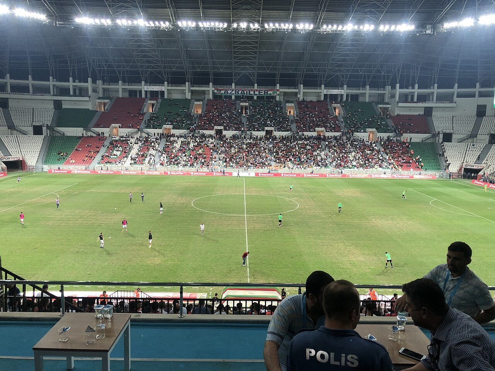

> 3. Lig 2. Grup 8. hafta maçı Soma Nazım Yavuz Stadı'nda oynanacak.

3. Lig 2. Grup'ta geçen hafta evinde Eskişehirspor'a 4-1 yenilen Altay, yarın deplasmanda Balıkesirspor ile oynayacak. Ev sahibi ekibin stadı bakımda olduğu için 8. hafta karşılaşması Soma Nazım Yavuz Stadı'nda oynanacak; maçı Murat Demir yönetecek.

Altay'da kırmızı kart cezalısı İsa ile sakatlığı bulunan Caner, Arif ve Ferhat forma giyemeyecek. Yunus Efe ile Salih'in durumu maç saatinde netleşecek. Balıkesirspor'da kırmızı kart cezalısı Ferit kadroda yer almayacak.

Ligde iç sahada 3 maçta 3 galibiyet alan Balıkesirspor 13 puanla 7. sırada, son 2 deplasman maçını kazanan Altay ise 9 puanla 11. sırada.

---

## 81 ilde ortaöğretim öğrencileri için "Tabiat ve Yaşanabilir Çevre" yarışması yapılacak

**Eğitim · Türkiye** · 2026-10-23 09:33 UTC · Kaynak: [Eskişehir İl Milli Eğitim Müdürlüğü](https://eskisehir.meb.gov.tr/www/81-ilde-ogrenciler-icin-quottabiat-ve-yasanabilir-cevrequot-bilgi-yarismasi-duzenlenecek/icerik/8689/tr)

> COP31 hazırlıkları kapsamındaki yarışma okul, ilçe ve il olmak üzere üç aşamalı olacak.

Türkiye'nin 9-20 Kasım 2026 tarihleri arasında Antalya'da ev sahipliği yapacağı 31. Taraflar Konferansı (COP31) hazırlıkları çerçevesinde ortaöğretim öğrencilerine yönelik "Tabiat ve Yaşanabilir Çevre" Bilgi Yarışması düzenlenecek.

Yarışmayla öğrencilerin iklim değişikliği ve sürdürülebilirlik konularındaki bilgi ve farkındalığının artırılması hedefleniyor. 81 ilde yapılacak yarışma okul, ilçe ve il olmak üzere üç aşamadan oluşacak.

Sorular iklim değişikliği ve iklim eylemi, sürdürülebilir yaşam, biyoçeşitlilik, enerji kaynakları ve verimliliği, su kaynaklarının korunması, atık yönetimi ve sıfır atık ile iklim politikaları konularından hazırlanacak.

---

## Tarım Kredi Kooperatifi eski müdürü Tahsin B.'nin zimmet davasında bilirkişi kararı

**Asayiş · Merkez** · 2026-10-23 08:33 UTC · Kaynak: [Google Haberler - Eskişehir gündem](https://www.cumhuriyet.com.tr/turkiye/tarim-kredi-kooperatifi-nde-83-ton-komur-acigi-eski-mudure-zimmet-davasi-2549477)

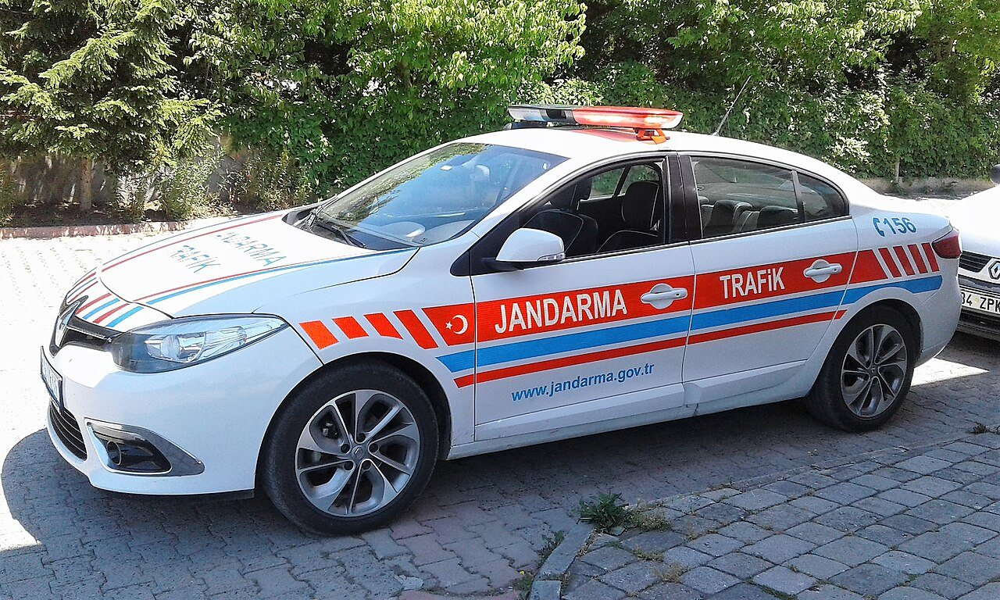

> Mahkeme, 83 ton kömür açığı iddiasıyla ilgili dosyayı Sayıştay emekli uzmanlarından oluşan heyete gönderdi.

Eskişehir'de Tarım Kredi Kooperatifi eski müdürü Tahsin B., zimmet ve resmi belgede sahtecilik suçlamalarıyla yargılanıyor. Davanın duruşması görüldü.

İddialara göre Tahsin B., bir kooperatif ortağından tahsil edilen paranın 5 bin lirasını zimmetine geçirdi, envanter sayımında ortaya çıkan 83 ton 577 kilogram kömür açığından sorumlu ve bir ziraat mühendisinin yerine sahte imza attı.

Savunma yapan Tahsin B. suçlamaları kabul etmedi. Parayı elden teslim edemediğini, sonradan banka havalesiyle iade ettiğini öne sürdü; kömür açığı ve sahte imza iddialarını reddetti. Tanık olarak dinlenen İsa Y., kooperatif kayıtlarında yalnızca 5 bin lira nakit ödeme göründüğünü söyledi. Sanık avukatı beraat talep etti.

Mahkeme, kooperatif zararının basit bir incelemeyle belirlenip belirlenemeyeceği için dosyanın 3 kişilik bilirkişi heyetine, belgelerdeki imzaların incelenmesi için evrakın Ankara Jandarma Kriminal Daire Başkanlığı'na gönderilmesine karar verdi ve duruşmayı erteledi. Sanık hakkında karar verilmedi.

---

## Ortaokul Matematik Zirvesi TED Eskişehir Koleji'nde yapıldı

**Eğitim · Merkez** · 2026-10-23 08:33 UTC · Kaynak: [Eskişehir İl Milli Eğitim Müdürlüğü](https://eskisehir.meb.gov.tr/www/ortaokul-matematik-zirvesi-eskisehir039de-gerceklestirildi/icerik/8693/tr)

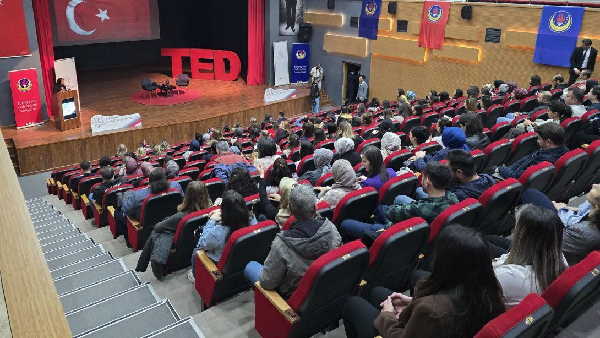

> İl Millî Eğitim Müdürlüğü koordinesindeki zirvede öğretmenler Maarif Modeli matematik programını konuştu.

Türkiye Yüzyılı Maarif Modeli doğrultusunda öğretmenlerin program okuryazarlığını güçlendirmek amacıyla düzenlenen Ortaokul Matematik Zirvesi, İl Millî Eğitim Müdürlüğü koordinesinde TED Eskişehir Koleji'nin ev sahipliğinde yapıldı.

Açılış konuşmasını yapan İl Millî Eğitim Müdürü Sinan Aydın, modelin öğrenci merkezli yapısına dikkat çekerek modelin başarısının öğretmenlerin bilgi ve donanımıyla doğrudan ilişkili olduğunu söyledi.

İlde görev yapan matematik öğretmenlerinin katıldığı zirvede, Matematik Dersi Öğretim Programı'nın temel yaklaşımı ve sınıf içi uygulama örnekleri ele alındı. Anadolu Üniversitesi'nden Prof. Dr. Dilek Tanışlı ve Prof. Dr. Nilüfer Köse sunum yaptı.

---

## Odunpazarı'nda çibörekçide yangın: 2 kişi dumandan etkilendi

**Gündem · Odunpazarı** · 2026-10-23 08:33 UTC · Kaynak: [Google Haberler - Eskişehir asayiş](https://www.sakaryagazetesi.com.tr/eskisehirin-islek-noktasinda-korkutan-yangin)

> Arifiye Mahallesi'ndeki yangına itfaiye müdahale etti; ilk değerlendirmede yağdan çıktığı belirtildi.

Eskişehir'in Odunpazarı ilçesine bağlı Arifiye Mahallesi Kıbrıs Şehitleri Caddesi üzerindeki bir çibörekçide henüz kesin olarak belirlenemeyen bir nedenle yangın çıktı. İhbar üzerine olay yerine sevk edilen itfaiye ekipleri yangına müdahale etti.

Yangında işletme personeli 2 kişi dumandan etkilendi ve ambulansta müdahale edildi. İlk değerlendirmelere göre yangının işletmede kullanılan yağdan kaynaklandığı belirtildi. Kesin çıkış nedeninin yapılacak incelemelerle belirlenmesi bekleniyor. Polis ekipleri olayla ilgili inceleme başlattı.

---

## MEB'in Ekim ayı Aile Eğitim Bülteni yayımlandı: Okul öncesi eğitim temalı

**Eğitim · Türkiye** · 2026-10-23 08:33 UTC · Kaynak: [Eskişehir İl Milli Eğitim Müdürlüğü](https://eskisehir.meb.gov.tr/www/quotaile-egitim-bulteniquot-ekim-sayisi-yayimlandi/icerik/8695/tr)

> Temel Eğitim Genel Müdürlüğü, okul öncesi çocukların aileleri için aylık bülteni yayımladı.

Temel Eğitim Genel Müdürlüğü, ailelerin eğitim sürecindeki rolünü güçlendirmek amacıyla her ay hazırladığı "Aile Eğitim Bülteni"nin Ekim sayısını yayımladı. Bülten, okul öncesi eğitime devam eden çocukların anne babalarına rehberlik sunuyor.

Ekim sayısı "Maarif Yolculuğunda Okul Öncesi Eğitim" temasıyla hazırlandı. Bültende okul öncesi eğitimin çocukların gelişimindeki yeri, Türkiye Yüzyılı Maarif Modeli'nin okul öncesi eğitim yaklaşımı ve çocukların okulda yaşayacağı öğrenme deneyimleri ele alındı.

Bültende her çocuğun ilgi alanları, öğrenme hızı ve ihtiyaçlarının farklı olduğu vurgulandı. Ailelerin paylaşacağı gözlemlerin öğretmenin çocuğu daha yakından tanımasına katkı sunacağı belirtildi. Bültende ayrıca Aile Eğitimi ve Katılımı Çalışmaları, Evde Oyun Rehberi ve Ailemle Okul Yolu Programı'na yer verildi.

---

## Eskişehirspor'a Altay maçındaki saha olayları nedeniyle 35 bin lira para cezası

**Spor · Merkez** · 2026-10-23 08:33 UTC · Kaynak: [Google Haberler - Eskişehirspor](https://www.istikbalgazetesi.com/eskisehirspora-para-cezasi-1)

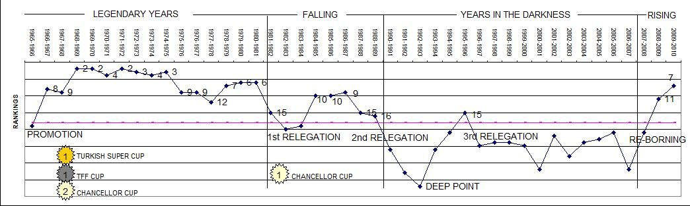

> PFDK, taraftarların neden olduğu olaylar gerekçesiyle kulübe ceza verdi.

Eskişehirspor, Altay ile oynadığı mücadelede yaşanan saha olayları gerekçesiyle Profesyonel Futbol Disiplin Kurulu'na (PFDK) sevk edilmişti.

PFDK, raporlar doğrultusunda Eskişehirspor'a taraftarlarının neden olduğu saha olayları nedeniyle FDT'nin 52/2. ve 46/1. maddeleri uyarınca 35 bin lira para cezası verdi.

---
