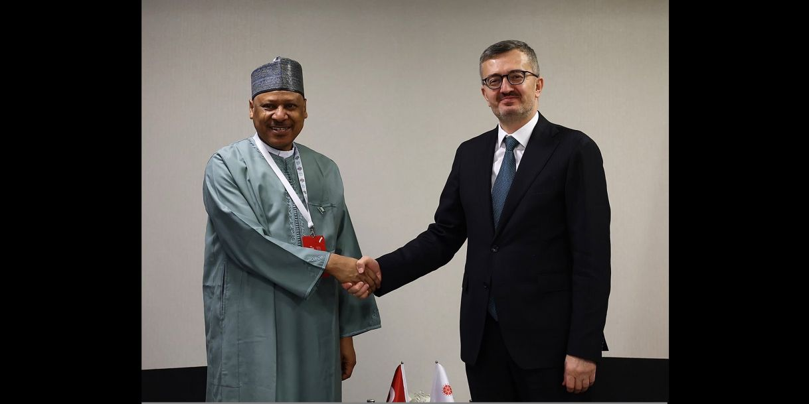
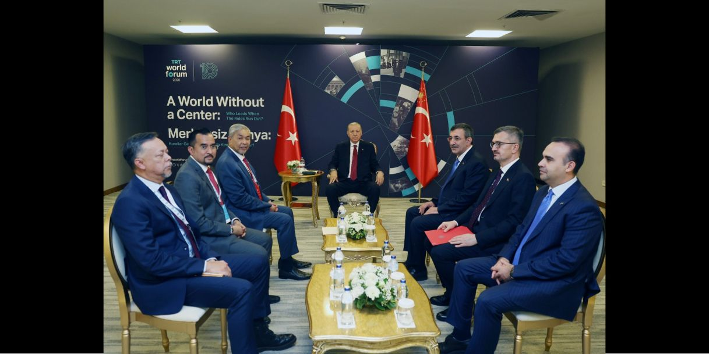
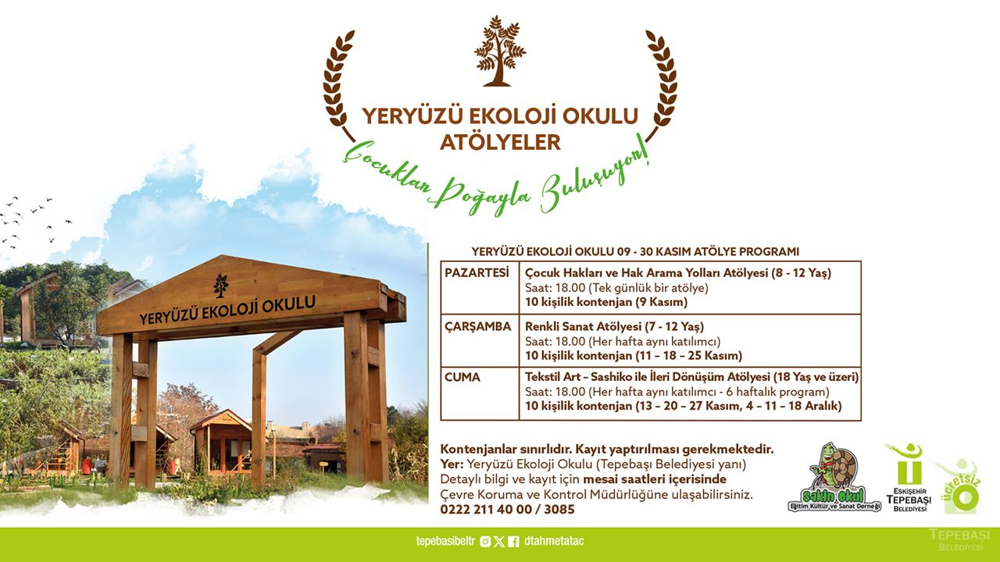
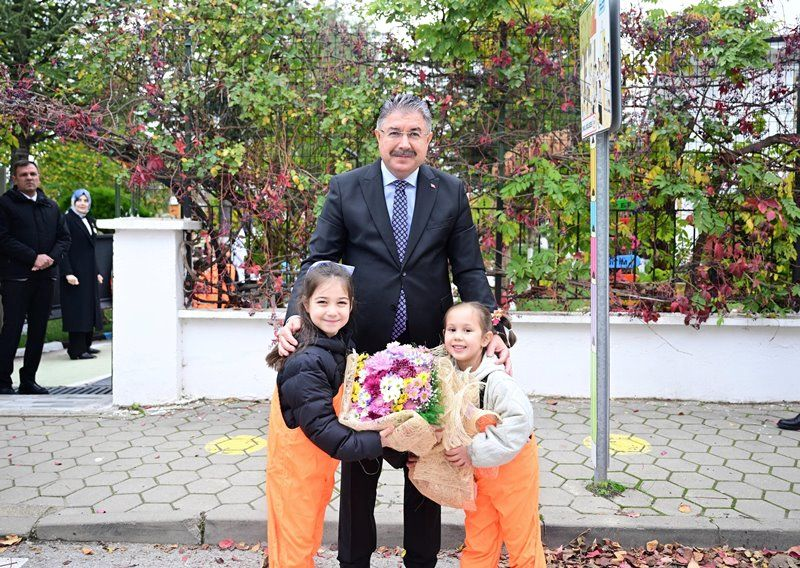
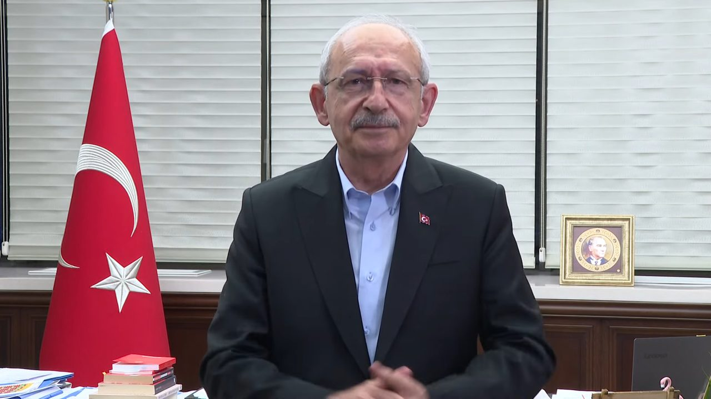
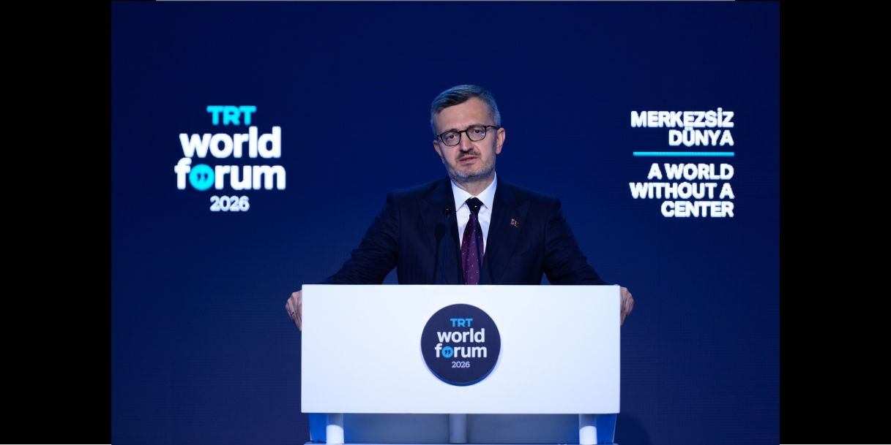
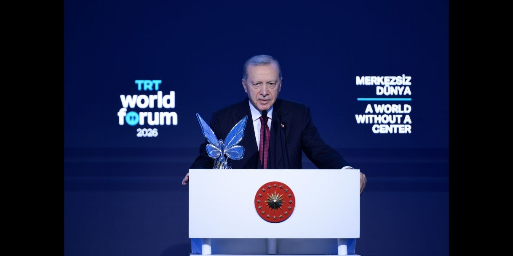
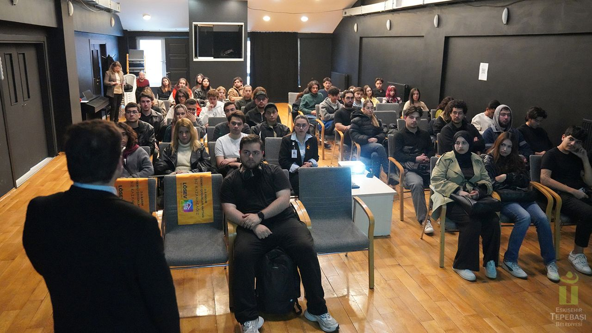
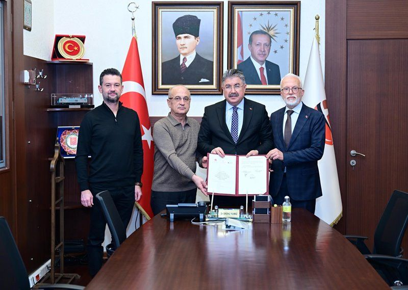
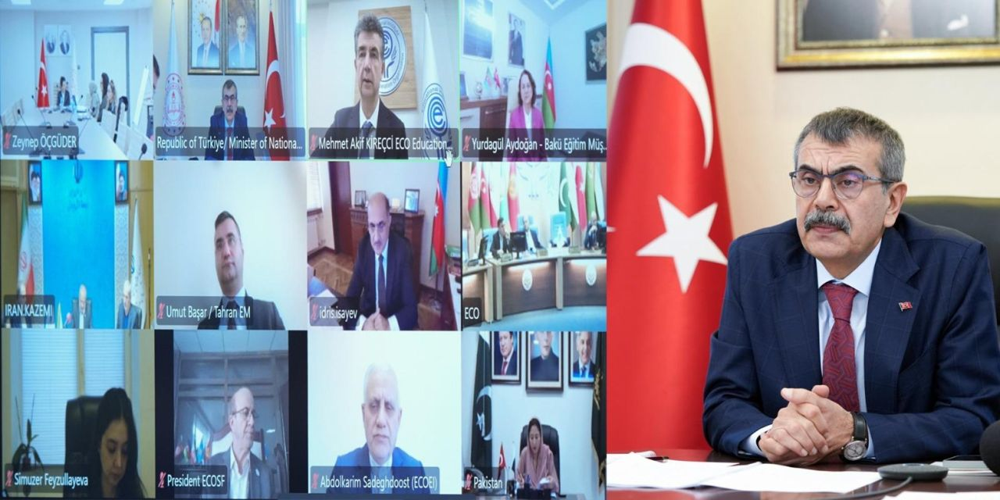

# Son haberler

Ajanın yazdığı son haberler (otomatik güncellenir).

## Altın fiyatları 7 Kasım 2026: Gram altın 6.620,93 TL

**Ekonomi · Merkez** · 2026-11-07 12:06 UTC · Kaynak: [Harem Altın](https://www.haremaltin.com/altin-fiyatlari)

> Gram altın güne yükselişle başladı. Harem Altın verilerine göre gram altın 6.543,03 TL'den alınıyor, 6.620,93 TL'den satılıyor.

Altın piyasasında güne yükselişle başlandı. Harem Altın'ın saat 15.06 itibarıyla verilerine göre gram altının satış fiyatı 6.620,93 TL, alış fiyatı 6.543,03 TL oldu. Gram altın, önceki kapanışa göre yüzde 0,49 yükseldi.

Ziynet altınlarda çeyrek altın 10.791 TL, yarım altın 21.576 TL, tam altın 42.993 TL, ata altın 44.142 TL seviyesinden satışa sunuluyor.

22 ayar bileziğin gram satış fiyatı 6.185,06 TL, has altının gram fiyatı 6.601,13 TL olarak belirlendi.

Uluslararası piyasalarda altının onsu 4.071,20 dolardan işlem görürken, dolar/TL 50,23 seviyesinde bulunuyor.

Fiyatlar Harem Altın'ın saat 15.06 itibarıyla paylaştığı verilere dayanmaktadır; kuyumcular arasında farklılık gösterebilir. Bu haber yatırım tavsiyesi değildir.

---

## İletişim Başkanı Duran, Nijeryalı Bakan Malagi ile görüştü

**Türkiye · Türkiye** · 2026-11-07 11:46 UTC · Kaynak: [İletişim Başkanlığı](https://www.iletisim.gov.tr/turkce/haberler/detay/iletisim-baskani-duran-nijerya-enformasyon-ve-ulusal-uyum-bakani-malagi-ile-bir-araya-geldi)

> İletişim Başkanı Burhanettin Duran, TRT World Forum 2026 için ülkemizde bulunan Nijerya Enformasyon ve Ulusal Uyum Bakanı Mohammed İdris Malagi'yi ağırladı.

Cumhurbaşkanlığı İletişim Başkanı Burhanettin Duran, TRT World Forum 2026 etkinlikleri dolayısıyla Türkiye'de bulunan Nijerya Federal Cumhuriyeti Enformasyon ve Ulusal Uyum Bakanı Mohammed İdris Malagi ve beraberindeki heyetle bir araya geldi.

Görüşmede, Türkiye ile Nijerya arasında medya ve iletişim alanındaki iş birliği imkânları masaya yatırıldı. Taraflar, kamu diplomasisi ve stratejik iletişim konularında geliştirilebilecek ortak çalışmaları değerlendirdi.

İletişim Başkanı Duran, iki ülke arasındaki ilişkilerin iletişim alanında da güçlenerek sürmesini dilediğini belirterek konuk bakana ve heyetine teşekkür etti.

---

## Eskişehir'e yeni bir vizyon: Kentpark'taki İklim Adası kapılarını açtı

**Belediye · Merkez** · 2026-11-07 11:46 UTC · Kaynak: [Google Haberler - Eskişehir gündem](https://www.istikbalgazetesi.com/unlucenin-iklim-adasi-gelecege-acilan-kapi)

> Eskişehir Büyükşehir Belediyesi tarafından Kentpark içinde hayata geçirilen İklim Adası, sürdürülebilirlik, bilim ve teknolojiyi buluşturan yeni bir yaşam alanı olarak hizmet vermeye başladı.

Eskişehir Büyükşehir Belediyesi, kentte sürdürülebilir yaşam kültürünü yaygınlaştırmak amacıyla önemli bir projeyi daha hayata geçirdi. Başkan Ayşe Ünlüce'nin öncülüğünde Kentpark içerisinde yeniden düzenlenen İklim Adası, bilim, teknoloji ve çevre bilincini bir araya getiren bir merkez olarak kapılarını açtı.

Eski Ada Restoran'ın bulunduğu alanda kurulan ve yaklaşık 500 metrekare kapalı ile 2 bin metrekare açık alana sahip olan merkez; kütüphane, atölyeler, amfi, çalışma alanları, podcast ve çekim odalarının yanı sıra yeme-içme ve dinlenme bölümlerini barındırıyor. Projede çevre dostu uygulamalar dikkat çekerken, kafeteryadaki mobilyaların tamamının sürdürülebilirlik anlayışıyla ikinci el ürünlerden tercih edildiği belirtildi.

İklim Adası'nda ayrıca yağmur sularının depolanarak yeşil alanların sulamasında kullanılacağı çevre dostu sistemler de yer alıyor. Öğrencilerden akademisyenlere ve girişimcilere kadar her kesimden vatandaşın buluşma noktası olması hedeflenen merkez, Eskişehir'in akıllı şehir vizyonuna katkı sunmayı amaçlıyor.

---

## Erdoğan'dan Azerbaycan ziyareti açıklaması: 8 Kasım'da gideceğim

**Siyaset · Türkiye** · 2026-11-07 11:46 UTC · Kaynak: [Google Haberler - Cumhurbaşkanı](https://ankahaber.net/haber/cumhurbaskani-erdogan-dan-azerbaycan-aciklamasi-kardesligimizin-asamayacagi-hicbir-engel-yoktur-a4c49662)

> Cumhurbaşkanı Erdoğan, Seul dönüşü uçakta yaptığı açıklamada 8 Kasım'da Azerbaycan'ın Zafer Günü etkinliklerine katılmayı planladığını duyurdu.

Cumhurbaşkanı Recep Tayyip Erdoğan, Seul ziyaretinden Türkiye'ye dönüşü sırasında uçakta gazetecilerin sorularını yanıtladı. Azerbaycan ile ilişkiler hakkında değerlendirmelerde bulunan Erdoğan, fevkalade bir durum olmazsa 8 Kasım'da Azerbaycan'ın Zafer Günü'ne katılmak üzere bir ziyaret gerçekleştirmeyi düşündüğünü belirtti.

İki ülke arasındaki bağların klasik diplomatik temasların ötesinde olduğunu vurgulayan Erdoğan, "Türkiye ve Azerbaycan kardeşliğinin evelallah aşamayacağı hiçbir engel yoktur" ifadesini kullandı. Ziyaret kapsamında gerekli adımların atılacağını belirten Erdoğan, Azerbaycan Cumhurbaşkanı İlham Aliyev ile telefon görüşmeleri gerçekleştirdiğini, ayrıca İstihbarat Başkanı ile Dışişleri Bakanı'nı da Azerbaycan'a gönderdiğini aktardı.

Açıklamalarında fon soruşturmasına da değinen Cumhurbaşkanı Erdoğan, sermaye piyasalarının usulsüzlüklerden ve manipülasyonlardan temizleneceğini belirterek, gerekli yol haritasının oluşturulduğunu ve sürecin titizlikle takip edildiğini kaydetti.

---

## Bakan Tekin: PISA'daki yükseliş vesayetle mücadelenin sonucudur

**Eğitim · Türkiye** · 2026-11-07 11:46 UTC · Kaynak: [Milli Eğitim Bakanlığı](https://www.meb.gov.tr/il-milli-egitim-mudurleri-toplantisi-diyarbakir039da-gerceklesti/haber/42428/tr)

> Millî Eğitim Bakanı Yusuf Tekin, Diyarbakır'da düzenlenen İl Millî Eğitim Müdürleri Toplantısı'nda eğitim alanındaki gelişmeleri değerlendirdi.

Millî Eğitim Bakanı Yusuf Tekin, yürütülen çalışmaları değerlendirmek üzere bakan yardımcıları ve birim amirlerinin de katılımıyla Diyarbakır'da 81 ilin millî eğitim müdürüyle bir araya geldi.

Toplantıda, bakanlığın eğitim politikalarının ülke genelinde aynı hassasiyetle uygulanmasında il millî eğitim müdürlerinin kritik bir sorumluluk üstlendiğini belirten Bakan Tekin, her çocuğun eğitim hakkının gözetilmesi ve öğretmenlerin mesleki itibarının korunması için sahadan gelen görüşlerle çalışmalara yön vermeye devam edeceklerini kaydetti.

Türkiye'nin eğitimde fiziki imkânların yanı sıra akademik başarı bakımından da önemli mesafeler kat ettiğini dile getiren Tekin, 2003'te OECD PISA araştırmalarında ilk 30'da yer alamayan ülkenin, 2015 sonrasında istikrarlı bir yükseliş gösterdiğini ifade etti. Bu başarının arkasında eğitim sistemi üzerindeki vesayetçi yapılarla mücadelenin yattığını vurgulayan Tekin, 2013'ten itibaren atılan adımların ve dershanelere yönelik yasal düzenlemelerin bakanlığın kendi politikalarını uygulamasını sağladığını aktardı.

İki gün sürecek olan toplantı, bakan yardımcıları ve birim amirlerinin sunumlarıyla sürdürülüyor.

---

## AK Partili Akyel'den Odunpazarı'na 'ruhsat' tepkisi

**Belediye · Odunpazarı** · 2026-11-07 11:46 UTC · Kaynak: [Google Haberler - Odunpazarı](https://www.gzt26.com/berke-akyelden-odunpazari-belediyesine-tepki-arsa-sahipleri-ruhsat-bekliyor)

> Odunpazarı Belediyesi AK Parti Meclis Üyesi Berke Akyel, Aşağı Çağlan, Kayapınar ve Kocakır bölgelerindeki TOKİ hak sahiplerine ruhsat verilmediğini ve kanuna aykırı olarak çap parası tahsil edildiğini öne sürdü.

Odunpazarı Belediyesi AK Parti Meclis Üyesi Berke Akyel, meclis toplantısında yaptığı konuşmada TOKİ arsaları için hak sahiplerinden talep edilen ücretlere ve ruhsat gecikmelerine tepki gösterdi. Aşağı Çağlan, Kayapınar ve Kocakır'da ev yapmak isteyen vatandaşların tapularını aldığını belirten Akyel, süreçteki tek engelin belediye olduğunu iddia etti.

Belediyenin hak sahiplerinden çap parası aldığını savunan Akyel, 775 sayılı Gecekondu Kanunu'nun 33. maddesi gereğince bu işlemlerin her türlü vergi, resim ve harçtan muaf olduğunu hatırlattı. Alınan belgelere harç yerine ücret yazıldığını ifade eden Akyel, alınan ücretlerin durdurulması ve tahsil edilen tutarların iade edilmesi için önerge sunacaklarını kaydetti.

Ayrıca vatandaşların temmuz ayından bu yana verdiği 200'ün üzerindeki dilekçeye yanıt alamadığını belirten Akyel, kırmızı kot ve yol profili gibi teknik çizimlerin vatandaşlar tarafından temin edilmesine rağmen ruhsat verilmediğini söyledi. Akyel, belediyeyi TOKİ ile iletişime geçmeye ve hak sahiplerinin mağduriyetini gidermeye çağırdı.

---

## Vali Yılmaz ve beraberindeki heyet Cumhurbaşkanı Yardımcısı Yılmaz'ı ziyaret etti

**Gündem · Merkez** · 2026-11-07 06:40 UTC · Kaynak: [Eskişehir Valiliği](https://www.eskisehir.gov.tr/alimiz-dr-erdinc-yilmaz-cumhurbaskani-yardimcimiz-sayin-cevdet-yilmaz-tarafindan-kabul-edildi)

> Eskişehir Valisi Dr. Erdinç Yılmaz, Cumhurbaşkanı Yardımcısı Cevdet Yılmaz ile bir araya geldi.

Eskişehir Valisi Dr. Erdinç Yılmaz, Ankara'da temaslarda bulundu. Valilikten edinilen bilgilere göre, Cumhurbaşkanı Yardımcısı Cevdet Yılmaz, Vali Erdinç Yılmaz'ı makamında kabul etti.

Gerçekleşen kabule, Eskişehir Milletvekili ve TBMM Yapay Zekâ Araştırma Komisyonu Başkanı Fatih Dönmez ile AK Parti Eskişehir İl Başkanı Gürhan Albayrak da katıldı.

---

## Kırım Tatar Akademik İş Birliği Çalıştayı Eskişehir'de Başladı

**Kültür-Sanat · Odunpazarı** · 2026-11-07 06:40 UTC · Kaynak: [Google Haberler - Eskişehir](https://www.qha.com.tr/diaspora/kirim-tatar-akademik-is-birligi-calistayi-eskisehir-de-basladi-537407)

> Kırım Tatar dili, tarihi ve kültürünün ele alındığı akademik çalıştay, Eskişehir Osmangazi Üniversitesinde bilim ve siyaset dünyasından isimlerin katılımıyla başladı.

Kırım Tatar dili, edebiyatı, tarihi ve kültürünün bilimsel paylaşımı ile iş birliği kapsamının genişletilmesi amacıyla düzenlenen Kırım Tatar Akademik İş Birliği Çalıştayı, Eskişehir Osmangazi Üniversitesinde kapılarını açtı.

Eskişehir Osmangazi Üniversitesinde gerçekleştirilen program, şehitler için saygı duruşunda bulunulmasının ardından Kırım Tatar millî marşı "Ant Etkenmen", İstiklâl Marşı ve Ukrayna millî marşının okunmasıyla başladı. Kırım Ailesi Derneği, Eskişehir Kırım Derneği, YTB, TİKA ve Ukrayna'nın Ankara Büyükelçiliğinin ortaklığıyla düzenlenen etkinlikte, Kırım Tatarlarının tarihi mücadelesi, kültürel mirası ve geleceğe yönelik yol haritası masaya yatırıldı.

Açılışta konuşan Kırım Ailesi Kurucusu Anife Kurtseitova, savaş ve işgal acılarına rağmen pes etmediklerini belirterek, amaçlarının sürgünde olsalar dahi Kırım'ın eğilmez ruhunu yeni nesillere aktarmak olduğunu ifade etti. Eskişehir Kırım Derneği Başkanı Recep Şen ise İsmail Bey Gaspıralı’nın "Dilde, fikirde, işte birlik" şiarına atıf yaparak, 1783'ten bu yana süren sürgün ve soykırımlara rağmen Kırım Türklerinin direnmeye devam ettiğini vurguladı.

Türk Ocakları Eskişehir Şubesi Başkanı Prof. Dr. Nedim Ünal, Kırım'ın ebediyen bir Türk vatanı olmaya devam edeceğini kaydetti. AK Parti Gençlik Kolları Genel Başkan Yardımcısı Murat Resul Karaman ve Odunpazarı Belediye Başkanı Av. Kâzım Kurt da çalıştayın Kırım'ın geleceği ve ortak hafıza açısından taşıdığı öneme dikkat çekti.

Program kapsamında Ukrayna Silahlı Kuvvetleri korosu ve Kültür Güçleri grubunun solisti İsmail Kurtumer ile Safiye Lenterkızı konser verirken, Kırım Ailesi halk danslarıyla sahne aldı. Gün boyunca açık olan sergide ise Kırım Tatar sanatçıların eserleri, mutfağı ve tarihi sürgün ile siyasi tutsaklara ait fotoğraflar ziyaretçilerle buluştu.

---

## Eskişehirspor seriyi sürdürmek için sahada: Kepez maçı saat 15.30'da

**Spor · Odunpazarı** · 2026-11-07 06:40 UTC · Kaynak: [Google Haberler - Eskişehirspor](https://www.istikbalgazetesi.com/eskisehirsporda-seri-zamani-simsekler-kepezi-bekliyor)

> Kırmızı Şimşekler, 9 günlük zorlu periyottaki kritik maçta Antalya Kepezspor'u konuk ediyor.

Evinde Bursa Yıldırım ile berabere kalıp Türkiye Kupası'nda Iğdır'ı eleyen, ardından deplasmanda Gaziemir'i mağlup ederek moral depolayan Eskişehirspor, galibiyet serisi yakalamak için sahaya çıkıyor.

Zorlu bir dönemece giren ve 9 gün içinde 3 kritik karşılaşmaya çıkacak olan Kırmızı Şimşekler, sahasında ağırlayacağı Antalya temsilcisini yenerek çıkışını sürdürmeyi hedefliyor. Öte yandan konuk ekip Kepezspor ise teknik direktör değişikliğinin ardından son iki maçını kazanarak Eskişehir'e moralli geliyor.

Prof. Dr. Fethi Heper Stadyumu'nda oynanacak karşılaşma saat 15.30'da başlayacak. Mücadeleyi İstanbul bölgesi üst klasman hakemi Deniz Güven yönetecek.

---

## Eskişehir'de ehliyet sınavında kopya şebekesine operasyon: 3 tutuklama

**Asayiş · Merkez** · 2026-11-07 06:40 UTC · Kaynak: [Google Haberler - Eskişehir asayiş](https://www.iha.com.tr/eskisehir-haberleri/ehliyet-sinavinda-kopya-sebekesine-operasyon-512022951)

> Eskişehir merkezli düzenlenen operasyonda ehliyet sınavlarında gizli kamera ve kulaklık düzenekleriyle kopya çektirdiği belirlenen 8 şüpheli yakalandı, adliyeye sevk edilen zanlılardan 3'ü tutuklandı.

Eskişehir Emniyet Müdürlüğü Kaçakçılık ve Organize Suçlarla Mücadele (KOM) Şube Müdürlüğü ekipleri, ehliyet sınavlarında organize şekilde kopya çekilmesini sağlayan bir suç şebekesini takibe aldı.

Gerçekleştirilen operasyonda, sınav sırasında üzerlerinde özel kopya düzeneği taşıyan 2 şüpheli ile bina dışında kamera görüntüleri aracılığıyla soruları yanıtlayan 6 şüpheli suçüstü yakalandı. Şüphelilerin üst aramalarında ve ikametlerinde yapılan aramalarda 4 Wi-Fi cihazı, 3 kamera düzeneği, 4 kulak içi gizli kulaklık ve 10 cep telefonu ele geçirildi.

6114 Sayılı Kanuna Muhalefet suçu kapsamında adliyeye sevk edilen zanlılardan 3'ü mahkemece tutuklanarak cezaevine gönderilirken, diğer 5 şüpheli hakkında adli kontrol kararı uygulandı.

---

## Erdoğan, Malezya Başbakan Yardımcısı Hamidi'yi kabul etti

**Siyaset · Türkiye** · 2026-11-07 06:40 UTC · Kaynak: [İletişim Başkanlığı](https://www.iletisim.gov.tr/turkce/haberler/detay/cumhurbaskani-erdogan-malezya-basbakan-yardimcisi-hamidiyi-kabul-etti)

> Cumhurbaşkanı Recep Tayyip Erdoğan, İstanbul Kongre Merkezi'nde Malezya Başbakan Yardımcısı Ahmad Zahid Hamidi ile bir araya geldi.

Cumhurbaşkanı Recep Tayyip Erdoğan, Malezya Başbakan Yardımcısı Ahmad Zahid Hamidi'yi kabul etti.

İstanbul Kongre Merkezi'nde gerçekleştirilen kabulde, Cumhurbaşkanı Yardımcısı Cevdet Yılmaz, Sanayi ve Teknoloji Bakanı Mehmet Fatih Kacır ve Cumhurbaşkanlığı İletişim Başkanı Burhanettin Duran da hazır bulundu.

---

## Başkan Kurt'tan Kurşunlu Külliyesi Tepkisi: Siyasi Eylem

**Belediye · Odunpazarı** · 2026-11-07 06:40 UTC · Kaynak: [Google Haberler - Odunpazarı](https://www.gzt26.com/kazim-kurttan-kursunlu-kulliyesi-ve-odunpazari-turizmi-hakkinda-sert-aciklamalar)

> Odunpazarı Belediye Başkanı Kazım Kurt, Kurşunlu Külliyesi'nin boşaltılmasının siyasi bir karar olduğunu belirterek turizme zarar verildiğini söyledi.

Odunpazarı Belediye Başkanı Kazım Kurt, Kurşunlu Külliyesi'nin boşaltılması süreci ve Odunpazarı turizmine yönelik eleştirilere ilişkin değerlendirmelerde bulundu.

Külliyenin boşaltılması kararının siyasi bir hamle olduğunu savunan Başkan Kurt, sürecin hukuki boyutuna ve yaşanan çifte standartlara dikkat çekti. Yasal haklar çerçevesinde başvuru yaptıklarını ancak taleplerinin karşılık bulmadığını ifade eden Kurt, bu kararın Eskişehir turizmini olumsuz etkileyeceğini dile getirdi.

Odunpazarı'nda gerçekleştirilen sokak sağlıklaştırmaları, konak restorasyonları ve uluslararası festivaller hakkında da bilgi veren Kurt, ilçenin cazibe merkezi haline gelmesi için önemli projelere imza attıklarını kaydetti. Dönemlerinde yapılan kültürel etkinliklerin ve müze çalışmalarının kentin turizmine büyük katkı sağladığını belirtti.

---

## Vali Yılmaz'dan Hava Kuvvetleri Komutanı Dalkıran'a ziyarette heyetli temas

**Gündem · Merkez** · 2026-11-07 00:58 UTC · Kaynak: [Eskişehir Valiliği](https://www.eskisehir.gov.tr/valimiz-dr-erdinc-yilmaz-hava-kuvvetleri-komutani-orgeneral-rafet-dalkirani-ziyaret-etti)

> Eskişehir Valisi Erdinç Yılmaz, beraberindeki heyetle birlikte Hava Kuvvetleri Komutanı Orgeneral Rafet Dalkıran'ı makamında ziyaret etti.

Eskişehir Valisi Dr. Erdinç Yılmaz, kentteki kurum ve kuruluş temsilcileriyle birlikte Ankara'da temaslarda bulundu. Bu kapsamda Vali Yılmaz, TEI Genel Müdürü Prof. Dr. Mahmut Faruk Akşit ve AK Parti Eskişehir İl Başkanı Gürhan Albayrak ile bir araya geldi.

Gerçekleştirilen program çerçevesinde heyet, Hava Kuvvetleri Komutanı Orgeneral Rafet Dalkıran'ı ziyaret etti. Ziyaretin detaylarına ilişkin başka bir ayrıntı paylaşılmadı.

---

## Eskişehirspor - Antalya Kepezspor maçı hangi kanalda? Yayın bilgisi açıklandı

**Spor · Merkez** · 2026-11-07 00:58 UTC · Kaynak: [Google Haberler - Eskişehirspor](https://www.gzt26.com/eskisehirspor-antalya-kepezspor-maci-hangi-kanalda-canli-yayin-programi-aciklandi)

> Nesine 3. Lig 2. Grup'ta mücadele eden Eskişehirspor'un Antalya Kepezspor ile oynayacağı 10. hafta karşılaşmasının canlı yayın kanalı belli oldu.

Nesine 2. Lig ve Nesine 3. Lig'de 10. hafta karşılaşmalarının canlı yayın programı Türkiye Futbol Federasyonu tarafından açıklandı. Futbolseverlerin merakla beklediği Eskişehirspor-Antalya Kepezspor mücadelesinin ekran bilgileri de netlik kazandı.

Siyah-kırmızılı ekibin 7 Kasım 2026 Cumartesi günü saat 15.30'da başlayacak kritik mücadelesi, Tivibu Spor 2 ekranlarından canlı olarak izlenebilecek. Karşılaşmayı stadyumdan takip edemeyecek olan Eskişehirspor taraftarları, mücadeleyi televizyon üzerinden canlı olarak takip edebilecek.

Açıklanan yayın programı kapsamında hafta sonu boyunca Nesine 2. Lig ve Nesine 3. Lig'deki toplam 20 karşılaşma Tivibu Spor ve Yaay platformları aracılığıyla futbolseverlerle buluşacak.

---

## Eskişehir Teknik Üniversitesi'ne yeni rektör atandı

**Eğitim · Tepebaşı** · 2026-11-07 00:58 UTC · Kaynak: [Google Haberler - Cumhurbaşkanı](https://www.aa.com.tr/tr/gundem/cumhurbaskani-erdogan-11-universiteye-rektor-atadi/4114801)

> Resmi Gazete'de yayımlanan atama kararına göre, Eskişehir Teknik Üniversitesi Rektörlüğüne Prof. Dr. Adnan Özcan getirildi.

Resmi Gazete'de yayımlanan Cumhurbaşkanlığı kararlarına göre, yükseköğretim kurumlarında rektör atamaları gerçekleştirildi.

Cumhurbaşkanı Recep Tayyip Erdoğan tarafından yapılan atamalar, 2547 sayılı Yükseköğretim Kanunu'nun 13'üncü maddesi ile 3 sayılı Cumhurbaşkanlığı Kararnamesi'nin 2'nci, 3'üncü ve 7'nci maddeleri gereğince imzalandı.

Alınan kararlar doğrultusunda Eskişehir Teknik Üniversitesi Rektörlüğüne Prof. Dr. Adnan Özcan atandı.

---

## Ekim ayında en çok satılan elektrikli otomobiller belli oldu: Togg zirvede

**Ekonomi · Türkiye** · 2026-11-07 00:58 UTC · Kaynak: [Google Haberler - Togg](https://www.usakhabergazetesi.com.tr/elektrikli-otomobilde-togg-ruzgari-en-cok-satilan-10-model-belli-oldu)

> Türkiye otomobil pazarında ekim ayında satılan yaklaşık her iki elektrikli otomobilden biri Togg olurken, T10X ilk sırada, T10F ise ikinci sırada yer aldı.

Türkiye otomobil pazarında elektrikli araçlara olan ilgi artmaya devam ederken, Otomotiv Distribütörleri ve Mobilite Derneği (ODMD) verilerine dayandırılan ekim ayı satış sonuçları açıklandı. Ekim ayında Türkiye genelinde toplam 64 bin 939 otomobil satılırken, bunların 14 bin 380'ini tamamen elektrikli modeller oluşturdu. Böylece elektrikli otomobillerin toplam satışlar içindeki payı yüzde 22,1'e ulaştı.

Açıklanan verilere göre ekim ayının en çok satılan elektrikli otomobili, 4 bin 59 adetle Togg T10X oldu. Togg T10X, tek başına elektrikli otomobil satışlarının yüzde 28,2'sini gerçekleştirdi. Markanın sedan modeli T10F ise 2 bin 702 adet satış rakamıyla ikinci sırada yer alarak yüzde 18,8 pazar payı elde etti. İki modelin toplam satışı 6 bin 761 adede ulaşırken, Togg'un tamamen elektrikli pazarındaki toplam payı yüzde 47 olarak hesaplandı.

Ekim ayında Togg modellerini 1 bin 705 adetle KGM Torres EVX takip ederken, Hyundai IONIQ 3 1 bin 077 adetle dördüncü sırayı aldı. İlk dört modelin toplam satışı, tamamen elektrikli pazarının yaklaşık yüzde 66,4'ünü oluşturdu. Listenin devamında Citroën ë-C3, Mercedes-Benz GLC, Volvo EX40, Volvo EX30, BMW iX3 ve Mercedes-Benz GLB yer aldı.

Öte yandan Togg'un başarısı yılın ilk 10 ayında da devam etti. Ocak-ekim döneminde T10X 26 bin 79, T10F ise 18 bin 108 adet satış rakamına ulaştı. Toplamda 44 bin 187 adede ulaşan Togg modelleri, yılın ilk 10 ayında tamamen elektrikli otomobil pazarında yaklaşık yüzde 32,7 pay elde etti.

---

## Tepebaşı'nda ekoloji okulu kasım atölyeleri başlıyor: Ücretsiz kayıtlar açıldı

**Belediye · Tepebaşı** · 2026-11-06 20:01 UTC · Kaynak: [Tepebaşı Belediyesi](https://www.tepebasi.bel.tr/Haber/Detay/yeryuzuekolojiokulu’ndakasımatolyeleribaslıyor)

> Tepebaşı Belediyesi Yeryüzü Ekoloji Okulu, kasım ayında çocuk ve yetişkinlere yönelik ücretsiz doğa, hak ve sanat atölyeleri düzenleyecek.

Tepebaşı Belediyesi, her yaştan vatandaşın doğayla bağ kurmasını ve çeşitli alanlarda deneyim kazanmasını hedefleyen Yeryüzü Ekoloji Okulu'nda kasım ayı programını duyurdu. Sakin Okul Eğitim, Kültür ve Sanat Derneği iş birliğiyle gerçekleştirilecek etkinlikler tamamen ücretsiz olacak.

Program kapsamında 9 Kasım'da başlayacak atölyelerde, çocuklara ve yetişkinlere yönelik farklı içerikler yer alacak. İlk etkinlik, 9 Kasım Pazartesi günü saat 18.00'de düzenlenecek Çocuk Hakları ve Hak Arama Yolları Atölyesi olacak. 8-12 yaş grubuna hitap eden bu tek günlük çalışma 10 kişilik kontenjanla sınırlı tutuldu.

Çocuklar için hazırlanan bir diğer etkinlik olan Renkli Sanat Atölyesi ise 7-12 yaş grubunu 11, 18 ve 25 Kasım Çarşamba günleri saat 18.00'de bir araya getirecek. Aynı katılımcıların devam edeceği bu atölyenin kontenjanı da 10 kişi olarak belirlendi. Yetişkinler için ise 18 yaş ve üzeri katılımcılara açık olan Tekstil Art – Sashiko ile İleri Dönüşüm Atölyesi düzenlenecek. 13 Kasım'da başlayacak ve 18 Aralık'a kadar her cuma saat 18.00'de gerçekleştirilecek program altı hafta sürecek.

Tepebaşı Belediyesi yanındaki Yeryüzü Ekoloji Okulu'nda yapılacak sınırlı kontenjanlı atölyeler için kayıtlar başladı. İsteyen vatandaşlar, mesai saatleri içinde Çevre Koruma ve Kontrol Müdürlüğünün 0222 211 40 00 / 3085 numaralı telefonundan detaylı bilgi alabilecek.

---

## Miniklerin doğa projelerini Vali Yılmaz yerinde inceledi

**Eğitim · Merkez** · 2026-11-06 20:01 UTC · Kaynak: [Eskişehir Valiliği](https://www.eskisehir.gov.tr/valimiz-dr-erdinc-yilmaz-cemal-ererdi-anaokulunu-ziyaret-etti)

> Vali Dr. Erdinç Yılmaz, kendisini okula davet eden Cemal Ererdi Anaokulu öğrencilerini ziyaret ederek iklim ve doğa çalışmaları hakkında bilgi aldı.

Eskişehir Valisi Dr. Erdinç Yılmaz, daha önce kendisini makamında ziyaret ederek okullarına davet eden Cemal Ererdi Anaokulu öğrencilerine iade-i ziyarette bulundu.

Ziyaret sırasında okulun sınıflarını ve bahçesini gezen Vali Yılmaz, minik öğrencilerin iklim değişikliği, doğanın korunması ve sürdürülebilir bir gelecek vizyonuyla hayata geçirdikleri projeleri yakından inceledi.

Öğrenciler, okul içinde ve bahçede yürüttükleri çevre çalışmalarını Vali Yılmaz'a bizzat anlatarak hazırladıkları projelerin amaçlarını ve elde ettikleri sonuçları paylaştı.

---

## Kılıçdaroğlu'ndan erken seçim ve ittifak açıklaması

**Siyaset · Türkiye** · 2026-11-06 20:01 UTC · Kaynak: [Google Haberler - CHP](https://serbestiyet.com/haberler/politika/kilicdaroglu-bir-chpli-belediye-baskani-yolsuzluk-yapiyorsa-derhalak-partiye-katilsin-253014/)

> CHP Genel Başkanı Kemal Kılıçdaroğlu, bir televizyon programında gündeme ilişkin değerlendirmelerde bulundu; erken seçim teklifine destek vereceklerini belirtti.

CHP Genel Başkanı Kemal Kılıçdaroğlu, katıldığı bir yayında iç siyaset, ekonomi, erken seçim tartışmaları ve dış politika konularında açıklamalarda bulundu.

Erken seçim tartışmalarına değinen Kılıçdaroğlu, bir muhalefet partisinin seçimden kaçma lüksünün olmadığını belirterek meclise gelecek erken seçim teklifine destek vereceklerini ifade etti. Ancak sürecin fırsatçılığa dönüştürülmesini doğru bulmadıklarını kaydetti.

Belediyelere yönelik yürütülen adli ve idari süreçlere de değinen Kılıçdaroğlu, yolsuzlukla mücadele edilmesi gerektiğini ancak uygulamalarda çifte standart olmaması gerektiğini vurguladı. Kurultay süreci ve parti içi tartışmalara ilişkin de konuşan Kılıçdaroğlu, gemiyi güvenli limana getirdikten sonra genel başkanlığı bırakacağını dile getirdi.

---

## İletişim Başkanı Duran: TRT World Forum 2026 İstanbul'da başladı

**Türkiye · Türkiye** · 2026-11-06 20:01 UTC · Kaynak: [İletişim Başkanlığı](https://www.iletisim.gov.tr/turkce/haberler/detay/cumhurbaskanligi-iletisim-baskani-duran-trt-world-forum-2026da-konustu)

> Cumhurbaşkanlığı İletişim Başkanı Burhanettin Duran, İstanbul'da düzenlenen TRT World Forum 2026'nın açılışında küresel krizlere ve adil bir uluslararası düzen ihtiyacına dikkat çekti.

İstanbul Kongre Merkezi'nde "Merkezsiz Dünya: Kurallar Geçersiz Kaldığında Kim Liderlik Eder?" temasıyla bu yıl 10'uncusu düzenlenen TRT World Forum'un açılışında konuşan Cumhurbaşkanlığı İletişim Başkanı Burhanettin Duran, uluslararası sistemin derin bir eksen kayması ve yapısal kriz yaşadığını belirtti.

İletişim Başkanı Duran, güç merkezleri çoğalırken ortak kuralların aşındığını, küresel rekabetin sertleştiğini ve ortak sorumluluk duygusunun zayıfladığını vurguladı. Mevcut düzende barışın alanının daraldığını, konvansiyonel savaş risklerinin ve vekalet çatışmalarının arttığını ifade eden Duran, yapay zekâ ve dijital teknolojiler üzerindeki hakimiyet yarışının yeni güç ilişkileri doğurduğunu kaydetti.

Tehditler küreselleşirken çözümlerin millileştiğine dikkat çeken Duran, bu yapısal krizin en çarpıcı örneğinin Gazze'de görüldüğünü dile getirdi. Duran, "Dünyanın gözü önünde yaşanan soykırım, uluslararası sistemin yalnızca krizleri önlemekte değil, varlık sebebi olan barışı, adaleti ve insan onurunu korumakta da yetersiz kaldığını ortaya koyuyor." dedi.

Türkiye'nin Cumhurbaşkanı Recep Tayyip Erdoğan'ın liderliğinde yeni bir uluslararası düzenin inşasını esas alan kurucu bir çoğulculuk önerdiğini belirten Duran, "Dünyanın ihtiyacı yeni bir savaşın galipleri değil, yeni bir barışın kurucularıdır." ifadelerini kullandı. Konuşmasında ayrıca Cumhurbaşkanlığı İletişim Başkanlığı tarafından geliştirilen forum diplomasisi faaliyetlerine de değindi.

---

## Eşini öldürüp balkondan atlayan şüphelinin davası başladı

**Asayiş · Merkez** · 2026-11-06 20:01 UTC · Kaynak: [Google Haberler - Eskişehir gündem](https://www.iha.com.tr/eskisehir-haberleri/esini-oldurdukten-sonra-8-kattan-atlayan-sanigin-durusmasina-basladi-511958702)

> Eskişehir'de eşini öldürdükten sonra balkondan atlayarak intihar girişiminde bulunan ve hastaneye kaldırılırken balıktan zehirlendiklerini öne süren sanığın yargılanmasına başlandı.

Eskişehir'de 7 kattaki evinin balkonundan atlayarak yaralanan ve hastaneye sevk edilirken polise balıktan zehirlendiklerini iddia eden şüpheli Mehmet K.'nın, eşi Sevim K.'yi öldürdüğü iddiasıyla açılan davanın ilk duruşması gerçekleştirildi. Eskişehir 7. Ağır Ceza Mahkemesindeki duruşmaya tutuklu sanık Mehmet K., maktulün kardeşi ve taraf avukatları katıldı.

Mahkemedeki savunmasında eşiyle tartışma yaşadığını öne süren tutuklu sanık Mehmet K., olay günü yaşananları anlattı. Sanık avukatı, müvekkilinin intihar girişiminde bulunduğunu ve zaman algısını kaybettiğini savunarak beraat ve tahliye talebinde bulundu.

Duruşmada maktulün kardeşi ve müşteki Servet Özdemir, sanığın cinayeti mal varlığı sebebiyle tasarlayarak işlediğini iddia etti. Özdemir, kardeşinin mülklerini ve altınlarını satmak istemediği için sanık tarafından öldürüldüğünü ve cenazenin günlerce evde kilitli tutulduğunu öne sürdü. Müşteki avukatları da şüphelinin çelişkili beyanlarda bulunduğunu belirterek en üst hadden cezalandırılmasını talep etti.

Mahkeme heyeti, sanık Mehmet K.'nın tutukluluk halinin devamına karar vererek duruşmayı aralık ayına erteledi.

---

## Erdoğan: Küresel sistem iflas bayrağını çekti

**Siyaset · Türkiye** · 2026-11-06 20:01 UTC · Kaynak: [Google Haberler - Cumhurbaşkanı](https://www.iletisim.gov.tr/turkce/haberler/detay/cumhurbaskani-erdogan-trt-world-forum-2026da-konustu)

> Cumhurbaşkanı Erdoğan, TRT World Forum 2026'da yaptığı konuşmada uluslararası sistemin krizde olduğunu belirterek, Gazze'deki soykırıma ve küresel adaletsizliklere tepki gösterdi.

İstanbul Kongre Merkezi'nde "Merkezsiz Dünya: Kurallar Geçersiz Kaldığında Kim Liderlik Eder?" temasıyla düzenlenen TRT World Forum 2026'da konuşan Cumhurbaşkanı Erdoğan, dünyanın sancılı ve kuralların yok sayıldığı bir dönemden geçtiğini ifade etti.

Uluslararası sistemin üzerine kurulduğu normların ayaklar altına alındığını belirten Erdoğan, Gazze'de modern zamanların en büyük soykırımının yaşandığına dikkat çekti. Ekim 2023'ten bu yana 75 bin kişinin katledildiğini ve 176 bin kişinin yaralandığını kaydeden Erdoğan, uluslararası yapıların yaşananları tribünden seyrettiğini söyledi.

Türkiye'nin her zaman hak ve hakikati savunmaya devam edeceğini vurgulayan Erdoğan, ülkeyi karalamaya çalışan algı operasyonlarına boyun eğmeyeceklerini belirtti. Forumun düzenlenmesinde emeği geçen TRT yönetimini ve çalışanlarını tebrik eden Erdoğan, TRT'nin ilkeli ve sorumlu yayıncılık anlayışıyla küresel ölçekte önemli bir ses olduğunu dile getirdi.

---

## 20 yıllık kayıp davasında tanık iddiası: Manisa'da yaşıyor

**Asayiş · Günyüzü** · 2026-11-06 20:01 UTC · Kaynak: [Google Haberler - Eskişehir asayiş](https://www.iha.com.tr/eskisehir-haberleri/eskisehirdeki-20-yillik-kayip-davasinda-sok-iddia-manisada-yasiyor-511986750)

> Günyüzü'nde 20 yıl önce kaçırıldığı iddia edilen Hamdi Karakuş davasının ikinci duruşmasında, bir tanık kayıp şahsın Manisa'da olduğunu öne sürdü.

Eskişehir'in Günyüzü ilçesine bağlı Çardaközü Mahallesi'nde 2005 yılında darbedilip bir gözünü kaybeden ve 1 Nisan 2006'da kendilerini jandarma olarak tanıtan kişilerce kaçırıldığı öne sürülen Hamdi Karakuş'un 20 yıldır arandığı dosya kapsamında ikinci duruşma görüldü. Eskişehir İl Jandarma Komutanlığı JASAT ekiplerinin tüfek dipçiğindeki DNA eşleşmesiyle yeniden açtığı soruşturma sonucunda açılan davanın duruşması Eskişehir 1. Ağır Ceza Mahkemesi'nde yapıldı. Duruşmaya tutuklu ve tutuksuz sanıklar, taraf avukatları ve tanıklar katıldı.

Duruşma sonrasında açıklama yapan aile avukatı Doğancan Çıra, kasten öldürme davasının ikinci celsesinde tanıkların dinlendiğini belirtti. Tanık M.Ö.'nün, kayıp Hamdi Karakuş'un 2022-2023 yıllarında Manisa'nın Turgutlu ilçesinde deterjan işi yaptığını, üzerinde farklı kimlik taşıdığını ve ailesine acı çektirmek amacıyla köye dönmediğini öne sürdüğünü aktaran Çıra, bu iddianın hayatın olağan akışına aykırı olduğunu söyledi. Avukat Çıra, mahkemenin bu iddiayı değerlendireceğini ve sanıkların en ağır cezayı alması için mücadele edeceklerini ifade etti.

Mahkeme heyeti, mevcut delil durumu ve kuvvetli suç şüphesini göz önünde bulundurarak tutuklu sanıklar E.A., G.A., İ.K., M.K., M.Ö., S.A., Ü.A. ve Ü.Ö.'nün tutukluluk hallerinin devamına karar verdi. Dosya kapsamında 2 sanığın ise adli kontrol şartıyla tutuksuz yargılanmasına devam ediliyor.

---

## Tepebaşı'nda gençlerden LÖSEV'e yoğun ilgi

**Belediye · Tepebaşı** · 2026-11-06 18:41 UTC · Kaynak: [Tepebaşı Belediyesi](https://www.tepebasi.bel.tr/Haber/Detay/29ekimgenclikmerkezi’ndesosyalsorumlulukprogramlarıdevamediyor)

> Tepebaşı Belediyesi 29 Ekim Gençlik Merkezi'nde düzenlenen LÖSEV bilgilendirme toplantısında, gençlere vakfın çalışmaları ve gönüllülük olanakları anlatıldı.

Tepebaşı Belediyesi, gençlerin toplumsal dayanışma ve gönüllülük faaliyetlerine katılımını destekleyen Sosyal Sorumluluk Programları'na devam ediyor. Anadolu Üniversitesi ve Eskişehir Teknik Üniversitesi ile yürütülen protokol iş birlikleri çerçevesinde hayata geçirilen programa, 2026 yılı güz döneminde 160 genç kayıt yaptırdı.

Bu kapsamda 29 Ekim Gençlik Merkezi Ali İsmail Korkmaz Sahnesi'nde LÖSEV bilgilendirme toplantısı gerçekleştirildi. Yaklaşık 50 gencin katıldığı buluşmada, LÖSEV Eskişehir FAYDA Projesi Kıdemli Personeli Sema Nur Cin ile proje personelleri Birol Sönmez ve Meliha Taşdemir katılımcılara vakfın yürüttüğü çalışmalar hakkında bilgi verdi.

Toplantıda gençlere gönüllülük olanakları da detaylı şekilde aktarıldı. Tepebaşı Belediyesi, sivil toplum kuruluşlarıyla iş birliği içinde gençleri farklı gönüllülük alanlarıyla buluşturan bu tür bilgilendirme buluşmalarının önümüzdeki dönemde de sürdürüleceğini bildirdi.

---

## Tepebaşı'na yeni sağlık merkezi: Hayırsever protokolü imzalandı

**Sağlık · Tepebaşı** · 2026-11-06 18:41 UTC · Kaynak: [Eskişehir Valiliği](https://www.eskisehir.gov.tr/valimiz-dr-erdinc-yilmaz-yusuf-ozsoy-saglik-tesisi-ek-protokol-imza-torenine-katildi)

> Eskişehir'de Yenibağlar Mahallesi'ne kazandırılacak Aile Sağlığı Merkezi ve ilçe sağlık müdürlüğü binası için imza töreni düzenlendi.

Eskişehir'de sağlık altyapısını güçlendirecek yeni bir tesis için resmi adım atıldı. Valilik, İl Sağlık Müdürlüğü ve hayırsever firma arasında imzalanan ek protokol ile Tepebaşı ilçesine yeni bir sağlık kompleksi kazandırılıyor.

Yenibağlar Mahallesi'nde tahsis edilen 502,87 metrekarelik arsa üzerine kurulacak olan tesis, en az 1.500 metrekare kapalı alana sahip olacak. Hayırsever Ahmet Özsoy tarafındanfinanse edilecek binada Aile Sağlığı Merkezi, Verem Savaş Dispanseri ve Tepebaşı İlçe Sağlık Müdürlüğü hizmet binası bir arada yer alacak.

Vali Dr. Erdinç Yılmaz, imza töreninde kente yapılan bu anlamlı katkıdan dolayı hayırsever Ahmet Özsoy'a teşekkürlerini iletti. Tesisin adı, hayırseverin talebi doğrultusunda "Yusuf Özsoy Sağlık Tesisi" olacak.

Ek protokol, İl Sağlık Müdürü Doç. Dr. Yaşar Bildirici ile hayırsever Ahmet Özsoy tarafından imzalanarak Vali Yılmaz'ın onayının ardından yürürlüğe girdi.

---

## Odunpazarı İlçe Milli Eğitim Müdürlüğü'nden USAEM'e ziyaret

**Eğitim · Odunpazarı** · 2026-11-06 18:41 UTC · Kaynak: [Google Haberler - Odunpazarı](https://www.yozgatgazetesi.com/iha-haberleri/odunpazari-ilce-milli-egitim-mueduerluegue-nden-usaem-e-ziyaret-301176.html)

> Odunpazarı İlçe Milli Eğitim Müdürlüğü heyeti, Eskişehir Uçucu Sağlığı Araştırma ve Eğitim Merkezi'ni (USAEM) ziyaret ederek havacılık ve uzay eğitiminde iş birliği imkânlarını değerlendirdi.

Odunpazarı İlçe Millî Eğitim Müdürü Barış Hancı ile Şube Müdürü Ömer Kızılkılıç, askerî pilotlara uçuş sağlığı eğitimleri veren ve dünyada nadir bulunan Eskişehir Uçucu Sağlığı Araştırma ve Eğitim Merkezi’ni (USAEM) ziyaret etti.

Ziyaret kapsamında merkezdeki laboratuvarları ve simülasyon cihazlarını inceleyen müdürlük yetkilileri, yürütülen çalışmalar hakkında merkez yöneticilerinden detaylı bilgi aldı. Görüşmelerde, öğrencilerin havacılık ve uzay bilimlerine olan ilgisini artırmak, farkındalık kazandırmak ve geleceğin havacılık profesyonellerinin yetişmesine katkı sunmak amacıyla hayata geçirilebilecek ortak projeler ele alındı.

Eğitim alanında olası iş birliği imkânlarının değerlendirildiği program, karşılıklı iyi niyet temennileriyle tamamlandı.

---

## Fethi Heper Stadyumu'nda yenileme çalışmaları incelendi

**Spor · Tepebaşı** · 2026-11-06 18:41 UTC · Kaynak: [Google Haberler - Eskişehirspor](https://www.istikbalgazetesi.com/eskisehirspor-fethi-heper-stadyumu-yenileniyor)

> Eskişehir Gençlik ve Spor İl Müdürü Hasan Kalın, Prof. Dr. Fethi Heper Stadyumu'ndaki yenileme ve iyileştirme çalışmalarını yerinde inceledi.

Eskişehir'de spor altyapısını güçlendirmek amacıyla yürütülen çalışmalar aralıksız sürüyor. Bu kapsamda Eskişehir Gençlik ve Spor İl Müdürü Hasan Kalın ve şube müdürleri, Prof. Dr. Fethi Heper Stadyumu'nu ziyaret ederek devam eden projeleri denetledi.

Ziyaret sırasında yetkililerden çalışmaların son durumu hakkında detaylı bilgi alındı. Antrenman salonlarının fiziki koşullarının daha modern hale getirilmesi ve sporculara elverişli imkânlar sunulması amacıyla yürütülen yenileme faaliyetlerinin planlandığı şekilde devam ettiği bildirildi.

Stadyumda gerçekleştirilen bu iyileştirmelerle birlikte, sporcuların antrenmanlarını daha modern ve konforlu ortamlarda yapabilmesi amaçlanıyor.

---

## ESTÜ'de sıtma farkındalık eğitimi: Bulaşma yolları ve korunma anlatıldı

**Sağlık · Tepebaşı** · 2026-11-06 18:41 UTC · Kaynak: [Eskişehir Teknik Üniversitesi](https://www.eskisehir.edu.tr/tr/Haber/Detay/eskisehir-teknik-universitesinde-sitma-farkindalik-egitimi-duzenlendi)

> Eskişehir Teknik Üniversitesinde, Tepebaşı İlçe Sağlık Müdürlüğü iş birliğiyle sıtma hastalığına yönelik farkındalık eğitimi düzenlendi.

Eskişehir Teknik Üniversitesi (ESTÜ), öğrencileri ve personeline yönelik bilinçlendirme faaliyetlerine bir yenisini ekledi. Tepebaşı İlçe Sağlık Müdürlüğü ile ortaklaşa gerçekleştirilen eğitim programı, üniversite yerleşkesinde yoğun bir katılımla yapıldı.

Eğitimde Dr. Fatih Köse, Ebe Hacer Atabay ve Hemşire Hayriye Tatlı tarafından katılımcılara kapsamlı bilgiler aktarıldı. Uzmanlar sunumlarında sıtma hastalığının bulaşma yolları, yayılım gösterdiği risk faktörleri ve temel belirtileri üzerinde durdu.

Program boyunca erken tanının hayat kurtarıcı önemi vurgulanırken, hastalıktan korunma yöntemleri ve alınabilecek bireysel önlemler detaylı şekilde ele alındı. Etkinlik, katılımcılardan gelen soruların uzmanlar tarafından yanıtlanması ve koruyucu sağlık uygulamalarına dair tavsiyelerle sona erdi.

---

## Eskişehir'de şehitler anısına 600 kişinin katılımıyla fidan dikildi

**Gündem · Merkez** · 2026-11-06 18:41 UTC · Kaynak: [Google Haberler - Eskişehir](https://www.haberturk.com/gundem/eskisehir-de-sehitlerin-anisina-fidan-dikildi-3925464)

> Eskişehir Valiliği koordinesinde yürütülen proje kapsamında, şehitlerin hatırasını yaşatmak için Bölge Trafik Denetleme Şube Müdürlüğü bahçesinde fidanlar toprakla buluşturuldu.

Eskişehir'de, şehitlerin hatırasını yaşatmak ve gelecek nesillere daha yeşil bir çevre bırakmak amacıyla anlamlı bir fidan dikim etkinliği gerçekleştirildi.

Eskişehir Valiliği'nden yapılan açıklamaya göre, Terörle Mücadele Daire Başkanlığı Bilgilendirme ve Önleme Faaliyetleri Şube Müdürlüğü koordinesinde "Şehitlerimiz İçin Her Bir Fidan, Geleceğimiz İçin Bin Nefes-2" projesi hayata geçirildi.

Bölge Trafik Denetleme Şube Müdürlüğünün bahçesinde düzenlenen programa Vali Yardımcısı Ersin Emiroğlu, protokol üyeleri, emniyet mensupları, şehit aileleri ve öğrenciler katıldı. Yaklaşık 600 kişinin yer aldığı etkinlikte, şehitlerin adını taşıyan fidanlar toprakla buluşturuldu.

---

## Bakan Tekin: Eğitim bakanlıkları dünya barışı için sorumluluk almalı

**Türkiye · Türkiye** · 2026-11-06 18:41 UTC · Kaynak: [Milli Eğitim Bakanlığı](https://www.meb.gov.tr/eit-egitim-enstitusu-5-mutevelli-heyeti-quotis-birliginin-gelistirilmesiquot-gundemiyle-toplandi/haber/42425/tr)

> EİT Eğitim Enstitüsü 5. Mütevelli Heyet Toplantısı'nda konuşan Millî Eğitim Bakanı Yusuf Tekin, küresel sorunlara karşı eğitim alanında daha aktif rol alınması gerektiğini vurguladı.

Millî Eğitim Bakanı Yusuf Tekin, EİT Eğitim Enstitüsü 5. Mütevelli Heyet Toplantısı'nda üye ülkeler arasındaki eğitim iş birliğinin geliştirilmesi ve gelecek döneme ilişkin çalışma programı hakkında değerlendirmelerde bulundu. Toplantıda Enstitünün faaliyetleri, mali ve idari yapısı ele alındı.

Katılımcılara hitap eden Bakan Tekin, EİT Eğitim Enstitüsünün son dönemde ivme kazandığını belirterek, Türkiye'nin süreçteki kurucu ve ev sahibi rolüne dikkat çekti. Ankara'da imzalanan Ev Sahibi Ülke Anlaşması ile kurumun diplomatik statü kazandığını hatırlatan Tekin, yapının kurumsallaşma sürecini tamamladığını ifade etti.

Dünyada yaşanan insan hakları ihlallerine ve antidemokratik gelişmelere dikkat çeken Tekin, eğitim bakanlıklarının bu süreçte kritik sorumluluklar taşıdığını kaydetti. Türkiye'nin eğitim müfredatında barış ve insan haklarını önceleyen adımlar attığını belirten Tekin, Türkiye Yüzyılı Maarif Modeli ile barış dolu bir dünya inşa etmeyi amaçladıklarını söyledi.

Toplantının sonunda Mütevelli Heyeti gündemindeki konular müzakere edildi. Merkezi Ankara'da bulunan EİT Eğitim Enstitüsü Başkanlığına Mehmet Akif Kireçci yeniden seçilirken, bir sonraki toplantının İran'ın ev sahipliğinde yapılması kararlaştırıldı.

---
