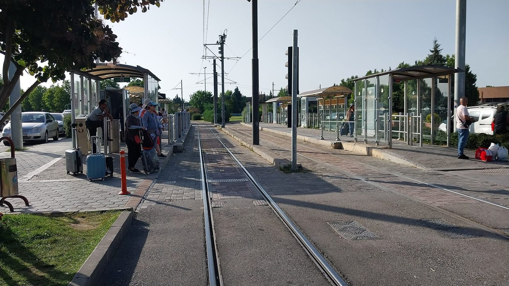
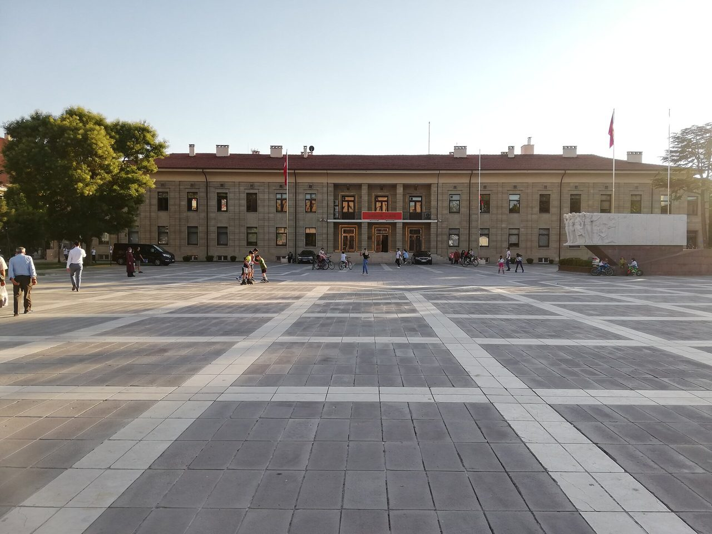

# Son haberler

Ajanın yazdığı son haberler (otomatik güncellenir).

## Eskişehirspor 9 günde 3 maç oynayacak: Kepezspor, Anadolu SF ve Ayvalıkgücü

**Spor · Merkez** · 2026-11-03 17:32 UTC · Kaynak: [Google Haberler - Eskişehirspor](https://www.istikbalgazetesi.com/eskisehirsporda-zorlu-donemec-9-gunde-3-mac)

> Eskişehirspor 11 Kasım'da Eskişehir Anadolu SF'ye konuk olacak.

Eskişehirspor, Gaziemir deplasmanında aldığı 5-0'lık galibiyetin ardından 9 günde üç maça çıkacak. 10. haftada 7 Kasım Cumartesi günü saat 15.30'da Kepezspor'u ağırlayacak. 11. haftada 11 Kasım Çarşamba günü saat 15.00'te zirve mücadelesi veren Eskişehir Anadolu SF'ye konuk olacak. 12. haftada ise 15 Kasım Pazar günü saat 15.00'te Ayvalıkgücü Belediyespor'u konuk edecek; İstikbal Gazetesi'ne göre rakip geçen sezon olduğu gibi bu sezon da grupta zirve mücadelesi veriyor.

Teknik direktör Hakan Şapcı'nın öğrencilerinin üç maçı da kazanarak 9 puan almayı hedeflediği belirtildi. Aynı hafta Eskişehir Anadolu SF, 7 Kasım'da saat 15.00'te Uşakspor ile deplasmanda oynayacak.

---

## Bayraktar, Beylikova'daki nadir toprak elementleri için Güney Koreli şirketle görüştü

**Ekonomi · Merkez** · 2026-11-03 17:32 UTC · Kaynak: [Google Haberler - Eskişehir](https://www.cumhuriyet.com.tr/siyaset/bakan-bayraktar-eskisehir-deki-nadir-toprak-elementleri-icin-guney-koreli-sirketle-gorustu-2552995)

> Görüşme, cevherden nihai ürüne uzanan entegre değer zinciri üzerine yapıldı.

Enerji ve Tabii Kaynaklar Bakanı Alparslan Bayraktar, Güney Koreli kalıcı mıknatıs üreticisi JS Link'in Yönetim Kurulu Başkanı J.S. Park ve beraberindeki yetkililerle Güney Kore'de bir araya geldi. Bayraktar sosyal medya hesabından yaptığı açıklamada, görüşmede Eskişehir Beylikova'daki nadir toprak elementleri kaynağının cevherden nihai ürüne uzanan entegre bir değer zinciriyle ekonomiye kazandırılmasına yönelik iş birliği imkânlarının değerlendirildiğini söyledi.

Bayraktar, nadir toprak elementlerinden yenilenebilir enerji teknolojilerine kadar enerjinin ve madenciliğin tüm alanlarında kaynak potansiyelini yüksek katma değerli üretime dönüştürecek yatırımlara ve uluslararası iş birliklerine açık olduklarını vurguladı. Açıklamada somut bir anlaşma veya yatırım tutarı yer almadı.

---

## AK Partili Sivri, Tepebaşı Meclisi'nde SSK Blokları'nda kentsel dönüşümü istedi

**Belediye · Tepebaşı** · 2026-11-03 16:34 UTC · Kaynak: [Google Haberler - Tepebaşı](https://www.eskisehirekspres.net/ahmet-sivriden-ssk-bloklari-icin-acil-donusum-cagrisi-10-bin-kisi-risk-altinda)

> Bölgede yaklaşık 3 bin 600 hane ve 10 bin kişi yaşıyor.

Tepebaşı Belediye Meclisi, Belediye Başkanı Ahmet Ataç başkanlığında toplandı. Gündem dışı söz alan AK Parti Meclis Üyesi Ahmet Sivri, ilçedeki SSK Blokları'nın kentsel dönüşüm sürecini gündeme getirdi.

Sivri, SSK Blokları'nda yaklaşık 3 bin 600 hanenin yaşadığını, bölgenin yaklaşık 10 bin kişilik nüfusa sahip olduğunu ve yapıların yaklaşık 50 yıllık olduğunu belirtti. Türkiye'nin farklı bölgelerinden hemen her gün deprem haberleri geldiğine dikkat çeken Sivri, dönüşüm çalışmalarının bir an önce hızlandırılması gerektiğini söyledi. Ataç'a seslenen Sivri, Cumhur İttifakı meclis üyelerinin yapılacak çalışmalara destek vermeye hazır olduğunu, önceliklerinin vatandaşların can güvenliği olduğunu ifade etti. Hasta, yaşlı ve engelli vatandaşların da depreme dayanıklı ve konforlu konutlarda yaşamasını istediklerini söyledi.

Haber meclis üyesinin konuşmasına dayanıyor; Tepebaşı Belediyesi'nin konuya ilişkin yanıtı kaynakta yer almıyor.

---

## Odunpazarıspor kadınlar hentbol liginde 8 Kasım'da Üsküdar Belediyesi'ne konuk olacak

**Spor · Odunpazarı** · 2026-11-03 16:32 UTC · Kaynak: [Google Haberler - Eskişehir](https://www.istikbalgazetesi.com/eskisehir-odunpazari-cikis-ariyor)

> Eskişehir ekibi 8 haftada 2 galibiyetle 4 puanla altıncı sırada.

Kadınlar Hentbol Süper Ligi'nde mücadele eden Eskişehir Odunpazarıspor, son maçında MC Sistem Yozgat GSK'ye 34-30 yenildi. Antrenör Mehmet Fatih Işık yönetimindeki takım, sekiz haftada 2 galibiyet ve 6 yenilgiyle 4 puanla altıncı sırada bulunuyor. Arkasındaki Göztepe 3 puanda, beşinci sıradaki Manisa Büyükşehir Belediyesi ile arasında 7 puan fark var.

Odunpazarıspor, 8 Kasım Pazar günü saat 16.00'da Çamlıca Spor Salonu'nda 12 puanla ikinci sıradaki Üsküdar Belediyesi'ne konuk olacak. 14 Kasım Cumartesi günü saat 15.00'te ise sahasında Ortahisar Belediyesi ile karşılaşacak.

---

## Tepebaşı Meclisi kıyafet bağış kutuları için Kızılay'la 3 yıllık iş birliğini kabul etti

**Belediye · Tepebaşı** · 2026-11-03 14:33 UTC · Kaynak: [Google Haberler - Tepebaşı](https://www.gzt26.com/tepebasinda-kiyafet-bagis-kutulari-icin-yeni-karar-alindi)

> Karar oy birliğiyle alındı; Ataç, mevcut firmanın işi bıraktığını söyledi.

Tepebaşı Belediye Meclisi kasım ayı toplantısında, ilçedeki kıyafet bağış kutularına ilişkin Türk Kızılay ile üç yıllık iş birliği yapılmasını oy birliğiyle kabul etti. Konu, Türk Kızılay Eskişehir İl Başkanlığı'nın belediyeye gönderdiği yazı üzerine gündeme geldi. Kızılay'ın yürüttüğü "İkinci El Tekstil Projesi", kullanılabilir durumdaki kıyafetlerin yeniden değerlendirilmesini, atık miktarının azaltılmasını ve insani yardım faaliyetlerine düzenli kaynak oluşturulmasını amaçlıyor.

Düzenlemeye göre belediyenin uygun göreceği noktalara Kızılay Kıyafet Bağış Kutuları yerleştirilecek; kutuların yerlerini belediye belirleyecek. Meclis, Belediye Başkanı Ahmet Ataç'a protokolü imzalaması için yetki verdi. Ataç, görüşme sırasında kıyafet toplama faaliyetlerini yürüten mevcut firmanın işi bıraktığını açıkladı.

---

## Kurşunlu Külliyesi'nde tahliye işlemleri başladı: kadın girişimciler kapıları açmadı

**Gündem · Odunpazarı** · 2026-11-03 14:32 UTC · Kaynak: [Google Haberler - Odunpazarı](https://www.birgun.net/haber/kapisina-kilit-vuruldu-744323)

> BirGün'e göre eserler kayıt altına alındı, külliyenin kapısına kilit vuruldu.

BirGün'ün aktardığına göre Kurşunlu Külliyesi'nin 3 Kasım saat 11.00'e kadar boşaltılmasını isteyen tebligatın süresinin dolmasıyla tahliye işlemleri başladı. İlk olarak Ahşap Eserler Müzesi'nin bulunduğu binada işlem yapıldı, ardından diğer müze ve atölyelere geçildi. Eserlerin kayıt altına alınmasını isteyen belediye yetkilileri, sayım yapılmadan tahliye edilmek istenmesine itiraz etti; eserler cep telefonlarıyla görüntülenerek tutanak tutuldu. Bazı noktalarda esnafın tepkisi üzerine görevliler tutanak tuttu.

Külliyede faaliyet gösteren kadın girişimciler, Lületaşı Müzesi'nin boşaltılmasına tepki göstererek Vakıflar Bölge Müdürlüğü ve Kaymakamlık yetkililerini içeri almadı. Yetkililerin polis çağırmak istemesi üzerine belediye görevlileri araya girdi. Osman Yaşar Tanaçan'ın kızı Vicdan Tanaçan, kendi atölyesinin fotoğraflarını çekerek kayıt altına aldığını ve anahtarı yetkililere teslim ettiğini söyledi.

Odunpazarı Belediye Başkanı Kazım Kurt, tahliyenin hukuka aykırı olduğunu savundu. Vakıflar Kanunu'na eklenen düzenlemeyle belediyeye beş yıl daha kiracı olma hakkı tanındığını, bu kapsamdaki başvurunun sonuçlandırılmadığını söyledi. Kurt, "Hiçbir şeyi imzalamayacağız, çünkü bu kararı tanımıyoruz" dedi; Vakıflar ve Kültür Bakanlığı'nın külliye için planının belli olmadığını belirtti. Külliyede Ahşap Eserler Müzesi, Osman Yaşar Tanaçan Fotoğraf Müzesi, Lületaşı Müzesi, Cam Sanatları Merkezi ve Canan Atasoy Müzesi ile kurs ve atölyeler bulunuyor.

Haber BirGün'ün aktardığı bilgilere ve belediye yetkililerinin açıklamalarına dayanıyor; Vakıflar Bölge Müdürlüğü'nün ve Kaymakamlığın görüşü kaynakta yer almıyor.

---

## Eskişehir'de "Erken Tanı ile Kuzularım Ölmüyor" projesi için protokol imzalandı

**Tarım · Merkez** · 2026-11-03 14:32 UTC · Kaynak: [Google Haberler - Eskişehir](https://www.esgazete.com/eskisehirde-kuzu-olumlerini-azaltacak-protokol-imzalandi)

> Proje 2027-2028'de 5 ilçede uygulanacak.

Eskişehir İl Tarım ve Orman Müdürlüğü ile Eskişehir Bilecik Bölgesi Veteriner Hekimler Odası, kuzu ölümlerinin azaltılması ve hayvansal verimliliğin artırılması amacıyla iş birliği protokolü imzaladı. Protokol, "Erken Tanı ile Kuzularım Ölmüyor" projesi kapsamında imzalandı.

2027-2028 yıllarında uygulanması planlanan proje Sivrihisar, Günyüzü, Çifteler, Seyitgazi ve Tepebaşı ilçelerini kapsayacak. Kuzularda doğum sonrası erken dönemde görülen hastalıkların hızlı teşhis edilmesi, uygun tedavi yöntemlerinin uygulanması ve koruyucu veteriner hekimlik hizmetlerinin yaygınlaştırılması hedefleniyor. Protokolle veteriner hekimlere akademisyenler ve uzmanlar tarafından eğitim verilecek, standart teşhis ve tedavi yöntemleri geliştirilecek. Projenin temel hedefi kuzu ölümlerini azaltmak, yetiştiricilerin ekonomik kayıplarını önlemek ve küçükbaş hayvancılığın sürdürülebilirliğine katkıda bulunmak.

---

## Kırım Kavşağı'ndaki kaza tramvay seferlerini yaklaşık 40 dakika aksattı

**Ulaşım · Merkez** · 2026-11-03 13:34 UTC · Kaynak: [Google Haberler - Eskişehir asayiş](https://www.gzt26.com/eskisehirde-trafik-kazasi-tramvay-seferlerini-durdurdu)

> ESTRAM alternatif işletim ve acil durum otobüsleri devreye aldı.

Eskişehir'de Şehir Hastanesi yönündeki Kırım Kavşağı'nın ardından bir karayolu aracının kaza yapması tramvay ulaşımını aksattı. ESTRAM'ın duyurusuna göre Şehir Hastanesi-Kumlubel ile Otogar-Opera-OGÜ hatlarında işletim yapılamadı.

ESTRAM, Şehir Hastanesi ile Otogar arasında tramvay seferlerini alternatif işletim düzeniyle sürdürdü, Kumlubel ile Es-Es arasında acil durum otobüslerini devreye aldı. Aksama yaklaşık 40 dakika sürdü ve seferler yeniden normal düzenine döndü. Kaynakta kazaya karışan aracın sürücüsünün durumu, yaralanan olup olmadığı ve kazanın nasıl meydana geldiği konusunda bilgi paylaşılmadığı belirtiliyor.

---

## YENİ Partili meclis üyeleri Kurşunlu Külliyesi için uzlaşma çağrısı yaptı

**Gündem · Odunpazarı** · 2026-11-03 13:34 UTC · Kaynak: [Google Haberler - Odunpazarı](https://www.istikbalgazetesi.com/yeni-partili-meclis-uyelerinden-kursunlu-kulliyesi-icin-uzlasma-cagrisi)

> Üyeler külliyenin Odunpazarı Belediyesi'nde kalmasını talep etti.

Odunpazarı Belediye Meclisi'ndeki YENİ Parti üyeleri, Kurşunlu Külliyesi önünde basın açıklaması yaptı. Açıklamayı üyeler adına İnci Şentuna okudu. Üyeler külliyenin Odunpazarı Belediyesi'nde kalmasını talep etti ve tahliye kararını tanımadıklarını söyledi.

Şentuna, belediyenin 2004'ten bu yana kira sözleşmeleri kapsamında kullandığı alanda Ahşap Eserler Müzesi, Lületaşı Müzesi, Osman Yaşar Tanaçan Fotoğraf Müzesi ve Cam Sanatları Merkezi gibi kültürel değerleri kazandırdığını belirtti. Konunun sıradan bir kira veya tahliye meselesi olmadığını söyledi. Belediyenin hukuki hak arayışını ve Belediye Başkanı Kazım Kurt'un yaklaşımını desteklediklerini ifade eden Şentuna, müzelerin ve atölyelerin taşınmasının ciddi kamu maliyeti doğuracağını savundu.

Üyeler, mülkiyet hakkını ortadan kaldırmayı değil, vakıf hukukuna saygılı bir çözümü istediklerini belirtti. Vakıflar Genel Müdürlüğü'nü, Kültür ve Turizm Bakanlığı'nı, Eskişehir Valiliği'ni ve ilgili kurumları uzlaşmaya davet ederek külliyenin Odunpazarı Belediyesi'nin kullanımında kalmasını sağlayacak, uzun vadeli, şeffaf ve denetlenebilir bir kira ve kullanım protokolü oluşturulmasını talep etti.

Haber YENİ Parti meclis üyelerinin açıklamasına dayanıyor; Kaymakamlığın ve Vakıflar Bölge Müdürlüğü'nün görüşü kaynakta yer almıyor.

---

## Altın fiyatları 3 Kasım 2026: Gram altın 6.383,19 TL

**Ekonomi · Merkez** · 2026-11-03 13:17 UTC · Kaynak: [Harem Altın](https://www.haremaltin.com/altin-fiyatlari)

> Gram altın güne düşüşle başladı. Harem Altın verilerine göre gram altın 6.314,41 TL'den alınıyor, 6.383,19 TL'den satılıyor.

Altın piyasasında güne düşüşle başlandı. Harem Altın'ın saat 16.17 itibarıyla verilerine göre gram altının satış fiyatı 6.383,19 TL, alış fiyatı 6.314,41 TL oldu. Gram altın, önceki kapanışa göre yüzde 1,57 geriledi.

Ziynet altınlarda çeyrek altın 10.404 TL, yarım altın 20.802 TL, tam altın 41.450 TL, ata altın 42.558 TL seviyesinden satışa sunuluyor.

22 ayar bileziğin gram satış fiyatı 5.962,82 TL, has altının gram fiyatı 6.364,70 TL olarak belirlendi.

Uluslararası piyasalarda altının onsu 3.935,80 dolardan işlem görürken, dolar/TL 50,12 seviyesinde bulunuyor.

Fiyatlar Harem Altın'ın saat 16.17 itibarıyla paylaştığı verilere dayanmaktadır; kuyumcular arasında farklılık gösterebilir. Bu haber yatırım tavsiyesi değildir.

---

## Kızılinler bal kabağı coğrafi işaret olarak tescillendi

**Tarım · Merkez** · 2026-11-03 12:33 UTC · Kaynak: [Google Haberler - Eskişehir](https://yerel-haberler.haberturk.com/eskisehir-haberleri/eskisehirin-kizilinler-bal-kabagi-cografi-isaret-olarak-tescil-edildi-119511141)

> Eskişehir'in tescilli coğrafi işaret sayısı 15'e çıktı, 5 ürünün başvurusu sürüyor.

Eskişehir'in "Kızılinler bal kabağı", Türk Patent ve Marka Kurumu (TÜRKPATENT) tarafından coğrafi işaret olarak tescillendi. Eskişehir Ticaret Borsası'nda yapılan Coğrafi İşaret Tescil Belgesi Takdim Töreni'nde konuşan Vali Erdinç Yılmaz, coğrafi işaretin ürünün yetiştiği toprağı, iklimi, ustasının emeğini ve itibarını korumak olduğunu söyledi.

Yılmaz, "Artık başka bir yerin kabağı 'Kızılinler' diye, başka bir yerin sucuğu 'Sivrihisar' diye satılamayacaktır" dedi. Eskişehir'in 15 tescilli coğrafi işareti bulunduğunu, 5 ürünün başvuru sürecinin ise devam ettiğini belirtti.

TBMM Yapay Zeka Araştırma Komisyonu Başkanı ve AK Parti Eskişehir Milletvekili Fatih Dönmez, Türkiye'de 13 bin 700 bitki türü bulunduğunu, bunlardan 3 bin 700'ünün endemik olduğunu, Eskişehir'de bu sayının 221 olduğunu söyledi. Dönmez, tescil sürecinde emeği geçen Eskişehir Ticaret Borsası Başkanı Ahmet Oğuz'a teşekkür etti. TÜRKPATENT Başkanı Muhammed Zeki Durak da Türkiye'nin coğrafi işaret sayısında dünyada ikinci sırada yer aldığını dile getirdi.

---

## Eskişehirspor-Kepezspor maçının biletleri satışta: fiyatlar 250 ile 1.200 TL arasında

**Spor · Merkez** · 2026-11-03 12:33 UTC · Kaynak: [Google Haberler - Eskişehirspor](https://www.istikbalgazetesi.com/eskisehirspor-kepezspor-macinin-biletleri-satisa-cikti)

> Maç 7 Kasım Cumartesi saat 15.30'da oynanacak.

Nesine 3. Lig'in 10. haftasında oynanacak Eskişehirspor-Kepezspor maçı 7 Kasım Cumartesi günü saat 15.30'da başlayacak. Biletler Espark AVM ve stadyum gişelerinden alınabilecek.

Bilet fiyatları kale arkası 250 TL, maraton alt 350 TL, maraton üst 500 TL ve Batı VIP 1.200 TL olarak açıklandı. Satışlar 3-6 Kasım tarihlerinde Espark AVM'de 13.00-20.00 saatleri arasında yapılacak. Maç günü stadyum Passo gişelerinde saat 10.00'dan 15.30'a kadar satış sürecek. Hem Espark AVM'de hem stadyum gişelerinde yalnızca nakit ödeme kabul edilecek.

---

## "Bi' Fikirle Eskişehir" projesi: Porsuk Çayı ve köprüleri yeni aydınlatmaya kavuştu

**Belediye · Merkez** · 2026-11-03 12:33 UTC · Kaynak: [Google Haberler - Eskişehir](https://ankahaber.net/haber/eskisehir-de-katilimci-butceyle-belirlenen-proje-tamamlandi-porsuk-cayi-ve-kopruler-aydinlatildi-2d53c6fa)

> Vatandaş önerileriyle belirlenen 26 projeden biri tamamlandı.

Eskişehir Büyükşehir Belediyesi'nin "Bi' Fikirle Eskişehir" projesi kapsamında vatandaşların önerileriyle belirlenen 26 proje etaplar halinde hayata geçiriliyor. Bunlardan "Porsuk Çayı ve Köprüleri Aydınlatma Projesi" tamamlandı. Proje, Strateji Geliştirme Dairesi Başkanlığı'nın geçen yıl yaptığı katılımcı bütçe uygulamasında vatandaşlardan gelen ve yine vatandaşlarca değerlendirilen önerilerden biri olarak "2026 Eskişehir Yılı" kapsamında yapıldı.

Çalışmaları Yol Yapım Bakım ve Onarım Dairesi Başkanlığı elektrik ekipleri yürüttü. İlk etapta İki Eylül Caddesi Tramvay Köprüsü aydınlatıldı; ardından Şair Fuzuli Caddesi Araç Köprüsü, Atatürk Caddesi Araç Köprüsü ile Porsuk-1, Porsuk-2, Porsuk-3 ve Porsuk-4 yaya köprülerinde görsel aydınlatma uygulandı. Projeyle Porsuk Çayı'nın gece görünümünün iyileştirilmesi ve kent merkezinin akşam saatlerinde daha aydınlık olması hedefleniyor.

---

## 14. Uluslararası Eskişehir Şiir Buluşması 13 Kasım'da başlıyor: 13 şair katılacak

**Kültür-Sanat · Tepebaşı** · 2026-11-03 12:32 UTC · Kaynak: [Google Haberler - Tepebaşı](https://ankahaber.net/haber/14-uluslararasi-eskisehir-siir-bulusmasi-icin-geri-sayim-basladi-3-ulkeden-13-sair-tepebasi-nda-bulusacak-0f5f2165)

> Etkinlik 13-15 Kasım'da Özdilek Sanat Merkezi ve Atila Özer Karikatürlü Ev'de yapılacak.

Tepebaşı Belediyesi'nin bu yıl 14'üncüsünü düzenleyeceği Uluslararası Eskişehir Şiir Buluşması 13 Kasım Cuma günü başlayacak. Açılış töreni 13 Kasım'da saat 18.30'da Özdilek Sanat Merkezi'nde yapılacak. Üç gün sürecek buluşmaya Mısır ve Fransa'dan 2, Türkiye'den 11 şair katılacak; şiir okumaları, oturumlar ve müzik dinletileri yapılacak.

Etkinlikler 13 ve 14 Kasım'da Özdilek Sanat Merkezi'nde, 15 Kasım'da Atila Özer Karikatürlü Ev'de düzenlenecek ve tüm Eskişehirlilere açık olacak. Belediye Başkanı Ahmet Ataç, kent sakinlerini etkinliklere davet etti. Ataç, şiirin farklı ülkelerden ve düşüncelerden insanları buluşturan güçlü bir dil olduğunu söyledi.

---

## Tepebaşı'nın "Gel Beraber Olsun" yemek projesi yeni adresinde 2 bin 30 öğrenciye ulaştı

**Belediye · Tepebaşı** · 2026-11-03 11:32 UTC · Kaynak: [Google Haberler - Tepebaşı](https://gazetekalem.com.tr/tepebasi-belediyesinin-gel-beraber-olsun-projesi-yeni-adresinde-ogrencileri-agirliyor/)

> Proje 19 Ekim'den bu yana Ali Rıza Efendi Deneyimli Kafe'de hizmet veriyor.

Tepebaşı Belediyesi'nin üniversite öğrencilerine yönelik "Gel Beraber Olsun" projesi, 19 Ekim 2026'dan bu yana Ali Rıza Efendi Deneyimli Kafe'de hizmet veriyor. Hafta içi her gün saat 18.00-19.00 arasında sunulan akşam yemeği desteğinden yeni dönemin başlangıcından bu yana 2 bin 30 öğrenci yararlandı.

Projeyi ziyaret eden Belediye Başkanı Ahmet Ataç, öğrencilerle yemek yedi, sohbet etti ve görüşlerini dinledi. Ataç, gençlerin barınma, ulaşım ve beslenme gibi ihtiyaçları için zorlandığını belirterek belediyenin öğrencilerin bir öğün yemeğini üstlenmek istediğini söyledi. Belediyenin 2022'den bu yana on binlerce öğrenciyle aynı sofrayı paylaştığını ifade eden Ataç, tüm üniversiteli gençleri sofraya davet etti.

---

## Kurşunlu Külliyesi'nde tahliye bildirildi: Kurt "Kararı tanımıyoruz" dedi

**Gündem · Odunpazarı** · 2026-11-03 11:33 UTC · Kaynak: [Google Haberler - Odunpazarı](https://www.medyagazete.com/haber/kursunlu-kulliyesinde-tahliye-gerginligi)

> Odunpazarı Belediye Başkanı Kurt, külliyede basın açıklaması yaptı.

Medya Gazete'nin aktardığına göre Kurşunlu Külliyesi'nin tahliyesi 3 Kasım'da saat 11.00 itibarıyla belediye ekiplerine tebliğ edildi. Külliyeye gelen Odunpazarı Belediye Başkanı Kazım Kurt basın açıklaması yaptı.

Kurt, kararın kanuna aykırı olduğunu savundu. Vakıflar Kanunu'na eklenen maddenin belediyeye 5 yıl daha kiracı olma hakkı verdiğini, bu başvurunun idare mahkemesinde beklediğini, iki gün önce yürütmeyi durdurma kararı verilinceye kadar beklenileceğinin bildirildiğini söyledi. Kurt, "Biz şu anda burada hiçbir şeyi imzalamayacağız, çünkü bu kararı tanımıyoruz" dedi.

Külliyedeki müze ve sanat eserlerinin 400 sayfalık envanterle kayıtlı olduğunu belirten Kurt, eserlerden birine zarar gelirse hesabını soracaklarını söyledi. Külliyenin kapatılması halinde çalışanların işsiz kalacağını ve esnafın ticari yaşamının sıkıntıya düşeceğini ifade etti.

Haber Kurt'un açıklamasına dayanıyor; Kaymakamlığın ve Vakıflar Bölge Müdürlüğü'nün görüşü kaynakta yer almıyor.

---

## Başkan Ünlüce Porsuk Barajı'nda inceleme yaptı: "Eskişehir'in suyuna sahip çıkacağız"

**Gündem · Merkez** · 2026-11-03 11:33 UTC · Kaynak: [Google Haberler - Eskişehir](https://ankahaber.net/haber/eskisehir-buyuksehir-belediye-baskani-unluce-den-porsuk-baraji-nda-inceleme-710bfb95)

> Ünlüce, ESKİ yetkilileriyle barajdaki mevcut durumu değerlendirdi.

Eskişehir Büyükşehir Belediye Başkanı Ayşe Ünlüce, ESKİ Genel Müdürü Niyazi Solak, Genel Müdür Yardımcısı Erdem Uslu ve Su Arıtma ve İşletme Dairesi Başkanı Eylem Sıla Özer ile birlikte Porsuk Barajı'nda inceleme yaptı. Ünlüce, kentin içme suyu ihtiyacının karşılanmasında önemli olan barajdaki mevcut durumu değerlendirdi ve su kaynaklarının korunması ile sürdürülebilir su yönetimi kapsamında yürütülen çalışmalar hakkında yetkililerden bilgi aldı.

Ünlüce, "Eskişehir'imizin tek su kaynağı olan Porsuk Barajı'nda ekiplerimizle birlikte incelemelerde bulunduk" dedi. Önceliklerinin suyu kaynağından başlayarak korumak, sağlıklı ve güvenli biçimde kente ulaştırmak, kayıp ve kaçakları azaltmak, atık suyu doğru yönetmek ve gelecek kuşakların su hakkını gözetmek olduğunu söyledi.

---

## Harezmi Eğitim Modeli Eskişehir'de 16 okulda uygulanacak

**Eğitim · Merkez** · 2026-11-03 11:31 UTC · Kaynak: [Eskişehir İl Milli Eğitim Müdürlüğü](https://eskisehir.meb.gov.tr/www/harezmi-egitim-modeli-2026-2027-egitim-ogretim-yilinda-eskisehir039de-16-okulda-uygulanacak/icerik/8701/tr)

> Model 3 ilçede, 17 ekiple ve 64 öğretmenle yürütülecek.

Eskişehir İl Millî Eğitim Müdürlüğü'nün açıklamasına göre disiplinler arası öğrenmeyi, üretkenliği ve problem çözme becerilerini merkeze alan Harezmi Eğitim Modeli, 2026-2027 eğitim öğretim yılında Eskişehir'de 3 ilçede, 16 okulda ve 17 ekiple uygulanacak. Modelde 64 öğretmen görev alacak.

Model kapsamında öğrenciler günlük yaşamla bağlantılı sorunları belirleyerek çözüm önerileri geliştirecek, tasarımlar yapacak ve ürünlerini uygulamaya dönüştürecek. Bilişim teknolojileri, matematik, fen bilimleri, sosyal bilimler ve sanat gibi farklı disiplinler bir araya getirilecek; öğrencilerin araştırma, sorgulama, eleştirel düşünme, iş birliği, tasarlama ve üretme becerilerinin geliştirilmesi hedefleniyor. Çalışmalar "Düşün, Tasarla, Üret ve Uygula" anlayışıyla yürütülecek.

---

## Tepebaşı'nda belde evlerindeki oyun gruplarında 15 çocuk bir araya geliyor

**Belediye · Tepebaşı** · 2026-11-03 10:32 UTC · Kaynak: [Tepebaşı Belediyesi](https://www.tepebasi.bel.tr/Haber/Detay/tepebası’ndacocuklaroyungruplarındabulusuyor)

> Belde Evleri Eylül 2026 itibarıyla 35 hizmet noktasında 230 kursla sürüyor.

Tepebaşı Belediyesi'nin belde evlerinde düzenlediği çocuk oyun grupları, yaşa uygun etkinliklerle çocukların gelişimine katkı sunuyor. Hasan Ali Yücel ve Hedef Batıkent belde evlerindeki iki grupta toplam 15 çocuk bir araya geliyor.

Hasan Ali Yücel Belde Evi'nde 36-42 aylık 6 çocuk pazartesi ve çarşamba günleri saat 10.00-12.00 arasında, Hedef Batıkent Belde Evi'nde 42-46 aylık 9 çocuk yine pazartesi ve çarşamba günleri 13.00-15.00 arasında etkinliklere katılıyor. Buluşmaların çocukların akranlarıyla iletişim kurmasına, birlikte hareket etmesine ve oyunla öğrenmesine olanak sağladığı belirtildi.

Tepebaşı Belediye Başkanı Ahmet Ataç, çocukların gelişimini desteklemenin geleceğe yapılan yatırım olduğunu söyledi. Belediyeye göre Belde Evleri Eylül 2026 itibarıyla 35 hizmet noktasında, 29 branşta ve 230 kursta sürüyor; başvuruların toplamı 8 bin 151'e, aktif yararlanıcı sayısı 4 bin 466'ya ulaştı.

---

## Kurşunlu Külliyesi'nde Kaymakamlık yetkilileri inceleme yaptı: tutanak imzalanmadı

**Gündem · Odunpazarı** · 2026-11-03 10:33 UTC · Kaynak: [Google Haberler - Odunpazarı](https://www.istikbalgazetesi.com/kursunlu-kulliyesi-odunpazari-belediyesinden-alindi-tutanak-imzalanmadi-eserler-kaydedildi)

> Belediye yetkilileri tutanağı imzalamayacaklarını, 400 eserin kaydedilmesini istedi.

Kurşunlu Külliyesi'nin 3 Kasım saat 11.00'de Vakıflar Bölge Müdürlüğü'ne teslimi istenmişti. İstikbal Gazetesi'nin aktardığına göre külliyeye gelen Odunpazarı Kaymakamlığı yetkilileri içeri girerek alanı incelemek istedi. Kaymakamlık Yazı İşleri Müdürü Muzaffer Kaptan'ı Odunpazarı Belediyesi Başkan Yardımcısı Emre Genç karşıladı.

İncelemede tutanak tutulması konusunda bir kriz yaşandığı belirtildi. Genç ve belediye yetkilileri tutanağa imza atmayacaklarını, ancak bir örneğini istediklerini söyledi. Genç, külliyede 400 sanat eseri bulunduğunu belirterek eserlerin tek tek kayıt altına alınmasını talep etti. Bunun üzerine polis kameraları, belediye ve kaymakamlık görevlileri eserleri tek tek video çekimi eşliğinde kayıt altına aldı.

Haber tek bir gazetenin aktardığı bilgilere dayanıyor; Kaymakamlığın ve Vakıflar Bölge Müdürlüğü'nün konuya ilişkin açıklaması kaynakta yer almıyor.

---

## Eskişehirli Murat Cırık Dünya Bilek Güreşi Şampiyonası'nda +80 kiloda dünya şampiyonu oldu

**Spor · Merkez** · 2026-11-03 10:32 UTC · Kaynak: [Google Haberler - Eskişehir](https://www.sondakika.com/amp/haber-eskisehir-valisi-yilmaz-hindistan-da-80-kiloda-dun-20390059/)

> Vali Yılmaz ve Gençlik ve Spor İl Müdürlüğü şampiyonu tebrik etti.

Eskişehirli milli sporcu Murat Cırık, Hindistan'da düzenlenen 2026 Dünya Bilek Güreşi Şampiyonası'nda ayakta +80 kilogram kategorisinde dünya şampiyonu oldu.

Eskişehir Valisi Dr. Erdinç Yılmaz ve Eskişehir Gençlik ve Spor İl Müdürlüğü, Cırık için tebrik mesajı yayımladı. Gençlik ve Spor İl Müdürlüğü mesajında "Ay-yıldızlı bayrağımızı zirveye taşıyan sporcumuzu yürekten tebrik ediyor, başarılarının devamını diliyoruz. Gururumuzsun Murat Cırık" ifadelerini kullandı. Vali Yılmaz da Cırık'ın tüm rakiplerini geride bırakarak dünya şampiyonu olduğunu belirterek "Seninle gurur duyuyoruz Murat! Bileğin kavi, başarıların daim olsun" dedi.

---

## Eskişehir'de "Kale'm Ailem" projesi kapsamında öğrenciler arası üç yarışma yapılacak

**Eğitim · Merkez** · 2026-11-03 10:32 UTC · Kaynak: [Eskişehir İl Milli Eğitim Müdürlüğü](https://eskisehir.meb.gov.tr/www/quotkale039m-ailemquot-projesi-kapsaminda-ogrenciler-arasi-yarismalar-duzenlenecek/icerik/8699/tr)

> Resim, şiir ve kısa film yarışmalarına son başvuru 23 Kasım.

Eskişehir İl Millî Eğitim Müdürlüğü'nün hazırladığı "Kale'm Ailem" Projesi kapsamında öğrenciler arası yarışmalar düzenlenecek. Proje, 2026-2035 yıllarının "Aile ve Nüfus On Yılı" ilan edilmesi ve Millî Eğitim Bakanlığı'nın aile kurumunun korunması ve güçlendirilmesine yönelik hedefleri doğrultusunda hazırlandı. Eskişehir genelindeki resmî okul öncesi, ilkokul, ortaokul ve liselerde öğrenim gören öğrenciler, öğretmenler ve velileri kapsıyor. İstanbul Aile Vakfı, üniversiteler ve Eskişehir İl Müftülüğü gibi paydaşlar katkı sunuyor.

Üç yarışma yapılacak: ilkokul öğrencileri arasında aile temalı resim yarışması, ortaokul öğrencileri arasında şiir yazma ve okuma yarışması, lise öğrencileri arasında kısa film yarışması.

Takvim: başvuru ilanı 2 Kasım 2026, son başvuru 23 Kasım 2026, okul dereceleri 25 Kasım 2026, ilçe dereceleri 1 Aralık 2026, il dereceleri 10 Aralık 2026. Ödül töreni Nisan 2027'de yapılacak.

---

## Eskişehirspor'un Türkiye Kupası 4. tur rakibi 4 Kasım'daki kurada belli olacak

**Spor · Merkez** · 2026-11-03 09:32 UTC · Kaynak: [Google Haberler - Eskişehirspor](https://www.gazetevatan.com/galeri/ziraat-turkiye-kupasi-4-tur-kurasi-ne-zaman-saat-kacta-hangi-kanalda-eskisehirspor-rakibini-bekliyor-2447351)

> Kura 4 Kasım Çarşamba günü saat 15.30'da çekilecek.

Ziraat Türkiye Kupası 4. eleme turu kura çekimi 4 Kasım 2026 Çarşamba günü yapılacak. Türkiye Futbol Federasyonu önce kuranın saat 14.00'te yapılacağını duyurmuştu; ertelenen Fethiyespor-Eyüpspor 3. tur maçının tamamlanması için düzenleme yapılması nedeniyle saat 15.30'a alındı.

Kura, İstanbul Riva'daki TFF Hasan Doğan Millî Takımlar Kamp ve Eğitim Tesisleri'nde, Orhan Saka Konferans Salonu'nda kulüp temsilcilerinin katılımıyla yapılacak. Kaynakta, önceki turların kura çekimlerinin A Spor'dan canlı ve şifresiz yayınlandığı, yayın bilgisi için resmî yayın akışının kontrol edilmesi gerektiği belirtiliyor.

Eskişehirspor, 3. turda Alagöz Holding Iğdır FK'yı Prof. Dr. Fethi Heper Stadı'nda 1-0 yenerek 4. tura çıktı. Golü 90+7. dakikada Kerem Baykuş attı. Eskişehirspor'un bir sonraki rakibi kurada belli olacak.

---

## Eskişehir'de Aile ve Sosyal Hizmetler personeline afet psikososyal destek eğitimi başladı

**Gündem · Merkez** · 2026-11-03 09:32 UTC · Kaynak: [Google Haberler - Eskişehir](https://yerel-haberler.haberturk.com/eskisehir-haberleri/eskisehirde-sosyal-hizmet-personeline-afet-ve-acil-durumlarda-psikososyal-destek-egitimi-119510916)

> Üç gün sürecek eğitimin açılışını İl Müdürü Orhan Bayrak yaptı.

Eskişehir Aile ve Sosyal Hizmetler İl Müdürlüğü personeline yönelik "Afet ve Acil Durumlarda Psikososyal Destek Eğitimi" başladı. Eğitim üç gün sürecek.

Açılışta konuşan İl Müdürü Orhan Bayrak, Türkiye'nin deprem ve diğer afet riskleriyle karşı karşıya olduğunu, kurum personelinin afet bölgelerinde önemli görevler üstlendiğini söyledi. Bayrak, Gölcük ve Kahramanmaraş merkezli depremlerde ve Ağrı'daki trafik kazasında sahada edindiği tecrübeleri paylaştı.

Afetlerde emniyet, jandarma ve sağlık ekipleri başta olmak üzere farklı kurumların görev yaptığını belirten Bayrak, sosyal hizmet personelinin engelli bireyler, kronik hastalar ve bebekli aileler gibi desteğe ihtiyaç duyan grupların belirlenmesi ve ihtiyaçlarının karşılanmasında rol aldığını anlattı. Bayrak, eğitimin interaktif bir çalışma olarak verimli geçmesini diledi.

---

## Kurşunlu Külliyesi'nde kursiyerler tahliye öncesi eşyalarını toplamaya başladı

**Gündem · Odunpazarı** · 2026-11-03 08:34 UTC · Kaynak: [Google Haberler - Odunpazarı](https://www.eskisehir.net/kursunlu-kulliyesinde-kursiyerler-esyalarini-toplamaya-basladi)

> Odunpazarı Belediyesi tahliyeyi 3 Kasım saat 11.00'de yapacağını bildirdi.

Eskişehir Odunpazarı'ndaki tarihi Kurşunlu Külliyesi'nin boşaltılmasına ilişkin süreç sürerken, külliyedeki atölyelerde sanat ve el emeği çalışmaları yapan kursiyerler eşyalarını toplamaya başladı. Kursiyerler, çalışmalarında kullandıkları malzemelerin yanı sıra el emeği ürünlerini ve kişisel eşyalarını bulundukları alanlardan çıkarıyor.

Odunpazarı Kaymakamlığı, 30 Ekim'de mahkeme sürecini beklemek üzere durdurulan tahliye için iki gün sonra yeni bir yazı göndererek külliyenin 3 Kasım 2026 Salı günü saat 11.00'de Kütahya Vakıflar Bölge Müdürlüğü'ne teslim edilmesini istemişti. Kaynakta, Odunpazarı Belediyesi'nin bu yazı üzerine belirtilen tarihte tahliye işlemini gerçekleştireceğini bildirdiği aktarılıyor.

---

## Ekim ayında en çok satan otomobil Togg T10X oldu: Togg iki modelle ilk dörtte

**Ekonomi · Türkiye** · 2026-11-03 08:34 UTC · Kaynak: [Google Haberler - Togg](https://www.donanimhaber.com/ekim-ayinda-en-cok-satan-otomobil-togg-t10x-oldu--212395)

> Togg T10X 4.059, T10F 2.702 adetle ekimde elektrikli pazarın ilk iki sırasında.

Otomobil gazetecisi Emre Özpeynirci'nin paylaştığı verilere göre Togg T10X, ekim ayında 4.059 adetlik satışla en çok satan otomobil oldu. Volkswagen T-Roc 3.324 adetle ikinci, Renault Boreal 2.779 adetle üçüncü sırada yer aldı. Togg T10F ise 2.702 adetle dördüncü oldu. İki Togg modelinin toplam satışı 6.761 adede ulaştı.

Türkiye otomobil ve hafif ticari araç pazarı ekimde yıllık bazda yüzde 30,84 azalarak 80 bin 334 adet oldu; otomobil satışları 64 bin 939, hafif ticari araç satışları 15 bin 395 adet olarak aktarıldı. Yılın ilk 10 ayında pazar geçen yılın aynı dönemine göre yüzde 15,33 daralarak 883 bin 799 adede geriledi.

Ocak-ekim döneminde en çok satan otomobil 35.844 adetle Renault Clio oldu. Toyota Corolla 26.455 adetle ikinci, Togg T10X 26.079 adetle üçüncü sırada yer aldı; Togg T10F 18.108 adetle ilk 10'da dokuzuncu sırada. İki modelin 10 aylık toplam satışı 44.187 adet.

Togg modelleri ekimde ve ocak-ekim döneminde elektrikli otomobil pazarında da ilk iki sırada yer aldı.

---

## UKOME kararı: Tepebaşı'nda Akbal Sokak tek yön olacak, 4 araçlık park yeri yapılacak

**Ulaşım · Tepebaşı** · 2026-11-03 05:32 UTC · Kaynak: [Google Haberler - Eskişehir](https://www.gazetevatan.com/sehirler/eskisehir/eskisehirdeki-sokak-tek-yon-oluyor-4-araclik-park-yeri-yapilacak-2446330)

> Sokaktaki Şehit Aileleri ve Gazilere Yönelik Sosyal Tesis'in girişine yaya geçidi de yapılacak.

Eskişehir Büyükşehir Belediyesi Ulaşım Koordinasyon Merkezi (UKOME), Tepebaşı ilçesi Şarhöyük Mahallesi'ndeki Akbal Sokak için trafik düzenlemesi kararı aldı. Karar toplantıda oy birliğiyle alındı.

Karara göre Şehit Aileleri ve Gazilere Yönelik Sosyal Tesis'in bulunduğu sokak, Gazi Yakup Satar Caddesi'nden Özkan Sokak'a doğru tek yön olarak düzenlenecek. Tesise gelenlerin araçlarını park edebilmesi için giriş kapısının karşısına 4 araçlık park yeri ayrılacak, giriş kapısına yakın noktada yaya geçidi yapılacak. Düzenlemeyle şehit yakınları, gaziler ve diğer yayalar için trafik güvenliğinin artırılması amaçlanıyor.

UKOME kararına göre yeni düzenleme, gerekli yatay ve düşey trafik işaretleri ile levhaların yapılmasının ardından uygulanmaya başlanacak.

---

## Ali Güven Turizm Lisesi öğrencileri Antalya'daki gastronomi festivalinde 15 madalya aldı

**Eğitim · Merkez** · 2026-11-03 04:32 UTC · Kaynak: [Google Haberler - Eskişehir](https://yerel-haberler.haberturk.com/eskisehir-haberleri/eskisehirli-ogrenciler-gastronomi-festivalinde-15-madalya-kazandi-119510006)

> Öğrenciler 6 altın, 7 gümüş ve 2 bronz madalya aldı.

Eskişehir'deki Ali Güven Turizm Mesleki ve Teknik Anadolu Lisesi öğrencileri, Antalya'da bu yıl 7'ncisi düzenlenen Game of Food Konyaaltı Uluslararası Gastronomi Festivali'nde 15 madalya kazandı.

İl Milli Eğitim Müdürlüğü'nün açıklamasına göre farklı kategorilerde yarışan öğrenciler 6 altın, 7 gümüş ve 2 bronz madalya elde etti.

---

## Tepebaşı'nda Kırım Caddesi 3-4 Kasım'da asfalt çalışması için trafiğe kapanacak

**Ulaşım · Tepebaşı** · 2026-11-03 04:32 UTC · Kaynak: [Google Haberler - Eskişehir](https://www.gzt26.com/eskisehirin-islek-caddesi-2-gun-trafige-kapatilacak)

> Kapatma saat 08.30-17.30 arasında uygulanacak, alternatif güzergah açıklandı.

Eskişehir Büyükşehir Belediyesi, Tepebaşı ilçesindeki Kırım Caddesi'nde asfalt bakım ve onarım çalışması yapılacağını duyurdu. Caddenin Gazi Yakup Satar Caddesi ile Sakarya 1 Caddesi arasında kalan bölümü 3 Kasım Salı ve 4 Kasım Çarşamba günleri saat 08.30 ile 17.30 arasında araç trafiğine kapalı olacak.

Çalışmayı Yol Yapım Bakım ve Onarım Dairesi Başkanlığı yürütecek. Belediye sürücülerden alternatif güzergah olarak İsmail Gaspıralı Caddesi üzerinden Hasan Polatkan Caddesi'ni kullanmalarını ve trafik işaret ve işaretçilerine uymalarını istedi. Yolun kapalı olduğu saatlerde acil durum araçlarının geçişi trafik güvenlik ekiplerince sağlanacak.

---

## Bakan Kacır: Togg 2026'da 60 bine yakın teslimat hedefliyor, gelecek yıl kapasite 100 bin

**Ekonomi · Türkiye** · 2026-11-03 02:32 UTC · Kaynak: [Google Haberler - Togg](https://www.toplumsal.com.tr/haber/togg-da-gelecek-yil-100-bin-kapasite-hedefleniyor_32622/)

> Kacır, Togg'un 2025'te 39 bin araç teslim ettiğini ve segmentinde yüzde 31 pazar payına sahip olduğunu söyledi.

Sanayi ve Teknoloji Bakanı Mehmet Fatih Kacır, TBMM Plan ve Bütçe Komisyonu'nda milletvekillerinin sorularını yanıtlarken Togg'a ilişkin rakamlar paylaştı.

Kacır, Togg'un 2026'da 60 bine yakın teslimat hedeflediğini, gelecek yıl piyasaya çıkacak yeni modelle kapasitenin 100 bin adede ulaşmasının planlandığını söyledi. Bakan, "Hep birlikte TOGG'a güçlü şekilde sahip çıkıyoruz" dedi.

Kacır'ın aktardığına göre Togg 2023'te 19 bin 600, 2024'te 30 bin, 2025'te 39 bin araç teslim etti. Bakan, markanın kendi segmentinde yüzde 31 pazar payıyla en çok satan otomobil olduğunu belirtti. ÖTV iadesi dahil çeşitli teşviklerin Togg'a sunulduğunu, maliyetleri düşürme tedbirleri ve batarya teknolojilerindeki gelişmelerle şirketin kârlılığa yaklaştığını da ifade etti.

---
