# Son haberler

Ajanın yazdığı son haberler (otomatik güncellenir).

## Zorla tespih satıp gasbetmeye çalıştığı öne sürülen şüpheli Ankara'da yakalandı

**Asayiş · Tepebaşı** · 2026-10-23 17:32 UTC · Kaynak: [Google Haberler - Eskişehir](https://yerel-haberler.haberturk.com/eskisehir-haberleri/eskisehirde-bir-kisiyi-gasbetmeye-calistigi-one-surulen-supheli-ankarada-yakalandi-119501650)

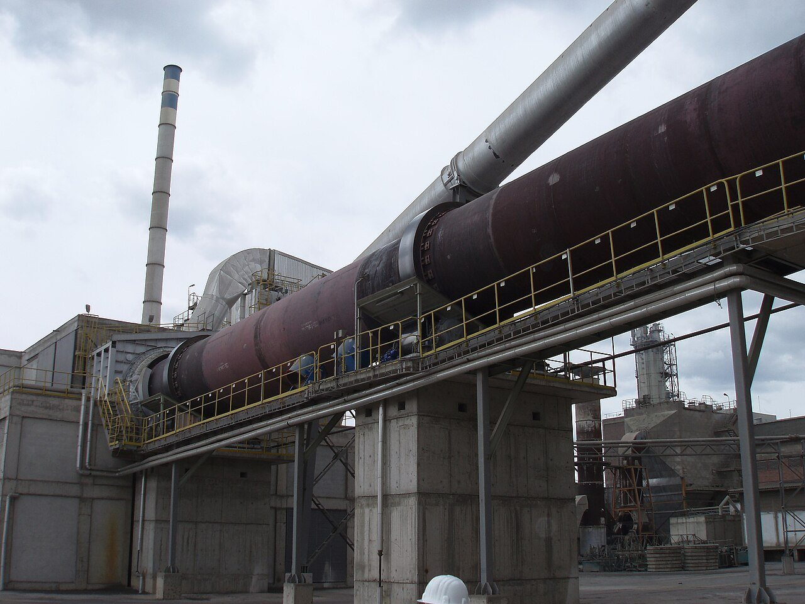

> Eskişehir Asayiş Şubesi ekiplerinin çalışması sonucu R.A. Ankara'da gözaltına alındı.

Eskişehir'de zorla tespih sattığı kişinin parasını gasbetmeye çalıştığı iddia edilen şüpheli Ankara'da yakalandı. Olay, Tepebaşı ilçesi Yenibağlar Mahallesi Yılmaz Büyükerşen Bulvarı'nda yaşandı.

Eskişehir İl Emniyet Müdürlüğü Asayiş Şubesi ekipleri çalışma başlattı ve Ankara'da bulunduğunu tespit ettiği şüpheli R.A.'yı (26) yakaladı. Gözaltına alınan şüpheli hakkında Eskişehir Cumhuriyet Başsavcılığı'nın talimatıyla işlem başlatıldı. Şüpheli hakkındaki suçlama henüz kanıtlanmış değil.

---

## Sivrihisar'da traktörün şaftına kolunu kaptıran kadın ağır yaralandı

**Gündem · Sivrihisar** · 2026-10-23 17:32 UTC · Kaynak: [Google Haberler - Eskişehir asayiş](https://www.anadolugazetesi.com/eskisehir-de-feci-kaza--traktorun-saftina-kolunu-kaptiran-kadin-agir-yaralandi-296889.html)

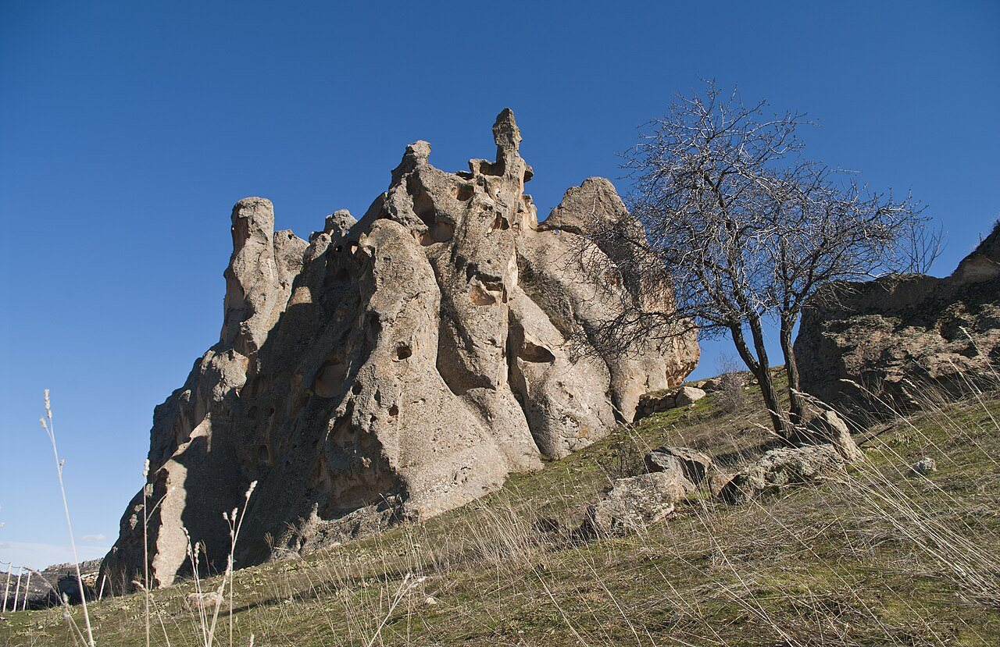

> 53 yaşındaki E.K. Göltepe Mahallesi'ndeki olayda hastaneye kaldırıldı.

Eskişehir'in Sivrihisar ilçesine bağlı kırsal Göltepe Mahallesi'nde çalışır durumdaki traktörün dönen şaftına sol kolunu kaptıran 53 yaşındaki E.K. ağır yaralandı. Olayı görenlerin ihbarı üzerine bölgeye sağlık ve jandarma ekipleri sevk edildi.

Sağlık ekiplerinin ilk müdahalesinin ardından ambulansla Eskişehir Osmangazi Üniversitesi Tıp Fakültesi Hastanesi'ne kaldırılan kadının sağlık durumunun ciddiyetini koruduğu öğrenildi. Olayın nedeni henüz belirlenemedi; jandarma ekipleri inceleme başlattı.

---

## CHP'li Saraç: 7 Kasım'da Ankara'da "Emekliler Buluşuyor" toplantısı yapılacak

**Siyaset · Türkiye** · 2026-10-23 17:32 UTC · Kaynak: [Google Haberler - CHP](https://www.babaocagi.com.tr/chp-genel-baskan-yardimcisi-sarac-ulkede-12-milyon-insan-aclik-sinirinda-yasiyor)

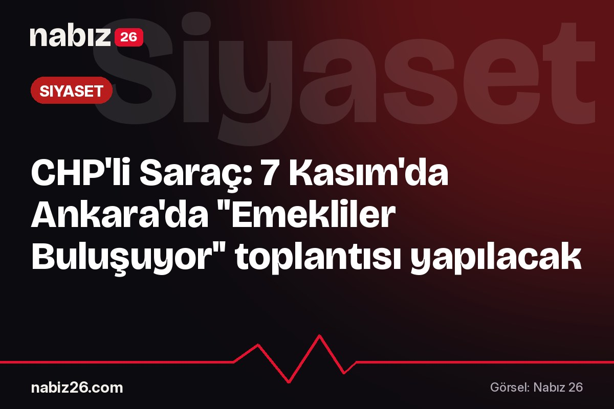

> Saraç ve Demirci, toplantıya davet için Yozgat'ta CHP il örgütünü ziyaret etti.

CHP Genel Başkan Yardımcıları Necdet Saraç ve Adnan Demirci, partilerinin 7 Kasım'da Ankara'da düzenleyeceği "Emekliler Buluşuyor" toplantısına vatandaşları davet etmek için Yozgat'a gitti ve CHP Yozgat il örgütünü ziyaret etti.

Saraç, yaptığı açıklamada Türkiye'de resmî emekli sayısının 16 milyon 900 bin olduğunu, emeklilerin yaklaşık 12,5 milyonunun 23 bin ile 40 bin lira arasında maaş aldığını söyledi. Saraç, gıda için açlık sınırının 37 bin lira olduğunu belirterek "12 milyon insan bu ülkede açlık sınırında yaşıyor" dedi ve çözüm bulunması gerektiğini savundu. Emekli maaşlarına ilişkin rakamlar Saraç'a aittir.

Saraç, Yozgat'ın 420 bin nüfusundan 88 bininin emekli olduğunu belirtti ve emeklilerin 7 Kasım'da Ankara'daki toplantıya katılmasını istedi.

---

## 75. Yıl'da Selami Vardar Bulvarı'ndaki doğalgaz hattı sızıntısı ESGAZ ekiplerince onarıldı

**Gündem · Merkez** · 2026-10-23 17:32 UTC · Kaynak: [Google Haberler - Odunpazarı](https://www.eskisehir.net/eskisehirde-gaz-kokusu-panigi-ekipler-harekete-gecti)

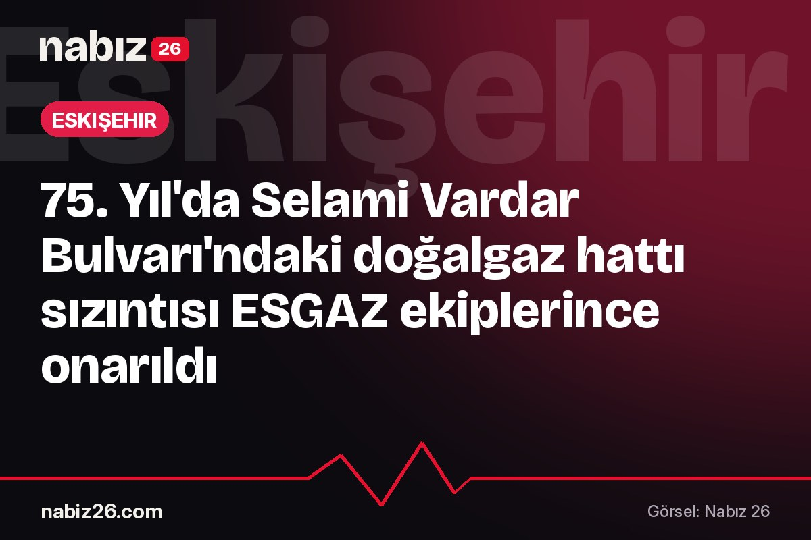

> Mahalle sakini sızıntı sırasında gaz kokusu hissedildiğini, olumsuzluk yaşanmadığını söyledi.

Eskişehir Şehir İçi Doğal Gaz Dağıtım (ESGAZ) ekipleri, 75. Yıl Mahallesi'nde Selami Vardar Bulvarı üzerindeki doğalgaz hattında çalışma yaptı. Teknik müdahalenin ardından sızıntı yapan bölümün onarıldığı ve üzerinin kapatıldığı öğrenildi.

Mahalle sakini İsmail Turan, bölgede yaklaşık üç gündür doğalgaz çalışması yapıldığını, bu sırada gaz kokusunun duyulduğunu ve sızıntının kısa sürede giderildiğini söyledi. Olay sırasında olumsuzluk yaşanmadığı belirtildi. Sızıntının ne zaman başladığına ve teknik nedenine ilişkin resmî bir açıklama paylaşılmadı.

---

## Zonguldak'taki maden ocağında metan patlaması: Vali Yılmaz taziye diledi, soruşturma var

**Gündem · Merkez** · 2026-10-23 16:34 UTC · Kaynak: [Google Haberler - Eskişehir gündem](https://www.eskisehirekspres.net/vali-yilmazdan-zonguldaktaki-maden-kazasi-icin-taziye-mesaji)

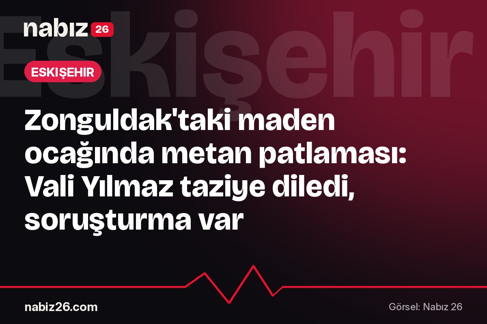

> Kilimli'deki kazada Vali'nin paylaşımına göre 2 madenci hayatını kaybetti, 5 madenci yaralandı.

Eskişehir Valisi Dr. Erdinç Yılmaz, sosyal medya hesabından yaptığı paylaşımda Zonguldak'ın Kilimli ilçesine bağlı Gelik beldesindeki bir kömür madeninde meydana gelen metan parlamasına ilişkin üzüntüsünü dile getirdi. Yılmaz, ilk belirlemelere göre 2 madencinin hayatını kaybettiğini, 5 madencinin yaralandığını, madende mahsur kalan 1 madencinin kurtarılması için çalışmaların sürdüğünü belirtti. Hayatını kaybedenlere rahmet, yakınlarına sabır, yaralılara acil şifa diledi.

Adalet Bakanı Akın Gürlek de Zonguldak Cumhuriyet Başsavcılığı'nca ivedi soruşturma başlatıldığını, 1 Cumhuriyet başsavcı vekili ve 2 Cumhuriyet savcısının görevlendirildiğini açıkladı. Gürlek, arama kurtarma çalışmalarının bir an önce olumlu sonuçlanmasını temenni etti.

---

## Tuncay: Deprem davalarında ilk derece yargılama 2027'nin ilk yarısında bitecek

**Türkiye · Türkiye** · 2026-10-23 16:34 UTC · Kaynak: [Google Haberler - Bakanlıklar](https://www.son.tv/deprem-davalarinda-kritik-takvim-can-tuncay-acikladi-deprem-davalarinda-hedef-2027nin-ilk-yarisi/)

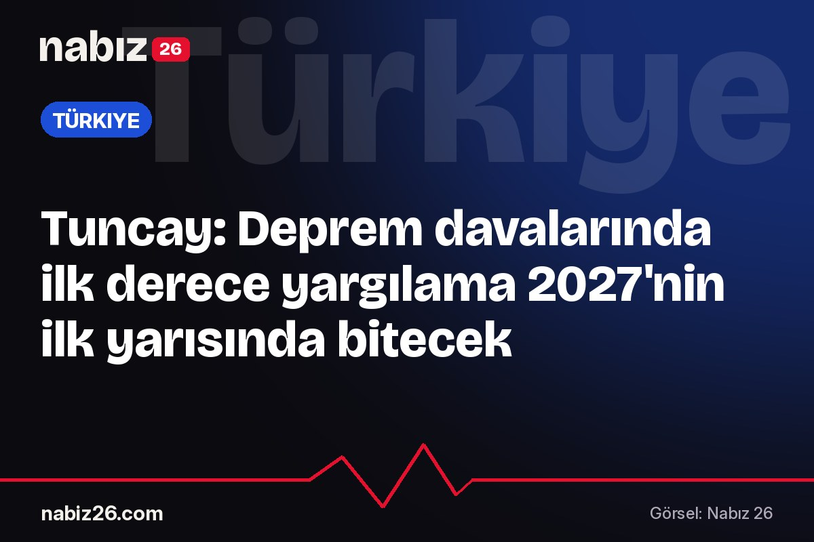

> Diyarbakır'daki toplantıya depremden etkilenen 11 ilin yargı yetkilileri katıldı.

Adalet Bakan Yardımcısı Can Tuncay, 6 Şubat 2023 depremlerinin ardından başlatılan davalara ilişkin Diyarbakır'da düzenlenen "Deprem Davalarında Adli Süreçlerin Değerlendirilmesi" toplantısında konuştu. Toplantıya depremlerden etkilenen 11 ilin cumhuriyet başsavcıları, adalet komisyonu başkanları ve idare mahkemesi başkanları katıldı.

Tuncay, "Deprem davalarında birinci derece mahkemelerdeki yargılamaları 2027'nin birinci yarısında sonlandırmayı, nihayetlendirmeyi planlıyoruz" dedi. Adalet Bakanlığı olarak depremde zarar gören ailelerle temas halinde olduklarını da söyledi.

---

## İYİ Partili Küçükerkan: Tepebaşı'nda mahalleler arasında hizmet farkı büyüyor

**Siyaset · Tepebaşı** · 2026-10-23 16:34 UTC · Kaynak: [Google Haberler - Tepebaşı](https://www.istikbalgazetesi.com/eskisehir-tepebasinda-hizmet-tartismasi-buyuyor-insan-hayati-bu-kadar-ucuz-olmamali)

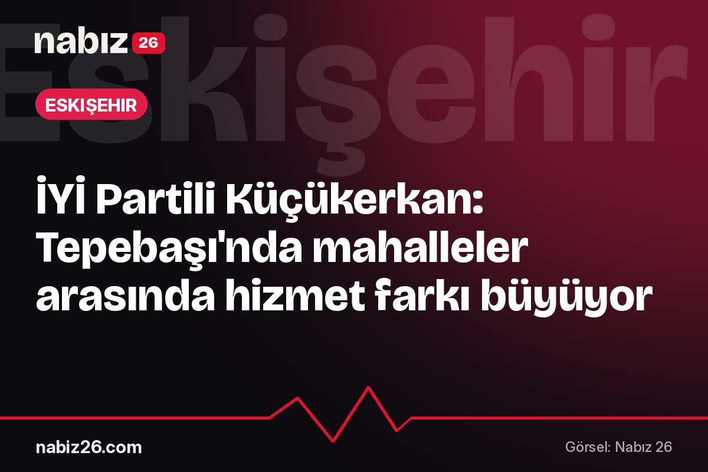

> İYİ Parti Tepebaşı İlçe Başkanı, kazı sonrası onarım ve drenaj konularında eleştirdi.

İYİ Parti Tepebaşı İlçe Başkanı Reşat Küçükerkan, Tepebaşı'nda hizmetlerin mahallelere eşit dağıtılmadığını savundu. Küçükerkan, ilçenin batı kesimi ile kuzey ve doğu mahalleleri arasında kentsel hizmet farkı bulunduğunu söyledi.

Küçükerkan'ın iddialarına göre bu mahallelerde kazı sonrası asfalt ve parke onarımı için bekleme süresi ortalama 45-60 gün, yağmur suyu drenaj hatlarının yol ağına oranı yaklaşık yüzde 32. Şiddetli yağışlarda Fevzi Çakmak ve Işıklar mahallelerinde sokaklarda göletler oluştuğunu ve bodrumların su bastığını ileri sürdü.

Küçükerkan, altyapı kurumlarının yatırım planlarının dijital ortamda çakıştırılmasını, kazı işlerinin en geç 15 gün içinde bitirilmesini, yüklenicilere asfalt ve parke kaplaması için 14 gün süre verilmesini ve acil drenaj hattı programı başlatılmasını istedi. Açıklamadaki rakamlar Küçükerkan'a ait olup kaynak metinde Tepebaşı Belediyesi'nin yanıtı yer almıyor.

---

## Eskişehir'de 29 Ekim Cumhuriyet Yürüyüşü saat 15.00'te Ulus Anıtı'ndan başlayacak

**Gündem · Merkez** · 2026-10-23 16:34 UTC · Kaynak: [Google Haberler - Eskişehir etkinlik](https://www.esgazete.com/eskisehirde-29-ekim-cumhuriyet-yuruyusu)

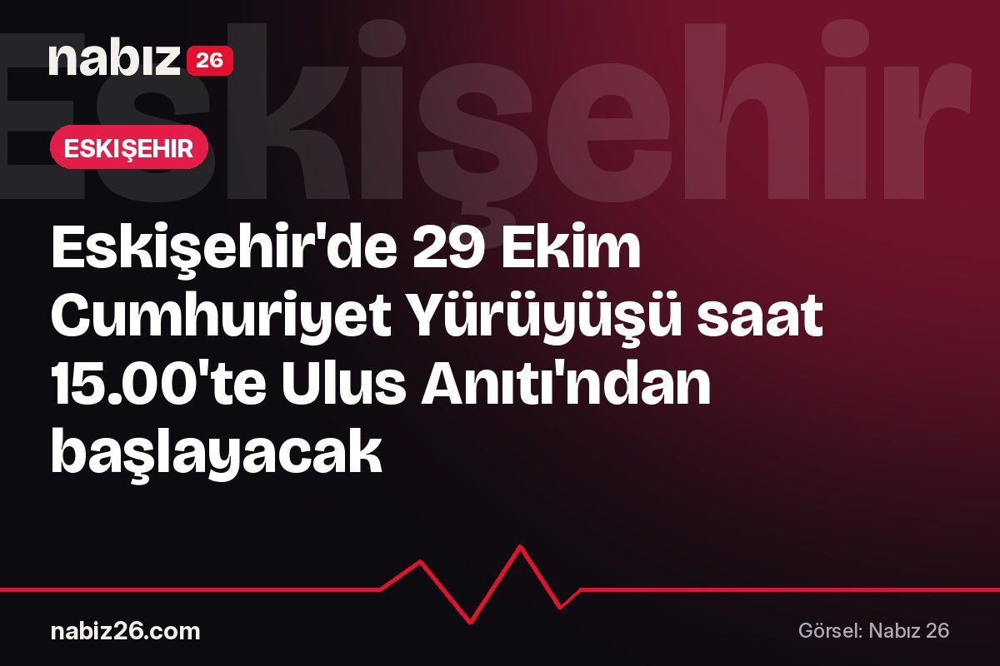

> Yürüyüş ÇYDD, Atatürkçü Düşünce Derneği ve Eğitim-Sen Eskişehir şubelerinin öncülüğünde yapılacak.

Eskişehir'de Cumhuriyet'in 103. yılı dolayısıyla 29 Ekim Perşembe günü Cumhuriyet Yürüyüşü düzenlenecek. Çağdaş Yaşamı Destekleme Derneği (ÇYDD) Eskişehir Şube Başkanı Sevgi Akmen, saat 15.00'te Ulus Anıtı önünden başlayacak yürüyüşe tüm Eskişehirlileri Türk bayrakları ve Atatürk posterleriyle katılmaya davet etti.

Buluşmanın ardından organizasyona katılan kurumlar adına basın açıklaması yapılacak, katılımcılar Vilayet Meydanı'na yürüyecek. Etkinlik, saygı duruşu ve İstiklal Marşı'nın okunmasıyla sona erecek. Akmen, vatandaşlardan evlerine bayrak asmalarını da istedi.

Yürüyüşe Atatürkçü Düşünce Derneği Eskişehir Şubesi, ÇYDD Eskişehir Şubesi ve Eğitim ve Bilim İşgörenleri Sendikası Eskişehir Şubesi öncülük ediyor.

---

## Erdoğan, Üsküdar ve Ataşehir belediye başkan vekillerini kabul etti

**Siyaset · Türkiye** · 2026-10-23 16:34 UTC · Kaynak: [Google Haberler - Cumhurbaşkanı](https://www.cnnturk.com/turkiye/cumhurbaskani-erdogan-uskudar-ve-atasehir-belediye-baskan-vekillerini-kabul-etti-3483755)

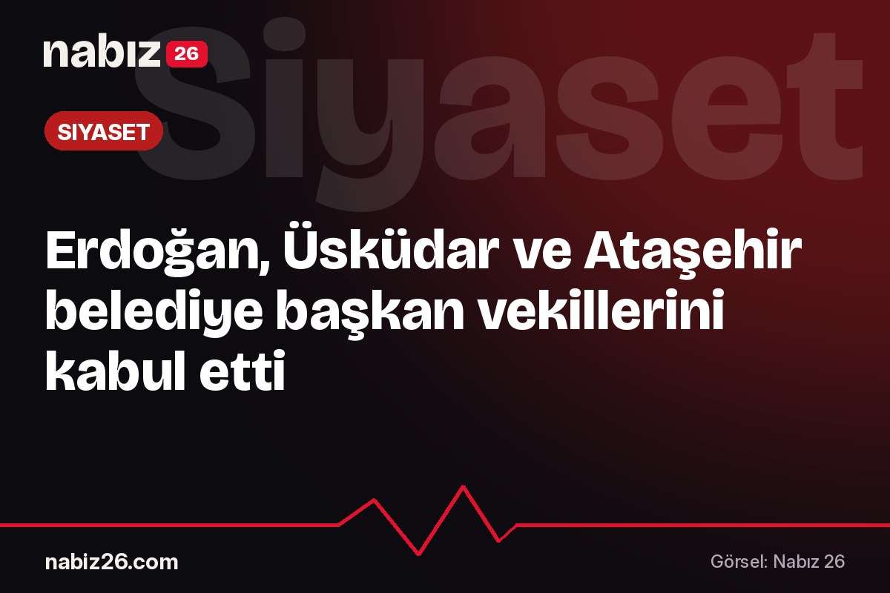

> Görüşmede ele alınan konulara ilişkin ayrıntı paylaşılmadı.

Cumhurbaşkanı Recep Tayyip Erdoğan, Üsküdar Belediye Başkan Vekili Muhammed Emin Sarıoğlu ile Ataşehir Belediye Başkan Vekili Serdar Orhan'ı kabul etti. Kabule AK Parti İstanbul İl Başkanı Abdullah Özdemir ile Üsküdar ve Ataşehir ilçe başkanları da katıldı.

Özdemir, sosyal medya hesabından yaptığı paylaşımda Erdoğan'a İstanbul'a gösterdiği yakın ilgi için teşekkür etti ve belediye başkan vekillerine görevlerinde başarı diledi. Görüşmede ele alınan konulara ilişkin paylaşımda ayrıntılı bilgi verilmedi.

---

## Eskişehir'de 462 kamu yatırım projesinin 70'i tamamlandı

**Gündem · Merkez** · 2026-10-23 15:34 UTC · Kaynak: [Eskişehir Valiliği](https://www.eskisehir.gov.tr/valimiz-dr-erdinc-yilmaz-baskanliginda-ekim-ayi-il-koordinasyon-kurulu-toplantisi-gerceklestirildi)

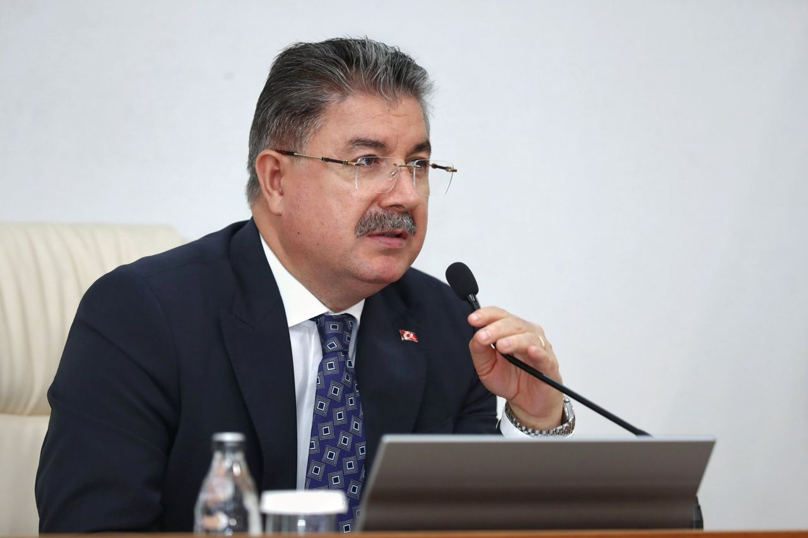

> Vali Yılmaz başkanlığındaki Ekim ayı İl Koordinasyon Kurulu toplantısında yatırımların durumu değerlendirildi.

2026 yılının dördüncü (Ekim ayı) İl Koordinasyon Kurulu Toplantısı, Vali Dr. Erdinç Yılmaz başkanlığında kurul üyelerinin katılımıyla yapıldı. Toplantı, kamu yatırımlarının il düzeyinde uygulanması, izlenmesi ve koordinasyonunun sağlanması amacıyla düzenlendi.

Vali Yılmaz, İLYAS (İl Yatırım Takip Sistemi) verilerine göre 2026 yılı üçüncü dönem sonu itibarıyla ilde çeşitli sektörlerde yapılan ve yapılması planlanan 462 proje bulunduğunu söyledi. Bu projelerin 70'inin tamamlandığını, 270'inin devam ettiğini, 15'inin ihale aşamasında olduğunu ve 103 projeye başlanacağını belirtti.

Yılmaz, koordinasyon gerektiren sorun ve ihtiyaçların toplantıda gündeme getirilmesinin önemine değindi, kurumların alınan kararları çözümlemede gerekli itinayı göstermesini istedi. Toplantı, kurul üyelerinin sunumlarının ardından sona erdi.

---

## Bakan Tekin İstanbul'da Kadıköy Lisesi ve Ziya Kalkavan Denizcilik Lisesi'ni ziyaret etti

**Eğitim · Türkiye** · 2026-10-23 15:34 UTC · Kaynak: [Milli Eğitim Bakanlığı](https://www.meb.gov.tr/bakan-tekin-istanbul039da-ogrencilerle-ve-ogretmenlerle-bulustu/haber/42281/tr)

> Tekin, öğrencilerin derslerine katıldı, sorularını yanıtladı ve bayrak törenine katıldı.

Millî Eğitim Bakanı Yusuf Tekin, İstanbul'da Kadıköy Lisesi'ni ziyaret etti. Tekin sınıfları gezerek öğrencilerin derslerine katıldı, sorularını yanıtladı ve öğrencilerle hatıra fotoğrafı çektirdi.

Ardından Beşiktaş'taki Ziya Kalkavan Denizcilik Mesleki ve Teknik Anadolu Lisesi'ni ziyaret eden Tekin, öğrencilerden çalışmaları hakkında bilgi aldı, öğretmenler odasında eğitimcilerle bir araya geldi. Okulda düzenlenen bayrak törenine katılan Tekin, öğrencilere iyi tatiller diledi.

Tekin, "Ülkemizin ekonomik ve toplumsal kalkınmasında kritik bir role sahip olan meslek liselerimizi ve sevgili gençlerimizi güçlendirmeye devam edeceğiz" dedi.

---

## Bakan Kacır Togg kampüsünde T6X'i inceledi: Günde 375 araç üretiliyor

**Ekonomi · Türkiye** · 2026-10-23 15:34 UTC · Kaynak: [Google Haberler - Togg](https://www.bloomberght.com/bakan-kacir-yeni-togg-u-paylasti-3792419)

> Kacır, T6X'in önümüzdeki yıl satışa sunulacağını belirtti.

Sanayi ve Teknoloji Bakanı Mehmet Fatih Kacır, Togg Üretim ve Teknoloji Kampüsü'nü ziyaret ederek önümüzdeki yıl satışa sunulması planlanan T6X ile tanıtımı yapılan T10F 4More Kehribar serisine yönelik çalışmaları inceledi.

Kacır, sosyal medya hesabından yaptığı paylaşımda, 10 çalışana 1 endüstriyel robot ortalamasıyla otomotiv sektörünün en dijital altyapısına sahip tesisi olan Togg'un günde 375 araç üretim hızıyla yoluna devam ettiğini belirtti.

---

## Togg T10F 4More'un Kehribar Serisi tanıtıldı: Yedi farklı renk seçeneği var

**Ekonomi · Türkiye** · 2026-10-23 14:34 UTC · Kaynak: [Google Haberler - Togg](https://www.haberturk.com/ekonomi/togg-t10f-4more-kehribar-serisi-tanitildi-iste-ozellikleri-3922036)

> Çift motorlu T10F 4More 0'dan 100'e 4,3 saniyede ulaşıyor, WLTP'ye göre 500 kilometre menzil sunuyor.

Togg, çift motorlu ve dört tekerlekten çekişli T10F 4More'u "Kehribar Serisi" ile kullanıcılarla buluşturuyor. Seri, Ayder, Seyhan, Urla, Kula, Oltu, Gemlik ve Mardin olmak üzere yedi farklı gövde rengiyle sunuluyor. Kehribar, Togg'un Obsidiyen Serisi'nden sonraki yeni özel serisi.

Jantlardan ön panjura, logodan yan aynalara ve cam çerçevelerine kadar kehribar detayları kullanılıyor. İç mekânda Artisyn kumaş ve kabartma desenli koltuklar ile özel dekoratif yüzeyler yer alıyor.

T10F 4More, 320 kW (435 PS) güç ve 700 Nm tork üretiyor ve 0'dan 100 km/sa hıza 4,3 saniyede ulaşıyor. 89,6 kWh batarya kapasitesiyle WLTP'ye göre 500 kilometre menzil sunan model, 26,5 dakikalık hızlı şarj süresine sahip.

---

## Şapcı: "Hedefimiz zirveyi almak"; Eskişehirspor Bursa Yıldırımspor'u ağırlayacak

**Spor · Merkez** · 2026-10-23 14:34 UTC · Kaynak: [Google Haberler - Eskişehirspor](https://www.sakaryagazetesi.com.tr/hakan-sapcihedefimiz-zirveyi-almak)

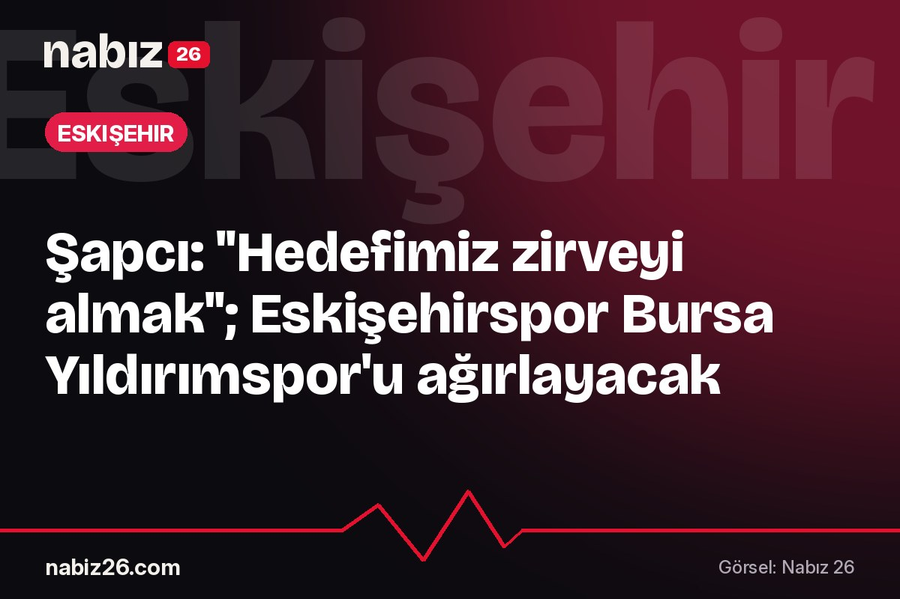

> Şapcı, kazanmaları halinde ligde ikinci sıraya yükseleceklerini söyledi.

Eskişehirspor'dan Hakan Şapcı, Bursa Yıldırımspor maçı öncesinde grupta dengeli bir yapı bulunduğunu ve rakiplerin puan kaybettiğini söyledi. Şapcı, "Rakiplerimizin takıldığı haftada önemli bir avantaj elde ettik" dedi ve bu hafta kazanmaları halinde lig ikincisi olacaklarını, rakip sonuçlarına göre liderliğe oturma ihtimallerinin de bulunduğunu belirtti.

Şapcı, rakibin ne yaptığını bilen, oyun kurgusu olan bir takım olduğunu, ancak kazanmak zorunda oldukları bir maça çıktıklarını ifade etti. Maçta taraftarın da tribündeki yerini alabileceğini hatırlatan Şapcı, Bursa Yıldırım'a bu sezonki ilk mağlubiyetini yaşatmak ve 2 puan önüne geçmek istediklerini söyledi. Bursa Yıldırımspor'u 43 yaşındaki teknik direktör Gürkan Ferhatoğlu çalıştırıyor; Şapcı'nın ekibi geçen sezon Bornova 1877'yi çalıştıran Ferhatoğlu'nun takımını 1-0 yenmişti.

---

## Piyano Günleri'nde Sebastiano Brusco'dan "Liebestraum" resitali

**Kültür-Sanat · Tepebaşı** · 2026-10-23 14:34 UTC · Kaynak: [Google Haberler - Eskişehir etkinlik](https://yerel-haberler.haberturk.com/eskisehir-haberleri/6-uluslararasi-piyano-gunlerinde-sebastiano-bruscodan-liebestraum-resitali-119501449)

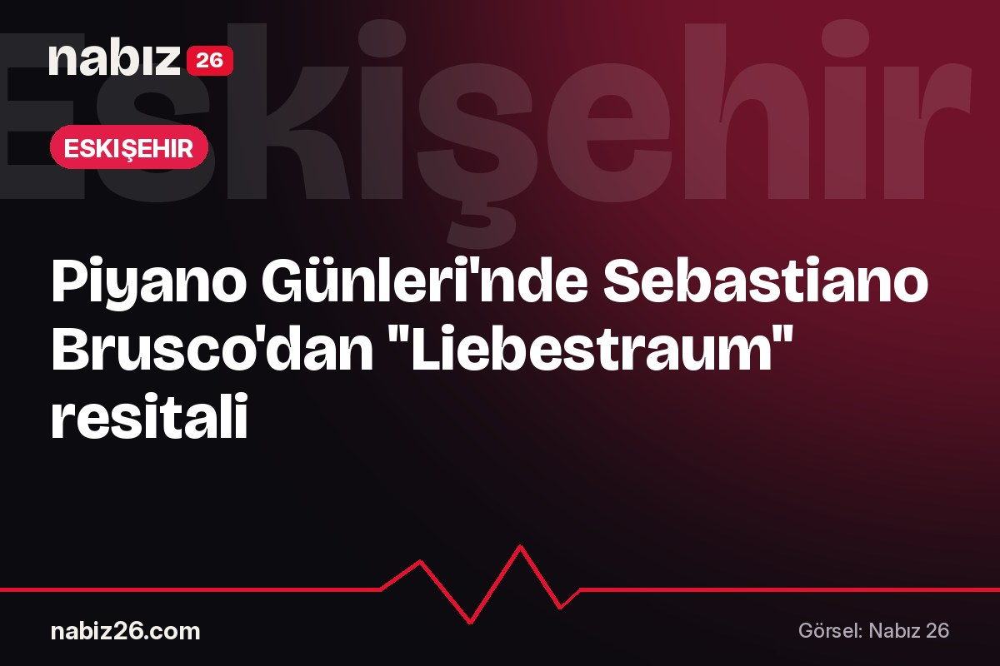

> 6. Uluslararası Piyano Günleri Anadolu Üniversitesi'nde 24 Ekim'e kadar sürecek.

Anadolu Üniversitesi Devlet Konservatuvarı Müzik Bölümü Piyano Anasanat Dalı Başkanlığı'nın düzenlediği 6. Uluslararası Piyano Günleri kapsamında piyanist Sebastiano Brusco, "Liebestraum" başlıklı resitalini verdi. Resital, Anadolu Üniversitesi Öğrenci Merkezi Yunus Emre Salonu'nda yapıldı.

Brusco, Schubert, Chopin, Rachmaninoff ve Liszt'in eserlerini seslendirdi. Programda Schubert'in Impromptu Op. 90 No. 3'ü, Chopin'in noktürn, etüt, baladlar ve polonezi, Rachmaninoff'un Prelude Op. 32 No. 12'si ve Liszt'in Liebestraum No. 3'ü yer aldı. Resitalin sonunda Anadolu Üniversitesi Halk Bilimi Uygulama ve Araştırma Merkezi Müdürü Prof. Oytun Eren, Brusco'ya teşekkür belgesi ve çiçek verdi.

Anadolu Üniversitesi ev sahipliğindeki Piyano Günleri, 24 Ekim'e kadar düzenlenecek konserler ve etkinliklerle sürecek.

---

## Hentbol 2. Lig'de Eskişehir'i temsil eden Büyükşehir GSK sezonun ilk maçına çıkıyor

**Spor · Merkez** · 2026-10-23 14:34 UTC · Kaynak: [Google Haberler - Eskişehir](https://www.istikbalgazetesi.com/eskisehir-buyuksehir-perdeyi-aciyor)

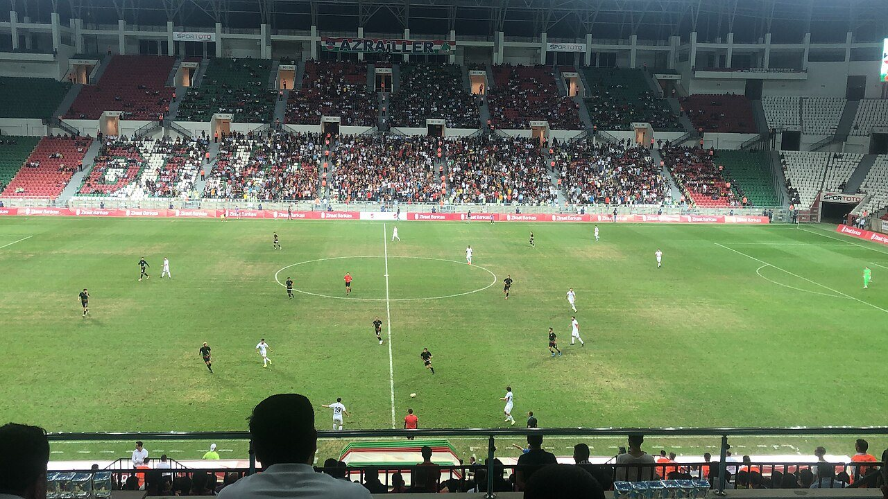

> Takım Kocaeli'ni Porsuk Spor Salonu'nda saat 16.00'da ağırlayacak.

Erkekler Hentbol 2. Lig'de Eskişehir'i temsil eden Büyükşehir Gençlik ve Spor Kulübü, yeni sezonun ilk maçına çıkıyor. İlk haftayı fikstür gereği dinlenerek geçiren takım, sezonu kendi sahasında açacak. Antrenör Erol Sezer yönetimindeki ekip, Kocaeli karşısında kazanarak lige iyi bir başlangıç yapmayı hedefliyor.

Büyükşehir, A Grubu'nda Beykoz Belediyesi, Kocaeli Gençlik ve Spor İl Müdürlüğü SK, Karagümrük Hentbol ve Zonguldak Gençlik ve Spor İl Müdürlüğü takımlarıyla mücadele edecek. Grubu ilk iki sırada tamamlayan takımlar 1. Lig'e yükselme maçlarına katılma hakkı elde edecek. Karşılaşma Porsuk Spor Salonu'nda saat 16.00'da oynanacak.

---

## Eskişehir Barosu Başkanı Günaydın: Avukat güvenliği ve basın özgürlüğü korunmalı

**Gündem · Merkez** · 2026-10-23 14:34 UTC · Kaynak: [Google Haberler - Eskişehir](https://www.sakaryagazetesi.com.tr/eskisehir-barosundan-sert-tepki-gercekler-tutuklanamaz)

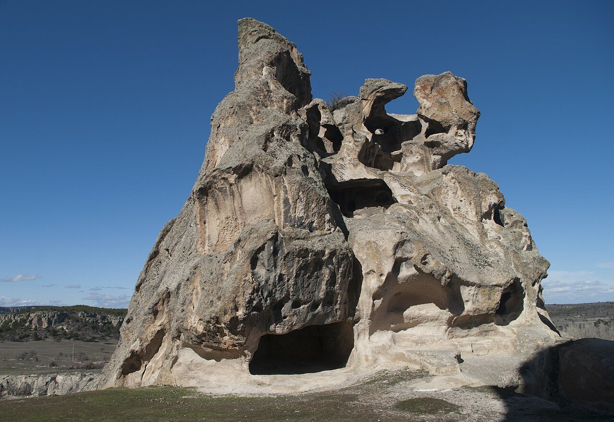

> Günaydın, avukatlara yönelik saldırılara ve gazetecilerin tutukluluğuna tepki gösterdi.

Eskişehir Barosu Başkanı Barış Günaydın, yaptığı açıklamada son günlerde farklı illerde avukatlara yönelik yaşanan saldırılara dikkat çekti. Aksaray, Afyonkarahisar, Van ve İstanbul'da görevlerini yerine getirirken saldırıya uğrayan avukatları hatırlatan Günaydın, "Avukatın can güvenliği, savunma hakkının güvencesidir" dedi ve etkili yasal düzenlemeler ile somut koruma tedbirleri alınmasını istedi.

Gazeteciler Murat Ağırel ve İsmail Arı'nın tutukluluk durumlarına değinen Günaydın, basın özgürlüğünün anayasal güvence altında olduğunu söyledi. Günaydın, "Tutuklama bir cezalandırma ya da yıldırma aracına dönüşmemelidir" diyerek tutukluluk hallerine son verilmesi çağrısında bulundu.

İzmir'in Menemen ilçesinde öldürülen Avukat Özge Penbegül'ü de anan Günaydın, kadın cinayetlerinin önlenmesi için 6284 sayılı Kanun'un etkin uygulanması gerektiğini belirtti.

---

## Uluönder'deki teknik arıza 4 tramvay hattını etkiledi, seferler normale döndü

**Ulaşım · Merkez** · 2026-10-23 13:33 UTC · Kaynak: [Google Haberler - Eskişehir](https://www.eskisehirekspres.net/eskisehirde-4-tramvay-hattinda-seferler-normale-dondu)

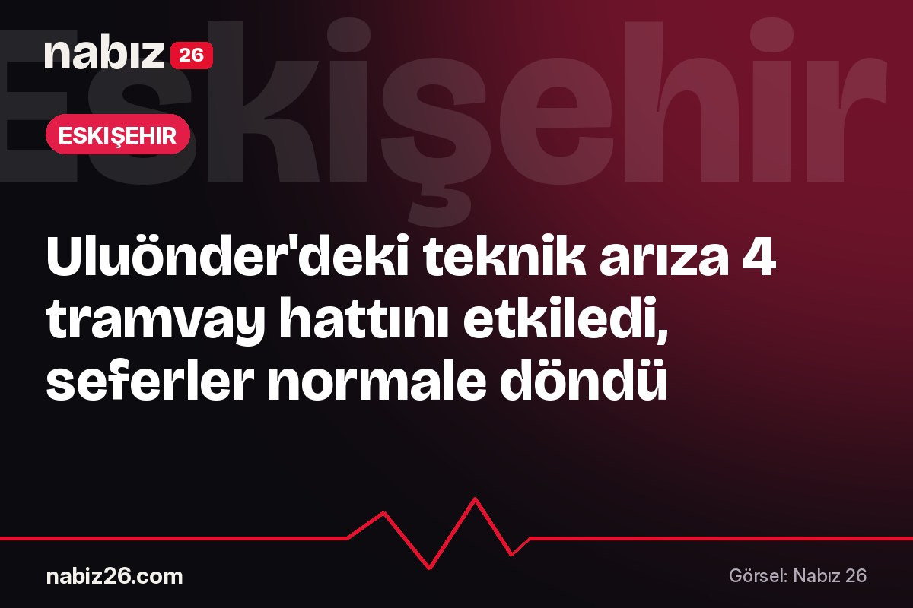

> Arıza nedeniyle Uluönder, SSK ve Atatürk Lisesi durakları arasında acil durum otobüsleri çalıştırıldı.

Eskişehir'de SSK yönünde, Uluönder tramvay durağı bölgesinde teknik arıza yaşandı. Arıza nedeniyle Otogar-SSK, SSK-OGÜ, Batıkent-SSK ve Çamlıca-SSK hatlarında seferler geçici olarak durduruldu.

Yolcuların mağdur olmaması için Uluönder, SSK ve Atatürk Lisesi durakları arasında acil durum otobüsleri devreye alındı. ESTRAM'ın yaptığı yeni açıklamada teknik sorunun giderildiği ve tramvay seferlerinin yeniden normale döndüğü bildirildi.

---

## Tepebaşı Belediyesi'nde Özel Kalem Müdürlüğü'ne Banu Gümüşpala getirildi

**Belediye · Tepebaşı** · 2026-10-23 13:33 UTC · Kaynak: [Google Haberler - Tepebaşı](https://www.eskisehirekspres.net/tepebasinda-yeni-ozel-kalem-muduru-resmen-belli-oldu)

> Görevi yürüten Suat Yalnızoğlu'nun yerine atama yapıldı.

Tepebaşı Belediyesi Özel Kalem Müdürlüğü görevini yürüten Suat Yalnızoğlu'nun yerine Banu Gümüşpala getirildi. Görev değişikliği Başkan Ahmet Ataç'ın onayının ardından resmiyet kazandı. Özel Kalem Müdürlüğü görevini bundan sonra Gümüşpala yürütecek.

---

## Eskişehirspor ve UNICEF projesi: "Spor Kulüpleri için Çocuk Koruma Rehberi" tanıtılacak

**Spor · Merkez** · 2026-10-23 13:33 UTC · Kaynak: [Google Haberler - Eskişehirspor](https://www.istikbalgazetesi.com/eskisehirspor-rehberlik-yapacak)

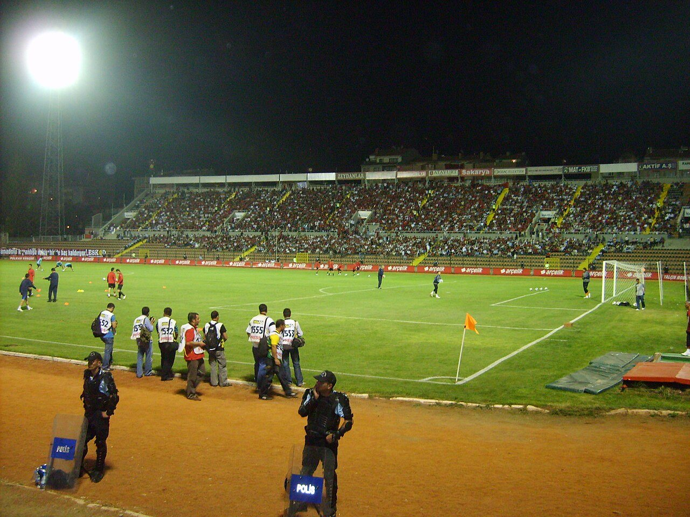

> Toplantı Haller Gençlik Merkezi Frigya Salonu'nda saat 10.00'da başlayacak.

Avrupa Birliği'nin eş finansman desteğiyle UNICEF tarafından yürütülen ACAR Projesi kapsamında Toy Gençlik Derneği ve Eskişehirspor Kulübü iş birliğinde hazırlanan "Spor Kulüpleri için Çocuk Koruma Rehberi" için tanıtım toplantısı yapılacak.

Uluslararası ve ulusal çerçevelere ve Eskişehirspor altyapısında yürütülen saha çalışmasına dayanan rehber, 18 yaş altı sporcularla çalışan kulüplerin ölçekleri ve branşları ne olursa olsun kendi çocuk koruma sistemlerini kurmalarına yardımcı olmak için hazırlandı. Toplantıda rehberin içeriği tanıtılacak, panelde sporda çocuk koruma yaklaşımı ve uygulama yöntemleri ele alınacak.

Eskişehir'de çocuk sporcularla çalışan tüm kulüpler ve kurumlar toplantıya katılabilecek. Toplantı Haller Gençlik Merkezi Frigya Salonu'nda saat 10.00'da başlayacak.

---

## Eskişehir'de kaçak alkol ve uyuşturucu operasyonu: 1 şüpheli gözaltına alındı

**Asayiş · Merkez** · 2026-10-23 13:33 UTC · Kaynak: [Google Haberler - Eskişehir asayiş](https://www.hurriyet.com.tr/yerel-haberler/eskisehir/eskisehirde-kacakcilik-ve-uyusturucu-operasyon-43352458)

> İki adreste yapılan aramalarda hap, sentetik uyuşturucu ve kaçak içki ele geçirildi.

Eskişehir'de kaçak ve sahte alkol ticareti yaparak halk sağlığını tehlikeye düşürdükleri belirlenen şüphelilere yönelik operasyon yapıldı. Çalışma Eskişehir Cumhuriyet Başsavcılığı koordinesinde İl Emniyet Müdürlüğü Kaçakçılık ve Organize Suçlarla Mücadele Şubesi ekiplerince yürütüldü.

İki adreste yapılan aramalarda 12 bin 460 yeşil reçeteye tabi hap, 3 bin 380 gram sentetik uyuşturucu ve 61 şişe kaçak ve sahte alkollü içki ele geçirildi. Bir şüpheli gözaltına alındı. Diğer şüphelinin ise uyuşturucu veya uyarıcı madde imal ve ticareti suçundan cezaevinde bulunduğu belirlendi. Soruşturmanın sürdüğü bildirildi.

---

## Eskişehir Model Fabrika'da 9. Öğren Dönüş Programı'nın ikinci aşaması yapıldı

**Ekonomi · Merkez** · 2026-10-23 13:33 UTC · Kaynak: [Google Haberler - Eskişehir](https://www.gzt26.com/eskisehir-sanayi-odasina-bagli-eskisehir-model-fabrikadan-firmalara-onemli-destek)

> Katılımcılara performans takibi, yalın üretim ve Just in Time konularında uygulamalı eğitim verildi.

Eskişehir Sanayi Odası'na bağlı Eskişehir Model Fabrika'da düzenlenen 9. Öğren Dönüş Programı'nın ikinci aşaması gerçekleştirildi. Katılımcılara üretimde verimliliğin artırılması, performansın takip edilmesi ve süreçlerin iyileştirilmesine yönelik uygulamalı eğitimler verildi.

Eğitimlerde Performans Panosu, standart operasyon prosedürleri (SOP), tam zamanında üretim (Just in Time) yaklaşımı ve Yamazumi çalışmaları ele alındı; SOCT uygulamaları doğrudan üretim hattında gözlemlendi. Programın sonraki aşamalarında firmaların öğrendikleri yöntemleri kendi pilot üretim alanlarında uygulamaları amaçlanıyor.

---

## Tepebaşı'nda 440 lise öğrencisine iklim krizi ve COP31 anlatıldı

**Eğitim · Tepebaşı** · 2026-10-23 12:33 UTC · Kaynak: [Tepebaşı Belediyesi](https://www.tepebasi.bel.tr/Haber/Detay/440ogrenciiklimkrizivecop31’ikonustu)

> Özel Atayurt ve Özel Çağdaş Okulları'nın 9. ve 10. sınıf öğrencilerine sunum yapıldı.

Tepebaşı Belediyesi İklim Değişikliği ve Sıfır Atık Müdürlüğü, Özel Atayurt Okulları ve Özel Çağdaş Okulları'nın lise öğrencilerine "Gezegenin Geleceği ve İklim Uzlaşmaları: COP31" başlıklı sunum yaptı. Sunuma 9. ve 10. sınıflardan toplam 440 öğrenci katıldı.

Sunumda iklim krizinin nedenleri ve günlük yaşama etkileri, sera gazları, Dünya Limit Aşım Günü, su kaynaklarının korunması, su ayak izi ve kentsel ısı adası etkisi ele alındı. Rio Zirvesi'nden Kyoto Protokolü ve Paris Anlaşması'na uzanan süreç, 1,5 derece hedefi ve Taraflar Konferansı'nın işleyişi anlatıldı.

Sunumun ardından düzenlenen interaktif oyunda başarılı olan üç öğrenciye not defteri ve kalem hediye edildi.

---

## Sarıcakaya'da Dorlion zeytinyağı için erken hasat tamamlandı

**Tarım · Sarıcakaya** · 2026-10-23 12:33 UTC · Kaynak: [Google Haberler - Eskişehir gündem](https://www.urfadabugun.com/haber/263840/eskisehirde-dorlion-zeytinyaginda-erken-hasat-tamamlandi.html)

> Dorlion Özel Seri, 19. Natürel Sızma Zeytinyağı Kalite Yarışması'nda Premium Ödülü kazanmıştı.

Eskişehir Büyükşehir Belediyesi'nin Sarıcakaya ilçesinde sürdürülebilir yöntemlerle yürüttüğü zeytinyağı üretiminde erken hasat dönemi sona erdi. Sarıcakayalı çiftçilerin topladığı zeytinler, Tarımsal Hizmetler Dairesi Başkanlığı tarafından natürel sızma zeytinyağına dönüştürüldü.

Eskişehir Orta Sakarya Vadisi Zeytinciliği Geliştirme Projesi kapsamında Dorlion Özel Seri için toplanan zeytinler, Sarıcakaya Zeytin Üreticileri Birliği aracılığıyla belediyeye teslim edildi. Zeytinler hava ile teması en aza indirilerek soğuk sıkım yöntemiyle işlendi.

Dorlion Özel Seri zeytinyağı, 19. Natürel Sızma Zeytinyağı Kalite Yarışması'nda Premium Ödülü kazandı. Büyükşehir, projeyle çiftçilerin üretimini desteklemeyi ve yerel tarım ürünlerine katma değer kazandırmayı amaçlıyor.

---

## Odunpazarı Mesleki Eğitim Merkezi öğrencileri çorba ikram ederek dayanışma etkinliği yaptı

**Eğitim · Odunpazarı** · 2026-10-23 12:33 UTC · Kaynak: [Google Haberler - Odunpazarı](https://www.anadolugazetesi.com/amp/odunpazari-mesem-den-anlamli-dayanisma-etkinligi-296875.html)

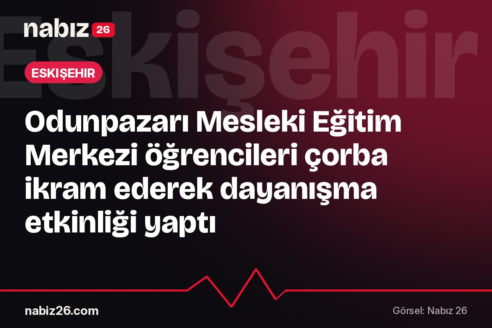

> Etkinlikte "Bir tas çorba, bin tebessüm" mesajı verildi.

Odunpazarı Mesleki Eğitim Merkezi (OMEM), öğrencilerin sosyal sorumluluk bilincini geliştirmeye yönelik bir etkinlik düzenledi. Okul Müdürü Erhan Aksu'nun katkıları, öğretmenlerin rehberliği ve öğrencilerin çalışmasıyla hazırlanan çorba, paylaşma ve dayanışma amacıyla ikram edildi.

Etkinlikle öğrencilerin empati, yardımlaşma ve sorumluluk bilinci kazanmasına katkı sunulması hedeflendi. OMEM ailesi etkinliğin mesajını "Bir tas çorba, bin tebessüm! Paylaştıkça çoğalır, dayanışmayla güçleniriz" sözleriyle özetledi.

---

## Mukaddes Emanetler Sergisi Eskişehir'de açıldı, vatandaşlar kuyruk oluşturdu

**Kültür-Sanat · Merkez** · 2026-10-23 12:33 UTC · Kaynak: [Google Haberler - Eskişehir etkinlik](https://www.sakaryagazetesi.com.tr/mukaddes-emanetleri-gorebilmek-icin-metrelerce-kuyruk-olusturdular)

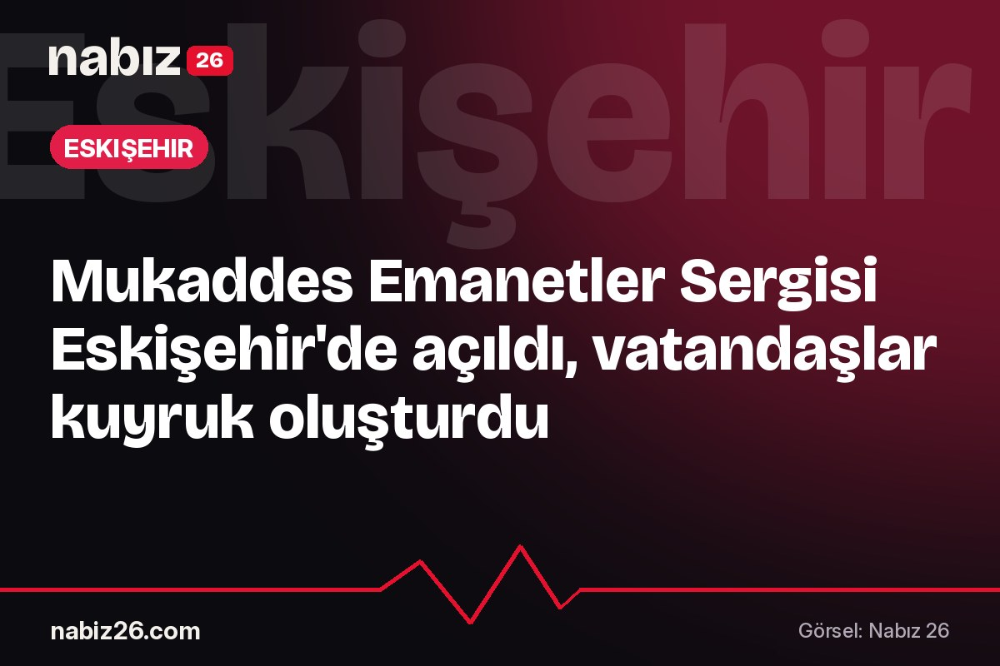

> 150'nin üzerinde emanetin yer aldığı sergi İl Kültür Müdürlüğü Sergi Salonu'nda.

Asrı Saadet'ten Osmanlı'ya ve günümüze uzanan 150'nin üzerinde kutsal emaneti Eskişehirlilerle buluşturan Mukaddes Emanetler Sergisi, Eskişehir İl Kültür Müdürlüğü Sergi Salonu'nda dün açıldı. Sergi, koleksiyoncu Erol Güzel ile MÜSİAD Eskişehir Şubesi iş birliğiyle düzenlendi.

Sergide Peygamber Efendimizin Sakal-ı Şerif'i ve Saç-ı Şerifi, Kabe-i Muazzama örtüleri, dünyanın en büyük ikinci el yazma Kur'an-ı Kerim'i, Ehl-i Beyt ve evliyalara ait emanetler yer alıyor. Mukaddes emanetlerin Eskişehir'de ilk kez bu kadar geniş kapsamda sergilendiği belirtildi. Sergiyi görmek isteyen vatandaşlar sergi salonunun önünde metrelerce kuyruk oluşturdu.

---

## Kız Anadolu İmam Hatip Lisesi'nde açılacak 4-6 yaş Kur'an kursunun hazırlıkları incelendi

**Eğitim · Merkez** · 2026-10-23 12:33 UTC · Kaynak: [Google Haberler - Eskişehir](https://yerel-haberler.haberturk.com/eskisehir-haberleri/eskisehirde-d-tipi-4-6-yas-kuran-kursu-hazirliklari-incelendi-119501366)

> İl Millî Eğitim Müdürü Aydın ve İl Müftüsü Gül, kurs alanını yerinde gördü.

Eskişehir İl Millî Eğitim Müdürü Sinan Aydın ve İl Müftüsü Muharrem Gül, Eskişehir Kız Anadolu İmam Hatip Lisesi bünyesinde açılması planlanan D Tipi 4-6 Yaş Kur'an Kursu'nun hazırlık çalışmalarını yerinde inceledi.

Heyet, kurs alanını ziyaret ederek Okul Müdürü Hasan Kaymakçı'dan hazırlık süreci ve kursun fiziki şartları hakkında bilgi aldı.

---

## Kılıçdaroğlu, Lüksemburg Temsilciler Meclisi Başkanı Wiseler'i kabul etti

**Siyaset · Türkiye** · 2026-10-23 12:33 UTC · Kaynak: [Google Haberler - CHP](https://ankahaber.net/haber/kemal-kilicdaroglu-luksemburg-temsilciler-meclisi-baskani-wiseler-ile-gorustu-09b1c067)

> Görüşme CHP Genel Merkezi'nde, çok partili heyetle yapıldı.

CHP Genel Başkanı Kemal Kılıçdaroğlu, Lüksemburg Temsilciler Meclisi Başkanı Claude Wiseler başkanlığındaki çok partili heyetle CHP Genel Merkezi'nde bir araya geldi.

---

## Halk Dansları Topluluğu ilk gösterisini yaptı: Ünlüce "hayalim gerçek oldu" dedi

**Kültür-Sanat · Merkez** · 2026-10-23 12:33 UTC · Kaynak: [Google Haberler - Eskişehir gündem](https://www.istikbalgazetesi.com/ayse-unluce-en-buyuk-hayalini-gerceklestirdigini-acikladi)

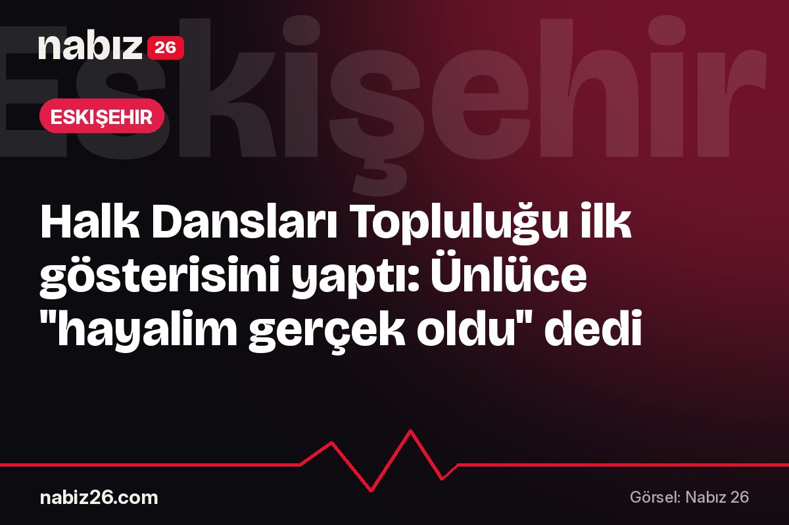

> "Eskiden Şehre Dorlion Zamanın Dansı" Eskişehir Yılı 2026 kapsamında sahnelendi.

Eskişehir Büyükşehir Belediyesi bünyesinde oluşturulan halk dansları topluluğu, 2026 Eskişehir Yılı etkinlikleri kapsamındaki "Eskiden Şehre Dorlion Zamanın Dansı" gösterisiyle ilk performansını sergiledi. Gösteride kentin geçmişten Cumhuriyet'e uzanan tarihi müzik ve dansla anlatıldı.

Büyükşehir Belediye Başkanı Ayşe Ünlüce, sosyal medya hesabından yaptığı paylaşımda yıllardır güçlü bir halk dansları topluluğu hayal ettiğini, ekibin ilk gösterisiyle bu hayalin gerçeğe dönüştüğünü söyledi. Ünlüce, emeği geçenlere teşekkür ederek topluluğun gelecekte de kentin kültürünü sahneye taşımasını diledi.

---

## ESMEK'ten müzede "Ben Bir İlmek Biz Bir Motif" yaratıcı drama atölyesi

**Kültür-Sanat · Merkez** · 2026-10-23 12:33 UTC · Kaynak: [Google Haberler - Eskişehir etkinlik](https://www.istikbalgazetesi.com/eskisehirde-muzede-anlamli-etkinlik-kadin-emegi-ve-dayanisma-ele-alindi)

> Atölyede müze koleksiyonundaki eserlerden yola çıkılarak kadın emeği ve dayanışma ele alındı.

Eğitmen Aslıhan Aslan yürütücülüğünde düzenlenen "Ben Bir İlmek Biz Bir Motif – Müzede Yaratıcı Drama Atölyesi"nde farklı kuşaklardan katılımcılar bir araya geldi.

Atölyede müze koleksiyonundaki eserlerden yola çıkılarak kadın emeği, toplumsal roller ve ortak yaşam deneyimleri yaratıcı drama çalışmalarıyla ele alındı. Canlandırma, grup çalışmaları ve hikâye oluşturma etkinlikleriyle katılımcılar kadın dayanışması ve toplumsal eşitsizlikler üzerine düşündü. ESMEK, Kültür ve Düşünce Buluşmaları kapsamında farklı temalarda etkinlikler düzenlemeye devam edecek.

---
