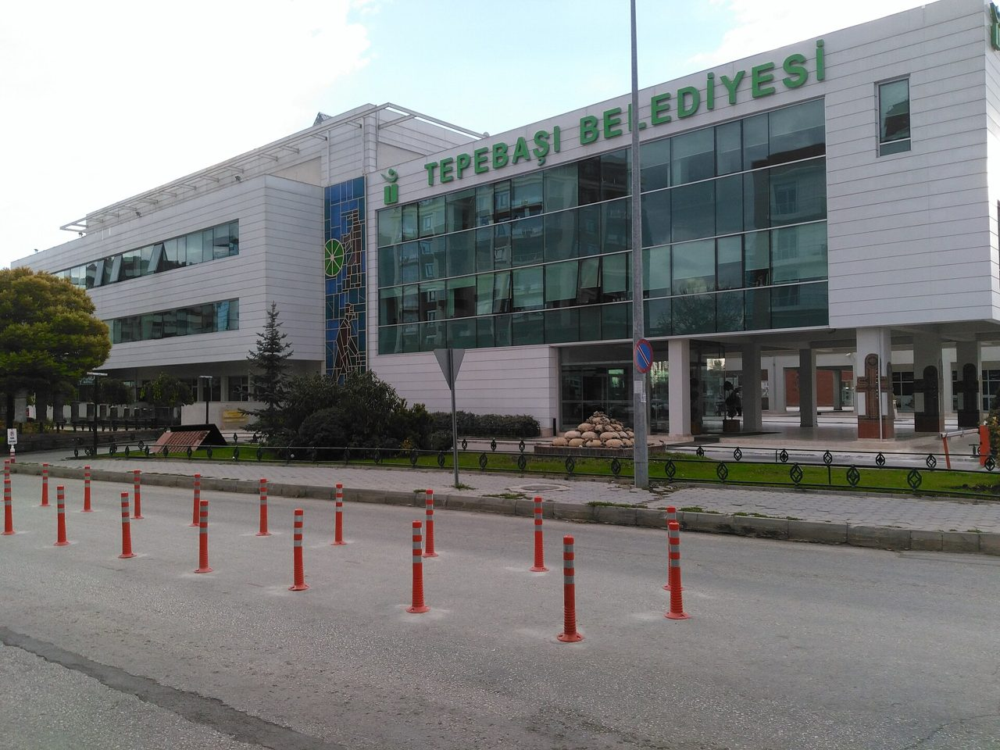
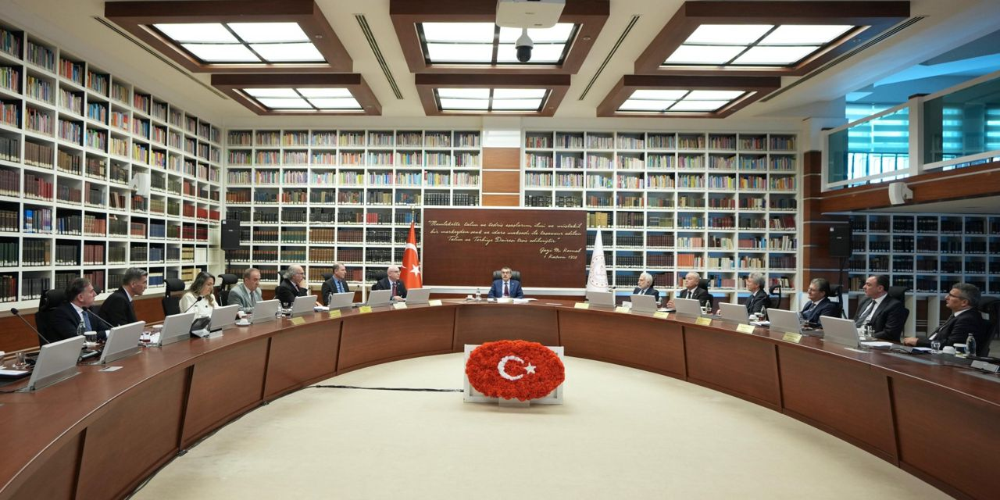
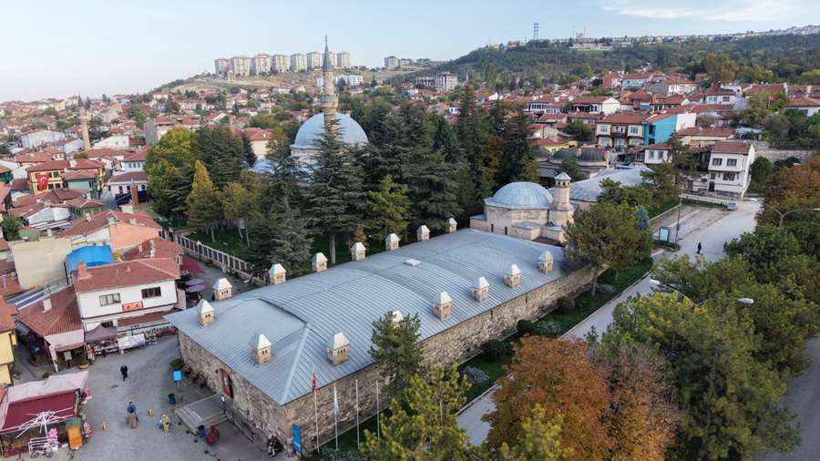
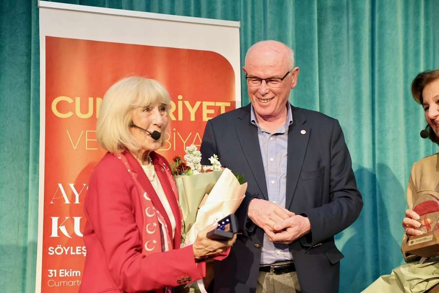

# Son haberler

Ajanın yazdığı son haberler (otomatik güncellenir).

## Tepebaşı Belediyesi'nin üniversite öğrencilerine ücretsiz akşam yemeği bu yıl da sürüyor

**Belediye · Tepebaşı** · 2026-11-02 19:32 UTC · Kaynak: [Google Haberler - Tepebaşı](https://www.gzt26.com/ahmet-atac-duyurdu-universite-ogrencilerine-desteklerimiz-devam-ediyor)

> Başkan Ataç öğrencilerle Ali Rıza Efendi Deneyimli Kafe'de yemek yedi.

Tepebaşı Belediye Başkanı Ahmet Ataç, üniversite öğrencilerine yönelik 2022'de başlatılan ücretsiz akşam yemeği uygulamasının bu yıl da devam ettiğini açıkladı. Ataç, Ali Rıza Efendi Deneyimli Kafe'de öğrencilerle bir araya geldi, eğitim hayatı ve günlük yaşam üzerine sohbet etti.

Ataç, "Üniversite okumak bugünün Türkiye'sinde hiç kolay değil. Ekonomik zorluklar ortada. Gençlerimizin bir öğün yemeğini biz düşünelim, ailelerin bütçesine de bir nebze katkımız olsun istiyoruz" dedi. Öğrencilere seslenen Ataç, "Afiyet olsun gençler, soframız, kapımız sizlere daima açık" ifadelerini kullandı.

Açıklamada uygulamadan bugüne kaç öğrencinin yararlandığına ve günlük dağıtılan yemek sayısına ilişkin bilgi verilmedi.

---

## Odunpazarı Meclisi'nde Kurşunlu Külliyesi tartışması: Kurt ve Kepez farklı görüşte

**Gündem · Odunpazarı** · 2026-11-02 18:33 UTC · Kaynak: [Google Haberler - Odunpazarı](https://www.gzt26.com/kazim-kurt-sert-konustu-hic-kimseye-bir-sey-teslim-etmiyoruz)

> Kurt belediyenin külliye giderlerini açıkladı, Kepez Vakıflar'ın mülk sahipliğini vurguladı.

Odunpazarı Belediyesi kasım ayı meclis toplantısında Kurşunlu Külliyesi'nin tahliyesi gündeme geldi. Belediye Başkanı Kazım Kurt ve AK Parti Grup Başkanvekili Mehmet Kepez farklı görüşler dile getirdi.

Kurt'un anlattığına göre külliye 2004'ten bu yana Odunpazarı Belediyesi tarafından kültür ve sanat hizmetlerine tahsis edilen bir alan. Belediyenin 1 Ocak-30 Ekim 2026 arasındaki külliye harcamalarını açıklayan Kurt, ortak alanların, müzenin ve işyerlerinin elektriği için 409 bin 523 lira, doğal gaz için 443 bin 366 lira, temizlik personeli için 794 bin 873 lira, güvenlik personeli için 3 milyon 238 bin 286 lira ve cam sanatları atölyesinin oksijen tesisatı ile diğer giderleri için yaklaşık 134 bin lira harcandığını, toplamın 6 milyon 26 bin liraya ulaştığını söyledi. Kurt, külliyede 18 kurs öğretmeni, teknisyen ve cam sanatçısının çalıştığını, 14 küçük işletmenin bulunduğunu belirtti.

Kurt, kira sözleşmesinin beş yıl uzatılmasına olanak tanıyan düzenlemeye süresi içinde başvurduklarını, Vakıflar'ın yanıt vermemesi üzerine "zımnen ret" kabul ederek dava açtıklarını, yargılamanın sürdüğünü ve mahkemenin yürütmeyi durdurma kararı vermediğini söyledi. Kaymakamlığın 3 Kasım 2026'da külliyenin boşaltılmasını bildirdiğini, ortada mahkeme kararı bulunmadığını savundu.

Kepez ise külliyenin boşaltılmasının AK Parti'yle ilgisi olmadığını söyledi. Külliye yargı kararıyla belediyeden alınsa bile AK Parti'nin orayı bir derneğe vermek gibi bir düşüncesi ve yetkisi bulunmadığını belirten Kepez, Vakıfların mülk sahibi olduğunu, kendi envanterini çıkararak kiraları tahsil etmeye çalıştığını, İl Tarım Müdürlüğü binasından ve bazı valiliklerden de kira istediğini ifade etti. Kepez, Vakıflarla kira konusunda uzlaşı sağlanamamasının belediyenin sorunu olduğunu ve bunun AK Parti'ye fatura edilmesinin doğru olmadığını söyledi.

Haber meclis konuşmalarına dayanıyor; Vakıflar Bölge Müdürlüğü'nün ve Kaymakamlığın bu açıklamalara ilişkin görüşü kaynakta yer almıyor.

---

## ESKİ: Çankaya'daki hat çalışması nedeniyle 6 mahallede su kesintisi sürecek

**Gündem · Merkez** · 2026-11-02 18:32 UTC · Kaynak: [Google Haberler - Eskişehir](https://www.gzt26.com/eski-duyurdu-eskisehirde-6-mahallede-su-kesintisi-devam-edecek)

> Bağlantı tamamlanınca sisteme kademeli olarak su verilecek.

Eskişehir Büyükşehir Belediyesi Su ve Kanalizasyon İdaresi Genel Müdürlüğü (ESKİ), Çankaya Mahallesi Özlem Caddesi'nde yürütülen içme ve kullanma suyu isale hattı bağlantı çalışmalarının sürdüğünü bildirdi.

ESKİ'nin yazılı açıklamasına göre çalışmalar nedeniyle Çankaya, Emek, Ihlamurkent, Erenköy, 71 Evler ve Vadişehir mahallelerinde yaşanan su kesintisi ve basınç düşüklüğü bir süre daha devam edecek. Ekiplerin çalışmaları güvenli şekilde tamamlamak ve bölgeye yeniden su vermek için sahada aralıksız çalıştığı belirtildi.

Bağlantı işlemleri tamamlandıktan sonra sisteme kademeli olarak su verilecek, şebeke basıncının dengelenmesine bağlı olarak su akışı aşamalı şekilde normal seviyesine ulaşacak. ESKİ, vatandaşlara anlayış ve sabırları için teşekkür etti. Açıklamada kesintinin ne zaman sona ereceğine dair bir saat verilmedi.

---

## Eskişehir Uluslararası Polifonik Koro Şenliği İstanbul Avrupa Korosu konseriyle bitti

**Kültür-Sanat · Merkez** · 2026-11-02 17:55 UTC · Kaynak: [Google Haberler - Eskişehir](https://ankahaber.net/haber/2-eskisehir-uluslararasi-polifonik-koro-senligi-ozel-konserle-sona-erdi-a838140a)

> Şenliğe 30 Ekim-1 Kasım'da 37 koro katıldı.

Eskişehir Büyükşehir Belediyesi ve Eskişehir Polifonik Korosu Derneği iş birliğiyle düzenlenen 2. Eskişehir Uluslararası Polifonik Koro Şenliği, İstanbul Avrupa Korosu'nun özel konseriyle sona erdi. Kapanış konserine Eskişehir Büyükşehir Belediye Başkan Vekili Vural Yörük ile Tepebaşı Belediye Başkanı Ahmet Ataç katıldı.

30 Ekim-1 Kasım tarihlerinde yapılan şenliğe farklı şehir ve ülkelerden toplam 37 koro katıldı. Konserlerin yanı sıra atölye çalışmaları ve ortak performanslar yapıldı. Koroların performansları uluslararası değerlendirme kurulu üyeleri tarafından sanatsal açıdan ele alındı; yarışma ve sıralama yerine gelişim ve paylaşım esas alındı, kurul üyeleri korolara repertuvar, yorum, teknik ve müzikal ifade konusunda görüş ve önerilerini aktardı.

Şenliğin sanat yönetmenliğini Ender Sakpınar üstlendi. Uluslararası değerlendirme kurulunda Turgay Erdener, Francesco Di Mauro, Nikos Haliassas, Özlem Erdoğan, Mete Gökçe, Çiğdem Aytepe, Atilla Çağdaş Değer, Zeynep Göknur Yıldız ve Hakan Bağcı yer aldı.

---

## Eskişehir Büyükşehir 8 yeni tramvay için ihaleye çıktı: ihale 6 Kasım'da

**Ulaşım · Merkez** · 2026-11-02 17:55 UTC · Kaynak: [Google Haberler - Eskişehir gündem](https://www.eskisehirhaberajansi.com/eskisehirde-tramvay-filosu-yenileniyor-ihale-tarihi-belli-oldu)

> Belediye ayrıca ESTÜ'ye tramvay bağlantısı için kurumlarla görüşüyor.

Eskişehir Büyükşehir Belediyesi, toplu ulaşım hizmetlerini geliştirmek amacıyla 8 yeni tramvay aracı alımı için ihale sürecini başlattı. İhale 6 Kasım 2026'da yapılacak. Yeni araçlarla tramvay seferlerinin sıklığının artırılması, yolculuk konforunun iyileştirilmesi ve araç filosunun yaş ortalamasının düşürülmesi amaçlanıyor.

Belediyenin açıklamasına göre 315 araçlık otobüs filosu 116 hatta hizmet veriyor. Okulların açık olduğu dönemde hafta içi günlük yaklaşık 105-110 bin yolcu otobüsleri kullanırken hafta sonu bu sayı 55-60 bin düzeyinde. Gece ulaşımında 00.00-05.00 arası hizmet veren araç sayısı Mayıs 2024'ten bu yana 3'ten 7'ye çıkarıldı. Ocak ayında 25 adet 8 metrelik otobüs filoya katıldı, Otobes26 Eskişehir Turistik Hattı oluşturuldu.

Belediye, "Türkiye'nin Ulaşımda Net Sıfır Emisyon Yol Haritası Projesi" kapsamında 20 elektrikli otobüs alımına yönelik proje başvurusunun kazanıldığını, Bakanlık nezdindeki görüşmelerin sürdüğünü bildirdi.

Opera-Kumlubel hattından Eskişehir Teknik Üniversitesi'ne tramvay bağlantısı için de çalışma başlatıldı. Projenin hava mania planı ve Karayolları Genel Müdürlüğü'nün sorumluluk alanında bulunması nedeniyle ilgili kurumlara yazı gönderildi; Büyükşehir, ESTÜ, Karayolları Genel Müdürlüğü ve Devlet Hava Meydanları İşletmesi ile irtibat halinde ve yanıtlar bekleniyor.

---

## Odunpazarı Belediyesinde yeni atamalar: Sibel Yeşildal başkan yardımcılığına getirildi

**Belediye · Odunpazarı** · 2026-11-02 17:15 UTC · Kaynak: [Google Haberler - Odunpazarı](https://www.gzt26.com/odunpazari-belediyesinde-yeni-atamalar-kazim-kurt-isimleri-acikladi)

> Başkan Kurt, atamaları belediye meclisinin bilgisine sundu.

Odunpazarı Belediye Başkanı Kazım Kurt, belediye meclisinde geçen ay yapılan bazı atamaları meclisin bilgisine sundu.

Kurt'un aktardığına göre belediye meclis üyesi Sibel Yeşildal belediye başkan yardımcılığına atandı. Gençlik ve Spor Hizmetleri Müdürü Soner Onrat Engelli ve Yaşlı Hizmetleri Müdürlüğü'ne, İşletme ve İştirakler Müdürü Ahmet Boz ise Gelirler Müdürlüğü'ne getirildi.

Müdür vekilliklerine Merve Sadıç (Gençlik ve Spor Hizmetleri), Alper Eseroğlu (İşletme ve İştirakler), İhsan Araz (Ruhsat ve Denetim), Ercan Temel (Afet İşleri ve Risk Yönetimi) ve İlker Ardıç (Bilgi İşlem) atandı. Kurt, atananların görevlerine başladığını söyledi.

Kurt ayrıca belediyede yapılan denetimlere ilişkin raporları grup başkanvekillerine sunduklarını, raporları meclisin bilgisine de sunduklarını belirtti.

---

## Eskişehir'de Karadeniz Festivali 13-15 Kasım'da: 1 ton hamsi ikram edilecek

**Kültür-Sanat · Merkez** · 2026-11-02 15:56 UTC · Kaynak: [Google Haberler - Eskişehir etkinlik](https://www.eskisehirhaber.com/eskisehirde-karadeniz-festivali-basliyor-1-ton-hamsi-ikram-edilecek)

> Festivalde İsmail Türüt ve Onay Şahin sahne alacak.

Eskişehir Karadenizliler Derneği öncülüğünde düzenlenecek Karadeniz Festivali, 13-14-15 Kasım 2026 tarihlerinde Vişnelik Mahallesi'ndeki Dede Korkut Parkı'nda yapılacak. Festival, Baş Fuar ve Organizasyon iş birliğiyle düzenleniyor.

Üç gün sürecek etkinlikte İsmail Türüt, Onay Şahin, Mithat Körler, Hakan Köntek, Filiz Yıldırım, Efe Karagüzel, Hamit Çakıcı ve Mehmet Durak sahne alacak. Program şöyle: 13 Kasım Cuma İsmail Türüt ve Filiz Yıldırım; 14 Kasım Cumartesi Onay Şahin, Hamit Çakıcı ve Mithat Körler; 15 Kasım Pazar Hakan Köntek ve Efe Karagüzel.

Ziyaretçilere 13 Kasım'da karalahana çorbası, 14 Kasım'da 1 ton hamsi, 15 Kasım'da kuymak ikram edilecek. Festival alanında horon, kemençe ve tulum gösterileri, Karadeniz'in yöresel ürünlerinin satıldığı stantlar ve çocuklar için oyun alanları da bulunacak.

---

## Odunpazarı Belediye Meclisi Sağlıklı Kentler Birliği'nden ayrılma kararı aldı

**Belediye · Odunpazarı** · 2026-11-02 14:33 UTC · Kaynak: [Google Haberler - Odunpazarı](https://www.gzt26.com/odunpazari-belediyesinden-flas-ayrilik-karari-mecliste-karar-alindi)

> Karar oy çokluğuyla kabul edildi; AK Parti grubu ret oyu kullanacağını açıkladı.

Odunpazarı Belediye Meclisi, belediyenin Sağlıklı Kentler Birliği üyeliğinden ayrılmasına ilişkin gündem maddesini oy çokluğuyla kabul etti.

Yeni Parti Grup Başkanvekili Emre Genç, birliğin bundan sonraki süreçte sağlıklı bir şekilde faaliyet sürdüremeyeceğini düşündüklerini söyledi. Genç, birçok belediyenin birlik toplantılarına katılmadığını ve ayrılma kararı aldığını belirterek maddeye kabul oyu vereceklerini açıkladı.

AK Parti Grup Başkanvekili Mehmet Kepez ise maddenin siyasi bir tavır olarak gündeme geldiğini düşündüklerini belirtti. Kepez, birliğin başkanının siyasi parti değiştirerek önce bağımsız olmasına, ardından AK Parti'ye geçmesine tepki olarak karar getirildiğini savundu. Kepez, birlik başkanları farklı partiden olduğunda iyi çalışacağı, AK Partili olduğunda çalışamayacağı yönündeki anlayışı doğru bulmadıklarını söyleyerek AK Parti grubunun ret oyu kullanacağını ifade etti.

Haber, Odunpazarı Belediye Meclisi'ndeki konuşmalara dayanıyor; birliğin görüşü kaynakta yer almıyor.

---

## ESOGÜ'de "Bilinçli Anneler, Güvende Nesiller" projesinin açılışı yapıldı

**Eğitim · Merkez** · 2026-11-02 14:33 UTC · Kaynak: [Eskişehir Osmangazi Üniversitesi](https://www.ogu.edu.tr/Web/HaberDetay/2149)

> Proje annelerin hukuki ve sosyal donanımını, çocukların güvenli yaşam farkındalığını hedefliyor.

Eskişehir Osmangazi Üniversitesi (ESOGÜ), Kadın ve Demokrasi Derneği (KADEM) Eskişehir Temsilciliği ve Eskişehir İl Milli Eğitim Müdürlüğü iş birliğinde yürütülen "Bilinçli Anneler, Güvende Nesiller" projesinin açılış programı ve ihtiyaç belirleme çalıştayı ESOGÜ ev sahipliğinde yapıldı. Etkinliğe Rektör Prof. Dr. Emine Gümüşsoy ile Rektör Yardımcısı Prof. Dr. Şerife Yücesoy Özkan katıldı. Kongre ve Kültür Merkezi'ndeki programda KADEM Eskişehir İl Temsilcisi Mehtap Özkaya ve İl Milli Eğitim Müdürü Sinan Aydın açılış konuşması yaptı.

Rektör Gümüşsoy'un aktardığına göre proje, Eskişehir'in merkez dışındaki ilçelerinde yaşayan annelerin hukuki ve sosyal donanımını artırmayı, şiddetsiz ve sağlıklı iletişim becerilerini geliştirmeyi, çocukların ise kişisel sınırlarını, beden güvenliklerini ve duygusal becerilerini desteklemeyi amaçlıyor. Anne ve çocuk eş zamanlı bir güçlenme modeliyle ele alınıyor: Anneler hukuki haklar, KADES, ŞÖNİM ve olumlu ebeveynlik konularında bilinçlenirken çocuklar oyun temelli eğitimlerle güvenli yaşam farkındalığı kazanacak. Eğitimlerin ardından tematik sanat atölyeleri yapılacak.

Gümüşsoy, ESOGÜ'nün akademisyen kadrosu ve gönüllü gençleriyle projenin bilimsel ve akademik paydaşı olduğunu söyledi.

---

## Altın fiyatları 2 Kasım 2026: Gram altın 6.373,02 TL

**Ekonomi · Merkez** · 2026-11-02 14:14 UTC · Kaynak: [Harem Altın](https://www.haremaltin.com/altin-fiyatlari)

> Gram altın güne düşüşle başladı. Harem Altın verilerine göre gram altın 6.299,44 TL'den alınıyor, 6.373,02 TL'den satılıyor.

Altın piyasasında güne düşüşle başlandı. Harem Altın'ın saat 17.14 itibarıyla verilerine göre gram altının satış fiyatı 6.373,02 TL, alış fiyatı 6.299,44 TL oldu. Gram altın, önceki kapanışa göre yüzde 1,72 geriledi.

Ziynet altınlarda çeyrek altın 10.387 TL, yarım altın 20.768 TL, tam altın 41.384 TL, ata altın 42.490 TL seviyesinden satışa sunuluyor.

22 ayar bileziğin gram satış fiyatı 5.952,73 TL, has altının gram fiyatı 6.353,96 TL olarak belirlendi.

Uluslararası piyasalarda altının onsu 3.942,60 dolardan işlem görürken, dolar/TL 49,99 seviyesinde bulunuyor.

Fiyatlar Harem Altın'ın saat 17.14 itibarıyla paylaştığı verilere dayanmaktadır; kuyumcular arasında farklılık gösterebilir. Bu haber yatırım tavsiyesi değildir.

---

## Eskişehir Şehir Hastanesi'nde Ürojinekoloji ve yeni Menopoz Polikliniği hizmet veriyor

**Sağlık · Merkez** · 2026-11-02 12:40 UTC · Kaynak: [Google Haberler - Eskişehir gündem](https://www.saraymedya.com/haber/eskisehir-sehir-hastanesi-nde-kadin-sagligina-iki-yeni-hizmet_320098/)

> Hastanede kadın sağlığına yönelik iki poliklinik çalışıyor.

Eskişehir Şehir Hastanesi, kadın sağlığı hizmetlerini Ürojinekoloji Polikliniği ve yeni açılan Menopoz Polikliniği ile genişletti.

Yaklaşık 1,5 yıldır hizmet veren Ürojinekoloji Polikliniği, idrar kaçırma ve organ sarkması şikâyetlerine multidisipliner yaklaşımla çözüm sunuyor. Kadın Hastalıkları ve Doğum Uzmanı Dr. Keziban Saylam Dönmez, kadınların yaklaşık yüzde 50'sinde idrar kaçağı görülebildiğini söyledi. Dönmez'e göre tedavi hasta eğitimi ve davranış tedavileriyle başlıyor; küçük sınıflarda fizik tedavi doktoru ve fizyoterapistle eğitimler veriliyor, gerektiğinde hastalar diyetisyene, obezite merkezine ve sigara bırakma birimlerine yönlendiriliyor. Fizyoterapist Emine Aşıcı, pelvik taban sağlığı için kuvvetlendirme, gevşetme ve stabilize etme programları uyguladıklarını belirtti.

Yeni Menopoz Polikliniği ise menopoz dönemi şikâyetlerine hizmet veriyor. Op. Dr. Melike Yıldırım, polikliniğin beklentilerin üzerinde ilgi gördüğünü, erken menopoz ve perimenopoz dönemindeki kadınlara da hizmet verdiklerini ve hem hormonlu hem hormonsuz tedavi seçenekleri bulunduğunu söyledi.

---

## Tepebaşı'nın Atatürk temalı kolektif anıtının adı "Cumhuriyet'in Çocukları" oldu

**Kültür-Sanat · Tepebaşı** · 2026-11-02 12:39 UTC · Kaynak: [Tepebaşı Belediyesi](https://www.tepebasi.bel.tr/Haber/Detay/eskisehirlilerkararverdicumhuriyet’incocukları)

> Anıtın adı, 1.272 kişinin katıldığı ankette belirlendi.

Tepebaşı Belediyesi'nin 18. Uluslararası Eskişehir Pişmiş Toprak Sempozyumu kapsamında kente kazandırdığı, Türkiye'nin ilk Atatürk temalı kolektif anıtının adı "Cumhuriyet'in Çocukları" oldu.

Belediyenin aktardığına göre üç gün süren anketlere toplam 1.272 kişi katıldı. Adı "Cumhuriyet'in Çocukları" olan öneri ilk ankette yüzde 65, ikinci ankette yüzde 53 oyla öne çıktı. Belediyenin sosyal medya hesaplarına gelen yorumlarda da en çok önerilen isim buydu.

Anıtın yapımında 6'sı Türk, 2'si yabancı 8 sanatçı, 4 konuk akademisyen, 24 stajyer ve 90 çocuk yer aldı; böylece eser 126 kişinin emeğiyle hazırlandı. Genel tasarımı Prof. Bilgehan Uzuner yaptı. Tasarımın merkezinde Atatürk'ün silueti bulunuyor, belirli saatlerde ışık eserin içinden yere yansıyor. Çocukların pişmiş topraktan ürettiği çiçekler esere eklendi. Anıt, sempozyum kapsamında hazırlanan dördüncü kolektif eser oldu.

Tepebaşı Belediye Başkanı Ahmet Ataç, "Bu eser artık yalnızca onu yapanların değil, adını veren Eskişehirlilerin de anıtı" dedi.

---

## Tepebaşı'ndaki Bahriye Üçok Eğitim Merkezi'nden 3 yılda 3 bin 688 öğrenci yararlandı

**Eğitim · Tepebaşı** · 2026-11-02 11:32 UTC · Kaynak: [Google Haberler - Tepebaşı](https://www.cumhuriyet.com.tr/yerel-gundem/tepebasi-belediyesi-egitim-ve-gelisim-merkezi-nde-3-yilda-3-bin-688-ogrenci-egitim-gordu-2552494)

> Güz döneminde 26 grupta 357 öğrenci ders desteği alıyor.

Tepebaşı Belediyesi'nin çocukların okul derslerini desteklemek amacıyla 2023'te hizmete açtığı Bahriye Üçok Eğitim ve Gelişim Merkezi'nden bugüne kadar toplam 3 bin 688 öğrenci yararlandı. Ekimde başlayan yeni güz döneminde 26 grupta 357 öğrenci eğitim alıyor.

Merkezde matematik, fen bilimleri, Türkçe, İngilizce ve sosyal bilgiler derslerinin yanı sıra rehberlik çalışmaları da yürütülüyor. Merkezin, çocukların eğitim olanaklarına erişiminin ailelerinin ekonomik koşullarına bağlı kalmaması hedefiyle çalıştığı belirtildi.

Tepebaşı Belediye Başkanı Ahmet Ataç, eğitime erişimin her çocuğun temel hakkı olduğunu vurgulayarak, "Tepebaşı'nda hiçbir çocuğun eğitim hakkından mahrum kalmaması için çalışmaya devam edeceğiz" dedi.

---

## Talim ve Terbiye Kurulu'nun 100. yıl özel oturumu Bakan Tekin başkanlığında yapıldı

**Eğitim · Türkiye** · 2026-11-02 11:32 UTC · Kaynak: [Milli Eğitim Bakanlığı](https://www.meb.gov.tr/quottalim-ve-terbiye-kurulu-100-yil-ozel-oturumuquot-bakan-tekin-baskanliginda-yapildi/haber/42382/tr)

> Kurul, 5 maddelik "100. Yıl Kararları"nı oy birliğiyle kabul etti.

Millî Eğitim Bakanlığı'nın bilimsel danışma ve inceleme organı Talim ve Terbiye Kurulu Başkanlığı'nın kuruluşunun 100. yılında "100. Yıl Özel Oturumu" yapıldı. Oturum, Bakan Yusuf Tekin başkanlığında Kurul Toplantı Salonu'nda gerçekleştirildi. Kurul Başkanı Cem Gençoğlu oturumu açtı.

"100. Yıl Kararları" taslağı okundu ve açık oylamada 5 maddeden oluşan kararlar Kurul üyelerinin oy birliğiyle kabul edilip imzalandı.

Bakan Tekin konuşmasında, Kurulun kuruluşunun 1 Kasım 1926'da Mustafa Kemal Atatürk tarafından TBMM'de ilan edildiğini hatırlattı. Türkiye Yüzyılı Maarif Modeli'nin oluşturulmasında Kurulun önemli katkısı olduğunu söyleyen Tekin, modelin programları beceri temelli hale getirdiğini belirtti. Tekin, 2029'da yapılacak PISA döngüsünde modelin etkisiyle daha başarılı bir sonuç alınacağına inandığını söyledi.

---

## Kurşunlu Külliyesi için Kaymakamlık yeni yazı gönderdi: teslim 3 Kasım'da

**Gündem · Odunpazarı** · 2026-11-02 11:32 UTC · Kaynak: [Odunpazarı Belediyesi](https://www.odunpazari.bel.tr/guncel/haberler/genel-haberler/kursunlu-kulliyesi-nde-iki-gunde-ne-degisti-kaymakamlik-yeniden-tahliye-talim)

> Odunpazarı Belediyesi, mahkeme süreci sürerken verilen yeni talimatı aktardı.

Odunpazarı Belediyesi'nin açıklamasına göre Odunpazarı Kaymakamlığı, Kurşunlu Külliyesi'nin 3 Kasım Salı günü saat 11.00'de Kütahya Vakıflar Bölge Müdürlüğü'ne teslim edilmesini istedi.

Belediyenin aktardığına göre Kaymakamlık, 30 Ekim 2026 tarihli yazısında Odunpazarı Belediyesi'nin tahliyeye karşı Eskişehir 1. İdare Mahkemesi'nde dava açtığını belirtmiş ve yürütmeyi durdurma konusunda karar alınıncaya kadar tahliyenin durdurulduğunu bildirmişti. Mahkemenin 26 Ekim tarihli ara kararında, yürütmeyi durdurma talebinin idarenin savunması alındıktan sonra değerlendirilmesi öngörülmüştü.

2 Kasım tarihli ikinci yazıda ise Vakıflar Bölge Müdürlüğü'nün tahliyenin önünde hukuki engel bulunmadığı yönündeki görüşüne yer verildi. Kaymakamlık, mevcut kiracıların ve kullanıcıların durumlarının korunarak külliyenin 3 Kasım'da saat 11.00 itibarıyla Vakıflar Bölge Müdürlüğü'ne teslim edilmesini istedi.

Odunpazarı Belediyesi, külliyeyi 2004 yılından bu yana kullandığını ve kira sözleşmesinin beş yıl uzatılması talebine yanıt alamadığı için yargı yoluna başvurduğunu belirtiyor. Külliyede Ahşap Eserler Müzesi, Osman Yaşar Tanaçan Fotoğraf Müzesi, Lületaşı Müzesi ve Cam Sanatları Merkezi bulunuyor. Belediye, hukuki mücadelesini sürdüreceğini bildirdi.

Haber, belediyenin açıklamasına dayanıyor. Kaymakamlığın ve Vakıflar Bölge Müdürlüğü'nün konuya ilişkin ayrı bir açıklaması kaynakta yer almıyor.

---

## Eskişehir'de ekim ayında aranan 582 kişi yakalandı

**Asayiş · Merkez** · 2026-11-02 10:32 UTC · Kaynak: [Google Haberler - Eskişehir asayiş](https://eskisehirdurum.com/eskisehir-asayis/eskisehirde-ekim-ayinda-aranan-582-sahis-polis-ve-jandarmaya-yakalandi/811057)

> 794 uygulama noktasında bin 978 personelle yapılan denetimlerde 9 kişi 10 yıl ve üzeri kesinleşmiş cezayla aranıyordu.

Eskişehir'de polis ve jandarma ekiplerinin ekim ayı boyunca yürüttüğü denetimlerde aranan toplam 582 kişi yakalandı. Eskişehir Valiliği koordinesinde İl Emniyet Müdürlüğü ve İl Jandarma Komutanlığı ekipleri, 1-31 Ekim 2026 tarihleri arasında il genelinde 794 farklı uygulama noktasında çalışma yaptı. Uygulamalara bin 978 polis ve jandarma personeli katıldı.

Yakalanan kişilerden 146'sının 5 yıla kadar, 29'unun 5 ila 10 yıl arasında, 9'unun ise 10 yıl ve üzeri kesinleşmiş hapis cezasıyla arandığı belirlendi. Çeşitli suçlardan haklarında arama kaydı bulunan 398 kişi de yakalandı.

Yakalanan şahıslar adli mercilere sevk edildi ve haklarında gerekli yasal işlemler yapıldı.

---

## Ataç: Tepebaşı Belediyesi'nde personel giderleri yüzde 40 sınırına çekilecek

**Belediye · Tepebaşı** · 2026-11-02 09:32 UTC · Kaynak: [Google Haberler - Tepebaşı](https://www.anadolugazetesi.com/tepebasi-belediyesinde-kac-kisi-isten-cikarilacak--atac-tan-aciklama-geldi-297396.html)

> Başkan Ataç, kaç çalışanın ayrılacağına ilişkin henüz net sayı olmadığını söyledi.

Tepebaşı Belediye Başkanı Ahmet Ataç, belediyenin personel giderlerine ilişkin değerlendirmede bulundu. Ataç, personel harcamalarının bütçenin yüzde 40'ını aşmaması gerektiğini, bu sınır doğrultusunda çalışan sayısının yeniden düzenleneceğini ve bazı personelle yolların ayrılmasının gündemde olduğunu söyledi. Kaç çalışanın ayrılacağına ilişkin henüz net bir sayı bulunmadığını belirtti.

Ataç, belediyenin sosyal belediyecilik kapsamında 24 belde evi, 11 deneyimli kafe, Ağız ve Diş Sağlığı Merkezi ve Yaşam Köyü gibi hizmet alanları yürüttüğünü anlattı. Yaşam Köyü'nde yaklaşık 200 kişinin çalıştığını ve bu hizmetlerin sürdürülebilmesi için yeterli sayıda personele ihtiyaç duyulduğunu ifade etti.

Düzenlemede öncelikle emeklilik hakkı bulunan personelle görüşüleceğini belirten Ataç, emeklilik kararının çalışanların kendi tercihine bağlı olacağını, ayrılacak personelin kıdem tazminatlarının ödeneceğini söyledi.

Ataç, personel düzenlemesinin bütçedeki yüzde 40 sınırı çerçevesinde yapılacağını kaydetti.

---

## Eskişehir'de ruhsatlı silah sahiplerine tebligat: silahlar kilitli yerde saklanmalı

**Gündem · Merkez** · 2026-11-02 08:41 UTC · Kaynak: [Google Haberler - Tepebaşı](https://yerel-haberler.haberturk.com/eskisehir-haberleri/ruhsatli-silah-sahiplerine-kilitli-muhafaza-uyarisi-eskisehir-tepebasi-avcilik-aticilik-119509798)

> Eskişehir, silah ruhsatı başvuru ve yenilemelerinde yazılı tebligat yapılan dört il arasında.

Ruhsatlı silahların ve yivsiz av tüfeklerinin çocukların ve yetkisiz kişilerin ulaşamayacağı kilitli alanlarda saklanması için ülke genelinde bilgilendirme çalışması başlatıldı. Çalışmanın ilk aşamasında 7 ilde silah ruhsatı sahiplerine SMS gönderildi. Eskişehir, Bursa, Afyonkarahisar ve Erzurum'da ise yeni ruhsat başvurusu yapan ve ruhsatını yenileyen vatandaşlara yazılı tebligat yapılmaya başlandı. Uygulamanın diğer illerde de sürdüğü bildirildi.

Eskişehir Tepebaşı Avcılık Atıcılık Balıkçılık İhtisas Spor Kulübü Derneği Başkan Yardımcısı Sercan Gözlev, konuya ilişkin değerlendirmesinde tüfeklerin yivli ve yivsiz olmak üzere ikiye ayrıldığını, her yivsiz tüfeğin av tüfeği olmadığını söyledi. Gözlev, "Halkımız tüfeklerini kilitli dolaplarda tutarsa istenmeyen olayların önüne geçilir" dedi. Gözlev, asayiş olaylarında kullanılan tüfeklerin çoğunun avda kullanılamayacağını, boyu kısa tüfeklerin avda kullanılmasının zaten yasak olduğunu belirtti.

---

## Eskişehir'de ekimde aranan 582 şahıs yakalandı: 794 uygulama noktası kuruldu

**Asayiş · Merkez** · 2026-11-02 07:37 UTC · Kaynak: [Google Haberler - Eskişehir asayiş](https://www.eskisehir.net/eskisehirde-emniyet-ve-jandarmadan-aranan-sahislara-operasyon)

> Valilik koordinesinde emniyet ve jandarma ekipleri 1.978 personelle sahada görev aldı.

Eskişehir Valiliği koordinesinde İl Emniyet Müdürlüğü ve İl Jandarma Komutanlığı ekiplerinin Ekim ayı asayiş ve aranan şahıs operasyonlarının sonuçları açıklandı. 1-31 Ekim 2026 tarihleri arasında il genelinde 794 uygulama noktası kuruldu ve 1.978 personel sahada görev yaptı.

Bir aylık çalışmada çeşitli suçlardan aranan 398 kişi dahil toplam 582 şahıs yakalandı. Yakalananlardan 146'sı 5 yıla kadar, 29'u 5 ile 10 yıl arasında, 9'u ise 10 yıl ve üzeri hapis cezasıyla aranıyordu. Emniyet ve jandarma birimlerinin denetimlere devam edeceği bildirildi.

---

## Eskişehir'de ekimde 1308 okul servisi denetlendi, 31 kusurlu araç tespit edildi

**Eğitim · Merkez** · 2026-11-02 07:37 UTC · Kaynak: [Google Haberler - Eskişehir](https://yerel-haberler.haberturk.com/eskisehir-haberleri/eskisehirde-okul-servisleri-ve-cevrelerinde-denetimler-yapildi-119509819)

> Valilik, okul çevrelerinde yüzlerce işletmenin de kontrol edildiğini açıkladı.

Eskişehir Valiliği'nin açıklamasına göre İl Emniyet Müdürlüğü ve İl Jandarma Komutanlığı ekipleri 1-31 Ekim tarihlerinde okul servisleri ve okul çevrelerinde denetim yaptı. 1308 okul servisi aracı ve şoförü denetlendi, 31 kusurlu servis aracı ve şoförü tespit edildi.

Okul çevrelerinde 363 kahvehane, 237 market ve tekel bayisi, 7 oyun salonu ile 325 park ve bahçe kontrol edildi. Denetimlerde ayrıca 2 bin 639 kişinin sorgulaması yapıldı.

---

## Erdoğan Seul'de: Güney Kore ziyareti başladı, 3 Kasım'da resmî görüşme var

**Türkiye · Türkiye** · 2026-11-02 07:36 UTC · Kaynak: [İletişim Başkanlığı](https://www.iletisim.gov.tr/turkce/haberler/detay/cumhurbaskani-erdogan-guney-korede)

> Ziyaret 4 Kasım'a kadar sürecek.

Cumhurbaşkanı Recep Tayyip Erdoğan, Güney Kore Devlet Başkanı Lee Jae Myung'un daveti üzerine başkent Seul'e geldi. Erdoğan ve eşi Emine Erdoğan, Seul Seongnam Hava Üssü'nde Kore Ticaret Bakanı Park Jung-sung tarafından karşılandı. Türkiye'nin Seul Büyükelçisi Fatih Yıldız ve eşi Nesrin Yıldız da karşılamada hazır bulundu.

Erdoğan'a ziyarette Dışişleri Bakanı Hakan Fidan, Enerji ve Tabii Kaynaklar Bakanı Alparslan Bayraktar, Millî Savunma Bakanı Yaşar Güler, Sanayi ve Teknoloji Bakanı Mehmet Fatih Kacır, AK Parti Genel Başkan Yardımcısı Halit Yerebakan ve Savunma Sanayii Başkanı Haluk Görgün eşlik ediyor.

4 Kasım'a kadar sürecek ziyaret kapsamında Erdoğan'ın 3 Kasım Salı günü Lee Jae Myung ile resmî görüşme yapması planlanıyor. Görüşmelerde iki ülke arasındaki stratejik ortaklık ilişkilerinin ele alınması ve ikili ilişkileri güçlendirecek anlaşmaların imzalanması hedefleniyor.

---

## Başkan Ünlüce Eskişehir Kırkalılar Derneği'nin kadınlar kahvaltısına katıldı

**Gündem · Merkez** · 2026-11-02 06:33 UTC · Kaynak: [Google Haberler - Eskişehir etkinlik](https://www.milliirade.com/eskisehirde-baskan-unluce-kirkali-kadinlarla-kahvaltida-bulustu)

> Etkinlikte Seyitgazi Belediye Başkanı Uğur Tepe de yer aldı.

Eskişehir Büyükşehir Belediye Başkanı Ayşe Ünlüce, Eskişehir Kırkalılar Kültür, Dayanışma ve Yardımlaşma Derneği'nin kadınlar için düzenlediği buluşma kahvaltısına katıldı. Seyitgazi Belediye Başkanı Uğur Tepe de etkinlikte yer aldı.

Kahvaltı, kadınların bir araya gelerek sohbet etmesi ve komşuluk ilişkilerini geliştirmesi amacıyla düzenlendi. Ünlüce, kadınların bir aradalığının toplumsal yapıya katkı sunduğunu söyledi ve organizasyonda emeği bulunan Dernek Başkanı Ayberk Akyıldız ile yönetimine teşekkür etti.

---

## Ayşe Kulin Eskişehir'de okurlarıyla buluştu: salon dolup taştı

**Kültür-Sanat · Odunpazarı** · 2026-11-02 06:31 UTC · Kaynak: [Odunpazarı Belediyesi](https://www.odunpazari.bel.tr/guncel/haberler/genel-haberler/ayse-kulin-odunpazari-nda-eskisehirlilerle-bulustu-kurtulus-savasi-bir-mucizedi)

> Odunpazarı Belediyesi'nin söyleşisinde Kulin, Cumhuriyet'i ve edebiyatın toplumsal sorumluluğunu anlattı.

Odunpazarı Belediyesi'nin düzenlediği söyleşi ve imza gününde yazar Ayşe Kulin, 31 Ekim'de Hasan Polatkan Kültür Merkezi'nde Eskişehirlilerle buluştu. Belediyenin aktardığına göre salon katılımcıları almadı, çok sayıda kişi söyleşiyi ayakta izledi.

Etkinliğe Odunpazarı Belediye Başkanı Kazım Kurt, Tepebaşı Belediye Başkanı Ahmet Ataç ve Anadolu Üniversitesi eski rektörü Prof. Dr. Engin Ataç katıldı. Söyleşinin moderatörlüğünü ÇYDD Eskişehir Şube Başkanı Sevgi Akmen yaptı.

Cumhuriyet'in 103. yıl dönümü dolayısıyla yapılan söyleşide Kulin, Cumhuriyet'in tarihsel önemini ve çocukluk anılarını anlattı. "İşgal altındaki bir ülkenin kazandığı Kurtuluş Savaşı, benim için bir mucizedir" diyen Kulin, "Biz onu tırnaklarımızla kazandık" ifadesini kullandı. Dedesinin Harf Devrimi'ne ilişkin tutumunu anlatan Kulin, edebiyatın yalnızca hikâye anlatmak olmadığını, toplumsal sorunlara dikkat çekme sorumluluğu taşıdığını söyledi. Kulin'in Kurşunlu Külliyesi'ndeki müzelerin tahliyesi tartışmasına ilişkin sözleri de söyleşinin dikkat çeken başlıklarından biri oldu.

Vakıflar Bölge Müdürlüğü'nün görüşü kaynakta yer almıyor.

---

## Porsuk'taki Aşk Adası iskele, ahşap teras ve yeşil alanla yenilenecek

**Belediye · Odunpazarı** · 2026-11-02 05:32 UTC · Kaynak: [Google Haberler - Eskişehir](https://www.gazetevatan.com/sehirler/eskisehir/eskisehirdeki-ask-adasina-yeni-duzenleme-yapilacak-iste-edinilen-bilgiler-2445126)

> 13 bin 693 metrekarelik adada tehlikeli bitki örtüsü temizlendi, ağaçlara budama yapıldı.

Eskişehir'de Odunpazarı ilçesi Gökmeydan Mahallesi'ndeki Aşk Adası için yeni bir düzenleme projesi hazırlandı. 19 Mayıs Caddesi üzerinde, Porsuk Çayı'nın yapay bir kanalla ayrılan bölümünde bulunan adada iskele, ahşap teraslar ve yeşil alan düzenlemeleri yapılması planlanıyor. Projeyle adanın mevcut yapısının korunarak vatandaşların daha fazla yararlanabileceği bir alana dönüştürülmesi hedefleniyor.

13 bin 693 metrekarelik adaya ulaşım yalnızca yaya köprüsünden sağlanıyor. En az 20 yıllık geçmişi bulunan adaya araç girişi olmaması bitki örtüsüne yönelik bakım çalışmalarını zorlaştırmıştı. Yaşlı kavak ve söğüt ağaçlarının çürümesi ve dallarının kırılması nedeniyle güvenlik riski oluştuğu belirtildi.

Aşk Adası İskele Projesi kapsamında Porsuk yatağı üzerinden araç girişine imkân veren bir yol oluşturuldu. Böylece adadaki kurumuş ve tehlike yaratan bitki örtüsü temizlendi, mevcut ağaçlar için dal budama çalışması yapıldı.

Suyla bütünleşen bir tasarımın benimsendiği projede, teknelerin yanaşabilmesi için su içinde ahşap teraslar ve iskele alanları planlandı. Adanın doğal yükseklik farklarından yararlanılarak yeni kullanım alanları oluşturulması öngörülüyor.

---

## Tepebaşı'nda emlak vergisi mobil vezne takvimi: 2-30 Kasım'da mahalle mahalle

**Belediye · Tepebaşı** · 2026-11-02 04:32 UTC · Kaynak: [Google Haberler - Tepebaşı](https://www.eskisehir.net/eskisehirde-emlak-vergisi-odeyecekler-dikkat-mobil-vezne-mahalle-mahalle-dolasacak)

> Mobil vezne 09.00-12.00 ve 13.00-16.00 saatleri arasında hizmet verecek.

Tepebaşı Belediyesi, kasım ayında emlak vergisi ödemeleri için mobil vezne uygulamasını sürdürecek. 2 Kasım'da başlayacak program kapsamında mobil vezne aracı, 30 Kasım'a kadar belirlenen takvime göre mahalleleri dolaşacak. Araç sabah 09.00-12.00, öğleden sonra 13.00-16.00 saatleri arasında hizmet verecek.

Belediyenin paylaştığı takvime göre ilk günler şöyle: 2 Kasım Sakintepe, 3 Kasım Uluönder, 4 Kasım Batıkent, 5 Kasım Hayriye (Muhtarlığı önü), 6 Kasım Yeni Mahalle ve Şeker, 7 Kasım Ömerağa ve Güllük, 8 Kasım Bahçelievler Muhtarlığı önü, 9 Kasım Işıklar Muhtarlığı önü, 10 Kasım Şirintepe, 11 Kasım Bahçelievler, 12 Kasım Ertuğrulgazi, 13 Kasım Şarhöyük. Ayın kalan günleri için takvimde Zincirlikuyu, Yaşamkent, Söğütönü, Kumlubel, Çamlıca, Tunalı, Fevziçakmak, Zafer, Sazova, Sütlüce, Esentepe ve Yeşiltepe mahalleleri ile Metin Özöğüt Yaşam Merkezi yer alıyor; 28 ve 29 Kasım'da vezne merkez binada olacak, 30 Kasım'da Yeşiltepe'ye gidecek.

Vatandaşlar emlak vergisini ayrıca Tepebaşı Belediyesi hizmet binası vezneleri (08.00-16.30), Odunpazarı Belediyesi hizmet binası veznesi (09.00-16.00) ve Tapu ve Kadastro 17. Bölge Müdürlüğü veznesinde (08.00-15.30) ödeyebilecek.

---

## İnönü'nde İsmetpaşa Mahallesi'ndeki bozulan yol onarılıp trafiğe açıldı

**Belediye · Merkez** · 2026-11-02 04:31 UTC · Kaynak: [Google Haberler - Eskişehir](https://yerel-haberler.haberturk.com/eskisehir-haberleri/inonudeki-yol-sorunu-cozume-kavustu-119509435)

> İnönü Belediyesi, Çınarlı Park yanındaki sokakta bakım ve onarım çalışmasını tamamladı.

Eskişehir'in İnönü ilçesi İsmetpaşa Mahallesi'nde, Çınarlı Park yanındaki sokakta meydana gelen yol bozulması belediye ekiplerince onarıldı ve yol yeniden araç trafiğine açıldı.

İnönü Belediye Başkanı Serhat Hamamcı'nın talimatıyla harekete geçen ekipler, bakım ve onarım çalışmasını kısa sürede tamamladı. Mahalle sakinlerinin, yolun yeniden trafiğe açılmasından memnuniyet duyduğu ve Hamamcı ile belediye ekiplerine teşekkür ettiği bildirildi.

---

## Kurtuluş Kapalı Pazar Yeri'nde sona yaklaşıldı: 216 tezgâh, 150 araçlık otopark

**Belediye · Merkez** · 2026-11-02 03:32 UTC · Kaynak: [Google Haberler - Eskişehir](https://www.eskisehirekspres.net/eskisehirde-500-milyonluk-projede-sona-dogru)

> Pazarcılar Odası Başkanı İsmail Oğuz, tesisin bahar aylarında tamamlanmasını bekliyor.

Eskişehir Büyükşehir Belediyesi'nin yapımını sürdürdüğü Kurtuluş Kapalı Pazar Yeri projesinde sona yaklaşılıyor. Eskişehir Pazarcılar Odası Başkanı İsmail Oğuz, pazar yerinin bahar aylarında tamamlanmasını beklediklerini söyledi; tesisin planlanandan daha erken hizmete açılabileceği de gündeme geldi.

Çevre, Şehircilik ve İklim Değişikliği Bakanlığı'nın alan desteği sağladığı proje, Büyükşehir Belediyesi'nin yaklaşık 500 milyon liralık yatırımıyla yapılıyor. Tesiste 54 tezgâh öbeği içinde toplam 216 tezgâh alanı, 27 balıkçı tezgâhı, 17 et, kasap ve şarküteri dükkânı ile 40'a yakın soğuk hava deposu yer alacak.

Projede ayrıca toplam 150 araç kapasiteli kapalı otopark bulunacak. Otoparkın 137 araçlık bölümü normal araçlara, 6 araçlık bölümü engelli vatandaşlara ayrılacak.

---

## 2. Eskişehir Uluslararası Polifonik Koro Şenliği başladı: 37 koro katılıyor

**Kültür-Sanat · Merkez** · 2026-11-02 03:33 UTC · Kaynak: [Google Haberler - Eskişehir](https://www.esgazete.com/2-eskisehir-uluslararasi-koro-senligi-coskuyla-basladi)

> Şenlik 30 Ekim-1 Kasım'da Büyükşehir Sanat ve Kültür Sarayı'nda yapılıyor.

Eskişehir Büyükşehir Belediyesi ile Eskişehir Polifonik Korosu Derneği'nin iş birliğiyle ikincisi düzenlenen Eskişehir Uluslararası Polifonik Koro Şenliği, açılış programıyla başladı. Şenlik 30 Ekim-1 Kasım 2026 tarihlerinde Büyükşehir Sanat ve Kültür Sarayı'nda (Opera) yapılıyor ve toplam 37 koroyu bir araya getiriyor. Konserler, atölye çalışmaları ve ortak sahne performansları programda yer alıyor.

Açılışta konuşan Büyükşehir Belediye Başkanı Ayşe Ünlüce, geçen yıl ilki düzenlenen şenliğin ardından bu yıl da aynı heyecanı yaşadığını söyledi. Macaristan'dan katılan Scherzo Mixed Choir ile birlikte farklı şehir ve ülkelerden gelen konuk koroları selamlayan Ünlüce, şenliklerin uluslararası nitelik taşımasını önemsediklerini belirtti.

Şenliğin sanat yönetmeni Ender Sakpınar da organizasyona destek verenlere teşekkür etti ve koro müziğinin birleştirici gücüne dikkat çekti. Organizasyonun amacı, farklı kültürlerden korolar arasında sanatsal etkileşimi artırmak ve müzik aracılığıyla kalıcı dostluklar kurmak olarak açıklandı.

---

## Eskişehir'de ekimde uyuşturucu operasyonlarında 241 şüpheliye işlem, 36 tutuklama

**Asayiş · Merkez** · 2026-11-02 02:33 UTC · Kaynak: [Google Haberler - Eskişehir asayiş](https://www.milliirade.com/eskisehirde-uyusturucuya-gecit-yok-1-ayda-241-gozalti-36-tutuklama)

> Valilik, 183 olayda ele geçirilen madde ve silah dökümünü paylaştı.

Eskişehir Valiliği koordinesinde İl Emniyet Müdürlüğü ve İl Jandarma Komutanlığı ekiplerinin 1-31 Ekim 2026 tarihlerinde yürüttüğü uyuşturucu operasyonlarının aylık bilançosu paylaşıldı. Kent genelinde 183 olaya müdahale edildi.

Haklarında adli işlem başlatılan 241 şüpheliden 36'sı tutuklandı, 205'i tutuksuz yargılanmak üzere serbest bırakıldı.

Aramalarda 9 kilo 56 gram metamfetamin, 2 kilo 55 gram kokain, 39 bin 636 adet sentetik ecza hapı, 1.709,62 gram esrar, 728,81 gram bonzai, 74 gram bonzai hammaddesi, 24 kök hint keneviri, 22 adet ecstasy hap ve 5,31 gram afyon sakızı ele geçirildi. Ayrıca 9 hassas terazi, 3 uyuşturucu kullanma aparatı, 1 ruhsatsız tabanca, 1 tabanca şarjörü ve 64 fişek muhafaza altına alındı.

Haklarında işlem yapılanların suçlu olduğu mahkeme kararıyla kesinleşmedikçe masum sayıldığı unutulmamalıdır.

---

## Erzurum Gastronomi ve Cağ Kebabı Festivali 4-8 Kasım'da Dede Korkut Parkı'nda

**Kültür-Sanat · Merkez** · 2026-11-02 02:33 UTC · Kaynak: [Google Haberler - Eskişehir etkinlik](https://erzurumgunebakis.com/amp/haber/erzurumun-lezzetleri-ve-kulturu-eskisehirde-bulusacak-141930)

> Eskişehir Erzurumlular Derneği festivalde beş gün konser ve bar gösterisi düzenleyecek.

Eskişehir Erzurumlular Derneği, Erzurum Gastronomi ve Cağ Kebabı Festivali'ni 4-8 Kasım 2026 tarihleri arasında Dede Korkut Parkı'nda düzenleyecek. Festivalde cağ kebabı, İspir kuru fasulyesi ve diğer yöresel lezzetler ziyaretçilerin beğenisine sunulacak.

Beş gün boyunca müzik etkinlikleri yapılacak. 5 Kasım Perşembe saat 18.00'de Adem Baysal, 19.00'da Rabia Yıldız; 6 Kasım Cuma saat 17.00'de Ceyhun Can, 19.00'da Elif Kayacan, 21.00'de Mustafa Özden; 7 Kasım Cumartesi saat 17.00'de Köksal Örs, 19.00'da Başak Kaya, 21.00'de İmera; 8 Kasım Pazar saat 19.00'da Apolas Lermi sahne alacak.

Erzurum bar ekibinin gösterileriyle kentin halk oyunları geleneği de tanıtılacak. Dernek, festivalle hemşehriler arasındaki birlik ve beraberliğin güçlenmesini ve Erzurum kültürünün geniş kitlelere ulaşmasını hedefliyor.

---
