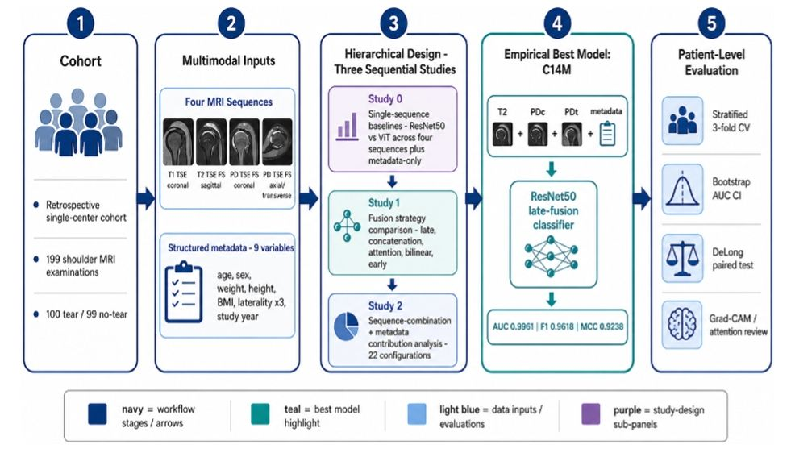

# Son haberler

Ajanın yazdığı son haberler (otomatik güncellenir).

## Tepebaşı Kadın Sığınma Evi 2007'den bu yana 819 kişiye hizmet verdi

**Belediye · Tepebaşı** · 2026-10-21 18:47 UTC · Kaynak: [Tepebaşı Belediyesi](https://www.tepebasi.bel.tr/Haber/Detay/baskanatackadınlarınesitveozguryasamıicinsorumlulugumuzusurdurecegiz)

> Tepebaşı Belediyesi Kadın Sığınma Evi'nde bugüne kadar 563 kadın ve 256 çocuk destek aldı. Bu kadınlardan 182'si bağımsız yaşamını kurdu.

Tepebaşı Belediyesi Kadın Sığınma Evi, 2007'den bu yana şiddet gören kadınlara ve çocuklarına güvenli bir yaşam alanı sunuyor. Merkezde bugüne kadar 563 kadın ve 256 çocuk olmak üzere toplam 819 kişiye hizmet verildi.

Sığınma evinden destek alan kadınlardan 182'si bağımsız yaşamını kurdu. Merkez; hukuki, sağlık, eğitim, eşya, psikososyal ve sosyal destek hizmeti sunuyor. Kadın Sığınma Evi'nin kapasitesi 10 kadın ve 5 çocuk.

Tepebaşı Belediye Başkanı Dt. Ahmet Ataç, kadına yönelik şiddetin kadınların yaşam hakkını, güvenliğini ve eşitliğini doğrudan etkileyen ciddi bir toplumsal sorun olduğunu belirtti. Ataç, bu sorunla mücadelenin yalnızca kadınların değil, toplumun ve kamu kurumlarının ortak sorumluluğu olduğunu söyledi.

Ataç, görevlerinin ihtiyaç duyan kadınların güvenli bir yere ulaşmasını sağlamak ve yaşamlarını yeniden kurma sürecinde onları yalnız bırakmamak olduğunu ifade etti. Her kadının güven içinde, eşit ve özgür yaşayabildiği bir kent için çalışmaya devam edeceklerini kaydetti.

Kaynakta yer alan bilgiye göre Türkiye'de yerel yönetimlere bağlı kadın sığınma evlerinin bulunduğu 33 belediyenin 8'i büyükşehir, 25'i ilçe belediyesi statüsünde.

---

## Odunpazarı'nda Eskişehir'in tarihi dansla sahneye taşınacak

**Kültür-Sanat · Odunpazarı** · 2026-10-21 18:47 UTC · Kaynak: [Odunpazarı Belediyesi](https://www.odunpazari.bel.tr/guncel/haberler/genel-haberler/eskisehir-in-hikayesi-dansla-sahneye-tasiniyor)

> Odunpazarı Belediyesi Halk Dansları Topluluğu, Eskişehir'in antik dönemden Cumhuriyet'e uzanan hikâyesini anlatan "Eskişehir'in Hikâyesi" adlı gösteri için hazırlık yapıyor.

Odunpazarı Belediyesi Halk Dansları Topluluğu, Eskişehir'in tarihini ve kültürel zenginliğini dans, müzik ve kostümlerle anlatan "Eskişehir'in Hikâyesi" adlı bir gösteriye hazırlanıyor. Proje, Afyon Kocatepe Üniversitesi Öğretim Görevlisi Muharrem Feratan tarafından hazırlandı.

Gösteri; Frigya uygarlığından Roma dönemine, Nasrettin Hoca'dan Yunus Emre'ye, Osman Gazi'nin rüyasından İnönü ve Sakarya savaşlarına uzanan bir tarih yolculuğunu sahneye taşıyacak. Kırım, Balkan ve Kafkas kültürlerinin dansları ve müzikleri de gösterinin içinde yer alacak. Hazırlıklar yaklaşık bir aydır sürüyor.

Feratan, Eskişehir'in zengin kültürünü sahneye yansıtmanın uzun süredir hayali olduğunu söyledi. 2012'de Türk Dünyası Kültür Başkenti kapsamında benzer bir gösteri hazırladıklarını, üniversite bünyesinde de benzer çalışmalar yaptıklarını belirten Feratan, projeyi bu kez güncellenmiş bir yapıda ve farklı müzikal düzenlemelerle izleyiciye sunmayı hedeflediklerini aktardı.

Topluluğun eğitmeni Oktay Şahin ise Odunpazarı'nın Eskişehir'in ilk yerleşim yeri olması nedeniyle projenin burada hayata geçirilmek istendiğini söyledi. Şahin, topluluğun 2014'ten bu yana farklı yaş gruplarına eğitim verdiğini, gösteri ve festivallere katıldığını belirtti. Yeni gösterinin Odunpazarı'na değer katacağını ifade etti.

---

## ESOGÜ'lü akademisyenlerden omuz MR'da yapay zekâ çalışması

**Sağlık · Merkez** · 2026-10-21 18:47 UTC · Kaynak: [Eskişehir Osmangazi Üniversitesi](https://www.ogu.edu.tr/Web/HaberDetay/2063?tur=AkademikMakale)

> Eskişehir Osmangazi Üniversitesi'nden araştırmacıların omuz MR görüntülerinde rotator manşet yırtığını sınıflandıran yapay zekâ çalışması Journal of Clinical Medicine dergisinde yayımlandı.

Eskişehir Osmangazi Üniversitesi Mühendislik-Mimarlık Fakültesi'nden Arş. Gör. Sergen Aşık ve Prof. Dr. Ahmet Yazıcı, Bilecik Şeyh Edebali Üniversitesi'nden Prof. Dr. Murat Aşçı ve Eskişehir Yunus Emre Devlet Hastanesi'nden Uzm. Dr. İrfan Okumuşer ile birlikte yürüttükleri makale, Q1 kategorisindeki Journal of Clinical Medicine dergisinde yayımlandı.

Çalışmada, çok sekanslı omuz MR görüntüleri yaş, cinsiyet, vücut kitle indeksi ve inceleme tarafı gibi klinik bilgilerle birleştirilerek rotator manşet yırtıklarının sınıflandırılması için yapay zekâ modeli geliştirildi. Retrospektif çalışmada, 100'ünde yırtık bulunan ve 99'unda bulunmayan toplam 199 hastanın görüntüleri değerlendirildi.

En başarılı model, yağ baskılı T2 sagittal, proton yoğunluklu koronal ve proton yoğunluklu aksiyel olmak üzere üç MR sekansını klinik verilerle birleştiren model oldu. Model 0,9961 ROC-AUC, yüzde 96 doğruluk ve yüzde 97,98 duyarlılık değerine ulaştı.

Üç sekans kullanan modelin dört sekansın tamamını kullanan modelden daha yüksek performans göstermesi, daha fazla görüntü kullanmanın her zaman daha iyi sonuç vermeyebileceğini ortaya koydu. Araştırmacılar, görüntü sayısından çok hastalığa özgü bilgi sağlayan sekansların seçilmesinin önemli olduğunu belirtti. Yöntemin farklı hastane ve MR cihazlarından alınacak verilerle doğrulanması da klinik kullanım potansiyelinin değerlendirilmesine katkı sağlayacak.

---

## Eskişehir'de "Mukaddes Emanetler" sergisi ziyarete açıldı

**Kültür-Sanat · Merkez** · 2026-10-21 18:47 UTC · Kaynak: [Google Haberler - Eskişehir](https://www.haberturk.com/gundem/foto/eskisehir-de-mukaddes-emanetler-sergisi-3921470)

> MÜSİAD Eskişehir Şubesi'nin düzenlediği sergi, İl Kültür ve Turizm Müdürlüğü Sergi Salonu'nda açıldı. Sergi 25 Ekim'de sona erecek.

Müstakil Sanayici ve İşadamları Derneği (MÜSİAD) Eskişehir Şubesi tarafından düzenlenen "Mukaddes Emanetler Sergisi", Eskişehir İl Kültür ve Turizm Müdürlüğü Sergi Salonu'nda ziyarete açıldı. Sergide Asr-ı Saadet dönemine ait kutsal emanetler yer alıyor.

Açılış törenine Eskişehir Valisi Erdinç Yılmaz, Cumhuriyet Başsavcısı Ferhat Deniz, Adli Yargı Komisyonu Başkanı Arif Hamdi Sazak, Eskişehir Osmangazi Üniversitesi Rektörü Prof. Dr. Emine Gümüşsoy, İl Müftüsü Muharrem Gül, MÜSİAD Eskişehir Şube Başkanı Oğuz Özdemir, siyasi parti temsilcileri, kurum müdürleri ve vatandaşlar katıldı.

Vali Yılmaz, serginin Hazreti Muhammed'i anmak ve manevi değerleri yaşatmak açısından önemli olduğunu belirterek organizasyonda emeği geçenlere teşekkür etti ve vatandaşları sergiyi ziyarete davet etti. Özdemir de sergiye ev sahipliği yapmaktan memnuniyet duyduklarını, bu tür etkinliklerin milli ve manevi değerlerin gelecek nesillere aktarılmasına katkı sağladığını söyledi.

Koleksiyoner Erol Güzel'in küratörlüğünde düzenlenen sergide kutsal emanetlerin yanı sıra Kabe örtüleri, Sakal-ı Şerifler ve Kabe, Medine ile Kudüs maketleri bulunuyor. Sergi 25 Ekim'de sona erecek.

---

## Tepebaşı İklim Haftası'nda sanayicilere yeşil dönüşüm destekleri anlatıldı

**Ekonomi · Tepebaşı** · 2026-10-21 18:35 UTC · Kaynak: [Tepebaşı Belediyesi](https://www.tepebasi.bel.tr/Haber/Detay/sanayiiciniklimfinansmanıveyesildonusumtepebasıiklimhaftası’ndaelealındı)

> Eskişehir OSB'de düzenlenen panelde sanayiciler, iklim finansmanı, yeşil dönüşüm destekleri ve Ufuk Avrupa programı hakkında bilgilendirildi.

Tepebaşı Belediyesi ile Eskişehir Organize Sanayi Bölgesi (EOSB) iş birliğinde düzenlenen Tepebaşı İklim Haftası, "İklim Finansmanı ve Yeşil Dönüşüm Paneli" ile devam etti. EOSB İdari Bina Konferans Salonu'ndaki panele sanayiciler, iş dünyası, kamu kurumları ve meslek odalarının temsilcileri katıldı.

Anadolu Üniversitesi İletişim Bilimleri Fakültesi'nden Prof. Dr. Nezih Orhon'un yönettiği panelde, işletmelerin yeşil dönüşüm sürecinde yararlanabileceği destek ve finansman olanakları ele alındı.

BEBKA'dan Nigah Ertekin bölgesel yeşil dönüşüm desteklerini, EcoMuse'den Seyran Hatipoğlu işletmeler için iklim finansmanını anlattı. TÜBİTAK Ufuk Avrupa Programı'ndan Arzu İpek Yılmaz Üçüncü ise Avrupa Birliği programının işletmelere sunduğu iklim odaklı destekleri aktardı.

Panelde düşük karbonlu üretime geçişin işletmeler için önemi ve ulusal ile uluslararası destek programlarından yararlanma yolları değerlendirildi. Katılımcılar uzmanlara sorularını yöneltti. Tepebaşı Belediye Başkanı Ahmet Ataç'ı panelde Meclis Üyesi Nazan Erşahin temsil etti.

---

## Odunpazarı'nda meme kanseri farkındalığı için yoga etkinliği

**Sağlık · Odunpazarı** · 2026-10-21 18:35 UTC · Kaynak: [Odunpazarı Belediyesi](https://www.odunpazari.bel.tr/guncel/haberler/genel-haberler/odunpazari-belediyesi-nden-pembe-ekim-de-yoga-ile-farkindalik-etkinligi)

> Odunpazarı Belediyesi, Pembe Ekim kapsamında kadınları 24 Ekim Cumartesi günü Gökmeydan'da düzenlenecek yoga etkinliğine davet etti.

Odunpazarı Belediyesi, meme kanseri farkındalık ayı olan Pembe Ekim kapsamında "Pembe Ekim'de Yoga ile Farkındalık" etkinliği düzenleyecek. Etkinlikle meme kanserinde erken tanının önemine dikkat çekilmesi ve kadınlarda sağlık farkındalığının artırılması amaçlanıyor.

Etkinlik, 24 Ekim Cumartesi günü saat 13.00'te Odunpazarı Belediyesi Gökmeydan Ek Hizmet Binası Spor Salonu'nda yapılacak. Yoga eğitmeni Meyra Dodurga eşliğinde gerçekleştirilecek buluşmada katılımcılar nefeslerine odaklanacak ve kendilerine zaman ayıracak.

Belediyenin açıklamasında, meme kanserinde erken tanının tedavi sürecinde önemli rol oynadığı hatırlatıldı. Düzenli sağlık kontrollerinin aksatılmaması ve şüpheli bir değişiklik fark edildiğinde sağlık kuruluşlarına başvurulması gerektiği vurgulandı.

Etkinlikle ilgili ayrıntılı bilgi almak isteyenler, Odunpazarı Belediyesi Kadın ve Aile Hizmetleri Müdürlüğüne 0222 213 30 30 numaralı telefondan ulaşabilecek.

---

## ESTÜ'de öğrencilere IPARD proje eğitimi verilecek

**Eğitim · Merkez** · 2026-10-21 18:35 UTC · Kaynak: [Eskişehir Teknik Üniversitesi](https://www.eskisehir.edu.tr/tr/Haber/Detay/estu-is-birliginde-universite-ogrencilerine-yonelik-ipard-proje-bilgilendirme-egitimi-duzenlenecek)

> Eskişehir Teknik Üniversitesi'nde 19 Kasım'da düzenlenecek eğitimde öğrenciler IPARD destekleri ve proje hazırlama konusunda bilgilendirilecek. Ön başvurular 2-12 Kasım arasında alınacak.

Eskişehir Teknik Üniversitesi (ESTÜ), Eskişehir Aile ve Sosyal Hizmetler İl Müdürlüğü ve Tarım ve Kırsal Kalkınmayı Destekleme Kurumu (TKDK) iş birliğinde üniversite öğrencilerine yönelik "IPARD Proje Bilgilendirme Eğitimi" düzenlenecek.

Eğitim, Aile ve Sosyal Hizmetler Bakanlığı ile TKDK arasında kadın girişimciliğini teşvik etmek ve kadın kooperatiflerini güçlendirmek amacıyla imzalanan iş birliği protokolü kapsamında yapılacak. Programda öğrencilerin IPARD destekleri, kırsal kalkınma fırsatları ve proje hazırlama süreçleri hakkında bilgilendirilmesi amaçlanıyor.

Eğitim, 19 Kasım 2026 Perşembe günü 13.30-16.30 saatleri arasında ESTÜ Konferans Salonu'nda yapılacak. Başta kız öğrenciler olmak üzere girişimcilik ve kırsal kalkınmaya ilgi duyan üniversite öğrencileri katılabilecek. Katılımcılara sertifika verilecek.

Eğitime katılmak isteyen öğrencilerin 2-12 Kasım 2026 tarihleri arasında pervin.ozyilmaz@aile.gov.tr adresi üzerinden ön başvuru yapması gerekiyor. Bilgi için 0222 217 46 05 (dahili 183) numaralı telefon aranabilir.

---

## Eskişehirspor, yenilgisiz Bursa Yıldırım'ı konuk edecek

**Spor · Merkez** · 2026-10-21 18:35 UTC · Kaynak: [Google Haberler - Eskişehirspor](https://www.istikbalgazetesi.com/eskisehirsporun-teklikeli-rakibi)

> Ligin 8. haftasında Eskişehirspor'un rakibi, 7 maçta hiç kaybetmeyen ve yalnızca 3 gol yiyen Bursa Yıldırım.

Eskişehirspor, ligin 8. haftasında Bursa Yıldırım'ı ağırlayacak.

Konuk ekip Bursa Yıldırım, ilk 7 maçta 4 galibiyet ve 3 beraberlik alarak 15 puan topladı. Ligde henüz yenilgisi bulunmayan takım 8 gol atarken kalesinde yalnızca 3 gol gördü. Bursa ekibi geçen hafta kendi sahasında Uşakspor ile 1-1 berabere kaldı.

Savunmada etkili olan ve kontra atak futbolu oynayan rakip karşısında Eskişehirspor Teknik Direktörü Hakan Şapcı'nın maç planı ve oyun içindeki hamleleri belirleyici olacak.

---
