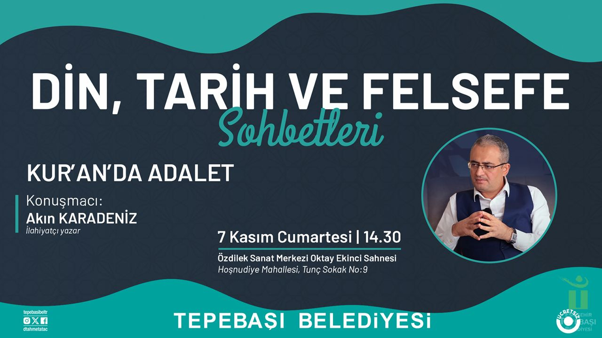
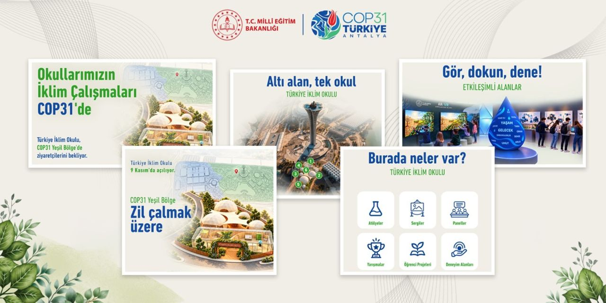
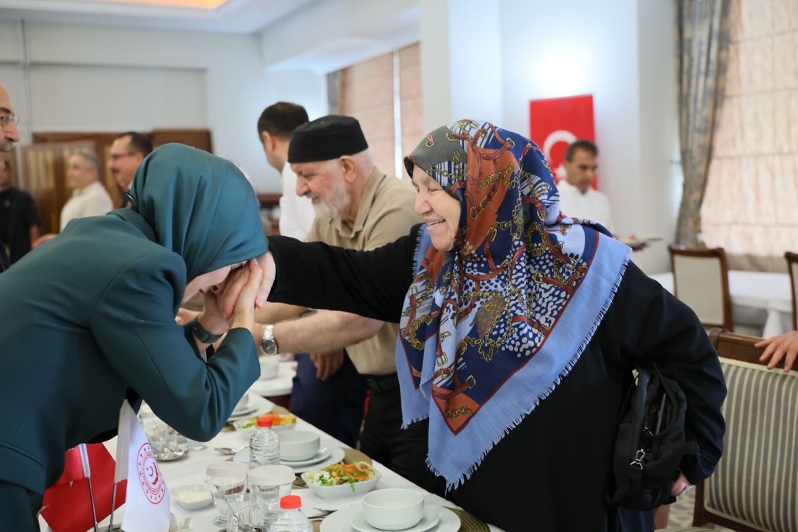
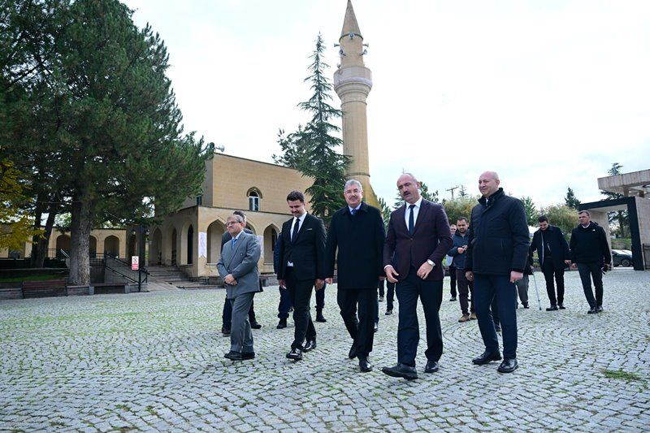
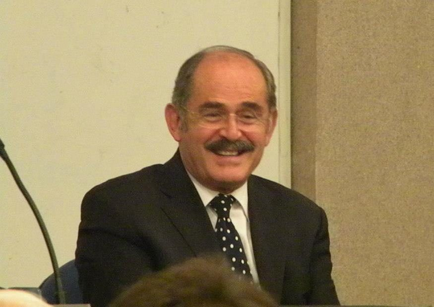
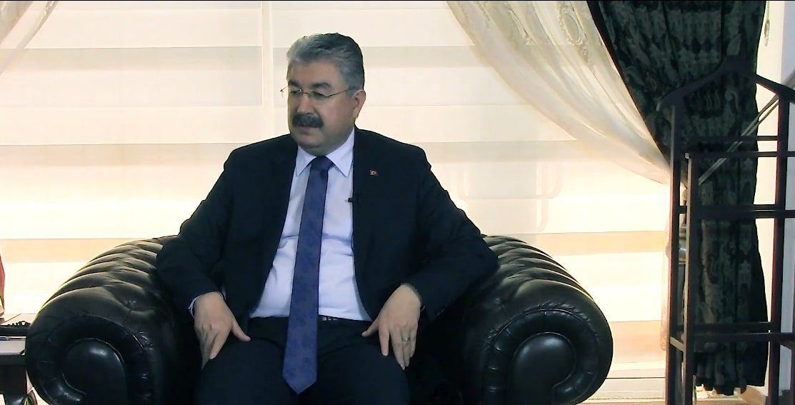
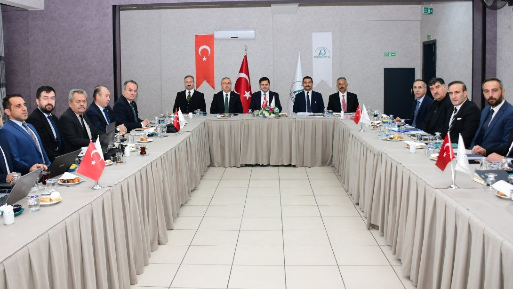
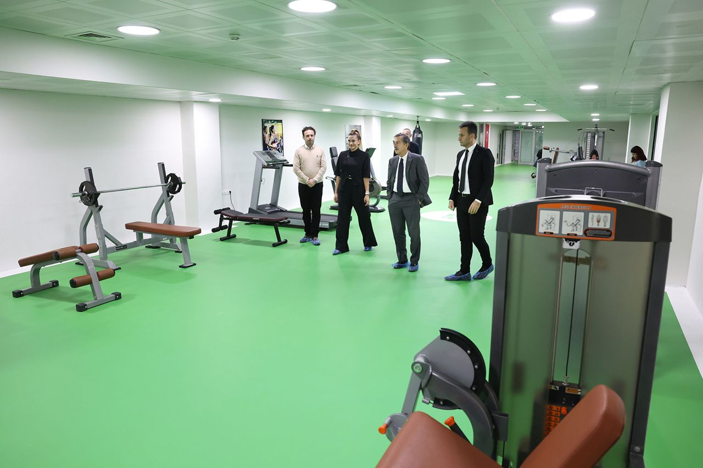
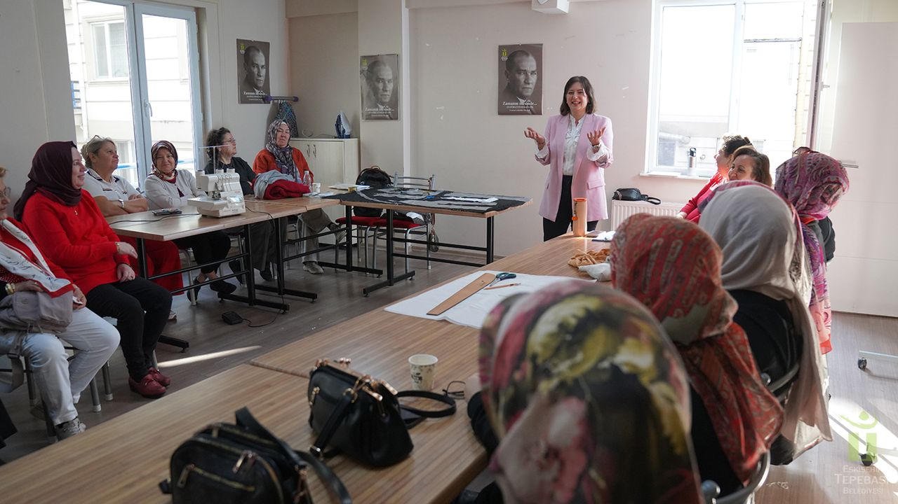
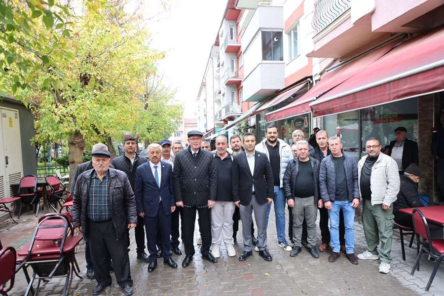

# Son haberler

Ajanın yazdığı son haberler (otomatik güncellenir).

## Tepebaşı'nda 7 Kasım'da "Kur'an'da Adalet" söyleşisi yapılacak

**Kültür-Sanat · Tepebaşı** · 2026-11-05 12:32 UTC · Kaynak: [Tepebaşı Belediyesi](https://www.tepebasi.bel.tr/Haber/Detay/tepebası’ndakur’an’daadaletsoylesisi)

> Etkinlik 14.30'da Özdilek Sanat Merkezi'nde ücretsiz.

Tepebaşı Belediyesi'nin "Din, Tarih ve Felsefe Sohbetleri" kapsamında düzenlediği söyleşide ilahiyatçı yazar Akın Karadeniz "Kur'an'da Adalet" konusunu ele alacak.

Etkinlik 7 Kasım Cumartesi günü saat 14.30'da Özdilek Sanat Merkezi Oktay Ekinci Sahnesi'nde ücretsiz olarak yapılacak. Belediye yetkilileri söyleşiye bütün Eskişehirlileri davet etti.

---

## Tepebaşı, BAKSAN Sanayi Sitesi'nde üstyapı çalışmalarını tamamladı

**Belediye · Tepebaşı** · 2026-11-05 12:32 UTC · Kaynak: [Tepebaşı Belediyesi](https://www.tepebasi.bel.tr/Haber/Detay/esnaftanhizmetetesekkur)

> Yatırım yüzde 20 büyütüldü; esnaf yol ve çamur sorununun çözülmesinden memnun.

Tepebaşı Belediyesi, BAKSAN Sanayi Sitesi'nde bu yıl için planladığı üstyapı çalışmalarını tamamladı. Belediyenin açıklamasına göre altyapı düzenlemelerinin ardından yol, asfalt ve kaldırım çalışmalarıyla bölgenin ulaşım koşulları yenilendi.

Planlanan yatırım, ihtiyaçlar doğrultusunda keşif artışıyla yüzde 20 büyütüldü; çalışmalar ilk planlamanın yüzde 120'sine ulaştı. Belediye Başkanı Ahmet Ataç, çalışmaların farklı aşamalarında sahada ilerlemeyi yerinde takip etti, Fen İşleri Müdürlüğü yetkililerinden bilgi aldı ve esnafla görüştü.

Esnaftan Göksal Günaydın, çalışmaların uzun sürmesine rağmen kapsamlı bir sürecin yürütüldüğünü ve kış gelmeden tamamlanmasından memnun olduklarını söyledi. Günaydın, BAKSAN'ın özel hukuki statüsünün hizmet sürecini kendine özgü hale getirdiğini, bazı gecikmelerde yönetim yapısından kaynaklanan etkenlerin de bulunduğunu belirtti. Ömer Gürhastan ve Ahmet Yıldız da asfaltın yenilenmesinden ve yıllardır süren yol ile çamur sorununun giderilmesinden memnun olduklarını söyledi.

Belediye, üstyapı çalışmalarının bölgenin ihtiyaçları doğrultusunda etaplar halinde sürdürüleceğini bildirdi.

---

## Kurtuluş Kapalı Pazar Yeri'nde yüzde 80 tamamlandı: Ünlüce çalışmaları yerinde inceledi

**Belediye · Odunpazarı** · 2026-11-05 12:32 UTC · Kaynak: [Google Haberler - Eskişehir etkinlik](https://www.eskisehirekspres.net/kurtulus-kapali-pazar-yerinde-yuzde-80lik-bolum-tamamlandi-unluceden-yerinde-inceleme)

> Yaklaşık 500 milyon TL yatırım bedelli projede kapalı otopark da yer alacak.

Eskişehir Büyükşehir Belediye Başkanı Ayşe Ünlüce, Kurtuluş Kapalı Pazar Yeri inşaatında incelemelerde bulunarak çalışmaların son durumu hakkında bilgi aldı. Ünlüce, projenin yüzde 80'inin tamamlandığını belirtti.

Yaklaşık 500 milyon TL yatırım bedeline sahip projede kapalı otoparkın yanı sıra modern pazar alanı, şarküteri ve balıkçı dükkânları ile farklı ihtiyaçlara yönelik özel alanlar yer alacak. Yeni pazar yerinin tamamlanmasıyla vatandaşların daha modern ve konforlu bir ortamda alışveriş yapması, pazarcı esnafının da daha uygun koşullarda hizmet vermesi amaçlanıyor.

Ünlüce, hemşehrilerinin ve pazarcı esnafının uzun süredir beklediği pazar yerini hizmete açmak için çalışmaların hızla sürdüğünü, en kısa sürede tamamlanacağını söyledi.

---

## Bakan Bayraktar 2040 enerji vizyonunu açıkladı: hedef yüzde 36 elektrikleşme

**Ekonomi · Türkiye** · 2026-11-05 12:32 UTC · Kaynak: [Enerji ve Tabii Kaynaklar Bakanlığı](https://enerji.gov.tr/haber-detay?id=31962)

> Kurulu gücün 2040'ta 281 bin megavata çıkarılması hedefleniyor.

Enerji ve Tabii Kaynaklar Bakanı Alparslan Bayraktar, Antalya'da yapılacak COP31 öncesinde Milli Enerji 2040 vizyonunu açıkladı. Bayraktar, hedeflerinin Türkiye'yi enerjide bağımsız kılmak olduğunu söyledi.

Bakan Bayraktar, 2040'ta yüzde 36 elektrikleşmeye ulaşılacağını belirtti. Elektrik kurulu gücünün 2025 itibarıyla 123 bin megavat olduğunu, 2040'ta yaklaşık 160 bin megavatlık artışla 281 bin megavata çıkmasının hedeflendiğini aktardı. Yenilenebilirin payının yüzde 63'ten yüzde 77'ye çıkması hedefleniyor; bunun için yaklaşık 190 milyar dolarlık yatırım gerektiği söylendi.

Bayraktar, programı enerji verimliliği, nükleer enerji, yenilenebilir enerji, petrol ve doğal gaz ile madenlerden oluşan beş temel başlık üzerine kurduklarını anlattı. İletim tarafında 36 milyar dolarlık yatırım öngörüldüğünü, yüksek gerilim hatlarının yaklaşık 77 bin kilometreden 112 bin kilometreye çıkarılacağını söyledi. Bakan ayrıca bir megavatın altındaki küçük santrallerin daha yoğun kurulmasını hedeflediklerini belirtti.

---

## TÜRKPATENT'in IP Öncüleri Projesi Eskişehir'de başladı, 10 okula ulaşılacak

**Eğitim · Odunpazarı** · 2026-11-05 11:32 UTC · Kaynak: [Google Haberler - Eskişehir](https://www.alomaliye.com/2026/11/05/turkpatentin-ip-onculeri-projesi-eskisehirde-10-okula-ulasacak/)

> Anadolu, Osmangazi ve Teknik Üniversite öğrencileri sınai mülkiyet bilincini okullara aktaracak.

Türk Patent ve Marka Kurumu (TÜRKPATENT) ile Avrupa Patent Ofisi iş birliğinde geliştirilen IP Öncüleri Projesi'nin Eskişehir programı, Anadolu Üniversitesi Yunus Emre Kampüsü'nde düzenlenen törenle başladı. Açılışa TÜRKPATENT ve üniversite yöneticileri, akademisyenler ve öğrenciler katıldı.

Eskişehir'deki uygulamada Anadolu Üniversitesi, Eskişehir Osmangazi Üniversitesi ve Eskişehir Teknik Üniversitesi öğrencileri "IP Öncüsü" olarak görev yapacak. Sınai mülkiyet eğitimi alan üniversite öğrencileri, edindikleri bilgileri Millî Eğitim Bakanlığına bağlı 10 okuldaki ortaokul ve lise öğrencilerine aktaracak. Projeyle gençlerin yenilikçi düşünme, üretme ve buluş geliştirme süreçlerine erken yaşta katılması hedefleniyor.

Programda sunum yapan TÜRKPATENT Başkanı, üniversitelerdeki bilimsel çalışmaların patentlere dönüşmesinin önemine dikkat çekti. Sunumda Türkiye'nin yerli patent başvurularında dünyada 10'uncu, yerli marka başvurularında 6'ncı ve yerli tasarım başvurularında 3'üncü sırada olduğu belirtildi.

Proje geçen yıl Ankara'da 12 üniversitenin katılımıyla yürütülmüş; 21 okulda 5 bin öğrenciye sınai mülkiyet farkındalığı eğitimi verilmişti. Eskişehir programının sonunda katılımcılara sertifikaları verildi; patent ve faydalı model tescili bulunan akademisyenlere de teşekkür belgesi sunuldu.

---

## Odunpazarı'nda Yunus buğdayı üretici buluşması: Ziraat Odası çiftçiye destek çağrısı yaptı

**Tarım · Odunpazarı** · 2026-11-05 11:32 UTC · Kaynak: [Google Haberler - Odunpazarı](https://eskisehirdurum.com/eskisehir-gundem/eskisehirde-yunus-bugdayi-icin-uretici-bulusmasi/811471)

> Etkinlikte Yunus çeşidinin özellikleri ve çiftçilere verilen destekler konuşuldu.

Odunpazarı Belediyesi'nin düzenlediği "Kalkanlı'dan Tarlalara Yunus Çeşidi Tohumluk Buğday Üretici Buluşması", Emek Kapalı Pazar Yeri'nde yapıldı. Buluşmaya üreticiler, tarım uzmanları ve ilgili kurumların temsilcileri katıldı; Yunus çeşidi tohumluk buğdayın özellikleri ve çiftçilerin desteklenmesi ele alındı.

Odunpazarı Ziraat Odası Başkanı Burhan Çelikoğlu, belediyenin sağladığı destek için Belediye Başkanı Kazım Kurt'a teşekkür etti. Çelikoğlu, çiftçilerin ekip biçmesine rağmen yeterli kazanç elde edemediğini ve sorunlarının fazla olduğunu söyledi; belediyenin desteğinin sınırlı olsa da değerli olduğunu belirterek desteklerin artarak sürmesini istedi.

Eskişehir Genç Rençberler Derneği Başkan Vekili Görkem Alçın ise girdi maliyetlerinin her geçen gün arttığını belirtti ve belediyelerin çiftçiye destek olmasını değerli bulduklarını söyledi.

NBC Tarım adına konuşan Necmettin Bolat, Yunus çeşidinin geliştirilme ve tescil sürecini anlattı. Bolat'a göre çeşit sulu alanlar için ıslah edildi, tescili oy birliğiyle kabul edildi ve adını kendisi önerdi. Bolat, çeşidin kırmızı sert ekmeklik buğday grubunda olduğunu, protein oranının yüzde 12 ile 14 arasında, ortalama hektolitre ağırlığının ise 80 kilogram olduğunu söyledi.

---

## MEB COP31'de eğitim bakanlarını ağırlayacak, Türkiye İklim Okulu 9 Kasım'da açılıyor

**Eğitim · Türkiye** · 2026-11-05 10:31 UTC · Kaynak: [Milli Eğitim Bakanlığı](https://www.meb.gov.tr/milli-egitim-bakanligi-cop31039de-gerceklestirecegi-uluslararasi-etkinliklere-hazir/haber/42416/tr)

> 14 Kasım'daki program Bakan Tekin'in ev sahipliğinde yapılacak.

Millî Eğitim Bakanlığı, Birleşmiş Milletler İklim Değişikliği Konferansı'nın (COP31) Mavi Bölge ve Yeşil Bölge'sinde yapacağı etkinliklere hazırlanıyor. Bakanlığın açıklamasına göre programlarda iklim değişikliğiyle mücadelede eğitimin rolü, çocukların ve gençlerin iklim eylemine katılımı ve öğretmenlerin güçlendirilmesi ele alınacak.

14 Kasım'daki Çocuklar, Gençlik, Eğitim ve Beceriler Günü programına Millî Eğitim Bakanı Yusuf Tekin ev sahipliği yapacak; farklı ülkelerin eğitim bakanları, üst düzey temsilciler ve uluslararası kuruluşlar katılacak. Programın resmî açılışı, MEB ile UNESCO Yeşil Eğitim Ortaklığı iş birliğinde "Antalya Eylem Protokolü" oturumuyla yapılacak. Türkiye'nin UNESCO Yeşil Eğitim Ortaklığı'na 100. üye ülke olarak katılım beyanının duyurulması da öngörülüyor.

Bakan Tekin'in başkanlığında OECD iş birliğiyle yapılacak ikinci oturumda iklim okuryazarlığı, PISA değerlendirmeleri ve eğitimde yeşil dönüşüme yönelik iyi uygulamalar görüşülecek. Aynı gün Yeşil Bölge'deki Türkiye İklim Okulu'nun resmî açılışı da yapılacak.

Türkiye İklim Okulu, 9 Kasım'dan itibaren öğrencileri, öğretmenleri, velileri ve akademisyenleri ağırlamaya başlayacak. Okul; Konferans Salonu, Yaşayan Okul ile İklim Deneyim ve Teknoloji Alanı'ndan oluşacak.

---

## Kasım ayı yaşlı ve engelli aylıkları yatırılmaya başlandı: 9,6 milyar lira ödenecek

**Türkiye · Türkiye** · 2026-11-05 10:31 UTC · Kaynak: [Aile ve Sosyal Hizmetler Bakanlığı](https://www.aile.gov.tr/haberler/kasim-ayi-yasli-ve-engelli-ayliklari-hesaplara-yatirilmaya-baslandi/)

> Bakan Göktaş: 735 bin 763 kişiye yaşlı, 557 bin 771 kişiye engelli aylığı ödenecek.

Aile ve Sosyal Hizmetler Bakanı Mahinur Özdemir Göktaş, kasım ayı yaşlı ve engelli aylığı ödemelerinin hesaplara yatırılmaya başlandığını bildirdi. Bakanlığın açıklamasına göre 1 milyon 293 bin 534 vatandaşa toplam 9,6 milyar lira ödeme yapılacak.

Göktaş, kasım ayında 735 bin 763 vatandaşa 5 milyar 435 milyon lira tutarında yaşlı aylığı, 557 bin 771 vatandaşa ise 4 milyar 185 milyon lira tutarında engelli aylığı ödeneceğini söyledi.

Bakan Göktaş, engelli ve yaşlı bireylerin hayatın her alanına tam katılımını sağlamak ve bağımsız yaşam sürmelerine destek olmak için çalıştıklarını belirtti. Ödemelerin vatandaşlara hayırlı olmasını diledi.

---

## Şehir Hastanesi'nde organ bağışı etkinliği: kentte 125 hasta böbrek nakli bekliyor

**Sağlık · Merkez** · 2026-11-05 09:32 UTC · Kaynak: [Google Haberler - Eskişehir etkinlik](https://www.anadolugazetesi.com/amp/eskisehir-de-organ-bagisi-farkindaligi--hastalar-umut-bekliyor-297532.html)

> İl Müftüsü Gül ve Başhekim Algın vatandaşları gönüllü organ bağışına çağırdı.

Eskişehir Şehir Hastanesi'nde, 3-9 Kasım Organ Bağışı Haftası kapsamında farkındalık etkinliği düzenlendi. Etkinlikte nakil bekleyen hastaların yaşadığı zorluklar gündeme getirildi.

Eskişehir İl Müftüsü Muharrem Gül, organ bağışının toplumsal ve insani açıdan büyük bir hayır olduğunu söyledi. Gül, kentte acil böbrek nakli bekleyen yaklaşık 125 hasta bulunduğunu belirtti. Diyanet İşleri Başkanlığı ve Din İşleri Yüksek Kurulunun organ bağışının caiz olduğuna ve teşvik edildiğine ilişkin fetvaları olduğunu hatırlatan Gül, vatandaşları gönüllü bağışa davet etti.

Şehir Hastanesi Başhekimi Prof. Dr. Mustafa Cem Algın da her yıl 3-9 Kasım'da farkındalık etkinlikleri yapıldığını anlattı. Algın, organ bağışının Sağlık Bakanlığı çalışmalarıyla artık e-Devlet üzerinden de kolayca yapılabildiğini belirterek vatandaşları bağışa destek olmaya çağırdı.

Etkinlikte, yaklaşık 20 yıl önce de organlarını bağışladığını söyleyen 58 yaşındaki Hatice Efe de deneyimini paylaştı. Efe, hastaneye tesadüfen geldiğinde yeniden bağışta bulunduğunu anlattı.

---

## Seyitgazi'de 4. Pekmez Kaynatma Şenliği 7 Kasım'da, ücretsiz otobüs seferleri olacak

**Kültür-Sanat · Merkez** · 2026-11-05 08:31 UTC · Kaynak: [Google Haberler - Eskişehir etkinlik](https://www.eskisehir.net/pekmez-kaynatma-senligi-icin-ucretsiz-ulasim-imkani-servis-duraklari-aciklandi)

> Şenlik 12.00-17.00 arasında Taşlık Çiftlikköy'deki ÇİDEM alanında yapılacak.

Seyitgazi Belediyesi'nin düzenlediği 4. Geleneksel Pekmez Kaynatma Şenliği, 7 Kasım 2026 Cumartesi günü saat 12.00-17.00 arasında Taşlık Çiftlikköy'deki ÇİDEM (Çiftçi Destekleme ve Eğitim Merkezi) alanında yapılacak.

Şenlikte katılımcılar geleneksel yöntemlerle pekmez kaynatma sürecini yakından izleyebilecek. Etkinlik alanında köy ekmeği yapımının yanı sıra patates, pancar, katmer, pide, kumpir ve kabak gibi yöresel lezzetler sunulacak; gün boyu canlı müzik dinletileri olacak.

Belediye, şenliğe ulaşım için 7 Kasım'da ücretsiz otobüs seferleri planladı:
- Odunpazarı kalkışlı (saat 11.00): Odunpazarı, Yıldıztepe, Yenikent üzerinden Taşlık.
- Atatürk Bulvarı kalkışlı (saat 11.00): Migros önü ve Cemevi üzerinden Taşlık.
- Kırka Ek Hizmet Binası: saat 11.00.
- Doğançayır Ek Hizmet Binası: saat 11.30.
- Seyitgazi Belediye Binası önü: saat 11.30.

Dönüş otobüsleri saat 17.00'de Taşlık Çiftlikköy'den hareket edecek. Seyitgazi Belediye Başkanı Uğur Tepe, bütün Eskişehir halkını şenliğe davet etti.

---

## Havaist, Eskişehir'den Sabiha Gökçen Havalimanı'na yeni hat hazırlığında

**Ulaşım · Merkez** · 2026-11-05 07:31 UTC · Kaynak: [Google Haberler - Eskişehir](https://www.ekonomigazetesi.com/sehirler/havaist-eskisehirden-sabiha-gokcene-yeni-hat-hazirliginda-91425)

> Hattın tarihi, sefer saatleri ve bilet ücretleri henüz açıklanmadı.

Havalimanı yolcu taşımacılığı şirketi Havaist, Eskişehir'den İstanbul Sabiha Gökçen Havalimanı'na ulaşım sağlayacak yeni bir hat açmaya hazırlanıyor. Şirket güzergâhı sosyal medya hesabından duyurdu.

Havaist'in açıklamasında "Eskişehir'den dünyaya uzanan yolculuklarınız, çok yakında Havaist konforuyla başlayacak! Eskişehir'i, Bozüyük ve Bursa bağlantılarıyla Sabiha Gökçen Havalimanı'na ulaştırmaya hazırlanıyoruz" ifadeleri yer aldı.

Hattın hangi tarihte hizmete gireceği, sefer sıklığı, hareket saatleri ve bilet ücretleri henüz açıklanmadı. Havaist, ayrıntıların önümüzdeki günlerde duyurulacağını bildirdi.

---

## Togg'da hisse devri anlaşması: Türkiye Varlık Fonu yüzde 35 ile en büyük ortak olacak

**Ekonomi · Türkiye** · 2026-11-05 06:31 UTC · Kaynak: [Google Haberler - Togg](https://haberkocaeli.com/toggda-ortaklik-yapisi-degisiyor-turkiye-varlik-fonu-en-buyuk-hissedar-olacak)

> Anlaşmalar 2 Kasım'da imzalandı; devirler kurum onaylarına ve kapanış koşullarına bağlı.

Anadolu Grubu ve Vestel, Togg'daki toplam yüzde 46'lık paylarını Türkiye Varlık Fonu ve Turkcell'e devretmek üzere anlaşma imzaladı. Anlaşmaların 2 Kasım'da imzalandığı, 3 Kasım 2026'da Kamuyu Aydınlatma Platformu'na (KAP) yapılan açıklamalarla bildirildi.

Toplam 368 milyon avroluk işlemde Vestel, yüzde 23'lük payını 184 milyon avroya Türkiye Varlık Fonu'na satacak. Anadolu Grubu da yüzde 23'lük payını 184 milyon avro bedelle Türkiye Varlık Fonu ve Turkcell'e devredecek. Turkcell'in payı yüzde 23'ten yüzde 34'e çıkacak.

Devirler tamamlandığında ortaklık yapısının şöyle olması bekleniyor: Türkiye Varlık Fonu yüzde 35, Turkcell yüzde 34, BMC yüzde 23 ve TOBB yüzde 8. Vestel, satıştan elde edeceği gelirin en az yüzde 90'ını, tahsilattan sonraki 30 gün içinde vadesi gelmiş nakdi banka kredisi borçlarının ödenmesinde kullanacağını açıkladı.

KAP açıklamalarına göre hisse devirleri henüz tamamlanmadı. İşlemin sonuçlanması için gerekli kurum onaylarının alınması, kapanış koşullarının yerine getirilmesi ve satış bedellerinin ödenmesi gerekiyor.

---

## Eskişehirli ralli ekibi Olcay-Kaya Almanya'daki sezon finalinde şampiyonluk için yarışacak

**Spor · Merkez** · 2026-11-05 04:32 UTC · Kaynak: [Google Haberler - Eskişehir](https://www.esgazete.com/sampiyonluga-bir-adim-kaldi-son-durak-almanya)

> Ekip, 5-7 Kasım'da Lausitz Rallisi'nde sezonun son yarışına çıkıyor.

Eskişehirli pilot Evren Olcay ve co-pilot Yenal Kaya, Avrupa Ralli Kupası'nın son yarışında şampiyonluk için yarışacak. Ekip, 5-7 Kasım tarihlerinde Almanya'da yapılacak 29. Uluslararası ADMV Lausitz Rallisi'ne katılacak.

Eskişehir Otomobil Sporları Kulübü (ESOK) Başkanı ve TOSFED Eskişehir İl Temsilcisi Nevzat Aslan, yarış öncesi basın mensuplarıyla bir araya geldi. Aslan, iki sporcunun puan olarak şampiyonluğu Eskişehir'e getirebilecek durumda olduğunu söyledi ve onların şampiyon olarak döneceğine inandığını belirtti. Olcay ise altı yarışlık programın beşinin tamamlandığını, ilk yarışın Marmaris'te test niteliğinde yapıldığını ve Almanya'da şampiyonluğu kutlamak istediklerini söyledi.

Haber, Aslan ve Olcay'ın açıklamalarına dayanıyor.

---

## Eskişehirspor-Kepezspor maçı Tivibu 1'den canlı yayınlanacak: 7 Kasım, 15.30

**Spor · Merkez** · 2026-11-05 00:32 UTC · Kaynak: [Google Haberler - Eskişehirspor](https://www.esyenigun.com/eskisehirspor-maci-ne-zaman-hangi-kanalda)

> Eskişehirspor 18 puanla liderin 3 puan gerisinde ikinci sırada.

Eskişehirspor ile Kepezspor arasındaki karşılaşma 7 Kasım 2026 Cumartesi günü saat 15.30'da Fethi Heper Stadyumu'nda oynanacak. Maç Tivibu 1 ekranlarından canlı yayınlanacak.

Eskişehirspor ligde 9 haftada topladığı 18 puanla, 5 galibiyet, 3 beraberlik ve 1 yenilgiyle, 21 puanlı lider Gemlik Sümerbey'in 3 puan gerisinde ikinci sırada. Anadolu SF ve Ayvalıkgücü de aynı puanda; Eskişehirspor averaj sıralamasıyla ikinci basamakta yer alıyor. Takım, Gaziemirspor'u 5-0 yendikten sonra Kepezspor maçına da 3 puan hedefiyle hazırlanıyor.

---

## Vali Yılmaz Mihalıççık'ta Yunus Emre Mezarı ve Külliyesi'ni ziyaret etti

**Kültür-Sanat · Merkez** · 2026-11-04 21:33 UTC · Kaynak: [Eskişehir Valiliği](https://www.eskisehir.gov.tr/valimiz-dr-erdinc-yilmaz-yunus-emre-mezar-ve-kulliyesini-ziyaret-etti)

> Vali, külliyede yürütülen çalışmalar hakkında yetkililerden bilgi aldı.

Vali Dr. Erdinç Yılmaz, hayırsever iş insanı Tayfur Bayar, Mihalıççık Kaymakamı Fahrettin Çırak ve Mihalıççık Belediye Başkanı Haydar Çorum ile birlikte Mihalıççık ilçesine bağlı Yunus Emre Mahallesi'ndeki Yunus Emre'nin mezarını ve külliyesini ziyaret etti.

Yılmaz, Yunus Emre'nin kabri başında dua etti, külliye alanında incelemelerde bulundu; yürütülen çalışmalar ve bölgenin tarihi ve kültürel önemi hakkında yetkililerden bilgi aldı. Ziyarette Yunus Emre'nin sevgi, hoşgörü, kardeşlik ve insanlık anlayışını merkeze alan düşünce mirasının önemine ve bu mirasın gelecek nesillere aktarılmasına dikkat çekildi.

---

## Yılmaz Büyükerşen'in 90. yaş günü 8 Kasım'da "90. Yaşa Saygıyla" programıyla kutlanacak

**Gündem · Merkez** · 2026-11-04 20:32 UTC · Kaynak: [Google Haberler - Eskişehir](https://www.gzt26.com/yilmaz-buyukersenin-90-yas-gunu-eskisehirde-ozel-bir-programla-kutlanacak)

> Kutlama programı saat 18.30'da başlayacak ve dostları tarafından düzenleniyor.

Eskişehir Büyükşehir Belediyesi'nde 1999-2024 arasında kesintisiz 25 yıl belediye başkanlığı yapan Yılmaz Büyükerşen, 8 Kasım Pazar günü 90. yaş gününü kutlayacak. Dostları tarafından hazırlanan "90. Yaşa Saygıyla" programı 8 Kasım 2026 Pazar günü saat 18.30'da Eskişehir'de bir davet salonunda yapılacak. Kaynakta salonun adı belirtilmiyor.

Programa Büyükerşen'in yakın dostlarının yanı sıra şehrin önde gelen isimlerinin de katılması ve Büyükerşen'in farklı dönemlerde birlikte çalıştığı isimlerle bir araya gelmesi bekleniyor. Büyükerşen 1999'da Eskişehir Büyükşehir Belediye Başkanı seçildi, beş dönem görev yaptı ve 2024'te görevinden ayrıldı.

---

## Tepebaşı Belediyesi zimmet davasında ilk duruşma: 12 tutuklu sanıktan 5'i tahliye edildi

**Gündem · Tepebaşı** · 2026-11-04 19:32 UTC · Kaynak: [Google Haberler - Eskişehir](https://yerel-haberler.haberturk.com/eskisehir-haberleri/tepebasi-belediyesinde-zimmet-davasi-5-saniga-tahliye-119512564)

> Sanıklar suçlamaları kabul etmedi; mahkeme bir tutuksuz sanığın tutuklanmasına karar verdi.

Tepebaşı Belediyesi'ne yönelik zimmet soruşturması kapsamında açılan davanın ilk duruşması Eskişehir 4. Ağır Ceza Mahkemesi'nde yapıldı. Dava, aralarında kamu görevlilerinin de bulunduğu 22 sanığı kapsıyor; sanıkların 12'si tutuklu.

İddianameye göre, geçen mayıs ayında düzenlenen operasyonda gözaltına alınan 22 şüpheliden 7'si kamu görevlisi 12 kişi tutuklanmış, 10 kişi adli kontrolle serbest bırakılmıştı. İddianamede 15 kamu görevlisi için zimmet suçundan 5 yıldan 12 yıla kadar, diğer 7 sanık için suça iştirak veya yardım iddiasıyla 2 yıl 6 aydan 6 yıla kadar hapis cezası talep ediliyor. İddianame, aralarında özel kalem müdürü ve başkan yardımcısının da bulunduğu kamu görevlilerinin, iki organizasyon firması sahibi üzerinden belediye bütçesinden yapılan ödemeleri zimmetlerine geçirdiklerini öne sürüyor.

DHA'nın aktardığına göre yaklaşık 11 saat süren savunmalarda sanıklar suçlamaları kabul etmedi ve iddiaların "iftira" olduğunu öne sürdü. Mahkeme heyeti, tutuklu sanıklardan 5'inin tahliyesine, tutuksuz sanıklardan birinin ise tutuklanmasına karar verdi. Yargılama sürüyor; sanıklar hakkında kesinleşmiş bir hüküm bulunmuyor.

---

## ESTÜ meslek yüksekokullarının 10 programında MEDEK akreditasyon saha ziyareti yapıldı

**Eğitim · Merkez** · 2026-11-04 19:32 UTC · Kaynak: [Eskişehir Teknik Üniversitesi](https://www.eskisehir.edu.tr/tr/Haber/Detay/eskisehir-teknik-universitesinde-meslek-yuksekokullarinin-medek-program-akreditasyonu-degerlendirme-sureci-kapsaminda-saha-ziyareti-gerceklestirildi-)

> Akreditasyon kararını MEDEK Yönetim Kurulu verecek.

Eskişehir Teknik Üniversitesi'ne (ESTÜ) bağlı Bilişim Teknolojileri, Porsuk ve Ulaştırma Meslek Yüksekokullarının 10 programında, Mesleki Eğitim Değerlendirme ve Akreditasyon Derneği (MEDEK) tarafından 2-4 Kasım 2026'da saha ziyaretleri yapıldı.

3 Kasım'da Bilgisayar Programcılığı, Mekatronik, Makine Resim ve Konstrüksiyonu ile Lojistik programlarının ara değerlendirmeleri tamamlandı. Son gün olan 4 Kasım'da Bilişim Teknolojileri Meslek Yüksekokulu İnsansız Hava Aracı Teknolojisi ve Operatörlüğü Programı yeni akreditasyon başvurusu kapsamında değerlendirildi; Porsuk Meslek Yüksekokulu'nun Basım ve Yayım Teknolojileri, Grafik Tasarımı ve Yapı Denetimi programları ile Ulaştırma Meslek Yüksekokulu'nun Sivil Havacılık Kabin Hizmetleri ve Raylı Sistemler Yol Teknolojisi programlarının değerlendirmeleri de bitti. Rektörlük Toplantı Salonu'nda çıkış bildirileri okundu. Program akreditasyon kararını MEDEK Yönetim Kurulu verecek.

---

## Hakan Şapçı: Kepez, Anadolu ve Ayvalıkgücü maçlarını kazanıp liderliği hedefliyoruz

**Spor · Merkez** · 2026-11-04 16:33 UTC · Kaynak: [Google Haberler - Eskişehirspor](https://www.istikbalgazetesi.com/hakan-sapci-3-maci-da-kazanmak-istiyoruz)

> Şapçı, Kepezspor'un son iki maçını kazanarak form yakaladığını hatırlattı.

Eskişehirspor Teknik Direktörü Hakan Şapçı, takımın Kepezspor, Eskişehir Anadolu SF ve Ayvalıkgücü maçlarının Eskişehir'de oynanacak olmasını önemli bir fırsat olarak gördüklerini söyledi. Şapçı, "Bir an önce üst üste galibiyetler alarak zirveyi yakalamayı, ilk devreyi lider tamamlamayı ve liderliği sezon sonuna kadar sürdürmeyi hedefliyoruz" dedi.

Kepezspor'un son iki maçını kazanarak form yakaladığını hatırlatan Şapçı, rakibin hafife alınmaması gerektiğini vurguladı: "Kepez kesinlikle çantada keklik bir rakip değil." Ahmet Dereli'nin sakatlığının ardından hücum hattında değişikliğe gittiklerini belirten Şapçı, Kerem, Hasan Kaya, Mehmet ve Sarper'in durumunun takip edildiğini, Ahmet Dereli ve Mustafa Eren dışındaki oyuncuları Kepez maçına yetiştirmeyi hedeflediklerini söyledi.

Şapçı, hedefinin nisan ayında Eskişehirspor'la şampiyonluk yaşamak olduğunu, ligde ilk dokuz takımın şampiyonluk yarışında olduğunu ve grubun geçen yıla göre daha güçlü olduğunu ifade etti. Haber Şapçı'nın açıklamalarına dayanıyor.

---

## Yerdeki Türk bayraklarını kaldıran trafik polisi Vali Yılmaz'dan plaket aldı

**Gündem · Tepebaşı** · 2026-11-04 15:33 UTC · Kaynak: [Google Haberler - Eskişehir](https://yerel-haberler.haberturk.com/eskisehir-haberleri/yerde-gordugu-turk-bayraklarini-kaldiran-polis-plaketle-odullendirildi-119512487)

> Polis memuru Osman Özbakır'a Vali Erdinç Yılmaz plaket ve başarı belgesi verdi.

Eskişehir Emniyet Müdürlüğü Trafik Şube Müdürlüğü'nde görevli polis memuru Osman Özbakır, önceki gün ekip aracıyla Tepebaşı ilçesi Uluönder Mahallesi'nde seyir halindeyken çevre yolunda refüjde yerde Türk bayrakları olduğunu fark etti. Özbakır, yoğun trafiğe rağmen yolun karşısına geçerek bayrakları yerden aldı. Bir kişinin cep telefonu kamerasıyla kaydettiği görüntülerde Özbakır'ın bayrakları katlayıp öptüğü görüldü.

Görüntülerin sosyal medyada paylaşılmasının ardından Vali Erdinç Yılmaz, Özbakır'ı Emniyet Müdür Vekili Kadir Murat Meral ve Trafik Denetleme Şube Müdürü Hakan Solak'la birlikte makamında ağırladı; Özbakır'a plaket ve başarı belgesi verdi. Yılmaz, "Senin o hassasiyetin bütün Türkiye'de çok güzel karşılandı" dedi.

Özbakır, ekip aracını trafik güvenliğini tehlikeye düşürmeyecek bir noktada durdurup bayrakları koşarak yerden kaldırdığını, trafik polisinin görevinin yalnızca trafik güvenliğini sağlamak değil, Türk bayrağına da sahip çıkmak olduğunu söyledi.

---

## Büyükşehir Caz Günleri'nde Sibel Köse Quintet sahne aldı, sonraki konser 17 Kasım'da

**Kültür-Sanat · Merkez** · 2026-11-04 14:32 UTC · Kaynak: [Google Haberler - Eskişehir etkinlik](https://www.milliirade.com/sibel-kose-quintetten-eskisehirde-caz-dolu-unutulmaz-bir-gece)

> Bir sonraki konserde Duygu Soylu Jazz Band sahne alacak.

Eskişehir Büyükşehir Belediyesi'nin düzenlediği Caz Günleri kapsamında Sibel Köse Quintet sahne aldı. Vokalde Sibel Köse, piyanoda Kürşad Deniz, kontrabasta Kağan Yıldız, tenor saksafonda Engin Recepoğulları ve davulda Berke Özgümüş'ün yer aldığı grup, Cole Porter, Milton Nascimento ve Sonny Burke gibi bestecilerin eserlerini seslendirdi. Gecenin öne çıkan parçası Kürşad Deniz'in özel düzenlemesiyle yorumlanan Cole Porter imzalı "So in Love" oldu; konserde Sibel Köse Septet'in "In Good Company" albümünden parçalar da yer aldı. Konserin ardından Köse, sanatseverlerle bir araya gelerek plaklarını imzaladı.

Caz Günleri'nin bir sonraki konserinde Duygu Soylu Jazz Band 17 Kasım 2026'da Büyükşehir Belediyesi Sanat ve Kültür Merkezi (EBSKM) Opera Sahnesi'nde sahne alacak.

---

## Kupada Eskişehirspor Bodrum FK'ya konuk olacak, Anadolu SF Samsunspor'u ağırlayacak

**Spor · Merkez** · 2026-11-04 13:34 UTC · Kaynak: [Google Haberler - Eskişehirspor](https://www.haber26.com.tr/spor/eskisehirspor-ve-anadolu-sfnin-4-tur-rakipleri-belli-oldu)

> Tek maç eleme usulüyle oynanacak karşılaşmaların tarihleri sonra açıklanacak.

Ziraat Türkiye Kupası 4. Eleme Turu kura çekimi 4 Kasım'da saat 15.30'da yapıldı. Kura sonucunda Eskişehirspor, 1. Lig ekibi Bodrum FK ile deplasmanda karşılaşacak. Kentin diğer temsilcisi Eskişehir Anadolu Spor Faaliyetleri ise Karadeniz ekibi Samsunspor'u Eskişehir'de konuk edecek.

Tek maç eleme usulüyle oynanacak karşılaşmaların kesin gün ve saatlerini TFF önümüzdeki günlerde duyuracak.

---

## Eskişehirspor kaptanı Beykan Şimşek: Dört haftalık dönemlerle ilerliyoruz, takım çıkışta

**Spor · Merkez** · 2026-11-04 13:34 UTC · Kaynak: [Google Haberler - Eskişehirspor](https://www.gzt26.com/eskisehirspor-takim-kaptani-beykan-simsek-taraftara-mesaji-verdi)

> Şimşek, bir haftada oynanacak üç maça ve taraftara seslendi.

Eskişehirspor Takım Kaptanı Beykan Şimşek, 9 haftayı geride bırakan takımın durumunu değerlendirdi. Şimşek, sezon başında ligi dörder haftalık dönemler halinde ele almayı planladıklarını söyledi. İlk dört haftada 7, ikinci dört haftada 8 puan topladıklarını belirten Şimşek, 9. hafta maçıyla üçüncü dönemin galibiyetle başladığını ifade etti.

Bursa Yıldırım Spor maçıyla başlayan, Altay karşılaşmasıyla süren ve Gaziemir maçına uzanan süreçte takımın temposunda ve kazanma isteğinde artış gördüğünü söyleyen Şimşek, bu dönemde Kepez'i sahalarında ağırlayacaklarını, bir haftada üç maç oynayacaklarını belirtti ve fiziksel hazırlığın önemini vurguladı. Takımın galibiyetlerle yeniden ligin ikinci sırasına yükseldiğini ifade eden Şimşek, taraftarın da tribünlerdeki yerini alacağını söyledi.

Haber Şimşek'in açıklamalarına dayanıyor.

---

## Mesleki ve Teknik Eğitim Genel Müdürü Kaygusuz Eskişehir'de değerlendirme yaptı

**Eğitim · Merkez** · 2026-11-04 13:32 UTC · Kaynak: [Eskişehir İl Milli Eğitim Müdürlüğü](https://eskisehir.meb.gov.tr/www/mesleki-ve-teknik-egitimde-eskisehir039in-birikimi-ve-gelecek-vizyonu-degerlendirildi/icerik/8703/tr)

> Toplantı Ali Güven Turizm Mesleki ve Teknik Anadolu Lisesi'nde yapıldı.

Mesleki ve Teknik Eğitim Genel Müdürü Salih Kaygusuz'un katılımıyla Eskişehir'de Mesleki ve Teknik Eğitim Değerlendirme Toplantısı yapıldı. Ali Güven Turizm Mesleki ve Teknik Anadolu Lisesi'nde düzenlenen toplantıya Genel Müdür Yardımcısı Murat Nedirli, Daire Başkanları Mehmet Faideci ve Mustafa Günay, İl Millî Eğitim Müdürü Sinan Aydın ile il ve ilçe millî eğitim yöneticileri katıldı.

Toplantıda Eskişehir'de mesleki ve teknik eğitimin mevcut durumu, gelişim alanları, fiziki ve akademik altyapı, okul-sanayi iş birlikleri ve kalite geliştirme faaliyetleri ele alındı. Kaygusuz, Eskişehir'de mesleki eğitimin niteliğinin oldukça yüksek olduğunu söyledi. Toplantının ardından Kaygusuz ve Aydın, Firuz Kanatlı Mesleki ve Teknik Anadolu Lisesi'ni ziyaret ederek öğretmen ve öğrencilerle bir araya geldi.

---

## Altın fiyatları 4 Kasım 2026: Gram altın 6.548,93 TL

**Ekonomi · Merkez** · 2026-11-04 13:29 UTC · Kaynak: [Harem Altın](https://www.haremaltin.com/altin-fiyatlari)

> Gram altın güne yükselişle başladı. Harem Altın verilerine göre gram altın 6.480,82 TL'den alınıyor, 6.548,93 TL'den satılıyor.

Altın piyasasında güne yükselişle başlandı. Harem Altın'ın saat 16.29 itibarıyla verilerine göre gram altının satış fiyatı 6.548,93 TL, alış fiyatı 6.480,82 TL oldu. Gram altın, önceki kapanışa göre yüzde 0,99 yükseldi.

Ziynet altınlarda çeyrek altın 10.674 TL, yarım altın 21.341 TL, tam altın 42.526 TL, ata altın 43.669 TL seviyesinden satışa sunuluyor.

22 ayar bileziğin gram satış fiyatı 6.117,65 TL, has altının gram fiyatı 6.529,42 TL olarak belirlendi.

Uluslararası piyasalarda altının onsu 4.040,50 dolardan işlem görürken, dolar/TL 50,13 seviyesinde bulunuyor.

Fiyatlar Harem Altın'ın saat 16.29 itibarıyla paylaştığı verilere dayanmaktadır; kuyumcular arasında farklılık gösterebilir. Bu haber yatırım tavsiyesi değildir.

---

## Tepebaşı'ndaki Atatürk Spor Tesisleri Su Sporları Merkezi yenilendi

**Spor · Tepebaşı** · 2026-11-04 12:32 UTC · Kaynak: [Tepebaşı Belediyesi](https://www.tepebasi.bel.tr/Haber/Detay/yenilenensusporlarımerkeziyenidonemehazır)

> Merkezde yeni fitness salonu hizmete girdi; yeni dönem kayıtları 16-22 Kasım'da.

Tepebaşı Belediye Başkanı Ahmet Ataç, fiziki şartları yenilenen Mustafa Kemal Atatürk Spor Tesisleri Su Sporları Merkezi'ni ziyaret ederek incelemelerde bulundu. Ataç, Gençlik ve Spor Hizmetleri Müdür Vekili Suat Arslanboğa'dan yürütülen çalışmalar ve yeni dönem programları hakkında bilgi aldı.

Merkezde yeni bir fitness salonu hizmete girdi; salon sporlarının yapıldığı alanlarda ve yetişkin kurslarının yapılabileceği yeni salonlarda zemin çalışmaları yapıldı. Ataç, "Burayla ilgili hayallerimi gerçekleştirdim, inanın" dedi ve erişilebilir spor yapmanın herkes için bir hak olduğunu söyledi.

Yeni dönemde 6-17 yaş grubundaki çocuk ve gençlere temel, orta ve ileri seviyelerde yüzme eğitimi veriliyor; yetişkinler için yüzme eğitimi ve serbest yüzme, kadınlar için su grupları ve su içi egzersiz programları bulunuyor. Özel gereksinimli bireyler için uygun havuz ve zaman planlaması yapılıyor. Salonlarda çocuklara modern dans ve taekwondo, yetişkinlere pilates, zumba, tabata ve fonksiyonel antrenman sunuluyor. Yüzme ve salon sporları kursları 20 Ekim'de başlamıştı; yeni dönem kayıtları 16-22 Kasım'da başlayacak.

---

## Tepebaşı belde evlerinde toplumsal cinsiyet eşitliği ve şiddet semineri sürüyor

**Belediye · Tepebaşı** · 2026-11-04 11:31 UTC · Kaynak: [Tepebaşı Belediyesi](https://www.tepebasi.bel.tr/Haber/Detay/esitlikvesiddetekarsıfarkındalıkbeldeevlerinde)

> Bahçelievler Belde Evi'ndeki seminere 40 kişi katıldı.

Tepebaşı Belediyesi toplumsal cinsiyet eşitliği ve şiddete karşı farkındalık seminerlerine Bahçelievler Belde Evi'nde devam etti. Seminerde Sağlık İşleri Müdürlüğü psikoloğu Ecem Kumaş katılımcılarla bir araya geldi; belde evindeki örgü grubundan 23, giyim grubundan 17 olmak üzere toplam 40 kişi katıldı.

Belediyeye göre eğitimler ay boyunca tüm belde evlerinde ve deneyimli kafelerde sürecek.

---

## Eskişehir Şehir Hastanesi 8. kuruluş yıl dönümünü kutluyor

**Sağlık · Merkez** · 2026-11-04 11:32 UTC · Kaynak: [Google Haberler - Eskişehir](https://yerel-haberler.haberturk.com/eskisehir-haberleri/eskisehir-sehir-hastanesi-8-kurulus-yil-donumunu-kutluyor-119512196)

> İl Sağlık Müdürlüğü, hastanenin 8 yıldır hizmet verdiğini açıkladı.

Eskişehir Şehir Hastanesi 8. kuruluş yıl dönümünü kutluyor. Eskişehir İl Sağlık Müdürlüğü'nün açıklamasına göre hastane modern sağlık altyapısı, tanı ve tedavi birimleri ve sağlık kadrosuyla 8 yıldır Eskişehir'e ve bölgeye hizmet veriyor.

Açıklamada hastanenin her geçen yıl hizmet kapasitesini geliştirdiği, sağlık çalışanlarının bilgi, tecrübe ve özverileriyle binlerce hastaya hizmet verdiği belirtildi; "gece gündüz" demeden görev yapan sağlık çalışanlarına teşekkür edildi.

---

## Başkan Kurt kahveci esnafıyla bir araya geldi: Emek Mahallesi'ndeki işgaliyeler görüşüldü

**Belediye · Odunpazarı** · 2026-11-04 11:31 UTC · Kaynak: [Odunpazarı Belediyesi](https://www.odunpazari.bel.tr/guncel/haberler/genel-haberler/kazim-kurt-kahveci-esnafiyla-isgaliye-konusunu-gorustu)

> Buluşma Emirdağlılar Derneği'nde kahvaltı programıyla yapıldı.

Odunpazarı Belediye Başkanı Kazım Kurt, Eskişehir Esnaf ve Sanatkarlar Odaları Birliği Başkanı Adnan Karamanlı, Eskişehir Kahveciler Odası Başkanı Mehmet Karatay ve kahveci esnafıyla Emirdağlılar Derneği'nde düzenlenen kahvaltıda bir araya geldi. Buluşmada kahvehanelerin işgaliye uygulamaları ele alındı.

Belediyenin aktardığına göre Kurt, Emek Mahallesi'ndeki kahvehanelerin işgaliye durumunu fotoğraflar üzerinden esnafa anlattı, esnafın görüş ve taleplerini dinleyip notlar aldı. Kurt, "Esnafımızın yaşadığı sorunları yerinde görmek, taleplerini dinlemek ve çözüm yollarını birlikte değerlendirmek bizim için önemli" dedi. Kaynakta işgaliye ücretlerine veya alınan bir karara dair ayrıntı yer almıyor.

---

## Başkan Ataç LÖSEV heyetini ağırladı: 2-8 Kasım Lösemili Çocuklar Haftası

**Sağlık · Tepebaşı** · 2026-11-04 11:31 UTC · Kaynak: [Tepebaşı Belediyesi](https://www.tepebasi.bel.tr/Haber/Detay/baskanatac’tanlosemilicocuklaradayanısmamesajıcocuklarımızınyanındaolmakhepimizinsorumlulugu)

> Ataç, lösemiyle mücadele eden çocuklara dayanışma mesajı verdi.

2-8 Kasım Lösemili Çocuklar Haftası dolayısıyla LÖSEV İl Koordinatörü Yelda İlker ve Kurumsal İletişim Müdürü İrem Dabanlı, Tepebaşı Belediye Başkanı Ahmet Ataç'ı ziyaret etti. Heyetteki çocuklar Çınar, Deniz ve Su, Ataç'a turuncu karanfil taktı.

Ataç, lösemiyle mücadele eden çocukların tedavi sürecinde eğitimden ve çocukluklarından kopmamasının önemini vurguladı. "Çocuklarımızın yanında olmak ve aileleriyle dayanışma göstermek hepimizin sorumluluğu" diyen Ataç, turuncu karanfilin dayanışmanın simgesi olduğunu söyledi, LÖSEV'e ve alanda emek veren sağlık çalışanlarına teşekkür etti.

---
