# Son haberler

Ajanın yazdığı son haberler (otomatik güncellenir).

## Uluslararası Eskişehir Şiir Buluşmaları 13 Kasım'da Başlıyor

**Kültür-Sanat · Tepebaşı** · 2026-11-11 18:42 UTC · Kaynak: [Tepebaşı Belediyesi](https://www.tepebasi.bel.tr/Haber/Detay/siirbulusmasındagerisayımbasladı)

> Tepebaşı Belediyesi tarafından bu yıl 14'üncüsü düzenlenen Uluslararası Eskişehir Şiir Buluşmaları, 13-15 Kasım tarihleri arasında edebiyatseverleri Özdilek Sanat Merkezi'nde bir araya getirecek.

Tepebaşı Belediyesi'nin geleneksel hale getirdiği ve bu yıl 14'üncüsü gerçekleştirilecek olan Uluslararası Eskişehir Şiir Buluşmaları için geri sayım tamamlandı. Türkiye'den 11 ile Mısır ve Fransa'dan iki şairin katılımıyla düzenlenecek üç günlük etkinlik, 13-15 Kasım tarihlerinde Özdilek Sanat Merkezi'nde yapılacak. Bu yıl ilk kez Mısır'dan bir şairin konuk olacağı buluşmanın onur konuğunu ise Türk şiirinin önemli isimlerinden İlhan Sami Çomak üstlenecek.

Festival direktörlüğünü Haydar Ergülen'in yürüttüğü organizasyonda Ahmad Zakaria, Sylvain Cavaillès, Begüm Şahbudak, Gülşah Demirci, Bülent Kenan Kocatürk, Efnan Ezenel, Rahmi Emeç, Erol Büyükmeriç, Yakup Kuyucu, Mahir Karayazı, Gürcan Banger ve Ömer Asaf Tosun gibi isimler yer alacak. Üç gün boyunca şiir okumalarının yanı sıra "Dünyadan Sesler" ve İlhan Sami Çomak panelleri, "Şiir ile Öykü" söyleşisi, müzik dinletileri, Ahmet Telli belgesel gösterimi ve anma etkinlikleri gerçekleştirilecek.

Etkinlik kapsamında ayrıca Özdilek Sanat Merkezi'nde şairlerin kendi el yazılarıyla Tepebaşı Belediyesi Kâğıt Geri Dönüşüm Atölyesi'nde üretilen özel kâğıtlara yazdığı şiirlerden oluşan sergi ile "Geçmişten Günümüze Şiir Buluşmaları Sergisi" sanatseverlerin ziyaretine açılacak. Program çerçevesinde şair ve yazar Erol Büyükmeriç de Melih Savaş Yaşam Köyü kreş öğrencileriyle bir araya gelerek çocuklarla buluşacak.

Tepebaşı Belediye Başkanı Dt. Ahmet Ataç, Yunus Emre'nin doğduğu topraklarda şiirin evrensel dilini paylaşmaktan onur duyduklarını belirterek tüm Eskişehirlileri etkinliğe davet etti. Türkiye Yazarlar Sendikası, PEN ve Kültürlerarası Şiir ve Çeviri Akademisi iş birliğiyle düzenlenen buluşmaların ilk günü, 13 Kasım Cuma saat 17.30'daki imza töreni ve açılış programıyla başlayacak.

---

## Tepebaşı'nda servis minibüsüyle yolcu minibüsü çarpıştı: 8 yaralı

**Asayiş · Tepebaşı** · 2026-11-11 18:42 UTC · Kaynak: [Google Haberler - Tepebaşı](https://www.haberler.com/amp/eskisehir-tepebasi-nda-ogrenci-servisi-ile-yolcu-20417703-haberi/)

> Eskişehir'in Tepebaşı ilçesinde öğrenci servisi ile yolcu minibüsünün çarpışması sonucu sürücüler, servis personeli ve öğrenciler yaralandı.

Eskişehir'in Tepebaşı ilçesinde meydana gelen trafik kazasında, öğrenci servisi ile yolcu minibüsü çarpıştı. Çarpışmanın şiddetiyle her iki araçta bulunan toplam 8 kişi yaralandı.

Edinilen bilgilere göre, A.Ç. yönetimindeki 26 M 0009 plakalı yolcu minibüsü ile M.G. idaresindeki 26 S 1806 plakalı öğrenci servisi, Aşağısöğütönü Mahallesi 1018. Sokak'ta çarpıştı. Kazada minibüs sürücüsü A.Ç. ile araçtaki yolculardan H.M.M., M.U., N.D., C.K., İ.K., öğrenci servisinde görevli personel R.S.I. ve öğrenci A.D. yaralandı.

İhbar üzerine olay yerine hızla polis ve sağlık ekipleri sevk edildi. Sağlık görevlilerinin olay yerindeki ilk müdahalelerinin ardından yaralılar, çevredeki hastanelere kaldırıldı. Tedavi altına alınan yaralıların sağlık durumlarına ilişkin bilgi verilmezken, polisin kazayla ilgili incelemesi sürüyor.

---

## Sivas ve Taşeli GES projeleri için 8 uluslararası kuruluştan imza

**Türkiye · Türkiye** · 2026-11-11 18:42 UTC · Kaynak: [Enerji ve Tabii Kaynaklar Bakanlığı](https://enerji.gov.tr/haber-detay?id=31970)

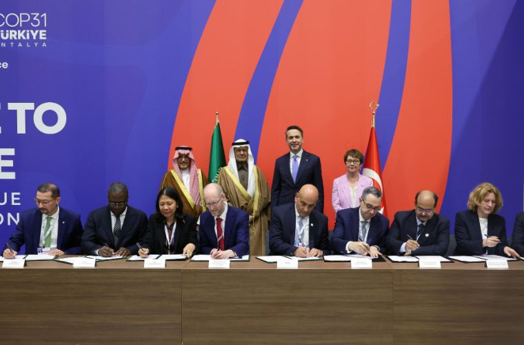

> Antalya'daki COP31 marjında, Suudi şirket ACWA'nın Türkiye'de hayata geçireceği Sivas ve Taşeli güneş enerjisi santrali projeleri için 8 uluslararası finans kuruluşu destek mektubu imzaladı.

Enerji ve Tabii Kaynaklar Bakanı Alparslan Bayraktar ile Suudi Arabistan Enerji Bakanı Abdulaziz bin Selman Al-Saud’un huzurunda, Sivas ve Taşeli Güneş Enerjisi Santrali (GES) projelerinin finansmanına yönelik destek mektupları imzalandı. Antalya’da düzenlenen BM İklim Değişikliği Çerçeve Sözleşmesi 31. Taraflar Konferansı (COP31) kapsamında gerçekleştirilen imza töreninde, toplam 5 bin megavatlık yenilenebilir enerji projesinin ilk aşaması ele alındı.

İmza töreninin ardından açıklamalarda bulunan Enerji ve Tabii Kaynaklar Bakanı Alparslan Bayraktar, 2040 yılında rüzgâr ve güneşte 175 bin megavatlık kurulu güce ulaşmayı hedeflediklerini belirtti. Anlaşmanın toplam 5 bin megavatlık paketin 2 bin megavatlık kısmını kapsadığını ifade eden Bakan Bayraktar, projelerin hayata geçirilmesi için 9 uluslararası kuruluşla finansman sağlanacağını kaydetti. Kalan 3 bin megavatlık bölümün ise rüzgâr, güneş ve depolama yatırımlarını içerebileceğini aktardı.

Her biri bin megavat kapasiteye sahip olacak Sivas ve Karaman (Taşeli) güneş enerjisi santrallerinin, toplam 1,6 milyar avroluk yatırımla 2029 yılında faaliyete geçmesi planlanıyor. Projelerin tamamlandığında 1,3 milyon haneye elektrik sağlaması ve yılda yaklaşık 1,65 milyon ton karbondioksit emisyonunu önlemesi öngörülüyor.

---

## Eskişehirspor derbisinde saat değişikliği: Anadolu SF maçı ne zaman?

**Spor · Tepebaşı** · 2026-11-11 18:42 UTC · Kaynak: [Google Haberler - Eskişehirspor](https://www.gazetevatan.com/galeri/eskisehirspor-maci-bugun-anadolu-sf-eskisehirspor-maci-saat-kacta-hangi-kanalda-2449010)

> Nesine 3. Lig 2. Grup'ta zirve yarışını yakından ilgilendiren Eskişehir derbisinin saati değiştirildi. ESOGÜ Stadyumu'ndaki karşılaşma saat 13.00'te başlayacak.

Nesine 3. Lig 2. Grup'un 11. haftasında Eskişehirspor, bugün Eskişehir Anadolu Spor Faaliyetleri ile karşı karşıya gelecek. Zirve yarışındaki iki takımın mücadelesi öncesinde yapılan son açıklamaya göre, başlangıçta saat 15.00 olarak duyurulan karşılaşma canlı yayın programı nedeniyle iki saat erkene alındı. Mücadele saat 13.00'te başlayacak.

Eskişehir Osmangazi Üniversitesi (ESOGÜ) Stadyumu'nda oynanacak derbi, Tivibu Spor ekranlarından canlı olarak yayınlanacak. Karşılaşmanın biletleri 400 TL'den satışa sunulurken, biletler maç günü saat 10.00'dan itibaren stat gişelerinden temin edilebilecek.

Üniversite yönetimi, kampüste devam eden sınavlar nedeniyle taraftarlar için özel ulaşım kuralları uygulayacağını bildirdi. Kampüsteki sınavların aksamaması ve yoğunluğun önlenmesi amacıyla taraftarların ana giriş kapıları yerine Regülatör tarafındaki kapıyı kullanması istendi.

Geride kalan 10 haftada her iki ekip de 21'er puana sahip bulunuyor. 22 puanlı liderin hemen ardından Eskişehirspor averajla ikinci, Anadolu SF ise üçüncü sırada yer alıyor.

---

## Eskişehir'de 15 bin 500 fidan toprakla buluştu

**Gündem · Odunpazarı** · 2026-11-11 18:42 UTC · Kaynak: [Eskişehir İl Milli Eğitim Müdürlüğü](https://eskisehir.meb.gov.tr/www/11-kasim-milli-agaclandirma-gunu-kapsaminda-eskisehir039de-15-bin-500-fidan-toprakla-bulustu/icerik/8709/tr)

> 11 Kasım Millî Ağaçlandırma Günü kapsamında Eskişehir genelinde 14 farklı noktada 15 bin 500 fidan toprakla buluşturuldu.

Eskişehir'de 11 Kasım Millî Ağaçlandırma Günü, "Geleceğe Nefes, Dünyaya Barış" temasıyla gerçekleştirilen etkinliklerle kutlandı. Odunpazarı ilçesi Gülpınar Mahallesi'ndeki ağaçlandırma sahasında düzenlenen programa Vali Dr. Erdinç Yılmaz, İl Millî Eğitim Müdürü Sinan Aydın, protokol üyeleri, öğretmenler ve öğrenciler katıldı.

Programda konuşan Vali Dr. Erdinç Yılmaz, günün büyük bir yeşil vatan seferberliğine dönüştüğünü belirterek ağacın barış, kardeşlik ve ortak yaşamın sembolü olduğunu ifade etti. Doğayı korumanın gelecek nesillere karşı ortak bir sorumluluk olduğunu vurgulayan Yılmaz, Eskişehir genelinde 2026 yılı sonuna kadar 1 milyon 100 bin fidanın toprakla buluşturulmasının hedeflendiğini kaydetti.

Tören alanındaki 5 hektarlık sahada 8 bin sedir ve muhtelif türde fidan dikimi yapılırken, il genelinde 14 ayrı lokasyonda yaklaşık 12 hektarlık alanda toplam 15 bin 500 fidan dikildi. Etkinlik boyunca vatandaşlara 2 bin fidan dağıtılırken, katılımcılar diktikleri fidanlara ilk can suyunu verdi.

---

## Erdoğan'dan Avustralya Başbakanı Albanese ile kritik COP31 görüşmesi

**Türkiye · Türkiye** · 2026-11-11 18:42 UTC · Kaynak: [İletişim Başkanlığı](https://www.iletisim.gov.tr/turkce/haberler/detay/cumhurbaskani-erdoganin-avustralya-basbakani-albaneseyi-kabulune-iliskin-aciklama-11-11-26)

> Cumhurbaşkanı Recep Tayyip Erdoğan, Antalya'da düzenlenen COP31 Liderler Zirvesi kapsamında Avustralya Başbakanı Anthony Albanese'yi kabul etti.

Cumhurbaşkanı Recep Tayyip Erdoğan, COP31 Liderler Zirvesi için Antalya'da bulunan Avustralya Başbakanı Anthony Albanese ile bir araya geldi. Basına kapalı gerçekleştirilen kabulde, Türkiye ile Avustralya arasındaki ikili ilişkilerin yanı sıra bölgesel ve küresel meseleler masaya yatırıldı.

Görüşme sırasında, iki ülke arasındaki mevcut ticaret potansiyelinin daha üst seviyelere taşınabileceği ifade edildi. Cumhurbaşkanı Erdoğan, bu doğrultuda pek çok farklı alanda iş birliği imkanlarının değerlendirilmesinin büyük önem taşıdığını dile getirdi.

Öte yandan Cumhurbaşkanı Erdoğan, COP31 zirvesinde Türkiye ve Avustralya'nın ortak bir sorumluluk üstlendiğine dikkati çekerek, zirveye sundukları katkılardan dolayı Avustralya Başbakanı Albanese'ye teşekkürlerini iletti.

---

## Albayrak'tan Odunpazarı tepkisi: Mağdur edebiyatının miadı doldu

**Siyaset · Odunpazarı** · 2026-11-11 18:42 UTC · Kaynak: [Google Haberler - Odunpazarı](https://www.saraymedya.com/haber/albayrak-odunpazari-nda-magdur-edebiyatinin-miadi-doldu_323159/)

> AK Parti İl Başkanı Gürhan Albayrak, Emek ve 71 Evler mahallelerinde vatandaşlarla buluşarak Odunpazarı'ndaki yerel yönetim anlayışını eleştirdi.

AK Parti Eskişehir İl Başkanı Gürhan Albayrak, Odunpazarı İlçe Başkanı Mustafa Kemal Bandırma ile birlikte Emek ve 71 Evler mahallelerini ziyaret ederek vatandaşların talep ve sorunlarını dinledi. Ziyaretler sırasında yaptığı değerlendirmelerde yerel yönetimi eleştiren Albayrak, Odunpazarı'nda mazeret siyaseti yürütüldüğünü savundu.

Siyasetlerinin temelinin vatandaşla kurulan gönül bağına dayandığını belirten Albayrak, birlikteliklerinin seçimden seçime olmadığını ifade etti. Sosyal medyada yer alan bazı tepkilere de değinen Albayrak, hizmet eksikliklerinin vatandaşlarca dile getirildiğini öne sürdü.

Odunpazarı'ndaki yerel yönetimin hizmet üretmek yerine mazeret ürettiğini iddia eden Albayrak, "Odunpazarı’nda mağdur edebiyatı yapan yerel yönetim zihniyetinin miadı doldu. Vatandaşlarımız yerel yönetimden umudunu tamamen kesmiş durumda" dedi.

---

## 81 ilden gençlerin çevre mesajları interaktif haritada yer aldı

**Eğitim · Türkiye** · 2026-11-11 18:42 UTC · Kaynak: [Milli Eğitim Bakanlığı](https://www.meb.gov.tr/quot81-ilden-81-genc-iklim-delegesiquotnin-cevreye-dair-mesajlari-quotetkilesimli-turkiye-haritasiquotnda/haber/42480/tr)

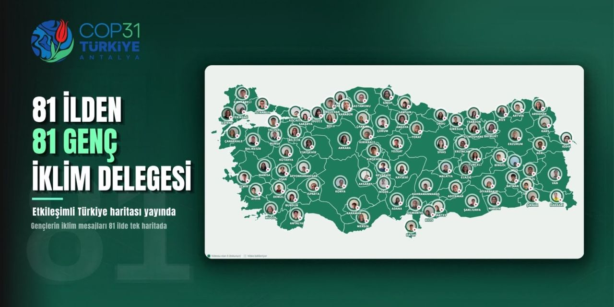

> Millî Eğitim Bakanlığınca COP31 kapsamında hayata geçirilen projede, 81 ilden genç iklim delegesinin çevreye dair mesajları etkileşimli Türkiye haritasında toplandı.

Millî Eğitim Bakanlığı tarafından COP31 çalışmaları çerçevesinde yürütülen "81 İlden 81 Genç İklim Delegesi" projesinde önemli bir aşamaya ulaşıldı. Projede görev alan gençlerin çevre bilinci ve iklim değişikliğine yönelik görüşleri, hazırlanan interaktif Türkiye haritası üzerinden erişime açıldı.

Gençlerin doğanın korunması, sürdürülebilirlik ve iklim kriziyle mücadele konularındaki düşüncelerini paylaştığı harita, projenin etki alanını genişletmeyi hedefliyor.

---

## Altın fiyatları 11 Kasım 2026: Gram altın 6.563,88 TL

**Ekonomi · Merkez** · 2026-11-11 12:42 UTC · Kaynak: [Harem Altın](https://www.haremaltin.com/altin-fiyatlari)

> Gram altın güne düşüşle başladı. Harem Altın verilerine göre gram altın 6.493,78 TL'den alınıyor, 6.563,88 TL'den satılıyor.

Altın piyasasında güne düşüşle başlandı. Harem Altın'ın saat 15.42 itibarıyla verilerine göre gram altının satış fiyatı 6.563,88 TL, alış fiyatı 6.493,78 TL oldu. Gram altın, önceki kapanışa göre yüzde 2,29 geriledi.

Ziynet altınlarda çeyrek altın 10.698 TL, yarım altın 21.390 TL, tam altın 42.623 TL, ata altın 43.762 TL seviyesinden satışa sunuluyor.

22 ayar bileziğin gram satış fiyatı 6.131,59 TL, has altının gram fiyatı 6.544,25 TL olarak belirlendi.

Uluslararası piyasalarda altının onsu 4.042,90 dolardan işlem görürken, dolar/TL 50,28 seviyesinde bulunuyor.

Fiyatlar Harem Altın'ın saat 15.42 itibarıyla paylaştığı verilere dayanmaktadır; kuyumcular arasında farklılık gösterebilir. Bu haber yatırım tavsiyesi değildir.

---

## Vali Yılmaz, Atatürk Lisesi Eğitim Tarihi Müzesi'ni gezdi

**Eğitim · Merkez** · 2026-11-11 06:41 UTC · Kaynak: [Eskişehir Valiliği](https://www.eskisehir.gov.tr/valimiz-dr-erdinc-yilmaz-10-kasim-dolayisiyla-ataturk-lisesi-egitim-tarihi-muzesini-ziyaret-etti)

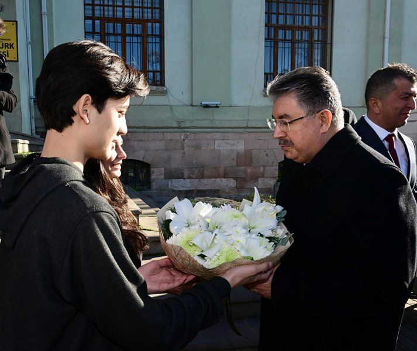

> Eskişehir Valisi Dr. Erdinç Yılmaz, 10 Kasım anma etkinlikleri kapsamında Atatürk Lisesi Eğitim Tarihi Müzesi'ni ziyaret ederek incelemelerde bulundu.

Eskişehir Valisi Dr. Erdinç Yılmaz, 10 Kasım Atatürk’ü Anma Günü vesilesiyle Atatürk Lisesi Eğitim Tarihi Müzesi'ni ziyaret etti.

Ziyaret sırasında müzede sergilenen eserleri, tarihî belgeleri, fotoğrafları ve eğitim materyallerini inceleyen Vali Yılmaz, okulun köklü geçmişi ve kentin eğitim tarihi hakkında yetkililerden detaylı bilgi aldı. Kentin eğitim ve kültür mirasının korunarak geleceğe aktarılmasının büyük önem taşıdığını vurguladı.

Vali Yılmaz, müze incelemesinin ardından okulda görev yapan öğretmenlerle bir araya gelerek bir süre sohbet etti.

---

## Tepebaşı'nda asfalt mesaisi: Şeker'den sonra Işıklar ve Mamure'de

**Belediye · Tepebaşı** · 2026-11-11 06:41 UTC · Kaynak: [Tepebaşı Belediyesi](https://www.tepebasi.bel.tr/Haber/Detay/seker’denısıklarvemamure’yetepebası’ndaasfaltmesaisisuruyor)

> Tepebaşı Belediyesi, ilçe genelindeki üstyapı çalışmaları kapsamında Şeker Mahallesi'nde asfalt yenileme çalışmalarına başladı.

Tepebaşı Belediyesi Fen İşleri Müdürlüğü ekipleri, ilçe genelinde ulaşım konforunu artırmak amacıyla yürüttüğü üstyapı çalışmalarına hız kesmeden devam ediyor. Yeni Mahalle'deki çalışmaların tamamlanmasının ardından Şeker Mahallesi'nde de asfalt yenileme uygulamaları hayata geçirildi.

Tepebaşı Belediye Başkanı Ahmet Ataç, sahaya giderek Şeker Mahallesi'ndeki çalışmaları yerinde inceledi ve ekiplerden bilgi aldı. Mahallelerin ihtiyaçları doğrultusunda hazırlanan program çerçevesinde yıpranan yol yüzeyleri yenilenirken, Şeker Mahallesi'ndeki çalışmaların ardından programın Işıklar ve Mamure mahalleleriyle süreceği bildirildi.

Çalışmaları değerlendiren Başkan Ahmet Ataç, hemşerilerinin günlük yaşamını doğrudan etkileyen yol çalışmalarını mahallelerin ihtiyaçlarına göre planladıklarını belirtti. Ataç, hava ve mevsim koşullarının elverdiği ölçüde asfalt yenileme çalışmalarını sürdüreceklerini, amaçlarının Tepebaşı'nın her mahallesinde güvenli ve konforli bir ulaşım altyapısı oluşturmak olduğunu ifade etti.

Fen İşleri Müdürlüğü ekipleri, belirlenen program dâhilinde ilçe genelinde yol bakım, onarım ve asfalt yenileme çalışmalarını sürdürecek.

---

## MEB AKUB gönüllülerinden COP31'de biyoçeşitlilik mesaisi

**Eğitim · Türkiye** · 2026-11-11 06:41 UTC · Kaynak: [Milli Eğitim Bakanlığı](https://www.meb.gov.tr/meb-akub-gonullulerinden-cop31-kapsaminda-biyolojik-cesitliligin-korunmasina-destek/haber/42461/tr)

> Millî Eğitim Bakanlığı Arama ve Kurtarma Birimi ile Genç MEB AKUB gönüllüleri, COP31 kapsamında biyoçeşitliliğin korunmasına destek verdi.

Millî Eğitim Bakanlığı Arama ve Kurtarma Birimi (MEB AKUB) ve Genç MEB AKUB gönüllüleri, COP31 etkinlikleri çerçevesinde önemli bir çalışmaya imza attı.

Ekipler, yürüttükleri faaliyetlerle biyoçeşitliliğin korunması ve çevre bilincinin artırılmasına yönelik destek sağladı.

---

## İletişim Başkanı Duran'dan COP31'de küresel iklim adaleti vurgusu

**Türkiye · Türkiye** · 2026-11-11 06:41 UTC · Kaynak: [İletişim Başkanlığı](https://www.iletisim.gov.tr/turkce/haberler/detay/iletisim-baskani-duran-parlamenterler-dusunce-kuruluslarinin-temsilcileri-akademisyenler-ve-arastirmacilarla-bulustu)

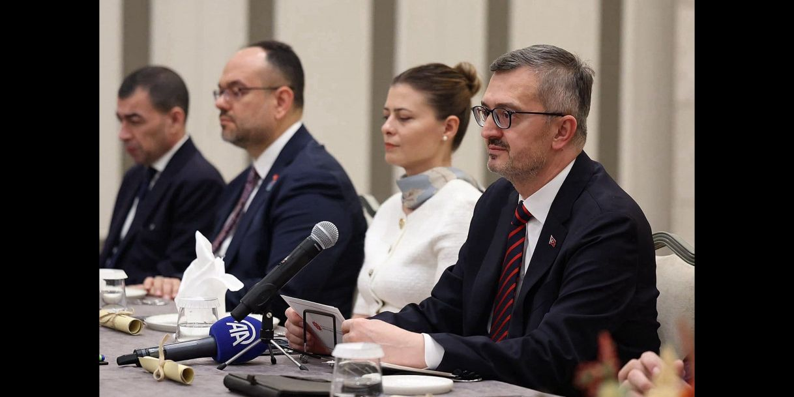

> Cumhurbaşkanlığı İletişim Başkanı Burhanettin Duran, Antalya'daki COP31 kapsamında düzenlenen etkinlikte parlamenterler ve düşünce kuruluşlarıyla bir araya gelerek iklim krizinde küresel adalet ve somut eylem çağrısı yaptı.

Cumhurbaşkanlığı İletişim Başkanı Burhanettin Duran, Antalya'da gerçekleştirilen Birleşmiş Milletler İklim Değişikliği Çerçeve Sözleşmesi'nin 31. Taraflar Konferansı (COP31) dolayısıyla düzenlenen yan etkinliklerde; parlamenterler, düşünce kuruluşlarının temsilcileri, akademisyenler ve araştırmacılarla buluştu.

İklim değişikliğinin çevre politikalarının sınırlarını aşarak ekonomik kalkınmadan enerji güvenliğine ve gıda arzına kadar çok geniş bir alanı etkilediğini belirten İletişim Başkanı Duran, bu sorunun tek bir aktörün alacağı tedbirlerle çözülemeyeceğini vurguladı. Türkiye'nin iklim krizine "mış gibi" yaklaşmadığını, somut ve sürdürülebilir çözümler ürettiğini ifade eden Duran, Paris Anlaşması'nın onaylanması, 2053 net sıfır emisyon hedefi, İkinci Ulusal Katkı Beyanı ve İklim Kanunu gibi atılan adımları hatırlattı. Ayrıca Emine Erdoğan'ın öncülüğünde hayata geçirilen Sıfır Atık girişiminin uluslararası boyut kazandığına işaret etti.

Konuşmasında küresel adaletin önemine de parantez açan Duran, sanayileşmiş ülkelerin sorunun çözümünde daha fazla sorumluluk üstlenmesi gerektiğini kaydetti. Gelişmekte olan ülkelerin finansman ve teknolojiye erişiminin kritik olduğunu belirten Duran, göreceli kabiliyetler ilkesi doğrultusunda daha adil ve kapsayıcı politikalar geliştirilmesi gerektiğini dile getirdi.

Düşünce kuruluşlarının karar alma süreçlerine sunduğu katkının altını çizen İletişim Başkanı Duran, bu tür buluşmaların Türkiye'nin iklim politikalarının uluslararası alanda anlaşılmasına ve yeni iş birliklerinin kurulmasına zemin hazırladığını ifade etti.

---

## Eskişehir'de tırın altına giren otomobilin sürücüsü hayatını kaybetti

**Asayiş · Merkez** · 2026-11-11 06:41 UTC · Kaynak: [Google Haberler - Eskişehir](https://www.sozcu.com.tr/eskisehirde-tir-surucusu-uyurken-sese-uyandi-korkunc-olum-p380110)

> Eskişehir-Ankara kara yolunda emniyet şeridinde park halindeki tıra arkadan çarpan otomobilin sürücüsü kaza yerinde yaşamını yitirdi.

Eskişehir-Ankara kara yolu Teksan Sanayi Sitesi mevkisinde korkunç bir trafik kazası meydana geldi. Edinilen bilgilere göre, Hakan Çalık idaresindeki 60 AEK 506 plakalı otomobil, emniyet şeridinde park halinde bulunan M.R.K.'ye ait 03 AIU 306 çekici plakalı tıra arkadan çarptı.

Çarpmanın şiddetiyle otomobil tırın dorsesinin altına girerek sıkıştı. Kazayı tırın içinde uyurken duyduğu sesle fark eden tır sürücüsü durumu yetkililere bildirdi. Çevredekilerin ihbarı üzerine olay yerine 112 Acil Sağlık, polis ve itfaiye ekipleri sevk edildi.

Sağlık ekiplerinin yaptığı kontrolde, otomobil sürücüsü Hakan Çalık'ın olay yerinde hayatını kaybettiği belirlendi. Savcılık incelemesinin ardından Çalık'ın cenazesi otopsi işlemleri için Eskişehir Şehir Hastanesi morguna kaldırıldı.

İtfaiye ve vinç çalışmalarının ardından tırın altından çıkarılan otomobil çekiciyle otoparka götürüldü. Polis ekipleri kazayla ilgili soruşturma başlatırken, tır sürücüsü M.R.K. ifadesi alınmak üzere polis merkezine götürüldü.

---

## Bakan Bayraktar: 2040'a kadar 300 milyar dolarlık enerji yatırımı

**Türkiye · Türkiye** · 2026-11-11 06:41 UTC · Kaynak: [Enerji ve Tabii Kaynaklar Bakanlığı](https://enerji.gov.tr/haber-detay?id=31964)

> Enerji ve Tabii Kaynaklar Bakanı Alparslan Bayraktar, COP31 marjında düzenlenen UEA toplantısında Türkiye'nin Milli Enerji 2040 vizyonunu paylaştı.

Enerji ve Tabii Kaynaklar Bakanı Alparslan Bayraktar, Antalya'da gerçekleştirilen BM İklim Değişikliği Çerçeve Sözleşmesi 31. Taraflar Konferansı (COP31) kapsamında Uluslararası Enerji Ajansı (UEA) Enerji Bakanları Toplantısı'na katıldı. Toplantıda konuşan Bakan Bayraktar, enerji arz güvenliğinin artık bir millî güvenlik meselesi haline geldiğini vurguladı.

Geçtiğimiz hafta açıkladıkları 'Milli Enerji 2040' vizyonunun uzun vadeli bir yol haritası sunduğunu belirten Bayraktar, yaklaşık 128 gigavat seviyesindeki kurulu gücü 2040'a kadar 281 gigavata çıkarmayı hedeflediklerini kaydetti. Bu kapasitenin 175 gigavatının güneş ve rüzgâr enerjisinden sağlanacağını ifade eden Bayraktar, yenilenebilir enerjinin payını yüzde 77'ye yükseltmeyi ve 10 gigavatlık nükleer enerji kapasitesini devreye almayı planladıklarını aktardı.

Dönüşüm sürecinde esneklik, depolama ve enterkonnekte şebekelere ihtiyaç duyulduğunu dile getiren Bayraktar, 40 gigavatsaatlik batarya depolama ve 15 gigavatlık sınır ötesi elektrik bağlantı kapasitesinin hedeflendiğini kaydetti. Ayrıca enerji verimliliği adımlarıyla 2040 yılına kadar kümülatif 240 milyar dolarlık tasarruf öngörüldüğünü belirten Bakan Bayraktar, tüm bu dönüşüm için 2040'a kadar yaklaşık 300 milyar dolarlık yatırım ihtiyacı bulunduğunu sözlerine ekledi.

---

## Anadolu Üniversitesi Rektörü Adıgüzel'den Rektör Özcan'a Ziyaret

**Eğitim · Tepebaşı** · 2026-11-11 06:41 UTC · Kaynak: [Eskişehir Teknik Üniversitesi](https://www.eskisehir.edu.tr/tr/Haber/Detay/anadolu-universitesi-rektoru-prof-dr-yusuf-adiguzelden-rektorumuz-prof-dr-adnan-ozcana-hayirli-olsun-ziyareti)

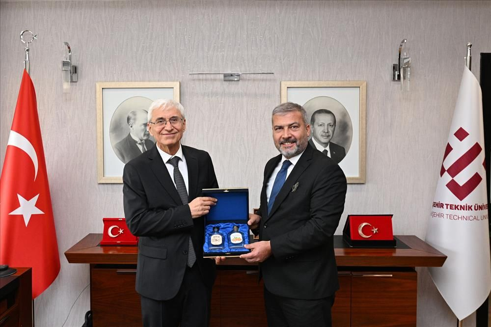

> Anadolu Üniversitesi Rektörü Prof. Dr. Yusuf Adıgüzel, Eskişehir Teknik Üniversitesi Rektörlüğüne yeniden atanan Prof. Dr. Adnan Özcan'ı ziyaret etti.

Anadolu Üniversitesi Rektörü Prof. Dr. Yusuf Adıgüzel, Eskişehir Teknik Üniversitesi (ESTÜ) Rektörlüğüne yeniden atanan Prof. Dr. Adnan Özcan'a hayırlı olsun ziyaretinde bulundu.

ESTÜ Rektörlük Ofisinde gerçekleşen buluşmada Rektör Prof. Dr. Yusuf Adıgüzel, Prof. Dr. Adnan Özcan'ı yeniden atanmasından dolayı tebrik ederek yeni görev döneminde başarı dileklerini iletti.

Ziyaretten duyduğu memnuniyeti ifade eden Rektör Prof. Dr. Adnan Özcan ise nazik ziyaretleri ve iyi dilekleri dolayısıyla Prof. Dr. Yusuf Adıgüzel'e teşekkür etti.

---

## Türkiye ile Suudi Arabistan arasında kritik elektrik iş birliği

**Türkiye · Türkiye** · 2026-11-10 21:21 UTC · Kaynak: [Enerji ve Tabii Kaynaklar Bakanlığı](https://enerji.gov.tr/haber-detay?id=31968)

> Türkiye ve Suudi Arabistan arasında, Cumhurbaşkanı Erdoğan'ın huzurunda elektrik projelerinde iş birliği mutabakat zaptı imzalandı.

Türkiye ile Suudi Arabistan arasında elektrik projelerinde iş birliğine yönelik yeni bir adım atıldı. Antalya'da gerçekleştirilen BM İklim Değişikliği Çerçeve Sözleşmesi 31. Taraflar Konferansı (COP31) kapsamında, Cumhurbaşkanı Recep Tayyip Erdoğan, Suudi Arabistan Enerji Bakanı Abdulaziz bin Selman Al-Saud'u kabul etti.

Kabulün ardından Cumhurbaşkanı Erdoğan'ın huzurunda, Enerji ve Tabii Kaynaklar Bakanı Alparslan Bayraktar ile Suudi mevkidaşı Abdulaziz bin Selman Al-Saud tarafından 'Elektrik Projelerinde İş Birliğine İlişkin Mutabakat Zaptı' imzalandı.

İmza töreninin ardından sosyal medya hesabından açıklamalarda bulunan Enerji ve Tabii Kaynaklar Bakanı Alparslan Bayraktar, daha önce Riyad'da imzalanan hükümetlerarası anlaşmayla ACWA Power tarafından Türkiye'de iki aşamada geliştirilecek toplam 5 bin megavatlık yenilenebilir enerji projelerinin çerçevesinin oluşturulduğunu hatırlattı. Sivas ve Karaman'daki toplam 2 bin megavatlık ilk aşama güneş enerjisi projelerindeki ilerlemeden duydukları memnuniyeti dile getiren Bakan Bayraktar, Antalya'da atılan imzayla ikinci aşamadaki 3 bin megavatlık ilave kapasitenin hayata geçirilmesine yönelik çalışmaların ileri bir aşamaya taşındığını kaydetti.

Bakan Bayraktar açıklamasında, yüksek gerilim doğru akım iletim altyapısı ve batarya enerji depolama sistemleriyle desteklenen rüzgâr enerjisi santrallerinin geliştirilmesini öngördüklerini belirterek, "Yenilenebilir enerji kapasitemizi artırırken şebeke altyapımızı güçlendirecek ve sistem esnekliğini geliştirecek bu yatırımlarla, Suudi Arabistan ile stratejik enerji iş birliğimizi derinleştiriyoruz. Türkiye'nin enerji dönüşümüne ve yatırım ortamına duyulan güveni somut projelere dönüştürmeye devam edeceğiz" ifadelerini kullandı.

---

## Türkiye İklim Okulu COP31'de uluslararası panellere ev sahipliği yaptı

**Türkiye · Türkiye** · 2026-11-10 21:21 UTC · Kaynak: [Milli Eğitim Bakanlığı](https://www.meb.gov.tr/quotturkiye-iklim-okuluquot-cop31-kapsaminda-uluslararasi-etkinliklere-ev-sahipligi-yapti/haber/42464/tr)

> Antalya'da düzenlenen COP31 kapsamında kurulan Türkiye İklim Okulu, ikinci gününde iklim eğitimi ve sürdürülebilirlik odaklı uluslararası paneller düzenledi.

Antalya'da devam eden Birleşmiş Milletler İklim Değişikliği Çerçeve Sözleşmesi 31. Taraflar Konferansı (COP31) çerçevesinde Millî Eğitim Bakanlığı tarafından hayata geçirilen Türkiye İklim Okulu, ikinci gününde uluslararası katılımcıların yer aldığı oturumlara ev sahipliği yaptı. Program, Gazi Mustafa Kemal Atatürk'ün ebediyete irtihalinin 88. yıl dönümü dolayısıyla gerçekleştirilen saygı duruşu ile başladı.

COP31'in Yeşil Bölge alanında düzenlenen panellerde, iklim kriziyle mücadelede eğitim sistemlerinin kritik rolü, sürdürülebilir kalkınma hedefleri ve gençlerin karar alma süreçlerindeki aktif katılımı masaya yatırıldı. "Ulusal Envanter ve İyi Uygulamalar Portföyü" sunumu kapsamında Türkiye'nin farklı bölgelerinde hayata geçirilen çevre projeleri katılımcılara tanıtıldı.

Öte yandan "Sözden Eyleme: Gençlik İklim Beyannamesi ve Kuşaklararası İklim Yönetişimi Laboratuvarı" başlıklı oturumda gençlerin iklim politikalarındaki rolü tartışıldı. Millî Eğitim Bakanlığı yetkilileri, 2022'de hazırlanan İklim Değişikliği Eylem Planı'nın bu yıl güncellendiğini aktararak Türkiye İklim Okulunun resmî açılışının 14 Kasım'da Bakan Yusuf Tekin'in katılımıyla yapılacağını bildirdi.

Ziyaretçilerin yoğun ilgi gösterdiği okulun "Yaşayan Okul", "İklim Deneyim Alanı" ve "Teknoloji Alanı" bölümlerinde uygulamalı atölyeler gerçekleştirildi. Etkinliklere katılan öğrencilere iklim eğitimi deneyimlerini belgelemeleri amacıyla "İklim Elçisi Pasaportu" verildi.

---

## Odunpazarı'nda uyuşturucu operasyonu: 1 şüpheli yakalandı

**Asayiş · Odunpazarı** · 2026-11-10 21:21 UTC · Kaynak: [Google Haberler - Odunpazarı](https://www.sondakika.com/amp/haber-eskisehir-odunpazari-nda-310-gram-esrar-bulundu-1--20414439/)

> Eskişehir'in Odunpazarı ilçesinde düzenlenen uyuşturucu operasyonunda 310 gram esrar ve kök kenevir ele geçirildi, 1 kişi gözaltına alındı.

Eskişehir İl Jandarma Komutanlığı ekipleri, uyuşturucuyla mücadele çalışmaları kapsamında Odunpazarı ilçesinde uyuşturucu üretimi yapıldığı bilgisine ulaştı. Yürütülen saha çalışmaları ve takiplerin ardından tespit edilen adrese operasyon düzenlendi.

Ev ve eklentilerinde gerçekleştirilen aramalarda, 310 gram esrar, 6 kök Hint keneviri, esrar öğütme aparatı ve bir adet hassas terazi ele geçirildi. Ele geçirilen maddelere el konulurken olayla ilgili 1 şüpheli gözaltına alındı.

Gözaltına alınan şüpheli hakkında "kullanmak için uyuşturucu veya uyarıcı madde satın almak, kabul etmek veya bulundurmak" ile "2313 sayılı Uyuşturucu Maddelerin Murakabesi Hakkında Kanun'a muhalefet" suçlarından yasal işlem başlatıldı.

---

## ESOGÜ Rektörü Gümüşsoy'dan Rektör Özcan'a hayırlı olsun ziyareti

**Eğitim · Tepebaşı** · 2026-11-10 21:21 UTC · Kaynak: [Eskişehir Teknik Üniversitesi](https://www.eskisehir.edu.tr/tr/Haber/Detay/eskisehir-osmangazi-universitesi-rektoru-prof-dr-emine-gumussoydan-rektor-prof-dr-adnan-ozcana-hayirli-olsun-ziyareti)

> Eskişehir Osmangazi Üniversitesi Rektörü Prof. Dr. Emine Gümüşsoy, yeniden ESTÜ Rektörlüğüne atanan Prof. Dr. Adnan Özcan'ı ziyaret etti.

Eskişehir Osmangazi Üniversitesi (ESOGÜ) Rektörü Prof. Dr. Emine Gümüşsoy, Cumhurbaşkanlığı Kararı ile Eskişehir Teknik Üniversitesi (ESTÜ) Rektörlüğü görevine yeniden atanan Prof. Dr. Adnan Özcan'a tebrik ziyaretinde bulundu.

ESTÜ Rektörlük Ofisi'nde gerçekleştirilen kabulde, ESOGÜ Rektör Yardımcısı Prof. Dr. Atilla Özcan Özdemir de yer aldı. Ziyarette Rektör Gümüşsoy, Özcan'a yeni döneminde başarı dileklerini iletti.

Eskişehir Teknik Üniversitesi Rektörü Prof. Dr. Adnan Özcan ise nazik ziyaretleri ve iyi dilekleri dolayısıyla ESOGÜ Rektörü Gümüşsoy ile Rektör Yardımcısı Özdemir'e teşekkür etti.

---

## Erdoğan ve Berdimuhamedov'dan COP31'de ikili iş birliği vurgusu

**Siyaset · Türkiye** · 2026-11-10 21:21 UTC · Kaynak: [İletişim Başkanlığı](https://www.iletisim.gov.tr/turkce/haberler/detay/cumhurbaskani-erdoganin-turkmenistan-halk-maslahati-baskani-berdimuhamedovu-kabulune-iliskin-aciklama-10-11-26)

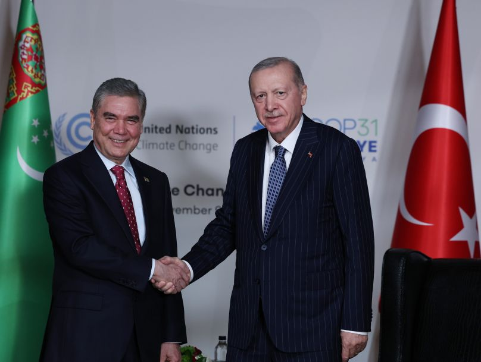

> Cumhurbaşkanı Recep Tayyip Erdoğan, COP31 Liderler Zirvesi dolayısıyla Antalya'da bulunan Türkmenistan Halk Maslahatı Başkanı Gurbanguli Berdimuhamedov'u kabul etti.

Cumhurbaşkanı Recep Tayyip Erdoğan, Antalya'da düzenlenen COP31 Liderler Zirvesi kapsamında Türkmenistan Halk Maslahatı Başkanı Gurbanguli Berdimuhamedov ile bir araya geldi. Gerçekleşen görüşmede Türkiye ile Türkmenistan arasındaki ikili ilişkilerin yanı sıra bölgesel ve küresel meseleler masaya yatırıldı.

Cumhurbaşkanı Erdoğan görüşme sırasında, iki ülke arasındaki iş birliğinin artırılması ve ilişkilerin üst seviyeye taşınması adına kararlı adımların atılmaya devam edeceğini belirtti. Erdoğan, özellikle enerji, ticaret, savunma sanayii ve yatırım alanlarındaki ortak çalışmaların yoğunlaştırılması gerektiğine dikkat çekti.

Türk Devletleri Teşkilatı'nın giderek güçlendiğini ifade eden Erdoğan, Ankara Zirvesi'nde Teşkilat'ın stratejik öneminin bir kez daha tescillendiğini kaydetti. Erdoğan ayrıca, Türkmenistan'ın Türk Devletleri Teşkilatı'na üye olarak katılması temennisini dile getirdi.

---

## Başkan Kurt Emek esnafıyla buluştu: Ekonomik kriz herkesi etkiliyor

**Belediye · Odunpazarı** · 2026-11-10 21:21 UTC · Kaynak: [Odunpazarı Belediyesi](https://www.odunpazari.bel.tr/guncel/haberler/genel-haberler/baskan-kurt-emek-te-esnafla-bulustu)

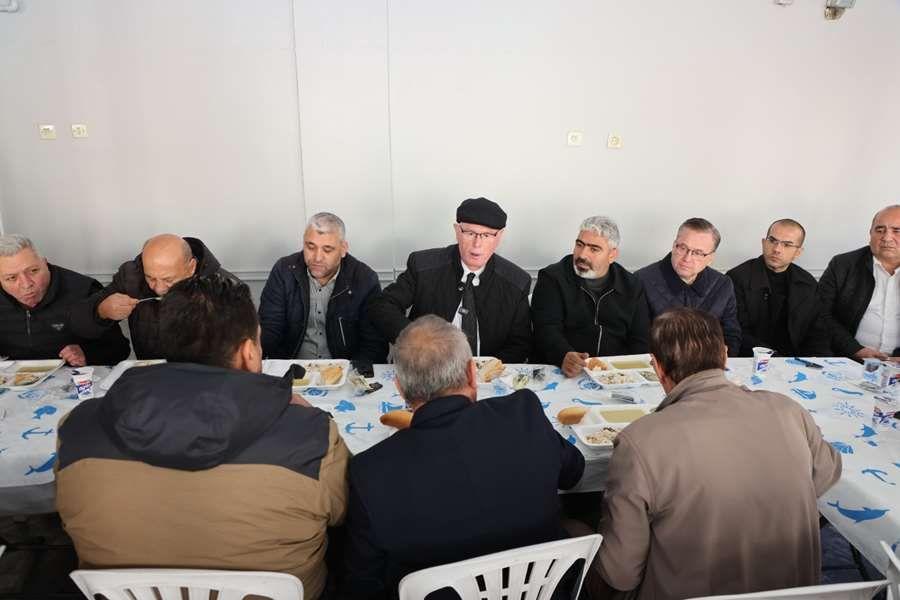

> Odunpazarı Belediye Başkanı Kazım Kurt, Emek Mahallesi'nde esnafı ziyaret ederek talep ve şikâyetlerini dinledi, küçük esnafın zor günler geçirdiğini vurguladı.

Odunpazarı Belediye Başkanı Kazım Kurt, mahalle buluşmaları kapsamında Emek Mahallesi Ziya Gökalp Caddesi'ndeki esnafla bir araya geldi. Ziyarete belediye başkan yardımcıları ve meclis üyeleri de katıldı.

Esnafla sohbet ederek işlerin durumunu ve karşılaşılan sorunları dinleyen Başkan Kurt, belediyenin çalışmalarına ilişkin değerlendirmelerde bulundu. Türkiye'de yaşanan ekonomik krizin toplumun tüm kesimlerini etkilediğine dikkati çeken Kurt, artan maliyetler, yüksek kiralar ve vatandaşın düşen alım gücü nedeniyle küçük esnafın zor günler geçirdiğini ifade etti.

Siyasetin halktan kopuk yürütülemeyeceğini belirten Kurt, yerel yönetimlerin esnaf ve yurttaşlarla sürekli iletişimde olması gerektiğini kaydetti. Halkın sorunlarını yerinde dinleyerek çözüm üretmeye çalıştıklarını aktaran Başkan Kurt, sosyal belediyecilik anlayışıyla çalışmaya devam edeceklerini belirterek esnafa bol kazançlar diledi.

---

## 30 yıl hapis cezasıyla aranıyordu: Odunpazarı'nda yakalandı

**Asayiş · Odunpazarı** · 2026-11-10 21:21 UTC · Kaynak: [Google Haberler - Eskişehir](https://www.hurriyet.com.tr/gundem/30-yil-hapisle-araniyordu-eskisehirde-yakalandi-43373493)

> Eskişehir'de hakkında kesinleşmiş 30 yıl 5 ay hapis cezası bulunan firari hükümlü, jandarma ekiplerinin operasyonuyla Odunpazarı'nda yakalandı.

Eskişehir İl Jandarma Komutanlığı ekipleri, aranan şahısların yakalanmasına yönelik yürüttüğü çalışmalar kapsamında önemli bir operasyona imza attı.

Yapılan istihbarat çalışmaları sonucunda, 'Cebir ve Tehdit veya Hile Kullanarak Kişiyi Hürriyetinden Yoksun Kılma' suçundan hakkında 30 yıl 5 ay kesinleşmiş hapis cezası bulunan bir hükümlünün Odunpazarı ilçesinde saklandığı tespit edildi.

Jandarma ekiplerince düzenlenen operasyonla kısa sürede yakalanan hükümlü, karakoldaki işlemlerinin ardından tutuklanarak Eskişehir Ceza İnfaz Kurumuna teslim edildi.

---

## Altın fiyatları 10 Kasım 2026: Gram altın 6.577,98 TL

**Ekonomi · Merkez** · 2026-11-10 13:58 UTC · Kaynak: [Harem Altın](https://www.haremaltin.com/altin-fiyatlari)

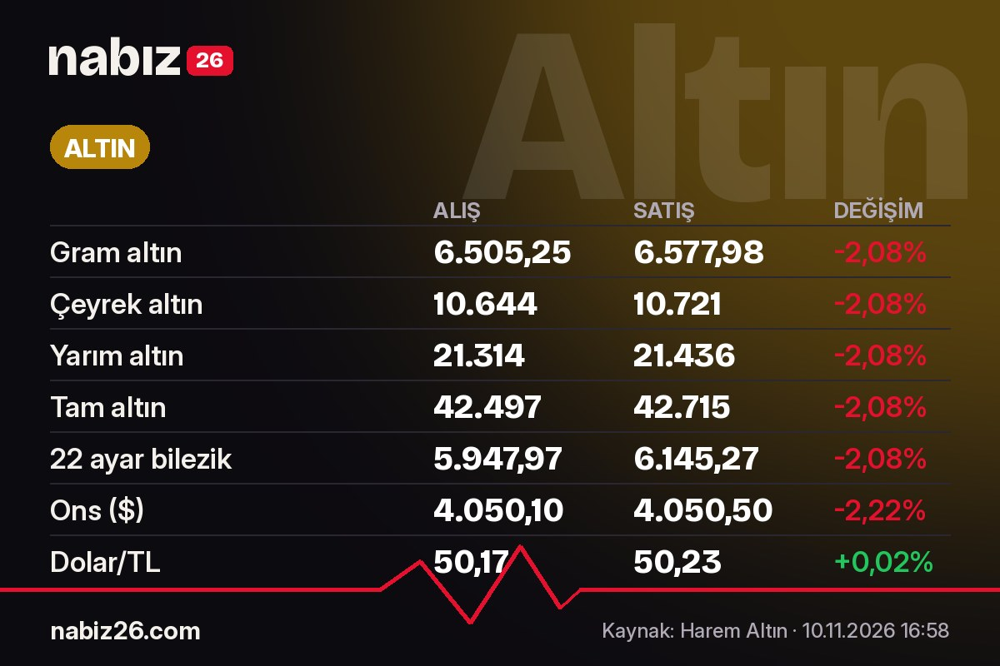

> Gram altın güne düşüşle başladı. Harem Altın verilerine göre gram altın 6.505,25 TL'den alınıyor, 6.577,98 TL'den satılıyor.

Altın piyasasında güne düşüşle başlandı. Harem Altın'ın saat 16.58 itibarıyla verilerine göre gram altının satış fiyatı 6.577,98 TL, alış fiyatı 6.505,25 TL oldu. Gram altın, önceki kapanışa göre yüzde 2,08 geriledi.

Ziynet altınlarda çeyrek altın 10.721 TL, yarım altın 21.436 TL, tam altın 42.715 TL, ata altın 43.856 TL seviyesinden satışa sunuluyor.

22 ayar bileziğin gram satış fiyatı 6.145,27 TL, has altının gram fiyatı 6.558,79 TL olarak belirlendi.

Uluslararası piyasalarda altının onsu 4.050,50 dolardan işlem görürken, dolar/TL 50,23 seviyesinde bulunuyor.

Fiyatlar Harem Altın'ın saat 16.58 itibarıyla paylaştığı verilere dayanmaktadır; kuyumcular arasında farklılık gösterebilir. Bu haber yatırım tavsiyesi değildir.

---

## Tepebaşı'nda 10 Kasım mevlidi: 650 kadın dualarda buluştu

**Belediye · Tepebaşı** · 2026-11-10 13:31 UTC · Kaynak: [Tepebaşı Belediyesi](https://www.tepebasi.bel.tr/Haber/Detay/650kadınataturkvesilaharkadaslarıicindualardabulustu)

> Tepebaşı Belediyesi tarafından 10 Kasım Atatürk’ü Anma Günü dolayısıyla düzenlenen mevlide 650 kadın katıldı.

Tepebaşı Belediyesi Sosyal İşler Müdürlüğü, 10 Kasım Atatürk’ü Anma Günü kapsamında Gazi Mustafa Kemal Atatürk, silah arkadaşları ve şehitler için mevlit programı düzenledi. Etkinliğe 650 kadın katıldı.

Kur'an-ı Kerim tilaveti ve okunan mevlidin ardından Atatürk ve vatan uğruna hayatını kaybeden şehitler için toplu dualar edildi. Programda bir konuşma yapan Tepebaşı Belediye Başkanı Ahmet Ataç, Kurtuluş Savaşı'nda cephe gerisinde büyük fedakârlıklar gösteren Anadolu kadınlarının emeklerinin unutulmaz olduğunu belirtti. Cumhuriyet'in kadınlara kazandırdığı haklara dikkat çeken Ataç, bu değerleri korumanın ortak sorumluluk olduğunu vurguladı.

Törene Başkan Ataç'ın yanı sıra Yeni Parti Eskişehir İl Başkanı Talat Yalaz, Tepebaşı İlçe Başkanı Tevfik Yıldırım, belediye başkan yardımcılıkları ve çok sayıda vatandaş katıldı. Program, yapılan duaların ardından sona erdi.

---

## Temiz enerjide 4'lü dev anlaşma: Elektriğin TANAP'ı Avrupa yolunda

**Türkiye · Türkiye** · 2026-11-10 13:31 UTC · Kaynak: [Enerji ve Tabii Kaynaklar Bakanlığı](https://enerji.gov.tr/haber-detay?id=31966)

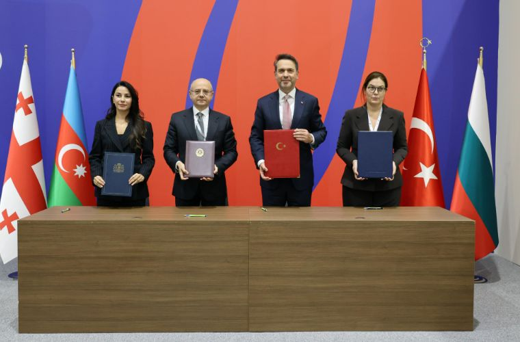

> Türkiye, Azerbaycan, Bulgaristan ve Gürcistan arasında imzalanan anlaşmayla, temiz enerji kaynaklarından üretilen elektriğin Avrupa pazarlarına ulaştırılması hedefleniyor.

Antalya'da düzenlenen BM İklim Değişikliği Çerçeve Sözleşmesi 31. Taraflar Konferansı (COP31) kapsamında, Türkiye, Azerbaycan, Bulgaristan ve Gürcistan arasında enerji alanında stratejik bir anlaşmaya imza atıldı. Dört ülke arasında temiz enerji sektöründeki iş birliğini güçlendirmeyi amaçlayan "Temiz Enerji Alanında Stratejik Ortaklığa İlişkin Anlaşma", Enerji ve Tabii Kaynaklar Bakanı Alparslan Bayraktar, Azerbaycan Enerji Bakanı Parviz Şahbazov, Bulgaristan Enerji Bakanı Iva Petrova ve Gürcistan Başbakan Yardımcısı ve Ekonomi ve Sürdürülebilir Kalkınma Bakanı Mariam Kvrivishvili tarafından imzalandı.

Anlaşma; temiz enerji kaynaklarından üretilen elektriğin sınır ötesi iletimi, dağıtımı ve ticaretinin geliştirilmesini, ülkeler arasında güvenli ve kesintisiz enerji akışının sağlanmasını hedefliyor. Proje kapsamında ayrıca fiber optik kablolar üzerinden iletişim ve veri aktarımının geliştirilmesi de öngörülüyor.

İmza töreninin ardından açıklamalarda bulunan Enerji ve Tabii Kaynaklar Bakanı Alparslan Bayraktar, projenin önemine dikkat çekerek, "'Elektriğin TANAP'ı' olarak nitelendirdiğimiz bu projeyle, temiz enerji kaynaklarından üretilen elektriğin Azerbaycan-Gürcistan-Türkiye-Bulgaristan güzergâhı üzerinden Avrupa pazarlarına ulaştırılmasını hedefliyoruz" dedi.

Bakan Bayraktar, elektrikleşmenin hız kazandığı bu dönemde atılan adımın ülkeler arasındaki enerji bağlarını güçlendireceğini, temiz enerji ticaretine yeni imkânlar sunacağını ve Avrupa'nın arz güvenliğine katkı sağlayacağını vurguladı.

---

## Odunpazarı Belediyesi'nde 10 Kasım töreni: Atatürk anıldı

**Belediye · Odunpazarı** · 2026-11-10 13:31 UTC · Kaynak: [Odunpazarı Belediyesi](https://www.odunpazari.bel.tr/guncel/haberler/genel-haberler/odunpazari-belediyesi-nde-ata-ya-saygi-durusu)

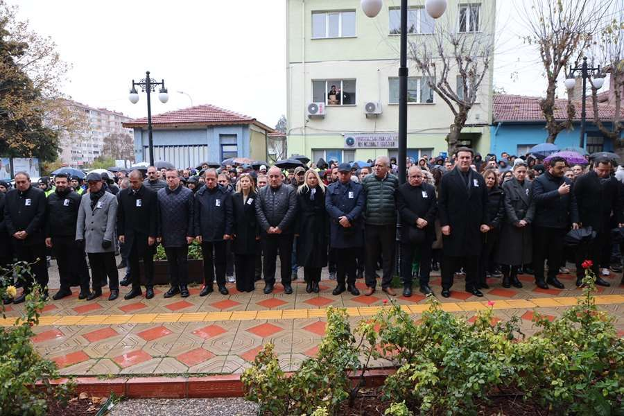

> Odunpazarı Belediyesi, Gazi Mustafa Kemal Atatürk'ün aramızdan ayrılışının 88'inci yıl dönümünde belediye binasında anma töreni düzenledi.

Odunpazarı Belediyesi, Cumhuriyetimizin kurucusu Büyük Önder Gazi Mustafa Kemal Atatürk'ü aramızdan ayrılışının 88'inci yıl dönümünde düzenlenen törenle andı. Belediye hizmet binasının bahçesinde gerçekleştirilen programa belediye meclis üyeleri, başkan yardımcıları, daire müdürleri ve belediye çalışanları katıldı.

Saat 09.05'te çalan sirenler eşliğinde Atatürk büstü önünde saygı duruşunda bulunulurken, ardından İstiklal Marşı okundu. Törende konuşan Odunpazarı Belediye Başkan Yardımcısı Emre Genç, Atatürk'ün fikirlerinin yol göstermeye devam ettiğini belirterek, kamu hizmeti sunan yerel yöneticiler ve çalışanlar olarak aklın ve bilimin ışığında ilerlediklerini ifade etti.

Genç, Atatürk'ün mirasına sahip çıkmanın ve Cumhuriyet kazanımlarını korumanın önemine dikkat çekti. Konuşmanın ardından katılımcılar Atatürk büstüne çiçek bıraktı.

---

## ESTÜ'de 10 Kasım anması: Zeybek ve modern dans gösterisi

**Eğitim · Tepebaşı** · 2026-11-10 13:31 UTC · Kaynak: [Eskişehir Teknik Üniversitesi](https://www.eskisehir.edu.tr/tr/Haber/Detay/eskisehir-teknik-universitesinde-10-kasim-ataturku-anma-programi-duzenlendi)

> Eskişehir Teknik Üniversitesi'nde düzenlenen 10 Kasım Atatürk'ü Anma Programı, çelenk sunumu ve konferans salonundaki müzik ve dans gösterileriyle gerçekleştirildi.

Eskişehir Teknik Üniversitesi (ESTÜ), Türkiye Cumhuriyeti'nin kurucusu Gazi Mustafa Kemal Atatürk'ü ebediyete intikalinin 88. yılında düzenlenen törenle andı.

Üniversite Atatürk Anıtı önünde gerçekleştirilen programda, Rektör Prof. Dr. Adnan Özcan tarafından anıta çelenk sunuldu. Tören, saygı duruşu ve İstiklal Marşı'nın okunmasıyla devam etti.

Anma etkinlikleri daha sonra ESTÜ Konferans Salonu'nda sürdü. Havacılık ve Uzay Bilimleri Fakültesi öğretim elemanı Öğr. Gör. Füsun Adar ile Spor Bilimleri Fakültesi öğretim elemanı Arş. Gör. Dr. Feridun Fikret Özer'in sunuculuğunu üstlendiği programda, sanat yönetmenliğini Öğr. Gör. Sabriye Tosun Şentürk'ün yaptığı müzik dinletileri sunuldu. Efe Türküsü, 19 Mayıs Marşı ve İleri Marşı'nın seslendirilmesinin ardından sahnelenen zeybek gösterisi ve modern dans performansı katılımcılara duygusal anlar yaşattı.

Program, Atatürk'ün hatırasına gerçekleştirilen etkinliklerin ardından sona erdi.

---

## Eskişehir'de bestHONEY Projesi'nin yaygınlaştırma toplantısı yapıldı

**Tarım · Merkez** · 2026-11-10 13:31 UTC · Kaynak: [Eskişehir İl Tarım ve Orman Müdürlüğü](https://eskisehir.tarimorman.gov.tr/Haber/1761/Besthoney-Projesinin-Mesleki-Egitim-Personeline-Yonelik-Yayginlastirma-Toplantisi-Eskisehirde-Gerceklestirildi)

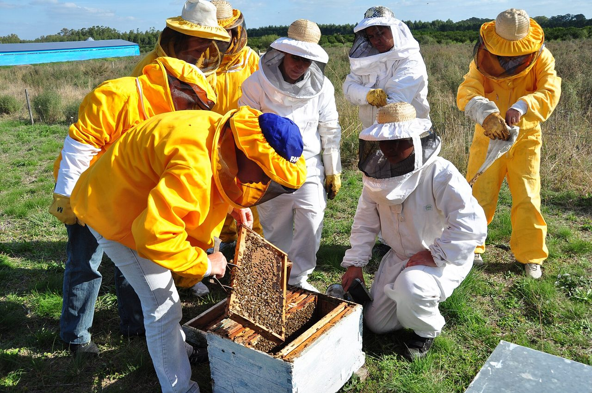

> Eskişehir İl Tarım ve Orman Müdürlüğü koordinatörlüğünde yürütülen Erasmus+ kapsamındaki bestHONEY Projesi'nin mesleki eğitim personeline yönelik yaygınlaştırma toplantısı gerçekleştirildi.

Eskişehir İl Tarım ve Orman Müdürlüğü koordinatörlüğünde; Fransa, İtalya ve İspanya'daki proje ortaklarıyla birlikte yürütülen Erasmus+ Mesleki Eğitim Alanında İş Birliği Ortaklıkları kapsamındaki bestHONEY Projesi'nin yaygınlaştırma toplantısı Eskişehir'de düzenlendi.

Toplantının açılış konuşmasını yapan Eskişehir İl Tarım ve Orman Müdürü Yüksel Çil, projenin sürdürülebilir arıcılığa sağlayacağı katkılara dikkat çekti. Çil, uluslararası ortaklıklarla hazırlanan eğitim materyallerinin Türkiye'nin yanı sıra Avrupa ve dünyadaki meslek gruplarının bilgi birikimine de destek olacağını belirterek, uluslararası iş birliklerinin kurumsal kapasiteyi artırdığını ifade etti.

Programda, İl Müdürlüğü personeli ve proje koordinatörü Veteriner Hekim Dr. Hatice Olcay projenin amacı, uluslararası faaliyetleri ve geliştirilen bilgi ve iletişim teknolojileri tabanlı eğitim materyalleri hakkında katılımcılara sunum yaptı. Sunumda modern teknik arıcılık, arı hastalıkları ve balda mevzuat gereklilikleri başlıklarında hazırlanan içeriklerin Türkçe, İngilizce, Fransızca, İtalyanca ve İspanyolca olmak üzere beş dilde hazırlandığı aktarıldı.

Toplantının devamında İl Müdürlüğü personeli Veteriner Hekim E. Selçuk Özkütük tarafından arı hastalıkları ve tedavisi konusunda mesleki eğitim personeline bilgilendirme yapıldı.

---

## Eskişehir'de 10 Kasım Anma Programı Düzenlendi

**Gündem · Merkez** · 2026-11-10 13:31 UTC · Kaynak: [Eskişehir Valiliği](https://www.eskisehir.gov.tr/valimiz-dr-erdinc-yilmaz-10-kasim-ataturku-anma-programina-katildi)

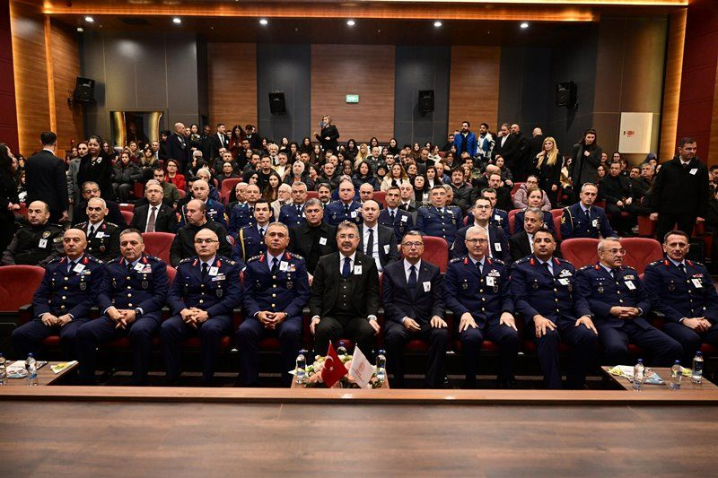

> Cumhuriyetimizin kurucusu Gazi Mustafa Kemal Atatürk, ebediyete irtihalinin 88. yıl dönümünde düzenlenen törenle anıldı.

Türkiye Cumhuriyeti'nin kurucusu Büyük Önder Gazi Mustafa Kemal Atatürk'ün ebediyete irtihalinin 88. yıl dönümü dolayısıyla Eskişehir'de anma programı gerçekleştirildi.

İl Millî Eğitim Müdürlüğü tarafından düzenlenen program, saygı duruşunda bulunulması ve İstiklal Marşı'nın okunmasıyla başladı. Şehit İsmail Tetik Anadolu Lisesi öğretmen ve öğrencilerinin hazırladığı anlamlı anma etkinlikleri katılımcılara sunuldu.

Tören, Gazi Mustafa Kemal Atatürk'ün saygı, minnet ve özlemle anılmasının ardından çekilen hatıra fotoğrafıyla sona erdi.

---
