# Son haberler

Ajanın yazdığı son haberler (otomatik güncellenir).

## Altın fiyatları 1 Kasım 2026: Gram altın 6.288,41 TL

**Ekonomi · Merkez** · 2026-11-01 12:20 UTC · Kaynak: [Harem Altın](https://www.haremaltin.com/altin-fiyatlari)

> Gram altın güne düşüşle başladı. Harem Altın verilerine göre gram altın 6.206,84 TL'den alınıyor, 6.288,41 TL'den satılıyor.

Altın piyasasında güne düşüşle başlandı. Harem Altın'ın saat 15.20 itibarıyla verilerine göre gram altının satış fiyatı 6.288,41 TL, alış fiyatı 6.206,84 TL oldu. Gram altın, önceki kapanışa göre yüzde 3,03 geriledi.

Ziynet altınlarda çeyrek altın 10.250 TL, yarım altın 20.493 TL, tam altın 40.823 TL, ata altın 41.920 TL seviyesinden satışa sunuluyor.

22 ayar bileziğin gram satış fiyatı 5.873,42 TL, has altının gram fiyatı 6.269,60 TL olarak belirlendi.

Uluslararası piyasalarda altının onsu 3.877,30 dolardan işlem görürken, dolar/TL 49,92 seviyesinde bulunuyor.

Fiyatlar Harem Altın'ın saat 15.20 itibarıyla paylaştığı verilere dayanmaktadır; kuyumcular arasında farklılık gösterebilir. Bu haber yatırım tavsiyesi değildir.

---

## Erdoğan, Zelenskiy ile Dolmabahçe'de görüştü: Karadeniz'de seyrüsefer vurgusu

**Türkiye · Türkiye** · 2026-10-31 17:31 UTC · Kaynak: [İletişim Başkanlığı](https://www.iletisim.gov.tr/turkce/haberler/detay/cumhurbaskani-erdogan-ukrayna-devlet-baskani-zelenskiy-ile-ortak-basin-toplantisinda-konustu-31-10-26)

> Erdoğan, Ukrayna'da barış çabalarını ve Karadeniz'deki güvenlik durumunu ele aldıklarını söyledi.

Cumhurbaşkanı Recep Tayyip Erdoğan ile Ukrayna Devlet Başkanı Volodimir Zelenskiy, Dolmabahçe Ofisi'nde yapılan ikili ve heyetler arası görüşmelerin ardından ortak basın toplantısı düzenledi.

Erdoğan, görüşmede Ukrayna'da barışın sağlanmasına yönelik son dönemde artan çabaları ve Karadeniz'deki güvenlik durumunu ele aldıklarını söyledi. Savaşın, özellikle ABD Başkanı Trump'ın çabalarıyla diplomatik yollarla sona erdirilmesine yönelik girişimlerin yeniden hız kazanmasından memnuniyet duyduklarını belirten Erdoğan, "Adil bir barışın kaybedeni olmaz" dedi ve barışa giden yolu açmak için gayret göstermeye hazır olduklarını ifade etti.

Erdoğan, çatışmaların Karadeniz'e sıçradığını belirterek, sivil gemilere yönelik saldırıların kimden gelirse gelsin kabul edilemeyeceğini söyledi, tüm tarafları sorumlu davranmaya çağırdı ve Karadeniz'de seyrüsefer emniyetini yeniden tesis etmek için taraflarla görüşmelerini sürdüreceklerini belirtti.

Ukrayna'nın toprak bütünlüğüne, egemenliğine ve bağımsızlığına bağlılıklarını teyit ettiklerini söyleyen Erdoğan, 2022'de imzalanan Serbest Ticaret Anlaşması'nın 1 Ekim itibarıyla yürürlüğe girmesinin 10 milyar dolar ticaret hacmi hedefine yaklaştırdığını ifade etti.

Toplantıda Millî Savunma Bakanı Yaşar Güler, MİT Başkanı İbrahim Kalın, İletişim Başkanı Burhanettin Duran, Savunma Sanayii Başkanı Haluk Görgün ve diğer isimler yer aldı.

---

## Altın fiyatları 31 Ekim 2026: Gram altın 6.280,35 TL

**Ekonomi · Merkez** · 2026-10-31 11:26 UTC · Kaynak: [Harem Altın](https://www.haremaltin.com/altin-fiyatlari)

> Gram altın güne düşüşle başladı. Harem Altın verilerine göre gram altın 6.202,49 TL'den alınıyor, 6.280,35 TL'den satılıyor.

Altın piyasasında güne düşüşle başlandı. Harem Altın'ın saat 14.26 itibarıyla verilerine göre gram altının satış fiyatı 6.280,35 TL, alış fiyatı 6.202,49 TL oldu. Gram altın, önceki kapanışa göre yüzde 3,15 geriledi.

Ziynet altınlarda çeyrek altın 10.236 TL, yarım altın 20.467 TL, tam altın 40.770 TL, ata altın 41.866 TL seviyesinden satışa sunuluyor.

22 ayar bileziğin gram satış fiyatı 5.865,88 TL, has altının gram fiyatı 6.261,57 TL olarak belirlendi.

Uluslararası piyasalarda altının onsu 3.877,30 dolardan işlem görürken, dolar/TL 49,90 seviyesinde bulunuyor.

Fiyatlar Harem Altın'ın saat 14.26 itibarıyla paylaştığı verilere dayanmaktadır; kuyumcular arasında farklılık gösterebilir. Bu haber yatırım tavsiyesi değildir.

---

## Aile ve Sosyal Hizmetler İl Müdürlüğü'nde değerlendirme toplantısı: yatırımlar ele alındı

**Gündem · Merkez** · 2026-10-30 18:31 UTC · Kaynak: [Google Haberler - Eskişehir](https://www.aile.gov.tr/eskisehir/haberler/il-mueduerlueguemuezde-degerlendirme-toplantisi-biz-bu-devletin-emanet-kasasiyiz/)

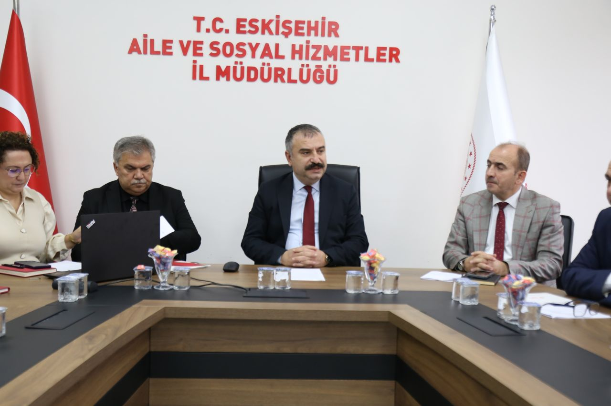

> İl Müdürü Orhan Bayrak, bakım merkezleri ve yeni tesis projelerinin süreçlerinin titizlikle takip edilmesinin önemini vurguladı.

Eskişehir Aile ve Sosyal Hizmetler İl Müdürlüğü'nde, İl Müdürü Orhan Bayrak başkanlığında koordinasyon toplantısı yapıldı. Toplantıya il müdürlüğüne bağlı kuruluşların idarecileri ve il müdür yardımcıları katıldı.

Toplantıda 29 Ekim Cumhuriyet Bayramı kapsamında il genelinde düzenlenen resmî törenler ve kuruluş içi etkinlikler değerlendirildi. Bayrak, kuruluşlarda misafir edilen çocukların, engellilerin ve yaşlıların bayramı coşkuyla yaşamasını sağlayan organizasyonlar için idarecilere ve personele teşekkür etti. Bayrak, "Bizler bu devletin emanet kasasıyız. Bakım ve koruma, bizim birinci ve en temel vazifemizdir" dedi.

İl genelinde yürütülen ve yapımına başlanması planlanan hizmet binaları, bakım merkezleri ve ek tesis projeleri de ele alındı; inşaat çalışmalarının fiziki gerçekleşme oranları gözden geçirildi. Bakanlık merkezindeki İl Müdürleri Toplantısı'nın çıktıları da görüşüldü. Sosyal dayanışma ağını güçlendirmeyi amaçlayan "İyilik Var" uygulamasının il genelinde daha etkin tanıtılması ve yaygınlaştırılması kararlaştırıldı. Dezavantajlı kesimlerin ihtiyaçlarını önceden tespit etmeyi amaçlayan "Sosyal Risk Haritası" çalışmalarının tamamlanması için birimler arası koordinasyonun artırılması gerektiği vurgulandı.

---

## Odunpazarı'nda özel gereksinimli bireylerin annelerine ücretsiz psikolojik danışmanlık

**Sağlık · Odunpazarı** · 2026-10-30 15:59 UTC · Kaynak: [Odunpazarı Belediyesi](https://www.odunpazari.bel.tr/guncel/haberler/genel-haberler/odunpazari-ndan-ozel-gereksinimli-bireylerin-annelerine-psikolojik-danismanlik-d-1)

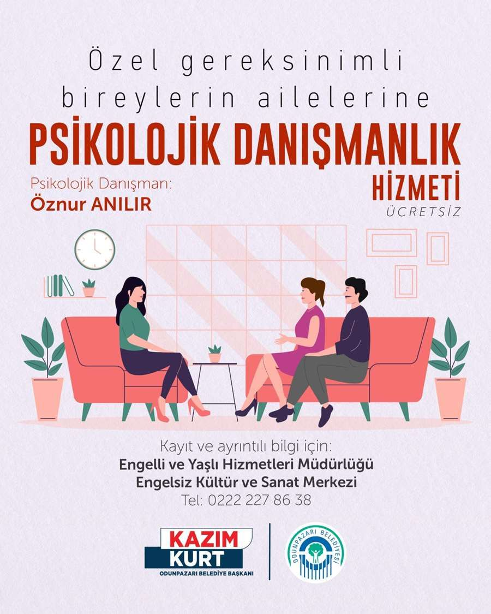

> Hizmet Engelsiz Kültür ve Sanat Merkezi'nde Psikolojik Danışman Öznur Anılır tarafından yürütülüyor.

Odunpazarı Belediyesi, Engelli ve Yaşlı Hizmetleri Müdürlüğü bünyesinde özel gereksinimli bireylerin aileleri için ücretsiz Psikolojik Danışmanlık Hizmeti sunuyor. Hizmetle ailelerin psikolojik açıdan desteklenmesi ve karşılaştıkları süreçlerde yalnız olmadıklarını hissetmeleri amaçlanıyor.

Hizmet, Engelsiz Kültür ve Sanat Merkezi'nde Psikolojik Danışman Öznur Anılır tarafından yürütülüyor. Belediyenin aktardığına göre çalışmayla ailelerin yaşadıkları süreçleri daha sağlıklı yönetmelerine, duygusal ihtiyaçlarını ifade etmelerine ve güçlüklerle baş etme becerilerini geliştirmelerine destek olunması hedefleniyor.

Ücretsiz Psikolojik Danışmanlık Hizmeti hakkında bilgi almak ve kayıt yaptırmak isteyenler Engelsiz Kültür ve Sanat Merkezi'ne başvurabilir. Ayrıntılı bilgi için Odunpazarı Belediyesi'nin 0222 227 86 38 numaralı telefonu aranabilir.

---

## Odunpazarı Belediyesi pazarlarda tartı kontrol noktası kurdu: eksik gramaj çıkmadı

**Belediye · Odunpazarı** · 2026-10-30 13:47 UTC · Kaynak: [Odunpazarı Belediyesi](https://www.odunpazari.bel.tr/guncel/haberler/genel-haberler/odunpazari-belediyesi-nden-pazarlarda-elektronik-tarti-denetimi-2)

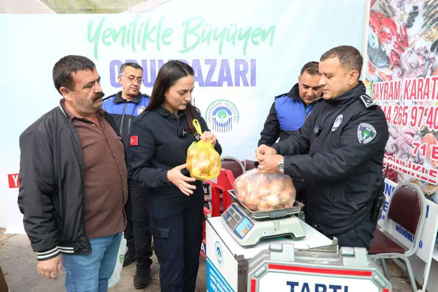

> Zabıta Emek Mahallesi Kapalı Pazar Yeri'nde denetim yaptı.

Odunpazarı Belediyesi Zabıta Müdürlüğü ekipleri, Pazar Uygulama Yönetmeliği kapsamında pazarlarda ölçü ve tartı aletlerinin hileli kullanımına karşı denetimlerini sürdürüyor. Ekipler son olarak Emek Mahallesi Kapalı Pazar Yeri'nde denetim yaptı.

Denetim sırasında pazar alanında Odunpazarı Belediyesi Tartı Kontrol Noktası kuruldu. Alışveriş yapan vatandaşlar satın aldıkları ürünleri burada yeniden tarttırabildi. Belediyenin aktardığına göre yapılan denetimlerde eksik gramaja rastlanmadı.

Zabıta Müdürlüğü yetkilileri, denetimlerin yalnızca kapalı pazar yerleriyle sınırlı kalmayacağını, ilçedeki diğer pazarlarda da düzenli olarak sürdürüleceğini açıkladı.

---

## Ayşe Kulin 31 Ekim'de Odunpazarı'nda okurlarıyla buluşacak

**Kültür-Sanat · Odunpazarı** · 2026-10-30 13:47 UTC · Kaynak: [Odunpazarı Belediyesi](https://www.odunpazari.bel.tr/guncel/haberler/genel-haberler/ayse-kulin-odunpazari-nda-okurlariyla-bulusacak)

> "Cumhuriyet ve Edebiyat" söyleşisi ve imza günü Hasan Polatkan Kültür Merkezi'nde, ücretsiz.

Odunpazarı Belediyesi, yazar Ayşe Kulin'i Eskişehirli okurlarla buluşturuyor. "Cumhuriyet ve Edebiyat" başlığıyla düzenlenecek söyleşi ve imza günü, 31 Ekim Cumartesi günü saat 15.00'te Hasan Polatkan Kültür Merkezi'nde yapılacak.

Etkinlik, Cumhuriyet'in edebiyatla kurduğu ilişkiyi odağına alıyor. Söyleşinin ardından düzenlenecek imza gününde okurlar kitaplarını Ayşe Kulin'e imzalatabilecek. Söyleşi ve imza günü ücretsiz.

---

## Odunpazarı'nın yaşlı merkezlerinde Cumhuriyet coşkusu: piyes ve balo

**Gündem · Odunpazarı** · 2026-10-30 12:57 UTC · Kaynak: [Odunpazarı Belediyesi](https://www.odunpazari.bel.tr/guncel/haberler/genel-haberler/odunpazari-nda-cinarlar-cumhuriyet-coskusunu-yasadi)

> Koca Çınar Yaşam Merkezi ve Lütfü Yüksel Yaşlı Bakım Merkezi'nde 103. yıl kutlandı.

Odunpazarı Belediyesi'nin yaşlılara yönelik hizmet veren merkezlerinde Cumhuriyet'in 103. yıl dönümü kutlandı. Belediyenin Engelli ve Yaşlı Hizmetleri Müdürlüğü'ne bağlı Koca Çınar Yaşam Merkezi'nde piyes ve balo düzenlendi, Lütfü Yüksel Yaşlı Bakım Merkezi'nin sakinleri de bayramı kutladı.

Gültepe Mahallesi Üniversite Evleri'ndeki Koca Çınar Yaşam Merkezi'nde hazırlanan programla Cumhuriyet'in anlamına dikkat çekildi, baloyla bayram sevinci paylaşıldı. Lütfü Yüksel Yaşlı Bakım Merkezi'nde ise merkezin kıdemli sakinleri Cumhuriyet'in 103. yıl dönümünü birlik, beraberlik ve Atatürk sevgisiyle karşıladı.

Odunpazarı Belediyesi, sosyal belediyecilik anlayışıyla yaş almış yurttaşların sosyal yaşamın içinde yer almasını destekleyen çalışmalarını sürdürdüğünü belirtti.

---

## Odunpazarı Belediyesi'nin Cumhuriyet programında müzik, tiyatro ve halk dansları

**Kültür-Sanat · Odunpazarı** · 2026-10-30 12:57 UTC · Kaynak: [Odunpazarı Belediyesi](https://www.odunpazari.bel.tr/guncel/haberler/genel-haberler/odunpazari-nda-cumhuriyet-coskusu-sanatla-sahneye-tasindi)

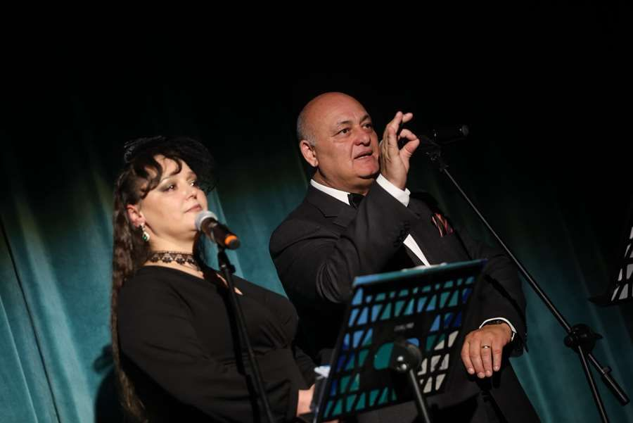

> Programda Cumhuriyet'e iz bırakan isimler sahnede canlandırıldı; Başkan Kurt konuştu.

Odunpazarı Belediyesi Kültür, Sanat ve Sosyal İşler Müdürlüğü'nün düzenlediği Cumhuriyet Bayramı kutlama programında Cumhuriyet'in kazanımları müzik, tiyatro, şiir ve halk danslarıyla anlatıldı. Programa Odunpazarı Belediye Başkanı Kazım Kurt, Eskişehir Büyükşehir Belediyesi Başkan Vekili Hasan Ünal, Tepebaşı Belediye Başkan Vekili Mehmet Baturay Özkan, Çağdaş Sen Eskişehir Şube Başkanı Deniz Kalkan ve çok sayıda Eskişehirli katıldı.

Saygı duruşu ve İstiklal Marşı ile başlayan programda Hülya Düzbaş "Yüzüm Şen, Hatıram Şen", "Mehtaplı Bir Gecede" ve "Bir Pembe İncisin Sen" eserlerini seslendirdi. Odunpazarı Belediye Tiyatrosu'nun canlandırmalarında Semiha Berksoy, Afife Jale, Müzeyyen Senar, Cahide Sonku, Samiye Cahid Morkaya, Remziye Hisar, Ahmet Adnan Saygun, Cahit Arf, Hasan Âli Yücel, Yaşar Kemal ve Vecihi Hürkuş gibi isimler izleyiciyle buluştu.

Utku Görkem Kırdemir, Attilâ İlhan'ın "Mustafa Kemal'in Sofrası" şiirini okudu; Serpil Mercan Vurucu "Ben Cumhuriyet Kadınıyım" şiirini seslendirdi. Odunpazarı Belediyesi Halk Dansları ekibi gösteri yaptı, tango gösterisi de programa renk kattı. Programın sonunda konuşan Başkan Kazım Kurt, Cumhuriyet'e ve kazanımlarına sahip çıkma çağrısı yaptı.

---

## Altın fiyatları 30 Ekim 2026: Gram altın 6.395,34 TL

**Ekonomi · Merkez** · 2026-10-30 11:52 UTC · Kaynak: [Harem Altın](https://www.haremaltin.com/altin-fiyatlari)

> Gram altın güne düşüşle başladı. Harem Altın verilerine göre gram altın 6.300,18 TL'den alınıyor, 6.395,34 TL'den satılıyor.

Altın piyasasında güne düşüşle başlandı. Harem Altın'ın saat 14.52 itibarıyla verilerine göre gram altının satış fiyatı 6.395,34 TL, alış fiyatı 6.300,18 TL oldu. Gram altın, önceki kapanışa göre yüzde 1,38 geriledi.

Ziynet altınlarda çeyrek altın 10.424 TL, yarım altın 20.841 TL, tam altın 41.548 TL, ata altın 42.645 TL seviyesinden satışa sunuluyor.

22 ayar bileziğin gram satış fiyatı 5.973,64 TL, has altının gram fiyatı 6.376,21 TL olarak belirlendi.

Uluslararası piyasalarda altının onsu 3.968,30 dolardan işlem görürken, dolar/TL 49,79 seviyesinde bulunuyor.

Fiyatlar Harem Altın'ın saat 14.52 itibarıyla paylaştığı verilere dayanmaktadır; kuyumcular arasında farklılık gösterebilir. Bu haber yatırım tavsiyesi değildir.

---

## Tepebaşı'nda kazılan yol ve kaldırımlar mahalle mahalle yenileniyor

**Belediye · Tepebaşı** · 2026-10-30 11:32 UTC · Kaynak: [Tepebaşı Belediyesi](https://www.tepebasi.bel.tr/Haber/Detay/tepebası’ndaustyapıatagı)

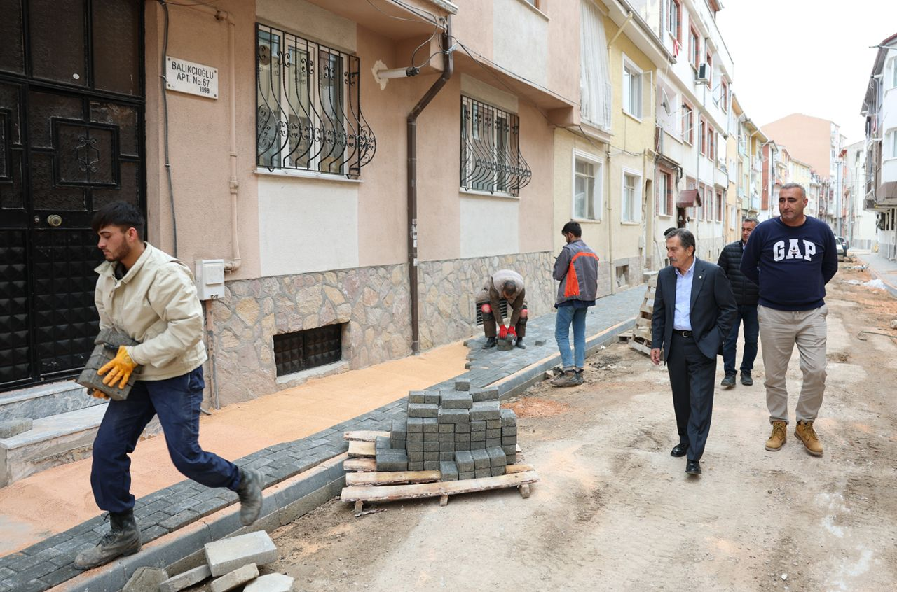

> Başkan Ataç, Yeni Mahalle'de tamamlanan, Işıklar ve Şeker'de süren çalışmaları inceledi.

Tepebaşı Belediyesi, alt yapı hizmeti yürüten kurum ve kuruluşların çalışmaları sırasında kazılan yol ve kaldırımları mahalle mahalle yeniliyor. Başkan Dt. Ahmet Ataç, Fen İşleri Müdürlüğü ekiplerinin sürdürdüğü çalışmaları yerinde inceledi.

Ataç, Yeni Mahalle'de çalışmaların tamamlandığını, Işıklar Mahallesi'nde yoğun biçimde sürdüğünü, Şeker Mahallesi'nde de bazı sokakların yenilendiğini söyledi. Fen İşleri Müdür Vekili Enes Akgün'den sahadaki çalışmalar hakkında bilgi alan Ataç, uygulamanın beş mahallede yürütüldüğünü belirtti.

Temmuz ayının sonunda başlayan çalışmalarda kaldırım işlerinin tamamlanmak üzere olduğunu, asfalt yenilemelerinin ise sürdüğünü ifade eden Ataç, "Şimdi sokakları bitirerek bu mahallelerdeki yenileme çalışmalarını tamamlayacağız" dedi. Ataç, iklim koşullarının çalışmaları engellememesini dilediğini de söyledi.

---

## Odunpazarı'nda anneler ve çocuklar Cumhuriyet'i Alaaddin Parkı'nda kutladı

**Gündem · Odunpazarı** · 2026-10-30 11:32 UTC · Kaynak: [Odunpazarı Belediyesi](https://www.odunpazari.bel.tr/guncel/haberler/genel-haberler/cumhuriyet-coskusu-anneler-ve-cocuklarla-alaaddin-parki-na-tasindi)

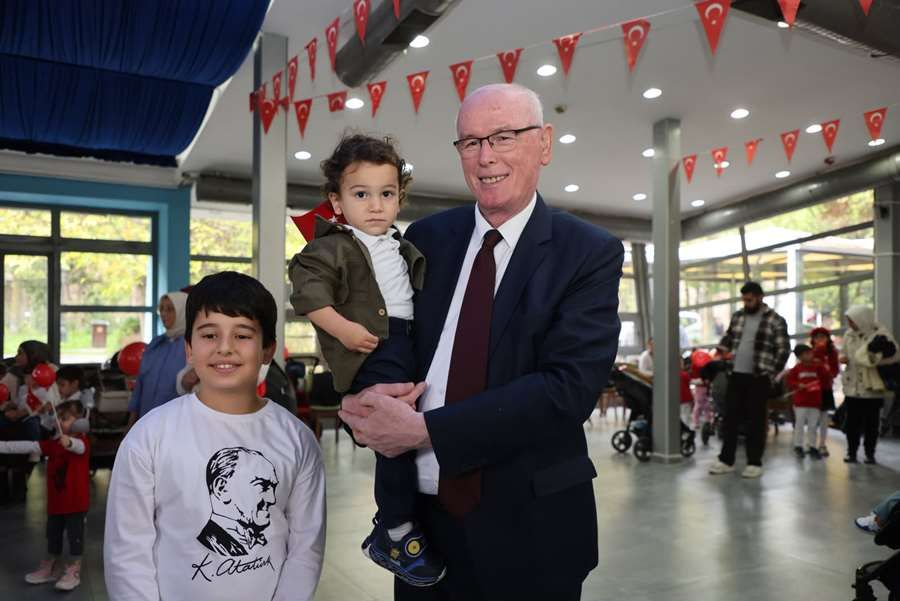

> Odunpazarı Belediyesi ve Eskişehir Anneleri Buluşuyor'un şenliğinde çocuklar hatıra afişine el izlerini bıraktı.

Odunpazarı Belediyesi, Eskişehir Anneleri Buluşuyor iş birliğiyle Alaaddin Parkı'nda Cumhuriyet Şenliği düzenledi. Anneler ve çocuklar Cumhuriyet'in 103. yıl dönümünü birlikte kutladı.

Atatürk ve Cumhuriyet temalı gösterimlerle başlayan şenlikte Cumhuriyet marşları söylendi, çocuklara Türk bayrağı dağıtıldı. Çocuklar ellerini kırmızı boyaya batırarak ortak hatıra afişine izlerini bıraktı. Etkinlik, her yaştan çocuğun katılımına açık ve ücretsizdi; belediye, Eskişehir'de bir ilk olarak çocuklara özel hazırlandığını aktardı.

Şenliğe katılan Odunpazarı Belediye Başkanı Kazım Kurt, çocuklarla sohbet etti ve fotoğraf çektirdi. Kurt, konuşmasında "103 yıldır Türkiye'de kadın erkek eşitliğini sağlayan, demokrasiyi getiren, hukukun üstünlüğünü getiren bir cumhuriyetimiz var. Buna sonuna kadar sahip çıkmalıyız" dedi. Kurt ayrıca "Cumhuriyet ve çocuklar size emanet" ifadesini kullandı.

---

## Kurşunlu Külliyesi'nde 3 Kasım tahliyesi durduruldu

**Belediye · Odunpazarı** · 2026-10-30 11:32 UTC · Kaynak: [Odunpazarı Belediyesi](https://www.odunpazari.bel.tr/guncel/haberler/genel-haberler/eskisehirlilerin-tepkisi-karsilik-buldu-kursunlu-kulliyesi-nde-tahliye-durdurul)

> Kaymakamlık, yürütmeyi durdurma talebine ilişkin mahkeme kararını bekleyecek.

Odunpazarı Belediyesi'nin kullandığı alanların 3 Kasım'da boşaltılmasını öngören Kurşunlu Külliyesi tahliye işlemi durduruldu. Odunpazarı Kaymakamlığı, mahkemenin yürütmeyi durdurma talebiyle ilgili kararını bekleyecek.

Odunpazarı Belediyesi'nin aktardığına göre, Odunpazarı Kaymakamlığı İlçe Hukuk İşleri Şefliği'nin 30 Ekim 2026'da belediyeye gönderdiği resmî yazıda, belediyenin tahliye işlemine karşı Eskişehir 1. İdare Mahkemesi'nde dava açtığı hatırlatıldı. Yazıda mahkemenin 26 Ekim 2026 tarihli ve 2026/1219 Esas sayılı kararına dikkat çekildi. Yürütmeyi durdurma talebiyle ilgili karar verilinceye kadar taşınmazın tahliyesinin durdurulmasına karar verildiği, mahkeme kararının ardından taraflardan talep gelmesi hâlinde konunun yeniden değerlendirileceği bildirildi.

Belediye, tahliye durdurulduğu için külliyedeki mevcut faaliyetlerin şimdilik devam edeceğini belirtti. Odunpazarı Belediyesi, 2004'ten bu yana kira sözleşmeleri kapsamında kullandığı külliyede kapsamlı restorasyon ve düzenleme çalışmaları yaptığını, külliyede Ahşap Eserler Müzesi, Osman Yaşar Tanaçan Fotoğraf Müzesi, Lületaşı Müzesi ve Cam Sanatları Merkezi'nin bulunduğunu aktardı. Belediyeye göre külliyede kadın girişimcilerin işlettiği işletmeler var, yaklaşık 30 kişi çalışıyor ve yüzlerce kursiyer sanat eğitimi alıyor. Belediye, kira sözleşmesinin beş yıl uzatılması talebine yanıt verilmemesi üzerine yargı yoluna başvurduğunu ifade etti.

Vakıflar Bölge Müdürlüğü'nün görüşü kaynakta yer almıyor.

---

## Erdoğan TDT Zirvesi'nde konuştu: Dönem başkanlığı Türkiye'ye geçti

**Türkiye · Türkiye** · 2026-10-30 09:32 UTC · Kaynak: [İletişim Başkanlığı](https://www.iletisim.gov.tr/turkce/haberler/detay/cumhurbaskani-erdogan-turk-devletleri-teskilati-devlet-baskanlari-konseyi-13-zirvesinde-konustu)

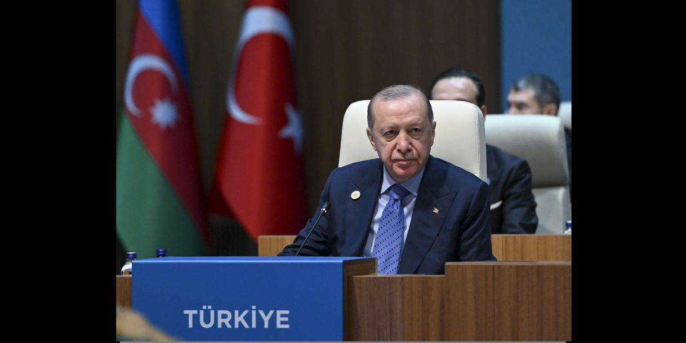

> Erdoğan, 13. Zirve'de Türkiye'nin dönem başkanlığı hedeflerini ve bölgesel gelişmelere ilişkin görüşlerini anlattı.

Cumhurbaşkanı Recep Tayyip Erdoğan, Beştepe Millet Sergi Salonu'nda "Türk Yüzyılı: Dilde, Fikirde, İşte Birlik" temasıyla düzenlenen Türk Devletleri Teşkilatı (TDT) Devlet Başkanları Konseyi 13. Zirvesi'nde konuştu.

Erdoğan, Teşkilat'ın dönem başkanlığını Azerbaycan'dan devraldıklarını söyledi ve Azerbaycan'a teşekkür etti. Dönem başkanlığında kurumsal birikimi daha somut kazanımlara dönüştürmeyi hedeflediklerini belirten Erdoğan, ortak dilin yaygınlaştırılması, spor başta olmak üzere kültürel etkinliklerin desteklenmesi ve ülkeler arasında seyahatlerin kolaylaştırılması gibi alanlarda ilerleme kaydetmek istediklerini ifade etti. Türkmenistan'ı en kısa zamanda tam üye olarak görmeyi temenni ettiğini de söyledi.

Erdoğan, Azerbaycan'ın Ermenistan ile yürüttüğü temasları desteklediğini, kalıcı barış için katkı sunmaya devam edeceklerini belirtti. İran ile son dönemde artan tansiyonun diplomasiye dönüşmesini temenni ettiğini söyleyen Erdoğan, Filistin meselesinin adil çözümü için daha fazla çaba gösterilmesi gerektiğini, Gazze'ye insani yardımların ulaştırılması ve yeniden imar çalışmalarının başlatılması gerektiğini ifade etti.

Ticaret, ulaştırma ve enerji alanına da değinen Erdoğan, Trans-Hazar-Doğu-Batı Orta Koridoru'nu "yarının ticaretine yön verecek stratejik bir hat" olarak niteledi. Siber güvenlik ve siber işbirliği mutabakatının en kısa sürede imzalanmasını beklediklerini, ortak uydu projesinin hızlandırılmasının öncelikleri arasında olduğunu, ortak dijital ticaret platformu ve büyük Türk dili modeli için çalışmalar yapılmasını beklediklerini söyledi.

Erdoğan, 11-12 Kasım'da COP31 Liderler Zirvesi'ne Antalya'da ev sahipliği yapacaklarını hatırlattı ve üyeleri zirveye davet etti. Görev süresi sona eren TDT Genel Sekreteri Kubanıçbek Ömüraliyev'e teşekkür etti, yeni Genel Sekreter Mirvahid Azimov'a başarılar diledi.

---

## Eskişehirspor, Iğdır FK'yı 90+7'de eledi: Türkiye Kupası'nda 4. tura çıktı

**Spor · Merkez** · 2026-10-29 20:35 UTC · Kaynak: [Google Haberler - Eskişehir](https://www.esgazete.com/eskisehirspor-907de-turu-kapti)

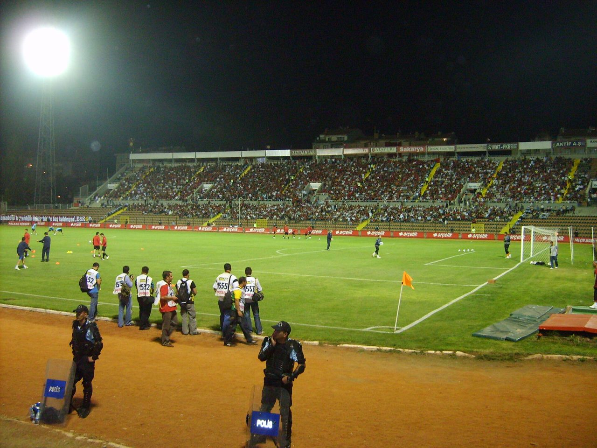

> Kırmızı-siyahlılar Kerem Baykuş'un son dakika golüyle Ziraat Türkiye Kupası'nda tur atladı.

Ziraat Türkiye Kupası 3. Eleme Turu'nda Alagöz Holding Iğdır FK'yı konuk eden Eskişehirspor, Kerem Baykuş'un 90+7. dakikada attığı golle rakibini 1-0 yendi ve 4. eleme turuna yükseldi.

Karşılaşma, 29 Ekim Cumhuriyet Bayramı'nda Prof. Dr. Fethi Heper Stadyumu'nda oynandı. İlk yarı golsüz sona erdi, ikinci yarıda da uzun süre gol çıkmadı. Eskişehirspor'da Kerem Baykuş, duran toptan attığı golle takımına tur biletini getirdi.

Maç öncesinde tribünlerde Cumhuriyet Bayramı coşkusu yaşandı. Türk bayraklarıyla donatılan tribünlerde taraftarlar, Bando Es Es'in çaldığı marşlarla Cumhuriyet'in 103. yılını kutladı.

Maçın kadrosu: Eskişehirspor: Kaan Çinkaya, Ertuğrul Kurtuluş, İsmail Kulet, Emre Sarıkaya, Sarper Çağlar, Ozan İsmail Koç, Mert Başer, Emre Tangeldi, Fırat Sarı, Atalay Yıldırım, Osman Arslantaş. Hakemler Raşit Yorgancılar, Mehmet Şengül ve Mehmet Ali Vardar'dı. Eskişehirspor'da Emre Tangeldi, Fırat Sarı ve Sarper Çağlar; Iğdır FK'da Alperen Selvi, Devran Şenyurt ve Ahmet Köse sarı kart gördü.

---

## Eskişehir'de Cumhuriyet'in 103. yıl dönümü töreni Atatürk Bulvarı'nda yapıldı

**Gündem · Merkez** · 2026-10-29 13:45 UTC · Kaynak: [Eskişehir Valiliği](https://www.eskisehir.gov.tr/valimiz-dr-erdinc-yilmaz-ve-esi-doc-dr-senay-yilmaz-hanimefendi-cumhuriyetimizin-103-yil-donumu-torenine-katildi)

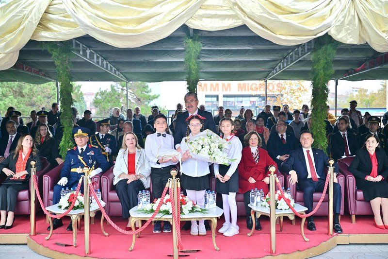

> Vali Yılmaz, Eskişehir'in savunma, havacılık, raylı sistemler ve nadir toprak elementleri alanlarında yeni başarılara imza atacağını söyledi.

Cumhuriyet'in kuruluşunun 103. yıl dönümü kutlamaları kapsamında Eskişehir'de Atatürk Bulvarı'nda resmî tören düzenlendi. Törene Vali Dr. Erdinç Yılmaz ve eşi Doç. Dr. Şenay Yılmaz da katıldı.

Tören, Vali Yılmaz, Muharip Hava Kuvveti ve Garnizon Komutanı Hava Orgeneral Erdoğan Gür ve Büyükşehir Belediye Başkanı Ayşe Ünlüce'nin askerî araçla törene katılanları ve vatandaşları selamlamasıyla başladı. Saygı duruşunun ve İstiklal Marşı'nın okunmasının ardından Cumhurbaşkanı Recep Tayyip Erdoğan'ın kutlama mesajı kendi sesinden dinlendi.

Törende konuşan Vali Yılmaz, Cumhuriyet'in 103. yıl dönümünü Eskişehir'de kutlamanın gururunu yaşadıklarını söyledi; Atatürk'ü ve Millî Mücadele kahramanlarını andı. "Kurtuluş Savaşımız milletimizin var olma ülküsü, Cumhuriyetimiz ise yeniden dirilişimizin adıdır" diyen Yılmaz, Cumhuriyet'in Türk milletinin karakterine en çok yakışan idare olduğunu belirtti. Gençlere seslenen Yılmaz, Türkiye'nin geleceğinin gençlerin ellerinde yükseleceğine olan inancını dile getirdi.

Vali Yılmaz, Eskişehir'in de savunma, havacılık, raylı sistemler ve nadir toprak elementleri alanlarında yeni başarılara imza atacağını ifade etti. Konuşmasını "Cumhuriyet Bayramımız kutlu olsun! Ne mutlu Cumhuriyetimize! Ne mutlu Türk'üm diyene!" sözleriyle tamamladı.

Şiirlerin okunması ve öğrencilerin halk oyunları gösterilerinin ardından askerî bando eşliğinde tören geçişi gerçekleştirildi. Vatandaşlar geçişe alkışlarla eşlik etti.

---

## Tepebaşı'nda Cumhuriyet coşkusu: kortej, konserler ve EKO-ŞOV

**Gündem · Tepebaşı** · 2026-10-29 12:44 UTC · Kaynak: [Tepebaşı Belediyesi](https://www.tepebasi.bel.tr/Haber/Detay/baskanatacklasikaracıylacoskuyaortakoldu)

> Başkan Ataç klasik aracıyla kortejde yer aldı; Özgenur Altaş ve Soup Opera konser verdi.

Tepebaşı Belediyesi'nin Cumhuriyet'in 103. yılı için düzenlediği etkinlikler büyük katılımla gerçekleşti. Başkan Ahmet Ataç, kendi kullandığı klasik otomobille Cumhuriyet Korteji'ne katılarak vatandaşları selamladı.

Kutlamalar 28 Ekim Çarşamba günü saat 17.30'da Şarhöyük Mahallesi Cumhuriyet Meydanı'ndan hareket eden kortejle başladı. Tepebaşı Belediyesi yanındaki açık otoparkta sona eren korteje Eskişehir Motosiklet Grubu 26, MOSEF, Vosbağa Eskişehir, Vos 26 Eskişehir, Yol Savaşçıları Türkiye ve Demir Pençe 26 Eskişehir motosikletleri ve klasik araçlarıyla destek verdi.

Kortejin ardından aynı alanda konserler yapıldı. Saat 19.00'da Özgenur Altaş, saat 20.00'de Soup Opera sahne aldı. Kutlamaların finali ise 29 Ekim Perşembe günü Espark AVM önünde gerçekleştirilen EKO-ŞOV gösterisi oldu.

Başkan Ataç, etkinliklerin ardından yaptığı değerlendirmede, "Biz Cumhuriyet'in çocuklarıyız. Büyük Önderimiz Mustafa Kemal Atatürk'ün bizlere emanet ettiği Cumhuriyet, en büyük ortak değerimizdir" dedi. Etkinliklere katılan hemşerilerine teşekkür eden Ataç, "Tepebaşı, Cumhuriyetine, Atatürk'üne ve aydınlık yarınlarına yürekten sahip çıkıyor" ifadesini kullandı.

---

## Altın fiyatları 29 Ekim 2026: Gram altın 6.488,18 TL

**Ekonomi · Merkez** · 2026-10-29 11:58 UTC · Kaynak: [Harem Altın](https://www.haremaltin.com/altin-fiyatlari)

> Gram altın güne yükselişle başladı. Harem Altın verilerine göre gram altın 6.398,52 TL'den alınıyor, 6.488,18 TL'den satılıyor.

Altın piyasasında güne yükselişle başlandı. Harem Altın'ın saat 14.58 itibarıyla verilerine göre gram altının satış fiyatı 6.488,18 TL, alış fiyatı 6.398,52 TL oldu. Gram altın, önceki kapanışa göre yüzde 0,05 yükseldi.

Ziynet altınlarda çeyrek altın 10.575 TL, yarım altın 21.143 TL, tam altın 42.151 TL, ata altın 42.973 TL seviyesinden satışa sunuluyor.

22 ayar bileziğin gram satış fiyatı 6.060,65 TL, has altının gram fiyatı 6.468,77 TL olarak belirlendi.

Uluslararası piyasalarda altının onsu 4.019,30 dolardan işlem görürken, dolar/TL 49,89 seviyesinde bulunuyor.

Fiyatlar Harem Altın'ın saat 14.58 itibarıyla paylaştığı verilere dayanmaktadır; kuyumcular arasında farklılık gösterebilir. Bu haber yatırım tavsiyesi değildir.

---

## Cumhuriyet'in 103. yılında devlet erkanı Anıtkabir'de

**Türkiye · Türkiye** · 2026-10-29 09:31 UTC · Kaynak: [İletişim Başkanlığı](https://www.iletisim.gov.tr/turkce/haberler/detay/cumhurbaskani-erdogan-baskanligindaki-devlet-erkani-anitkabiri-ziyaret-etti-29-10-26)

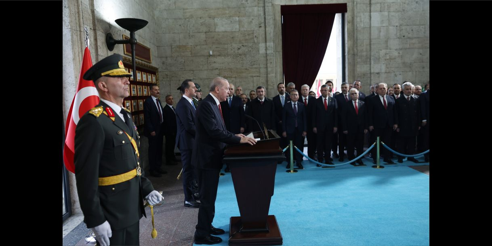

> Cumhurbaşkanı Erdoğan başkanlığındaki devlet erkanı Anıtkabir'i ziyaret etti, Özel Defter'e not yazdı.

29 Ekim Cumhuriyet Bayramı ve Cumhuriyet'in ilanının 103. yıl dönümü kutlamalarının ilk töreni Anıtkabir'de düzenlendi. Tören, devlet erkanının Aslanlı Yol'da yürüyüşüyle başladı.

Cumhurbaşkanı Recep Tayyip Erdoğan'ın başkanlığındaki kortejde TBMM Başkanı Numan Kurtulmuş, Cumhurbaşkanı Yardımcısı Cevdet Yılmaz, Yeni Parti Genel Başkanı Özgür Özel, MHP Genel Başkanı Devlet Bahçeli, CHP Genel Başkanı Kemal Kılıçdaroğlu, İYİ Parti Genel Başkanı Müsavat Dervişoğlu, Kabine üyeleri, yüksek yargı organlarının başkanları, Genelkurmay Başkanı Orgeneral Selçuk Bayraktaroğlu, kuvvet komutanları, siyasi partilerin temsilcileri ve diğer devlet erkanı yer aldı.

Erdoğan, üzerinde ay yıldız bulunan çelengi Atatürk'ün mozolesine bıraktı. Ardından saygı duruşunda bulunuldu ve İstiklal Marşı okundu. Erdoğan ve beraberindekiler daha sonra Misak-ı Millî Kulesi'ne geçti.

Erdoğan, burada Anıtkabir Özel Defteri'ne yazdığı notta Atatürk'ü, silah arkadaşlarını ve şehitleri şükranla andı. Notunda "Türkiye Cumhuriyeti'ni, devleti ve milletiyle birlikte müreffeh ve muzaffer yarınlara ulaştırmak için farklı cephelerde yoğun bir mücadele içindeyiz" ifadesini kullanan Erdoğan, Türkiye Yüzyılı hedefine ulaşıncaya kadar kararlılıkla çalışmayı sürdüreceklerini yazdı.

---

## Erdoğan'dan Cumhuriyet Bayramı video mesajı: "Türkiye bugün dünden daha güçlü"

**Türkiye · Türkiye** · 2026-10-29 07:31 UTC · Kaynak: [İletişim Başkanlığı](https://www.iletisim.gov.tr/turkce/haberler/detay/cumhurbaskani-erdogandan-cumhuriyet-bayrami-mesaji-29-10-26)

> Cumhurbaşkanı Erdoğan, Cumhuriyet'in 103. yılında video mesaj yayımladı.

Cumhurbaşkanı Recep Tayyip Erdoğan, 29 Ekim Cumhuriyet Bayramı dolayısıyla video mesaj yayımladı. Cumhuriyet'in kuruluşunun 103. yıl dönümünün büyük bir gurur ve coşkuyla kutlandığını belirten Erdoğan, vatandaşların, Kıbrıs Türkü kardeşlerin ve dünyanın farklı yerlerinde yaşayan Türklerin bayramını tebrik etti.

Erdoğan, Türkiye'nin yakın çevresinde ve dünyanın farklı yerlerinde savaşların, çatışmaların ve krizlerin yaşandığı zor bir dönemde istikrarını koruduğunu, anlaşmazlıkların çözümü için de sorumluluk aldığını söyledi.

Cumhuriyet'i Türk milletinin bağımsızlık iradesinin ve hür yaşama kararlılığının en güçlü nişanesi olarak niteleyen Erdoğan, Gazi Mustafa Kemal önderliğindeki Millî Mücadele'nin, birlik ve beraberlik içinde kenetlenen bir milletin en zor şartlarda neleri başarabileceğini dünyaya gösterdiğini belirtti. Son 24 yılda savunma sanayisinden enerjiye, ulaştırmadan diplomasiye uzanan alanlarda katedilen mesafeyi "müessir ve müreffeh Türkiye'ye giden yolun kilometre taşları" olarak gördüklerini ifade etti.

"Dünyada barış, bölgede barış ve yurtta barış" şiarıyla barış ve adalet için gayret göstermeye devam edeceklerini söyleyen Erdoğan, Türkiye Yüzyılı hedefini hayata geçireceklerini belirtti. Erdoğan, "Türkiye hamdolsun bugün dünden daha güçlüdür" ifadesini kullandı.

Mesajın sonunda Atatürk'ü, silah arkadaşlarını, Millî Mücadele kahramanlarını ve şehitleri rahmetle andı, gazilere şükranlarını sundu.

---

## Bakan Tekin'den Cumhuriyet Bayramı mesajı: "Eğitim en sağlam dayanağımız"

**Eğitim · Türkiye** · 2026-10-29 06:31 UTC · Kaynak: [Milli Eğitim Bakanlığı](https://www.meb.gov.tr/bakan-tekin039in-29-ekim-cumhuriyet-bayrami-mesaji/haber/42330/tr)

> Bakan Tekin, Cumhuriyet'in 103. yılında Maarif Modeli'ne ve öğretmenlere vurgu yaptı.

Millî Eğitim Bakanı Yusuf Tekin, Cumhuriyet'in ilanının 103. yıl dönümü dolayısıyla bir mesaj yayımladı. Tekin, mesajında yurdun dört bir yanındaki vatandaşların, Kıbrıs Türk halkının, yurt dışında yaşayanların ve bütün eğitim camiasının 29 Ekim Cumhuriyet Bayramı'nı kutladı.

Bakan Tekin, bu özel günün milletin birliğini ve kardeşliğini güçlendirmesini, ülke ve bütün insanlık için huzura ve barışa vesile olmasını diledi. Cumhuriyet'in banisi Gazi Mustafa Kemal Atatürk'ü, Millî Mücadele'yi yöneten Gazi Meclis'in mensuplarını ve bu mücadelenin bütün kahramanlarını şükranla andığını belirtti; şehitleri rahmetle, gazileri minnetle andı.

Tekin, Cumhuriyet'in ikinci yüzyılının şafağında Cumhurbaşkanı'nın işaret ettiği Türkiye Yüzyılı hedeflerine millet olarak omuz verdiklerini söyledi. Bu hedefin en sağlam dayanağının eğitim, en büyük güvencesinin ise iyi yetişmiş nesiller olduğunu vurguladı. Türkiye Yüzyılı Maarif Modeli'ni bu bilinçle hayata geçirdiklerini, modelle millî ve manevi değerlerine bağlı, tarihine ve kültürüne vâkıf, hür düşünen, muhakeme eden ve üreten nesiller yetiştirmeyi amaçladıklarını ifade etti.

Mesajında öğretmenlere de seslenen Tekin, onları eğitim idealini yaşatan "cumhuriyet neferleri" olarak niteledi ve "Hakkınız ödenmez" dedi.

---

## Erdoğan, ABD Başkanı Trump ile telefonda görüştü

**Türkiye · Türkiye** · 2026-10-29 02:31 UTC · Kaynak: [Google Haberler - Cumhurbaşkanı](https://www.iletisim.gov.tr/turkce/haberler/detay/cumhurbaskani-erdoganin-abd-baskani-trump-ile-gorusmesine-iliskin-aciklama28-10-26)

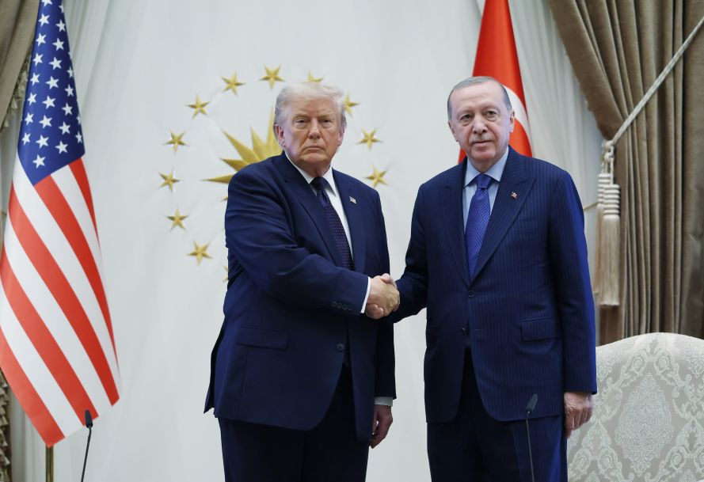

> Liderler ikili ilişkileri ve bölgesel gelişmeleri ele aldı; Trump Cumhuriyet Bayramı'nı kutladı.

Cumhurbaşkanı Recep Tayyip Erdoğan, Amerika Birleşik Devletleri Başkanı Donald Trump ile telefon görüşmesi gerçekleştirdi. Liderler, Türkiye-ABD ikili ilişkilerini ve bölgesel ile küresel gelişmeleri ele aldı.

Erdoğan, önümüzdeki sene tesisinin 100. yıl dönümü kutlanacak Türkiye-ABD ilişkilerinin geliştirilmesi ve iş birliğine her alanda ivme kazandırılması için çalışmaya devam edeceklerini belirtti.

Erdoğan, Mekke Ortak Savunma İttifakı olarak Hürmüz Boğazı ve Yemen'deki gelişmeleri yakından takip ettiklerini, sorunun diplomasi zemininde çözülmesi için gayret gösterdiklerini ifade etti. Türkiye'nin, Ukrayna-Rusya arasında diplomatik sürecin canlandırılması ve savaşın bu yolla sona erdirilmesi için yapılan çalışmalara destek vermeye hazır olduğunu da belirtti.

Trump ise Erdoğan'ı ve Türk halkını Cumhuriyet Bayramı dolayısıyla kutladı; Türk Devletleri Teşkilatı Zirvesi'nin başarılı geçmesi temennisini iletti.

---

## Tepebaşı'nda 'Yediden Yetmişe Cumhuriyet Bayramı Kutlaması' üç kuşağı buluşturdu

**Gündem · Tepebaşı** · 2026-10-28 20:32 UTC · Kaynak: [Tepebaşı Belediyesi](https://www.tepebasi.bel.tr/Haber/Detay/tepebası’ndacumhuriyetcoskusuucneslibirarayagetirdi)

> Yunusemre Spor Kompleksi'ndeki etkinlikte vals ve rumba gösterileri yapıldı, Andımız hep birlikte okundu.

Tepebaşı Belediyesi'nin "Yediden Yetmişe Cumhuriyet Bayramı Kutlaması", Yunusemre Spor Kompleksi'nde yapıldı. Etkinliği belediyenin Kadın Aile Hizmetleri Müdürlüğü, Gençlik ve Spor Hizmetleri Müdürlüğü ile Sağlık İşleri Müdürlüğü düzenledi. Metin Özöğüt Yaşam Merkezi sakinleri, belediyeye bağlı kreşlerdeki çocuklar ve engelli merkezlerinde eğitim gören gençler bayram sevincini birlikte yaşadı.

Yaşam merkezi sakinleriyle anaokulu çocuklarının birlikte sunduğu vals gösterisi ve üç çiftin vals ile rumba gösterisi beğeni topladı. Engelli merkezlerindeki gençler Atatürk'ün sevdiği şarkıları seslendirdi. Tepebaşı Belediye Başkanı Ahmet Ataç, belediye personeli, çocuklar, gençler ve deneyimli vatandaşlar "Andımız"ı hep birlikte okudu; 98 yaşındaki Ayhan Tunçer de bir konuşma yaptı.

Ataç, Cumhuriyet'in kuşakları yan yana getiren ortak bir kazanım olduğunu söyledi ve etkinliğe emek verenlere teşekkür etti. (Kaynak: Tepebaşı Belediyesi)

---

## Tepebaşı'nda 8. Geleneksel Cumhuriyet Kupası'nı Sağlık İşleri Müdürlüğü kazandı

**Spor · Tepebaşı** · 2026-10-28 20:32 UTC · Kaynak: [Tepebaşı Belediyesi](https://www.tepebasi.bel.tr/Haber/Detay/tepebasıbelediyesi8gelenekselcumhuriyetkupasıtamamlandı)

> Turnuvaya 12 takım ve 150 belediye personeli katıldı; Park Bahçeler ikinci, Temizlik İşleri üçüncü oldu.

Tepebaşı Belediyesi'nin 12 takım ve 150 personelin katılımıyla düzenlediği 8. Geleneksel Cumhuriyet Kupası tamamlandı. Esentepe Halı Saha'da oynanan finalde Sağlık İşleri Müdürlüğü, Park Bahçeler Müdürlüğü'nü geçerek şampiyon oldu. Park Bahçeler Müdürlüğü ikinci, Temizlik İşleri Müdürlüğü üçüncü sırada yer aldı.

Turnuvayı Spor İşleri Müdürlüğü düzenledi. Kayıtlar 14 Eylül'de başladı, maçlar 5 Ekim'de oynanmaya başladı. Tepebaşı Belediye Başkanı Ahmet Ataç, kupanın çalışma arkadaşlarını sporun birleştirici gücü etrafında buluşturan bir gelenek olduğunu söyledi ve dereceye giren takımları kutladı. (Kaynak: Tepebaşı Belediyesi)

---

## 'Atatürk ve Dünya Çocukları' anıtı açıldı, adını Eskişehirliler anketle belirleyecek

**Kültür-Sanat · Tepebaşı** · 2026-10-28 19:33 UTC · Kaynak: [Tepebaşı Belediyesi](https://www.tepebasi.bel.tr/Haber/Detay/ataturkvecocuklarınizieskisehir’inkenthafızasınakazındı)

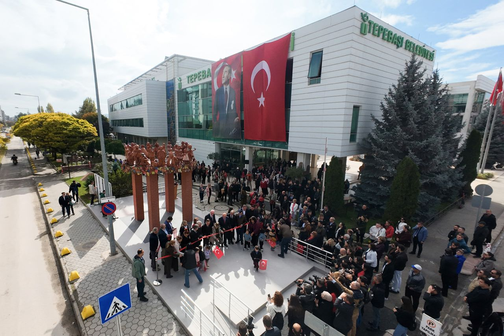

> Tepebaşı Belediyesi'nin 18. Pişmiş Toprak Sempozyumu'nda hazırlanan anıtın yapımına 126 kişi emek verdi.

Tepebaşı Belediyesi'nin 18. Uluslararası Eskişehir Pişmiş Toprak Sempozyumu kapsamında kente kazandırdığı "Atatürk ve Dünya Çocukları" temalı kolektif anıt, 29 Ekim Cumhuriyet Bayramı'nın arifesinde törenle açıldı. Tepebaşı Belediye Başkanı Ahmet Ataç'ın ev sahipliğindeki törene Odunpazarı Belediye Başkanı Kazım Kurt, Büyükşehir Belediye Başkan Vekili Vural Yörük, Tepebaşı Kent Konseyi Başkanı Canan Adlım, Prof. Bilgehan Uzuner ve çok sayıda vatandaş katıldı. Bando gösterisiyle başlayan törende Tepebaşı Belediyesi Erken Çocukluk Eğitim Merkezlerindeki çocuklar bayraklarla yer aldı; protokol kurdele keserek anıtı açtı.

Anıtın yapımına 6'sı Türk, 2'si yabancı 8 sanatçı, 90 çocuk, 24 stajyer ve 4 konuk akademisyen, toplam 126 kişi katkı sundu. Sanatçıların hazırladığı çocuk figürleri, çocukların pişmiş topraktan yaptığı çiçeklerle bir araya geldi. Uzuner, tasarımın merkezinde Atatürk'ün siluetinin bulunduğunu, belirli saatlerde ışığın yere de yansıdığını anlattı. Anıt, sempozyumun dördüncü kolektif eseri; daha önce "Varlığınız Sağlığımız Anıtı", "Sonsuz Cumhuriyet Anıtı" ve Yazılıkaya'dan esinlenen eser kente kazandırılmıştı.

Ataç, sempozyumun 25 yıllık birikiminde 236 sanatçının katıldığını, yaklaşık 700 güzel sanatlar öğrencisinin yer aldığını, Eskişehir'e 244 pişmiş toprak heykel kazandırıldığını ve 400 bildirinin sunulduğunu söyledi. Anıtın adı, "Cumhuriyet'in Çocukları", "Atatürk'ün Çiçekleri", "Atatürk'ün Dünya Çocukları" ve "Atatürk'ün Çiçek Bahçesi" seçenekleriyle halk oylamasına sunulacak. (Kaynak: Tepebaşı Belediyesi)

---

## Vali Yılmaz, gösteri uçuşu için Eskişehir'e gelen SOLOTÜRK ekibini kabul etti

**Gündem · Merkez** · 2026-10-28 12:52 UTC · Kaynak: [Eskişehir Valiliği](https://www.eskisehir.gov.tr/valimiz-dr-erdinc-yilmaz-solo-turk-ekibini-kabul-etti)

> Vali Erdinç Yılmaz, ekibe gösteri uçuşunda başarılar diledi.

Eskişehir Valisi Dr. Erdinç Yılmaz, SOLOTÜRK gösteri uçuşu kapsamında Eskişehir'e gelen Hava Pilot Yarbay Murat Bakıcı, Hava Pilot Yarbay M. Erhan Aydemir, Hava Pilot Binbaşı Murat Çakmak, Hava Piyade Yüzbaşı Ş. Alper Şen ve Hava Harekât Astsubay Üstçavuş Muhammed Bölükbaşı'nı kabul etti.

Yılmaz, SOLOTÜRK'ün Türk Hava Kuvvetlerinin gücünü, Türk pilotlarının yeteneğini ve havacılıktaki başarılarını gökyüzünde temsil ettiğini belirtti. Ekibe nazik ziyaretleri için teşekkür eden Yılmaz, gösteri uçuşunda başarılar diledi. (Kaynak: Eskişehir Valiliği)

---

## Altın fiyatları 28 Ekim 2026: Gram altın 6.525,46 TL

**Ekonomi · Merkez** · 2026-10-28 11:51 UTC · Kaynak: [Harem Altın](https://www.haremaltin.com/altin-fiyatlari)

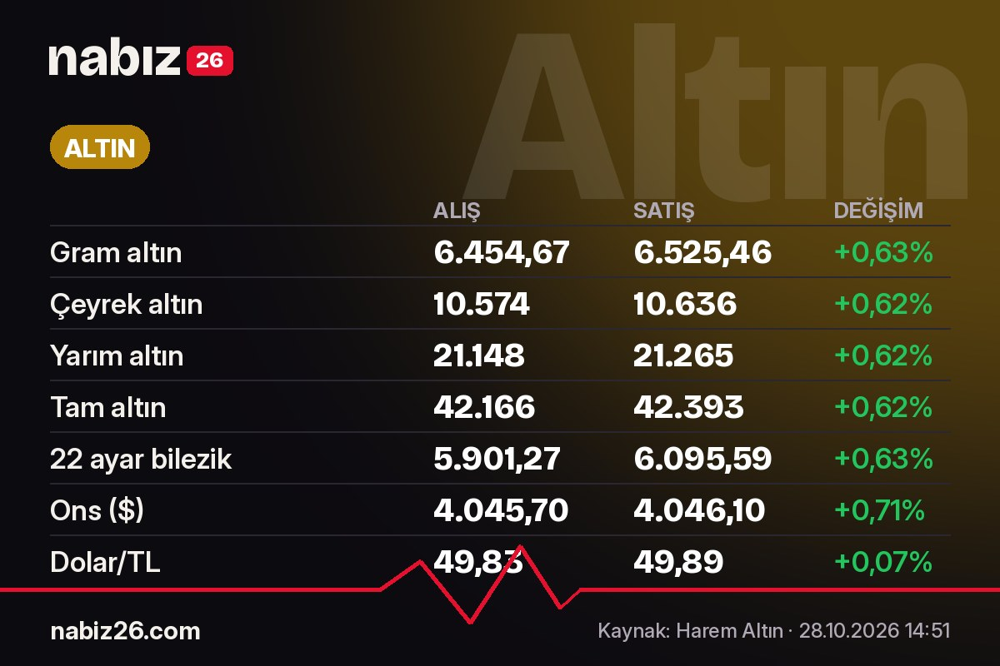

> Gram altın güne yükselişle başladı. Harem Altın verilerine göre gram altın 6.454,67 TL'den alınıyor, 6.525,46 TL'den satılıyor.

Altın piyasasında güne yükselişle başlandı. Harem Altın'ın saat 14.51 itibarıyla verilerine göre gram altının satış fiyatı 6.525,46 TL, alış fiyatı 6.454,67 TL oldu. Gram altın, önceki kapanışa göre yüzde 0,63 yükseldi.

Ziynet altınlarda çeyrek altın 10.636 TL, yarım altın 21.265 TL, tam altın 42.393 TL, ata altın 43.219 TL seviyesinden satışa sunuluyor.

22 ayar bileziğin gram satış fiyatı 6.095,59 TL, has altının gram fiyatı 6.505,94 TL olarak belirlendi.

Uluslararası piyasalarda altının onsu 4.046,10 dolardan işlem görürken, dolar/TL 49,89 seviyesinde bulunuyor.

Fiyatlar Harem Altın'ın saat 14.51 itibarıyla paylaştığı verilere dayanmaktadır; kuyumcular arasında farklılık gösterebilir. Bu haber yatırım tavsiyesi değildir.

---

## Mahkeme, Alpagut-Atalan altın-gümüş madeni projesinin ÇED olumlu kararını durdurdu

**Gündem · Merkez** · 2026-10-28 11:36 UTC · Kaynak: [Google Haberler - Eskişehir etkinlik](https://www.eskisehirekspres.net/eskisehirin-dogasi-icin-kritik-karar-ced-olumlu-karari-durduruldu)

> Eskişehir 2. İdare Mahkemesi, Büyükşehir Belediyesi'nin açtığı davada yürütmeyi durdurma kararı verdi.

Eskişehir Büyükşehir Belediyesi'nin Alpagut-Atalan Altın-Gümüş Madeni Projesi'ne karşı açtığı davada önemli bir gelişme yaşandı. Eskişehir 2. İdare Mahkemesi, bilirkişi raporunda doğa ve su kaynaklarına yönelik ciddi risklerin ortaya konulmasının ardından, telafisi güç zararlar oluşabileceği değerlendirmesiyle ÇED Olumlu kararının yürütmesini durdurdu.

Eskişehir Büyükşehir Belediye Başkanı Ayşe Ünlüce, kararın kentin doğal kaynaklarının korunması açısından büyük önem taşıdığını belirtti. Ünlüce açıklamasında, "Alpagut-Atalan Altın-Gümüş Madeni Projesi'ne karşı açtığımız davada, bilirkişi raporuyla doğamıza ve su kaynaklarımıza yönelik ciddi riskler ortaya konuldu" dedi ve Eskişehir'in suyuna, toprağına ve geleceğine sahip çıkmaya devam edeceklerini söyledi. (Kaynak: Eskişehir Ekspres)

---

## Yenikent Olimpik Havuzu'nda çocuk yüzme kış spor okulu kayıtları 2 Kasım'da

**Spor · Merkez** · 2026-10-28 08:33 UTC · Kaynak: [Eskişehir Gençlik ve Spor İl Müdürlüğü](https://eskisehir.gsb.gov.tr/HaberDetaylari/1/305045/olimpik-havuz-cocuk-egitim-yuzme-kayitlari.aspx)

> 7-17 yaş grubu için 8 haftalık, 16 derslik eğitimlerin kaydı 2 Kasım Pazartesi 08.00-17.00 arasında alınacak.

Eskişehir Gençlik ve Spor İl Müdürlüğü, Yenikent Olimpik Yüzme Havuzu'ndaki ücretli kış spor okulu çocuk eğitim kayıtlarının 2 Kasım 2026 Pazartesi günü 08.00-17.00 saatleri arasında alınacağını duyurdu. Kayıtlar saat 08.00'de başlayacak. Eğitimler 8 hafta, yani 16 ders sürecek.

Kayıt, 2011-2019 doğumlu, yüzme bilen ve bilmeyen çocuklar için yapılacak. Kayıt sırasında kimlik ibrazı zorunlu; anne, baba ve reşit kardeş dışındaki kişilerin yaptıracağı kayıtlar alınmayacak. Kayıt formuna katılmak istenen grubun numarası yazılmalı. Duyuruya göre ücretler ön kayıt işlemi yapıldıktan sonra yatırılacak, elden veya kredi kartıyla ücret alınmayacak ve kayıt işleminden önce herhangi bir IBAN numarasına ücret yatırılmaması gerekiyor.

Ücret, 07-17 yaş grubu için tek çocukta 1750 TL, iki kardeşte kişi başı 1600 TL, üç kardeşte kişi başı 1450 TL; her durumda 50 TL kart ücreti ekleniyor. Üyeliğini iptal etmek isteyenlerin durumlarını belgelendirmesi gerekiyor; ücret iadesi yapılmayacak, ücret hakkı iptal edilen kayıt döneminden itibaren 2 kayıt dönemi içinde kullanılabilecek. Eğitim başladıktan sonra grup değişikliği yapılmayacak. (Kaynak: Eskişehir Gençlik ve Spor İl Müdürlüğü)

---

## Türkiye'de ilk Eskişehir Bal Kabağı Çalıştayı ESOGÜ'de yapıldı

**Tarım · Tepebaşı** · 2026-10-28 06:33 UTC · Kaynak: [Tepebaşı Belediyesi](https://www.tepebasi.bel.tr/Haber/Detay/tepebasıbelediyesi’ndenbirilkdahabalkabagıilkkezulusalolcektemasayayatırıldı)

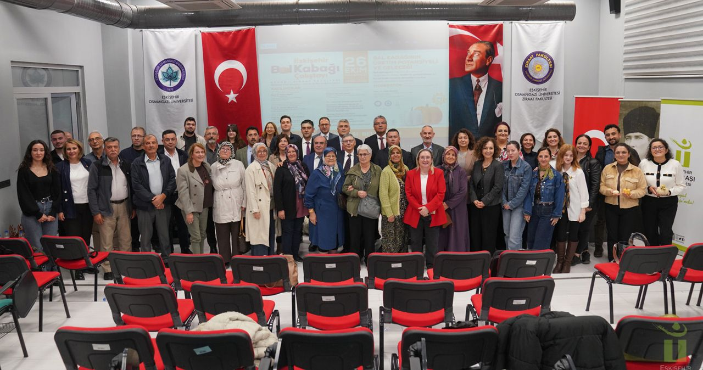

> Tepebaşı Belediyesi ve ESOGÜ Ziraat Fakültesi, bal kabağını ulusal ölçekte ele alan ilk çalıştayı düzenledi.

Tepebaşı Belediyesi ile Eskişehir Osmangazi Üniversitesi (ESOGÜ) Ziraat Fakültesi iş birliğinde düzenlenen Eskişehir Bal Kabağı Çalıştayı, bal kabağını ulusal ölçekte ele alan ilk buluşma oldu. Çalıştay ESOGÜ Ali Numan Kıraç Yerleşkesi Prof. Dr. Ali Koç Konferans Salonu'nda yapıldı.

Akademisyenler ve tarımsal araştırma enstitülerinin temsilcileri; bal kabağının genetik kaynaklarını, ıslahını, yetiştiriciliğini ve kırsal kalkınmadaki yerini değerlendirdi. Çalıştaya Geçit Kuşağı Araştırma Enstitüsü Müdürü Ulaş Çınar, Sakarya Mısır Araştırma Enstitüsü Müdürü Mehmet Yılmaz, Eskişehir İl Tarım ve Orman Müdür Yardımcısı Hasan Öz ile Tarımsal Araştırmalar ve Politikalar Genel Müdürlüğü'nden Dr. Evran Doğan da katıldı.

Tepebaşı Belediye Başkanı Ahmet Ataç, Kızılinler bal kabağının Eskişehir'in kırsal değerlerinden biri olduğunu ve coğrafi işaret tescili taşıdığını hatırlatarak üretimi geliştirmek ve üreticiye daha fazla katkı sunmak istediklerini söyledi. ESOGÜ Ziraat Fakültesi Dekanı Prof. Dr. Onur Koyuncu da bilgilerin paylaşılmasının önemine değindi. Çalıştayın moderatörlüğünü Doç. Dr. Sıtkı Ermiş yaptı; ilk oturumlarda kabak türlerinin tarihsel gelişimi ve ıslah çalışmaları ele alındı. (Kaynak: Tepebaşı Belediyesi)

---
