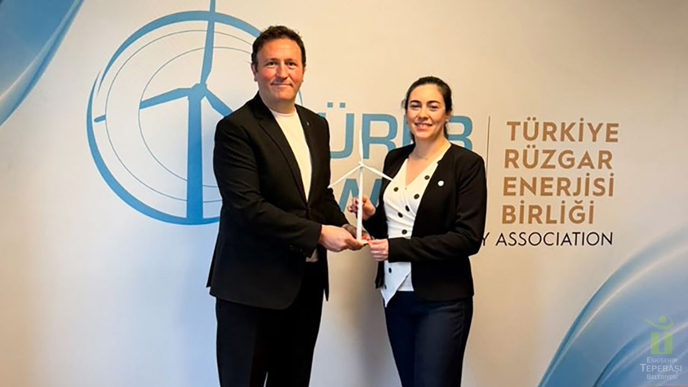
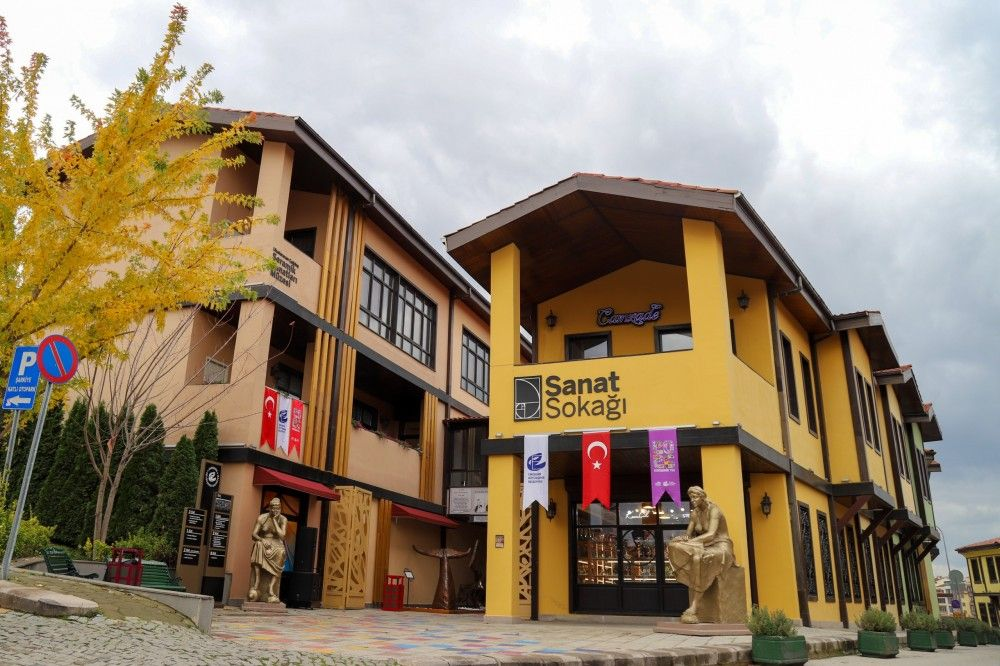
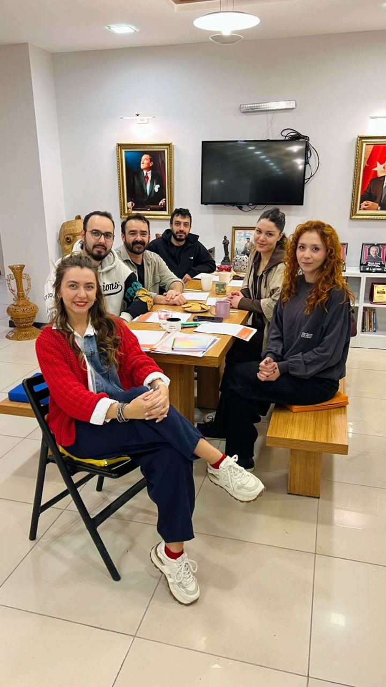
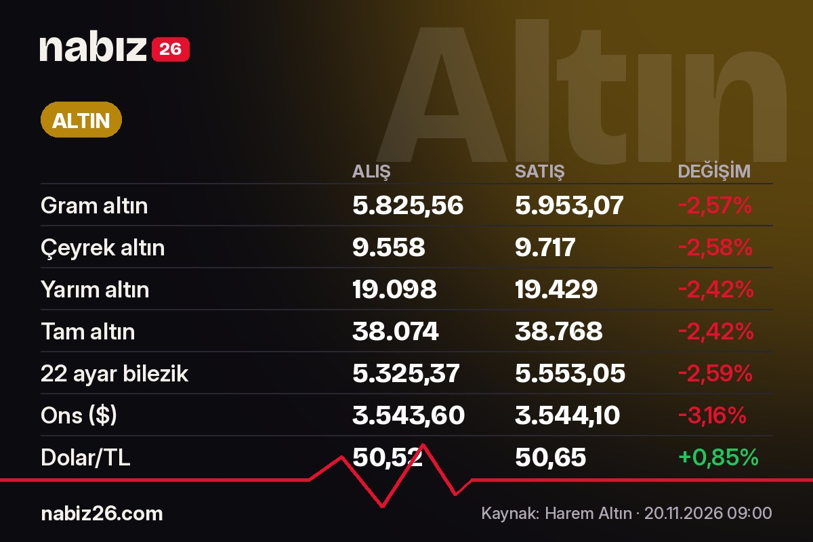
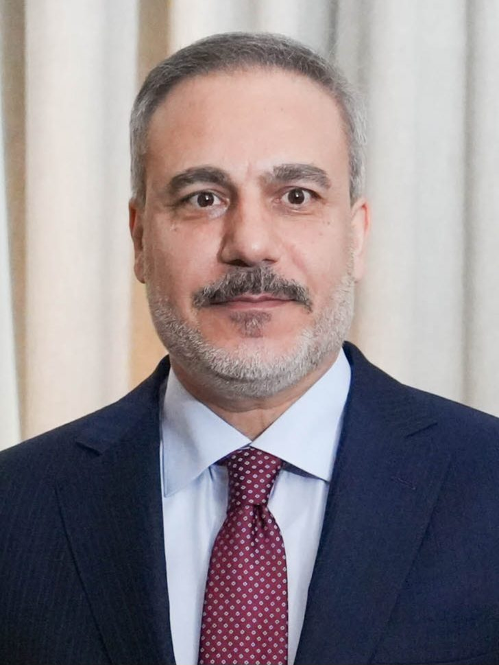
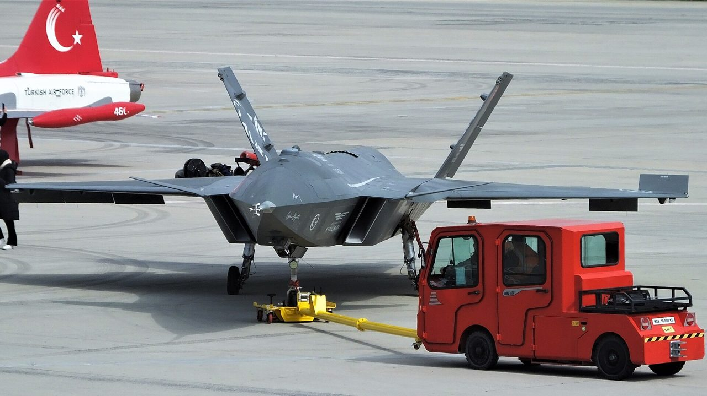
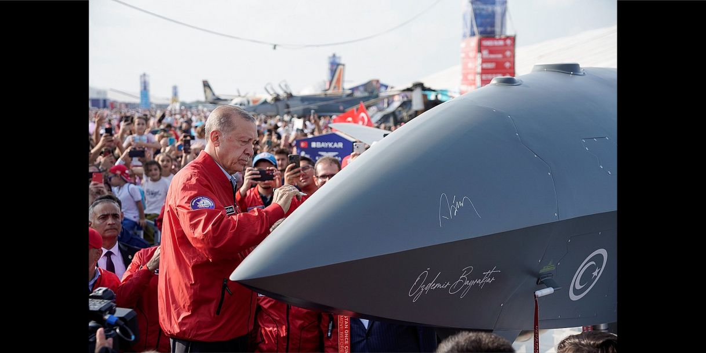
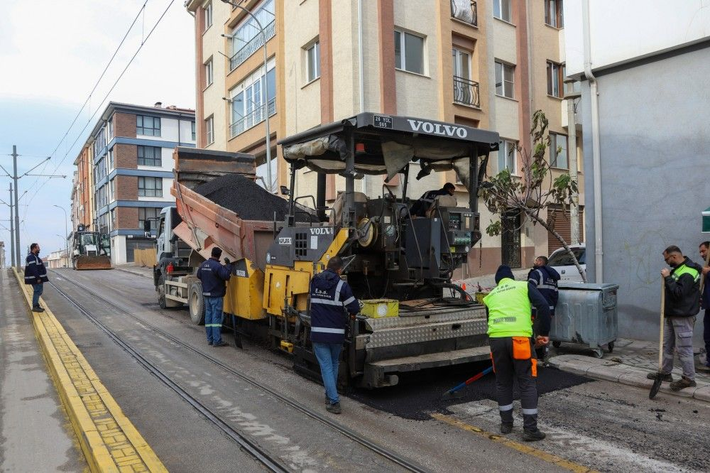

# Son haberler

Ajanın yazdığı son haberler (otomatik güncellenir).

## Tepebaşı'na AB Destekli Rüzgâr Hibesi: Temiz Enerji Haritası Çıkarılacak

**Belediye · Tepebaşı** · 2026-11-20 13:09 UTC · Kaynak: [Tepebaşı Belediyesi](https://www.tepebasi.bel.tr/Haber/Detay/tepebası’nınhibezincirineyenihalka)

> Tepebaşı Belediyesi, ilçenin rüzgâr enerjisi potansiyelini belirlemek için hazırladığı projeyle AB destekli TÜREB programından 15 bin avro hibe almaya hak kazandı.

Tepebaşı Belediyesi, temiz enerji yatırımlarına yön vermek ve ilçenin rüzgâr enerjisi potansiyelini ortaya çıkarmak amacıyla hazırladığı projeyle yeni bir dış kaynak sağladı. Türkiye Rüzgâr Enerjisi Birliği (TÜREB) tarafından yürütülen ve Avrupa Birliği tarafından desteklenen hibe programı kapsamındaki sözleşme, Tepebaşı Belediye Başkan Yardımcısı Suat Yalnızoğlu tarafından Ankara'da imzalandı.

Toplam 16 bin 800 avro bütçeli projeye 15 bin avro hibe desteği verilecek. Tepebaşı Belediyesi İklim Değişikliği ve Sıfır Atık Müdürlüğü koordinesinde 23 Kasım 2026'da başlayacak ve dokuz ay sürecek çalışma kapsamında, Coğrafi Bilgi Sistemleri desteğiyle rüzgâr verileri, arazi yapısı ve şebeke bağlantısı uygun olan en fazla üç alan belirlenerek incelenecek. Çalışmanın sonucunda belediyenin elektrik tüketimini rüzgârdan karşılamaya yönelik teknik ön değerlendirme raporu ve yol haritası hazırlanacak.

Teknik incelemelerin yanı sıra belediye personeline ve öğrencilere yönelik eğitim atölyeleri de düzenlenecek. Ayrıca Vecihi Hürkuş Havacılık ve Teknoloji Parkı'nda enerji sektörü temsilcileri, sivil toplum kuruluşları ve kent sakinlerinin bir araya geleceği bir "Enerji Günü" organize edilerek elde edilen veriler kamuoyuyla paylaşılacak.

---

## MEB'den Öğrencilere 'Dijital Anadolu Medeniyetleri Ansiklopedisi'

**Eğitim · Türkiye** · 2026-11-20 13:09 UTC · Kaynak: [Milli Eğitim Bakanlığı](https://www.meb.gov.tr/anadolu-medeniyetleri-ogrencilere-quotdijital-ansiklopediquot-ile-tanitilacak/haber/42598/tr)

> Millî Eğitim Bakanlığı, Anadolu'nun köklü kültürel mirasını yeni nesillere tanıtmak amacıyla 800 dakikalık belgesel serisinden oluşan dijital ansiklopedi projesini kullanıma sunuyor.

Millî Eğitim Bakanlığı Yenilik ve Eğitim Teknolojileri Genel Müdürlüğü, dijital eğitim platformlarının içeriklerini zenginleştirmek amacıyla "Dijital Anadolu Medeniyetleri Ansiklopedisi" projesini başlattı. Çalışmayla Anadolu medeniyetlerinin insanlık tarihine sunduğu katkıların görünür kılınması ve kültürel mirasın gelecek kuşaklara aktarılması hedefleniyor.

Türkiye Yüzyılı Maarif Modeli öğretim programlarında yer alan kavramlarla ilişkilendirilen proje doğrultusunda, ilk aşamada 100 kavram ele alındı. Ardından ortaokul ve lise müfredatıyla uyumlu ilave 100 kavram için toplam 800 dakikalık eğitsel video içeriği oluşturuldu.

Belgesel anlatım tarzında hazırlanan ve her biri 8 dakika süren eğitsel videolar, üç boyutlu animasyonlar, hareketli grafikler ve gerçek mekân çekimleriyle desteklendi. Öğrencilerin kültürel kavramları görsel ve işitsel yöntemlerle kavramasını amaçlayan yapımlar, Türkçe ve İngilizce dil seçeneklerinin yanı sıra çift dilde alt yazı desteğiyle sunuluyor.

Hazırlanan tüm içerikler EBA, TRT EBA ve Bakanlığa bağlı diğer dijital platformlar aracılığıyla öğrenci, öğretmen ve velilerin erişimine açık olacak.

---

## ESTÜ'den Akademik Başarı: URAP Sıralamasında Türkiye'de İlk 10'a Girdi

**Eğitim · Tepebaşı** · 2026-11-20 13:09 UTC · Kaynak: [Eskişehir Teknik Üniversitesi](https://www.eskisehir.edu.tr/tr/Haber/Detay/eskisehir-teknik-universitesi-urap-20262027-turkiye-siralamasinda-ilk-10-universite-arasinda)

> Eskişehir Teknik Üniversitesi, URAP 2026–2027 Türkiye Sıralaması'nda tıp fakültesi bulunmayan üniversiteler kategorisinde 10. basamakta yer aldı.

Orta Doğu Teknik Üniversitesi Enformatik Enstitüsü bünyesindeki URAP Araştırma Laboratuvarı tarafından hazırlanan 2026–2027 Türkiye Sıralaması açıklandı. Yayımlanan raporda Eskişehir Teknik Üniversitesi (ESTÜ), tıp fakültesi bulunmayan yükseköğretim kurumları arasında 667,80 puan toplayarak 10. sıraya yerleşti.

İTÜ, ODTÜ, Sabancı, Yıldız Teknik ve Boğaziçi gibi üniversitelerin yer aldığı listede ilk 10 arasındaki yerini koruyan ESTÜ, bilimsel araştırma ve akademik üretimdeki istikrarını sürdürdü.

Söz konusu sıralama Clarivate Analytics/InCites ile YÖK verileri temel alınarak oluşturuldu. Değerlendirme sürecinde bilimsel yayınlar, atıf sayıları, öğretim üyesi başına düşen üretkenlik, doktora mezun ve öğrenci oranları, ulusal ve uluslararası iş birlikleri ile TÜBİTAK destekli projeler olmak üzere toplam 15 farklı akademik gösterge dikkate alındı.

---

## ESOGÜ'de Geleceğin Diş Hekimleri Beyaz Önlüklerini Giydi: Yeni Hastane Müjdesi

**Eğitim · Odunpazarı** · 2026-11-20 13:09 UTC · Kaynak: [Eskişehir Osmangazi Üniversitesi](https://www.ogu.edu.tr/Web/HaberDetay/2153)

> Eskişehir Osmangazi Üniversitesi Diş Hekimliği Fakültesi 1. sınıf öğrencileri, düzenlenen törenle beyaz önlüklerini giyerek mesleğe ilk adımı attı.

Eskişehir Osmangazi Üniversitesi (ESOGÜ) Diş Hekimliği Fakültesi 14. dönem birinci sınıf öğrencileri için Kongre ve Kültür Merkezi'nde "2026-2027 Eğitim-Öğretim Yılı Beyaz Önlük Giyme Töreni" gerçekleştirildi. Törene üniversite yönetimi, akademisyenler, sağlık sektörü temsilcileri ve öğrenci aileleri katıldı.

Törende konuşan ESOGÜ Rektörü Prof. Dr. Emine Gümüşsoy, fakültenin güçlü kadrosuyla başarılı hekimler yetiştirdiğini belirterek birkaç ay içerisinde yeni hastane binasına taşınma sürecinin tamamlanacağını ve bu adımla hizmet kapasitesinin daha da güçleneceğini duyurdu. Öğrencilere seslenen Gümüşsoy, beyaz önlüğün dürüstlük ve sorumluluğun simgesi olduğunu vurguladı.

Diş Hekimliği Fakültesi Dekanı Prof. Dr. Batu Can Yaman ise Türkiye'de bilimsel diş hekimliğinin temellerinin 22 Kasım 1908'de atıldığını hatırlatarak, mesleğin teknolojik gelişmelerle birlikte sürekli bir öğrenme süreci gerektirdiğini ifade etti. Yaman, ailelerin gösterdiği fedakârlıkların ardından öğrencilerin nitelikli birer hekim olarak yetişeceğini söyledi.

Konuşmaların ardından birinci sınıf öğrencilerine beyaz önlükleri fakülte öğretim üyeleri ve protokol üyeleri tarafından giydirildi.

---

## Eskişehir Sanat Sokağı 2 Yaşında: İki Yılda 80'den Fazla Etkinlik Düzenlendi

**Kültür-Sanat · Merkez** · 2026-11-20 13:09 UTC · Kaynak: [Eskişehir Büyükşehir Belediyesi](https://www.eskisehir.bel.tr/icerik-detay.php?icerik_id=13579&cat_icerik=1&menu_id=24)

> Eskişehir Büyükşehir Belediyesi tarafından kente kazandırılan Sanat Sokağı, ikinci kuruluş yılını geride bıraktı. Kompleks, iki yıllık süreçte 80'i aşkın kültür ve sanat etkinliğine ev sahipliği yaptı.

Eskişehir Büyükşehir Belediyesinin kentin kültür ve sanat hayatına kazandırdığı Sanat Sokağı, ikinci yaşını kutluyor. Bünyesinde Uluslararası Çağdaş Seramik Sanatları Müzesi, sanat atölyeleri, sergi salonu, Genco Erkal Sahnesi ve kukla tiyatrosu barındıran kompleks, iki yıl içinde 80'den fazla sanatsal ve kültürel buluşmaya sahne oldu.

Büyükşehir Belediyesi Kent Tarihi, Tanıtımı ve Turizm Daire Başkanı Sercan Kara, merkezin kentin en genç ve en büyük sanat kompleksi olduğunu belirterek, her ay yenilenen sergiler ve atölyelerle tüm vatandaşları Sanat Sokağı'na davet etti. Alanda üretim yapan cam, minyatür ve bebek yapım sanatçıları da mekânın yerli ve yabancı ziyaretçilerden yoğun ilgi gördüğünü ifade etti.

Merkez, yetişkinlere yönelik sergi, söyleşi ve dinletilerin yanı sıra Çocuk Hakları Birimi iş birliğiyle minik ziyaretçilere de düzenli olarak yaratıcı drama, satranç, tasarım ve dans gibi farklı başlıklarda atölye imkânı sunuyor.

---

## Tepebaşı'nda Tesisler Mercek Altında: Hizmet Binalarında Entegre Su Yönetimi Başladı

**Belediye · Tepebaşı** · 2026-11-20 11:09 UTC · Kaynak: [Google Haberler - Tepebaşı](https://www.ekonomim.com/sehirler/tepebasi-atac-iklim-eylemi-kentlerde-gundelik-kararlarla-hayat-bulur-haberi-932405)

> Tepebaşı Belediyesi, BEBKA desteğiyle yürüttüğü proje kapsamında hizmet binalarında ve yeşil alanlarda su verimliliği analizi gerçekleştirirken 425 kişiye tasarruf eğitimi verdi.

Tepebaşı Belediyesi, iklim krizi ve artan kuraklık riskine karşı kaynakları korumak amacıyla "Hizmet Binalarında Entegre Su Yönetimi ve Su Verimliliği Kapasitesinin Geliştirilmesi" projesini hayata geçirdi. Bursa Eskişehir Bilecik Kalkınma Ajansı (BEBKA) 2026 Yılı Teknik Destek Programı kapsamında desteklenen çalışma ile belediye tesislerinde su tüketim alışkanlıkları kapsamlı şekilde inceleniyor.

Çalışma doğrultusunda Tepebaşı Belediyesi Ana Hizmet Binası, Mustafa Kemal Atatürk Su Sporları Merkezi ve Metin Özöğüt Yaşam Merkezi'nde teknik denetimler yapılıyor. Tüketimin yoğunlaştığı noktalar tespit edilirken kayıpların önlenmesi, yağmur suyu hasadı ve gri suyun geri kazanımı gibi tasarruf alternatifleri değerlendiriliyor. Analizler yalnızca kapalı tesislerle sınırlı kalmayıp park, bahçe ve rekreasyon alanlarındaki sulama sistemlerini de kapsıyor.

Su verimliliği seferberliği kapsamında bugüne kadar toplam 425 kişiye eğitim sunuldu. Mavi Su Belgesi kapsamında 101, okullarla ortaklaşa 259 öğrenci ve BEBKA projesi çerçevesinde 65 belediye personeli bilinçlendirme programlarına katıldı.

Projeye ilişkin değerlendirmede bulunan Tepebaşı Belediye Başkanı Dt. Ahmet Ataç, iklim krizinin kentlerin karşı karşıya olduğu somut bir gerçek olduğuna dikkat çekti. Ataç, "Kuraklık ve su kaynaklarının azalması, suyu nasıl kullandığımızı yeniden düşünmemizi zorunlu kılıyor. Su yalnızca çevresel bir başlık değil; yaşamın, üretimin, ekonominin ve kentlerin geleceğinin temelidir. COP31'de konuşulan iklim eyleminin karşılığı kentlerde alınan kararlarla ortaya çıkar. Bugünden atacağımız her bilinçli adım gelecek kuşakların suya erişimi ve kentimizin dayanıklılığı için hayati önem taşıyor" ifadelerini kullandı.

---

## Sarar Grup'tan Rektör Özcan'a Tebrik Ziyareti: Yeni Dönemde Başarı Diledi

**Eğitim · Tepebaşı** · 2026-11-20 11:09 UTC · Kaynak: [Eskişehir Teknik Üniversitesi](https://www.eskisehir.edu.tr/tr/Haber/Detay/sarar-grup-resmi-iliskiler-ve-protokol-muduru-alaattin-cobandan-rektor-prof-dr-adnan-ozcana-hayirli-olsun-ziyareti)

> Sarar Grup Resmi İlişkiler ve Protokol Müdürü Alaattin Çoban, yeniden ESTÜ Rektörlüğüne atanan Prof. Dr. Adnan Özcan'ı makamında ziyaret etti.

Cumhurbaşkanlığı Kararı ile Eskişehir Teknik Üniversitesi Rektörlüğü görevine yeniden atanan Prof. Dr. Adnan Özcan'a yönelik hayırlı olsun ziyaretleri devam ediyor.

Bu kapsamda Sarar Grup Resmi İlişkiler ve Protokol Müdürü Alaattin Çoban, Rektörlük Ofisinde Prof. Dr. Adnan Özcan ile bir araya geldi. Görüşmede Çoban, yeni görev dönemine başlayan Rektör Özcan'ı tebrik ederek üniversite yönetimine çalışmalarında başarılar diledi.

Ziyaretten duyduğu memnuniyeti ifade eden Rektör Prof. Dr. Adnan Özcan ise iyi dilekleri ve nezaketi dolayısıyla Alaattin Çoban'a teşekkürlerini iletti.

---

## Odunpazarı'nda Türkü Gecesi: Köz Orkestra Dinleyicileri Hayran Bıraktı

**Kültür-Sanat · Odunpazarı** · 2026-11-20 11:09 UTC · Kaynak: [Odunpazarı Belediyesi](https://www.odunpazari.bel.tr/guncel/haberler/genel-haberler/koz-orkestra-dan-beste-formunda-turkuler-konseri)

> Odunpazarı Belediyesi eğitmenlerinin oluşturduğu Köz Orkestra, 'Beste Formunda Türküler' konseriyle Eskişehirli müzikseverlere unutulmaz bir akşam yaşattı.

Odunpazarı Belediyesi bünyesinde görev yapan sanat eğitmenlerinin kurduğu Köz Orkestra, Yunus Emre Kültür ve Sanat Merkezi'nde (YKSM) sahne aldı. Ücretsiz olarak gerçekleştirilen konsere kentteki sanatseverler yoğun ilgi gösterdi.

'Beste Formunda Türküler' temasıyla düzenlenen konserde Anadolu'nun köklü ezgileri çok sesli ve özgün enstrümantal düzenlemelerle yorumlandı. Köz Orkestra'nın sahne performansı salonu dolduran dinleyicilerden alkış topladı.

Belediyenin kültür ve sanat etkinlikleri kapsamında sahne alan orkestra, geleneksel Türk halk müziği mirasını modern yaklaşımlarla kente taşımaya devam ediyor.

---

## MEBİ Yapay Zekâ ve Çevrim Dışı Modla Yenilendi: Kullanıcı Sayısı 8 Milyonu Aştı

**Eğitim · Türkiye** · 2026-11-20 11:09 UTC · Kaynak: [Milli Eğitim Bakanlığı](https://www.meb.gov.tr/quotmebiquot-yenilenen-yuzu-ve-yapay-zeka-destekli-ozellikleriyle-yayinda/haber/42599/tr)

> Millî Eğitim Bakanlığının bireysel öğrenme platformu MEBİ; yapay zekâ asistanı, internetsiz çalışma özelliği ve genişletilen erişilebilirlik seçenekleriyle baştan aşağı güncellendi.

Millî Eğitim Bakanlığı, öğrenci ve öğretmenlerin kullanımına sunduğu MEBİ Bireysel Öğrenme Platformu’nu gelen geri bildirimler doğrultusunda yeniledi. Web arayüzü ve mobil uygulaması daha işlevsel hâle getirilen platformda, öğrencilerin ders çalışma alışkanlıklarını destekleyen kişiselleştirilebilir ekranlar ve yeni dijital modüller devreye alındı.

Platformun yapay zekâ destekli öğrenci asistanı KANKA geliştirilerek öğrencilerin hedeflerine, uygun saatlerine ve zorlandıkları konulara göre kişiye özel haftalık program hazırlaması sağlandı. Doğal dille arama imkânı sunan yapay zekâ desteği, deneme sınavı sonuçlarını değerlendirerek öğrencilere günlük çalışma tavsiyeleri üretiyor. Yeni eklenen çevrim dışı çalışma özelliğiyle de öğrenciler, içerikleri önceden mobil cihazlarına indirerek internet bağlantısı olmayan ortamlarda ders çalışabiliyor.

Farklı ihtiyaçlara sahip öğrencilerin platformdan rahat yararlanabilmesi için erişilebilirlik seçenekleri de genişletildi. Görme engelli öğretmenlerin katılımıyla yapılan testler sonucunda platforma disleksi dostu görünüm, renk körlüğü ayarları, yüksek kontrast ve ekran okuyucu uyumluluğu eklendi. Ayrıca ders notlarının tek noktada toplanmasını sağlayan Not Defteri modülü kullanıma açıldı.

Bakanlık verilerine göre ortaokul ve lise düzeyinde 6 milyon 180 binden fazla öğrencinin yararlandığı platformun toplam kullanıcı sayısı öğretmen ve velilerle birlikte 8 milyon 187 bini aştı. Mobil uygulaması 6,6 milyondan fazla indirilen MEBİ üzerinden bugüne kadar 704 milyonu aşkın soru çözüldüğü bildirildi.

---

## Porsuk Kıyısına 'Meydan 26': Eskişehir'in En Büyük Kent Meydanı Geliyor

**Belediye · Odunpazarı** · 2026-11-20 09:09 UTC · Kaynak: [Google Haberler - Eskişehir](https://www.gazetevatan.com/galeri/eskisehirin-en-buyuk-meydani-geliyor-belediye-dev-projeyi-duyurdu-2466735)

> Eskişehir Büyükşehir Belediyesi, Sümer Mahallesi'nde Porsuk Çayı kıyısında hayata geçirilecek Kızılyer Park ve Rekreasyon Alanı (Meydan 26) projesinin ayrıntılarını duyurdu.

Eskişehir Büyükşehir Belediyesi, Sümer Mahallesi sınırlarında Porsuk Çayı boyunca uzanacak yeni bir yaşam alanı için düğmeye bastı. Kent merkezinin en büyük meydanı olması hedeflenen "Meydan 26" (Kızılyer Park ve Rekreasyon Alanı) projesinde geniş yeşil alanlar, spor tesisleri, kültürel noktalar ve çocuk oyun alanları bir araya getirilecek.

Projenin kalbinde kültürel buluşmalar ve açık hava etkinlikleri için tasarlanan geniş bir kent meydanı ile etkinlik platformu yer alacak. Meydanın giriş bölümüne iki kemerli süs havuzu yapılacak. Ziyaretçilerin doğayla temasını artıracak alanda açık hava kütüphanesi ile basamaklı amfi ve sahne düzenlemesi bulunacak.

Farklı yaş gruplarına yönelik spor alanlarının da planlandığı projede tenis kortu, çocuk tenis kortu, antrenman duvarı, açık hava crossfit alanı ve üç potalı basketbol sahası yer alacak. Çocuklar için denge ve koordinasyon becerilerini destekleyecek tematik oyun parkı kurulacak.

Porsuk Çayı'nın doğal koridoruna uyumlu peyzajla tasarlanan projede yürüyüş parkurları, üç adet büfe, umumi tuvaletler ve gölgelikli dinlenme alanları bulunacak. Belediyeden yapılan bilgilendirmede, kentin iklimine uygun bitki örtüsüyle donatılacak alanın hem ekolojik sürekliliği destekleyeceği hem de kente yeni bir kamusal buluşma noktası kazandıracağı belirtildi.

---

## Odunpazarı Belediye Tiyatrosu'ndan Yeni Çocuk Oyunu: 'Pablo' İçin Provalar Başladı

**Kültür-Sanat · Odunpazarı** · 2026-11-20 09:09 UTC · Kaynak: [Odunpazarı Belediyesi](https://www.odunpazari.bel.tr/guncel/haberler/genel-haberler/odunpazari-belediye-tiyatrosu-nda-yeni-cocuk-oyununun-okuma-provalari-basladi)

> Odunpazarı Belediye Tiyatrosu, minik izleyicilerle buluşturacağı 'Pablo' adlı yeni çocuk oyununun okuma provalarına başladı. Yapım, ocak ayından itibaren sahnelenecek.

Odunpazarı Belediye Tiyatrosu, çocukların hayal dünyasını zenginleştirmeyi amaçlayan yeni tiyatro oyunu "Pablo" için hazırlıklarını hızlandırdı. Ekip, yeni sezonda minik sanatseverlerin beğenisine sunulacak yapımın okuma provalarını gerçekleştirmeye başladı.

İpek Uzkalan'ın hem kaleme aldığı hem de yönetmenliğini üstlendiği oyunda Enes Soylar, Yağmur İncesu, Atakan Özer, Hilal Demirbaş ve Abdullah Çiftçi sahne alıyor. Yapımın koreografisini Janna Elmalioğlu yürütürken, sahne ve kukla düzenlemelerini Çiğdem Öztürk, özgün müziklerini ise Ufuk Kuzucu hazırlıyor.

Kukla ve müziğin harmanlandığı yeni çocuk oyunu, ocak ayı itibarıyla Hasan Polatkan Kültür Merkezi'nde tiyatroseverlerle buluşacak ve sezon boyunca gösterimde kalacak.

---

## Eskişehirspor Söke Deplasmanında Liderlik Peşinde: Maç Saati ve Kanalı Belli Oldu

**Spor · Merkez** · 2026-11-20 09:09 UTC · Kaynak: [Google Haberler - Eskişehirspor](https://www.gazetevatan.com/galeri/soke-1970-eskisehirspor-maci-ne-zaman-saat-kacta-hangi-kanalda-liderligi-geri-almak-icin-sahada-2466745)

> Nesine 3. Lig 2. Grup'ta zirve mücadelesi veren Eskişehirspor, 22 Kasım Pazar günü saat 13.00'te Söke 1970 Spor'a konuk olacak. Mücadele Tivibu Spor ekranlarından canlı yayınlanacak.

Nesine 3. Lig 2. Grup'un 13. haftasında şampiyonluk mücadelesi veren Eskişehirspor, Aydın deplasmanında Söke 1970 Spor ile karşılaşacak. Geçtiğimiz hafta evinde Ayvalıkgücü Belediyespor ile 2-2 berabere kalarak zirveyi 26 puanlı Etimesgut Spor'a devreden ve 25 puanla ikinci sıraya gerileyen siyah-kırmızılılar, deplasmandan 3 puanla dönerek liderliği yeniden devralmayı amaçlıyor.

Söke İlçe Stadı'nda 22 Kasım 2026 Pazar günü oynanacak karşılaşma saat 13.00'te başlayacak. Zirve yarışını yakından ilgilendiren zorlu 90 dakika, Tivibu Spor ekranlarından canlı olarak futbolseverlerle buluşacak.

Eskişehirspor'un ligin zirvesine yeniden oturabilmesi için Söke deplasmanında galibiyet almasının yanı sıra lider Etimesgut Spor'un Kepez Spor deplasmanında ve aynı puandaki Gemlik Sümerbey'in Bucaspor 1928 karşısında alacağı sonuçlar belirleyici olacak. Ev sahibi Söke 1970 Spor ise ligde topladığı 9 puanla 15. sırada yer alıyor.

---

## Togg T10X Ekimde Zirveye Yerleşti: 4 Bin 59 Adetle Rakiplerini Geride Bıraktı

**Ekonomi · Türkiye** · 2026-11-20 07:09 UTC · Kaynak: [Google Haberler - Togg](https://n24.com.tr/otomotiv/togg-t10x-ekim-satislarinda-renault-ve-volkswageni-solladi)

> Türkiye otomobil pazarında ekim ayı satış lideri 4 bin 59 adetle Togg T10X oldu. Markanın yeni modeli T10F ise 2 bin 702 adetlik satışla dördüncü sıraya yerleşti.

Türkiye otomobil pazarında yılın ilk 10 ayına ait model bazlı satış verileri netleşti. Ekim ayı rakamlarına göre yerli elektrikli SUV Togg T10X, 4 bin 59 adetlik satış rakamına ulaşarak Türkiye genelinde en çok satılan otomobil unvanını elde etti. T10X'i 3 bin 324 adetle Volkswagen T-Roc ve 2 bin 779 adetle Renault Boreal izledi.

Togg'un fastback sedan modeli T10F de ekim ayında gösterdiği performansla dikkat çekti. Ay boyunca 2 bin 702 adetlik satışa ulaşan T10F, listenin dördüncü basamağına yerleşti. Böylece ekim ayında ilk dört sırada iki yerli elektrikli otomobil modeli yer almış oldu.

Ocak-ekim dönemini kapsayan 10 aylık toplam satışlarda ise Renault Clio 35 bin 884 adetle liderliğini sürdürürken, Toyota Corolla 26 bin 455 adetle ikinci, Togg T10X ise 26 bin 79 adetle üçüncü sırada yer aldı. Togg'un T10X ve T10F modellerinin yılın ilk 10 ayındaki toplam satış hacmi 44 bin 187 adede ulaştı.

---

## Gürhan Albayrak Sazova Sakinleriyle Buluştu: 'Bahane Değil Hizmet Bekleniyor'

**Siyaset · Tepebaşı** · 2026-11-20 07:09 UTC · Kaynak: [Google Haberler - Tepebaşı](https://www.milliirade.com/tepebasinda-sazova-sakinleri-belediye-hizmetini-elestirdi)

> AK Parti Eskişehir İl Başkanı Gürhan Albayrak ve beraberindeki teşkilat üyeleri, Sazova Mahallesi sakinleriyle bir araya gelerek bölgedeki sorun ve talepleri dinledi.

AK Parti Eskişehir İl Başkanı Gürhan Albayrak, parti teşkilatıyla birlikte Sazova Mahallesi'ni ziyaret etti. Mahalle sakinleriyle çay sohbetinde buluşan heyet, vatandaşların belediye hizmetlerine ilişkin görüş ve beklentilerini kaydetti.

Ziyaretin ardından yapılan açıklamada, bölge sakinlerinin yerel hizmet anlayışından memnun olmadığı savunularak vatandaşların artık mazeret yerine somut hizmet görmek istediği ifade edildi.

Sazova Mahallesi'nin ihtiyaçlarının ve iletilen taleplerin takipçisi olunacağını belirten Albayrak, misafirperverliklerinden dolayı mahalle sakinlerine teşekkür etti.

---

## Altın fiyatları 20 Kasım 2026: Gram altın 5.953,07 TL

**Ekonomi · Merkez** · 2026-11-20 06:00 UTC · Kaynak: [Harem Altın](https://www.haremaltin.com/altin-fiyatlari)

> Gram altın güne düşüşle başladı. Harem Altın verilerine göre gram altın 5.825,56 TL'den alınıyor, 5.953,07 TL'den satılıyor.

Altın piyasasında güne düşüşle başlandı. Harem Altın'ın saat 09.00 itibarıyla verilerine göre gram altının satış fiyatı 5.953,07 TL, alış fiyatı 5.825,56 TL oldu. Gram altın, önceki kapanışa göre yüzde 2,57 geriledi.

Ziynet altınlarda çeyrek altın 9.717 TL, yarım altın 19.429 TL, tam altın 38.768 TL, ata altın 39.747 TL seviyesinden satışa sunuluyor.

22 ayar bileziğin gram satış fiyatı 5.553,05 TL, has altının gram fiyatı 5.928,77 TL olarak belirlendi.

Uluslararası piyasalarda altının onsu 3.544,10 dolardan işlem görürken, dolar/TL 50,65 seviyesinde bulunuyor.

Fiyatlar Harem Altın'ın saat 09.00 itibarıyla paylaştığı verilere dayanmaktadır; kuyumcular arasında farklılık gösterebilir. Bu haber yatırım tavsiyesi değildir.

---

## Vize Serbestisinde Kalan 6 Kriter İçin Taslak Hazır: Bütçeden Sonra Meclis'e Geliyor

**Türkiye · Türkiye** · 2026-11-20 05:09 UTC · Kaynak: [Google Haberler - Bakanlıklar](https://www.haberturk.com/gundem/disisleri-bakani-hakan-fidan-vize-serbestisi-icin-hazirlanan-taslagin-meclise-gelecegini-acikladi-3928625)

> Dışişleri Bakanı Hakan Fidan, Avrupa Birliği ile vize serbestisi sürecinde kalan 6 kritere dair yasal düzenleme taslağının bütçe görüşmelerinin ardından TBMM'ye sunulacağını açıkladı.

Dışişleri Bakanı Hakan Fidan, TBMM Plan ve Bütçe Komisyonundaki bütçe görüşmelerinde milletvekillerinin sorularını yanıtladı. Türkiye'nin Avrupa Birliği ile yürüttüğü vize serbestisi sürecine değinen Fidan, yerine getirilmesi gereken son 6 kritere ilişkin taslak çalışmada sona gelindiğini ve düzenlemenin bütçe mesaisinin tamamlanmasıyla birlikte Meclis gündemine taşınacağını duyurdu.

Bulgaristan'ın Schengen sistemine dahil olmasının ardından sınır geçişlerinde elektronik denetime geçildiğini hatırlatan Fidan, Türk tır şoförlerinin yaşadığı vize ve süre aşımı sıkıntılarına da değindi. 180 günde azami 90 gün kalış kuralının sistem tarafından otomatik denetlenmesi nedeniyle yaşanan mağduriyetleri aşmak için Bulgaristan makamlarıyla temas kurduklarını ve ek süre alındığını belirten Fidan, sorunun kalıcı çözümü için AB ile müzakerelerin sürdüğünü söyledi.

Tır şoförleri için D tipi vize veya kurallara uyan sürücülerin özel bir sisteme dahil edilmesi gibi formüllerin masada olduğunu kaydeden Bakan Fidan, lojistikteki aksamaların yalnızca Türkiye'yi değil AB'nin tedarik zincirini de doğrudan etkilediğini vurguladı.

Öte yandan Bakanlık bünyesindeki vakıflara ilişkin iddialara da yanıt veren Fidan, Dışişleri Güçlendirme Teşkilatı Vakfı ile personelin kurduğu vakfın gelirlerinin yatırım fonlarında değil, kamu bankalarında muhafaza edildiğini açıkladı.

---

## CHP'li Heyet Artvin'de Esnafla Buluştu: 'Emeklilerin Yüzde 40'ı Açlık Sınırında'

**Siyaset · Türkiye** · 2026-11-20 05:09 UTC · Kaynak: [Google Haberler - CHP](https://ankahaber.net/haber/chp-genel-baskan-yardimcilari-demirci-ve-bilek-artvin-de-esnaf-ziyaretinde-bulundu-383e479e)

> CHP Genel Başkan Yardımcıları Adnan Demirci ve Nevaf Bilek, Artvin'de esnaf ve vatandaşlarla bir araya gelerek ekonomik sıkıntıları ve parti içi gündemi değerlendirdi.

CHP Genel Başkan Yardımcıları Adnan Demirci ile Nevaf Bilek, Artvin İl Başkanı Ahmet Özdemir ve parti yöneticileriyle birlikte kent merkezinde esnaf ve emeklileri ziyaret etti. Program kapsamında dükkânları dolaşan heyet, vatandaşların ekonomik koşullara ilişkin taleplerini ve eleştirilerini dinledi.

Ziyaret sırasında geçim sıkıntısına dikkat çeken Genel Başkan Yardımcısı Adnan Demirci, Türkiye'de emeklilerin yüzde 40'ının açlık sınırının altında yaşadığını, asgari ücretlilerin büyük bölümünün de benzer zorluklarla mücadele ettiğini belirtti. Demirci, yaşanan ekonomik sıkıntıların birlikte aşılacağını ve hedeflerinin bu tabloyu değiştirmek olduğunu ifade etti.

Esnafın parti içindeki gelişmelere ve farklı parti kurma girişimlerine yönelik sorularını yanıtlayan Genel Başkan Yardımcısı Nevaf Bilek ise ayrışma tartışmalarına değindi. Ayrılıp yeni oluşumlara gidenlerin yaklaşımlarını eleştiren Bilek, siyasi mücadelenin birlik içinde sürdürülmesi gerektiğini kaydetti.

---

## Tepebaşı'nda Kış Spor Kurslarına Kayıt Başlıyor: 9 Farklı Branş Açılacak

**Belediye · Tepebaşı** · 2026-11-19 21:09 UTC · Kaynak: [Google Haberler - Tepebaşı](https://www.haber26.com.tr/spor/tepebasi-nda-kis-kurslarina-kayit-23-kasim-da-basliyor)

> Tepebaşı Belediyesi Yunus Emre Spor Tesisi'nde kış dönemi kurs kayıtları 23-27 Kasım tarihleri arasında internet üzerinden alınacak.

Tepebaşı Belediyesi, Yunus Emre Spor Tesisi bünyesinde düzenlenecek 2026 yılı kış dönemi çocuk ve yetişkin spor kurslarının takvimini duyurdu. Kayıtların 23-27 Kasım tarihleri arasında tamamlanacağı, yeni dönemin ise 30 Kasım Pazartesi günü başlayacağı bildirildi.

Yetişkinler için 18 yaş ve üzeri kadınlara yönelik pilates branşı açılacak. Çocuklar için sunulan branşlar ve yaş aralıkları ise cimnastik (4-9 yaş), satranç (5-13 yaş), badminton (6-13 yaş), futbol (7-12 yaş), basketbol (7-14 yaş), taekwondo (7-15 yaş), voleybol (8-15 yaş) ve masa tenisi (9-12 yaş) olarak belirlendi.

Kontenjanların sınırlı olduğu eğitimler için başvurular "tesis.tepebasi.bel.tr" adresi üzerinden çevrim içi olarak yapılabilecek. Şirintepe Mahallesi Merkez Sokak'ta hizmet veren tesis ve kurs detayları hakkında 0222 335 51 85 numaralı hattan bilgi alınabileceği kaydedildi.

---

## Eskişehirspor'da Söke Deplasmanı Öncesi 6 Eksik: Kaptan Kadroda Yok

**Spor · Merkez** · 2026-11-19 21:09 UTC · Kaynak: [Google Haberler - Eskişehirspor](https://yenisokegazetesi.com/haber/29188448/soke-1970e-eskisehirspor-mujdesi-rakipte-6-oyuncu-eksik)

> Nesine 3. Lig 2. Grup'ta zirve mücadelesini sürdüren Eskişehirspor, Söke 1970 deplasmanına sakat ve cezalı 6 önemli futbolcusundan yoksun çıkacak.

Nesine 3. Lig 2. Grup'ta mücadele eden Eskişehirspor, ligin kritik haftasında deplasmanda oynayacağı Söke 1970 maçı öncesinde eksik oyuncuların sıkıntısını yaşıyor. Zorlu mücadele öncesi siyah-kırmızılı ekipte tam altı futbolcu kadroda yer alamayacak.

Eskişehir Anadoluspor müsabakasında sakatlanan takım kaptanı Beykan Şimşek'in tedavisine devam edildiği ve deplasman kafilesine dahil edilmeyeceği öğrenildi. Kaptanın yanı sıra sakatlıkları süren Ahmet Dereli, Mustafa Eren Demar ve Atalay Yıldırım da Söke deplasmanında forma giyemeyecek.

Siyah-kırmızılı ekipte sakat isimlerin haricinde kart cezaları da teknik heyeti düşündürüyor. Sarı kart cezalısı durumuna düşen İsmail Kulet ile Ozan İsmail Koç, bu karşılaşmada takımdaki yerlerini alamayacak.

Eskişehirspor, altı eksik oyuncusuna rağmen zorlu deplasmandan puanla dönerek şampiyonluk yarışındaki iddiasını sürdürmeyi amaçlıyor. Ev sahibi Söke 1970 ise rakibinin eksiklerini fırsata çevirip sahasında galibiyet arayacak.

---

## Başkanlar Eskişehir İçin Masada: Kent Gündemi ve İlçe Projeleri Görüşüldü

**Belediye · Merkez** · 2026-11-19 21:09 UTC · Kaynak: [Google Haberler - Eskişehir](https://www.esgazete.com/eskisehirde-belediye-baskanlari-gundemi-degerlendirdi)

> Eskişehir Büyükşehir Belediye Başkanı Ayşe Ünlüce, Odunpazarı Belediye Başkanı Kazım Kurt ve ilçe belediye başkanları bir araya gelerek kentin ortak gündemini değerlendirdi.

Eskişehir'de yerel yönetimler arasındaki koordinasyonu güçlendirmek amacıyla belediye başkanları toplantısı düzenlendi. Odunpazarı Belediye Başkanı Kazım Kurt, Büyükşehir Belediye Başkanı Ayşe Ünlüce ve ilçe belediye başkanlarının katıldığı buluşmada kent genelindeki son gelişmeler ele alındı.

Toplantıda ilçelerde sürdürülen projeler, yerel hizmetler ve planlanan çalışmalar masaya yatırıldı. Başkanlar, kent merkezi ile kırsal ilçeler arasındaki dayanışmayı ve koordinasyonu artırmaya yönelik fikir alışverişinde bulundu.

Buluşmaya ilişkin açıklamada bulunan Odunpazarı Belediye Başkanı Kazım Kurt, Eskişehir ve hemşehrileri için ortak kararlılıkla çalışmaya devam edeceklerini belirtti.

---

## Bayraktar Kızılelma TSK Envanterinde: İlk 3 İnsansız Savaş Uçağı Teslim Edildi

**Siyaset · Türkiye** · 2026-11-19 19:09 UTC · Kaynak: [Google Haberler - Cumhurbaşkanı](https://www.trthaber.com/haber/gundem/cumhurbaskani-erdogan-bugun-bir-buyuk-hayalin-gercege-donustugu-tarihi-bir-gun-963863.html)

> Cumhurbaşkanı Recep Tayyip Erdoğan, Bayraktar Kızılelma insansız savaş uçağının kabul testlerini tamamlayan ilk 3 adedinin Türk Silahlı Kuvvetleri envanterine alındığını duyurdu.

Cumhurbaşkanı Recep Tayyip Erdoğan, Bayraktar Kızılelma insansız savaş uçağının Türk Silahlı Kuvvetleri (TSK) envanterine girdiğini açıkladı. Sosyal medya hesabından paylaşımda bulunan Cumhurbaşkanı Erdoğan, gelişmeyi "büyük bir hayalin gerçeğe dönüştüğü tarihi bir gün" sözleriyle nitelendirerek yeni nesil hava aracının orduya hayırlı olmasını diledi.

Baykar tarafından tamamen öz kaynaklarla milli ve özgün olarak geliştirilen Kızılelma projesinde, test ve eğitim süreçleri boyunca toplam 600 sorti uçuş gerçekleştirildi. Kabul testlerini başarıyla geride bırakan ilk 3 Kızılelma güvenlik güçlerine resmen teslim edildi. Böylece Türkiye, insansız bir savaş uçağını envanterine dahil eden ilk ülke kaydını elde etti.

Kavramsal tasarımı Temmuz 2021'de paylaşılan ve Mart 2022'de üretim hattına giren Kızılelma, ilk uçuşunu 14 Aralık 2022'de yapmıştı. Platform; mühimmat atış testleri, elektro-optik hedefleme entegrasyonu, radar destekli görüş ötesi füze atışları ve akıllı filo otonomisi uçuşları dahil olmak üzere kritik geliştirme aşamalarını tamamlayarak aktif görev sürecine geçti.

---

## MHP Odunpazarı Heyetinden Eskişehir OSB'ye Ziyaret: Sanayi Projeleri Görüşüldü

**Siyaset · Odunpazarı** · 2026-11-19 19:08 UTC · Kaynak: [Google Haberler - Odunpazarı](https://www.haber26.com.tr/politika/mhp-odunpazari-heyeti-eskisehir-osb-yi-ziyaret-etti)

> MHP Odunpazarı İlçe Başkanı Mustafa Ünal ve yönetimi, Eskişehir OSB Yönetim Kurulu Başkanı Nadir Küpeli ile bir araya gelerek kentin sanayi gündemini değerlendirdi.

Milliyetçi Hareket Partisi (MHP) Odunpazarı İlçe Teşkilatı, Eskişehir Organize Sanayi Bölgesi (EOSB) yönetimini ziyaret etti. MHP Odunpazarı İlçe Başkanı Mustafa Ünal ve beraberindeki yönetim kurulu üyeleri, EOSB Yönetim Kurulu Başkanı Nadir Küpeli ile görüş alışverişinde bulundu.

Eskişehir OSB Denetim Kurulu Üyesi Hamit Alper Çelebi'nin de hazır bulunduğu ziyarette, kentin ekonomik dinamikleri, sanayi sektörünün gelişimi ve bölgede hayata geçirilen projeler masaya yatırıldı. EOSB'nin yürüttüğü çalışmalar hakkında konuk heyete bilgi aktarıldı.

Ziyaretten duyduğu memnuniyeti dile getiren EOSB Yönetim Kurulu Başkanı Nadir Küpeli, nazik ziyaretleri için İlçe Başkanı Mustafa Ünal ve beraberindeki partililere teşekkür etti.

---

## KIZILELMA TSK Envanterinde: Cumhurbaşkanı Erdoğan Tarihî Günü Duyurdu

**Siyaset · Türkiye** · 2026-11-19 19:08 UTC · Kaynak: [İletişim Başkanlığı](https://www.iletisim.gov.tr/turkce/haberler/detay/cumhurbaskani-erdogandan-kizilelmanin-envantere-girmesine-iliskin-mesaj)

> Cumhurbaşkanı Recep Tayyip Erdoğan, insansız savaş uçağı Bayraktar KIZILELMA'nın Türk Silahlı Kuvvetleri bünyesine dahil edildiğini açıkladı.

Bayraktar KIZILELMA insansız savaş uçağı, tamamlanan geliştirme ve test süreçlerinin ardından Türk Silahlı Kuvvetlerinin envanterine resmen girdi.

Cumhurbaşkanı Recep Tayyip Erdoğan, sosyal medya hesabı üzerinden yaptığı açıklamada büyük bir hedefin hayata geçtiği tarihî bir dönüm noktası yaşandığını belirtti. Erdoğan, KIZILELMA'nın uzun yıllar süren gayret ve çalışmalar neticesinde Türk ordusuna kazandırıldığını kaydetti.

Açıklamasında bu adımın hayırlı olmasını dileyen Cumhurbaşkanı Erdoğan, yeni nesil savaş platformunun orduya güç katacağını ve Türk Silahlı Kuvvetlerinin elde edeceği başarılarda rol oynayacağını vurguladı.

---

## Tramvay Güzergâhlarında Sıcak Asfalt Mesaisi: Bozuk Yollar Yenileniyor

**Belediye · Tepebaşı** · 2026-11-19 17:09 UTC · Kaynak: [Eskişehir Büyükşehir Belediyesi](https://www.eskisehir.bel.tr/icerik-detay.php?icerik_id=13574&cat_icerik=1&menu_id=24)

> Eskişehir Büyükşehir Belediyesi, tramvay hatlarının geçtiği sokaklar başta olmak üzere kent genelinde sıcak asfalt ve yama çalışmalarını hızlandırdı.

Eskişehir Büyükşehir Belediyesi Yol Yapım Bakım ve Onarım Dairesi Başkanlığı ekipleri, kent merkezindeki ulaşım konforunu ve yol güvenliğini artırmak amacıyla yürüttüğü bakım ve onarım mesaisine devam ediyor. Ekipler, uygun hava koşullarını değerlendirerek bozulma yaşanan noktalara müdahale ediyor.

Çalışmalar kapsamında son olarak Tepebaşı ilçesine bağlı Çamlıca Mahallesi Behçet Necatigil Sokak üzerinde asfalt yama çalışması gerçekleştirildi. Sorumluluk sahasındaki cadde ve bulvarları düzenli olarak denetleyen belediye ekipleri, özellikle tramvay geçişlerinin bulunduğu arterleri öncelikli olarak çalışma programına alıyor.

Tramvay hatlarıyla kesişen veya güzergâh üzerinde bulunan yollarda uygulanan sıcak asfalt kaplama ve yama işlemleriyle, zemin bozulmalarının önüne geçilmesi ve trafik güvenliğinin yükseltilmesi hedefleniyor. Yetkililer, kış koşulları öncesinde ihtiyaç duyulan sokak ve caddelerdeki bakım çalışmalarının sürdürüleceğini bildirdi.

---

## Japon Besteci Kozakura Konservatuvarda Sahne Aldı: Çağdaş Müzik Rüzgârı

**Kültür-Sanat · Tepebaşı** · 2026-11-19 17:09 UTC · Kaynak: [Anadolu Üniversitesi](https://anahaber.anadolu.edu.tr/tr/haber-detay/fsgct2vgd2yfglzl4u1o0r2s)

> Anadolu Üniversitesi Devlet Konservatuvarı, Japon besteci Prof. Hideki Kozakura ve piyanist Deniz Erden'in elektronik müzik performansına ev sahipliği yaptı.

Anadolu Üniversitesi Devlet Konservatuvarı tarafından organize edilen “Beyond Silence: BbYond Mozart & Ambient Works” başlıklı çağdaş müzik konseri, Koral Çalgan Salonu'nda dinleyicilerle buluştu.

Konsere Bestecilik ve Orkestra Şefliği Anasanat Dalı Başkanı Prof. Dr. Berkant Gençkal'ın yanı sıra çok sayıda öğrenci ve müziksever katıldı.

Etkinlikte Japon besteci Prof. Hideki Kozakura ile piyanoda besteci Deniz Erden, elektronik müzik tınıları eşliğinde sahne aldı. Dinletide Toru Takemitsu’nun “Litany”, Wenhao Zhao’nun “Drizzle and Fog 2” ve Kozakura’nın kendi bestesi olan “BbYond Mozart” eserleri seslendirildi.

---

## COP31'de 81 İlden Genç İklim Delegeleri Buluştu: Bildiriler Kitaplaştırılıyor

**Eğitim · Türkiye** · 2026-11-19 17:09 UTC · Kaynak: [Milli Eğitim Bakanlığı](https://www.meb.gov.tr/cop31039de-quot81-il-81-iklim-delegesi-genclik-paneliquot-duzenlendi/haber/42590/tr)

> Antalya'daki COP31 İklim Zirvesi kapsamında kurulan Türkiye İklim Okulunda bir araya gelen 81 ilden lise öğrencisi, çevre ve iklim krizine dair hazırladıkları çözüm önerilerini paylaştı.

Millî Eğitim Bakanlığı tarafından Birleşmiş Milletler İklim Değişikliği Çerçeve Sözleşmesi 31. Taraflar Konferansı (COP31) çerçevesinde kurulan Türkiye İklim Okulunda "81 İl 81 İklim Delegesi Gençlik Paneli" düzenlendi. Antalya'da gerçekleştirilen programa Türkiye'nin 81 ilinden seçilen birer lise öğrencisi iklim delegesi olarak katıldı.

Panelde, genç delegeler tarafından hazırlanan çalışmalar arasından 10 temel tema altında öne çıkan bildirilerin sunumu yapıldı. Söz alan öğrenciler, iklim değişikliğiyle mücadele, çevre bilinci ve sürdürülebilir bir geleceğe yönelik tespit ve çözüm tekliflerini katılımcılara aktardı. 81 ilden gelen tüm bildirilerin "81 İl 81 Genç İklim Delegesi" adıyla dijital ortamda yayımlanacağı açıklandı.

Genç iklim elçilerinin zirveye yönelik değerlendirme ve mesajlarını içeren video kayıtları ise Türkiye haritası üzerinden hazırlanan etkileşimli bir sistemde toplandı. Harita üzerinden seçilen illerdeki öğrencilerin görüşleri izlenebilirken, projeyle gençlerin iklim alanındaki karar alma mekanizmalarına katılımının güçlendirilmesi amaçlanıyor.

---

## 34 Ülkeden 55 Film Eskişehir'de: 23. Uluslararası Film Festivali Perdelerini Açtı

**Kültür-Sanat · Tepebaşı** · 2026-11-19 17:09 UTC · Kaynak: [Google Haberler - Eskişehir](https://yerel-haberler.haberturk.com/eskisehir-haberleri/23-eskisehir-uluslararasi-film-festivali-basladi-119527136)

> Anadolu Üniversitesi'nin düzenlediği 23. Eskişehir Uluslararası Film Festivali, '500 Mil' filminin Türkiye prömiyeri ve açılış töreniyle başladı.

Kültür ve Turizm Bakanlığı Sinema Genel Müdürlüğü desteğiyle Anadolu Üniversitesi İletişim Bilimleri Fakültesi tarafından hayata geçirilen 23. Eskişehir Uluslararası Film Festivali, Yunus Emre Yerleşkesi'ndeki Sinema Anadolu'da düzenlenen törenle başladı. Festival, Türkiye'deki üniversite festivalleri arasında uzun metrajlı film gösterimi yapan tek organizasyon olma özelliğini sürdürüyor.

Açılışta konuşan Anadolu Üniversitesi Rektörü Prof. Dr. Yusuf Adıgüzel, üniversitenin kentin kültürel ve ekonomik gelişimine yön veren köklü bir kurum olduğunu belirtti. Festival Yönetmeni Prof. Dr. Sırrı Serhat Serter ise etkinlik boyunca 34 ülkeden 55 filmin 8 gün boyunca izleyiciyle buluşacağını aktararak, programda film gösterimlerinin yanı sıra söyleşiler, atölyeler ve sempozyumların yer alacağını kaydetti.

Törende geleneksel sinema ödülleri de sahiplerini buldu. "Sinema Emek Ödülleri" yönetmen ve yapımcı Biket İlhan ile Necip Sarıcı'ya takdim edilirken, "Sinema Onur Ödülleri" usta yönetmen Feyzi Tuna ve oyuncu Nilüfer Aydan'a verildi. "Sinema Kültürüne Katkı Ödülü" ise Türkiye Film Araştırmalarında Yeni Yönelimler Konferansı'nın oldu.

Festival, Morgan Matthews yönetmenliğindeki 2026 yapımı "500 Mil" (500 Miles) filminin Türkiye prömiyeriyle start aldı. Piyano eşliğinde sessiz film gösterimleri ve özel sinema derslerinin de yer alacağı zengin program, 27 Kasım'a kadar sinemaseverleri ağırlamaya devam edecek.

---

## Odunpazarı'nda Kitap ve Sanat Günleri Başlıyor: İki Gün Boyunca İmza ve Söyleşi

**Kültür-Sanat · Odunpazarı** · 2026-11-19 15:09 UTC · Kaynak: [Odunpazarı Belediyesi](https://www.odunpazari.bel.tr/guncel/haberler/genel-haberler/odunpazari-nda-sanat-ve-kitap-gunleri-basliyor)

> Odunpazarı Belediyesi ve paydaşlarının iş birliğiyle düzenlenen Sanat ve Kitap Günleri, 21-22 Kasım tarihlerinde 100. Yıl Kültür Merkezi'nde kitapseverleri ağırlayacak.

Cumhuriyet Gazetesi, Cumhuriyet Kitapları, Odunpazarı Belediyesi ve Odunpazarı Kent Konseyi ortaklığıyla hayata geçirilen Sanat ve Kitap Günleri, 21-22 Kasım 2026 tarihlerinde Eskişehirli edebiyat ve sanatseverlerle buluşuyor. Yenikent Mahallesi Şehit Yüzbaşı Tuncer Güngör Caddesi'ndeki 100. Yıl Kültür Merkezi'nde gerçekleştirilecek program, edebiyat, sanat, tarih ve siyaset eksenli oturumlara sahne olacak.

Etkinlik, 21 Kasım Cumartesi günü saat 13.00'te Cumhuriyet Gazetesi Koleksiyon Sergisi'nin açılışıyla başlayacak. Programın ilk gününde resim, edebiyat, cumhuriyet tarihi ve hayvan hakları üzerine çeşitli söyleşiler düzenlenecek. A. Celal Binzet, Güven Baykan, Işık Kansu, Adnan Gerger, Ahmet Antman, Eren Aysan ile Gülay ve Gürbüz Ertürk okurlarla buluşacak.

22 Kasım Pazar günü ise modern Türk edebiyatı, öykü, cumhuriyet devrimleri ve Yunus Emre konuları ele alınacak. Seyfettin Araç, Halil Genç, İsa Küçük, Tolga Aydoğan ve Yüksel Işık'ın konuşmacı olduğu oturumların ardından, saat 17.00'de kapanış söyleşisi yapılacak. Kapanış programında Odunpazarı Belediye Başkanı Kazım Kurt ile gazeteci-yazar Mustafa Balbay, yerel siyaset ve yerel yönetim konusunu ele alacak. İki gün boyunca oturumların bitiminde yazarlar imza stantlarında okurlarıyla bir araya gelecek.

---

## Kazakistan Eski Eğitim Bakanı Beisembayev Anadolu Üniversitesini Ziyaret Etti

**Eğitim · Tepebaşı** · 2026-11-19 15:09 UTC · Kaynak: [Anadolu Üniversitesi](https://anahaber.anadolu.edu.tr/tr/haber-detay/c6b2ohjv3ggvldf2tuut0i6c)

> Kazakistan eski Eğitim Bakanı Gani Beisembayev, Anadolu Üniversitesi Rektörü Prof. Dr. Yusuf Adıgüzel'i ziyaret ederek uzaktan öğrenme ve yükseköğretim iş birliklerini görüştü.

Kazakistan Cumhuriyeti eski Eğitim Bakanı Gani Beisembayev ve beraberindeki heyet, Anadolu Üniversitesi Rektörü Prof. Dr. Yusuf Adıgüzel’i makamında ziyaret etti. Görüşmede Açıköğretim Fakültesi Dekanı Prof. Dr. Aras Bozkurt da yer aldı.

Rektörlük makamında gerçekleştirilen ziyarette, Anadolu Üniversitesinin eğitim alanındaki faaliyetleri, uluslararasılaşma çalışmaları ve iki ülke arasında kurulabilecek yükseköğretim ortaklıkları ele alındı. Görüşmede özellikle üniversitenin açık ve uzaktan öğrenme alanındaki tecrübesi üzerine fikir alışverişinde bulunuldu.

İki ülke arasındaki eğitim ilişkilerini güçlendirmeye yönelik değerlendirmelerin yapıldığı temaslar, karşılıklı iyi niyet temennilerinin ardından çekilen hatıra fotoğrafıyla sona erdi.

---

## Büyükdere'de 410 Metrelik İsale Hattı Yenilendi: ESKİ Çalışmayı Tamamladı

**Belediye · Odunpazarı** · 2026-11-19 15:09 UTC · Kaynak: [Eskişehir Büyükşehir Belediyesi](https://www.eskisehir.bel.tr/icerik-detay.php?icerik_id=13575&cat_icerik=1&menu_id=24)

> ESKİ Genel Müdürlüğü, Büyükdere Mahallesi Söğütlü Sokak'ta kullanım ömrünü tamamlayan 410 metrelik içme suyu iletim hattını yüksek dayanımlı çelik borularla yenileyerek hizmete aldı.

Eskişehir Büyükşehir Belediyesi Su ve Kanalizasyon İdaresi (ESKİ) Genel Müdürlüğü, kentin içme ve kullanma suyu altyapısını modernize etme çalışmaları kapsamında Odunpazarı ilçesine bağlı Büyükdere Mahallesi'ndeki iletim hattını baştan aşağı yeniledi.

Söğütlü Sokak'ta uzun yıllardır kullanılan ve arızalar nedeniyle su iletim güvenliği zayıflayan 410 metre uzunluğundaki hat, yeni nesil malzemelerle değiştirildi. İmalatta iç yüzeyi epoksi, dış yüzeyi ise polietilen kaplamalı yüksek dayanımlı spiral kaynaklı çelik borular tercih edildi.

Kaynak birleştirme, izolasyon ve kalite kontrol süreçlerinin ardından yeni hat mevcut şehir şebekesine başarıyla entegre edilerek devreye alındı. Yetkililer, kent genelinde ekonomik ömrünü dolduran iletim hatlarının yenilenmesine ve arıza risklerini en aza indirmeye yönelik altyapı yatırımlarının süreceğini bildirdi.

---
