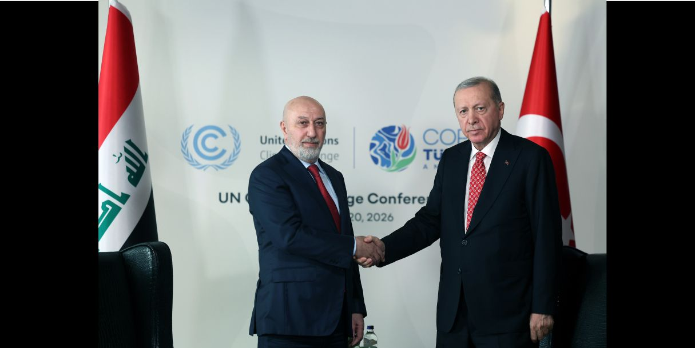
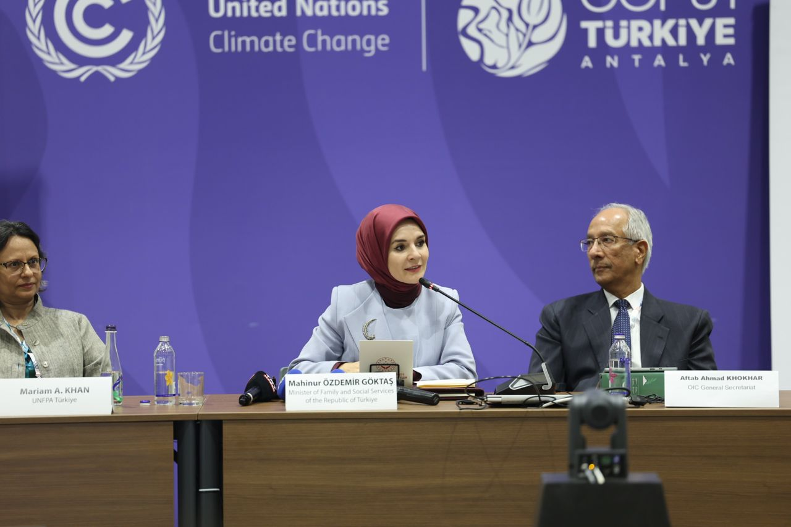
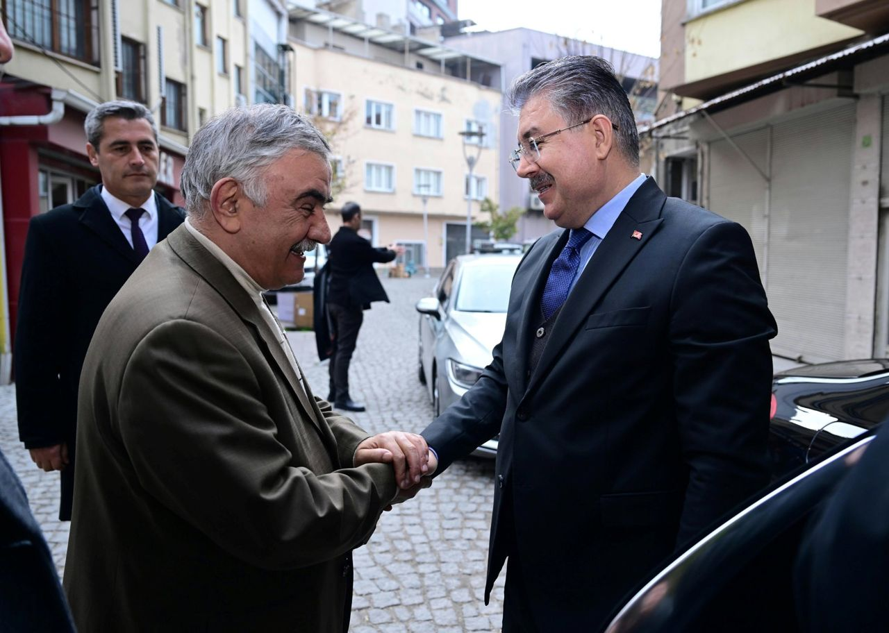
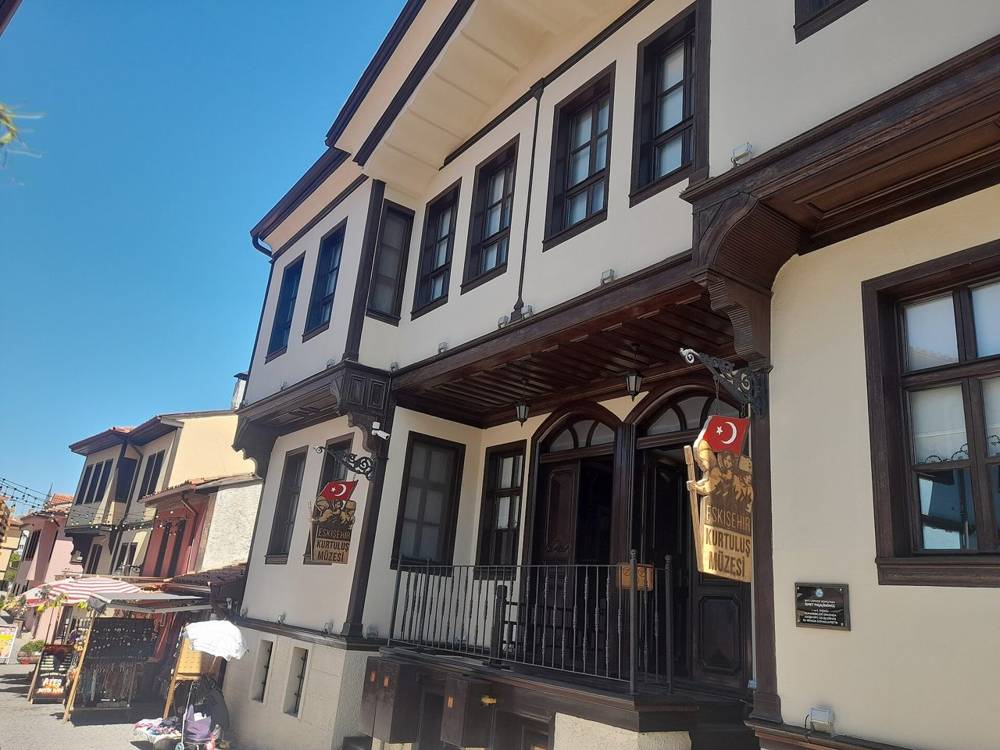
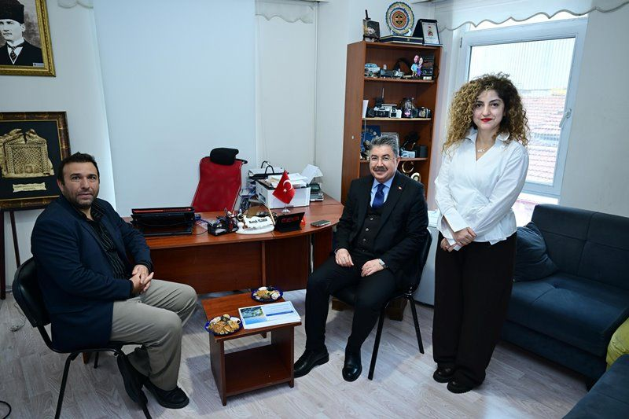
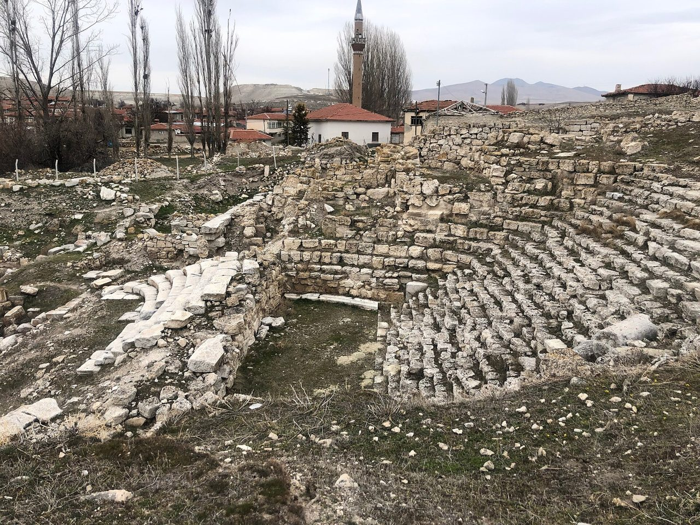
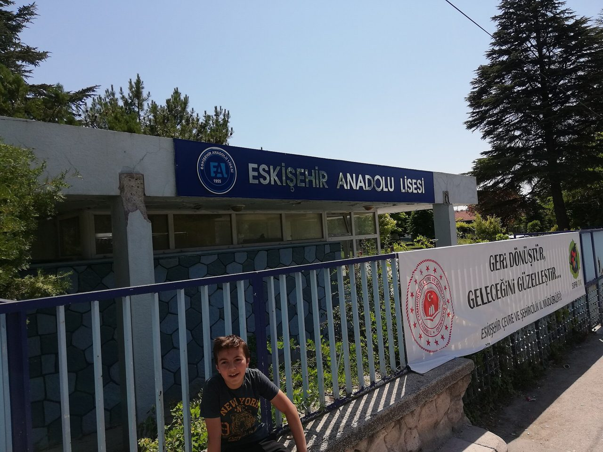

# Son haberler

Ajanın yazdığı son haberler (otomatik güncellenir).

## Uluslararası Eskişehir Şiir Buluşması başladı: Minikler doğanın sesini şiirle keşfetti

**Kültür-Sanat · Tepebaşı** · 2026-11-13 13:04 UTC · Kaynak: [Tepebaşı Belediyesi](https://www.tepebasi.bel.tr/Haber/Detay/14uluslararasıeskisehirsiirbulusmasıcocuklarındogasesleriylebasladı)

> Tepebaşı Belediyesi tarafından düzenlenen 14. Uluslararası Eskişehir Şiir Buluşması, kreş çocuklarının doğa seslerini taklit ettiği renkli çocuk oturumuyla açıldı.

Tepebaşı Belediyesi Basın Yayın ve Halkla İlişkiler Müdürlüğü tarafından bu yıl 14’üncüsü düzenlenen Uluslararası Eskişehir Şiir Buluşması, çocukların dünyasına dokunan bir etkinlikle başladı. Festival kapsamında yazar ve şair Erol Büyükmeriç, Melih Savaş Yaşam Köyü’nde eğitim gören kreş çocuklarıyla bir araya geldi.

"Doğadaki Sesleri Dinleyelim Çocuk Oturumu" başlığıyla düzenlenen etkinlikte Büyükmeriç, miniklerle birlikte "Sesler Kitabı"nı inceledi. Doğadaki kuş ve hayvan seslerini taklit ederek şiirlerin ritmine eşlik eden çocuklar keyifli anlar yaşadı. Programın sonunda Büyükmeriç, çocuklara imzalı kitaplarını hediye etti.

Eskişehir'i edebiyat dünyasının önemli isimleriyle buluşturan festival, 13–15 Kasım tarihleri arasında devam edecek. Etkinlik boyunca Türkiye'nin yanı sıra Mısır ve Fransa'dan gelen şairler kentte edebiyatseverlerle buluşacak.

---

## MEB Bakan Yardımcısı Yelkenci: İklim krizi aslında bir denge ve eğitim meselesidir

**Eğitim · Türkiye** · 2026-11-13 13:04 UTC · Kaynak: [Milli Eğitim Bakanlığı](https://www.meb.gov.tr/cop-31039de-quotturkiye-yuzyili-maarif-modeli-cercevesinde-insan-ve-toplumquot-paneli-duzenlendi/haber/42502/tr)

> Antalya'da düzenlenen COP31 kapsamında konuşan Millî Eğitim Bakan Yardımcısı Ömer Faruk Yelkenci, iklim krizinin özünde bir denge krizi olduğunu ve çözümün eğitimden geçtiğini vurguladı.

Antalya'nın ev sahipliğinde gerçekleştirilen Birleşmiş Milletler İklim Değişikliği Çerçeve Sözleşmesi 31. Taraflar Konferansı (COP31) Gençlik Pavilyonu'nda "Türkiye Yüzyılı Maarif Modeli Çerçevesinde İnsan ve Toplum" başlıklı panel düzenlendi.

Panelin açılışında konuşan Millî Eğitim Bakan Yardımcısı Ömer Faruk Yelkenci, modern insanın geleceğe tahakküm etme yaklaşımını eleştirerek yarınların sonraki nesillerin hakkı olduğunu belirtti. Doğadaki temel dengenin bozulmasına insanın faaliyetlerinin yol açtığını ifade eden Yelkenci, karbon piyasaları veya teknolojik adımların tek başına yeterli olamayacağını, asıl çözümün zihniyet ve eğitimle sağlanabileceğini söyledi.

Yelkenci, Türkiye Yüzyılı Maarif Modeli'nin insanı ruh ve beden bütünlüğüyle ele aldığını hatırlatarak çevre bilincinin müfredatta somut bir karşılık bulduğunu aktardı. Ortaokullarda uygulanan Çevre Eğitimi ve İklim Değişikliği dersinin insan ve doğa ilişkisine odaklandığını belirten Yelkenci, uluslararası taahhütler ile uygulama arasındaki mesafenin müzakere masalarından ziyade sınıflarda kapatılacağına inandıklarını dile getirdi.

---

## Başkan Ünlüce COP31'de Eskişehir'in Çevre ve Tarım Projelerini Anlattı

**Belediye · Merkez** · 2026-11-13 13:04 UTC · Kaynak: [Google Haberler - Eskişehir](https://ankahaber.net/haber/eskisehir-in-iklim-ve-surdurulebilirlik-vizyonu-cop31-de-8cc4a956)

> Eskişehir Büyükşehir Belediye Başkanı Ayşe Ünlüce, COP31 İklim Zirvesi'nde kentin sürdürülebilirlik projelerini ve yerel yönetimlerin iklim mücadelesindeki rolünü uluslararası kamuoyuyla paylaştı.

Birleşmiş Milletler İklim Değişikliği Çerçeve Sözleşmesi 31. Taraflar Konferansı (COP31) kapsamında düzenlenen etkinliklerde yer alan Eskişehir Büyükşehir Belediye Başkanı ve Türkiye Belediyeler Birliği (TBB) Başkan Vekili Ayşe Ünlüce, iklim değişikliğiyle mücadelede yerel yönetimlerin önemine dikkat çekti. Ünlüce, TBB'nin 75 ilden 330 belediyenin katkısıyla hazırladığı Yerel Yönetimler Pozisyon Belgesi'nin tanıtıldığı oturumun açılışında konuştu.

İklim krizinin etkilerinin her kentte farklı hissedildiğini ve bu nedenle küresel politikaların yerel koşullara uyarlanması gerektiğini vurgulayan Ünlüce, belediyelerin sadece karar uygulayıcı değil, sahadaki ihtiyaçları en iyi gözlemleyen kurumlar olduğunu belirtti.

Zirve kapsamında düzenlenen panellerde Eskişehir'de hayata geçirilen uygulamalardan örnekler veren Ünlüce, katı atık bertaraf tesisinde çöpten enerji üretildiğini ve oluşan ısıyla seralarda gıda ile peyzaj bitkileri yetiştirildiğini aktardı. Ayrıca kentteki ortak akıl merkezi "a.d.a", kırsal kalkınmayı destekleyen Çiftçi Destekleme ve Eğitim Merkezi (ÇİDEM), Küllüoba ekmeği ve Sakarya Vadisi'nde üretilen Dorlion zeytinyağı projeleri de katılımcılara tanıtıldı.

Başkan Ünlüce, sürdürülebilir gıda sistemleri ve döngüsel gastronomi oturumunda ise gıda israfıyla mücadelenin ve atıkların yeniden değerlendirilmesinin sera gazı emisyonlarını düşürmedeki kritik rolüne işaret etti.

---

## Başkan Kurt Uluslararası REBUS Forumu'nda Odunpazarı'nı Anlattı

**Belediye · Odunpazarı** · 2026-11-13 13:04 UTC · Kaynak: [Google Haberler - Odunpazarı](http://yozgatgazetesi.com/iha-haberleri/kazim-kurt-uluslararasi-rebus-2026-forumu-nda-odunpazari-ni-anlatti-305333.html)

> Tataristan'ın başkenti Kazan'da düzenlenen 4. Uluslararası REBUS Forumu'na konuşmacı olarak katılan Odunpazarı Belediye Başkanı Kazım Kurt, ilçedeki koruma ve restorasyon deneyimlerini paylaştı.

Rusya’nın Tataristan Cumhuriyeti’ne bağlı Kazan kentinde düzenlenen 4. Uluslararası REBUS 2026 Forumu'nda tarihî yerleşimlerin korunması ve sürdürülebilir kentsel gelişim ele alındı. Tataristan Cumhuriyeti Reisi Rüstem Minnihanov’un himayesinde Kazan EXPO'da yapılan foruma, Odunpazarı Belediye Başkanı Kazım Kurt da konuşmacı olarak davet edildi.

Rusya'nın 65 bölgesinin yanı sıra BRICS+, Şanghay İşbirliği Örgütü ve BDT üyesi ülkelerden çok sayıda heyetin katıldığı genel oturumda söz alan Başkan Kurt, Odunpazarı'nın tarihî kimliğini, yürütülen koruma çalışmalarını ve hayata geçirilen projeleri uluslararası delegelere aktardı. Toplantıda kentsel yenileme, tarihî dokunun ekonomik gelişmeyle uyumu, mekânsal planlama ve ekoloji gibi başlıklar üzerinde duruldu.

Forumun ardından açıklamada bulunan Başkan Kazım Kurt, farklı ülkelerin kültürel mirası koruma yaklaşımlarını incelemenin önemine değindi. Kurt, "Odunpazarı’mızın tarihî dokusunu ve bu alanda yürüttüğümüz çalışmaları uluslararası katılımcılarla paylaşma fırsatı bulduk. Kentlerin geçmişiyle geleceği arasında bağ kurma yöntemlerini dinlemek son derece kıymetliydi" ifadelerini kullanarak organizasyonda emeği geçen Tataristan yetkililerine teşekkür etti.

---

## Bakan Bayraktar Duyurdu: Akkuyu'da İlk Nükleer Reaktör Birkaç Haftaya Başlatılıyor

**Türkiye · Türkiye** · 2026-11-13 13:04 UTC · Kaynak: [Enerji ve Tabii Kaynaklar Bakanlığı](https://enerji.gov.tr/haber-detay?id=31974)

> Enerji ve Tabii Kaynaklar Bakanı Alparslan Bayraktar, Türkiye'nin ilk nükleer güç reaktörünün fiziksel başlatmasının birkaç hafta içinde Akkuyu'da gerçekleştirileceğini açıkladı.

Antalya'da düzenlenen Birleşmiş Milletler İklim Değişikliği Çerçeve Sözleşmesi 31. Taraflar Konferansı (COP31) kapsamında gerçekleştirilen Dünya Atom Günleri etkinliğinde konuşan Enerji ve Tabii Kaynaklar Bakanı Alparslan Bayraktar, Türkiye'nin enerji dönüşümü ve nükleer hedeflerine ilişkin kritik açıklamalarda bulundu.

İnşası süren Akkuyu Nükleer Güç Santrali'ndeki son duruma değinen Bakan Bayraktar, Türkiye'nin ilk nükleer güç reaktörünün fiziksel başlatmasının önümüzdeki birkaç hafta içinde yapılacağını duyurdu. Bayraktar, Türkiye'nin 2035 yılına kadar ekonomide yüzde 35 elektrifikasyon hedefi belirlediğini ve bu zorlu hedefe ulaşmak için nükleer enerjiye kesin bir ihtiyaç duyulduğunu belirtti.

Türkiye'nin 2050 yılına kadar büyük reaktörler ve küçük modüler reaktörlerin (SMR) birleşimiyle toplam 20 gigavatlık nükleer kapasiteye ulaşmayı planladığını ifade eden Bayraktar, bu sayede elektrik ihtiyacının en az yüzde 10 ila 12'sinin temiz kaynaklardan temin edileceğini ve karbon emisyonlarının düşürüleceğini kaydetti.

Nükleer enerji programındaki yerlileşme adımlarına da dikkat çeken Bakan Bayraktar, Akkuyu projesinde yerlilik oranının yüzde 50'nin üzerine çıktığını ve Rusya'da eğitim alan 300'ü aşkın Türk uzmanın projede görev yaptığını sözlerine ekledi.

---

## Talat Yalaz'ın davasında ilk duruşma görüldü: Dava 3 Aralık'a ertelendi

**Siyaset · Merkez** · 2026-11-13 11:05 UTC · Kaynak: [Google Haberler - Eskişehir gündem](https://yerel-haberler.haberturk.com/eskisehir-haberleri/yeni-parti-eskisehir-il-baskani-talat-yalazin-yargilanmasina-baslandi-119519875)

> Eskişehir'de yaptığı basın açıklamasındaki ifadeleri gerekçesiyle hakkında hapis ve siyasi yasak talebiyle dava açılan Talat Yalaz'ın yargılanmasına başlandı.

CHP İl Başkanlığı yaptığı dönemde gerçekleştirdiği bir basın açıklamasındaki sözleri gerekçe gösterilerek "halkı kanunlara uymamaya tahrik" suçlamasıyla hakkında dava açılan Talat Yalaz'ın yargılanmasına Eskişehir 5. Asliye Ceza Mahkemesinde başlandı.

İlk duruşmaya şehir dışında olduğu belirtilen Talat Yalaz katılmazken, kendisini avukatı Tevfik Yıldırım temsil etti. Duruşmada söz alan Avukat Yıldırım, soruşturma aşamasına dair tanık dinlenmesi yönündeki talebini mahkeme heyetine iletti.

Mahkeme, dava dosyasındaki eksik hususların giderilmesine karar vererek duruşmayı 3 Aralık tarihine erteledi.

Eskişehir Cumhuriyet Başsavcılığı tarafından hazırlanan iddianamede, 20 Temmuz 2024 tarihinde Hayvanları Koruma Kanunu'nda yapılması planlanan değişikliklere karşı düzenlenen basın açıklamasındaki ifadeler gerekçe gösterilmişti. Yalaz hakkında 6 aydan 2 yıla kadar hapis cezası ile siyasi yasak getirilmesi talep ediliyor.

---

## Erdoğan'dan Irak Cumhurbaşkanı Amedi ile Kritik Zirve: Kalkınma Yolu Masada

**Siyaset · Türkiye** · 2026-11-13 11:05 UTC · Kaynak: [Google Haberler - Cumhurbaşkanı](https://www.iletisim.gov.tr/turkce/haberler/detay/cumhurbaskani-erdoganin-irak-cumhurbaskani-amedi-ile-gorusmesine-iliskin-aciklama)

> Cumhurbaşkanı Recep Tayyip Erdoğan, COP31 Liderler Zirvesi kapsamında Irak Cumhurbaşkanı Nizar Amedi ile Antalya'da bir araya geldi.

Cumhurbaşkanı Recep Tayyip Erdoğan, Antalya'da düzenlenen COP31 Liderler Zirvesi marjında Irak Cumhurbaşkanı Nizar Amedi ile ikili bir görüşme gerçekleştirdi. İletişim Başkanlığından yapılan açıklamaya göre, görüşmede Türkiye ile Irak arasındaki ikili ilişkiler ve bölgesel gelişmeler ele alındı.

Cumhurbaşkanı Erdoğan, iki ülke arasındaki üst düzey temaslarda yakalanan ivmenin ikili ilişkilere dinamizm kazandırdığını belirtti. Görüşmede özellikle Kalkınma Yolu Projesi'ndeki ilerlemelere dikkat çeken Erdoğan, bu projenin Doğu-Batı ticaretinde yeni bir güzergâh oluşturacağını, enerji başta olmak üzere birçok sektörde iş birliğini güçlendirecek adımların sürdürüleceğini ifade etti.

Erdoğan ayrıca Türkiye'nin "Terörsüz Bölge" hedefine Irak'ın desteğini artırarak sürdürmesini beklediklerini, bu amaca ulaşılmasının her iki ülkenin de çıkarına olacağını kaydetti.

Zirve kapsamındaki görüşmeye Dışişleri Bakanı Hakan Fidan, Adalet Bakanı Akın Gürlek, Tarım ve Orman Bakanı İbrahim Yumaklı, AK Parti Genel Başkan Yardımcısı ve Parti Sözcüsü Ömer Çelik, MİT Başkanı İbrahim Kalın ile Cumhurbaşkanlığı İletişim Başkanı Burhanettin Duran da katıldı.

---

## Bodrum Heyeti Eskişehir'de: Başarılı Projeler Ege'ye Taşınacak

**Belediye · Merkez** · 2026-11-13 11:04 UTC · Kaynak: [Google Haberler - Eskişehir](https://www.eskisehirekspres.net/baskan-mandalinci-eskisehirdeki-guzel-ornekleri-bodruma-tasimak-istiyoruz)

> Bodrum Belediye Başkanı Tamer Mandalinci ve beraberindeki heyet, Eskişehir Büyükşehir Belediye Başkanı Ayşe Ünlüce’yi ziyaret ederek kentteki şehircilik uygulamalarını inceledi.

Eskişehir Büyükşehir Belediyesi Meclis Salonu’nda gerçekleşen buluşmada, Eskişehir Büyükşehir Belediye Başkanı Ayşe Ünlüce ile Bodrum Belediye Başkanı Tamer Mandalinci bir araya geldi. Görüşmede iki kent arasındaki kardeş şehir ilişkileri, belediyecilik tecrübeleri ve kente değer katan uygulamalar ele alındı.

Eskişehir’deki başarılı projeleri yerinde görmek amacıyla kente geldiklerini aktaran Bodrum Belediye Başkanı Tamer Mandalinci, teknik incelemelerin oldukça verimli geçtiğini belirtti. Eskişehir'in belediyecilik anlayışını yakından takip ettiklerini ifade eden Mandalinci, kentte hayata geçirilen örnek çalışmaları Bodrum'a taşımak istediklerini kaydetti.

Ziyaretten duyduğu memnuniyeti dile getiren Eskişehir Büyükşehir Belediye Başkanı Ayşe Ünlüce ise yerel yönetimler arasındaki deneyim paylaşımının önemine değindi. Eskişehir’in yıllar içinde geçirdiği dönüşüm sürecini anlatan Ünlüce, özellikle Porsuk Çayı ıslahı ve çevresinde kurulan kamusal yeşil alanların şehre kazandırdığı canlılığı paylaştı.

---

## Hakan Şapcı'nın PFDK Cezası Belli Oldu: Ayvalıkgücü Maçında Kulübede

**Spor · Merkez** · 2026-11-13 10:20 UTC · Kaynak: [Google Haberler - Eskişehirspor](https://www.gazetevatan.com/sehirler/eskisehir/eskisehirsporu-diken-ustunde-tutan-ceza-aciklandi-2464363)

> Kepezspor maçında kırmızı kart gören Eskişehirspor Teknik Direktörü Hakan Şapcı'ya PFDK tarafından bir maç ve 5 bin TL para cezası verildi.

Kepezspor karşılaşmasının devre arasında kırmızı kartla ihraç edilen ve Profesyonel Futbol Disiplin Kuruluna (PFDK) sevk edilen Eskişehirspor Teknik Direktörü Hakan Şapcı hakkındaki karar açıklandı. Disiplin kurulu, tecrübeli teknik adama bir maç men ve 5 bin TL para cezası uyguladı.

Verilen bir maçlık cezasını hafta içinde oynanan Anadolu SF müsabakasında tribünde kalarak tamamlayan Hakan Şapcı'nın men süresi sona erdi. Başarılı çalıştırıcı, pazar günü oynanacak Ayvalıkgücü karşılaşmasında takımının başında yer alarak yedek kulübesine dönebilecek.

---

## Erdoğan COP31'de Liderlerle Görüştü: Masada Barış ve İş Birliği Vardı

**Siyaset · Türkiye** · 2026-11-13 09:04 UTC · Kaynak: [Google Haberler - Cumhurbaşkanı](https://www.trthaber.com/haber/gundem/cumhurbaskani-erdogandan-cop31de-yogun-diplomasi-trafigi-963155.html)

> Cumhurbaşkanı Recep Tayyip Erdoğan, Antalya'da düzenlenen COP31 kapsamında BM Genel Sekreteri Guterres ve çok sayıda devlet başkanıyla ikili temaslarda bulundu.

Antalya EXPO alanında gerçekleştirilen Birleşmiş Milletler İklim Değişikliği Çerçeve Sözleşmesi 31. Taraflar Konferansı (COP31), yoğun bir ikili diplomasi trafiğine sahne oldu. Cumhurbaşkanı Recep Tayyip Erdoğan, zirve boyunca dünya liderleriyle bir dizi resmi görüşme gerçekleştirdi.

Temaslarına BM Genel Sekreteri Antonio Guterres ile başlayan Erdoğan; İran-ABD gerilimi, Ukrayna-Rusya Savaşı, Gazze, Kıbrıs ve Libya'daki gelişmeleri ele aldı. Erdoğan, bölgesel ihtilafların diplomasi ve diyalog yoluyla çözülmesi için Türkiye'nin desteğe hazır olduğunu kaydetti. Zirve kapsamında Brezilya Devlet Başkanı Lula da Silva ile de görüşen Erdoğan, iklim müzakerelerinde alınan mesafeyi COP31 ile somut uygulamalara dönüştürmeyi hedeflediklerini belirtti.

Liderler Zirvesi boyunca devam eden görüşmelerde Avustralya Başbakanı Anthony Albanese, Çin Devlet Başkan Yardımcısı Han Zheng, Ermenistan Başbakanı Nikol Paşinyan ve Bosna Hersek heyetiyle ikili ilişkiler değerlendirildi. Çin ile Orta Koridor, Kuşak ve Yol ile Kalkınma Yolu projelerinin uyumuna dikkat çekilirken; Ermenistan ile normalizasyon ve Azerbaycan arasındaki barış süreci masaya yatırıldı. Suudi Arabistan ile ise elektrik projelerinde iş birliğini içeren mutabakat zaptı imzalandı.

Zirvenin son gününde İran Cumhurbaşkanı Mesud Pezeşkiyan ile bir araya gelen Erdoğan, İran-ABD arasındaki çatışmaların sona ermesi için müzakere masasının kurulması gerektiğini vurguladı. Cumhurbaşkanı Erdoğan ayrıca Irak, Pakistan, Gürcistan, Kongo, Kongo DC, Sudan, Libya ve Tanzanya liderleriyle enerji, ticaret ve ulaştırma alanlarındaki iş birliğini güçlendirmeye yönelik temaslarda bulundu.

---

## Bakan Göktaş'tan COP31'de İklim ve Göç Uyarısı: 216 Milyon Kişi Yer Değiştirebilir

**Türkiye · Türkiye** · 2026-11-13 09:04 UTC · Kaynak: [Aile ve Sosyal Hizmetler Bakanlığı](https://www.aile.gov.tr/haberler/bakanimiz-goktas-cop31-de-iklim-politikasi-cercevelerinde-ayristirilmis-demografik-veri-kullaniminin-hizlandirilmasi-etkinliginde-konustu/)

> Aile ve Sosyal Hizmetler Bakanı Mahinur Özdemir Göktaş, COP31'de yaptığı konuşmada iklim krizinin toplumsal yapıyı derinden etkilediğini ve sosyal politikaların değişen nüfus verilerine göre şekillendirileceğini açıkladı.

Antalya'da düzenlenen Birleşmiş Milletler İklim Değişikliği Çerçeve Sözleşmesi 31. Taraflar Konferansı (COP31) kapsamında gerçekleştirilen "İklim Politikası Çerçevelerinde Ayrıştırılmış Demografik Veri Kullanımının Hızlandırılması" etkinliğinde konuşan Aile ve Sosyal Hizmetler Bakanı Mahinur Özdemir Göktaş, iklim ile nüfus dinamikleri arasındaki güçlü bağa dikkat çekti. Bakan Göktaş, Dünya Bankası verilerine işaret ederek 2050 yılına kadar 216 milyon kişinin iklim koşulları sebebiyle kendi ülkesi içinde göç etmek zorunda kalabileceğini ifade etti.

İklim krizinin etkilerinin toplum kesimlerine göre farklılık gösterdiğini belirten Göktaş, Hükümetlerarası İklim Değişikliği Paneli verilerine göre dünya çapında 3 milyar 300 milyon ile 3 milyar 600 milyon arasında insanın iklim olaylarına karşı yüksek kırılganlık taşıdığını aktardı. Bu farklılıkların yönetilebilmesi için ayrıştırılmış demografik verilerin hayati öneme sahip olduğunu vurgulayan Bakan Göktaş, risklerin yaş, gelir ve hane yapısına göre tespit edilerek müdahale planlarının hazırlanması gerektiğini söyledi.

Bakanlık olarak iklim kaynaklı değişimleri sosyal politikalara entegre ettiklerini kaydeden Göktaş, iklim krizinin kadınlar üzerindeki etkilerini araştıran saha çalışmaları yürüttüklerini belirtti. Hazırlanan sosyal risk haritalarında iç ve dış göç hareketlerinin birer gösterge olarak yer aldığını bildiren Göktaş, "Aile ve Nüfus On Yılı" vizyonu çerçevesinde sosyal hizmetlerin geleceğin değişen demografik şartlarına uygun şekilde planlanacağını sözlerine ekledi.

---

## Vali Yılmaz'dan İHA Eskişehir Bölge Müdürlüğü'ne Ziyaret

**Gündem · Merkez** · 2026-11-13 07:49 UTC · Kaynak: [Eskişehir Valiliği](https://www.eskisehir.gov.tr/valimiz-dr-erdinc-yilmaz-ihlas-haber-ajansi-iha-eskisehir-bolge-mudurlugunu-ziyaret-etti)

> Eskişehir Valisi Dr. Erdinç Yılmaz, İhlas Haber Ajansı Eskişehir Bölge Müdürlüğü'nü ziyaret ederek yürütülen basın çalışmaları hakkında bilgi aldı.

Eskişehir Valisi Dr. Erdinç Yılmaz, kentteki basın kuruluşlarına yönelik temasları kapsamında İhlas Haber Ajansı (İHA) Eskişehir Bölge Müdürlüğü'ne ziyarette bulundu.

Ziyarette İHA Eskişehir Bölge Müdürü Mehmet Emin Toker, Haber Müdürü Aydın Sarıoğlu ve kurum bünyesinde görev yapan muhabirlerle bir araya gelen Vali Yılmaz, ajansın kentteki ve bölgedeki haber faaliyetleri ile operasyonel çalışmaları hakkında detaylı bilgi aldı.

Basın çalışanlarıyla bir süre sohbet ederek görevlerinde kolaylıklar dileyen Vali Yılmaz, yerel ve bölgesel gelişmelerin kamuoyuna aktarılmasında basın mensuplarının üstlendiği sorumluluğa işaret etti.

---

## Şeker Mahallesi'nde Gece Mesaisi: Sırada İki Mahalle Daha Var

**Belediye · Tepebaşı** · 2026-11-13 07:49 UTC · Kaynak: [Google Haberler - Tepebaşı](https://gazetekalem.com.tr/tepebasi-belediye-baskani-atac-seker-mahallesinde-yurutulen-calismalari-inceledi/)

> Tepebaşı Belediye Başkanı Ahmet Ataç, Şeker Mahallesi’nde akşam saatlerinde yürütülen asfalt çalışmalarını yerinde inceleyerek bölge sakinleriyle bir araya geldi.

Tepebaşı Belediyesi Fen İşleri Müdürlüğü ekipleri, ilçe genelindeki yollarda ulaşım güvenliğini artırmak ve yıpranan zeminleri yenilemek amacıyla üstyapı çalışmalarını sürdürüyor. Merkez mahallelerde yürütülen asfalt serim mesaisi, Şeker Mahallesi'nde akşam saatlerinde de devam etti.

Çalışmaları sahada takip eden Tepebaşı Belediye Başkanı Ahmet Ataç, ekiplerden gelinen son aşama hakkında bilgi aldı. İncelemelerin ardından mahalle sakinleriyle buluşan Ataç, vatandaşların talep ve önerilerini dinledi. Ulaşımı daha güvenli ve konforlu hale getirmeyi amaçladıklarını vurgulayan Ataç, hem sahada görev yapan personellere hem de destek veren bölge halkına teşekkür etti.

Belediyeden yapılan bilgilendirmeye göre, Şeker Mahallesi’ndeki yol düzenleme çalışmalarının tamamlanmasının ardından ekipler plan doğrultusunda Işıklar ve Mamure mahallelerinde de asfalt yenileme mesaisine başlayacak.

---

## Karakurt'tan Kurtuluş Savaşı'na: Eskişehirli öğretmenler kent tarihini müzelerde inceledi

**Eğitim · Odunpazarı** · 2026-11-13 07:49 UTC · Kaynak: [Google Haberler - Eskişehir gündem](https://yerel-haberler.haberturk.com/eskisehir-haberleri/eskisehirde-ogretmenler-kentin-tarihi-ve-kulturel-mirasini-muzelerde-tanidi-119519307)

> Eskişehir Öğretmen Akademileri bünyesinde düzenlenen özel gezi programıyla öğretmenler, kentin binlerce yıllık tarihi ve sanayi mirasını müzelerde yerinde gördü.

İl Milli Eğitim Müdürlüğünden yapılan açıklamaya göre, Eskişehir Öğretmen Akademileri bünyesinde faaliyet gösteren Şehir ve Kültür Akademisi tarafından öğretmenlere yönelik kapsamlı bir müze gezisi düzenlendi.

Program kapsamında ilk olarak Eskişehir Ticaret ve Sanayi Müzesi'ni ziyaret eden eğitimciler; Frig uygarlığından kentin ticaret ve sanayi geçmişine, geleneksel lületaşı ustalığından Karakurt lokomotifi ve Türkiye'nin ilk yerli otomobili Devrim'e uzanan koleksiyonu inceledi.

Gezinin ikinci durağı ise Eskişehir Kurtuluş Müzesi oldu. Burada Milli Mücadele dönemine ait tarihi belgeleri, dönemin gazete ve karikatürlerini inceleyen öğretmenler, Birinci İnönü Savaşı'nın aktarıldığı Strateji Odası hakkında da ayrıntılı bilgi aldı.

---

## COP31'de 102 lider ağırlandı: Duran'dan iklim diplomasisi mesajı

**Türkiye · Türkiye** · 2026-11-13 07:49 UTC · Kaynak: [İletişim Başkanlığı](https://www.iletisim.gov.tr/turkce/haberler/detay/iletisim-baskani-durandan-cop31-liderler-zirvesi-mesaji)

> İletişim Başkanı Burhanettin Duran, Antalya'da düzenlenen COP31 Liderler Zirvesi kapsamında 6 kıtadan 95 ülkenin lideri ve 7 uluslararası kuruluş başkanı olmak üzere toplam 102 liderin ağırlandığını duyurdu.

Cumhurbaşkanlığı İletişim Başkanı Burhanettin Duran, Antalya'nın ev sahipliğinde gerçekleştirilen Birleşmiş Milletler (BM) İklim Değişikliği Çerçeve Sözleşmesi 31. Taraflar Konferansı (COP31) Liderler Zirvesi'ne ilişkin değerlendirmelerde bulundu. Duran, zirve kapsamında sözleşmeye taraf 196 ülke ile Avrupa Birliği'nin bir araya geldiğini, Türkiye'nin ise diyaloğu, uzlaşıyı ve somut eylemi merkeze alan bir iklim diplomasisi yürüttüğünü kaydetti.

Zirvede toplam 102 liderin Türkiye'de misafir edildiğini belirten Duran, Cumhurbaşkanı Recep Tayyip Erdoğan'ın zirvede yaptığı çağrıya işaret etti. Erdoğan'ın "İnsanlığın tek bir çatısı vardır, o da gökyüzüdür; tek bir bahçesi vardır, o da yeryüzüdür. Başka bir gökyüzümüz, başka bir yeryüzümüz yoktur" sözlerini anımsatan Duran, iklim adaleti konuşulurken insani değerlerin ve vicdanın da öne çıkarıldığını ifade etti.

İklim kriziyle mücadelenin aynı zamanda insana, toprağa ve geleceğe sahip çıkma mücadelesi olduğunu vurgulayan Duran, Gazze'deki duruma dikkat çekerek Cumhurbaşkanı Erdoğan'ın 11 Kasım Millî Ağaçlandırma Günü kapsamında BM Genel Sekreteri Antonio Guterres ile birlikte diktiği zeytin fidanının anlamlı bir iradeyi simgelediğini dile getirdi. Duran, gelecek kuşaklara bırakılacak en değerli mirasın daha temiz, yeşil ve adil bir dünya olacağını belirtti.

---

## Vali Yılmaz'dan Esgazete'ye Ziyaret

**Gündem · Merkez** · 2026-11-13 07:44 UTC · Kaynak: [Eskişehir Valiliği](https://www.eskisehir.gov.tr/valimiz-dr-erdinc-yilmaz-esgazete-internet-haber-merkezini-ziyaret-etti)

> Eskişehir Valisi Dr. Erdinç Yılmaz, Esgazete İnternet Haber Merkezi'ni ziyaret ederek kurum çalışmaları hakkında bilgi aldı.

Eskişehir Valisi Dr. Erdinç Yılmaz, yerel medyanın çalışmalarını yerinde incelemek amacıyla Esgazete İnternet Haber Merkezi'ni ziyaret etti.

Ziyaret sırasında Esgazete İmtiyaz Sahibi Mustafa Yıldırım ve Yazı İşleri Müdürü Şenay Yıldırım ile bir araya gelen Vali Yılmaz, yürütülen faaliyetler ve haber çalışmaları hakkında yetkililerden bilgi aldı.

Basın mensuplarıyla bir süre sohbet eden Vali Yılmaz, gazetecilik faaliyetlerinin önemine değinerek tüm çalışanlara görevlerinde başarılar diledi.

---

## Ünlü Edebiyatçı Feridun Andaç'tan Tepebaşı'nın Kültür Vizyonuna Övgü

**Kültür-Sanat · Tepebaşı** · 2026-11-13 07:44 UTC · Kaynak: [Google Haberler - Tepebaşı](https://www.haber26.com.tr/eskisehir/unlu-edebiyatci-feridun-andactan-tepebasinin-kultur-ve-sanat-vizyonuna-ovgu)

> Yazar ve akademisyen Feridun Andaç, Tepebaşı Belediyesi'ni ziyaret ederek kültür ve sanat projelerini inceledi, Başkan Ataç'ın çalışmalarının örnek olduğunu belirtti.

Ünlü edebiyatçı ve akademisyen Feridun Andaç, Tepebaşı Belediye Başkanı Dt. Ahmet Ataç’ı makamında ziyaret etti. Ziyarette belediyenin kültür ve sanat alanında hayata geçirdiği projeler masaya yatırıldı.

Başkan Ataç'ın kamuoyu anketlerinde yüzde 60,7 oy oranıyla İç Anadolu Bölgesi’nin en beğenilen ilçe belediye başkanı seçilmesinin tesadüf olmadığını ifade eden Feridun Andaç, Tepebaşı’nda insanı ve sanatı merkeze alan belediyecilik anlayışının Türkiye geneline örnek teşkil ettiğini dile getirdi. Hizmetlerin yalnızca altyapıyla sınırlı kalmaması gerektiğini vurgulayan Andaç, sanat ve edebiyat etkinliklerinin kente kazandırdığı değere dikkat çekti.

Tepebaşı Belediye Başkanı Dt. Ahmet Ataç ise ziyaretten duyduğu memnuniyeti belirterek kültür ve sanatın bir toplumun nefesi, hafızası ve geleceği olduğunu söyledi. Kentte çocukların, gençlerin ve kadınların sanata kolayca ulaşabileceği bir yaşam alanı yaratmak için çalıştıklarını ifade eden Ataç, sanat odaklı projelerin artarak devam edeceğini kaydetti.

Ziyaretin ardından Feridun Andaç ve Başkan Ataç; atık kâğıtların yeniden üretime kazandırıldığı Kâğıt Geri Dönüşüm Atölyesi’ni, Uluslararası Pişmiş Toprak Sempozyumu eserlerini ve Milli Mücadele dönemini anlatan sergiyi gezerek incelemelerde bulundu.

---

## Togg'dan COP31'de 2035 karbon nötr hedefi açıklaması

**Ekonomi · Türkiye** · 2026-11-13 07:44 UTC · Kaynak: [Google Haberler - Togg](https://www.platinonline.com/otomotiv/togg-ceosu-gurcan-karakas-toggun-2035-hedefini-paylasti-1100759)

> Togg CEO'su Gürcan Karakaş, Antalya'da düzenlenen COP31 İklim Zirvesi'nde şirketin 2035 yılına kadar karbon nötr olma hedefini duyurdu.

Çevre, Şehircilik ve İklim Değişikliği Bakanlığı'nın ev sahipliğinde Antalya'da gerçekleştirilen COP31 İklim Zirvesi'nde Togg da küresel sahnede yerini aldı. Zirvede açıklamalarda bulunan Togg CEO'su M. Gürcan Karakaş, şirketin sürdürülebilirlik vizyonunu ve çevre hedeflerini paylaştı.

Gemlik'teki üretim üssünün tam anlamıyla bir teknoloji merkezi olduğunu belirten Karakaş, tesisi ilk günden itibaren bu vizyonla kurguladıklarını ifade etti. Karakaş, "2035 yılında karbon nötr olma hedefimiz var. Bunu ilk günden itibaren böyle kurguladık" diyerek gelecek planlamasında yarından sonrasını hedeflediklerini kaydetti.

Üretim süreçlerinde tamamen kağıtsız ve dijital bir model uyguladıklarını aktaran Karakaş, aynı yaklaşımın tedarik zincirinde de sürdürüldüğünü belirtti. Karbon emisyonlarının yapay zeka destekli altyapıyla takip edilip doğrulandığını ifade eden Karakaş, yollardaki 130 bine yakın Togg akıllı cihazı sayesinde yaklaşık 600 bin ton karbondioksit emisyonunun önüne geçildiğini bildirdi.

Zirvedeki uluslararası ilgiye de değinen Karakaş, katılımcılardan büyük bir merak ve şaşkınlık gördüklerini, özellikle Türkiye'nin bu sistemi bu kadar kısa sürede nasıl kurduğunu öğrenmek istediklerini sözlerine ekledi.

---

## Pessinus'un Binlerce Yıllık Tarihi Kent Müzeleri'nde Ziyarete Açıldı

**Kültür-Sanat · Odunpazarı** · 2026-11-13 07:44 UTC · Kaynak: [Google Haberler - Eskişehir etkinlik](https://www.esgazete.com/eskisehirde-pessinus-sergisi-kent-muzelerinde-acildi)

> Antik Pessinus'un köklü geçmişini ve Ballıhisar köyündeki yaşamı buluşturan sergi, Kent Müzeleri Kompleksi'nde kapılarını açtı.

Eskişehir Büyükşehir Belediyesi Kent Müzeleri Kompleksi Geçici Sergi Salonu, tarih ve arkeoloji meraklılarını buluşturan yeni bir sergiye ev sahipliği yapıyor. “Toprağın Altındaki Kent, Üstündeki Köy: Pessinus” başlığıyla hazırlanan serginin açılışı yoğun bir katılımla gerçekleştirildi.

Anadolu'nun en önemli inanç ve ticaret merkezlerinden biri olan antik Pessinus'un tarihini ziyaretçilere aktaran sergi; Tanrılar Ana'nın kutsal merkezinden Roma dönemi yapılarına, Bizans ve Selçuklu izlerinden günümüz Ballıhisar köyüne uzanan hikâyeyi gözler önüne seriyor. Arkeolojik çalışmalarla gün ışığına çıkan kültürel mirası görünür kılmayı hedefleyen sergi, toprağın altındaki tarih ile üstünde süren yaşamı aynı çatı altında buluşturuyor.

Açılışta konuşan Eskişehir Büyükşehir Belediyesi Başkan Vekili Hasan Ünal, Pessinus'ta yürütülen kazı çalışmalarının önemine vurgu yaparak, araştırmaların daha güçlü kaynaklarla desteklenmesi gerektiğini dile getirdi. Ünal, belediye olarak kazı ekiplerine desteği sürdüreceklerini belirtti.

Pessinus Kazı Başkanı Doç. Dr. Adem Yurtsever ise antik kentin kültürel değerinin kentte daha geniş kitlelerce tanınması gerektiğini kaydetti. Sergi, 6 Aralık 2026 tarihine kadar Kent Müzeleri Kompleksi'nde ziyaret edilebilecek.

---

## Minikler ÇEDES Projesi ile hem eğlendi hem tarihi keşfetti

**Eğitim · Odunpazarı** · 2026-11-13 07:44 UTC · Kaynak: [Google Haberler - Eskişehir gündem](https://www.medyagazete.com/haber/cedes-projesi-kapsaminda-minikler-hem-eglendi-hem-tarihi-ogrendi)

> Eskişehir'de ÇEDES Projesi kapsamında bir araya gelen ilkokul öğrencileri, atölye çalışmalarına katıldı ve Odunpazarı'nda kültür gezisi yaptı.

Eskişehir Gençlik ve Spor İl Müdürlüğü bünyesindeki Yunus Emre Gençlik Merkezi, "Çevreme Duyarlıyım Değerlerime Sahip Çıkıyorum" (ÇEDES) Projesi çerçevesinde Şehit Mehmet Taş İlkokulu öğrencilerini misafir etti.

Merkezi ziyaret eden minikler, gençlik liderleri ve eğitmenlerin rehberliğinde hazırlanan çeşitli atölye ve farkındalık çalışmalarına katıldı. Programda çocukların katılımıyla "Aile Bütünlüğü" temalı eğitici drama oyunları sahnelendi ve bilgilendirici sunumlar yapıldı. Ardından resim atölyesinde boyama yapan öğrenciler, müzik etkinliğinde şarkılar söyleyerek keyifli anlar yaşadı.

Merkezdeki etkinliklerin tamamlanmasının ardından öğrenciler ve gençlik merkezi ekibi, tarihi Odunpazarı bölgesine doğru kültür gezisi gerçekleştirdi. Bölgedeki sanat atölyelerini gezerek zanaatkarların çalışmalarını yerinde inceleyen çocuklar, tarihi mekanları ziyaret edip hatıra fotoğrafı çektirerek günü tamamladı.

---

## İletişim Başkanı Duran'dan COP31 Açıklaması: Türkiye'nin Çabaları Takdir Ediliyor

**Türkiye · Türkiye** · 2026-11-13 07:44 UTC · Kaynak: [İletişim Başkanlığı](https://www.iletisim.gov.tr/turkce/haberler/detay/iletisim-baskani-duran-cop31-liderler-zirvesine-dair-aciklamalarda-bulundu)

> İletişim Başkanı Burhanettin Duran, Antalya'da düzenlenen COP31 Liderler Zirvesi'ne ilişkin yaptığı açıklamada, Türkiye'nin iklim adaleti ve Sıfır Atık Hareketi'ndeki öncü rolüne dikkat çekti.

Cumhurbaşkanlığı İletişim Başkanı Burhanettin Duran, Antalya'da ev sahipliği yapılan Birleşmiş Milletler (BM) İklim Değişikliği Çerçeve Sözleşmesi 31. Taraflar Konferansı (COP31) Liderler Zirvesi'nin ardından değerlendirmelerde bulundu. Zirvenin başarılı bir şekilde sürdüğünü belirten Duran, Cumhurbaşkanı Recep Tayyip Erdoğan'ın zirvedeki temaslarına ve konuşmasına liderlerin yoğun ilgi gösterdiğini ifade etti.

Cumhurbaşkanı Erdoğan'ın konuşmasındaki iklim adaleti vurgusunun ve Gazze'deki çevre ve insanlık dramına dikkat çeken mesajlarının uluslararası alanda büyük yankı uyandırdığını aktaran Duran, gelişmekte olan ülkelerin iklim mücadelesindeki finans ve teknoloji ihtiyaçlarının somut adımlarla desteklenmesi gerektiğini vurguladı. Duran, Türkiye'nin Emine Erdoğan'ın liderliğinde hayata geçirdiği Sıfır Atık Hareketi'nin tüm dünyaya örnek teşkil ettiğini belirtti.

İletişim Başkanlığı'nın zirvedeki faaliyetlerine de değinen Duran, etkinlik alanında kurulan geniş pavilyonda 5 panel düzenlediklerini ve iklim diplomasisi, Türkiye'nin COP31 tecrübesi ile Sıfır Atık konularını ele alan 3 temel eser hazırladıklarını kaydetti. Duran, Anadolu Ajansı ve TRT'nin de zirvede etkin bir görev üstlendiğini belirterek, SETA standını da ziyaret ettiğini sözlerine ekledi.

---

## Eskişehir'de kontrolden çıkan otomobil yan yattı: Sürücü ve yolcular ucuz kurtuldu

**Asayiş · Tepebaşı** · 2026-11-13 07:44 UTC · Kaynak: [Google Haberler - Eskişehir asayiş](https://www.haber26.com.tr/asayis/eskisehir-de-kontrolden-cikan-otomobil-yan-yatti)

> Tepebaşı ilçesinde sürücüsünün direksiyon hakimiyetini kaybettiği otomobilin yan yattığı kazada araçta bulunanlar hafif sıyrıklarla kurtuldu.

Eskişehir'de gece saatlerinde meydana gelen trafik kazasında kontrolden çıkan otomobil yan yattı. Şans eseri kazada yaralanan olmadı.

Kaza, Tepebaşı ilçesi Hoşnudiye Mahallesi İstasyon Caddesi üzerinde yaşandı. Alınan bilgilere göre, Z.Ö. yönetimindeki 16 LP 113 plakalı otomobil, sürücüsünün direksiyon hakimiyetini yitirmesi neticesinde savrulmaya başladı. Kontrolden çıkan araç cadde üzerinde devrilerek yan yattı.

Olayda sürücü ile otomobildeki yolcular kazayı hafif sıyrıklarla atlattı. İhbar üzerine olay yerine gelen polis ekipleri güvenlik önlemleri alırken, devrilen araç çekici marifetiyle kaldırıldı. Kazayla ilgili inceleme başlatıldı.

---

## Çatıda mahsur kalan kedi DAK ekiplerince kurtarıldı

**Gündem · Odunpazarı** · 2026-11-13 07:44 UTC · Kaynak: [Google Haberler - Odunpazarı](https://www.haber26.com.tr/news/eskisehir-de-binanin-catisinda-mahsur-kalan-kediyi-dak-ekipleri-kurtardi)

> Odunpazarı ilçesinde apartman çatısında mahsur kalan kedi, Doğal Afetler Arama Kurtarma ekiplerinin müdahalesiyle kurtarıldı.

Eskişehir'de bir binanın çatısında mahsur kalan kedi, Doğal Afetler Arama Kurtarma (DAK) ekiplerinin operasyonuyla kurtarılarak güvenli bir şekilde sokağa bırakıldı.

Olay, Odunpazarı ilçesi Kurtuluş Mahallesi Bahçeler Sokak'ta yaşandı. Bir apartmanın çatısına çıkan kedinin uzun süre miyav seslerini duyan mahalle sakinleri, hayvanı kendi imkanlarıyla indiremeyince durumu ekiplere bildirdi. İhbar üzerine olay yerine yönlendirilen DAK görevlileri, gerekli güvenlik önlemlerini alarak çatıya çıktı.

Ekiplerin titiz çalışması sonucu bulunduğu yerden alınan kedi, sağ salim aşağı indirilerek doğal yaşam alanına bırakıldı.

---

## Vali Yılmaz'dan Eskişehir.Net'e Ziyaret

**Gündem · Merkez** · 2026-11-13 07:05 UTC · Kaynak: [Eskişehir Valiliği](https://www.eskisehir.gov.tr/valimiz-dr-erdinc-yilmaz-eskisehirnet-sedef-medya-as-internet-haber-sitesini-ziyaret-etti)

> Eskişehir Valisi Dr. Erdinç Yılmaz, Eskişehir.Net Sedef Medya A.Ş.'yi ziyaret ederek çalışmalar hakkında bilgi aldı.

Eskişehir Valisi Dr. Erdinç Yılmaz, yerel medyanın çalışmalarını yerinde incelemek amacıyla Eskişehir.Net Sedef Medya A.Ş. İnternet haber sitesini ziyaret etti.

Ziyaret kapsamında İmtiyaz Sahibi Fatih Sezer ve Sorumlu Yazı İşleri Müdürü Cihan Yıldırım ile bir araya gelen Vali Yılmaz, kurumun yürüttüğü faaliyetler hakkında bilgi aldı. Görüşmede basının kamuoyunu doğru ve hızlı bir şekilde bilgilendirmedeki kritik rolüne dikkat çekildi.

Vali Yılmaz, buluşmanın sonunda medya çalışanlarına görevlerinde başarılar diledi.

---

## Togg T6X ne zaman çıkacak? Fiyatı ne kadar olacak?

**Ekonomi · Türkiye** · 2026-11-13 07:05 UTC · Kaynak: [Google Haberler - Togg](https://www.yenisafak.com/galeri/ozgun/togg-t6x-ne-zaman-cikacak-togg-t6x-modeli-ne-kadar-kac-lira-olacak-4860677)

> Togg Yönetim Kurulu Başkanı Fuat Tosyalı, daha ekonomik yeni model T6X'i önümüzdeki yılın ortasında piyasaya sunmayı hedeflediklerini açıkladı.

Türkiye'nin yerli otomobil üreticisi Togg, C-SUV modeli T10X ve sedan modeli T10F'in ardından A/B segmentindeki yeni modeli T6X için hazırlıklarını sürdürüyor. Bireysel kullanıcılar ve şehir içi mobiliteye yönelik geliştirilen B-SUV/Crossover konseptindeki T6X modeli, haziran ayında kullanıcılarla buluşturulacak.

Togg Yönetim Kurulu Başkanı Fuat Tosyalı, Anadolu Ajansı Finans Masası'nda yaptığı açıklamada, yeni modelin mevcut fiyatlara kıyasla çok daha hesaplı olacağını belirtti. Tosyalı, "T10X ve T10F'den sonra T6X'i özellikle geliştirdik ki neredeyse şu anki cari fiyatlara göre çok çok daha hesaplı. Buna uygun kampanya süreçlerimiz de olacak" ifadelerini kullandı.

"Ucuz Togg" olarak da anılan T6X modelinin, kompakt boyutları ve optimize edilmiş batarya seçenekleriyle Türkiye'deki en düşük ÖTV diliminde yer alması ve erişilebilir bir fiyat etiketi sunması öngörülüyor. Trumore uygulaması üzerinden e-Devlet entegrasyonuyla gerçekleştirilecek talep toplama sürecinde hak sahipleri kura veya sıra ile belirlenecek.

Seri üretim öncesi test ve geliştirme süreçleri devam eden aracın batarya kapasitesi, sürüş menzili, motor gücü ve donanım paketleri gibi teknik detaylarının satış tarihine yakın bir zamanda kamuoyuyla paylaşılması bekleniyor.

---

## Sazova'daki dev tesis atıl kaldı: Halkın hizmetine açılsın

**Gündem · Tepebaşı** · 2026-11-13 07:05 UTC · Kaynak: [Google Haberler - Eskişehir gündem](https://www.eskisehirekspres.net/nihat-cuhadardan-cagri-yeniden-eskisehir-halkinin-hizmetine-kazandirilmali)

> Eskişehir Büyükşehir Belediye Meclisi'nde konuşan YENİ Parti Meclis Üyesi Nihat Çuhadar, kapalı tutulan Türk Dünyası Bilim Kültür ve Sanat Merkezi'nin yeniden halkın hizmetine sunulmasını istedi.

Eskişehir Büyükşehir Belediye Meclisi Başkanvekili Hasan Ünal yönetiminde gerçekleştirilen toplantıda, Sazova Bilim Kültür ve Sanat Parkı içindeki Türk Dünyası Bilim Kültür ve Sanat Merkezi'nin durumu gündeme taşıdı. Mecliste söz alan YENİ Parti Meclis Üyesi Nihat Çuhadar, tesisin güncel durumu hakkında değerlendirmelerde bulundu.

Merkezin 2013 Türk Dünyası Kültür Başkenti ajandası kapsamında kalıcı bir eser olarak tasarlandığını hatırlatan Çuhadar, 15 bin metrekarelik kapalı alana sahip yapının bugün kapalı tutulduğunu belirtti. Tesisin günümüzdeki yeniden yapım maliyetinin yaklaşık 850 milyon ile 1 milyar lira arasında değerlendirildiğini ifade eden Çuhadar, kamu yatırımlarının korunması ve işlevsel kılınması gerektiğini vurguladı.

Merkezin Gençlik ve Spor İl Müdürlüğü'ne devredildiği yönündeki bilgileri hatırlatan Çuhadar, devir sürecine ve tesisin geleceğine ilişkin resmi mercilere sorular yöneltti. Çuhadar, merkezin neden kapatıldığını, eserlerin nerede korunduğunu ve yeni kullanım planının ne olduğunu sordu.

Konunun siyasi tartışmalardan uzak tutulması gerektiğini belirten Çuhadar, ilgili tüm kurumların ortak bir akistle hareket ederek tesisin yeniden bilim, kültür ve sanat faaliyetleri için açılmasını talep etti.

---

## Odunpazarı'nda Sanat ve Kitap Günleri için geri sayım

**Kültür-Sanat · Odunpazarı** · 2026-11-13 07:05 UTC · Kaynak: [Google Haberler - Odunpazarı](https://www.esgazete.com/odunpazarinda-sanat-ve-kitap-gunleri-21-kasimda-basliyor)

> Odunpazarı Belediyesi ve Cumhuriyet Gazetesi iş birliğiyle düzenlenecek Sanat ve Kitap Günleri, 21-22 Kasım tarihlerinde kapılarını açacak.

Odunpazarı Belediyesi, Cumhuriyet Gazetesi ve Cumhuriyet Kitapları iş birliğiyle hayata geçirilen Sanat ve Kitap Günleri, 21-22 Kasım 2026 tarihlerinde 100. Yıl Kültür Merkezi'nde kitapseverlerle buluşacak. Yenikent Mahallesi'nde yer alan merkezde gerçekleştirilecek etkinlik, edebiyat, sanat ve düşünce dünyasından pek çok ismi Eskişehirlilerle bir araya getirecek.

İki gün sürecek organizasyon; söyleşiler, imza etkinlikleri ve Cumhuriyet Gazetesi Koleksiyon Sergisi'ne ev sahipliği yapacak. Program kapsamında edebiyattan şiire, resimden Cumhuriyet tarihine, Atatürk'ten yerel yönetimlere kadar geniş bir yelpazede başlıklar ele alınacak.

Etkinlik, 21 Kasım Cumartesi günü saat 13.00'te sergi açılışı ve açılış konuşmalarıyla başlayacak ve gün boyunca sürecek söyleşi ve imza etkinlikleriyle devam edecek. Programın ikinci gününde ise çeşitli yazarlar ve şairler okurlarıyla buluşacak.

Organizasyonun kapanış bölümünde Odunpazarı Belediye Başkanı Kazım Kurt ve gazeteci-yazar Mustafa Balbay, "Yerel Siyaset, Yerel Yönetim" başlıklı söyleşide yerel siyasetin dinamiklerini değerlendirecek.

---

## İletişim Başkanı Duran'dan Malatya'daki şehit Mehmetçikler için taziye

**Türkiye · Türkiye** · 2026-11-13 07:05 UTC · Kaynak: [İletişim Başkanlığı](https://www.iletisim.gov.tr/turkce/haberler/detay/iletisim-baskani-duran-milletimizin-basi-sag-olsun)

> Cumhurbaşkanlığı İletişim Başkanı Burhanettin Duran, Malatya'da askerî helikopterin kaza kırıma uğraması sonucu şehit olan Mehmetçikler için başsağlığı diledi.

Cumhurbaşkanlığı İletişim Başkanı Burhanettin Duran, sosyal medya hesabından yaptığı paylaşımda, Malatya'da S-70 tipi askerî helikopterin kaza kırıma uğraması neticesinde şehit düşen kahraman askerler için taziye mesajı yayımladı.

Duran paylaşımında, şehitlere Allah'tan rahmet dileyerek, kederli ailelere, yakınlara ve Türk Silahlı Kuvvetleri'ne başsağlığı dileklerini iletti.

---

## Eskişehirspor taraftarından yüksek bilet fiyatına para atarak protesto

**Spor · Merkez** · 2026-11-13 07:05 UTC · Kaynak: [Google Haberler - Eskişehirspor](https://www.haber26.com.tr/spor/valizi-toplayip-gidin)

> Nesine 3. Lig 2. Grup'taki Anadolu SF maçında 400 TL'lik bilet fiyatına tepki gösteren Eskişehirspor taraftarları, tribünlerden para atarak yönetimi protesto etti.

Nesine 3. Lig 2. Grup'ta oynanan Anadolu Spor Faaliyetleri ile Eskişehirspor karşılaşmasında siyah-kırmızılı taraftarlar tribünlerde dikkat çeken bir protestoya imza attı. Ev sahibi ekibin bilet fiyatlarını 400 TL olarak belirlemesi maç öncesinde tepki toplarken, siyah-kırmızılılar yüksek ücrete rağmen ESOGÜ Stadyumu'ndaki yerini aldı.

Maç öncesinde bilet fiyatlarına tepki gösteren taraftarlar, tribünlerden para atarak ev sahibi yönetimi protesto etti. Siyah-kırmızılılar, "Bu kadar ihtiyaç mı var paraya? Valizi toplayıp gidin Ankara'ya" tezahüratlarıyla tepkilerini dile getirdi.

Karşılaşma boyunca takımlarını desteklemeyi sürdüren Eskişehirspor taraftarı, 90 dakika boyunca bilet fiyatlarına yönelik protestolarına devam etti.

---

## Eskişehir Anadolu Lisesi önündeki çöpler tepki çekti

**Gündem · Tepebaşı** · 2026-11-13 07:05 UTC · Kaynak: [Google Haberler - Eskişehir](https://www.eskisehirekspres.net/eskisehirde-lise-onunde-cop-manzarasi)

> Sümer Mahallesi'nde bulunan Eskişehir Anadolu Lisesi'nin önünde biriken çöpler çevre kirliliğine yol açarken, vatandaşlar bölgede temizlik çalışmalarının artırılmasını talep ediyor.

Eskişehir'de çevre kirliliğiyle ilgili şikayetlere bir yenisi daha eklendi. Sümer Mahallesi Kızılyer mevkiinde yer alan Eskişehir Anadolu Lisesi'nin önündeki atıklar, bölgede bakımsız bir görüntü oluşturdu.

Öğrencilerin yoğun olarak kullandığı okul çevresinde biriken çöpler hem çevre sağlığını tehdit ediyor hem de kötü bir görüntü ortaya çıkarıyor. Mahalle sakinleri ve veliler, öğrencilerin eğitim gördüğü bu alanda temizlik çalışmalarının sıklaştırılmasını ve çöplerin düzenli bir şekilde toplanmasını istiyor.

---
