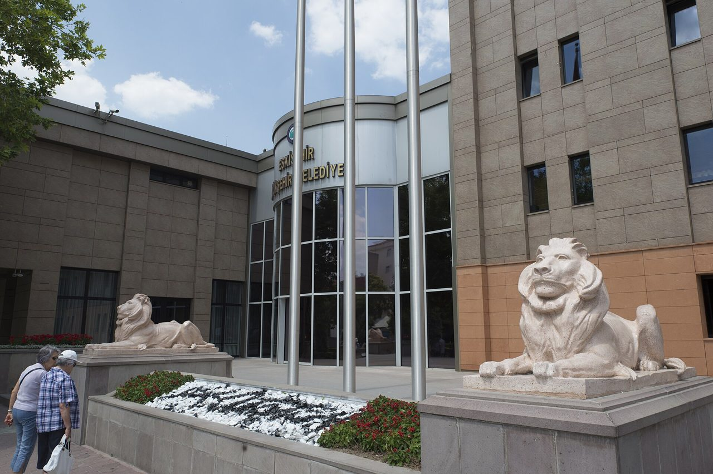
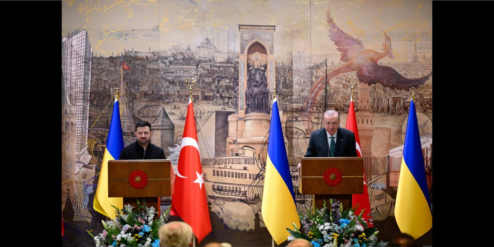
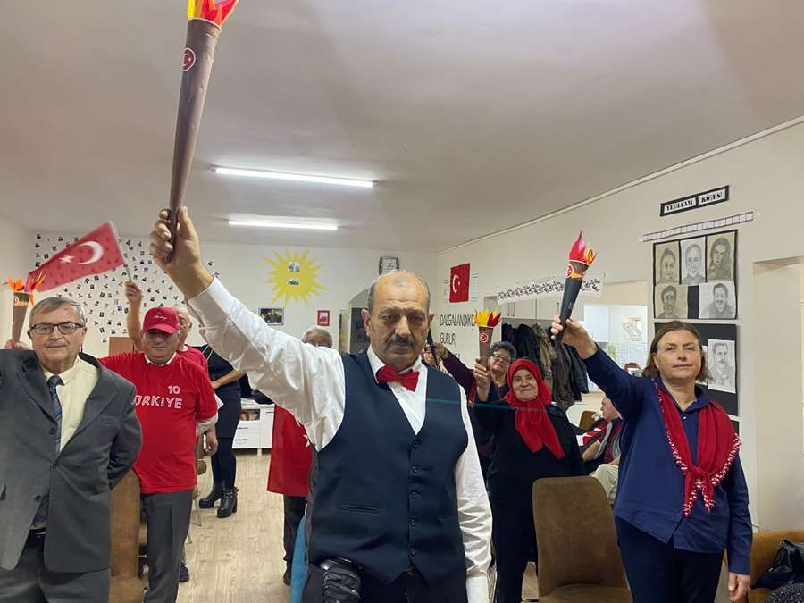

# Son haberler

Ajanın yazdığı son haberler (otomatik güncellenir).

## Porsuk'taki Aşk Adası iskele, ahşap teras ve yeşil alanla yenilenecek

**Belediye · Odunpazarı** · 2026-11-02 05:32 UTC · Kaynak: [Google Haberler - Eskişehir](https://www.gazetevatan.com/sehirler/eskisehir/eskisehirdeki-ask-adasina-yeni-duzenleme-yapilacak-iste-edinilen-bilgiler-2445126)

> 13 bin 693 metrekarelik adada tehlikeli bitki örtüsü temizlendi, ağaçlara budama yapıldı.

Eskişehir'de Odunpazarı ilçesi Gökmeydan Mahallesi'ndeki Aşk Adası için yeni bir düzenleme projesi hazırlandı. 19 Mayıs Caddesi üzerinde, Porsuk Çayı'nın yapay bir kanalla ayrılan bölümünde bulunan adada iskele, ahşap teraslar ve yeşil alan düzenlemeleri yapılması planlanıyor. Projeyle adanın mevcut yapısının korunarak vatandaşların daha fazla yararlanabileceği bir alana dönüştürülmesi hedefleniyor.

13 bin 693 metrekarelik adaya ulaşım yalnızca yaya köprüsünden sağlanıyor. En az 20 yıllık geçmişi bulunan adaya araç girişi olmaması bitki örtüsüne yönelik bakım çalışmalarını zorlaştırmıştı. Yaşlı kavak ve söğüt ağaçlarının çürümesi ve dallarının kırılması nedeniyle güvenlik riski oluştuğu belirtildi.

Aşk Adası İskele Projesi kapsamında Porsuk yatağı üzerinden araç girişine imkân veren bir yol oluşturuldu. Böylece adadaki kurumuş ve tehlike yaratan bitki örtüsü temizlendi, mevcut ağaçlar için dal budama çalışması yapıldı.

Suyla bütünleşen bir tasarımın benimsendiği projede, teknelerin yanaşabilmesi için su içinde ahşap teraslar ve iskele alanları planlandı. Adanın doğal yükseklik farklarından yararlanılarak yeni kullanım alanları oluşturulması öngörülüyor.

---

## Tepebaşı'nda emlak vergisi mobil vezne takvimi: 2-30 Kasım'da mahalle mahalle

**Belediye · Tepebaşı** · 2026-11-02 04:32 UTC · Kaynak: [Google Haberler - Tepebaşı](https://www.eskisehir.net/eskisehirde-emlak-vergisi-odeyecekler-dikkat-mobil-vezne-mahalle-mahalle-dolasacak)

> Mobil vezne 09.00-12.00 ve 13.00-16.00 saatleri arasında hizmet verecek.

Tepebaşı Belediyesi, kasım ayında emlak vergisi ödemeleri için mobil vezne uygulamasını sürdürecek. 2 Kasım'da başlayacak program kapsamında mobil vezne aracı, 30 Kasım'a kadar belirlenen takvime göre mahalleleri dolaşacak. Araç sabah 09.00-12.00, öğleden sonra 13.00-16.00 saatleri arasında hizmet verecek.

Belediyenin paylaştığı takvime göre ilk günler şöyle: 2 Kasım Sakintepe, 3 Kasım Uluönder, 4 Kasım Batıkent, 5 Kasım Hayriye (Muhtarlığı önü), 6 Kasım Yeni Mahalle ve Şeker, 7 Kasım Ömerağa ve Güllük, 8 Kasım Bahçelievler Muhtarlığı önü, 9 Kasım Işıklar Muhtarlığı önü, 10 Kasım Şirintepe, 11 Kasım Bahçelievler, 12 Kasım Ertuğrulgazi, 13 Kasım Şarhöyük. Ayın kalan günleri için takvimde Zincirlikuyu, Yaşamkent, Söğütönü, Kumlubel, Çamlıca, Tunalı, Fevziçakmak, Zafer, Sazova, Sütlüce, Esentepe ve Yeşiltepe mahalleleri ile Metin Özöğüt Yaşam Merkezi yer alıyor; 28 ve 29 Kasım'da vezne merkez binada olacak, 30 Kasım'da Yeşiltepe'ye gidecek.

Vatandaşlar emlak vergisini ayrıca Tepebaşı Belediyesi hizmet binası vezneleri (08.00-16.30), Odunpazarı Belediyesi hizmet binası veznesi (09.00-16.00) ve Tapu ve Kadastro 17. Bölge Müdürlüğü veznesinde (08.00-15.30) ödeyebilecek.

---

## İnönü'nde İsmetpaşa Mahallesi'ndeki bozulan yol onarılıp trafiğe açıldı

**Belediye · Merkez** · 2026-11-02 04:31 UTC · Kaynak: [Google Haberler - Eskişehir](https://yerel-haberler.haberturk.com/eskisehir-haberleri/inonudeki-yol-sorunu-cozume-kavustu-119509435)

> İnönü Belediyesi, Çınarlı Park yanındaki sokakta bakım ve onarım çalışmasını tamamladı.

Eskişehir'in İnönü ilçesi İsmetpaşa Mahallesi'nde, Çınarlı Park yanındaki sokakta meydana gelen yol bozulması belediye ekiplerince onarıldı ve yol yeniden araç trafiğine açıldı.

İnönü Belediye Başkanı Serhat Hamamcı'nın talimatıyla harekete geçen ekipler, bakım ve onarım çalışmasını kısa sürede tamamladı. Mahalle sakinlerinin, yolun yeniden trafiğe açılmasından memnuniyet duyduğu ve Hamamcı ile belediye ekiplerine teşekkür ettiği bildirildi.

---

## Kurtuluş Kapalı Pazar Yeri'nde sona yaklaşıldı: 216 tezgâh, 150 araçlık otopark

**Belediye · Merkez** · 2026-11-02 03:32 UTC · Kaynak: [Google Haberler - Eskişehir](https://www.eskisehirekspres.net/eskisehirde-500-milyonluk-projede-sona-dogru)

> Pazarcılar Odası Başkanı İsmail Oğuz, tesisin bahar aylarında tamamlanmasını bekliyor.

Eskişehir Büyükşehir Belediyesi'nin yapımını sürdürdüğü Kurtuluş Kapalı Pazar Yeri projesinde sona yaklaşılıyor. Eskişehir Pazarcılar Odası Başkanı İsmail Oğuz, pazar yerinin bahar aylarında tamamlanmasını beklediklerini söyledi; tesisin planlanandan daha erken hizmete açılabileceği de gündeme geldi.

Çevre, Şehircilik ve İklim Değişikliği Bakanlığı'nın alan desteği sağladığı proje, Büyükşehir Belediyesi'nin yaklaşık 500 milyon liralık yatırımıyla yapılıyor. Tesiste 54 tezgâh öbeği içinde toplam 216 tezgâh alanı, 27 balıkçı tezgâhı, 17 et, kasap ve şarküteri dükkânı ile 40'a yakın soğuk hava deposu yer alacak.

Projede ayrıca toplam 150 araç kapasiteli kapalı otopark bulunacak. Otoparkın 137 araçlık bölümü normal araçlara, 6 araçlık bölümü engelli vatandaşlara ayrılacak.

---

## 2. Eskişehir Uluslararası Polifonik Koro Şenliği başladı: 37 koro katılıyor

**Kültür-Sanat · Merkez** · 2026-11-02 03:33 UTC · Kaynak: [Google Haberler - Eskişehir](https://www.esgazete.com/2-eskisehir-uluslararasi-koro-senligi-coskuyla-basladi)

> Şenlik 30 Ekim-1 Kasım'da Büyükşehir Sanat ve Kültür Sarayı'nda yapılıyor.

Eskişehir Büyükşehir Belediyesi ile Eskişehir Polifonik Korosu Derneği'nin iş birliğiyle ikincisi düzenlenen Eskişehir Uluslararası Polifonik Koro Şenliği, açılış programıyla başladı. Şenlik 30 Ekim-1 Kasım 2026 tarihlerinde Büyükşehir Sanat ve Kültür Sarayı'nda (Opera) yapılıyor ve toplam 37 koroyu bir araya getiriyor. Konserler, atölye çalışmaları ve ortak sahne performansları programda yer alıyor.

Açılışta konuşan Büyükşehir Belediye Başkanı Ayşe Ünlüce, geçen yıl ilki düzenlenen şenliğin ardından bu yıl da aynı heyecanı yaşadığını söyledi. Macaristan'dan katılan Scherzo Mixed Choir ile birlikte farklı şehir ve ülkelerden gelen konuk koroları selamlayan Ünlüce, şenliklerin uluslararası nitelik taşımasını önemsediklerini belirtti.

Şenliğin sanat yönetmeni Ender Sakpınar da organizasyona destek verenlere teşekkür etti ve koro müziğinin birleştirici gücüne dikkat çekti. Organizasyonun amacı, farklı kültürlerden korolar arasında sanatsal etkileşimi artırmak ve müzik aracılığıyla kalıcı dostluklar kurmak olarak açıklandı.

---

## Eskişehir'de ekimde uyuşturucu operasyonlarında 241 şüpheliye işlem, 36 tutuklama

**Asayiş · Merkez** · 2026-11-02 02:33 UTC · Kaynak: [Google Haberler - Eskişehir asayiş](https://www.milliirade.com/eskisehirde-uyusturucuya-gecit-yok-1-ayda-241-gozalti-36-tutuklama)

> Valilik, 183 olayda ele geçirilen madde ve silah dökümünü paylaştı.

Eskişehir Valiliği koordinesinde İl Emniyet Müdürlüğü ve İl Jandarma Komutanlığı ekiplerinin 1-31 Ekim 2026 tarihlerinde yürüttüğü uyuşturucu operasyonlarının aylık bilançosu paylaşıldı. Kent genelinde 183 olaya müdahale edildi.

Haklarında adli işlem başlatılan 241 şüpheliden 36'sı tutuklandı, 205'i tutuksuz yargılanmak üzere serbest bırakıldı.

Aramalarda 9 kilo 56 gram metamfetamin, 2 kilo 55 gram kokain, 39 bin 636 adet sentetik ecza hapı, 1.709,62 gram esrar, 728,81 gram bonzai, 74 gram bonzai hammaddesi, 24 kök hint keneviri, 22 adet ecstasy hap ve 5,31 gram afyon sakızı ele geçirildi. Ayrıca 9 hassas terazi, 3 uyuşturucu kullanma aparatı, 1 ruhsatsız tabanca, 1 tabanca şarjörü ve 64 fişek muhafaza altına alındı.

Haklarında işlem yapılanların suçlu olduğu mahkeme kararıyla kesinleşmedikçe masum sayıldığı unutulmamalıdır.

---

## Erzurum Gastronomi ve Cağ Kebabı Festivali 4-8 Kasım'da Dede Korkut Parkı'nda

**Kültür-Sanat · Merkez** · 2026-11-02 02:33 UTC · Kaynak: [Google Haberler - Eskişehir etkinlik](https://erzurumgunebakis.com/amp/haber/erzurumun-lezzetleri-ve-kulturu-eskisehirde-bulusacak-141930)

> Eskişehir Erzurumlular Derneği festivalde beş gün konser ve bar gösterisi düzenleyecek.

Eskişehir Erzurumlular Derneği, Erzurum Gastronomi ve Cağ Kebabı Festivali'ni 4-8 Kasım 2026 tarihleri arasında Dede Korkut Parkı'nda düzenleyecek. Festivalde cağ kebabı, İspir kuru fasulyesi ve diğer yöresel lezzetler ziyaretçilerin beğenisine sunulacak.

Beş gün boyunca müzik etkinlikleri yapılacak. 5 Kasım Perşembe saat 18.00'de Adem Baysal, 19.00'da Rabia Yıldız; 6 Kasım Cuma saat 17.00'de Ceyhun Can, 19.00'da Elif Kayacan, 21.00'de Mustafa Özden; 7 Kasım Cumartesi saat 17.00'de Köksal Örs, 19.00'da Başak Kaya, 21.00'de İmera; 8 Kasım Pazar saat 19.00'da Apolas Lermi sahne alacak.

Erzurum bar ekibinin gösterileriyle kentin halk oyunları geleneği de tanıtılacak. Dernek, festivalle hemşehriler arasındaki birlik ve beraberliğin güçlenmesini ve Erzurum kültürünün geniş kitlelere ulaşmasını hedefliyor.

---

## ESOGÜ öğrencileri için ders yönetmeliğinde değişiklik: eş değer derslerde yeni kural

**Eğitim · Merkez** · 2026-11-02 01:32 UTC · Kaynak: [Google Haberler - Eskişehir](https://www.gzt26.com/eskisehir-osmangazi-universitesi-ogrencilerinin-bekledigi-mujde-geldi)

> Değişiklik 2 Kasım 2026 tarihli Resmî Gazete'de yayımlandı.

Eskişehir Osmangazi Üniversitesi'nin Ön Lisans ve Lisans Eğitim-Öğretim ve Sınav Yönetmeliği'nde yapılan değişiklik, 2 Kasım 2026 tarihli ve 33418 sayılı Resmî Gazete'de yayımlandı. Değişiklik, 14 Eylül 2019'da yayımlanan yönetmeliğin 23. maddesinin birinci fıkrasına yeni bir bent ekliyor.

Yeni düzenlemeye göre öğrencinin eğitim planındaki mezuniyet grubunda yer alan eş değer derslerden FF, YZ veya DZ notu aldığı bir ders varsa, öğrenci yeni bir derse kayıt yaptırdığında bu yeni ders başarısız olduğu eş değer dersin yerine sayılacak.

Akademik uyarısı bulunan öğrenciler için ayrı bir hüküm de yer aldı: bu öğrencilerin DC veya DD aldıkları eş değer derslerde de aynı uygulama geçerli olacak.

---

## Eskişehir'de ekimde 117 bin araç denetlendi, bin 238 araç trafikten men edildi

**Gündem · Merkez** · 2026-11-02 01:32 UTC · Kaynak: [Google Haberler - Eskişehir asayiş](https://www.anadolugazetesi.com/eskisehir-yollarinda-siki-denetim--bin-238-arac-trafikten-men-edildi-297362.html)

> Emniyet ve jandarma verilerine göre 453 sürücünün ehliyetine el konuldu.

Eskişehir İl Emniyet Müdürlüğü ve İl Jandarma Komutanlığı trafik ekipleri, 1-31 Ekim 2026 tarihleri arasında kent genelinde denetim yaptı. Bir ayda 117 bin 791 araç ve sürücü kontrol edildi.

Denetimlerin 15 bin 608'i yük taşımacılığı, 2 bin 603'ü yolcu taşımacılığı, 11 bin 772'si alkol, 2 bin 886'sı motosiklet ve 26 bin 69'u emniyet kemeri kontrolünden oluştu. Diğer kontrol türlerinde 58 bin 853 denetim yapıldı.

Kusurlu bulunan araç ve sürücülere toplam 25 bin 45 trafik cezası kesildi. Bin 238 araç trafikten men edildi, 453 sürücünün ehliyetine el konuldu.

Aynı dönemde Eskişehir genelinde 3 ölümlü, 277 yaralanmalı ve 273 maddi hasarlı trafik kazası kayıtlara geçti.

---

## Aşağıçağlan'daki 541 konutluk projenin ihalesi 23 Kasım'a ertelendi

**Gündem · Odunpazarı** · 2026-11-02 00:33 UTC · Kaynak: [Google Haberler - Odunpazarı](https://www.eskisehir.net/eskisehirde-541-konut-icin-beklenen-ihale-ertelendi)

> İhale daha önce 10 Kasım olarak duyurulmuştu; erteleme gerekçesi açıklanmadı.

Odunpazarı ilçesi Aşağıçağlan Mahallesi'nde planlanan 541 konut ve 4 dükkânlık projenin ihale tarihi ertelendi. Daha önce 10 Kasım 2026 olarak belirlenen ihale, takvim değişikliğiyle 23 Kasım 2026 Pazartesi günü saat 14.30'a alındı.

Değişiklik, İlkevim Eskişehir ve İlkevim Arsa Eskişehir hesaplarından yapılan duyuruyla bildirildi. İhale, Aşağıçağlan Mahallesi 3. Etap kapsamındaki yapım işini kapsıyor. İhale kapsamında 541 konutla birlikte 4 dükkânın inşası ve altyapı ile çevre düzenlemesi işleri yer alıyor.

İhale tarihindeki değişikliğin gerekçesine ilişkin bir açıklama yapılmadı.

---

## Eskişehir'de bugün 08.00-15.00 arası siren kontrolü yapılacak

**Gündem · Merkez** · 2026-11-02 00:34 UTC · Kaynak: [Google Haberler - Eskişehir](https://www.sakaryagazetesi.com.tr/eskisehirde-pazartesi-sirenler-calacak)

> Valilik, AFAD'ın kent genelindeki sirenleri test edeceğini duyurdu.

Eskişehir Valiliği, İl Afet ve Acil Durum Müdürlüğü (AFAD) tarafından yapılacak siren kontrolü hakkında vatandaşları bilgilendirdi. Açıklamada, kent genelinde kurulu ve mevcut sirenlerin test edileceği belirtildi.

Kontrol çalışmaları 2 Kasım 2026 Pazartesi günü saat 08.00 ile 15.00 arasında yapılacak. Bu saatler içinde sirenler, çalışır durumda olup olmadıklarının kontrol edilmesi amacıyla kısa süreli olarak çalınacak.

Duyuru Eskişehir Valisi Dr. Erdinç Yılmaz imzasıyla yayımlandı.

---

## Eskişehir Büyükşehir Kız Futbol Takımı ligi ikinci sırada tamamladı

**Spor · Merkez** · 2026-11-02 00:34 UTC · Kaynak: [Google Haberler - Eskişehir](https://www.istikbalgazetesi.com/eskisehir-buyuksehir-kiz-futbol-takimindan-gururlandiran-basari)

> U15, U17 ve A takım kategorilerinde mücadele eden kulüp, kentin tek kız futbol takımı olarak öne çıkıyor.

Eskişehir Büyükşehir Spor Kulübü, kadın futbolunda oluşturduğu altyapı yapılanmasıyla dikkat çekiyor. Kulüp, U15, U17 ve A takım kategorilerinde Eskişehir'i temsil eden tek kız futbol takımı olma özelliğini taşıyor.

Takımın teknik sorumlusu Bahadır Aksin, Türkiye'de ilk kez düzenlenen organizasyonda Eskişehir'i temsil ederek ligi ikinci sırada tamamlamanın büyük gurur olduğunu söyledi. Aksin, "Bizim için başarı sadece kazanılan maçlardan ve elde edilen derecelerden ibaret değil. En büyük hedefimiz, kız çocuklarımızın sporla büyümesini sağlamak, onlara fırsat sunmak ve geleceğin başarılı kadın futbolcularını yetiştirmek" dedi.

Aksin, U15'ten U17'ye, oradan A takım seviyesine uzanan bir futbol yapılanması oluşturmak istediklerini belirtti ve emeği geçenlere teşekkür etti.

---

## Vali Yılmaz'ın duyurduğu "Vizyon Eskişehir 2036" çalışması televizyonda tartışıldı

**Gündem · Merkez** · 2026-11-01 23:32 UTC · Kaynak: [Google Haberler - Eskişehir](https://www.gzt26.com/vizyon-eskisehir-2036-projesi-eskisehire-neler-katacak)

> Gazeteci Akif Yer, çalışmanın ilçelere yönelik yaklaşımını olumlu bulduğunu söyledi.

Kanal 26'da yayınlanan Muhabirin Gözünden programında, Eskişehir Valisi Dr. Erdinç Yılmaz'ın duyurduğu "Vizyon Eskişehir 2036" çalışması ele alındı. Programın moderatörü Merve Esra Özer, açıklanan hedeflerin somut projelere dönüşmesi için gereken adımları sordu. Gazeteci Akif Yer, çalışmanın kentin önümüzdeki 10 yılı için önemli hedefler içerdiğini söyledi.

Yer'in aktardığına göre tanıtım programına belediyeler, odalar, dernekler, vakıflar ve üniversiteler dahil çok sayıda kurum davet edildi ve yaklaşık 40-45 dakika sürdü. Yer, çalışmanın yeni fabrikalar kurulmasını, iş imkânlarının artırılmasını, tarımın geliştirilmesini, turizmin büyütülmesini ve gençlere fırsat sunulmasını hedeflediğini anlattı. Tanıtımda kullanılan şarkı ve klibin yapay zekâyla oluşturulduğunu belirten Yer, şarkıyı yetersiz bulduğunu söyledi.

Yer, çalışmanın en beğendiği yönünün "Eskişehir sadece Odunpazarı ve Tepebaşı'ndan ibaret değildir" vurgusu olduğunu belirtti. Yaklaşık 920 bin kişilik nüfusun 820 bininin iki merkez ilçede yaşadığını, kalan nüfusun 12 kırsal ilçeye dağıldığını ve yatırımcıların ilçelere yönlendirilmesi gerektiğini söyledi. Eskişehir'in İstanbul ve Ankara'ya yakın konumu nedeniyle daha fazla yatırım alması gerektiğini ifade eden Yer, 2036'ya kadar yaşanacak gelişmeleri takip edeceklerini belirtti.

Haberdeki değerlendirmeler Akif Yer'e aittir.

---

## Eskişehirspor'da Hakan Şapcı'ya taraftardan destek: tribünler çağırdı, alkışladı

**Spor · Merkez** · 2026-11-01 22:32 UTC · Kaynak: [Google Haberler - Eskişehirspor](https://www.gzt26.com/eskisehirsporda-hakan-sapci-ve-ekibine-destek-artiyor)

> Gaziemir galibiyetinin ardından teknik direktör tribünlere çağrıldı.

Eskişehirspor'un İzmir'de Gaziemir'i 5-0 yendiği maçın ardından taraftarlar teknik direktör Hakan Şapcı'yı tribünlere çağırdı. Şapcı, taraftarları alkışlayarak teşekkür etti.

Etimesgut ve Bursa Yıldırımspor maçlarındaki puan kayıpları nedeniyle eleştirilen Şapcı'ya yönelik tepkiler artmıştı. Bursa Yıldırımspor maçının son dakikalarında tribünlerden istifa tezahüratları yükselmişti. Takımın Türkiye Kupası'nda Iğdır FK'yı yenmesi bu süreçte önemli bir dönüm noktası olarak değerlendirildi.

Üst üste alınan Iğdır FK ve Gaziemir galibiyetlerinin ardından Eskişehirspor gelecek cumartesi günü kendi sahasında Antalya Kepezspor'u konuk edecek.

---

## Eskişehirli Sui Generis Tiyatro Maltepe Tiyatro Festivali'nde "Cambazın Cenazesi"ni oynadı

**Kültür-Sanat · Merkez** · 2026-11-01 22:32 UTC · Kaynak: [Google Haberler - Eskişehir etkinlik](https://www.gzt26.com/eskisehirli-tiyatro-toplulugu-istanbulda-alkis-topladi)

> Oyun 27 Ekim'de Maltepe Belediyesi Türkan Saylan Kültür Merkezi'nde sahnelendi.

Eskişehir'in tiyatro topluluklarından Sui Generis Tiyatro, İstanbul'da düzenlenen 8. Uluslararası Maltepe Tiyatro Festivali'ne katıldı. Topluluk, "Cambazın Cenazesi" oyununu 27 Ekim Salı akşamı Maltepe Belediyesi Türkan Saylan Kültür Merkezi'nde sahneledi ve izleyicilerden alkış aldı.

2009'da Eskişehir'de kurulan topluluğun oyununun yazarı Firuze Engin, yönetmeni Eskişehir Büyükşehir Belediyesi Şehir Tiyatroları sanatçısı Tolga Tümer. Oyunda Hüseyin Akçar, Tolga Tümer ve Eren Coşan rol aldı.

Grup Koordinatörü Av. Hüseyin Akçar, İstanbul'da gördükleri ilgiden memnuniyet duyduklarını, topluluğun uzun yıllardır gönüllülük esasıyla çalıştığını söyledi.

---

## Erdoğan Güney Kore'ye gitti: 3 Kasım'da Lee Jae Myung ile görüşecek

**Türkiye · Türkiye** · 2026-11-01 22:31 UTC · Kaynak: [İletişim Başkanlığı](https://www.iletisim.gov.tr/turkce/haberler/detay/cumhurbaskani-erdogan-guney-koreye-gitti-01.11.26)

> Ziyaret 1-4 Kasım tarihlerini kapsıyor.

Cumhurbaşkanı Recep Tayyip Erdoğan, Kore Cumhuriyeti Devlet Başkanı Lee Jae Myung'un davetiyle Seul'e hareket etti. Erdoğan'ı Atatürk Havalimanı Devlet Konukevi'nden Cumhurbaşkanı Yardımcısı Cevdet Yılmaz, İstanbul Valisi Davut Gül ve AK Parti İstanbul İl Başkanı Abdullah Özdemir uğurladı.

Erdoğan'a eşi Emine Erdoğan, Enerji ve Tabii Kaynaklar Bakanı Alparslan Bayraktar, Millî Savunma Bakanı Yaşar Güler ve Sanayi ve Teknoloji Bakanı Mehmet Fatih Kacır eşlik etti.

1-4 Kasım tarihlerini kapsayan ziyaret kapsamında Erdoğan, 3 Kasım Salı günü Lee Jae Myung ile resmî görüşme yapacak. Görüşmelerde iki ülke arasındaki stratejik ortaklık ilişkileri tüm yönleriyle ele alınacak, güncel bölgesel ve küresel meseleler hakkında fikir alışverişinde bulunulacak ve ikili ilişkilerin zeminini güçlendirecek çeşitli belgeler imzalanacak.

---

## Tepebaşı Pop & Caz Korosu için koristler aranıyor: başvuru 12 Kasım'a kadar

**Kültür-Sanat · Tepebaşı** · 2026-11-01 18:32 UTC · Kaynak: [Google Haberler - Tepebaşı](https://www.haberes.com.tr/tepebasinda-pop-caz-korosu-icin-koristler-araniyor)

> 17-35 yaş arası müzikseverler için seçmeler 13 Kasım'da Ferdi Zeyrek Yaşam Merkezi'nde.

Tepebaşı Belediyesi, Pop & Caz Korosu'nda yer almak isteyen 17-35 yaş arasındaki müzikseverler için başvuru sürecini başlattı. Başvurular 22 Ekim-12 Kasım tarihleri arasında alınacak.

Şef Derya İnanç yönetimindeki koroya başvuru formuna tepebasi.bel.tr adresinin Etkinlikler sayfasından ulaşılabilecek. Seçmeler 13 Kasım Cuma günü saat 19.00'da, Ferdi Zeyrek Yaşam Merkezi bünyesindeki İki Elin Sesi Var Çocuk ve Gençlik Senfoni Orkestrası ve Korosu'nda yapılacak.

Seçmelerin yapılacağı adres Yeşiltepe Mahallesi, Kırca Sokak No: 1/A. Ayrıntılı bilgi için 0222 321 12 79 numaralı telefon aranabilir. Etkinlik ücretsiz.

---

## Başkan Ataç pazar günü Baksan'daki yol çalışmalarını inceledi

**Belediye · Tepebaşı** · 2026-11-01 17:32 UTC · Kaynak: [Google Haberler - Tepebaşı](https://www.gzt26.com/baksanda-calismalar-devam-ediyor-ahmet-atac-aciklama-yapti)

> Tepebaşı Belediyesi ekipleri Baksan'da yaz başından beri süren çalışmalara pazar günü de devam etti.

Tepebaşı Belediye Başkanı Ahmet Ataç, Baksan bölgesindeki yol çalışmalarını yerinde inceledi. Belediye ekipleri pazar günü de sahada çalıştı.

Ataç, çalışma alanlarını gezdi ve belediye personeliyle bir araya geldi. Çalışmaların hangi aşamada olduğu, ihtiyaç duyulan düzenlemeler ve önümüzdeki süreçte yapılacak işler ele alındı. Ataç incelemelerin ardından, "Baksan'da ekiplerimiz pazar mesaisinde. Çalışmaları yerinde inceleyip sahadaki mevcut durumu, ihtiyaçları ve planlamamızı değerlendirdik" dedi.

Tepebaşı Belediyesi'nin yaz başından beri ilçenin farklı noktalarında yol düzenleme çalışmaları yürüttüğü belirtildi. Ataç, "Mevsim koşulları elverdiği sürece, şehrimizi güzelleştirmek için tüm ekiplerimizle sahada olacağız" ifadesini kullandı. Çalışma programının hava şartlarına göre sürdürüleceği bildirildi. Belediyenin açıklamasında Baksan'daki çalışmaların tamamlanacağı tarihe ilişkin bilgi verilmedi.

---

## Kent Konseyi Arabasız Pazar'da "Satın Alma, Sahiplen" etkinliği düzenledi

**Gündem · Merkez** · 2026-11-01 17:31 UTC · Kaynak: [Google Haberler - Eskişehir](https://www.gzt26.com/inci-ulugden-eskisehir-halkina-anlamli-cagri)

> Başkan İnci Ülüğ hayvan sahiplenmenin önemine dikkat çekti.

Eskişehir Kent Konseyi Hayvan Hakları Çalışma Grubu, Eskişehir Büyükşehir Belediyesi'nin Atatürk Bulvarı'nda düzenlediği Arabasız Pazar etkinliğinde "Satın Alma, Sahiplen" etkinliği yaptı. Etkinliğe Kent Konseyi Başkanı İnci Ülüğ de katıldı.

Çalışma grubu üyeleri, vatandaşları hayvan hakları konusunda bilgilendirdi ve hayvan satın almak yerine sahiplenmenin tercih edilmesi gerektiğini anlattı. Ülüğ, hayvanların sevgiye ve güvenli bir yuvaya ihtiyaç duyan yaşam arkadaşları olduğunu vurguladı.

Kent Konseyi'nin açıklamasında, etkinlik kapsamında kaç hayvanın sahiplendirildiğine ilişkin bir sayı paylaşılmadı.

---

## Eskişehirspor, Gaziemir'i deplasmanda 5-0 yenerek ikinci sıraya yükseldi

**Spor · Merkez** · 2026-11-01 16:47 UTC · Kaynak: [Google Haberler - Eskişehirspor](https://www.eskisehirekspres.net/eskisehirspordan-izmirde-rahat-galibiyet-5-0)

> Kırmızı-siyahlılar Nesine 3. Lig'de ilk yarıda 5 gol buldu.

Eskişehirspor, Nesine 3. Lig 2. Grup'un 9. haftasında İzmir Bornova Aziz Kocaoğlu Stadyumu'nda Gaziemir'i 5-0 yendi.

İlk yarıda 11. dakikada Kerem Baykuş, Atalay Yıldırım'ın ortasıyla öne geçti. 16. dakikada Hasan Kaya'nın ortasında Beykan Şimşek skoru 2-0 yaptı. 28. dakikada Hasan Kaya, 29. dakikada İsmail Kulet ve 35. dakikada Atalay Yıldırım golleri attı. Eskişehirspor ilk yarıyı 5-0 önde tamamladı.

İkinci yarıda tempo düştü. Teknik direktör Hakan Şapcı, Beykan Şimşek, Sarper Çağlar, Atalay Yıldırım ve Ertuğrul Kurtuluş'un yerine Mert Başer, Ahmet Kara, Fırat Sarı ve Emre Sarıkaya'yı oyuna aldı. 88. dakikada Hasan Kaya'nın şutunu Gaziemir'den Sedat Yahşi çizgi üzerinde çıkardı; başka gol olmadı.

Bu galibiyetle puanını 18'e yükselten Eskişehirspor ikinci sıraya yerleşti. Takım, 10. haftada 7 Kasım Cumartesi günü saat 15.30'da sahasında Kepezspor'u konuk edecek.

---

## Ayşe Kulin Odunpazarı'nı gezdi, Kurşunlu Külliyesi'ndeki müzeye dikkat çekti

**Kültür-Sanat · Odunpazarı** · 2026-11-01 17:46 UTC · Kaynak: [Google Haberler - Eskişehir gündem](https://www.anadolugazetesi.com/amp/ayse-kulin-den-kursunlu-kulliyesi-icin-cagri--kulturu-lutfen-mahvetmeyiniz-beyler--297356.html)

> Yazar, Ahşap Eserler Müzesi'nin tahliye edilmek istenmesine tepki gösterdi.

Odunpazarı Belediyesi'nin düzenlediği "Cumhuriyet ve Edebiyat" söyleşisi ve imza günü için Eskişehir'e gelen yazar Ayşe Kulin, Odunpazarı Tarihi Bölge'yi gezdi. Gezide Odunpazarı Belediye Başkanı Kazım Kurt eşlik etti.

Kulin'in ilk durağı Mustafa Abdülcemil Kırımoğlu Kırım Tatar Müzesi oldu. Ardından Odunpazarı Şehrin Ateşi Seramik Galerisi'ni ve Kurşunlu Külliyesi'ndeki Ahşap Eserler Müzesi'ni gezdi. Müzede, Uluslararası Ahşap Heykel Festivali'ne katılan 55 ülkeden sanatçının 202 eseri sergileniyor.

Kulin, Kurşunlu Külliyesi'nin tahliye edilmek istenmesine tepki gösterdi. "İçeride çok değerli eserler var. Burayı tahliye edip ne yapacaklar? Bina mı yok? Var olan bir şeyi yok etmek kolaydır, var olanını muhafaza etmek daha zordur" dedi. Kulin, "Kültürü lütfen mahvetmeyiniz beyler" ifadesini kullandı.

Vakıflar Bölge Müdürlüğü'nün görüşü kaynakta yer almıyor.

---

## "Eskişehir Lezzetleri" kitabı tanıtıldı: 37 tarif, 12 lezzetin öyküsü

**Kültür-Sanat · Merkez** · 2026-11-01 17:46 UTC · Kaynak: [Google Haberler - Eskişehir](https://www.toplumsal.com.tr/haber/eskisehir-in-37-tarifli-mutfak-kitabi-tanitildi_32397/)

> Kitabı Büyükşehir ile TYSD Eskişehir Şubesi hazırladı.

Eskişehir Büyükşehir Belediyesi ile Türkiye Yardımsevenler Derneği (TYSD) Eskişehir Şubesi'nin hazırladığı "Eskişehir Lezzetleri" kitabı, Porsuk Konukevi'nde düzenlenen programla tanıtıldı. Kitapta 37 özgün tarif ile kentle özdeşleşen 12 lezzetin tarihçesi, hikâyesi ve fotoğrafları yer alıyor.

Tanıtıma Büyükşehir Belediye Başkanı Ayşe Ünlüce, YENİ Parti Eskişehir Milletvekili İbrahim Arslan, Tepebaşı Belediye Başkanı Ahmet Ataç, Eskişehir Baro Başkanı Barış Günaydın, TYSD Eskişehir Şube Başkanı Serpil Çamoğlu, Eskişehir Ticaret Odası Yönetim Kurulu Üyesi Yasin Bakılan ve meclis üyeleri katıldı. Ünlüce, 81 ilin yemek tariflerini içeren bir kitabın ardından Eskişehir'e özel bir çalışma fikrinin doğduğunu, 2026 Eskişehir Yılı'nda kente kalıcı bir eser kazandırmak istediklerini söyledi. Kitabı hazırlayan Serpil Uzoğlu, çalışmayı kitabın editörlüğünü yapan kızı İpek Eda Uça ile yürüttüklerini, tarifleri araştırıp kendi evlerinde hazırladıklarını anlattı.

Etkinlik, kitaptaki geleneksel tariflerden hazırlanan yöresel yemeklerin ikramıyla sona erdi. Kitap; TYSD Eskişehir Şubesi, Hamam Müzesi, Masal Şatosu, ETİ Su Altı Dünyası Akvaryum Kafe ve Hediyelik Eşya Bölümü, Bilim Deney Merkezi Galaksi Kafe, Emek Kafe, Aktif Yaşam Parkı Yaşam Kafe, Sazova Bilim Kültür Sanat Parkı Elma Kafe ve Hayvanat Bahçesi Tropik Merkezi'nden alınabilecek.

---

## Altın fiyatları 1 Kasım 2026: Gram altın 6.288,41 TL

**Ekonomi · Merkez** · 2026-11-01 12:20 UTC · Kaynak: [Harem Altın](https://www.haremaltin.com/altin-fiyatlari)

> Gram altın güne düşüşle başladı. Harem Altın verilerine göre gram altın 6.206,84 TL'den alınıyor, 6.288,41 TL'den satılıyor.

Altın piyasasında güne düşüşle başlandı. Harem Altın'ın saat 15.20 itibarıyla verilerine göre gram altının satış fiyatı 6.288,41 TL, alış fiyatı 6.206,84 TL oldu. Gram altın, önceki kapanışa göre yüzde 3,03 geriledi.

Ziynet altınlarda çeyrek altın 10.250 TL, yarım altın 20.493 TL, tam altın 40.823 TL, ata altın 41.920 TL seviyesinden satışa sunuluyor.

22 ayar bileziğin gram satış fiyatı 5.873,42 TL, has altının gram fiyatı 6.269,60 TL olarak belirlendi.

Uluslararası piyasalarda altının onsu 3.877,30 dolardan işlem görürken, dolar/TL 49,92 seviyesinde bulunuyor.

Fiyatlar Harem Altın'ın saat 15.20 itibarıyla paylaştığı verilere dayanmaktadır; kuyumcular arasında farklılık gösterebilir. Bu haber yatırım tavsiyesi değildir.

---

## Erdoğan, Zelenskiy ile Dolmabahçe'de görüştü: Karadeniz'de seyrüsefer vurgusu

**Türkiye · Türkiye** · 2026-10-31 17:31 UTC · Kaynak: [İletişim Başkanlığı](https://www.iletisim.gov.tr/turkce/haberler/detay/cumhurbaskani-erdogan-ukrayna-devlet-baskani-zelenskiy-ile-ortak-basin-toplantisinda-konustu-31-10-26)

> Erdoğan, Ukrayna'da barış çabalarını ve Karadeniz'deki güvenlik durumunu ele aldıklarını söyledi.

Cumhurbaşkanı Recep Tayyip Erdoğan ile Ukrayna Devlet Başkanı Volodimir Zelenskiy, Dolmabahçe Ofisi'nde yapılan ikili ve heyetler arası görüşmelerin ardından ortak basın toplantısı düzenledi.

Erdoğan, görüşmede Ukrayna'da barışın sağlanmasına yönelik son dönemde artan çabaları ve Karadeniz'deki güvenlik durumunu ele aldıklarını söyledi. Savaşın, özellikle ABD Başkanı Trump'ın çabalarıyla diplomatik yollarla sona erdirilmesine yönelik girişimlerin yeniden hız kazanmasından memnuniyet duyduklarını belirten Erdoğan, "Adil bir barışın kaybedeni olmaz" dedi ve barışa giden yolu açmak için gayret göstermeye hazır olduklarını ifade etti.

Erdoğan, çatışmaların Karadeniz'e sıçradığını belirterek, sivil gemilere yönelik saldırıların kimden gelirse gelsin kabul edilemeyeceğini söyledi, tüm tarafları sorumlu davranmaya çağırdı ve Karadeniz'de seyrüsefer emniyetini yeniden tesis etmek için taraflarla görüşmelerini sürdüreceklerini belirtti.

Ukrayna'nın toprak bütünlüğüne, egemenliğine ve bağımsızlığına bağlılıklarını teyit ettiklerini söyleyen Erdoğan, 2022'de imzalanan Serbest Ticaret Anlaşması'nın 1 Ekim itibarıyla yürürlüğe girmesinin 10 milyar dolar ticaret hacmi hedefine yaklaştırdığını ifade etti.

Toplantıda Millî Savunma Bakanı Yaşar Güler, MİT Başkanı İbrahim Kalın, İletişim Başkanı Burhanettin Duran, Savunma Sanayii Başkanı Haluk Görgün ve diğer isimler yer aldı.

---

## Altın fiyatları 31 Ekim 2026: Gram altın 6.280,35 TL

**Ekonomi · Merkez** · 2026-10-31 11:26 UTC · Kaynak: [Harem Altın](https://www.haremaltin.com/altin-fiyatlari)

> Gram altın güne düşüşle başladı. Harem Altın verilerine göre gram altın 6.202,49 TL'den alınıyor, 6.280,35 TL'den satılıyor.

Altın piyasasında güne düşüşle başlandı. Harem Altın'ın saat 14.26 itibarıyla verilerine göre gram altının satış fiyatı 6.280,35 TL, alış fiyatı 6.202,49 TL oldu. Gram altın, önceki kapanışa göre yüzde 3,15 geriledi.

Ziynet altınlarda çeyrek altın 10.236 TL, yarım altın 20.467 TL, tam altın 40.770 TL, ata altın 41.866 TL seviyesinden satışa sunuluyor.

22 ayar bileziğin gram satış fiyatı 5.865,88 TL, has altının gram fiyatı 6.261,57 TL olarak belirlendi.

Uluslararası piyasalarda altının onsu 3.877,30 dolardan işlem görürken, dolar/TL 49,90 seviyesinde bulunuyor.

Fiyatlar Harem Altın'ın saat 14.26 itibarıyla paylaştığı verilere dayanmaktadır; kuyumcular arasında farklılık gösterebilir. Bu haber yatırım tavsiyesi değildir.

---

## Aile ve Sosyal Hizmetler İl Müdürlüğü'nde değerlendirme toplantısı: yatırımlar ele alındı

**Gündem · Merkez** · 2026-10-30 18:31 UTC · Kaynak: [Google Haberler - Eskişehir](https://www.aile.gov.tr/eskisehir/haberler/il-mueduerlueguemuezde-degerlendirme-toplantisi-biz-bu-devletin-emanet-kasasiyiz/)

> İl Müdürü Orhan Bayrak, bakım merkezleri ve yeni tesis projelerinin süreçlerinin titizlikle takip edilmesinin önemini vurguladı.

Eskişehir Aile ve Sosyal Hizmetler İl Müdürlüğü'nde, İl Müdürü Orhan Bayrak başkanlığında koordinasyon toplantısı yapıldı. Toplantıya il müdürlüğüne bağlı kuruluşların idarecileri ve il müdür yardımcıları katıldı.

Toplantıda 29 Ekim Cumhuriyet Bayramı kapsamında il genelinde düzenlenen resmî törenler ve kuruluş içi etkinlikler değerlendirildi. Bayrak, kuruluşlarda misafir edilen çocukların, engellilerin ve yaşlıların bayramı coşkuyla yaşamasını sağlayan organizasyonlar için idarecilere ve personele teşekkür etti. Bayrak, "Bizler bu devletin emanet kasasıyız. Bakım ve koruma, bizim birinci ve en temel vazifemizdir" dedi.

İl genelinde yürütülen ve yapımına başlanması planlanan hizmet binaları, bakım merkezleri ve ek tesis projeleri de ele alındı; inşaat çalışmalarının fiziki gerçekleşme oranları gözden geçirildi. Bakanlık merkezindeki İl Müdürleri Toplantısı'nın çıktıları da görüşüldü. Sosyal dayanışma ağını güçlendirmeyi amaçlayan "İyilik Var" uygulamasının il genelinde daha etkin tanıtılması ve yaygınlaştırılması kararlaştırıldı. Dezavantajlı kesimlerin ihtiyaçlarını önceden tespit etmeyi amaçlayan "Sosyal Risk Haritası" çalışmalarının tamamlanması için birimler arası koordinasyonun artırılması gerektiği vurgulandı.

---

## Odunpazarı'nda özel gereksinimli bireylerin annelerine ücretsiz psikolojik danışmanlık

**Sağlık · Odunpazarı** · 2026-10-30 15:59 UTC · Kaynak: [Odunpazarı Belediyesi](https://www.odunpazari.bel.tr/guncel/haberler/genel-haberler/odunpazari-ndan-ozel-gereksinimli-bireylerin-annelerine-psikolojik-danismanlik-d-1)

> Hizmet Engelsiz Kültür ve Sanat Merkezi'nde Psikolojik Danışman Öznur Anılır tarafından yürütülüyor.

Odunpazarı Belediyesi, Engelli ve Yaşlı Hizmetleri Müdürlüğü bünyesinde özel gereksinimli bireylerin aileleri için ücretsiz Psikolojik Danışmanlık Hizmeti sunuyor. Hizmetle ailelerin psikolojik açıdan desteklenmesi ve karşılaştıkları süreçlerde yalnız olmadıklarını hissetmeleri amaçlanıyor.

Hizmet, Engelsiz Kültür ve Sanat Merkezi'nde Psikolojik Danışman Öznur Anılır tarafından yürütülüyor. Belediyenin aktardığına göre çalışmayla ailelerin yaşadıkları süreçleri daha sağlıklı yönetmelerine, duygusal ihtiyaçlarını ifade etmelerine ve güçlüklerle baş etme becerilerini geliştirmelerine destek olunması hedefleniyor.

Ücretsiz Psikolojik Danışmanlık Hizmeti hakkında bilgi almak ve kayıt yaptırmak isteyenler Engelsiz Kültür ve Sanat Merkezi'ne başvurabilir. Ayrıntılı bilgi için Odunpazarı Belediyesi'nin 0222 227 86 38 numaralı telefonu aranabilir.

---

## Odunpazarı Belediyesi pazarlarda tartı kontrol noktası kurdu: eksik gramaj çıkmadı

**Belediye · Odunpazarı** · 2026-10-30 13:47 UTC · Kaynak: [Odunpazarı Belediyesi](https://www.odunpazari.bel.tr/guncel/haberler/genel-haberler/odunpazari-belediyesi-nden-pazarlarda-elektronik-tarti-denetimi-2)

> Zabıta Emek Mahallesi Kapalı Pazar Yeri'nde denetim yaptı.

Odunpazarı Belediyesi Zabıta Müdürlüğü ekipleri, Pazar Uygulama Yönetmeliği kapsamında pazarlarda ölçü ve tartı aletlerinin hileli kullanımına karşı denetimlerini sürdürüyor. Ekipler son olarak Emek Mahallesi Kapalı Pazar Yeri'nde denetim yaptı.

Denetim sırasında pazar alanında Odunpazarı Belediyesi Tartı Kontrol Noktası kuruldu. Alışveriş yapan vatandaşlar satın aldıkları ürünleri burada yeniden tarttırabildi. Belediyenin aktardığına göre yapılan denetimlerde eksik gramaja rastlanmadı.

Zabıta Müdürlüğü yetkilileri, denetimlerin yalnızca kapalı pazar yerleriyle sınırlı kalmayacağını, ilçedeki diğer pazarlarda da düzenli olarak sürdürüleceğini açıkladı.

---

## Ayşe Kulin 31 Ekim'de Odunpazarı'nda okurlarıyla buluşacak

**Kültür-Sanat · Odunpazarı** · 2026-10-30 13:47 UTC · Kaynak: [Odunpazarı Belediyesi](https://www.odunpazari.bel.tr/guncel/haberler/genel-haberler/ayse-kulin-odunpazari-nda-okurlariyla-bulusacak)

> "Cumhuriyet ve Edebiyat" söyleşisi ve imza günü Hasan Polatkan Kültür Merkezi'nde, ücretsiz.

Odunpazarı Belediyesi, yazar Ayşe Kulin'i Eskişehirli okurlarla buluşturuyor. "Cumhuriyet ve Edebiyat" başlığıyla düzenlenecek söyleşi ve imza günü, 31 Ekim Cumartesi günü saat 15.00'te Hasan Polatkan Kültür Merkezi'nde yapılacak.

Etkinlik, Cumhuriyet'in edebiyatla kurduğu ilişkiyi odağına alıyor. Söyleşinin ardından düzenlenecek imza gününde okurlar kitaplarını Ayşe Kulin'e imzalatabilecek. Söyleşi ve imza günü ücretsiz.

---

## Odunpazarı'nın yaşlı merkezlerinde Cumhuriyet coşkusu: piyes ve balo

**Gündem · Odunpazarı** · 2026-10-30 12:57 UTC · Kaynak: [Odunpazarı Belediyesi](https://www.odunpazari.bel.tr/guncel/haberler/genel-haberler/odunpazari-nda-cinarlar-cumhuriyet-coskusunu-yasadi)

> Koca Çınar Yaşam Merkezi ve Lütfü Yüksel Yaşlı Bakım Merkezi'nde 103. yıl kutlandı.

Odunpazarı Belediyesi'nin yaşlılara yönelik hizmet veren merkezlerinde Cumhuriyet'in 103. yıl dönümü kutlandı. Belediyenin Engelli ve Yaşlı Hizmetleri Müdürlüğü'ne bağlı Koca Çınar Yaşam Merkezi'nde piyes ve balo düzenlendi, Lütfü Yüksel Yaşlı Bakım Merkezi'nin sakinleri de bayramı kutladı.

Gültepe Mahallesi Üniversite Evleri'ndeki Koca Çınar Yaşam Merkezi'nde hazırlanan programla Cumhuriyet'in anlamına dikkat çekildi, baloyla bayram sevinci paylaşıldı. Lütfü Yüksel Yaşlı Bakım Merkezi'nde ise merkezin kıdemli sakinleri Cumhuriyet'in 103. yıl dönümünü birlik, beraberlik ve Atatürk sevgisiyle karşıladı.

Odunpazarı Belediyesi, sosyal belediyecilik anlayışıyla yaş almış yurttaşların sosyal yaşamın içinde yer almasını destekleyen çalışmalarını sürdürdüğünü belirtti.

---
