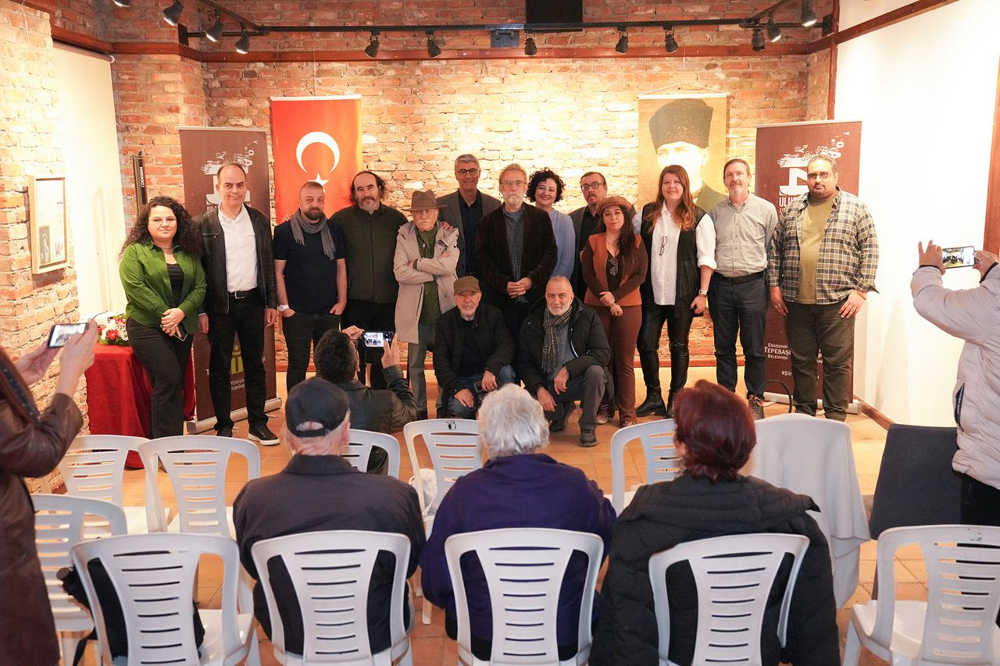
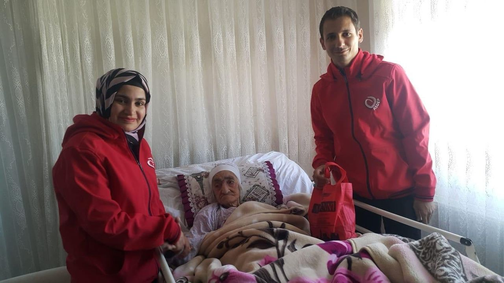
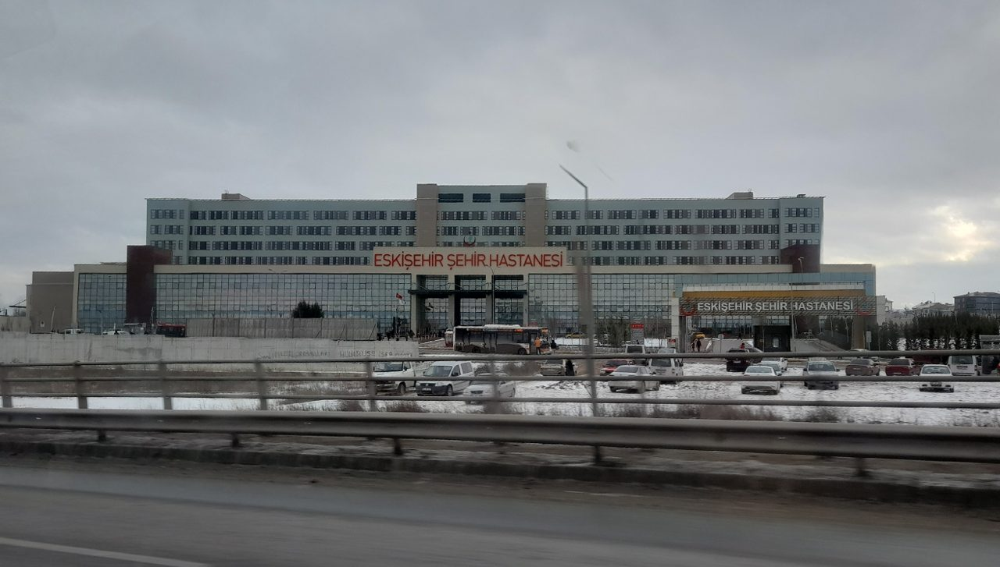
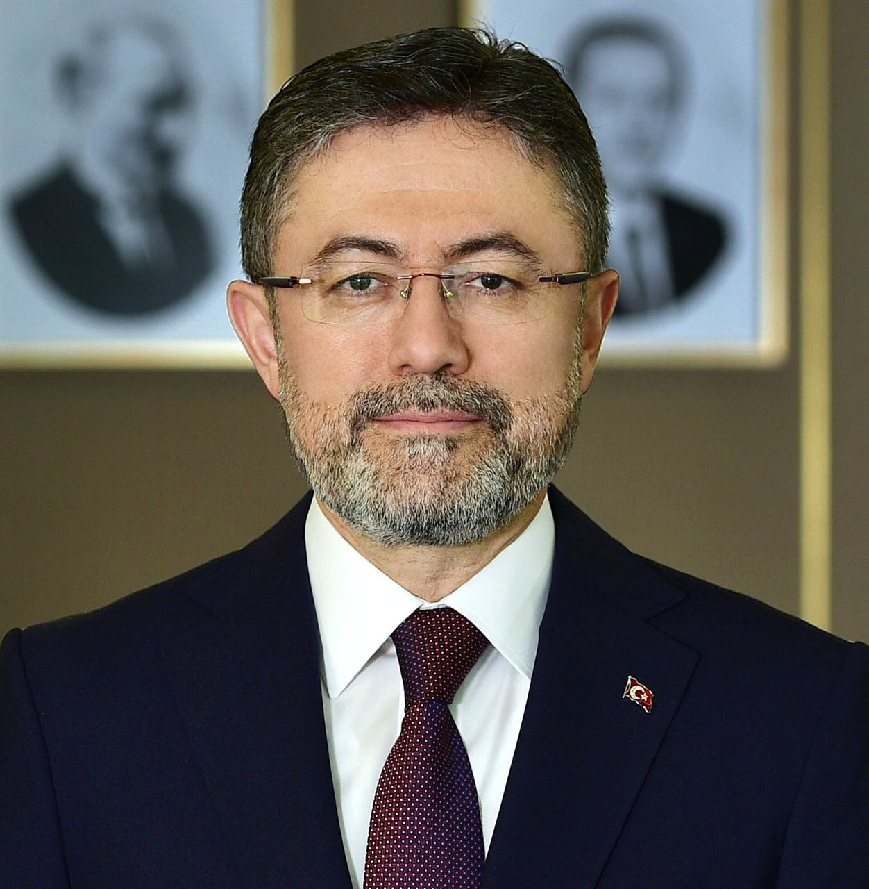
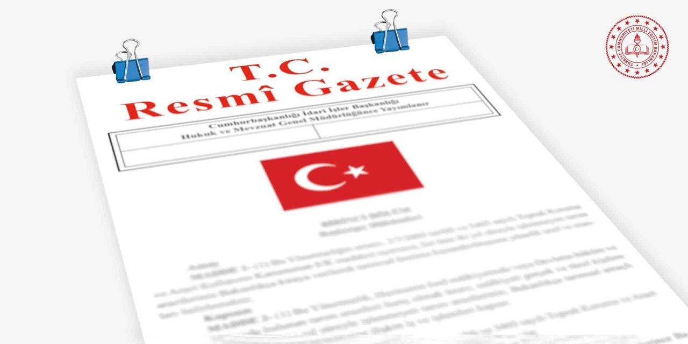
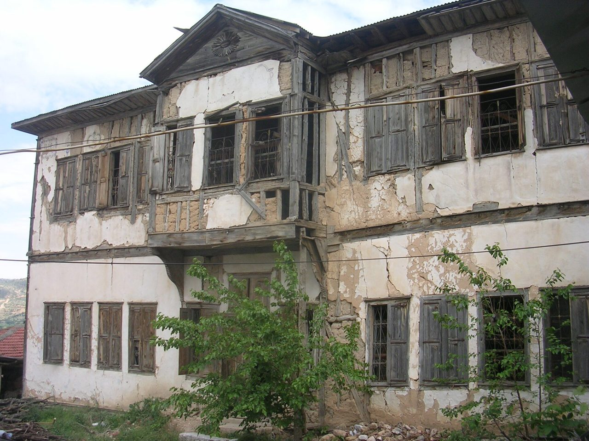

# Son haberler

Ajanın yazdığı son haberler (otomatik güncellenir).

## Eski Giysiler Japon Sanatıyla Yenileniyor: Tepebaşı'nda Sashiko Atölyesi Başladı

**Belediye · Tepebaşı** · 2026-11-15 12:46 UTC · Kaynak: [Google Haberler - Tepebaşı](https://ankahaber.net/haber/tepebasi-nda-eski-tekstiller-yeniden-hayat-buluyor-886efb66)

> Tepebaşı Belediyesi Yeryüzü Ekoloji Okulu, geleneksel Japon el işleme tekniği Sashiko ile eskiyen tekstil ürünlerini yeniden hayata kazandıran ileri dönüşüm atölyesi başlattı.

Tepebaşı Belediyesi, sürdürülebilir yaşam kültürünü yaygınlaştırmak ve çevre bilincini artırmak amacıyla Yeryüzü Ekoloji Okulu bünyesinde "Tekstil Art – Sashiko ile İleri Dönüşüm Atölyesi"ni hayata geçirdi. Atölye çalışmasında, kullanılmayan veya yıpranmış giysilerin onarılarak ve süslenerek kullanım ömrünün uzatılması hedefleniyor.

Emekli resim öğretmeni Hatice Aydoğan Yılmaz rehberliğinde gerçekleştirilen eğitim programının ilk oturumuna 20 ile 63 yaşları arasındaki kursiyerler katıldı. Yılmaz, katılımcılara Japonya'nın geleneksel dikiş sanatı olan Sashiko tekniğinin inceliklerini ve altı haftalık program boyunca uygulanacak yöntemleri aktardı.

18 yaş ve üzerindeki yurttaşlara yönelik düzenlenen atölye, altı hafta süresince her cuma günü 18.00-19.00 saatleri arasında gerçekleştirilecek. Katılımcılar eğitim boyunca hem tekstil atıklarını azaltmanın yollarını öğrenecek hem de eski eşyalarına estetik ve işlevsel bir dokunuş kazandıracak.

---

## 14. Uluslararası Eskişehir Şiir Buluşması Sona Erdi: 13 Şair Katıldı

**Kültür-Sanat · Tepebaşı** · 2026-11-15 12:46 UTC · Kaynak: [Tepebaşı Belediyesi](https://www.tepebasi.bel.tr/Haber/Detay/14uluslararasıeskisehirsiirbulusmasısonaerdi)

> Tepebaşı Belediyesi tarafından düzenlenen 14. Uluslararası Eskişehir Şiir Buluşması, Atila Özer Karikatürlü Ev'deki oturum ve dinletilerle tamamlandı.

Tepebaşı Belediyesi ev sahipliğinde bu yıl 14'üncüsü gerçekleştirilen Uluslararası Eskişehir Şiir Buluşması, üç gün süren edebiyat dolu programın ardından sona erdi. İkisi yabancı, 11'i Türk olmak üzere toplam 13 şairin ağırlandığı organizasyonun kapanış etkinlikleri Atila Özer Karikatürlü Ev’de yapıldı.

Buluşma kapsamında Haydar Ergülen moderatörlüğünde Fransız şair Sylvain Cavailles ve Ahmad Zakaria’nın yer aldığı “Dünyadan Sesler” oturumu düzenlendi. Ardından Efnan Ezenel, Begüm Şahbudak, Rahmi Emeç ve Haydar Ergülen’in katılımıyla “İlhan Sami Çomak” oturumu gerçekleştirildi. Programda ayrıca Ahmet Telli belgeseli gösterilirken Ahmet Telli, Elif Sofya ve Serdar Koçak için anma oturumu yapıldı.

Etkinliğin son gününde Gürcan Banger tarafından “Şiir ile Öykü Konuşması” başlıklı oturum sunuldu ve müzik eşliğinde şiir okumaları gerçekleştirildi. Karikatürlü Ev’i ziyaret eden sanatseverler, Tepebaşı Belediyesi Kâğıt Geri Dönüşüm Atölyesi’nde üretilen özel kâğıtlara şairlerin kendi el yazılarıyla kaleme aldığı şiir sergisini de görme fırsatı buldu.

Üç günlük programın tamamlanmasıyla birlikte konuk şairler ve edebiyatseverler, gelecek yıl düzenlenecek 15. buluşmada yeniden bir araya gelme dileğinde bulundu.

---

## İskele 26 Kışa Hazırlandı: Soğuk Havalara Karşı Dome Alanları Kuruldu

**Belediye · Merkez** · 2026-11-15 11:04 UTC · Kaynak: [Google Haberler - Eskişehir](https://ankahaber.net/haber/eskisehir-de-iskele-26-kisa-hazirlandi-9fa4a339)

> Eskişehir Büyükşehir Belediyesi iştiraklerinden Belkent AŞ bünyesindeki İskele 26, kış mevsimi için özel dome alanlarıyla donatıldı.

Eskişehir Büyükşehir Belediyesi tarafından kente kazandırılan ve vatandaşların yoğun ilgi gösterdiği buluşma noktalarından İskele 26'da kış mevsimine yönelik hazırlıklar tamamlandı. Belkent AŞ tarafından işletilen tesis, yeni düzenlemeleriyle kış sezonuna hazır hale getirildi.

Soğuk havalara karşı alana yerleştirilen özel tasarımlı dome alanları, ziyaretçilerin açık hava atmosferini korurken sıcak bir ortamda vakit geçirmelerine olanak tanıyor. Farklı aydınlatma düzenlemeleriyle dikkat çeken yeni oturma alanları, mekânın kış görünümüne katkı sağladı.

Balık ekmek lezzeti ve sosyal yaşam alanlarıyla hem hafta içi hem de hafta sonu Eskişehirlilerden ilgi gören tesis, kış ayları boyunca da misafirlerini ağırlamayı sürdürecek.

---

## Eskişehirspor Ayvalıkgücü Karşısında: Maç Şifresiz Yayınlanacak

**Spor · Tepebaşı** · 2026-11-15 11:04 UTC · Kaynak: [Google Haberler - Eskişehirspor](https://www.ntvspor.net/futbol/galeri-canli-izle-eskisehirspor-ayvalikgucu-maci-ne-zaman-saat-kacta-hangi-kanalda-433047)

> TFF 3. Lig'de mücadele eden Eskişehirspor, 12. hafta randevusunda Ayvalıkgücü Belediyespor'u ağırlıyor. Mücadele Tivibu Spor'dan şifresiz olarak canlı yayınlanacak.

TFF 3. Lig 2. Grup'un 12. hafta karşılaşmasında Eskişehirspor, sahasında Ayvalıkgücü Belediyespor ile karşı karşıya geliyor. Prof. Dr. Fethi Heper Stadyumu'nda oynanacak mücadele saat 15.30'da başlayacak.

Karşılaşmayı stadyumdan izleyemeyecek futbolseverler için yayın ayrıntıları da netleşti. Mücadele, Tivibu Spor ekranlarından şifresiz ve canlı olarak futbolseverlerle buluşacak.

Karşılaşmayı uydu üzerinden takip etmek isteyenler için Türksat 4A frekans bilgileri 11853 MHz frekans, yatay (H) polarizasyon, 25000 sembol oranı ve 3/4 FEC olarak paylaşıldı.

---

## Erdoğan'dan KKTC'nin 43. Yılına Özel Mesaj: Asla Yalnız Bırakmayacağız

**Siyaset · Türkiye** · 2026-11-15 11:04 UTC · Kaynak: [Google Haberler - Cumhurbaşkanı](https://www.trthaber.com/haber/gundem/cumhurbaskani-erdogan-kibrisi-ne-olursa-olsun-asla-yalniz-birakmayacagiz-963330.html)

> Cumhurbaşkanı Erdoğan, KKTC'nin 43. kuruluş yıl dönümünü kutlayarak 'Kıbrıs bizim millî davamızdır, asla yalnız bırakmayacağız' dedi.

Cumhurbaşkanı Recep Tayyip Erdoğan, Kuzey Kıbrıs Türk Cumhuriyeti'nin (KKTC) 43'üncü kuruluş yıl dönümü dolayısıyla bir kutlama mesajı yayımladı. Sosyal medya hesabı üzerinden açıklamada bulunan Erdoğan, Kıbrıs davasına verilen desteğin kararlılıkla süreceğini kaydetti.

Mesajında şehit ve gazileri de anan Erdoğan, "Kuzey Kıbrıs Türk Cumhuriyeti’nin 43’üncü kuruluş yıl dönümünü en kalbî duygularımla tebrik ediyor; kahraman şehitlerimizi rahmetle, gazilerimizi şükranla anıyorum. Dayanışmamızı her alanda daha da güçlendirmeye devam edeceğimiz Kıbrıs Türkü kardeşlerime selam ve muhabbetlerimi iletiyorum. Kıbrıs bizim millî davamızdır. Kıbrıs’ı ne olursa olsun asla yalnız bırakmayacağız" ifadelerini kullandı.

---

## MEB'den 17 Milyon Öğrenciye Ara Tatil Rehberi ve Etkinlik Kitapları

**Eğitim · Türkiye** · 2026-11-15 09:04 UTC · Kaynak: [Milli Eğitim Bakanlığı](https://www.meb.gov.tr/ogrenciler-ara-tatilde-etkinlik-kitaplari-ve-rehberlerle-desteklenecek/haber/42522/tr)

> Milli Eğitim Bakanlığı, 16-20 Kasım tarihlerinde uygulanacak birinci dönem ara tatili için tüm kademelere yönelik etkinlik kitapları ve rehber setleri yayımladı.

İlköğretim ve ortaöğretim kurumlarındaki yaklaşık 17 milyon öğrenci, 2026-2027 eğitim öğretim yılının ilk ara tatiline 16 Kasım Pazartesi günü başlıyor. 20 Kasım Cuma gününe kadar sürecek tatil öncesinde Milli Eğitim Bakanlığı, okul öncesinden liseye kadar her kademedeki öğrencilerin tatil dönemini verimli geçirmesi amacıyla yeni materyaller hazırladı.

Türkiye Yüzyılı Maarif Modeli doğrultusunda geliştirilen etkinlik takvimi ve kitaplar; öğrencilerin aileleriyle kaliteli vakit geçirmesini, edindikleri bilgi ve becerileri günlük hayatla birleştirmesini hedefliyor. Karekodlar üzerinden dijital oyunlar, sanal müze gezileri, öyküler ve şarkılarla desteklenen içerikler öğrenme sürekliliğini ev ortamına taşımayı amaçlıyor.

Okul öncesi eğitim için hazırlanan etkinlik takviminde "Oyun Anahtarım" uygulamasıyla çocukların her güne özel tasarlanan oyunları tamamlayıp kendi anahtarlarını tasarlamaları planlandı. İlkokul ve ortaokul kademeleri için hazırlanan "Arada 1" etkinlik kitaplarında Türk dünyasının kültürel mirası, çocuk hakları, doğa sevgisi ve matematiksel düşünme becerileri ön plana çıkarıldı.

Lise kademesine hitap eden rehberde ise aile içi iletişim ve ekran süresi dengesinin yanı sıra üniversiteye hazırlanan öğrenciler için kritik yönlendirmelere yer verildi. Rehberin son bölümünde YKS kapsamındaki TYT, AYT ve YDT oturumlarına yönelik zaman yönetimi, odaklanma teknikleri ve ders bazlı uzman öğretmen tavsiyeleri paylaşıldı.

---

## İletişim Başkanı Duran'dan KKTC'nin 43. Kuruluş Yıl Dönümü Mesajı

**Türkiye · Türkiye** · 2026-11-15 09:04 UTC · Kaynak: [İletişim Başkanlığı](https://www.iletisim.gov.tr/turkce/haberler/detay/kktcnin-43-yil-donumu-icin-kutlama-mesajlari-15-11-26)

> Cumhurbaşkanlığı İletişim Başkanı Burhanettin Duran, Kuzey Kıbrıs Türk Cumhuriyeti'nin 43. kuruluş yıl dönümünü kutlayarak Türkiye'nin Kıbrıs Türk halkının haklarını kararlılıkla koruyacağını vurguladı.

Cumhurbaşkanlığı İletişim Başkanı Burhanettin Duran, Kuzey Kıbrıs Türk Cumhuriyeti’nin (KKTC) ilanının 43. yıl dönümü dolayısıyla sosyal medya hesabı üzerinden bir kutlama mesajı yayımladı.

Mesajında Kıbrıs Türk halkının bağımsızlık mücadelesine dikkat çeken Duran, "Kıbrıs Türk halkının özgürlük mücadelesinin, bağımsızlık iradesinin simgesi olan Kuzey Kıbrıs Türk Cumhuriyeti’nin ilanının 43. yıl dönümünü gönülden kutluyorum" ifadelerini kullandı.

Türkiye'nin Cumhurbaşkanı Recep Tayyip Erdoğan’ın liderliğinde Kıbrıs Türklerinin hakları, egemen eşitliği ve güvenliği için kararlılıkla çalışmaya devam edeceğini belirten Duran, KKTC Kurucu Cumhurbaşkanı Rauf Denktaş, Dr. Fazıl Küçük ve tüm şehitleri rahmet ve minnetle andı.

---

## Evde Bakım Yardımı Hesaplara Yatıyor: Bu Ay Toplam 7,8 Milyar Lira Ödenecek

**Türkiye · Türkiye** · 2026-11-15 09:04 UTC · Kaynak: [Aile ve Sosyal Hizmetler Bakanlığı](https://www.aile.gov.tr/haberler/aile-ve-sosyal-hizmetler-bakanimiz-goktas-evde-bakim-yardimi-odemesini-hesaplara-yatirmaya-basladik/)

> Aile ve Sosyal Hizmetler Bakanı Mahinur Özdemir Göktaş, evlerinde bakılan tam bağımlı vatandaşlar ve aileleri için bu ay toplam 7,8 milyar liralık desteğin hesaplara aktarılmaya başlandığını bildirdi.

Aile ve Sosyal Hizmetler Bakanı Mahinur Özdemir Göktaş, engelli bireylerin öncelikle aile ortamında bakımını desteklemek amacıyla yürütülen Evde Bakım Yardımı ödemelerinin hak sahiplerinin hesaplarına yatırılmaya başlandığını duyurdu. Göktaş, bu ay toplam 7,8 milyar liralık kaynağın aktarıldığını belirtti.

Evde Bakım Yardımı'nın 2006 yılından bu yana uygulanan temel bir sosyal hizmet modeli olduğunu hatırlatan Bakan Göktaş, engelli bireylerin aile bütünlüklerini koruyarak kendi yaşam alanlarında desteklenmesini öncelikli gördüklerini vurguladı. Bu destekle engelli bireylerin ailelerinden ayrılmadan yaşamlarını sürdürebilmelerinin amaçlandığı kaydedildi.

Program kapsamında hak sahibi başına aylık 15 bin 755 lira ödeme yapıldığını aktaran Göktaş, hâlihazırda 495 bin vatandaşın bu yardımdan faydalandığını ifade ederek ödemelerin tüm hak sahiplerine ve ailelerine hayırlı olmasını diledi.

---

## Yunus Emre Devlet Hastanesi'nde Dünya Diyabet Günü Standı Açıldı

**Sağlık · Tepebaşı** · 2026-11-15 07:04 UTC · Kaynak: [Google Haberler - Eskişehir etkinlik](https://www.eskisehir.net/eskisehirde-dunya-diyabet-gunune-ozel-etkinlik)

> Eskişehir Yunus Emre Devlet Hastanesi'nde 14 Kasım Dünya Diyabet Günü dolayısıyla vatandaşlara yönelik bilgilendirme ve farkındalık etkinliği gerçekleştirildi.

Eskişehir Yunus Emre Devlet Hastanesi'nde 14 Kasım Dünya Diyabet Günü kapsamında toplumsal bilinci artırmak amacıyla stant açıldı. Etkinliğe Yunus Emre Devlet Hastanesi Başhekimi Dr. Öğr. Üyesi Gamze Akın Mumcu, hastane yöneticileri, sağlık personeli ve çok sayıda vatandaş katılım sağladı.

Hastane içerisinde kurulan bilgilendirme standında görevliler tarafından vatandaşlara diyabetin risk faktörleri, hastalığın erken teşhis edilmesinin önemi ve korunma yöntemleri aktarıldı. Sağlık ekipleri, erken tanının tedavi sürecindeki kritik rolünü vurguladı.

Farkındalık çalışması kapsamında ayrıca dengeli beslenme alışkanlığı, düzenli fiziksel aktivite yapılması ve rutin kan şekeri kontrolünün diyabetle mücadeledeki önemi hatırlatılarak vatandaşlara sağlıklı yaşam tavsiyelerinde bulunuldu.

---

## Altın fiyatları 15 Kasım 2026: Gram altın 6.373,53 TL

**Ekonomi · Merkez** · 2026-11-15 06:00 UTC · Kaynak: [Harem Altın](https://www.haremaltin.com/altin-fiyatlari)

> Gram altın güne düşüşle başladı. Harem Altın verilerine göre gram altın 6.293,54 TL'den alınıyor, 6.373,53 TL'den satılıyor.

Altın piyasasında güne düşüşle başlandı. Harem Altın'ın saat 09.00 itibarıyla verilerine göre gram altının satış fiyatı 6.373,53 TL, alış fiyatı 6.293,54 TL oldu. Gram altın, önceki kapanışa göre yüzde 5,12 geriledi.

Ziynet altınlarda çeyrek altın 10.388 TL, yarım altın 20.770 TL, tam altın 41.388 TL, ata altın 42.493 TL seviyesinden satışa sunuluyor.

22 ayar bileziğin gram satış fiyatı 5.953,20 TL, has altının gram fiyatı 6.354,47 TL olarak belirlendi.

Uluslararası piyasalarda altının onsu 3.880,80 dolardan işlem görürken, dolar/TL 50,50 seviyesinde bulunuyor.

Fiyatlar Harem Altın'ın saat 09.00 itibarıyla paylaştığı verilere dayanmaktadır; kuyumcular arasında farklılık gösterebilir. Bu haber yatırım tavsiyesi değildir.

---

## Özel Eğitimde Erken Tarama Dönemi: Riskli Öğrenciler İçin Yeni Sistem Geliyor

**Eğitim · Türkiye** · 2026-11-15 05:04 UTC · Kaynak: [Milli Eğitim Bakanlığı](https://www.meb.gov.tr/ozel-egitim-ihtiyaci-bulunan-ogrenciler-icin-erken-tarama-sistemi-yayginlastirilacak/haber/42521/tr)

> Milli Eğitim Bakanlığı, özel eğitim ihtiyacı bulunan çocukların erken fark edilmesi amacıyla geliştirilen tarama bataryasını 2027'de e-Rehberlik sistemine entegre ederek yaygınlaştıracak.

Milli Eğitim Bakanlığı, özel eğitim ihtiyacı olan öğrencilerin eğitim imkânlarından tam olarak yararlanabilmesi ve bireysel gelişimlerinin desteklenmesi amacıyla erken tarama çalışmalarına hız verdi. "Temel Eğitimde Özel Eğitim Strateji Belgesi" kapsamında UNICEF iş birliğiyle hazırlanan Eğitsel Tarama ve Değerlendirme Bataryası'nın ülke genelinde kullanıma açılması planlanıyor.

Yeni sistem sayesinde okul öncesi öğretmenleri ile ilkokul 1, 2 ve 3'üncü sınıf öğretmenleri, gelişimsel risk altındaki öğrencileri erken evrede fark ederek tanılama ve destek süreçlerine yönlendirebilecek. Uygulamanın 2027 yılı itibarıyla e-Rehberlik Modülü'ne dahil edilmesi ve sahadaki öğretmenlerin tarama sürecindeki etkinliğinin artırılması hedefleniyor.

Öte yandan özel eğitimde tanı ve değerlendirme aşamalarında yerli ölçme araçları yaygınlaştırılıyor. Bilgisayar tabanlı ilk yerli zekâ testi olan ve BİLSEM yerleştirmelerinde de yararlanılan Türk Ulusal Zeka Ölçeği'nin (TUZÖ) ardından, 6-9 yaş aralığına özel sözel olmayan yeni bir zekâ testi geliştirme çalışmalarının başlatıldığı bildirildi.

---

## Bakan Tekin COP31 Heyetiyle Çevreci Anaokulunu İnceledi

**Eğitim · Türkiye** · 2026-11-14 22:59 UTC · Kaynak: [Milli Eğitim Bakanlığı](https://www.meb.gov.tr/bakan-tekin-cop31039in-quotegitimquot-temali-gununde-katilimcilarla-bir-araya-geldi/haber/42520/tr)

> Millî Eğitim Bakanı Yusuf Tekin, COP31 zirvesi kapsamında yabancı heyet üyeleriyle Antalya'daki çevreci uygulamalarıyla öne çıkan anaokulunu ziyaret etti.

Antalya'da düzenlenen Birleşmiş Milletler İklim Değişikliği Çerçeve Sözleşmesi 31. Taraflar Konferansı'nın (COP31) "Çocuklar, Gençlik, Eğitim ve Beceriler" temalı gününde çeşitli temaslar gerçekleştirildi. Millî Eğitim Bakanı Yusuf Tekin, zirve alanındaki oturumların ardından Mavi Bölge'deki Çocuk ve Gençlik pavilyonunun açılışını yaptı.

Bakan Tekin, Memur-Sen ve Uluslararası Emek Konfederasyonu tarafından hazırlanan ve Gazze'deki çevresel ile insani yıkımı anlatan "Dönüş Umudu: El-Avde-Zeytin Ağacı Hikayesi" sergisini inceledi. Zirve alanındaki stantları gezen Tekin, öğrenciler ve sivil toplum temsilcileriyle bir araya geldi.

Temaslar kapsamında Bakanlar Oturumu'na katılan yabancı heyetlerle yemekte buluşan Tekin, daha sonra konuk bakan ve temsilcilerle Muratpaşa'daki 15 Temmuz Şehitler Anaokuluna geçti. Ziyarette Nepal Eğitim ve Spor Bakanı Sasmit Pokharel, UNESCO ve OECD temsilcileri de yer aldı. Heyet, okulun mini serasını, doğa temelli öğrenme ve sürdürülebilir yaşam becerileri atölyelerini yerinde inceleyerek öğretmenlerden bilgi aldı.

---

## Lider Eskişehirspor'da Gözler Ayvalıkgücü Randevusunda: Hazırlıklar Sürüyor

**Spor · Tepebaşı** · 2026-11-14 19:05 UTC · Kaynak: [Google Haberler - Eskişehirspor](https://www.medyagazete.com/haber/eskisehirsporda-ayvalikgucu-belediyespor-maci-hazirliklari-suruyor)

> TFF 3. Lig'de zirvede yer alan Eskişehirspor, sahasında ağırlayacağı Ayvalıkgücü Belediyespor mücadelesinin taktik hazırlıklarını tamamlıyor.

TFF Nesine 3. Lig 2. Grup'ta 24 puanla liderlik koltuğunda oturan Eskişehirspor, ligin 12. haftasında oynayacağı kritik Ayvalıkgücü Belediyespor karşılaşması için çalışmalarını sürdürüyor.

Teknik Direktör Hakan Şapcı yönetiminde gerçekleştirilen antrenmanlarda siyah-kırmızılı ekip, rakibine karşı uygulayacağı taktik plan üzerinde durdu. Futbolcuların antrenmandaki istekli görüntüsü teknik heyeti memnun etti.

Zirvedeki yerini korumak isteyen Eskişehirspor ile Ayvalıkgücü Belediyespor arasındaki karşılaşma, 15 Kasım Pazar günü saat 15.30'da Prof. Dr. Fethi Heper Stadyumu'nda oynanacak.

---

## Togg'dan Kasım Kampanyası: 1,5 Milyon Liraya Kadar Sıfır Faiz Fırsatı

**Ekonomi · Türkiye** · 2026-11-14 18:47 UTC · Kaynak: [Google Haberler - Togg](https://www.haberx.com/toggtan-otomobil-almak-isteyenlere-15-milyon-tlye-kadar-faizsiz-kredi/)

> Yerli otomobil üreticisi Togg, T10X ve T10F modelleri için 1,5 milyon liraya kadar sıfır faizli finansman desteği içeren yeni kampanyasını duyurdu.

Türkiye'nin yerli otomobil üreticisi Togg, Kasım 2026 dönemine ilişkin yeni finansman desteğini açıkladı. Kampanya çerçevesinde, T10X ve sedan gövdeli T10F modellerini satın almak isteyen müşterilere 1,5 milyon liraya varan faizsiz kredi imkânı sağlanıyor. Açıklanan güncel fiyat listesine göre T10X modeli 1 milyon 909 bin 48 liradan, T10F modeli ise 1 milyon 884 bin 980 liradan alıcı bekliyor.

Her iki modelin V2 donanım seviyesinde tüketicilere farklı vade seçenekleriyle faizsiz finansman desteği veriliyor. Bu kapsamda 700 bin lira için 4 ay, 500 bin lira için 6 ay ve 300 bin lira için belirlenen vadelerde faiz uygulanmıyor. Performans odaklı 4More paketini tercih eden alıcılar ise 1,5 milyon liralık kredi desteğini 10 ay boyunca faizsiz kullanabiliyor. Bireysel başvurularda ayrıca 1 milyon 700 bin liraya kadar uzanan tutarlar için 48 ay vade ve aylık yüzde 2,95 faiz oranı seçeneği de sunuluyor.

Kampanyada şirketler ve ticari alıcılar için de özel imkânlar yer alıyor. Kurumsal müşteriler ile şahıs şirketlerine yönelik pakette, banka onayına bağlı olarak aracın fatura tutarının tamamına kadar kredi kullanılabiliyor. Şirketlerin filo yenileme maliyetlerini hafifletmeyi amaçlayan bu uygulamanın yanı sıra, 4More donanımlı modellerde kurumsal müşteriler de 1,5 milyon liraya kadar faizsiz kredi imkânından yararlanabiliyor.

---

## Kurtuluş Mahallesi'nde Kötü Kokular Üzerine Girilen Evde Acı Bulgu

**Asayiş · Odunpazarı** · 2026-11-14 17:04 UTC · Kaynak: [Google Haberler - Eskişehir](https://www.cumhuriyet.com.tr/turkiye/eskisehir-de-35-yasindaki-kisi-evinde-olu-bulundu-2556147)

> Odunpazarı'nda bir apartman dairesinden yayılan kokular üzerine adrese giren ekipler, tek başına yaşayan 35 yaşındaki kişiyi hareketsiz halde buldu. Sağlık ekipleri şahsın yaşamını yitirdiğini belirledi.

Eskişehir'in Odunpazarı ilçesine bağlı Kurtuluş Mahallesi Ziyapaşa Caddesi'ndeki bir apartmanda yaşayan vatandaşlar, binadaki bir daireden yoğun koku gelmesi üzerine durumu 112 Acil Çağrı Merkezine bildirdi.

İhbar üzerine olay yerine polis, sağlık ve itfaiye ekipleri yönlendirildi. Kapının açılmasıyla eve giren ekipler, ikamette yalnız kaldığı öğrenilen 35 yaşındaki A.T.K.'yi yerde hareketsiz yatarken buldu. Sağlık görevlilerinin yaptığı kontrollerde şahsın hayatını kaybettiği tespit edildi.

Olay yerinde incelemelerde bulunan belediye tabibi, 35 yaşındaki vatandaşın vefatını şüpheli ölüm olarak değerlendirdi. Polis ekipleri olayla ilgili geniş çaplı inceleme başlatırken, cenaze kesin ölüm nedeninin belirlenmesi amacıyla otopsi yapılmak üzere Eskişehir Şehir Hastanesi morguna kaldırıldı.

---

## Bakanlar Tekin ve Kurum Duyurdu: Türkiye İklim Okulu Kapılarını Açtı

**Eğitim · Türkiye** · 2026-11-14 17:04 UTC · Kaynak: [Milli Eğitim Bakanlığı](https://www.meb.gov.tr/bakanlar-tekin-ve-kurum039un-katilimiyla-turkiye-iklim-okulu039nun-acilisi-yapildi/haber/42516/tr)

> Millî Eğitim Bakanı Yusuf Tekin ile Çevre, Şehircilik ve İklim Değişikliği Bakanı Murat Kurum'un katılımıyla Türkiye İklim Okulu resmen açıldı.

Millî Eğitim Bakanı Yusuf Tekin ile Çevre, Şehircilik ve İklim Değişikliği Bakanı Murat Kurum'un katılımıyla Türkiye İklim Okulu hizmete girdi. Programda çevre bilincinin eğitim yoluyla yeni nesillere kazandırılması gerektiği vurgulandı.

Açılışta konuşan Millî Eğitim Bakanı Yusuf Tekin, eğitim sisteminin Türkiye Yüzyılı Maarif Modeli ile revize edildiğini belirterek merkeze insanı ve insani değerleri aldıklarını söyledi. Yaşanabilir bir çevre inşa etmek için çevre bilincine sahip nesiller yetiştirilmesinin zorunlu olduğunu ifade eden Tekin, bunun da ancak eğitim öğretim süreçleriyle mümkün olabileceğini dile getirdi.

COP31 Başkanı ve Çevre, Şehircilik ve İklim Değişikliği Bakanı Murat Kurum ise Türkiye İklim Okulu'nun kapılarını hem bir eğitim yuvası hem de ortak geleceğin temsilcisi olarak açtıklarını kaydetti. Çocukların bu mekânda iklim değişikliğini öğreneceğini ve çözümler tasarlayacağını anlatan Kurum, Antalya'dan yükselen bu girişimin tüm Türkiye'deki okullara yayılmasını arzu ettiklerini belirtti.

Törende, Maarif İklim Ideathonu ile COP31 Uluslararası Öğrenci Münazarası'nda dereceye giren öğrencilere ödülleri verildi. Açılışın ardından Bakan Tekin, okul bünyesindeki atölyeleri gezerek öğrencilerin yürüttüğü faaliyetleri yerinde inceledi.

---

## Odunpazarı Kadın Hentbol Takımı Sahadan Farklı Galibiyetle Ayrıldı: 43-22

**Spor · Odunpazarı** · 2026-11-14 15:04 UTC · Kaynak: [Google Haberler - Odunpazarı](https://www.canligaste.com/hentbol-kadinlar-super-ligi-odunpazari-ortahisar-i-43-22-yendi/949670/)

> Hentbol Kadınlar Süper Ligi'nin 10. haftasında Odunpazarı, sahasında ağırladığı Ortahisar Belediyespor'u 43-22 gibi farklı bir skorla mağlup etti.

Hentbol Kadınlar Süper Ligi 10. hafta mücadelesinde Odunpazarı, Porsuk Spor Salonu'nda Ortahisar Belediyespor ile karşı karşıya geldi.

Mücadeleye etkili başlayan ev sahibi Odunpazarı, oyunun kontrolünü ilk dakikalardan itibaren eline aldı. Hücumda ve savunmada üstün bir performans sergileyen Eskişehir temsilcisi, soyunma odasına 20-9 önde girdi.

İkinci yarıda da temposunu koruyan Odunpazarı, farkı giderek açarak salondan 43-22'lik rahat bir galibiyetle ayrılmayı başardı.

---

## Mihalıççık Yeni Salonundaki İlk Maçında Güçlü Rakibine 28-26 Mağlup Oldu

**Spor · Mihalıççık** · 2026-11-14 15:04 UTC · Kaynak: [Google Haberler - Eskişehir gündem](https://www.milliirade.com/mihaliccik-hentbol-takimi-yeni-tesisteki-ilk-maci-kaybetti)

> Mihalıççık Belediyesi Spor Kulübü hentbol takımı, ilçede hizmete giren yeni spor tesisindeki ilk maçında İstanbul Gençlik SK'ya 28-26 yenildi.

Mihalıççık Belediyesi Spor Kulübü hentbol takımı, yapımı süren spor kompleksinin tamamlanan salonunda ilk resmî müsabakasına çıktı. İlçe halkının yoğun ilgi gösterdiği karşılaşmada ev sahibi ekip, ligin güçlü takımlarından İstanbul Gençlik SK karşısında sahadan 28-26'lık mağlubiyetle ayrıldı.

Karşılaşmanın ardından açıklamalarda bulunan Mihalıççık Belediye Başkanı Haydar Çorum, skora rağmen takımın sergilediği mücadeleden memnun olduğunu belirtti. Rakibin şampiyonluk yarışında iddialı ve uzun süredir birlikte oynayan bir kadroya sahip olduğuna dikkat çeken Çorum, yeni tesisin tüm rakipler için zorlu bir deplasman olacağını gösterdiklerini dile getirdi.

Kulüp tarihinde ilk kez bu kadar yoğun bir taraftar atmosferi yaşadıklarını vurgulayan Çorum, maçta çok sayıda çocuk ve gencin bulunmasının kendileri için asıl kazanım olduğunu söyledi. Tesisin geri kalan bölümlerini de en kısa sürede tamamlayarak spor kompleksini bütünüyle hizmete açmayı hedeflediklerini belirten Çorum, gelecek hafta konuk edecekleri Bursa Nilüfer maçına tüm sporseverleri davet etti.

---

## Eskişehirspor'da Kaptan Beykan Şimşek Şoku: Ayvalıkgücü Maçında Yok

**Spor · Merkez** · 2026-11-14 15:04 UTC · Kaynak: [Google Haberler - Eskişehirspor](https://www.gazetevatan.com/sehirler/eskisehir/eskisehirspora-kotu-haber-forma-giyemeyecek-2464687)

> Ayvalıkgücü karşılaşması öncesinde Eskişehirspor'da kaptan Beykan Şimşek sakatlığı nedeniyle kadrodan çıkarılırken, Kerem Baykuş'un iyileşmesi yüzleri güldürdü.

Bölgesel Amatör Lig'de zirve mücadelesini sürdüren Eskişehirspor'a hafta sonu oynanacak kritik Ayvalıkgücü karşılaşması öncesinde kaptanından kötü haber geldi. Siyah-kırmızılı ekibin tecrübeli ismi Beykan Şimşek, sakatlığı nedeniyle bu hafta sahada yer alamayacak.

Anadolu SF ile oynanan müsabakada sağ arka adalesinden sakatlanan kaptan Şimşek'in yapılan kontrolleri ve çekilen MR tetkiklerinde küçük çaplı bir yırtık belirlendi. Sağlık ekibinin değerlendirmesi sonucunda deneyimli futbolcunun Ayvalıkgücü maçında riske edilmeyeceği bildirildi.

Kaptanın yokluğuyla sarsılan kırmızı-siyahlı ekipte orta sahadan gelen haber ise teknik heyeti sevindirdi. Sakatlığı nedeniyle son iki lig karşılaşmasında takımını yalnız bırakan Kerem Baykuş'un tedavisinin tamamlandığı ve zorlu Ayvalıkgücü deplasmanında forma giyebileceği öğrenildi.

---

## Eskişehir'de Kış Trafiği İçin Önlemler Masada: Kurumlara Koordinasyon Uyarısı

**Ulaşım · Merkez** · 2026-11-14 15:04 UTC · Kaynak: [Google Haberler - Eskişehir](https://www.haberes.com.tr/eskisehirde-kis-mevsimi-trafik-tedbirleri-masaya-yatirildi)

> Eskişehir Valisi Dr. Erdinç Yılmaz başkanlığında toplanan yetkililer, kış aylarında kent genelinde trafik güvenliğini sağlamak amacıyla alınacak tedbirleri değerlendirdi.

Eskişehir'de kış şartlarının yaklaşmasıyla birlikte trafik güvenliğini sağlamak ve kazaların önüne geçmek amacıyla Kış Mevsimi Trafik Tedbirleri Toplantısı gerçekleştirildi. Vali Dr. Erdinç Yılmaz başkanlığında düzenlenen toplantıya, kamu kurum ve kuruluşlarının temsilcileri ile emniyet ve jandarmanın trafik birimleri yetkilileri katıldı.

Toplantıda, kış boyunca vatandaşların güvenli seyahat edebilmeleri adına karayollarında ve kent içinde alınacak önlemler detaylandırıldı. Kar yağışı, gizli buzlanma ve olumsuz hava şartlarına karşı yollarda yapılacak çalışmalar ile denetim planları görüşüldü.

Kurumlar arası koordinasyonun kritik bir öneme sahip olduğunu belirten Vali Yılmaz, sahadaki tüm ekiplerin hazırlıklarını eksiksiz tamamlaması gerektiğini vurguladı. Vatandaşların can ve mal emniyetinin birinci öncelik olduğuna dikkat çeken Yılmaz, ihtiyaç anında tüm birimlerin süratli ve eşgüdüm içinde hareket etmesini istedi.

---

## 14. Şiir Buluşması Başladı: İlhan Sami Çomak ve Yabancı Şairler Tepebaşı'nda

**Kültür-Sanat · Tepebaşı** · 2026-11-14 15:04 UTC · Kaynak: [Google Haberler - Tepebaşı](https://www.haberes.com.tr/siir-bulusmasi-siirlerle-ve-muzikle-14-kez-hayat-buldu)

> Tepebaşı Belediyesi tarafından düzenlenen 14. Uluslararası Eskişehir Şiir Buluşması, Fransa ve Mısır'dan konukların da yer aldığı açılış töreniyle kapılarını açtı.

Tepebaşı Belediyesi'nin ev sahipliğinde bu yıl 14'üncüsü gerçekleştirilen Uluslararası Eskişehir Şiir Buluşması'nın açılış töreni yapıldı. Türkiye Yazarlar Sendikası, PEN ve Kültürlerarası Şiir ve Çeviri Akademisi'nin katkılarıyla düzenlenen etkinliğe; Tepebaşı Belediye Başkanı Ahmet Ataç, Büyükşehir Belediyesi Başkan Vekili Nihat Çuhadar, edebiyatçılar ve çok sayıda sanatsever katıldı.

Buluşmanın bu yılki onur konuğu olan şair İlhan Sami Çomak, törende yaptığı konuşmada Eskişehir'de edebiyatseverlerle bir arada bulunmaktan duyduğu mutluluğu dile getirerek şiirini seslendirdi. Şiir Buluşması Direktörü Haydar Ergülen ise bir kentte 14 yıl boyunca kesintisiz şiir buluşması düzenlemenin önemine dikkat çekerek emeği geçenlere teşekkür etti.

Tepebaşı Belediye Başkanı Ahmet Ataç, bu yıl ikisi yabancı olmak üzere toplam 13 şairi Eskişehir'de ağırladıklarını belirtti. Ataç, etkinlik kapsamında kâğıt geri dönüşüm atölyesinde hazırlanan özel kâğıtlara yazılan şiirlerden oluşan bir serginin de ziyarete açıldığını aktardı. Fransa'dan Sylvain Cavaillès ve Mısır'dan Ahmad Zakaria da törende konuşma yaparak şiirlerini paylaştı.

Şiir dinletileri, sergiler ve panellerle devam eden festival, Atila Özer Karikatürlü Ev'deki söyleşi ve okuma programlarıyla 15 Kasım Pazar günü tamamlanacak.

---

## Erdoğan ve Bolivya Lideri Pereira Dolmabahçe'de Görüştü: Savunma ve Madencilik Masada

**Siyaset · Türkiye** · 2026-11-14 13:04 UTC · Kaynak: [İletişim Başkanlığı](https://www.iletisim.gov.tr/turkce/haberler/detay/cumhurbaskani-erdogan-bolivya-cumhurbaskani-pereira-ile-gorusmesine-iliskin-aciklama)

> Cumhurbaşkanı Recep Tayyip Erdoğan, Bolivya Devlet Başkanı Rodrigo Paz Pereira ile Dolmabahçe Ofisi'nde bir araya geldi. Zirvede savunma sanayii ve madencilik iş birliği öne çıktı.

Cumhurbaşkanı Recep Tayyip Erdoğan, Türkiye'ye ziyarette bulunan Bolivya Devlet Başkanı Rodrigo Paz Pereira ile Cumhurbaşkanlığı Dolmabahçe Ofisi’nde bir görüşme gerçekleştirdi. İki liderin bir araya geldiği toplantıda, Türkiye ile Bolivya arasındaki ikili ilişkilerin yanı sıra bölgesel gelişmeler ele alındı.

Görüşmede Bolivya’yı Latin Amerika’da önemli bir ortak olarak gördüklerini vurgulayan Cumhurbaşkanı Erdoğan, iki ülke arasında savunma sanayii başta olmak üzere pek çok alanda iş birliğini derinleştirmenin taşıdığı önemi ifade etti. Gündemde bulunan anlaşmaların "kazan-kazan" anlayışıyla ilişkilerin ahdi zeminini kuvvetlendireceğini belirten Erdoğan, madencilik gibi potansiyel taşıyan alanlarda da yeni adımların atılabileceğini dile getirdi.

Dolmabahçe'deki kabulde Millî Savunma Bakanı Yaşar Güler, Cumhurbaşkanlığı İletişim Başkanı Burhanettin Duran ile Cumhurbaşkanlığı Savunma Sanayii Başkanı Haluk Görgün de hazır bulundu.

---

## Erdoğan'dan Malatya'da Şehit Düşen 4 Askerin Ailesine Taziye Mesajı

**Siyaset · Türkiye** · 2026-11-14 12:11 UTC · Kaynak: [Google Haberler - Cumhurbaşkanı](http://mobil.hurriyet.com.tr/gundem/cumhurbaskani-erdogandan-malatyada-sehit-olan-askerler-icin-taziye-mesaji-43378181)

> Cumhurbaşkanı Recep Tayyip Erdoğan, Malatya'da askeri helikopterin kaza kırıma uğraması sonucu şehit olan 4 askerin ailesine başsağlığı mesajı gönderdi.

Cumhurbaşkanı Recep Tayyip Erdoğan, Malatya'da meydana gelen helikopter kazasında şehit düşen askerlerin ailelerine taziye dileklerini iletti.

Edinilen bilgiye göre Cumhurbaşkanı Erdoğan, 12 Kasım'da Malatya'da S-70 tipi helikopterin kaza kırıma uğraması sonucu şehit olan Kara Pilot Binbaşı Erdem Çimen, Kara Pilot Binbaşı Orhun Pınar, Astsubay Kıdemli Üstçavuş Hüseyin Zehir ve Astsubay Kıdemli Çavuş Serkan Önder'in ailelerine başsağlığı mesajı gönderdi.

Erdoğan, mesajında şehitlerin ailelerine sabır ve başsağlığı temennisinde bulundu.

---

## Başkan Kurt'tan Kazan'da Yatırım ve Kentsel Gelişim Temasları

**Belediye · Odunpazarı** · 2026-11-14 12:11 UTC · Kaynak: [Google Haberler - Odunpazarı](https://www.esgazete.com/kazim-kurttan-kazanda-is-birligi-temaslari)

> Tataristan'ın başkenti Kazan'da temaslarda bulunan Odunpazarı Belediye Başkanı Kazım Kurt, yatırım, kentsel gelişim ve eğitim alanlarında iş birliği görüşmeleri gerçekleştirdi.

Odunpazarı Belediye Başkanı Kazım Kurt, Tataristan'ın başkenti Kazan'da yürüttüğü temaslar kapsamında çeşitli kurum ve kuruluşların temsilcileriyle bir araya geldi. Görüşmelerde Odunpazarı için yatırım olanakları, kentsel dönüşüm ve gelişim projeleri ile eğitim alanındaki ortak çalışma imkanları masaya yatırıldı.

Ziyaret programı çerçevesinde Tataristan Yatırım Geliştirme Ajansı Başkanı Taliya Minullina ile bir araya gelen Kurt, yatırım fırsatları ve teşvikleri değerlendirdi. Kurt ayrıca Türkiye Cumhuriyeti Kazan Başkonsolosu Uğur Yılmaz ile de görüşme gerçekleştirdi. Bölgedeki genç mimarlarla da buluşan Başkan Kurt, Odunpazarı'nda hayata geçirilen şehircilik uygulamalarını aktararak ortak projeler üzerine fikir alışverişinde bulundu.

Eğitim alanındaki temasları kapsamında Kazan Öğretmen Evi Müdürü Albert Ahmetov eşliğinde öğretmenlerin mesleki gelişimi için kurulan yeni merkezi inceleyen Kurt, temaslarını tamamladı. Ziyaretin ardından değerlendirmede bulunan Kurt, kente yeni fikirler, güçlü dostluklar ve Odunpazarı için uygulanabilecek iş birliği imkanlarıyla veda ettiklerini belirterek ev sahipliği yapan yetkililere teşekkür etti.

---

## Bakan Yumaklı Duyurdu: Iğdır'da 109 Bin Dekarlık Sulama Projesinde İhale Tamamlandı

**Tarım · Türkiye** · 2026-11-14 12:11 UTC · Kaynak: [Google Haberler - Bakanlıklar](https://www.yesiligdir.com/tarim-bakanligi-acikladi-igdira-dev-yatirim)

> Tarım ve Orman Bakanlığı, Iğdır'da 109 bin 820 dekar tarım arazisini modern sulama altyapısına kavuşturacak projenin ihalesinin yapıldığını duyurdu.

Tarım ve Orman Bakanı İbrahim Yumaklı, Iğdır'daki tarım arazilerini basınçlı borulu sulama sistemiyle buluşturacak kapsamlı yatırım projesinin ihale sürecinin tamamlandığını açıkladı. Proje kapsamında Ünlendi Barajı ile Kamışlı ve Göktaş regülatörlerinden temin edilen su, kapalı boru sistemiyle arazilere ulaştırılacak.

Sosyal medya hesabı üzerinden yatırımın teknik detaylarını paylaşan Bakan Yumaklı, çalışma çerçevesinde 421 bin 905 metre uzunluğunda boru hattı inşa edileceğini ve toplam 109 bin 820 dekar arazinin sulamaya açılacağını bildirdi.

Projenin arazi düzenlemesini de içerdiğini belirten Yumaklı, 143 bin 110 dekar alanda arazi toplulaştırması yürütüleceğini ve 27 yerleşim biriminde yerinde toplulaştırma faaliyeti gerçekleştirileceğini kaydetti.

---

## Yenikent'te tramvay ile otobüs çarpıştı: Seferlerde aksama yaşandı

**Ulaşım · Odunpazarı** · 2026-11-14 11:04 UTC · Kaynak: [Google Haberler - Eskişehir asayiş](https://www.anadolugazetesi.com/eskisehir-de-toplu-ulasimda-kaza-panigi--tramvay-ile-otobus-carpisti-298072.html)

> Odunpazarı'nda sabah saatlerinde tramvay ile halk otobüsünün çarpışması sonucu maddi hasar oluşurken, aksayan seferler araçların kaldırılmasıyla normale döndü.

Eskişehir'in Odunpazarı ilçesine bağlı Yenikent Mahallesi'nde toplu taşıma araçları kaza yaptı. Sabah saatlerinde Şehit Yüzbaşı Tuncer Güngör Caddesi üzerinde seyir halinde olan tramvay ile otobüs henüz belirlenemeyen bir sebeple çarpıştı.

Çarpışmanın etkisiyle her iki araçta da maddi hasar meydana geldi. Kaza nedeniyle bölgedeki tramvay hattında ulaşım bir süre durma noktasına geldi.

İhbar üzerine sevk edilen polis ekipleri cadde üzerinde güvenlik önlemleri alarak inceleme başlattı. Ekiplerin inceleme ve temizlik çalışmalarını tamamlamasının ardından kazaya karışan araçlar yoldan çekildi ve tramvay seferleri yeniden düzenli şekilde işlemeye başladı.

---

## Hamzabeyli'de 558,6 Milyon Liralık Kaçak Eşya Operasyonu

**Türkiye · Türkiye** · 2026-11-14 11:04 UTC · Kaynak: [Google Haberler - Bakanlıklar](https://www.cumhuriyet.com.tr/turkiye/ticaret-bakanligi-verileri-acikladi-558-6-milyon-lira-degerinde-kacak-esya-ele-gecirildi-2556059)

> Ticaret Bakanlığı Gümrükler Muhafaza ekiplerince Edirne Hamzabeyli Gümrük Kapısı'nda durdurulan bir tırda 558 milyon 594 bin lira değerinde kaçak ticari eşya ele geçirildi.

Ticaret Bakanlığı Gümrükler Muhafaza ekipleri, Edirne'deki Hamzabeyli Gümrük Sahası'nda kaçakçılıkla mücadele kapsamında yürüttüğü saha denetimleri sırasında şüpheli hareketler sergileyen bir tırı takibe aldı. Durdurulan araçta yapılan detaylı aramalarda, yasal gümrük işlemlerine tabi tutulmadan Türkiye'ye sokulmak istenen yüklü miktarda ticari malzeme tespit edildi.

Aramalarda 193 bin 31 adet elektronik sigara ve aksamı, 4 bin 700 adet cep telefonu, 11 bin 263 adet gözlük ve aksesuarı, 8 bin 233 adet ilaç ile 3 bin 600 adet sigara filtresi bulundu. Ele geçirilen kaçak eşyaların toplam gümrüklenmiş piyasa değerinin 558 milyon 594 bin lira olduğu açıklandı.

Bakanlık açıklamasında, haksız rekabetin önlenmesi, kamu sağlığı ile ekonomik çıkarların korunması amacıyla gümrük muhafaza ekiplerinin denetimlerinin kararlılıkla süreceği bildirildi. Ele geçirilen malzemelerle ilgili adli tahkikat Edirne Cumhuriyet Başsavcılığı koordinesinde yürütülüyor.

---

## Bakan Tekin COP31'de Duyurdu: 19 Dersin Müfredatına İklim Değişikliği Eklendi

**Eğitim · Türkiye** · 2026-11-14 11:04 UTC · Kaynak: [Milli Eğitim Bakanlığı](https://www.meb.gov.tr/bakan-tekin-cop31039de-duzenlenen-yuksek-duzeyli-bakanlar-acilis-oturumu039nda-hitap-etti/haber/42514/tr)

> Millî Eğitim Bakanı Yusuf Tekin, COP31 zirvesinde okul öncesinden liseye kadar 19 dersin öğretim programına iklim değişikliği ve sürdürülebilirlik konularının yerleştirildiğini açıkladı.

Antalya'da düzenlenen Birleşmiş Milletler İklim Değişikliği Çerçeve Sözleşmesi 31. Taraflar Konferansı (COP31) kapsamında, UNESCO iş birliğiyle "Yeşil Eğitimin Merkezinde Çocuklar, Gençler ve Öğretmenler" başlıklı Yüksek Düzeyli Bakanlar Açılış Oturumu gerçekleştirildi. Oturumda konuşan Millî Eğitim Bakanı Yusuf Tekin, çevre krizinin yalnızca yasal düzenlemelerle çözülemeyeceğini, zihniyet dönüşümünün eğitim yoluyla sağlanabileceğini vurguladı.

Türkiye Yüzyılı Maarif Modeli kapsamında yaşanabilir çevreyi odağa aldıklarını belirten Tekin, okul öncesinden ortaöğretime kadar tüm kademelerdeki zorunlu ve seçmeli 19 derse iklim değişikliği ile sürdürülebilirlik başlıklarının eklendiğini söyledi. Bakan Tekin, Çevre Dostu Okul Projesi aracılığıyla okullarda güneş enerjisi panelleri kurulduğunu ve yağmur sularının bahçe sulamasında değerlendirildiğini ifade etti. Sıfır atık uygulamalarının 29 bin 400 okulda tamamlandığı ve 9 milyon öğrencinin Sıfır Atık Sertifikası aldığı bilgisi de paylaşıldı.

Öğretmenlerin çevre bilincindeki rolüne dikkat çeken Bakan Tekin, öğretmen adaylarına yönelik 1200 saatlik iklim ve sürdürülebilirlik hazırlık eğitimi programı uygulandığını, Öğretmen Bilişim Ağı üzerinden verilen çevre eğitimlerine ise şu ana kadar 517 bin öğretmenin katıldığını kaydetti. Ayrıca 30 ilden gelen lise öğrencilerinin hazırladığı ortak gençlik iklim bildirgesinin zirve boyunca dört dilde okunacağı ve genç iklim delegelerinin karar alıcılarla doğrudan temas kuracağı aktarıldı.

Konuşmasında çatışmaların çevreye ve çocuklara verdiği zarara da değinen Tekin, Gazze'deki tahribatı hatırlatarak adalet ve barış olmadan iklim krizine kalıcı bir çözüm üretilemeyeceğini belirtti. Bakan Tekin'in konuşmasının ardından uluslararası temsilcilerin katılımıyla yeşil beceriler ve iklim eğitimi konulu panel gerçekleştirildi.

---

## MEB'den Sınav Yönetmeliğinde Değişiklik: İlkokullarda Sınav Tamamen Yasaklandı

**Eğitim · Türkiye** · 2026-11-14 09:04 UTC · Kaynak: [Milli Eğitim Bakanlığı](https://www.meb.gov.tr/olcme-ve-degerlendirme-yonetmeligi039nde-degisiklik-resmi-gazete039de-yayimlandi/haber/42511/tr)

> Milli Eğitim Bakanlığı Ölçme ve Değerlendirme Yönetmeliği'nde yaptığı değişiklikle okul öncesi ve ilkokullarda hiçbir ad altında sınav yapılamayacağını duyurdu.

Milli Eğitim Bakanlığına bağlı resmi ve özel okul öncesi, ilköğretim ile ortaöğretim kurumlarında yürütülen ölçme ve değerlendirme faaliyetlerine ilişkin yönetmelik değişikliği Resmi Gazete'de yayımlanarak yürürlüğe girdi. Yeni düzenlemeyle ölçme ve değerlendirme süreçlerinin Türkiye Yüzyılı Maarif Modeli ile uyumlu hale getirilmesi hedeflendi.

Yayımlanan yeni yönetmeliğe göre, okul öncesi eğitim kurumlarında ve ilkokullarda herhangi bir isim altında sınav uygulaması yapılamayacak. Bu kademelerde ölçme ve değerlendirmenin temel hedefi, öğrencilerin bilişsel, fiziksel, sosyal ve duygusal gelişim düzeylerinin süreç içerisinde takip edilmesi ve desteklenmesi olacak. Ayrıca elde edilen sonuçlar; öğrenciler, sınıflar, okullar ya da iller arasında kıyaslama ve sıralama amacıyla kullanılamayacak.

Düzenleme kapsamında ölçme ve değerlendirme faaliyetleri yalnızca Bakanlık tarafından uygun bulunan dijital sistemler aracılığıyla yürütülecek. Soru hazırlama ve değerlendirme aşamalarında verimliliği artırmak amacıyla Bakanlık onaylı yapay zekâ araçlarından yararlanılabilecek. Süreçte kişisel verilerin gizliliği esas alınacak.

Yönetmelikle birlikte ABİDE, Dört Beceride Türkçe Dil Gelişimi İzleme ve okul tabanlı araştırmalar tek bir mevzuat çatısı altında birleştirilirken, PISA ve TIMSS gibi uluslararası izleme araştırmalarına yönelik kurallar da yeniden düzenlendi.

---

## Tarihi Hacı Halit Konağı Etnografya Müzesi Oluyor: Çalışmalar Son Aşamada

**Kültür-Sanat · Mihalıççık** · 2026-11-14 07:03 UTC · Kaynak: [Google Haberler - Eskişehir gündem](https://www.anadolugazetesi.com/eskisehir-e-yeni-muze-geliyor--tarihi-binada-calismalar-son-asamada--297999.html)

> Eskişehir'in Mihalıççık ilçesinde yer alan tarihi Hacı Halit Konağı, etnografya müzesine dönüştürülüyor. Çalışmalarda son aşamaya gelindi.

Eskişehir'in Mihalıççık ilçe merkezine yaklaşık 32 kilometre mesafede yer alan tarihi Hacı Halit Konağı, kentin yeni etnografya müzesi olmaya hazırlanıyor. Tarihi yapının restore edilerek müzeye dönüştürülmesi sürecinde yürütülen çalışmalarda son aşamaya gelindiği bildirildi.

Müzede sergilenecek etnografik eserlerin Eskişehir Müze Müdürlüğü envanterinden karşılanacağı kaydedildi. Proje kapsamında ildeki müze depolarında ve kayıtlarında yer alan tarihi eserler, düzenlenecek sergi alanlarıyla tarihi konakta halkın ziyaretine açılacak.

Öte yandan, konağın bulunduğu mahallenin ilçe merkezine mesafesi ve ulaşım imkânlarının kısıtlı olması bazı soru işaretlerini de beraberinde getirdi. Bazı ilgililer, Eskişehir genelinde bağımsız bir etnografya müzesi bulunmazken projenin ulaşımı zor bir kırsal yerleşime kurulmasını eleştirerek ziyaretçi sayısının beklenenden düşük kalabileceği yönünde görüş bildirdi. Müzenin hizmete girmesiyle birlikte ulaşım ve ziyaretçi erişimine dönük adımların nasıl şekilleneceği bekleniyor.

---
