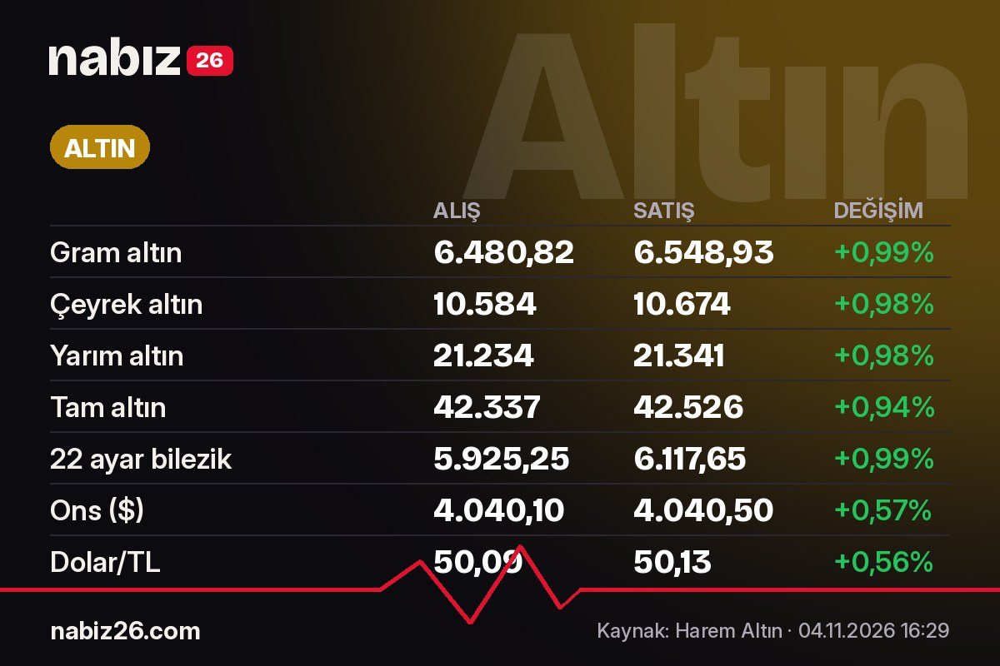
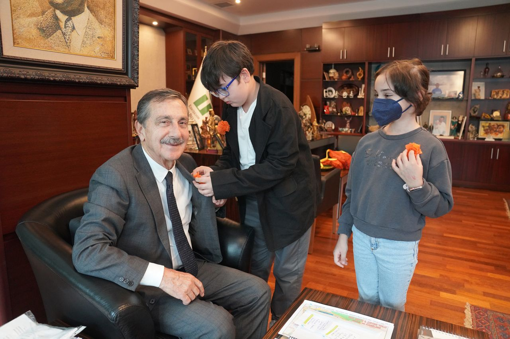

# Son haberler

Ajanın yazdığı son haberler (otomatik güncellenir).

## Seyitgazi'de 4. Pekmez Kaynatma Şenliği 7 Kasım'da, ücretsiz otobüs seferleri olacak

**Kültür-Sanat · Merkez** · 2026-11-05 08:31 UTC · Kaynak: [Google Haberler - Eskişehir etkinlik](https://www.eskisehir.net/pekmez-kaynatma-senligi-icin-ucretsiz-ulasim-imkani-servis-duraklari-aciklandi)

> Şenlik 12.00-17.00 arasında Taşlık Çiftlikköy'deki ÇİDEM alanında yapılacak.

Seyitgazi Belediyesi'nin düzenlediği 4. Geleneksel Pekmez Kaynatma Şenliği, 7 Kasım 2026 Cumartesi günü saat 12.00-17.00 arasında Taşlık Çiftlikköy'deki ÇİDEM (Çiftçi Destekleme ve Eğitim Merkezi) alanında yapılacak.

Şenlikte katılımcılar geleneksel yöntemlerle pekmez kaynatma sürecini yakından izleyebilecek. Etkinlik alanında köy ekmeği yapımının yanı sıra patates, pancar, katmer, pide, kumpir ve kabak gibi yöresel lezzetler sunulacak; gün boyu canlı müzik dinletileri olacak.

Belediye, şenliğe ulaşım için 7 Kasım'da ücretsiz otobüs seferleri planladı:
- Odunpazarı kalkışlı (saat 11.00): Odunpazarı, Yıldıztepe, Yenikent üzerinden Taşlık.
- Atatürk Bulvarı kalkışlı (saat 11.00): Migros önü ve Cemevi üzerinden Taşlık.
- Kırka Ek Hizmet Binası: saat 11.00.
- Doğançayır Ek Hizmet Binası: saat 11.30.
- Seyitgazi Belediye Binası önü: saat 11.30.

Dönüş otobüsleri saat 17.00'de Taşlık Çiftlikköy'den hareket edecek. Seyitgazi Belediye Başkanı Uğur Tepe, bütün Eskişehir halkını şenliğe davet etti.

---

## Havaist, Eskişehir'den Sabiha Gökçen Havalimanı'na yeni hat hazırlığında

**Ulaşım · Merkez** · 2026-11-05 07:31 UTC · Kaynak: [Google Haberler - Eskişehir](https://www.ekonomigazetesi.com/sehirler/havaist-eskisehirden-sabiha-gokcene-yeni-hat-hazirliginda-91425)

> Hattın tarihi, sefer saatleri ve bilet ücretleri henüz açıklanmadı.

Havalimanı yolcu taşımacılığı şirketi Havaist, Eskişehir'den İstanbul Sabiha Gökçen Havalimanı'na ulaşım sağlayacak yeni bir hat açmaya hazırlanıyor. Şirket güzergâhı sosyal medya hesabından duyurdu.

Havaist'in açıklamasında "Eskişehir'den dünyaya uzanan yolculuklarınız, çok yakında Havaist konforuyla başlayacak! Eskişehir'i, Bozüyük ve Bursa bağlantılarıyla Sabiha Gökçen Havalimanı'na ulaştırmaya hazırlanıyoruz" ifadeleri yer aldı.

Hattın hangi tarihte hizmete gireceği, sefer sıklığı, hareket saatleri ve bilet ücretleri henüz açıklanmadı. Havaist, ayrıntıların önümüzdeki günlerde duyurulacağını bildirdi.

---

## Togg'da hisse devri anlaşması: Türkiye Varlık Fonu yüzde 35 ile en büyük ortak olacak

**Ekonomi · Türkiye** · 2026-11-05 06:31 UTC · Kaynak: [Google Haberler - Togg](https://haberkocaeli.com/toggda-ortaklik-yapisi-degisiyor-turkiye-varlik-fonu-en-buyuk-hissedar-olacak)

> Anlaşmalar 2 Kasım'da imzalandı; devirler kurum onaylarına ve kapanış koşullarına bağlı.

Anadolu Grubu ve Vestel, Togg'daki toplam yüzde 46'lık paylarını Türkiye Varlık Fonu ve Turkcell'e devretmek üzere anlaşma imzaladı. Anlaşmaların 2 Kasım'da imzalandığı, 3 Kasım 2026'da Kamuyu Aydınlatma Platformu'na (KAP) yapılan açıklamalarla bildirildi.

Toplam 368 milyon avroluk işlemde Vestel, yüzde 23'lük payını 184 milyon avroya Türkiye Varlık Fonu'na satacak. Anadolu Grubu da yüzde 23'lük payını 184 milyon avro bedelle Türkiye Varlık Fonu ve Turkcell'e devredecek. Turkcell'in payı yüzde 23'ten yüzde 34'e çıkacak.

Devirler tamamlandığında ortaklık yapısının şöyle olması bekleniyor: Türkiye Varlık Fonu yüzde 35, Turkcell yüzde 34, BMC yüzde 23 ve TOBB yüzde 8. Vestel, satıştan elde edeceği gelirin en az yüzde 90'ını, tahsilattan sonraki 30 gün içinde vadesi gelmiş nakdi banka kredisi borçlarının ödenmesinde kullanacağını açıkladı.

KAP açıklamalarına göre hisse devirleri henüz tamamlanmadı. İşlemin sonuçlanması için gerekli kurum onaylarının alınması, kapanış koşullarının yerine getirilmesi ve satış bedellerinin ödenmesi gerekiyor.

---

## Eskişehirli ralli ekibi Olcay-Kaya Almanya'daki sezon finalinde şampiyonluk için yarışacak

**Spor · Merkez** · 2026-11-05 04:32 UTC · Kaynak: [Google Haberler - Eskişehir](https://www.esgazete.com/sampiyonluga-bir-adim-kaldi-son-durak-almanya)

> Ekip, 5-7 Kasım'da Lausitz Rallisi'nde sezonun son yarışına çıkıyor.

Eskişehirli pilot Evren Olcay ve co-pilot Yenal Kaya, Avrupa Ralli Kupası'nın son yarışında şampiyonluk için yarışacak. Ekip, 5-7 Kasım tarihlerinde Almanya'da yapılacak 29. Uluslararası ADMV Lausitz Rallisi'ne katılacak.

Eskişehir Otomobil Sporları Kulübü (ESOK) Başkanı ve TOSFED Eskişehir İl Temsilcisi Nevzat Aslan, yarış öncesi basın mensuplarıyla bir araya geldi. Aslan, iki sporcunun puan olarak şampiyonluğu Eskişehir'e getirebilecek durumda olduğunu söyledi ve onların şampiyon olarak döneceğine inandığını belirtti. Olcay ise altı yarışlık programın beşinin tamamlandığını, ilk yarışın Marmaris'te test niteliğinde yapıldığını ve Almanya'da şampiyonluğu kutlamak istediklerini söyledi.

Haber, Aslan ve Olcay'ın açıklamalarına dayanıyor.

---

## Eskişehirspor-Kepezspor maçı Tivibu 1'den canlı yayınlanacak: 7 Kasım, 15.30

**Spor · Merkez** · 2026-11-05 00:32 UTC · Kaynak: [Google Haberler - Eskişehirspor](https://www.esyenigun.com/eskisehirspor-maci-ne-zaman-hangi-kanalda)

> Eskişehirspor 18 puanla liderin 3 puan gerisinde ikinci sırada.

Eskişehirspor ile Kepezspor arasındaki karşılaşma 7 Kasım 2026 Cumartesi günü saat 15.30'da Fethi Heper Stadyumu'nda oynanacak. Maç Tivibu 1 ekranlarından canlı yayınlanacak.

Eskişehirspor ligde 9 haftada topladığı 18 puanla, 5 galibiyet, 3 beraberlik ve 1 yenilgiyle, 21 puanlı lider Gemlik Sümerbey'in 3 puan gerisinde ikinci sırada. Anadolu SF ve Ayvalıkgücü de aynı puanda; Eskişehirspor averaj sıralamasıyla ikinci basamakta yer alıyor. Takım, Gaziemirspor'u 5-0 yendikten sonra Kepezspor maçına da 3 puan hedefiyle hazırlanıyor.

---

## Vali Yılmaz Mihalıççık'ta Yunus Emre Mezarı ve Külliyesi'ni ziyaret etti

**Kültür-Sanat · Merkez** · 2026-11-04 21:33 UTC · Kaynak: [Eskişehir Valiliği](https://www.eskisehir.gov.tr/valimiz-dr-erdinc-yilmaz-yunus-emre-mezar-ve-kulliyesini-ziyaret-etti)

> Vali, külliyede yürütülen çalışmalar hakkında yetkililerden bilgi aldı.

Vali Dr. Erdinç Yılmaz, hayırsever iş insanı Tayfur Bayar, Mihalıççık Kaymakamı Fahrettin Çırak ve Mihalıççık Belediye Başkanı Haydar Çorum ile birlikte Mihalıççık ilçesine bağlı Yunus Emre Mahallesi'ndeki Yunus Emre'nin mezarını ve külliyesini ziyaret etti.

Yılmaz, Yunus Emre'nin kabri başında dua etti, külliye alanında incelemelerde bulundu; yürütülen çalışmalar ve bölgenin tarihi ve kültürel önemi hakkında yetkililerden bilgi aldı. Ziyarette Yunus Emre'nin sevgi, hoşgörü, kardeşlik ve insanlık anlayışını merkeze alan düşünce mirasının önemine ve bu mirasın gelecek nesillere aktarılmasına dikkat çekildi.

---

## Yılmaz Büyükerşen'in 90. yaş günü 8 Kasım'da "90. Yaşa Saygıyla" programıyla kutlanacak

**Gündem · Merkez** · 2026-11-04 20:32 UTC · Kaynak: [Google Haberler - Eskişehir](https://www.gzt26.com/yilmaz-buyukersenin-90-yas-gunu-eskisehirde-ozel-bir-programla-kutlanacak)

> Kutlama programı saat 18.30'da başlayacak ve dostları tarafından düzenleniyor.

Eskişehir Büyükşehir Belediyesi'nde 1999-2024 arasında kesintisiz 25 yıl belediye başkanlığı yapan Yılmaz Büyükerşen, 8 Kasım Pazar günü 90. yaş gününü kutlayacak. Dostları tarafından hazırlanan "90. Yaşa Saygıyla" programı 8 Kasım 2026 Pazar günü saat 18.30'da Eskişehir'de bir davet salonunda yapılacak. Kaynakta salonun adı belirtilmiyor.

Programa Büyükerşen'in yakın dostlarının yanı sıra şehrin önde gelen isimlerinin de katılması ve Büyükerşen'in farklı dönemlerde birlikte çalıştığı isimlerle bir araya gelmesi bekleniyor. Büyükerşen 1999'da Eskişehir Büyükşehir Belediye Başkanı seçildi, beş dönem görev yaptı ve 2024'te görevinden ayrıldı.

---

## Tepebaşı Belediyesi zimmet davasında ilk duruşma: 12 tutuklu sanıktan 5'i tahliye edildi

**Gündem · Tepebaşı** · 2026-11-04 19:32 UTC · Kaynak: [Google Haberler - Eskişehir](https://yerel-haberler.haberturk.com/eskisehir-haberleri/tepebasi-belediyesinde-zimmet-davasi-5-saniga-tahliye-119512564)

> Sanıklar suçlamaları kabul etmedi; mahkeme bir tutuksuz sanığın tutuklanmasına karar verdi.

Tepebaşı Belediyesi'ne yönelik zimmet soruşturması kapsamında açılan davanın ilk duruşması Eskişehir 4. Ağır Ceza Mahkemesi'nde yapıldı. Dava, aralarında kamu görevlilerinin de bulunduğu 22 sanığı kapsıyor; sanıkların 12'si tutuklu.

İddianameye göre, geçen mayıs ayında düzenlenen operasyonda gözaltına alınan 22 şüpheliden 7'si kamu görevlisi 12 kişi tutuklanmış, 10 kişi adli kontrolle serbest bırakılmıştı. İddianamede 15 kamu görevlisi için zimmet suçundan 5 yıldan 12 yıla kadar, diğer 7 sanık için suça iştirak veya yardım iddiasıyla 2 yıl 6 aydan 6 yıla kadar hapis cezası talep ediliyor. İddianame, aralarında özel kalem müdürü ve başkan yardımcısının da bulunduğu kamu görevlilerinin, iki organizasyon firması sahibi üzerinden belediye bütçesinden yapılan ödemeleri zimmetlerine geçirdiklerini öne sürüyor.

DHA'nın aktardığına göre yaklaşık 11 saat süren savunmalarda sanıklar suçlamaları kabul etmedi ve iddiaların "iftira" olduğunu öne sürdü. Mahkeme heyeti, tutuklu sanıklardan 5'inin tahliyesine, tutuksuz sanıklardan birinin ise tutuklanmasına karar verdi. Yargılama sürüyor; sanıklar hakkında kesinleşmiş bir hüküm bulunmuyor.

---

## ESTÜ meslek yüksekokullarının 10 programında MEDEK akreditasyon saha ziyareti yapıldı

**Eğitim · Merkez** · 2026-11-04 19:32 UTC · Kaynak: [Eskişehir Teknik Üniversitesi](https://www.eskisehir.edu.tr/tr/Haber/Detay/eskisehir-teknik-universitesinde-meslek-yuksekokullarinin-medek-program-akreditasyonu-degerlendirme-sureci-kapsaminda-saha-ziyareti-gerceklestirildi-)

> Akreditasyon kararını MEDEK Yönetim Kurulu verecek.

Eskişehir Teknik Üniversitesi'ne (ESTÜ) bağlı Bilişim Teknolojileri, Porsuk ve Ulaştırma Meslek Yüksekokullarının 10 programında, Mesleki Eğitim Değerlendirme ve Akreditasyon Derneği (MEDEK) tarafından 2-4 Kasım 2026'da saha ziyaretleri yapıldı.

3 Kasım'da Bilgisayar Programcılığı, Mekatronik, Makine Resim ve Konstrüksiyonu ile Lojistik programlarının ara değerlendirmeleri tamamlandı. Son gün olan 4 Kasım'da Bilişim Teknolojileri Meslek Yüksekokulu İnsansız Hava Aracı Teknolojisi ve Operatörlüğü Programı yeni akreditasyon başvurusu kapsamında değerlendirildi; Porsuk Meslek Yüksekokulu'nun Basım ve Yayım Teknolojileri, Grafik Tasarımı ve Yapı Denetimi programları ile Ulaştırma Meslek Yüksekokulu'nun Sivil Havacılık Kabin Hizmetleri ve Raylı Sistemler Yol Teknolojisi programlarının değerlendirmeleri de bitti. Rektörlük Toplantı Salonu'nda çıkış bildirileri okundu. Program akreditasyon kararını MEDEK Yönetim Kurulu verecek.

---

## Hakan Şapçı: Kepez, Anadolu ve Ayvalıkgücü maçlarını kazanıp liderliği hedefliyoruz

**Spor · Merkez** · 2026-11-04 16:33 UTC · Kaynak: [Google Haberler - Eskişehirspor](https://www.istikbalgazetesi.com/hakan-sapci-3-maci-da-kazanmak-istiyoruz)

> Şapçı, Kepezspor'un son iki maçını kazanarak form yakaladığını hatırlattı.

Eskişehirspor Teknik Direktörü Hakan Şapçı, takımın Kepezspor, Eskişehir Anadolu SF ve Ayvalıkgücü maçlarının Eskişehir'de oynanacak olmasını önemli bir fırsat olarak gördüklerini söyledi. Şapçı, "Bir an önce üst üste galibiyetler alarak zirveyi yakalamayı, ilk devreyi lider tamamlamayı ve liderliği sezon sonuna kadar sürdürmeyi hedefliyoruz" dedi.

Kepezspor'un son iki maçını kazanarak form yakaladığını hatırlatan Şapçı, rakibin hafife alınmaması gerektiğini vurguladı: "Kepez kesinlikle çantada keklik bir rakip değil." Ahmet Dereli'nin sakatlığının ardından hücum hattında değişikliğe gittiklerini belirten Şapçı, Kerem, Hasan Kaya, Mehmet ve Sarper'in durumunun takip edildiğini, Ahmet Dereli ve Mustafa Eren dışındaki oyuncuları Kepez maçına yetiştirmeyi hedeflediklerini söyledi.

Şapçı, hedefinin nisan ayında Eskişehirspor'la şampiyonluk yaşamak olduğunu, ligde ilk dokuz takımın şampiyonluk yarışında olduğunu ve grubun geçen yıla göre daha güçlü olduğunu ifade etti. Haber Şapçı'nın açıklamalarına dayanıyor.

---

## Yerdeki Türk bayraklarını kaldıran trafik polisi Vali Yılmaz'dan plaket aldı

**Gündem · Tepebaşı** · 2026-11-04 15:33 UTC · Kaynak: [Google Haberler - Eskişehir](https://yerel-haberler.haberturk.com/eskisehir-haberleri/yerde-gordugu-turk-bayraklarini-kaldiran-polis-plaketle-odullendirildi-119512487)

> Polis memuru Osman Özbakır'a Vali Erdinç Yılmaz plaket ve başarı belgesi verdi.

Eskişehir Emniyet Müdürlüğü Trafik Şube Müdürlüğü'nde görevli polis memuru Osman Özbakır, önceki gün ekip aracıyla Tepebaşı ilçesi Uluönder Mahallesi'nde seyir halindeyken çevre yolunda refüjde yerde Türk bayrakları olduğunu fark etti. Özbakır, yoğun trafiğe rağmen yolun karşısına geçerek bayrakları yerden aldı. Bir kişinin cep telefonu kamerasıyla kaydettiği görüntülerde Özbakır'ın bayrakları katlayıp öptüğü görüldü.

Görüntülerin sosyal medyada paylaşılmasının ardından Vali Erdinç Yılmaz, Özbakır'ı Emniyet Müdür Vekili Kadir Murat Meral ve Trafik Denetleme Şube Müdürü Hakan Solak'la birlikte makamında ağırladı; Özbakır'a plaket ve başarı belgesi verdi. Yılmaz, "Senin o hassasiyetin bütün Türkiye'de çok güzel karşılandı" dedi.

Özbakır, ekip aracını trafik güvenliğini tehlikeye düşürmeyecek bir noktada durdurup bayrakları koşarak yerden kaldırdığını, trafik polisinin görevinin yalnızca trafik güvenliğini sağlamak değil, Türk bayrağına da sahip çıkmak olduğunu söyledi.

---

## Büyükşehir Caz Günleri'nde Sibel Köse Quintet sahne aldı, sonraki konser 17 Kasım'da

**Kültür-Sanat · Merkez** · 2026-11-04 14:32 UTC · Kaynak: [Google Haberler - Eskişehir etkinlik](https://www.milliirade.com/sibel-kose-quintetten-eskisehirde-caz-dolu-unutulmaz-bir-gece)

> Bir sonraki konserde Duygu Soylu Jazz Band sahne alacak.

Eskişehir Büyükşehir Belediyesi'nin düzenlediği Caz Günleri kapsamında Sibel Köse Quintet sahne aldı. Vokalde Sibel Köse, piyanoda Kürşad Deniz, kontrabasta Kağan Yıldız, tenor saksafonda Engin Recepoğulları ve davulda Berke Özgümüş'ün yer aldığı grup, Cole Porter, Milton Nascimento ve Sonny Burke gibi bestecilerin eserlerini seslendirdi. Gecenin öne çıkan parçası Kürşad Deniz'in özel düzenlemesiyle yorumlanan Cole Porter imzalı "So in Love" oldu; konserde Sibel Köse Septet'in "In Good Company" albümünden parçalar da yer aldı. Konserin ardından Köse, sanatseverlerle bir araya gelerek plaklarını imzaladı.

Caz Günleri'nin bir sonraki konserinde Duygu Soylu Jazz Band 17 Kasım 2026'da Büyükşehir Belediyesi Sanat ve Kültür Merkezi (EBSKM) Opera Sahnesi'nde sahne alacak.

---

## Kupada Eskişehirspor Bodrum FK'ya konuk olacak, Anadolu SF Samsunspor'u ağırlayacak

**Spor · Merkez** · 2026-11-04 13:34 UTC · Kaynak: [Google Haberler - Eskişehirspor](https://www.haber26.com.tr/spor/eskisehirspor-ve-anadolu-sfnin-4-tur-rakipleri-belli-oldu)

> Tek maç eleme usulüyle oynanacak karşılaşmaların tarihleri sonra açıklanacak.

Ziraat Türkiye Kupası 4. Eleme Turu kura çekimi 4 Kasım'da saat 15.30'da yapıldı. Kura sonucunda Eskişehirspor, 1. Lig ekibi Bodrum FK ile deplasmanda karşılaşacak. Kentin diğer temsilcisi Eskişehir Anadolu Spor Faaliyetleri ise Karadeniz ekibi Samsunspor'u Eskişehir'de konuk edecek.

Tek maç eleme usulüyle oynanacak karşılaşmaların kesin gün ve saatlerini TFF önümüzdeki günlerde duyuracak.

---

## Eskişehirspor kaptanı Beykan Şimşek: Dört haftalık dönemlerle ilerliyoruz, takım çıkışta

**Spor · Merkez** · 2026-11-04 13:34 UTC · Kaynak: [Google Haberler - Eskişehirspor](https://www.gzt26.com/eskisehirspor-takim-kaptani-beykan-simsek-taraftara-mesaji-verdi)

> Şimşek, bir haftada oynanacak üç maça ve taraftara seslendi.

Eskişehirspor Takım Kaptanı Beykan Şimşek, 9 haftayı geride bırakan takımın durumunu değerlendirdi. Şimşek, sezon başında ligi dörder haftalık dönemler halinde ele almayı planladıklarını söyledi. İlk dört haftada 7, ikinci dört haftada 8 puan topladıklarını belirten Şimşek, 9. hafta maçıyla üçüncü dönemin galibiyetle başladığını ifade etti.

Bursa Yıldırım Spor maçıyla başlayan, Altay karşılaşmasıyla süren ve Gaziemir maçına uzanan süreçte takımın temposunda ve kazanma isteğinde artış gördüğünü söyleyen Şimşek, bu dönemde Kepez'i sahalarında ağırlayacaklarını, bir haftada üç maç oynayacaklarını belirtti ve fiziksel hazırlığın önemini vurguladı. Takımın galibiyetlerle yeniden ligin ikinci sırasına yükseldiğini ifade eden Şimşek, taraftarın da tribünlerdeki yerini alacağını söyledi.

Haber Şimşek'in açıklamalarına dayanıyor.

---

## Mesleki ve Teknik Eğitim Genel Müdürü Kaygusuz Eskişehir'de değerlendirme yaptı

**Eğitim · Merkez** · 2026-11-04 13:32 UTC · Kaynak: [Eskişehir İl Milli Eğitim Müdürlüğü](https://eskisehir.meb.gov.tr/www/mesleki-ve-teknik-egitimde-eskisehir039in-birikimi-ve-gelecek-vizyonu-degerlendirildi/icerik/8703/tr)

> Toplantı Ali Güven Turizm Mesleki ve Teknik Anadolu Lisesi'nde yapıldı.

Mesleki ve Teknik Eğitim Genel Müdürü Salih Kaygusuz'un katılımıyla Eskişehir'de Mesleki ve Teknik Eğitim Değerlendirme Toplantısı yapıldı. Ali Güven Turizm Mesleki ve Teknik Anadolu Lisesi'nde düzenlenen toplantıya Genel Müdür Yardımcısı Murat Nedirli, Daire Başkanları Mehmet Faideci ve Mustafa Günay, İl Millî Eğitim Müdürü Sinan Aydın ile il ve ilçe millî eğitim yöneticileri katıldı.

Toplantıda Eskişehir'de mesleki ve teknik eğitimin mevcut durumu, gelişim alanları, fiziki ve akademik altyapı, okul-sanayi iş birlikleri ve kalite geliştirme faaliyetleri ele alındı. Kaygusuz, Eskişehir'de mesleki eğitimin niteliğinin oldukça yüksek olduğunu söyledi. Toplantının ardından Kaygusuz ve Aydın, Firuz Kanatlı Mesleki ve Teknik Anadolu Lisesi'ni ziyaret ederek öğretmen ve öğrencilerle bir araya geldi.

---

## Altın fiyatları 4 Kasım 2026: Gram altın 6.548,93 TL

**Ekonomi · Merkez** · 2026-11-04 13:29 UTC · Kaynak: [Harem Altın](https://www.haremaltin.com/altin-fiyatlari)

> Gram altın güne yükselişle başladı. Harem Altın verilerine göre gram altın 6.480,82 TL'den alınıyor, 6.548,93 TL'den satılıyor.

Altın piyasasında güne yükselişle başlandı. Harem Altın'ın saat 16.29 itibarıyla verilerine göre gram altının satış fiyatı 6.548,93 TL, alış fiyatı 6.480,82 TL oldu. Gram altın, önceki kapanışa göre yüzde 0,99 yükseldi.

Ziynet altınlarda çeyrek altın 10.674 TL, yarım altın 21.341 TL, tam altın 42.526 TL, ata altın 43.669 TL seviyesinden satışa sunuluyor.

22 ayar bileziğin gram satış fiyatı 6.117,65 TL, has altının gram fiyatı 6.529,42 TL olarak belirlendi.

Uluslararası piyasalarda altının onsu 4.040,50 dolardan işlem görürken, dolar/TL 50,13 seviyesinde bulunuyor.

Fiyatlar Harem Altın'ın saat 16.29 itibarıyla paylaştığı verilere dayanmaktadır; kuyumcular arasında farklılık gösterebilir. Bu haber yatırım tavsiyesi değildir.

---

## Tepebaşı'ndaki Atatürk Spor Tesisleri Su Sporları Merkezi yenilendi

**Spor · Tepebaşı** · 2026-11-04 12:32 UTC · Kaynak: [Tepebaşı Belediyesi](https://www.tepebasi.bel.tr/Haber/Detay/yenilenensusporlarımerkeziyenidonemehazır)

> Merkezde yeni fitness salonu hizmete girdi; yeni dönem kayıtları 16-22 Kasım'da.

Tepebaşı Belediye Başkanı Ahmet Ataç, fiziki şartları yenilenen Mustafa Kemal Atatürk Spor Tesisleri Su Sporları Merkezi'ni ziyaret ederek incelemelerde bulundu. Ataç, Gençlik ve Spor Hizmetleri Müdür Vekili Suat Arslanboğa'dan yürütülen çalışmalar ve yeni dönem programları hakkında bilgi aldı.

Merkezde yeni bir fitness salonu hizmete girdi; salon sporlarının yapıldığı alanlarda ve yetişkin kurslarının yapılabileceği yeni salonlarda zemin çalışmaları yapıldı. Ataç, "Burayla ilgili hayallerimi gerçekleştirdim, inanın" dedi ve erişilebilir spor yapmanın herkes için bir hak olduğunu söyledi.

Yeni dönemde 6-17 yaş grubundaki çocuk ve gençlere temel, orta ve ileri seviyelerde yüzme eğitimi veriliyor; yetişkinler için yüzme eğitimi ve serbest yüzme, kadınlar için su grupları ve su içi egzersiz programları bulunuyor. Özel gereksinimli bireyler için uygun havuz ve zaman planlaması yapılıyor. Salonlarda çocuklara modern dans ve taekwondo, yetişkinlere pilates, zumba, tabata ve fonksiyonel antrenman sunuluyor. Yüzme ve salon sporları kursları 20 Ekim'de başlamıştı; yeni dönem kayıtları 16-22 Kasım'da başlayacak.

---

## Tepebaşı belde evlerinde toplumsal cinsiyet eşitliği ve şiddet semineri sürüyor

**Belediye · Tepebaşı** · 2026-11-04 11:31 UTC · Kaynak: [Tepebaşı Belediyesi](https://www.tepebasi.bel.tr/Haber/Detay/esitlikvesiddetekarsıfarkındalıkbeldeevlerinde)

> Bahçelievler Belde Evi'ndeki seminere 40 kişi katıldı.

Tepebaşı Belediyesi toplumsal cinsiyet eşitliği ve şiddete karşı farkındalık seminerlerine Bahçelievler Belde Evi'nde devam etti. Seminerde Sağlık İşleri Müdürlüğü psikoloğu Ecem Kumaş katılımcılarla bir araya geldi; belde evindeki örgü grubundan 23, giyim grubundan 17 olmak üzere toplam 40 kişi katıldı.

Belediyeye göre eğitimler ay boyunca tüm belde evlerinde ve deneyimli kafelerde sürecek.

---

## Eskişehir Şehir Hastanesi 8. kuruluş yıl dönümünü kutluyor

**Sağlık · Merkez** · 2026-11-04 11:32 UTC · Kaynak: [Google Haberler - Eskişehir](https://yerel-haberler.haberturk.com/eskisehir-haberleri/eskisehir-sehir-hastanesi-8-kurulus-yil-donumunu-kutluyor-119512196)

> İl Sağlık Müdürlüğü, hastanenin 8 yıldır hizmet verdiğini açıkladı.

Eskişehir Şehir Hastanesi 8. kuruluş yıl dönümünü kutluyor. Eskişehir İl Sağlık Müdürlüğü'nün açıklamasına göre hastane modern sağlık altyapısı, tanı ve tedavi birimleri ve sağlık kadrosuyla 8 yıldır Eskişehir'e ve bölgeye hizmet veriyor.

Açıklamada hastanenin her geçen yıl hizmet kapasitesini geliştirdiği, sağlık çalışanlarının bilgi, tecrübe ve özverileriyle binlerce hastaya hizmet verdiği belirtildi; "gece gündüz" demeden görev yapan sağlık çalışanlarına teşekkür edildi.

---

## Başkan Kurt kahveci esnafıyla bir araya geldi: Emek Mahallesi'ndeki işgaliyeler görüşüldü

**Belediye · Odunpazarı** · 2026-11-04 11:31 UTC · Kaynak: [Odunpazarı Belediyesi](https://www.odunpazari.bel.tr/guncel/haberler/genel-haberler/kazim-kurt-kahveci-esnafiyla-isgaliye-konusunu-gorustu)

> Buluşma Emirdağlılar Derneği'nde kahvaltı programıyla yapıldı.

Odunpazarı Belediye Başkanı Kazım Kurt, Eskişehir Esnaf ve Sanatkarlar Odaları Birliği Başkanı Adnan Karamanlı, Eskişehir Kahveciler Odası Başkanı Mehmet Karatay ve kahveci esnafıyla Emirdağlılar Derneği'nde düzenlenen kahvaltıda bir araya geldi. Buluşmada kahvehanelerin işgaliye uygulamaları ele alındı.

Belediyenin aktardığına göre Kurt, Emek Mahallesi'ndeki kahvehanelerin işgaliye durumunu fotoğraflar üzerinden esnafa anlattı, esnafın görüş ve taleplerini dinleyip notlar aldı. Kurt, "Esnafımızın yaşadığı sorunları yerinde görmek, taleplerini dinlemek ve çözüm yollarını birlikte değerlendirmek bizim için önemli" dedi. Kaynakta işgaliye ücretlerine veya alınan bir karara dair ayrıntı yer almıyor.

---

## Başkan Ataç LÖSEV heyetini ağırladı: 2-8 Kasım Lösemili Çocuklar Haftası

**Sağlık · Tepebaşı** · 2026-11-04 11:31 UTC · Kaynak: [Tepebaşı Belediyesi](https://www.tepebasi.bel.tr/Haber/Detay/baskanatac’tanlosemilicocuklaradayanısmamesajıcocuklarımızınyanındaolmakhepimizinsorumlulugu)

> Ataç, lösemiyle mücadele eden çocuklara dayanışma mesajı verdi.

2-8 Kasım Lösemili Çocuklar Haftası dolayısıyla LÖSEV İl Koordinatörü Yelda İlker ve Kurumsal İletişim Müdürü İrem Dabanlı, Tepebaşı Belediye Başkanı Ahmet Ataç'ı ziyaret etti. Heyetteki çocuklar Çınar, Deniz ve Su, Ataç'a turuncu karanfil taktı.

Ataç, lösemiyle mücadele eden çocukların tedavi sürecinde eğitimden ve çocukluklarından kopmamasının önemini vurguladı. "Çocuklarımızın yanında olmak ve aileleriyle dayanışma göstermek hepimizin sorumluluğu" diyen Ataç, turuncu karanfilin dayanışmanın simgesi olduğunu söyledi, LÖSEV'e ve alanda emek veren sağlık çalışanlarına teşekkür etti.

---

## Kurşunlu Külliyesi mühürlendi, iki habere erişim engeli geldi; Kurt tepki gösterdi

**Gündem · Odunpazarı** · 2026-11-04 09:34 UTC · Kaynak: [Google Haberler - Odunpazarı](https://www.anadolugazetesi.com/amp/kazim-kurt-ve-yeni-parti-den-kursunlu-kulliyesi-tepkisi---muhru-de-sansuru-de-kabul-etmiyoruz--297512.html)

> Haberes'te yayımlanan iki habere Sulh Ceza Hâkimliği kararıyla erişim engeli getirildi.

Odunpazarı Belediye Başkanı Kazım Kurt ve YENİ Parti Odunpazarı İlçe Yönetimi, Kurşunlu Külliyesi'nin mühürlenmesine ve Haberes'in Genel Yayın Yönetmeni Ayhan Aydıner'in külliyeyle ilgili iki haberine erişim engeli getirilmesine tepki gösterdi. Anadolu Gazetesi'nin aktardığına göre YENİ Parti açıklamasında külliyenin Vakıflar Bölge Müdürlüğü ve Odunpazarı Kaymakamlığı nezaretinde mühürlendiği, işlemin mahkeme kararı beklenmeden yapıldığı öne sürüldü.

Aydıner'in 30 Ekim ve 1 Kasım'da Haberes'te yayımlanan "Külliye Olayının Gölgesindeki Rant Çarkı: Vakıflar'dan Adrese Teslim İhaleler!" ve "Yurt İçin Vakıflar'a Bağışlanan Bina Nasıl Lüks Otel Oldu?" başlıklı iki haberi, Eskişehir 3. Sulh Ceza Hâkimliği kararıyla erişime engellendi.

Kurt, gazetecilerin kamu adına soru sorma ve haber yapma hakkının engellenemeyeceğini söyledi: "Gazetecilik suç değildir. Kamu adına soru sormak suç değildir." YENİ Parti ilçe yönetimi de külliyenin mühürlenmesine ve habere getirilen erişim engeline tepki gösterdi, "Gazetecilik suç değildir" dedi.

Haber Kurt'un ve YENİ Parti'nin açıklamalarına dayanıyor; Vakıflar Bölge Müdürlüğü'nün, Kaymakamlığın ve erişim engelini talep edenlerin görüşü kaynakta yer almıyor. Erişim engeline konu haberlerdeki iddiaları bu site doğrulamamıştır.

---

## EOSB heyeti yeni açılan Hampton by Hilton Eskişehir'i ziyaret etti

**Ekonomi · Merkez** · 2026-11-04 09:33 UTC · Kaynak: [Google Haberler - Eskişehir](https://www.esgazete.com/hampton-by-hilton-eskisehirin-cazibesini-artiracak)

> Eskişehir OSB ile Köksal Şirketler Grubu arasında iş birliği protokolü de imzalanmıştı.

Eskişehir Organize Sanayi Bölgesi (EOSB) Yönetim Kurulu Başkanı Nadir Küpeli ve yönetim kurulu üyeleri, Köksal Şirketler Grubu bünyesinde faaliyet gösteren ve kısa süre önce hizmete açılan Hampton by Hilton Eskişehir'i ziyaret etti. Heyeti Köksal Şirketler Grubu Yönetim Kurulu Başkanı Orhan Köksal ve Yönetim Kurulu Üyesi İlhan Köksal ağırladı; görüşmede otelin fiziki imkânları, konaklama hizmetleri ile toplantı ve organizasyon alanları hakkında bilgi verildi.

Küpeli, otelin şehre gelen iş insanlarının, yatırımcıların ve misafirlerin konaklama ihtiyacına katkı sunacağını, toplantı ve seminer imkânlarıyla iş ve organizasyon turizmine değer katacağını söyledi. Eskişehir OSB ile Köksal Şirketler Grubu arasında geçtiğimiz günlerde imzalanan iş birliği protokolünün de bölgedeki sanayi kuruluşlarının çalışanları ve misafirlerine yönelik olduğunu belirtti.

---

## ESOGÜ Yüzme Havuzu'ndaki bakım ve onarım çalışmaları tamamlandı

**Spor · Merkez** · 2026-11-04 08:32 UTC · Kaynak: [Google Haberler - Eskişehirspor](https://www.anadolugazetesi.com/osmangazi-universitesi-havuzu-yenilendi-297492.html)

> Üniversite, tesislerin yenilenmesine ve geliştirilmesine devam edileceğini açıkladı.

Eskişehir Osmangazi Üniversitesi Yüzme Havuzu'nda bir süredir sürdürülen bakım ve onarım çalışmaları sona erdi. Yenileme çalışmalarıyla tesisin kullanım koşulları iyileştirildi.

Üniversitenin açıklamasında, sporculara ve vatandaşlara daha kaliteli hizmet sunabilmek amacıyla tesislerin yenilenmesine ve geliştirilmesine devam edileceği belirtildi. Kaynakta çalışmaların kapsamı, maliyeti ve havuzun yeniden açılış tarihi konusunda ayrıntı yer almıyor.

---

## ESOGÜ Hastanesi'nde Organ Bağışı Haftası için bilgilendirme standı kuruldu

**Sağlık · Merkez** · 2026-11-04 07:33 UTC · Kaynak: [Google Haberler - Eskişehir etkinlik](https://www.eskisehirhaber.com/esogu-hastanesinden-organ-bagisi-icin-anlamli-etkinlik)

> ESOGÜ Hastanesi'nde 2017'den bu yana karaciğer ve böbrek nakli yapılıyor.

Eskişehir Osmangazi Üniversitesi (ESOGÜ) Sağlık Uygulama ve Araştırma Hastanesi'nde 3-9 Kasım Organ Bağışı Haftası dolayısıyla farkındalık etkinliği düzenlendi. ESOGÜ Tıp Fakültesi Genel Cerrahi Ana Bilim Dalı Transplantasyon Ünitesi'nin kurduğu standda organ bağışının önemi anlatıldı, vatandaşların soruları yanıtlandı. Hasta ve hasta yakınlarına süreç hakkında bilgi verildi, broşür dağıtıldı, bağış yapmak isteyenlere başvuru işlemlerinde yardımcı olundu.

Etkinlikte yapılan açıklamaya göre ESOGÜ Hastanesi'nde 2017'den bu yana karaciğer ve böbrek nakilleri yapılıyor; nakil sonrası taburcu edilen hastalar düzenli kontrollerle izleniyor. Etkinliğe Dr. Öğr. Üyesi Yavuz Selim Angın, Hastane Başmüdürü Ayşe Kırcı, Halkla İlişkiler Sorumlusu Esin Gökalp ile organ nakli koordinatörleri Tarık Uca ve Elif Hiçyılmaz katıldı.

---

## AB destekli projede gençler geleneksel tarım bilgisini dijital hikayeye çeviriyor

**Tarım · Merkez** · 2026-11-04 07:33 UTC · Kaynak: [Google Haberler - Eskişehir](https://yerel-haberler.haberturk.com/eskisehir-haberleri/eskisehirde-gencler-geleneksel-tarim-bilgilerini-dijital-hikayelere-donusturmeye-119511755)

> Proje 20 genci Yunus Emre ve Yörük Kırka mahallelerindeki çiftçi ailelerle buluşturdu.

Avrupa Birliği Sivil Düşün Programı finansmanıyla yürütülen "Kadim Tarım Bilgisinin Dijital Hikaye Anlatıcılığı Yoluyla Kuşaklararası Aktarımı" projesi kapsamında, Eskişehir Teknik Üniversitesi, Anadolu Üniversitesi ve Eskişehir Osmangazi Üniversitesi öğrencilerinin de aralarında bulunduğu 20 genç, kırsalda yaşayan deneyimli çiftçilerden geleneksel tarım bilgilerini öğreniyor.

Proje yürütücüsü İhsan Tarık Çelik, 24-25 Ekim'de Eskişehir Teknik Üniversitesi TÜBİTAK Milli Teknoloji Atölyesi'nde dijital hikaye anlatıcılığı, röportaj teknikleri, mobil gazetecilik, görsel anlatım ve dijital içerik üretimi eğitimi verdi. 31 Ekim ve 1 Kasım'da gençler Yunus Emre ve Yörük Kırka mahallelerinde çiftçi ailelerle günlük üretim faaliyetlerine katıldı; hayvan bakımı, süt sağımı, ekşi maya ve bazlama yapımı ile hasat çalışmalarını gözlemleyip görüntü ve ses kaydı aldı.

Saha çalışmasının ardından kurgu ve montaj aşamasına geçildi. Görüntüler farklı temalarda dijital hikayelere dönüştürülecek; yatay ve dikey formatlı filmlerin YouTube'da ve projenin internet sitesinde, kısa videoların sosyal medyada yayımlanması planlanıyor.

---

## Eskişehirspor Kadın Futbol Takımı İstanbul deplasmanında 2-1 yenildi

**Spor · Merkez** · 2026-11-04 06:34 UTC · Kaynak: [Google Haberler - Eskişehirspor](https://www.gzt26.com/eskisehirspor-kadin-futbol-takiminda-yurekleri-burkan-tablo)

> Antrenör Konca, otobüs ücretini borçlanarak günübirlik gittiklerini söyledi.

TFF Kadınlar Futbol 2. Ligi A Grubu'nda mücadele eden Eskişehirspor Kadın Futbol Takımı, İstanbul deplasmanında Büyükçekmece Karadeniz İdman Ocağı'na 2-1 yenildi. Sabah saat 06.00'da Eskişehir'den yola çıkan takım konaklama yapmadan günübirlik gitti. Eskişehirspor, 2. dakikada Esin Demirtürk'ün golüyle öne geçti ancak üstünlüğünü koruyamadı.

Maçın ardından konuşan Antrenör Pınar Konca, kulübün maddi sıkıntı yaşadığını, deplasman yolculuğunda kullanılan otobüsün ücretini sonradan ödemek üzere borçlandıklarını söyledi. Konca, futbolcularının performansından memnun olduğunu, takımın mücadeleden vazgeçmeyeceğini belirtti; kentte kadın futboluna ve amatör kulüplere verilen desteği değerlendirirken duyarsızlığın arttığını dile getirdi ve maddi sorunların yalnızca kendi takımlarına özgü olmadığını söyledi.

Haber Konca'nın açıklamalarına dayanıyor; kulüp yönetiminin konuya ilişkin görüşü kaynakta yer almıyor.

---

## Sivrihisar-2 Caddesi'nin bir bölümü 4 Kasım'da asfalt çalışması için kapatılıyor

**Ulaşım · Tepebaşı** · 2026-11-04 06:34 UTC · Kaynak: [Google Haberler - Tepebaşı](https://www.eskisehir.net/sivrihisar-2-caddesinin-bir-bolumu-trafige-kapaniyor)

> Kapatma saat 08.30-17.30 arasında uygulanacak.

Eskişehir Büyükşehir Belediyesi, Tepebaşı ilçesindeki Sivrihisar-2 Caddesi'nin Abdülhamid Dedelek Caddesi ile Kırım Caddesi arasında kalan bölümünü 4 Kasım 2026 Çarşamba günü saat 08.30 ile 17.30 arasında araç trafiğine kapatacak. Neden, Yol Yapım Bakım ve Onarım Dairesi Başkanlığı'nın yürüteceği asfalt bakım ve onarım çalışması.

Belediye sürücülerden alternatif güzergahları kullanmalarını ve trafik işaretleri ile işaretçilerine dikkat etmelerini istedi. Acil durumlarda ulaşım trafik güvenlik ekiplerince sağlanacak.

---

## ESKİ, Çankaya'da yenilenen 1.400 metrelik içme suyu isale hattını devreye aldı

**Gündem · Merkez** · 2026-11-04 05:32 UTC · Kaynak: [Google Haberler - Eskişehir](https://www.basingazetesi.net/amp/gundem/eskisehir-in-icme-suyu-altyapisi-gucleniyor-77804)

> Bağlantı çalışması gece boyunca sürdü; iletim sistemi normal işletme düzenine döndü.

Eskişehir Büyükşehir Belediyesi Su ve Kanalizasyon İdaresi (ESKİ), Çankaya Mahallesi Özlem Caddesi güzergâhında ekonomik ömrünü tamamlayan içme suyu isale hattını yenileyerek devreye aldı. Yaklaşık 1.400 metre uzunluğundaki yeni hat, Çankaya Mahallesi'ndeki D21 su deposundan çıkıyor ve Özlem Caddesi boyunca uzanıyor.

ESKİ'nin açıklamasına göre hat, dayanıklılığı yüksek spiral çelik borularla yeniden inşa edildi; yapımda kazı, boru yerleştirme, kaynak ve izolasyon işlemleri yapıldı. Yeni hattın mevcut içme suyu iletim sistemine bağlanması için ekipler gece boyunca aralıksız çalıştı. Bağlantıların tamamlanmasının ardından hatta kademeli olarak su verildi, şebeke basıncı dengelendi ve iletim sistemi yeniden normal işletme düzenine kavuştu.

Çalışma sırasında Çankaya, Emek, Ihlamurkent, Erenköy, 71 Evler ve Vadişehir mahallelerinde su kesintisi ve basınç düşüklüğü yaşanmıştı. ESKİ, yatırımla olası arıza risklerinin azaltılmasını ve su iletiminde sürekliliğin sağlanmasını amaçladığını belirtti.

---

## Anadolu Üniversitesi mezunu Selin Toprak'a Altın Portakal'da Jüri Özel Ödülü

**Kültür-Sanat · Merkez** · 2026-11-04 03:32 UTC · Kaynak: [Google Haberler - Eskişehir etkinlik](https://www.mersinhaber.com/amp/haber/834997)

> Ödüllü film, Anadolu Üniversitesi'nde mezuniyet projesi olarak hazırlandı.

Anadolu Üniversitesi Güzel Sanatlar Fakültesi mezunu Selin Toprak, "Dünya Günü Kutlu Olsun (Happy Earth Day)" adlı kısa animasyon filmiyle 63. Uluslararası Antalya Altın Portakal Film Festivali'nde Sinema Okulları Öğrenci Filmleri Yarışması kapsamında Jüri Özel Ödülü'nü kazandı. Festival 24-31 Ekim 2026 tarihlerinde yapıldı.

Yedi dakikalık iki boyutlu bilim kurgu animasyonu, Dünya'daki yaşam koşullarının kötüleşmesinin ardından bir uzay gemisine yerleşen insanların hikâyesini anlatıyor; Ivy ve Willow karakterleri üzerinden ortak yaşam, kayıp ve nostalji temalarını işliyor.

Film, Anadolu Üniversitesi Güzel Sanatlar Fakültesi Çizgi Film ve Animasyon Bölümü'nde ANİ473 Çizgi Film Proje I dersi kapsamında mezuniyet projesi olarak hazırlandı. Danışmanlığını fakültenin öğretim üyeleri Prof. Fethi Kaba, Prof. Hikmet Sofuoğlu ve Doç. Sabahattin Çalışkan üstlendi.

---
