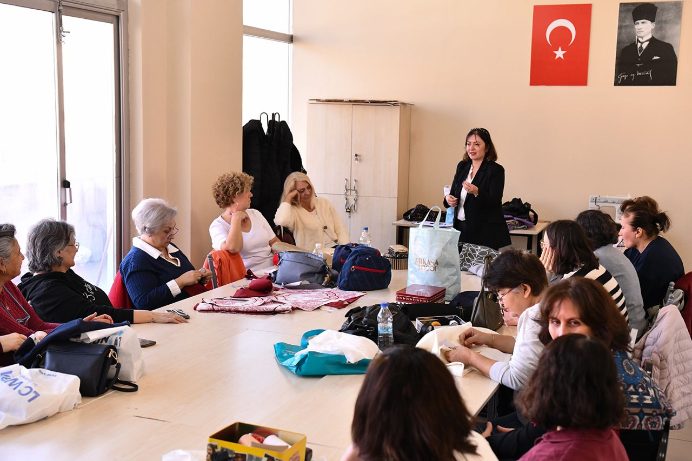
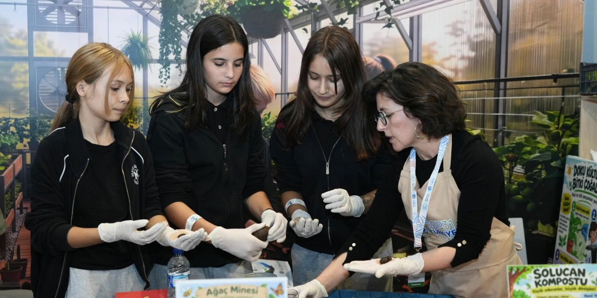
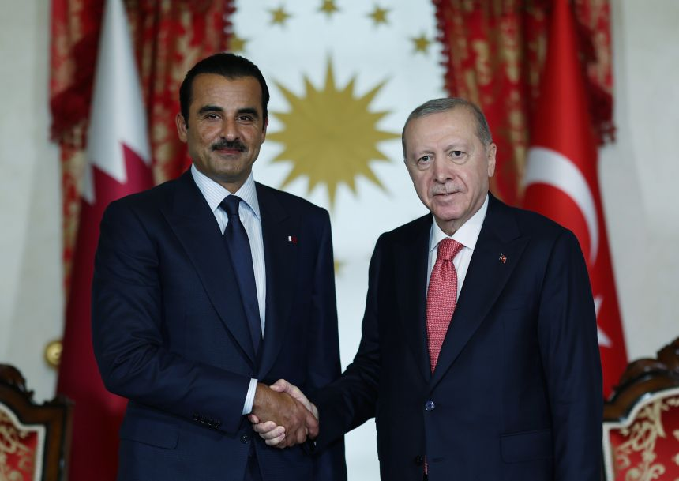
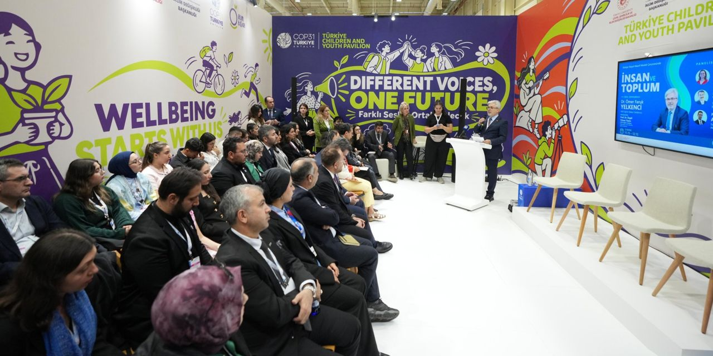

# Son haberler

Ajanın yazdığı son haberler (otomatik güncellenir).

## Yenikent'te tramvay ile otobüs çarpıştı: Seferlerde aksama yaşandı

**Ulaşım · Odunpazarı** · 2026-11-14 11:04 UTC · Kaynak: [Google Haberler - Eskişehir asayiş](https://www.anadolugazetesi.com/eskisehir-de-toplu-ulasimda-kaza-panigi--tramvay-ile-otobus-carpisti-298072.html)

> Odunpazarı'nda sabah saatlerinde tramvay ile halk otobüsünün çarpışması sonucu maddi hasar oluşurken, aksayan seferler araçların kaldırılmasıyla normale döndü.

Eskişehir'in Odunpazarı ilçesine bağlı Yenikent Mahallesi'nde toplu taşıma araçları kaza yaptı. Sabah saatlerinde Şehit Yüzbaşı Tuncer Güngör Caddesi üzerinde seyir halinde olan tramvay ile otobüs henüz belirlenemeyen bir sebeple çarpıştı.

Çarpışmanın etkisiyle her iki araçta da maddi hasar meydana geldi. Kaza nedeniyle bölgedeki tramvay hattında ulaşım bir süre durma noktasına geldi.

İhbar üzerine sevk edilen polis ekipleri cadde üzerinde güvenlik önlemleri alarak inceleme başlattı. Ekiplerin inceleme ve temizlik çalışmalarını tamamlamasının ardından kazaya karışan araçlar yoldan çekildi ve tramvay seferleri yeniden düzenli şekilde işlemeye başladı.

---

## Hamzabeyli'de 558,6 Milyon Liralık Kaçak Eşya Operasyonu

**Türkiye · Türkiye** · 2026-11-14 11:04 UTC · Kaynak: [Google Haberler - Bakanlıklar](https://www.cumhuriyet.com.tr/turkiye/ticaret-bakanligi-verileri-acikladi-558-6-milyon-lira-degerinde-kacak-esya-ele-gecirildi-2556059)

> Ticaret Bakanlığı Gümrükler Muhafaza ekiplerince Edirne Hamzabeyli Gümrük Kapısı'nda durdurulan bir tırda 558 milyon 594 bin lira değerinde kaçak ticari eşya ele geçirildi.

Ticaret Bakanlığı Gümrükler Muhafaza ekipleri, Edirne'deki Hamzabeyli Gümrük Sahası'nda kaçakçılıkla mücadele kapsamında yürüttüğü saha denetimleri sırasında şüpheli hareketler sergileyen bir tırı takibe aldı. Durdurulan araçta yapılan detaylı aramalarda, yasal gümrük işlemlerine tabi tutulmadan Türkiye'ye sokulmak istenen yüklü miktarda ticari malzeme tespit edildi.

Aramalarda 193 bin 31 adet elektronik sigara ve aksamı, 4 bin 700 adet cep telefonu, 11 bin 263 adet gözlük ve aksesuarı, 8 bin 233 adet ilaç ile 3 bin 600 adet sigara filtresi bulundu. Ele geçirilen kaçak eşyaların toplam gümrüklenmiş piyasa değerinin 558 milyon 594 bin lira olduğu açıklandı.

Bakanlık açıklamasında, haksız rekabetin önlenmesi, kamu sağlığı ile ekonomik çıkarların korunması amacıyla gümrük muhafaza ekiplerinin denetimlerinin kararlılıkla süreceği bildirildi. Ele geçirilen malzemelerle ilgili adli tahkikat Edirne Cumhuriyet Başsavcılığı koordinesinde yürütülüyor.

---

## Bakan Tekin COP31'de Duyurdu: 19 Dersin Müfredatına İklim Değişikliği Eklendi

**Eğitim · Türkiye** · 2026-11-14 11:04 UTC · Kaynak: [Milli Eğitim Bakanlığı](https://www.meb.gov.tr/bakan-tekin-cop31039de-duzenlenen-yuksek-duzeyli-bakanlar-acilis-oturumu039nda-hitap-etti/haber/42514/tr)

> Millî Eğitim Bakanı Yusuf Tekin, COP31 zirvesinde okul öncesinden liseye kadar 19 dersin öğretim programına iklim değişikliği ve sürdürülebilirlik konularının yerleştirildiğini açıkladı.

Antalya'da düzenlenen Birleşmiş Milletler İklim Değişikliği Çerçeve Sözleşmesi 31. Taraflar Konferansı (COP31) kapsamında, UNESCO iş birliğiyle "Yeşil Eğitimin Merkezinde Çocuklar, Gençler ve Öğretmenler" başlıklı Yüksek Düzeyli Bakanlar Açılış Oturumu gerçekleştirildi. Oturumda konuşan Millî Eğitim Bakanı Yusuf Tekin, çevre krizinin yalnızca yasal düzenlemelerle çözülemeyeceğini, zihniyet dönüşümünün eğitim yoluyla sağlanabileceğini vurguladı.

Türkiye Yüzyılı Maarif Modeli kapsamında yaşanabilir çevreyi odağa aldıklarını belirten Tekin, okul öncesinden ortaöğretime kadar tüm kademelerdeki zorunlu ve seçmeli 19 derse iklim değişikliği ile sürdürülebilirlik başlıklarının eklendiğini söyledi. Bakan Tekin, Çevre Dostu Okul Projesi aracılığıyla okullarda güneş enerjisi panelleri kurulduğunu ve yağmur sularının bahçe sulamasında değerlendirildiğini ifade etti. Sıfır atık uygulamalarının 29 bin 400 okulda tamamlandığı ve 9 milyon öğrencinin Sıfır Atık Sertifikası aldığı bilgisi de paylaşıldı.

Öğretmenlerin çevre bilincindeki rolüne dikkat çeken Bakan Tekin, öğretmen adaylarına yönelik 1200 saatlik iklim ve sürdürülebilirlik hazırlık eğitimi programı uygulandığını, Öğretmen Bilişim Ağı üzerinden verilen çevre eğitimlerine ise şu ana kadar 517 bin öğretmenin katıldığını kaydetti. Ayrıca 30 ilden gelen lise öğrencilerinin hazırladığı ortak gençlik iklim bildirgesinin zirve boyunca dört dilde okunacağı ve genç iklim delegelerinin karar alıcılarla doğrudan temas kuracağı aktarıldı.

Konuşmasında çatışmaların çevreye ve çocuklara verdiği zarara da değinen Tekin, Gazze'deki tahribatı hatırlatarak adalet ve barış olmadan iklim krizine kalıcı bir çözüm üretilemeyeceğini belirtti. Bakan Tekin'in konuşmasının ardından uluslararası temsilcilerin katılımıyla yeşil beceriler ve iklim eğitimi konulu panel gerçekleştirildi.

---

## MEB'den Sınav Yönetmeliğinde Değişiklik: İlkokullarda Sınav Tamamen Yasaklandı

**Eğitim · Türkiye** · 2026-11-14 09:04 UTC · Kaynak: [Milli Eğitim Bakanlığı](https://www.meb.gov.tr/olcme-ve-degerlendirme-yonetmeligi039nde-degisiklik-resmi-gazete039de-yayimlandi/haber/42511/tr)

> Milli Eğitim Bakanlığı Ölçme ve Değerlendirme Yönetmeliği'nde yaptığı değişiklikle okul öncesi ve ilkokullarda hiçbir ad altında sınav yapılamayacağını duyurdu.

Milli Eğitim Bakanlığına bağlı resmi ve özel okul öncesi, ilköğretim ile ortaöğretim kurumlarında yürütülen ölçme ve değerlendirme faaliyetlerine ilişkin yönetmelik değişikliği Resmi Gazete'de yayımlanarak yürürlüğe girdi. Yeni düzenlemeyle ölçme ve değerlendirme süreçlerinin Türkiye Yüzyılı Maarif Modeli ile uyumlu hale getirilmesi hedeflendi.

Yayımlanan yeni yönetmeliğe göre, okul öncesi eğitim kurumlarında ve ilkokullarda herhangi bir isim altında sınav uygulaması yapılamayacak. Bu kademelerde ölçme ve değerlendirmenin temel hedefi, öğrencilerin bilişsel, fiziksel, sosyal ve duygusal gelişim düzeylerinin süreç içerisinde takip edilmesi ve desteklenmesi olacak. Ayrıca elde edilen sonuçlar; öğrenciler, sınıflar, okullar ya da iller arasında kıyaslama ve sıralama amacıyla kullanılamayacak.

Düzenleme kapsamında ölçme ve değerlendirme faaliyetleri yalnızca Bakanlık tarafından uygun bulunan dijital sistemler aracılığıyla yürütülecek. Soru hazırlama ve değerlendirme aşamalarında verimliliği artırmak amacıyla Bakanlık onaylı yapay zekâ araçlarından yararlanılabilecek. Süreçte kişisel verilerin gizliliği esas alınacak.

Yönetmelikle birlikte ABİDE, Dört Beceride Türkçe Dil Gelişimi İzleme ve okul tabanlı araştırmalar tek bir mevzuat çatısı altında birleştirilirken, PISA ve TIMSS gibi uluslararası izleme araştırmalarına yönelik kurallar da yeniden düzenlendi.

---

## Tarihi Hacı Halit Konağı Etnografya Müzesi Oluyor: Çalışmalar Son Aşamada

**Kültür-Sanat · Mihalıççık** · 2026-11-14 07:03 UTC · Kaynak: [Google Haberler - Eskişehir gündem](https://www.anadolugazetesi.com/eskisehir-e-yeni-muze-geliyor--tarihi-binada-calismalar-son-asamada--297999.html)

> Eskişehir'in Mihalıççık ilçesinde yer alan tarihi Hacı Halit Konağı, etnografya müzesine dönüştürülüyor. Çalışmalarda son aşamaya gelindi.

Eskişehir'in Mihalıççık ilçe merkezine yaklaşık 32 kilometre mesafede yer alan tarihi Hacı Halit Konağı, kentin yeni etnografya müzesi olmaya hazırlanıyor. Tarihi yapının restore edilerek müzeye dönüştürülmesi sürecinde yürütülen çalışmalarda son aşamaya gelindiği bildirildi.

Müzede sergilenecek etnografik eserlerin Eskişehir Müze Müdürlüğü envanterinden karşılanacağı kaydedildi. Proje kapsamında ildeki müze depolarında ve kayıtlarında yer alan tarihi eserler, düzenlenecek sergi alanlarıyla tarihi konakta halkın ziyaretine açılacak.

Öte yandan, konağın bulunduğu mahallenin ilçe merkezine mesafesi ve ulaşım imkânlarının kısıtlı olması bazı soru işaretlerini de beraberinde getirdi. Bazı ilgililer, Eskişehir genelinde bağımsız bir etnografya müzesi bulunmazken projenin ulaşımı zor bir kırsal yerleşime kurulmasını eleştirerek ziyaretçi sayısının beklenenden düşük kalabileceği yönünde görüş bildirdi. Müzenin hizmete girmesiyle birlikte ulaşım ve ziyaretçi erişimine dönük adımların nasıl şekilleneceği bekleniyor.

---

## Dalışa Eskişehir'de Başlayan Erkan Balk Üst Üste İkinci Kez Dünya Şampiyonu

**Spor · Merkez** · 2026-11-14 07:03 UTC · Kaynak: [Google Haberler - Eskişehir](https://www.gazetevatan.com/sehirler/eskisehir/eskisehirde-basladi-dunya-sampiyonu-oldu-2464608)

> Su altı görüntüleme milli sporcusu Erkan Balk, Bali'de düzenlenen şampiyonada 'Okyanusun Senfonisi' adlı çalışmasıyla üst üste ikinci kez dünya şampiyonluğunu kazandı.

Türkiye Sualtı Sporları Federasyonu (TSSF) milli sporcusu Erkan Balk, su altı görüntüleme dalında uluslararası alanda önemli bir başarıya imza attı. 2023 yılında Küba'da dalış eşi Akın Bağcılar ile birlikte video kategorisinde dünya şampiyonu olarak Türkiye tarihinde bu alanda ilk kez podyuma çıkan Balk, bu unvanını korudu.

Endonezya'nın Bali adasında gerçekleştirilen dünya şampiyonasında doğanın seslerini arayan bir müzisyenin hikayesini konu alan "Okyanusun Senfonisi" isimli kısa filmiyle yarışan Balk, üst üste ikinci kez dünya şampiyonluğuna ulaştı. Yaklaşık 23 yıldır tüplü dalışla ilgilenen ve 4 yıldır uluslararası arenada Türkiye'yi temsil eden milli sporcu, su altı belgeselciliğinde farklı temaları işleyerek başarıya ulaştıklarını belirtti.

Elde edilen başarının 7-8 aylık yoğun bir hazırlık döneminin sonucu olduğunu ifade eden Balk, su altı dünyasında müziği bir araya getiren hikayenin jüri üzerinde derin bir etki bıraktığını söyledi. Balk, federasyonun ve bakanlığın desteğiyle elde edilen bu tecrübeleri yeni yetişen sporculara aktararak başarının kalıcı olmasını hedeflediklerini kaydetti.

---

## Altın fiyatları 14 Kasım 2026: Gram altın 6.368,49 TL

**Ekonomi · Merkez** · 2026-11-14 06:00 UTC · Kaynak: [Harem Altın](https://www.haremaltin.com/altin-fiyatlari)

> Gram altın güne düşüşle başladı. Harem Altın verilerine göre gram altın 6.277,23 TL'den alınıyor, 6.368,49 TL'den satılıyor.

Altın piyasasında güne düşüşle başlandı. Harem Altın'ın saat 09.00 itibarıyla verilerine göre gram altının satış fiyatı 6.368,49 TL, alış fiyatı 6.277,23 TL oldu. Gram altın, önceki kapanışa göre yüzde 5,20 geriledi.

Ziynet altınlarda çeyrek altın 10.380 TL, yarım altın 20.754 TL, tam altın 41.355 TL, ata altın 42.460 TL seviyesinden satışa sunuluyor.

22 ayar bileziğin gram satış fiyatı 5.948,47 TL, has altının gram fiyatı 6.349,44 TL olarak belirlendi.

Uluslararası piyasalarda altının onsu 3.880,80 dolardan işlem görürken, dolar/TL 50,46 seviyesinde bulunuyor.

Fiyatlar Harem Altın'ın saat 09.00 itibarıyla paylaştığı verilere dayanmaktadır; kuyumcular arasında farklılık gösterebilir. Bu haber yatırım tavsiyesi değildir.

---

## İlkokulda Gerçeği Aratmayan Tatbikat: Miniklere Deprem ve Yangın Eğitimi

**Eğitim · Tepebaşı** · 2026-11-14 05:03 UTC · Kaynak: [Google Haberler - Eskişehir asayiş](https://www.iha.com.tr/eskisehir-haberleri/esoguden-ilkokullarda-uygulamali-deprem-ve-yangin-egitimleri-515580824)

> ESOGÜ ve AFAD iş birliğiyle Reşat Benli İlkokulu'nda düzenlenen uygulamalı eğitimde, öğrencilere deprem ve yangın anında yapılması gerekenler tatbikatla anlatıldı.

Eskişehir Osmangazi Üniversitesi (ESOGÜ), "Dirençli Toplum İçin Erken Yaşta Afet Bilinci" sloganıyla başlattığı ilkokullara yönelik uygulamalı afet eğitimlerini sürdürüyor. 12 Kasım Afet Eğitimi Hazırlık Günü kapsamında Reşat Benli İlkokulu'nda gerçekleştirilen etkinlikte, öğrenci ve öğretmenlere afet anında sergilenecek doğru davranış modelleri ile tahliye adımları uygulamalı olarak aktarıldı.

Yükseköğretim Kurulu (YÖK) Bilim İletişimi Ofisi öncülüğünde yürütülen "Bilim Kafe" etkinlikleri çerçevesinde düzenlenen organizasyona ESOGÜ birimleri, ESOGÜ Arama Kurtarma Ekibi (ESOGÜAK), Afet ve Acil Durum Farkındalık Kulübü, Eskişehir AFAD İl Müdürlüğü ile Millî Eğitim Bakanlığı Arama ve Kurtarma Birimi (MEBAKUB) destek sağladı. Okul bahçesinde kurulan stantlar ve gerçekleştirilen tatbikatlarla öğrencilere arama kurtarma çalışmaları hakkında bilgi verildi.

Eğitim sürecinde ESOGÜ Eğitim ve Öğretimde Mükemmeliyet Merkezi Müdürü Prof. Dr. Ersin Karademir, ESOGÜAK Sivil Savunma Uzmanı Serap Bozdemir ve AFAD personeli görev aldı. Programla çocukların öğrendikleri doğru davranışları aileleri ve çevreleriyle paylaşarak afet farkındalığını yaygınlaştırması amaçlanırken, benzer bilinçlendirme çalışmalarının farklı okullarda devam edeceği kaydedildi.

---

## CHP'den Emekli Aylığı Çağrısı: En Düşük Maaş 40 Bin Lira Olmalı

**Siyaset · Türkiye** · 2026-11-14 05:03 UTC · Kaynak: [Google Haberler - CHP](https://ankara-etimesgut.chp.org.tr/haberler/muslim-sari-en-dusuk-emekli-maasi-1-ocaktan-tibaren-40-bin-liraya-cikarilmali)

> CHP Sözcüsü Müslim Sarı, açlık sınırının 38 bin lirayı aştığını belirterek en düşük emekli maaşının 1 Ocak itibarıyla 40 bin liraya yükseltilmesini önerdiklerini söyledi.

CHP Sözcüsü Müslim Sarı, Genel Başkan Yardımcısı Tahsin Tarhan ile birlikte CHP Kocaeli İl Başkanlığı'nda düzenlediği basın toplantısında ekonomi gündemine ilişkin değerlendirmelerde bulundu. Sarı, partisinin ücret politikasının "sıfır açlık" esasına dayandığını vurgulayarak hiçbir ücretin ve gelirin açlık sınırının altında kalmaması gerektiğini ifade etti.

Açlık sınırının 38 bin liraya ulaştığını ve yıl sonunda 40 bin lirayı bulmasının beklendiğini belirten Sarı, 23 bin lira seviyesindeki en düşük emekli maaşının 1 Ocak'tan itibaren yaklaşık yüzde 70 artışla 40 bin liraya çıkarılması çağrısında bulundu. Sarı, geçmiş yıllara kıyasla emekli aylıklarının kişi başına düşen milli gelir artışının oldukça gerisinde kaldığını savundu.

Ekonomide yaşanan gelişmelere de değinen Sarı; konkordato ilan eden firma sayısının 5 binin üzerine çıktığını, işsizliğin ve hayat pahalılığının yükseldiğini ifade etti. Borsadaki manipülasyon iddiaları ve fon krizine ilişkin yürütülen soruşturmaların siyasi ayağının da aydınlatılması gerektiğini dile getiren Sarı, denetim görevini ihmal eden sorumluların ortaya çıkarılmasını istedi.

Gazetecilerin sorularını da yanıtlayan CHP Sözcüsü Sarı, cumhurbaşkanlığı adaylığı ve ittifak tartışmaları için henüz erken olduğunu belirterek partinin şu aşamada bu yönde bir görüşmesi bulunmadığını, önceliklerinin saha çalışmalarıyla halkın sorunlarını dinlemek olduğunu sözlerine ekledi.

---

## Togg Engelli Raporuyla ÖTV'siz Alınabiliyor: İşte Kapsamdaki Modeller ve Şartlar

**Ekonomi · Türkiye** · 2026-11-14 01:28 UTC · Kaynak: [Google Haberler - Togg](https://www.engelolma.net/engelli-arac/togg-engelli-raporuyla-otvsiz-alinabilir-mi/400032)

> Yerli elektrikli otomobil Togg'un arkadan itişli T10X ve T10F modelleri, ÖTV muafiyeti üst sınırının altında kalarak engelli raporuyla satın alınabiliyor. Çift motorlu seçenekler ise sınırın üzerinde kalıyor.

Türkiye'de üretilen yerli elektrikli otomobil Togg modellerinde engelli muafiyetiyle araç alımı yapılabiliyor. Yüzde 40 yerli katkı şartını karşılayan T10X ve T10F modellerinin arkadan itişli versiyonları, 2 milyon 873 bin 900 TL olarak belirlenen yasal üst sınırın altında kaldığı için muafiyet kapsamına giriyor. Yaklaşık 3,2 milyon liralık liste fiyatına sahip çift motorlu 4More donanım paketleri ise üst sınırı aştığından istisnadan yararlanamıyor.

Elektrikli araçlardaki ÖTV oranının içten yanmalı motorlara kıyasla daha düşük olması, muafiyet indiriminin tutarını da doğrudan etkiliyor. Yüzde 25 ÖTV diliminde yer alan standart menzilli T10X V1 RWD modelinde muafiyet sağlandığında yaklaşık 380 bin liralık indirim elde ediliyor ve aracın maliyeti 1,53 milyon lira seviyesine iniyor.

Satın alma sürecinde genel ÖTV istisnası kuralları uygulanıyor. Yüzde 90 ve üzeri engelli raporu bulunanlar ile raporunda ve ehliyetinde özel tertibat veya otomatik vites ibaresi yer alan ortopedik engelliler haktan faydalanabiliyor. On yılda bir kullanılabilen bu istisna kapsamında alınan araçların, beş yıl dolmadan muafiyet hakkı olmayan üçüncü kişilere devredilmesi halinde tahsil edilmeyen verginin ödenmesi şart koşuluyor.

---

## ESOGÜ Hastanesi'nde Prematüre Günü: Minik Savaşçılar İçin Mor Kutlama

**Sağlık · Odunpazarı** · 2026-11-14 01:28 UTC · Kaynak: [Google Haberler - Eskişehir etkinlik](https://www.esyenigun.com/esogu-hastanesinde-dunya-premature-gunune-ozel-etkinlik)

> Eskişehir Osmangazi Üniversitesi Hastanesi'nde Dünya Prematüre Günü dolayısıyla düzenlenen etkinlikte, erken doğan bebeklerin hayata tutunma mücadelesine dikkat çekildi.

Eskişehir Osmangazi Üniversitesi (ESOGÜ) Sağlık, Uygulama ve Araştırma Hastanesi Yenidoğan Yoğun Bakım Ünitesi bünyesinde Dünya Prematüre Günü kapsamında özel bir program düzenlendi. Etkinliğe Tıp Fakültesi Dekanı Prof. Dr. Koray Harmancı, Hastane Başhekimi Prof. Dr. Haluk Hüseyin Gürsoy, Başhekim Yardımcısı Doç. Dr. Gürkan Bozan ile akademisyenler ve sağlık yöneticileri katıldı.

Programda değerlendirmelerde bulunan Çocuk Sağlığı ve Hastalıkları Ana Bilim Dalı Başkanı Prof. Dr. Özge Aydemir, günün amacının erken doğum konusunda toplumsal farkındalık oluşturmak ve ailelerin yaşadığı zorlu süreçleri gündeme taşımak olduğunu vurguladı. Prematüre Günü’nün simgesi olan mor rengin erken doğan bebeklerin hassasiyetini ve yaşama tutunma gayretini simgelediğini belirten Aydemir, bu süreçte aile desteğinin ve multidisipliner uzmanlık alanlarının koordinasyonunun hayati önemde olduğunu ifade etti.

ESOGÜ Yenidoğan Yoğun Bakım Ünitesi'nin ikinci, üçüncü ve dördüncü düzey sağlık hizmetleri sunarak bölgede önemli bir referans merkezi konumunda bulunduğuna işaret eden Prof. Dr. Aydemir, uzman hekimlerden hemşirelere kadar tüm personelin büyük bir özveriyle görev yaptığını söyledi. Etkinlik kapsamında daha önce yoğun bakımda tedavi görüp sağlığına kavuşan bebeklerin ailelerinin gönderdiği video mesajlar izlenirken, mor süslemeli pastanın kesilmesiyle program tamamlandı.

---

## Uluönder'e Yeni ESKİ Abone Merkezi ve Ücretsiz Otopark Geliyor

**Belediye · Tepebaşı** · 2026-11-13 21:03 UTC · Kaynak: [Google Haberler - Tepebaşı](https://www.haberes.com.tr/uluondere-yeni-eski-abone-servisi-geliyor)

> Eskişehir Büyükşehir Belediyesi, Uluönder Mahallesi'nde açılacak yeni ESKİ abone servisi ve 'Park Et Devam Et' otoparkı ile çevre mahalle sakinlerine kolaylık sağlayacak.

Eskişehir Büyükşehir Belediye Başkanı Ayşe Ünlüce, ESKİ Genel Müdürlüğü tarafından Tepebaşı ilçesine bağlı Uluönder Mahallesi'nde kısa süre içinde faaliyete geçirilecek olan abone servisini yerinde inceledi. ESKİ Genel Müdürü Niyazi Solak'tan yürütülen son hazırlıklar hakkında bilgi alan Ünlüce, merkezin bölge sakinlerinin işlemlerini hızlandıracağını belirtti.

Yapımında sona gelinen yeni ESKİ Uluönder Abone Servisi, Yunus Emre Halk Çarşısı'ndaki Abone İşleri Dairesi'nde gerçekleştirilen tüm hizmetleri sunacak. Merkezin hizmete girmesiyle birlikte Uluönder, Batıkent, Çamlıca ve Şirintepe mahallelerinde oturan vatandaşlar, abonelik ve ödeme gibi işlemlerini kent merkezine gitmeden mahallelerinde halledebilecek.

İncelemeler sırasında aynı noktada yer alan otopark alanını da gezen Başkan Ünlüce, 'Park Et Devam Et' modelinin devreye alınacağını açıkladı. Otobüs ve tramvay duraklarına yakın olan bu otoparkın toplu taşımayı kullanan vatandaşlara ücretsiz sunulacağı, sürücülerin araçlarını buraya bırakarak yolculuklarına toplu taşımayla devam edebileceği bildirildi.

Belediye Başkanı Ayşe Ünlüce, tesis incelemelerinin ardından Uluönder Mahalle Muhtarı Hasan Güler ile birlikte mahalle esnafını ve vatandaşları ziyaret ederek talep ve önerileri dinledi.

---

## Dede Korkut Parkı'nda Karadeniz Şöleni: 1 Ton Hamsi Dağıtılacak

**Kültür-Sanat · Odunpazarı** · 2026-11-13 21:03 UTC · Kaynak: [Google Haberler - Eskişehir etkinlik](https://www.eskisehir.net/eskisehirde-karadeniz-festivali-bugun-basliyor-kuymak-karalahana-corbasi-ve-1-ton-hamsi-dagitilacak)

> Eskişehir'de üç gün sürecek Karadeniz Festivali kapılarını açtı; etkinlikte vatandaşlara 1 ton hamsi, kuymak ve karalahana çorbası ikram edilecek.

Eskişehir Karadenizliler Derneği öncülüğünde ve B.A.S. Fuar ve Organizasyon iş birliğiyle düzenlenen Karadeniz Festivali, Vişnelik Mahallesi'ndeki Dede Korkut Parkı'nda başladı. 13-15 Kasım tarihleri arasında üç gün sürecek etkinlik, Karadeniz kültürünü ve yöresel tatlarını Eskişehirlilerle buluşturacak.

Festival kapsamında Karadeniz mutfağının lezzetleri katılımcıların beğenisine sunulacak. Etkinlik boyunca alanda karalahana çorbası ve kuymak hazırlanırken, ziyaretçilere toplam 1 ton hamsi ikramı gerçekleştirilecek.

Kemençe dinletileri ve horon gösterilerinin yer alacağı festivalde alışveriş stantları ile çocuklar için oyun alanları da kuruldu. Program çerçevesinde sanatçı Mithat Körler, 14 Kasım Cumartesi günü saat 19.00'da sahne alarak konser verecek. Organizatörler üç gün sürecek şölene tüm kent halkını davet etti.

---

## Tepebaşı'nda 2 Kişinin Öldüğü Silahlı Kavga Davasında Bir Sanığa Tahliye

**Asayiş · Tepebaşı** · 2026-11-13 20:31 UTC · Kaynak: [Google Haberler - Tepebaşı](https://www.canligaste.com/eskisehir-de-2-kisinin-oldugu-silahli-kavgayla-ilgili-5-sanigin-yargilanmasina-baslandi/949292/)

> Eskişehir'in Tepebaşı ilçesinde iki kişinin yaşamını yitirdiği silahlı kavgaya ilişkin 5 sanığın yargılanmasına başlandı; mahkeme bir sanığı tahliye etti.

Eskişehir'in Tepebaşı ilçesine bağlı Fatih Mahallesi'nde bulunan Kumlubel Parkı'nda geçen yıl husumetli iki grup arasında çıkan silahlı çatışmada Enes Öz ile Volkan Taşdelen hayatını kaybetmiş, Ali Han D. ise yaralanmıştı. Olayın ardından açılan davanın ilk duruşması Eskişehir 7. Ağır Ceza Mahkemesi'nde görüldü.

Duruşmaya tutuklu sanıklar Cevdet D., Umut U. ve Ahmet D. ile başka bir suçtan tutuklu bulunan sanık Ali Han D. bizzat katılırken, tutuklu sanık Bayram S. cezaevinden SEGBİS aracılığıyla bağlandı. Taraf avukatlarının da hazır bulunduğu duruşmada sanıklar olay anında yaşanan arbede ve silah kullanımıyla ilgili savunmalarını yaptı.

Savunmaların ardından ara kararını açıklayan mahkeme heyeti, Bayram S.'nin yurt dışına çıkış yasağı ve imza şartıyla tahliyesine hükmetti. Diğer üç tutuklu sanığın tutukluluk hallerinin devamına ve Ali Han D. hakkındaki adli kontrol tedbirlerinin sürdürülmesine karar veren mahkeme, duruşmayı ileri bir tarihe erteledi.

---

## Odunpazarı Spor Kulübü Porsuk'ta Galibiyet Peşinde

**Spor · Odunpazarı** · 2026-11-13 20:31 UTC · Kaynak: [Google Haberler - Odunpazarı](https://www.istikbalgazetesi.com/odunpazarina-cikis-firsat)

> Ligde dokuz haftada 4 puan toplayan Odunpazarı Spor Kulübü, Porsuk Spor Salonu'nda Ortahisar Belediyespor'u ağırlayacak.

Ligde geride kalan dokuz haftada iki galibiyet ve yedi mağlubiyet alan Eskişehir temsilcisi Odunpazarı Spor Kulübü, 4 puanla altıncı sırada yer alıyor. Son mücadelesinde Üsküdar Belediyespor'a 34-30 mağlup olan mavi-beyazlılar, bu mağlubiyeti unutturmayı amaçlıyor.

Eskişehir ekibi, ligde henüz puanı bulunmayan ve son sırada yer alan Ortahisar Belediyespor ile karşılaşacak. Mücadele yarın saat 15.00'te Porsuk Spor Salonu'nda oynanacak.

Taraftarı önünde galibiyete odaklanan mavi-beyazlı ekip, parkeden zaferle ayrılarak ligde yeniden yükselişe geçmeyi hedefliyor.

---

## Kumlubel Parkı'ndaki Çifte Cinayet Davasında Bir Sanığa Tahliye Kararı Çıktı

**Asayiş · Tepebaşı** · 2026-11-13 20:31 UTC · Kaynak: [Google Haberler - Eskişehir](https://yerel-haberler.haberturk.com/eskisehir-haberleri/eskisehirde-2-kisinin-oldugu-silahli-kavgayla-ilgili-5-sanigin-yargilanmasina-baslandi-119521664)

> Eskişehir'in Tepebaşı ilçesinde 2 kişinin hayatını kaybettiği silahlı çatışmaya ilişkin 5 sanığın yargılanmasına başlandı. İlk duruşmada bir sanık adli kontrol şartıyla tahliye edildi.

Tepebaşı ilçesine bağlı Fatih Mahallesi'ndeki Kumlubel Parkı'nda geçen yıl ağustos ayında iki grup arasında çıkan ve 2 kişinin yaşamını yitirdiği silahlı kavgaya ilişkin dava süreci başladı. Eskişehir 7'nci Ağır Ceza Mahkemesi'nde görülen ilk duruşmaya, tutuklu sanıklar Cevdet D, Umut U, Ahmet D. ile başka suçtan tutuklu bulunan Ali Han D. ve avukatları katıldı. Diğer tutuklu sanık Bayram S. ise duruşmaya SEGBİS aracılığıyla bağlandı.

Mahkemedeki savunmasında olay anını anlatan sanıklardan Cevdet D, kalabalık bir grubun üzerlerine geldiğini, çıkan arbedede yere düştüğünü ve silahın eline geçtiğini öne sürdü. Omzundan vurulduğunu ve korkuyla rastgele ateş ettiğini belirten sanık, kimseyi kasten hedef almadığını savundu. Olayda yaralanan sanıklardan Ali Han D. ise karşı tarafın kendilerine silah çektiğini ve darbedildiklerini iddia etti.

SEGBİS üzerinden ifade veren sanık Bayram S, olay yerine gittiğinde tarafların oturduğunu, ardından tartışma çıkmasıyla silah kullanıldığını anlattı. Sanık Umut U. da karşı gruptan küfür edilmesi üzerine arbede başladığını ve karşı taraftan ateş açıldığını ileri sürdü.

Tanık ve sanık ifadelerini dinleyen mahkeme heyeti ara kararını açıkladı. Tutuklu sanıklardan Bayram S.'nin yurt dışına çıkış yasağı ve imza yükümlülüğü şartıyla tahliyesine karar verilirken, 3 sanığın tutukluluk halinin devamına hükmedildi. Duruşma ileri bir tarihe ertelendi.

Geçen yıl meydana gelen olayda kurşunların hedefi olan Volkan Taşdelen ve Enes Öz ağır yaralı olarak kaldırıldıkları hastanede hayatını kaybetmiş, Ali Han D. ise tedavisinin ardından adli kontrolle serbest bırakılmıştı.

---

## Türkiye İklim Okulu'nda Dünya Gençleri İklim Dezenformasyonunu Tartıştı

**Eğitim · Türkiye** · 2026-11-13 19:04 UTC · Kaynak: [Milli Eğitim Bakanlığı](https://www.meb.gov.tr/farkli-ulkelerden-gencler-turkiye-iklim-okulunda-iklim-degisikligiyle-mucadeleyi-ele-aldi/haber/42504/tr)

> Antalya'da düzenlenen COP31 kapsamında Millî Eğitim Bakanlığı tarafından kurulan Türkiye İklim Okulu, farklı ülkelerden gençlerin katıldığı çevre ve eğitim atölyelerine ev sahipliği yaptı.

Birleşmiş Milletler İklim Değişikliği Çerçeve Sözleşmesi 31. Taraflar Konferansı (COP31) kapsamında Millî Eğitim Bakanlığı tarafından hayata geçirilen Türkiye İklim Okulu, uluslararası etkinliklerle çok sayıda ziyaretçiyi ağırlamaya devam ediyor. Etkinlikler çerçevesinde Türkiye'nin üyesi olduğu UNESCO Yeşil Eğitim Ortaklığının 4. Dönem Çalışma Grubu Toplantısı konferans salonunda yapılarak iklim kriziyle mücadele yöntemleri ele alındı.

OECD iş birliğinde organize edilen atölyede ise Özbekistan, Bahamalar ve Meksika gibi ülkelerden gelen genç aktivistler ile çeşitli sektör temsilcileri buluştu. Gençler yuvarlak masa toplantısında iklim eğitimi, güvenilir bilgi kaynaklarına erişim ve çevre konularındaki dezenformasyonla mücadele deneyimlerini paylaştı. Programda OECD analisti Mario Piacentini ile İklim Eğitimi Ofisi araştırmacısı Elena Pasquinelli, doğru bilgiye ulaşma ve eleştirel düşünme üzerine değerlendirmelerde bulundu.

Öte yandan okul bünyesindeki atölyeler ve deneyim alanları öğrencilerin de yoğun ilgisini çekti. Konferansı aileleriyle ziyaret eden çocuklar ve öğrenciler, iklim deneyim ve teknoloji alanlarında uygulamalı etkinliklerle çevre bilinci kazandı.

---

## Odunpazarı Kent Konseyi'nde İsmail Kumru Güven Tazeledi

**Belediye · Odunpazarı** · 2026-11-13 19:04 UTC · Kaynak: [Google Haberler - Odunpazarı](https://www.esgazete.com/sorunlar-icin-mahalle-meclislerimizle-sahadayiz)

> Odunpazarı Kent Konseyi'nin 22. Olağan Seçimli Genel Kurulu'nda mevcut başkan İsmail Kumru, açık oylamayla yeniden başkanlığa seçildi.

Odunpazarı Belediyesi 100. Yıl Kültür Merkezi'nde düzenlenen genel kurula 200'ün üzerinde sivil toplum kuruluşu temsilcisi katıldı. Divan başkanlığını ESGİAD Yönetim Kurulu Başkanı Batuhan Eldem'in üstlendiği toplantıda, üniversiteler, meslek odaları ve dernek temsilcilerinden oluşan 19 kişilik yeni yürütme kurulu oy birliğiyle kabul edildi.

Genel kurulda konuşan Başkan İsmail Kumru, kentin çevre ve altyapı sorunlarına dikkat çekti. Alpagut-Atalan, Kaymaz ve Beylikova bölgelerindeki çevre odaklı projelere değinen Kumru, kent içi çevre yolu ve hava yolu ulaşımındaki tıkanıklıkların çözümü için çalışmalarını sürdüreceklerini belirtti. Kumru ayrıca okul çevrelerindeki güvenlik tedbirlerine, Kocakır TOKİ bölgesinin sosyal donatı ihtiyaçlarına ve Emek Mahallesi'ndeki lise talebine işaret etti.

Bünyelerindeki 23 mahalle meclisi ve 14 çalışma grubuyla vatandaşların taleplerini aktarmayı sürdüreceklerini dile getiren Kumru, Türkiye genelindeki yaklaşık 400 kent konseyi arasında ilk beş içerisinde yer aldıklarını ifade etti. Etkinlik kapsamında Ekrem Borazan'ın karikatür sergisi ile Yörükkırka Efeleri'nin zeybek gösterisi de katılımcılara sunuldu.

---

## Halkbank'tan Togg'a 48 Ay Vadeli Kredi: Tahsis Ücreti Alınmayacak

**Ekonomi · Türkiye** · 2026-11-13 19:04 UTC · Kaynak: [Google Haberler - Togg](https://marmarabolge.com/halkbanktan-togg-alacaklara-firsat-kredi-miktari-aciklandi)

> Halkbank, yerli elektrikli otomobil Togg için finansman koşullarını duyurdu. 2,5 milyon liraya kadar olan araçlarda yüzde 70'e kadar kredi ve 48 ay vade imkânı sağlanıyor.

Yerli üretim elektrikli otomobil Togg'u satın almak isteyenler için Halkbank taşıt kredisi koşullarını açıkladı. Bankanın belirlediği yeni finansman şartlarına göre araç fatura bedeline bağlı olarak dört farklı vade ve kredi oranı uygulanacak. Kampanya kapsamında kullanılacak kredilerden tahsis ücreti de talep edilmeyecek.

Belirlenen baremlere göre, fatura değeri 2 milyon 500 bin liraya kadar olan Togg modellerinde araç bedelinin yüzde 70'ine kadar kredi verilecek ve azami vade 48 ay olacak. Bu kapsamda 2,5 milyon liralık bir araç için en fazla 1 milyon 750 bin lira finansman sağlanabilecek. Değeri 2 milyon 500 bin lira ile 5 milyon lira arasında bulunan araçlar için yüzde 50 oran ve 36 ay vade, 5 milyon lira ile 6,5 milyon lira arasındaki araçlar için yüzde 30 oran ve 24 ay vade uygulanacak. Fatura tutarı 6,5 milyon ile 7,5 milyon lira aralığındaki modellerde ise azami oran yüzde 20, vade süresi ise 12 ay ile sınırlandırıldı.

Kredi değerlendirmesinde gerçek kullanım tutarları müşterilerin gelir durumuna göre belirlenecek. Uygun faiz ve esnek ödeme koşullarının sunulduğu belirtilen Togg taşıt kredisi başvuruları ve ödeme planı detayları Halkbank şubeleri üzerinden temin edilebilecek.

---

## Eskişehirspor'un Kupa Randevusu Belli Oldu: 2 Aralık'ta Bodrum Deplasmanı

**Spor · Merkez** · 2026-11-13 19:04 UTC · Kaynak: [Google Haberler - Eskişehirspor](https://www.gzt26.com/bodrumspor-eskisehirspor-macinin-gunu-ve-saati-aciklandi)

> Ziraat Türkiye Kupası 4. Eleme Turu programı açıklandı. Eskişehirspor, Bodrum FK ile 2 Aralık Çarşamba günü deplasmanda kozlarını paylaşacak.

Ziraat Türkiye Kupası 4. Eleme Turu karşılaşmalarının takvimi netleşti. Kupanın dördüncü turunda mücadele edecek olan Eskişehirspor'un maç günü ve saati belli oldu. Kırmızı-siyahlı ekip, bir üst tura kalabilmek için Bodrum FK deplasmanına çıkacak.

Açıklanan programa göre Bodrum FK ile Eskişehirspor arasındaki karşılaşma 2 Aralık 2026 Çarşamba günü oynanacak. Mücadele saat 15.00'te başlayacak ve tur atlayan taraf adını bir sonraki tura yazdıracak.

Eskişehir'i kupada temsil eden bir diğer ekip olan Eskişehir Anadolu Spor Faaliyetleri de aynı gün sahaya çıkacak. Eskişehir temsilcisi, 2 Aralık Çarşamba günü saat 14.00'te Samsunspor'u kendi sahasında konuk edecek.

---

## Eskişehir'den Sabiha Gökçen'e seferler başladı: İşte saatler ve bilet fiyatı

**Ulaşım · Merkez** · 2026-11-13 19:04 UTC · Kaynak: [Google Haberler - Eskişehir gündem](https://www.gzt26.com/eskisehirden-sabiha-gokcen-havalimanina-havaist-seferleri-basladi)

> Eskişehir ile İstanbul Sabiha Gökçen Havalimanı arasında Havaist seferleri başladı. Günde iki kez düzenlenecek seferlerde tek yön bilet ücreti 1.050 TL olarak açıklandı.

Eskişehir'den İstanbul Sabiha Gökçen Havalimanı'na doğrudan ulaşım sağlamak amacıyla yeni bir otobüs hattı devreye alındı. Havaist bünyesinde 13 Kasım itibarıyla başlatılan seferlerle, Eskişehir çıkışlı yolcular her gün düzenli olarak havalimanına ulaştırılabilecek.

Bursa güzergâhı üzerinden gerçekleştirilecek yolculukların yaklaşık dört saat süreceği bildirildi. Açıklanan programa göre ilk otobüs Eskişehir'den gece saat 00.30'da hareket ederek 04.30'da havalimanına varacak. İkinci sefer ise saat 03.30'da kalkacak ve otobüsün 07.30'da Sabiha Gökçen Havalimanı'na ulaşması hedefleniyor.

Her iki sefer için de tek yön bilet fiyatı 1.050 TL olarak belirlendi. Sabah saatlerindeki uçuşlara yetişmek isteyen yolculara yönelik planlanan seferlerin haftanın her günü aralıksız sürdürüleceği kaydedildi.

---

## Tepebaşı'nda Kadınlara Şiddet ve Eşitlik Semineri: Ay Boyunca Sürecek

**Belediye · Tepebaşı** · 2026-11-13 17:04 UTC · Kaynak: [Tepebaşı Belediyesi](https://www.tepebasi.bel.tr/Haber/Detay/beldeevlerindetoplumsalcinsiyetesitligibulusmaları)

> Tepebaşı Belediyesi, kadınlarda farkındalık oluşturmak amacıyla Belde Evleri ve Deneyimli Kafelerde "Toplumsal Cinsiyet Eşitliği ve Şiddet" başlıklı seminerler düzenliyor.

Tepebaşı Belediyesi Sağlık İşleri Müdürlüğü, kadınların toplumsal cinsiyet eşitliği konusundaki farkındalığını artırmak ve şiddetle mücadelede bilinçlendirme sağlamak amacıyla bilgilendirme seminerlerini sürdürüyor. Program kapsamında son olarak Hedef Batıkent Belde Evi'nde kadınlara yönelik eğitim gerçekleştirildi.

Psikolog Ecem Kumaş ile Sosyal Hizmet Uzmanı Ezgi Bilgin tarafından verilen seminerde toplumsal cinsiyet eşitliği ve şiddet boyutları ele alındı. Belde evindeki kurslara devam eden kadınların yoğun ilgi gösterdiği buluşmada, uzmanlar katılımcıların sorularını yanıtlayarak hukuki ve psikolojik süreçlere ilişkin bilgi aktardı.

Kadınların uzman desteğine doğrudan erişimini hedefleyen seminer dizisinin, ay boyunca ilçe genelindeki tüm Belde Evleri ve Deneyimli Kafelerde devam edeceği bildirildi.

---

## MEB'den Liselere 'Yeşil ve Dijital' Adım: 138 Etkinlik Kartı Hazırlandı

**Eğitim · Türkiye** · 2026-11-13 15:04 UTC · Kaynak: [Milli Eğitim Bakanlığı](https://www.meb.gov.tr/gencler-yesil-ve-dijital-donusume-egitimle-hazirlaniyor/haber/42507/tr)

> Millî Eğitim Bakanlığı, lise öğrencilerinin çevre ve teknoloji yetkinliklerini artırmak amacıyla başlattığı program kapsamında 138 etkinlik kartı hazırladı.

Millî Eğitim Bakanlığı, çevre bilinci ile dijital yetkinlikleri bir araya getiren Yeşil Beceri ve Dijital Dönüşüm Programı kapsamındaki çalışmalarını sürdürüyor. Türkiye Yüzyılı Maarif Modeli çerçevesinde yürütülen projeyle öğrencilerin çevre sorunlarına karşı farkındalık kazanması ve teknolojiyi bu sorunların çözümünde kullanabilmesi hedefleniyor.

Program kapsamında 9 ve 10. sınıfların dokuz ortak dersine yönelik 138 etkinlik kartı geliştirildi. Hazırlanan içeriklerden 92'si, öğretmen ve öğrencilerin kullanımına sunulmak üzere OGM Materyal platformunda yayımlandı. Çalışmanın devamında ise 11 ve 12. sınıflar için matematik, fizik, kimya, biyoloji, Türk dili ve edebiyatı, tarih, coğrafya, felsefe ile din kültürü ve ahlak bilgisi branşlarında yeni etkinlik kartları hazırlanıyor.

Öğrencilerin enerji verimliliği, sıfır atık ve doğal kaynakların sürdürülebilir kullanımı gibi konularda bilinçlenmesini amaçlayan programda kodlama, yapay zekâ ve dijital güvenlik gibi beceriler de destekleniyor. Çalışmanın ortaöğretimin tüm kademelerine yaygınlaştırılması hedefleniyor.

---

## Cumhurbaşkanı Erdoğan, Katar Emiri Al Sani ile Dolmabahçe'de Bir Araya Geldi

**Siyaset · Türkiye** · 2026-11-13 15:04 UTC · Kaynak: [İletişim Başkanlığı](https://www.iletisim.gov.tr/turkce/haberler/detay/cumhurbaskani-erdogan-katar-emiri-al-sani-ile-gorustu-13-11-26)

> Cumhurbaşkanı Recep Tayyip Erdoğan, Katar Emiri Şeyh Temim bin Hamed Al Sani ile Cumhurbaşkanlığı Dolmabahçe Ofisi'nde resmî temaslarda bulundu.

Cumhurbaşkanı Recep Tayyip Erdoğan, Katar Emiri Şeyh Temim bin Hamed Al Sani'yi Cumhurbaşkanlığı Dolmabahçe Ofisi'nde düzenlenen resmî törenle karşıladı. Törende liderlerin birbirlerine heyetlerini tanıtmasının ardından baş başa görüşmeye geçildi.

Liderlerin baş başa gerçekleştirdiği temasların sonrasında heyetler arası görüşme yapıldı. Görüşmede iki ülke arasındaki ilişkiler ve bölgesel konular ele alındı.

Dolmabahçe Ofisi'ndeki temaslarda Dışişleri Bakanı Hakan Fidan ile Millî İstihbarat Teşkilatı (MİT) Başkanı İbrahim Kalın da hazır bulundu.

---

## Uluslararası Eskişehir Şiir Buluşması başladı: Minikler doğanın sesini şiirle keşfetti

**Kültür-Sanat · Tepebaşı** · 2026-11-13 13:04 UTC · Kaynak: [Tepebaşı Belediyesi](https://www.tepebasi.bel.tr/Haber/Detay/14uluslararasıeskisehirsiirbulusmasıcocuklarındogasesleriylebasladı)

> Tepebaşı Belediyesi tarafından düzenlenen 14. Uluslararası Eskişehir Şiir Buluşması, kreş çocuklarının doğa seslerini taklit ettiği renkli çocuk oturumuyla açıldı.

Tepebaşı Belediyesi Basın Yayın ve Halkla İlişkiler Müdürlüğü tarafından bu yıl 14’üncüsü düzenlenen Uluslararası Eskişehir Şiir Buluşması, çocukların dünyasına dokunan bir etkinlikle başladı. Festival kapsamında yazar ve şair Erol Büyükmeriç, Melih Savaş Yaşam Köyü’nde eğitim gören kreş çocuklarıyla bir araya geldi.

"Doğadaki Sesleri Dinleyelim Çocuk Oturumu" başlığıyla düzenlenen etkinlikte Büyükmeriç, miniklerle birlikte "Sesler Kitabı"nı inceledi. Doğadaki kuş ve hayvan seslerini taklit ederek şiirlerin ritmine eşlik eden çocuklar keyifli anlar yaşadı. Programın sonunda Büyükmeriç, çocuklara imzalı kitaplarını hediye etti.

Eskişehir'i edebiyat dünyasının önemli isimleriyle buluşturan festival, 13–15 Kasım tarihleri arasında devam edecek. Etkinlik boyunca Türkiye'nin yanı sıra Mısır ve Fransa'dan gelen şairler kentte edebiyatseverlerle buluşacak.

---

## MEB Bakan Yardımcısı Yelkenci: İklim krizi aslında bir denge ve eğitim meselesidir

**Eğitim · Türkiye** · 2026-11-13 13:04 UTC · Kaynak: [Milli Eğitim Bakanlığı](https://www.meb.gov.tr/cop-31039de-quotturkiye-yuzyili-maarif-modeli-cercevesinde-insan-ve-toplumquot-paneli-duzenlendi/haber/42502/tr)

> Antalya'da düzenlenen COP31 kapsamında konuşan Millî Eğitim Bakan Yardımcısı Ömer Faruk Yelkenci, iklim krizinin özünde bir denge krizi olduğunu ve çözümün eğitimden geçtiğini vurguladı.

Antalya'nın ev sahipliğinde gerçekleştirilen Birleşmiş Milletler İklim Değişikliği Çerçeve Sözleşmesi 31. Taraflar Konferansı (COP31) Gençlik Pavilyonu'nda "Türkiye Yüzyılı Maarif Modeli Çerçevesinde İnsan ve Toplum" başlıklı panel düzenlendi.

Panelin açılışında konuşan Millî Eğitim Bakan Yardımcısı Ömer Faruk Yelkenci, modern insanın geleceğe tahakküm etme yaklaşımını eleştirerek yarınların sonraki nesillerin hakkı olduğunu belirtti. Doğadaki temel dengenin bozulmasına insanın faaliyetlerinin yol açtığını ifade eden Yelkenci, karbon piyasaları veya teknolojik adımların tek başına yeterli olamayacağını, asıl çözümün zihniyet ve eğitimle sağlanabileceğini söyledi.

Yelkenci, Türkiye Yüzyılı Maarif Modeli'nin insanı ruh ve beden bütünlüğüyle ele aldığını hatırlatarak çevre bilincinin müfredatta somut bir karşılık bulduğunu aktardı. Ortaokullarda uygulanan Çevre Eğitimi ve İklim Değişikliği dersinin insan ve doğa ilişkisine odaklandığını belirten Yelkenci, uluslararası taahhütler ile uygulama arasındaki mesafenin müzakere masalarından ziyade sınıflarda kapatılacağına inandıklarını dile getirdi.

---

## Başkan Ünlüce COP31'de Eskişehir'in Çevre ve Tarım Projelerini Anlattı

**Belediye · Merkez** · 2026-11-13 13:04 UTC · Kaynak: [Google Haberler - Eskişehir](https://ankahaber.net/haber/eskisehir-in-iklim-ve-surdurulebilirlik-vizyonu-cop31-de-8cc4a956)

> Eskişehir Büyükşehir Belediye Başkanı Ayşe Ünlüce, COP31 İklim Zirvesi'nde kentin sürdürülebilirlik projelerini ve yerel yönetimlerin iklim mücadelesindeki rolünü uluslararası kamuoyuyla paylaştı.

Birleşmiş Milletler İklim Değişikliği Çerçeve Sözleşmesi 31. Taraflar Konferansı (COP31) kapsamında düzenlenen etkinliklerde yer alan Eskişehir Büyükşehir Belediye Başkanı ve Türkiye Belediyeler Birliği (TBB) Başkan Vekili Ayşe Ünlüce, iklim değişikliğiyle mücadelede yerel yönetimlerin önemine dikkat çekti. Ünlüce, TBB'nin 75 ilden 330 belediyenin katkısıyla hazırladığı Yerel Yönetimler Pozisyon Belgesi'nin tanıtıldığı oturumun açılışında konuştu.

İklim krizinin etkilerinin her kentte farklı hissedildiğini ve bu nedenle küresel politikaların yerel koşullara uyarlanması gerektiğini vurgulayan Ünlüce, belediyelerin sadece karar uygulayıcı değil, sahadaki ihtiyaçları en iyi gözlemleyen kurumlar olduğunu belirtti.

Zirve kapsamında düzenlenen panellerde Eskişehir'de hayata geçirilen uygulamalardan örnekler veren Ünlüce, katı atık bertaraf tesisinde çöpten enerji üretildiğini ve oluşan ısıyla seralarda gıda ile peyzaj bitkileri yetiştirildiğini aktardı. Ayrıca kentteki ortak akıl merkezi "a.d.a", kırsal kalkınmayı destekleyen Çiftçi Destekleme ve Eğitim Merkezi (ÇİDEM), Küllüoba ekmeği ve Sakarya Vadisi'nde üretilen Dorlion zeytinyağı projeleri de katılımcılara tanıtıldı.

Başkan Ünlüce, sürdürülebilir gıda sistemleri ve döngüsel gastronomi oturumunda ise gıda israfıyla mücadelenin ve atıkların yeniden değerlendirilmesinin sera gazı emisyonlarını düşürmedeki kritik rolüne işaret etti.

---

## Başkan Kurt Uluslararası REBUS Forumu'nda Odunpazarı'nı Anlattı

**Belediye · Odunpazarı** · 2026-11-13 13:04 UTC · Kaynak: [Google Haberler - Odunpazarı](http://yozgatgazetesi.com/iha-haberleri/kazim-kurt-uluslararasi-rebus-2026-forumu-nda-odunpazari-ni-anlatti-305333.html)

> Tataristan'ın başkenti Kazan'da düzenlenen 4. Uluslararası REBUS Forumu'na konuşmacı olarak katılan Odunpazarı Belediye Başkanı Kazım Kurt, ilçedeki koruma ve restorasyon deneyimlerini paylaştı.

Rusya’nın Tataristan Cumhuriyeti’ne bağlı Kazan kentinde düzenlenen 4. Uluslararası REBUS 2026 Forumu'nda tarihî yerleşimlerin korunması ve sürdürülebilir kentsel gelişim ele alındı. Tataristan Cumhuriyeti Reisi Rüstem Minnihanov’un himayesinde Kazan EXPO'da yapılan foruma, Odunpazarı Belediye Başkanı Kazım Kurt da konuşmacı olarak davet edildi.

Rusya'nın 65 bölgesinin yanı sıra BRICS+, Şanghay İşbirliği Örgütü ve BDT üyesi ülkelerden çok sayıda heyetin katıldığı genel oturumda söz alan Başkan Kurt, Odunpazarı'nın tarihî kimliğini, yürütülen koruma çalışmalarını ve hayata geçirilen projeleri uluslararası delegelere aktardı. Toplantıda kentsel yenileme, tarihî dokunun ekonomik gelişmeyle uyumu, mekânsal planlama ve ekoloji gibi başlıklar üzerinde duruldu.

Forumun ardından açıklamada bulunan Başkan Kazım Kurt, farklı ülkelerin kültürel mirası koruma yaklaşımlarını incelemenin önemine değindi. Kurt, "Odunpazarı’mızın tarihî dokusunu ve bu alanda yürüttüğümüz çalışmaları uluslararası katılımcılarla paylaşma fırsatı bulduk. Kentlerin geçmişiyle geleceği arasında bağ kurma yöntemlerini dinlemek son derece kıymetliydi" ifadelerini kullanarak organizasyonda emeği geçen Tataristan yetkililerine teşekkür etti.

---

## Bakan Bayraktar Duyurdu: Akkuyu'da İlk Nükleer Reaktör Birkaç Haftaya Başlatılıyor

**Türkiye · Türkiye** · 2026-11-13 13:04 UTC · Kaynak: [Enerji ve Tabii Kaynaklar Bakanlığı](https://enerji.gov.tr/haber-detay?id=31974)

> Enerji ve Tabii Kaynaklar Bakanı Alparslan Bayraktar, Türkiye'nin ilk nükleer güç reaktörünün fiziksel başlatmasının birkaç hafta içinde Akkuyu'da gerçekleştirileceğini açıkladı.

Antalya'da düzenlenen Birleşmiş Milletler İklim Değişikliği Çerçeve Sözleşmesi 31. Taraflar Konferansı (COP31) kapsamında gerçekleştirilen Dünya Atom Günleri etkinliğinde konuşan Enerji ve Tabii Kaynaklar Bakanı Alparslan Bayraktar, Türkiye'nin enerji dönüşümü ve nükleer hedeflerine ilişkin kritik açıklamalarda bulundu.

İnşası süren Akkuyu Nükleer Güç Santrali'ndeki son duruma değinen Bakan Bayraktar, Türkiye'nin ilk nükleer güç reaktörünün fiziksel başlatmasının önümüzdeki birkaç hafta içinde yapılacağını duyurdu. Bayraktar, Türkiye'nin 2035 yılına kadar ekonomide yüzde 35 elektrifikasyon hedefi belirlediğini ve bu zorlu hedefe ulaşmak için nükleer enerjiye kesin bir ihtiyaç duyulduğunu belirtti.

Türkiye'nin 2050 yılına kadar büyük reaktörler ve küçük modüler reaktörlerin (SMR) birleşimiyle toplam 20 gigavatlık nükleer kapasiteye ulaşmayı planladığını ifade eden Bayraktar, bu sayede elektrik ihtiyacının en az yüzde 10 ila 12'sinin temiz kaynaklardan temin edileceğini ve karbon emisyonlarının düşürüleceğini kaydetti.

Nükleer enerji programındaki yerlileşme adımlarına da dikkat çeken Bakan Bayraktar, Akkuyu projesinde yerlilik oranının yüzde 50'nin üzerine çıktığını ve Rusya'da eğitim alan 300'ü aşkın Türk uzmanın projede görev yaptığını sözlerine ekledi.

---

## Talat Yalaz'ın davasında ilk duruşma görüldü: Dava 3 Aralık'a ertelendi

**Siyaset · Merkez** · 2026-11-13 11:05 UTC · Kaynak: [Google Haberler - Eskişehir gündem](https://yerel-haberler.haberturk.com/eskisehir-haberleri/yeni-parti-eskisehir-il-baskani-talat-yalazin-yargilanmasina-baslandi-119519875)

> Eskişehir'de yaptığı basın açıklamasındaki ifadeleri gerekçesiyle hakkında hapis ve siyasi yasak talebiyle dava açılan Talat Yalaz'ın yargılanmasına başlandı.

CHP İl Başkanlığı yaptığı dönemde gerçekleştirdiği bir basın açıklamasındaki sözleri gerekçe gösterilerek "halkı kanunlara uymamaya tahrik" suçlamasıyla hakkında dava açılan Talat Yalaz'ın yargılanmasına Eskişehir 5. Asliye Ceza Mahkemesinde başlandı.

İlk duruşmaya şehir dışında olduğu belirtilen Talat Yalaz katılmazken, kendisini avukatı Tevfik Yıldırım temsil etti. Duruşmada söz alan Avukat Yıldırım, soruşturma aşamasına dair tanık dinlenmesi yönündeki talebini mahkeme heyetine iletti.

Mahkeme, dava dosyasındaki eksik hususların giderilmesine karar vererek duruşmayı 3 Aralık tarihine erteledi.

Eskişehir Cumhuriyet Başsavcılığı tarafından hazırlanan iddianamede, 20 Temmuz 2024 tarihinde Hayvanları Koruma Kanunu'nda yapılması planlanan değişikliklere karşı düzenlenen basın açıklamasındaki ifadeler gerekçe gösterilmişti. Yalaz hakkında 6 aydan 2 yıla kadar hapis cezası ile siyasi yasak getirilmesi talep ediliyor.

---
