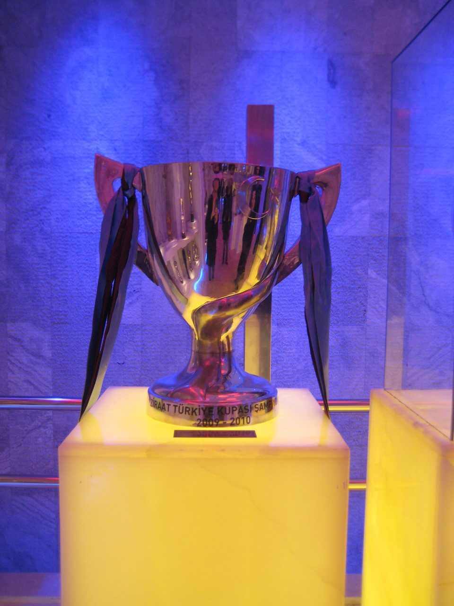
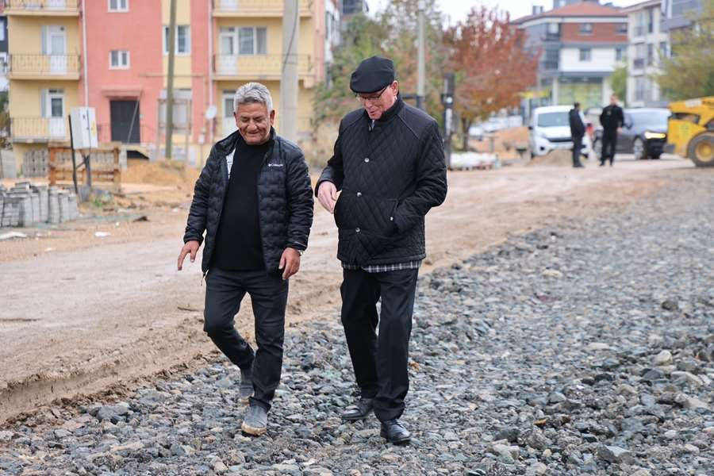
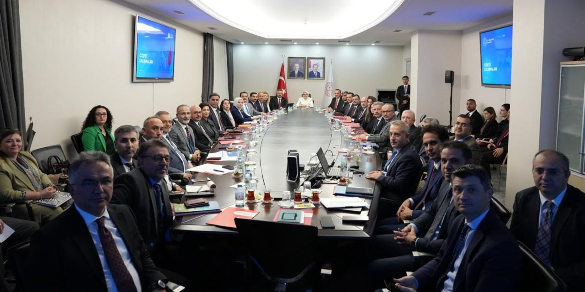
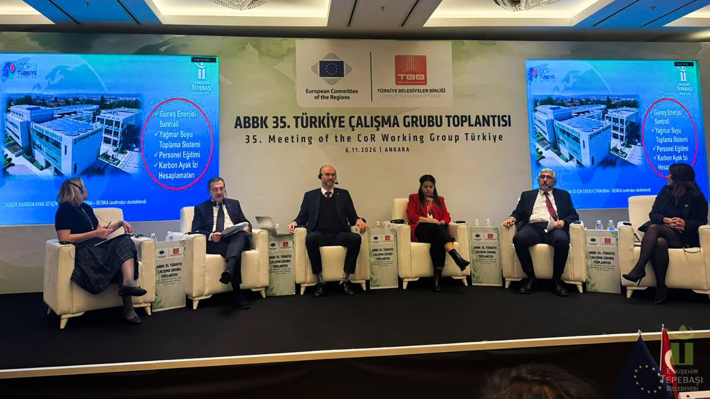
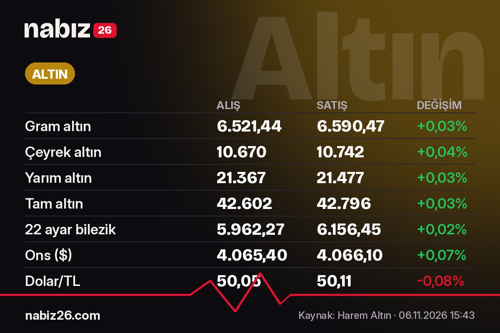
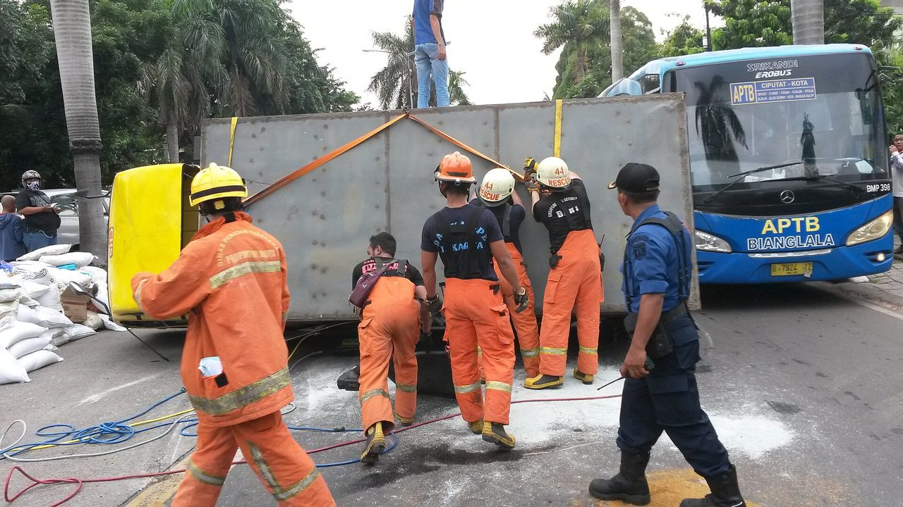
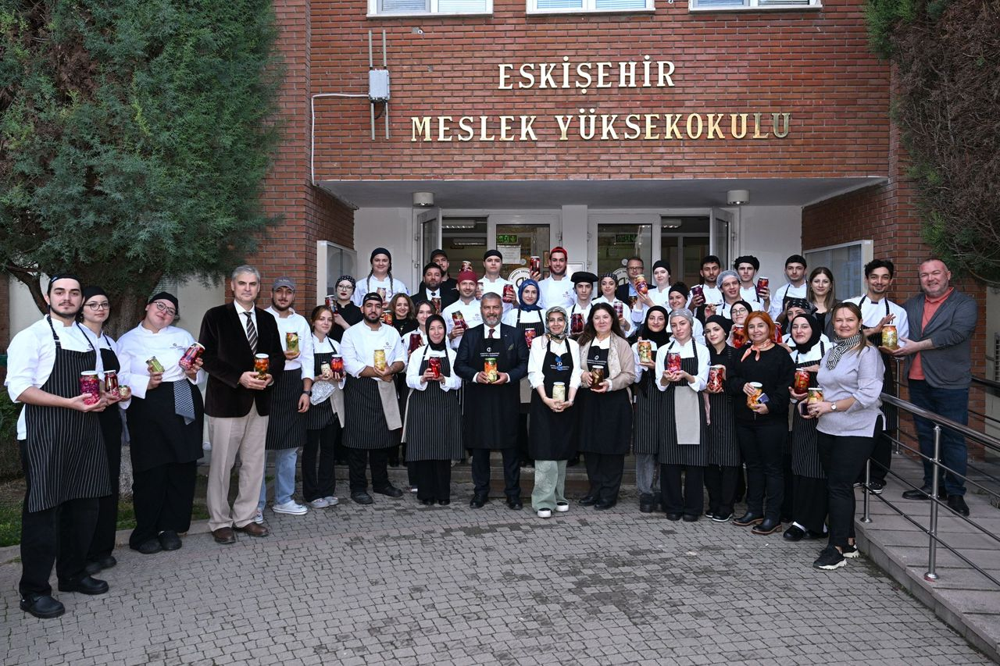

# Son haberler

Ajanın yazdığı son haberler (otomatik güncellenir).

## Ziraat Türkiye Kupası: Eskişehirspor'un rakibi Bodrum FK oldu

**Spor · Merkez** · 2026-11-06 12:59 UTC · Kaynak: [Google Haberler - Eskişehirspor](https://bodrumolay.com/bodrum-fknin-turkiye-kupasindaki-rakibi-eskisehirspor-oldu/)

> Ziraat Türkiye Kupası 4. eleme turu kura çekimi sonucunda Eskişehirspor, Bodrum FK'nın rakibi oldu.

Ziraat Türkiye Kupası 2026-2027 sezonu 4. eleme turu kura çekimi, Türkiye Futbol Federasyonunun Riva’daki Hasan Doğan Millî Takımlar Kamp ve Eğitim Tesisleri’nde yapıldı.

Kulüp temsilcilerinin katılımıyla gerçekleştirilen kura çekimi sonucunda Eskişehirspor, Bodrum FK ile eşleşti. Tek maç eleme usulüne göre oynanacak müsabakada Bodrum FK, Eskişehir temsilcisini sahasında ağırlayacak.

Karşılaşmanın 1, 2 veya 3 Aralık 2026 tarihlerinden birinde oynanması planlanırken, maçın kesin saati ve stadyum bilgisi TFF tarafından ilan edilecek. Normal sürenin berabere bitmesi durumunda uzatmalara, eşitlik bozulmazsa penaltı atışlarına geçilecek.

---

## TÜKDES'ten Sivil Toplum Merkezi'nde sağlıklı yaşam ve otlar söyleşisi

**Sağlık · Odunpazarı** · 2026-11-06 12:59 UTC · Kaynak: [Google Haberler - Eskişehir](https://ankahaber.net/haber/eskisehir-sivil-toplum-destekleme-merkezi-nde-saglikli-yasam-bulusmasi-f1a1e3c6)

> Eskişehir'de TÜKDES tarafından düzenlenen "Yenen Otlar ve Sağlıklı Hayat" söyleşisinde yenilebilir yabani otların beslenmedeki önemi ele alındı.

Eskişehir Büyükşehir Belediyesi Sivil Toplum Destekleme Merkezi, sivil toplum kuruluşlarının etkinliklerine ev sahipliğini sürdürüyor. Bu kapsamda Tüketiciyi Destekleme Derneği (TÜKDES) tarafından merkezde "Yenen Otlar ve Sağlıklı Hayat" başlıklı bir söyleşi gerçekleştirildi.

TÜKDES Danışma Kurulu Üyesi Prof. Dr. Ersin Yücel'in konuşmacı olarak katıldığı etkinlikte, doğada kendiliğinden yetişen şifalı ve yenilebilir yabani otların insan sağlığı üzerindeki etkileri değerlendirildi. Doğru bitki tüketimi, beslenme kültürüne katkıları ve sağlıklı yaşam alışkanlıklarının günlük hayata nasıl entegre edileceği katılımcılara aktarıldı. Program, soru-cevap bölümüyle tamamlandı.

Öte yandan, yoğun ilgi gören söyleşinin 14 Kasım 2026 Cumartesi günü saat 14.00'te aynı adreste tekrar düzenleneceği bildirildi. Ücretsiz olarak gerçekleştirilecek etkinliğe katılmak veya bilgi almak isteyen vatandaşlar, Arifiye Mahallesi İki Eylül Caddesi'ndeki merkeze başvurabilecek.

---

## Odunpazarı'ndan 71 Evler'de 26 sokakta kapsamlı yol ve kaldırım mesaisi

**Belediye · Odunpazarı** · 2026-11-06 12:59 UTC · Kaynak: [Odunpazarı Belediyesi](https://www.odunpazari.bel.tr/guncel/haberler/genel-haberler/odunpazari-belediyesi-nden-71-evler-de-kapsamli-yol-calismasi)

> Odunpazarı Belediyesi, 71 Evler Mahallesi'nde 26 sokakta 33 bin 600 metrekarelik yol ve 7 bin 300 metrekarelik tretuvar düzenleme çalışmalarını sürdürüyor.

Odunpazarı Belediyesi Fen İşleri Müdürlüğü ekipleri, ilçe genelindeki altyapı ve ulaşım yatırımlarını sürdürüyor. Çalışmalar kapsamında 71 Evler Mahallesi'nde yer alan 26 sokakta yol bakım, onarım, asfalt serimi ve kaldırım düzenleme işlemleri hız kazandı. Mahallede toplam 33 bin 600 metrekarelik yol alanı ile 7 bin 300 metrekarelik tretuvar alanı yenileniyor.

Odunpazarı Belediye Başkanı Kazım Kurt, mahalleyi ziyaret ederek devam eden çalışmaları yerinde inceledi ve ekiplerden bilgi aldı. Mahalle sakinlerinin daha konforlu ve güvenli koşullarda ulaşım sağlamasını hedeflediklerini belirten Başkan Kurt, ihtiyaçları yakından takip ettiklerini vurguladı.

Başkan Kurt incelemelerin ardından yaptığı değerlendirmede, "71 Evler Mahallemizde devam eden yol çalışmalarımızı yerinde inceledik. Fen İşleri Müdürlüğü ekiplerimiz asfalt serimi, yol bakım ve onarımı ile kaldırım düzenlemelerini sürdürüyor. Mahallelerimizin ihtiyaçlarını biliyoruz. Hemşehrilerimizin daha güvenli ve konforlu yollarda ulaşım sağlaması için çalışmalarımızı titizlikle yürütüyoruz. Emek veren tüm çalışma arkadaşlarıma teşekkür ediyorum" ifadelerini kullandı.

---

## Odunpazarı Belediyesi'nden 71 Evler'de 33 bin metrekarelik yol mesaisi

**Belediye · Odunpazarı** · 2026-11-06 12:59 UTC · Kaynak: [Google Haberler - Odunpazarı](https://www.yozgatgazetesi.com/iha-haberleri/odunpazari-belediyesi-nden-71-evler-de-kapsamli-yol-calismasi-300951.html)

> Odunpazarı Belediyesi, 71 Evler Mahallesi'nde 26 sokakta asfalt serimi, bakım ve kaldırım çalışmalarına devam ediyor.

Odunpazarı Belediyesi Fen İşleri Müdürlüğü ekipleri, ilçe genelindeki altyapı ve ulaşım yatırımlarını sürdürüyor. Bu kapsamda 71 Evler Mahallesi'nde başlatılan kapsamlı çalışmalarla yollar ve kaldırımlar yenileniyor.

Mahalle genelinde toplam 26 sokağı kapsayan projede, 33 bin 600 metrekarelik yol alanı ile 7 bin 300 metrekarelik tretuvar alanında düzenleme yapılıyor. Ekipler bir yandan asfalt serimi gerçekleştirirken, diğer yandan yol bakım ve onarım faaliyetlerini yürütüyor.

Odunpazarı Belediye Başkanı Kazım Kurt, mahalledeki çalışmaları yerinde inceleyerek Fen İşleri Müdürlüğü ekiplerinden bilgi aldı. Vatandaşların daha güvenli ve konforlu bir ulaşım sağlamasını amaçladıklarını belirten Başkan Kurt, mahallelerin ihtiyaçlarını yakından takip ettiklerini ifade etti.

Çalışmaların titizlikle devam ettiğini kaydeden Başkan Kurt, emek veren tüm personele teşekkür etti.

---

## MEB'de COP31 hazırlıkları: Türkiye İklim Okulu masaya yatırıldı

**Eğitim · Türkiye** · 2026-11-06 12:59 UTC · Kaynak: [Milli Eğitim Bakanlığı](https://www.meb.gov.tr/milli-egitim-bakanliginda-cop31-oncesi-son-hazirliklar-degerlendirildi/haber/42423/tr)

> Millî Eğitim Bakanlığında düzenlenen toplantıda, Antalya'da yapılacak COP31 konferansı kapsamında Türkiye İklim Okulu'nda gerçekleştirilecek etkinlikler ve hazırlıklar ele alındı.

Millî Eğitim Bakanlığında, Birleşmiş Milletler İklim Değişikliği Çerçeve Sözleşmesi kapsamında Antalya'da düzenlenecek 31. Taraflar Konferansı (COP31) hazırlıkları gözden geçirildi. Bakan Yardımcısı Ökten'in katılımıyla gerçekleştirilen toplantıda, birimlerin sorumluluk alanlarındaki çalışmalar ve etkinlik takvimi değerlendirildi.

Toplantının ana gündem maddelerinden biri, COP31 Yeşil Bölge'de ziyaretçilerini ağırlayacak Türkiye İklim Okulu'nda yapılacak etkinlikler oldu. İklim okuryazarlığı, sıfır atık, yenilenebilir enerji ve çevre dostu teknolojiler gibi başlıklar altında düzenlenecek programlar ile öğrenci projelerinin ziyaretçilerle buluşturulması için yürütülen çalışmalar ele alındı.

Bakanlık birimleri, hazırlık süreçleri ve uluslararası iş birliğiyle gerçekleştirilecek faaliyetler hakkında bilgi verdi. Toplantıda, "Gençlik ve Eğitim" tema alanının uluslararası düzeyde etkili biçimde temsil edilmesi amacıyla koordinasyonun sürdürüleceği vurgulandı.

---

## Başkan Ataç, AB platformunda Tepebaşı'nın iklim modelini anlattı

**Belediye · Tepebaşı** · 2026-11-06 12:59 UTC · Kaynak: [Tepebaşı Belediyesi](https://www.tepebasi.bel.tr/Haber/Detay/baskanatactepebası’nıniklimmodeliniavrupabirligiplatformundaanlattı)

> Tepebaşı Belediye Başkanı Ahmet Ataç, Ankara'daki AB Bölgeler Komitesi toplantısında ilçenin iklim projelerini paylaştı, COP31 öncesi yerel yönetimler için doğrudan finansman çağrısı yaptı.

Avrupa Birliği Bölgeler Komitesi (CoR) Türkiye Çalışma Grubu'nun 35. toplantısı Ankara'da gerçekleştirildi. Toplantıya katılan Tepebaşı Belediye Başkanı Ahmet Ataç, Tepebaşı'nın iklim alanındaki uygulamalarını aktararak COP31 öncesinde yerel yönetimlerin karar süreçlerine katılması ve finansmana doğrudan erişmesi gerektiğini vurguladı.

Toplantıda konuşan Başkan Ataç, küresel iklim hedeflerinin kentlerde enerji verimliliği, su tasarrufu ve temiz ulaşım yatırımlarıyla hayata geçirildiğini belirtti. Tepebaşı Belediyesi'nin 2013 yılında Başkanlar Sözleşmesi'ne taraf olduğunu ve çalışmaların Sürdürülebilir Enerji ve İklim Eylem Planı (SECAP) ile yürütüldüğünü ifade eden Ataç, 2030'a kadar sera gazı emisyonlarının yüzde 40 oranında azaltılmasının hedeflendiğini kaydetti. Belediye hizmet binası ve Mustafa Kemal Atatürk Su Sporları Merkezi'ndeki güneş enerjisi ve su verimliliği uygulamalarıyla önemli tasarruflar sağlandığını dile getirdi.

Ufuk 2020 Programı kapsamındaki REMOURBAN projesine de değinen Ataç, Melih Savaş Yaşam Köyü'nde enerji verimliliği, yenilenebilir enerji ve sürdürülebilir ulaşım uygulamalarının bir araya getirildiğini belirtti. Projede enerji tasarrufunun yüzde 53'e, karbon emisyonlarındaki azalmanın ise yüzde 63'e ulaştığını aktaran Ataç, yatırımların Alzheimer Konukevi ve sosyal hizmetlerle bütünleştirildiğini ifade etti.

Konuşmasında iklim finansmanında başvuru süreçlerinin kolaylaştırılması ve teknik desteğin artırılması gerektiğine dikkat çeken Başkan Ataç, "COP31'den beklentimiz; yerel yönetimlerin finansmana doğrudan erişmesi, kararlara katılması ve başarılı uygulamaların yaygınlaşmasıdır. Tepebaşı olarak yeni iş birliklerine hazırız" dedi.

---

## Ataç: Yerel yönetimler iklim kararlarına katılmalı ve finansmana erişmeli

**Belediye · Tepebaşı** · 2026-11-06 12:59 UTC · Kaynak: [Google Haberler - Tepebaşı](https://ankahaber.net/haber/tepebasi-belediye-baskani-atac-kentin-iklim-modelini-avrupa-birligi-platformunda-anlatti-5d179552)

> Tepebaşı Belediye Başkanı Ahmet Ataç, AB Bölgeler Komitesi toplantısında kentin iklim modelini anlatarak, COP31 öncesi yerel yönetimlerin güçlendirilmesi ve doğrudan finansman desteği alması gerektiğini vurguladı.

Tepebaşı Belediye Başkanı Ahmet Ataç, Avrupa Birliği Bölgeler Komitesi (CoR) Türkiye Çalışma Grubu'nun Ankara'da düzenlenen 35'inci toplantısına katıldı. Toplantıda kentin iklim alanındaki uygulamalarını paylaşan Ataç, COP31 hazırlık sürecinde yerel yönetimlerin karar süreçlerinde etkin rol almasının ve finansmana doğrudan erişmesinin şart olduğuna dikkat çekti.

Konuşmasında Tepebaşı Belediyesi'nin yürüttüğü projelere değinen Başkan Ataç, 2013 yılında Başkanlar Sözleşmesi'ne taraf olduklarını ve Sürdürülebilir Enerji ve İklim Eylem Planı (SECAP) kapsamında 2030'a kadar sera gazı emisyonlarını yüzde 40 oranında azaltmayı hedeflediklerini belirtti. Belediye hizmet binasında ve Mustafa Kemal Atatürk Su Sporları Merkezi'nde güneş enerjisi ile yağmur suyu toplama sistemleri kullanıldığını aktaran Ataç, su verimliliği uygulamalarıyla önemli tasarruflar elde edildiğini kaydetti.

AB Ufuk 2020 Programı kapsamındaki REMOURBAN projesinin Melih Savaş Yaşam Köyü'nde hayata geçirildiğini hatırlatan Ataç; projede enerji tasarrufunun yüzde 53'e, karbon emisyonlarındaki azalmanın ise yüzde 63'e ulaştığını ifade etti. İklim yatırımlarının Alzheimer Konukevi, Engelliler Montaj Atölyesi ve belde evleri gibi sosyal hizmetlerle bütünleştirildiğini belirten Ataç, yerel yönetimlerin uygun eş finansman olanaklarıyla desteklenmesi gerektiğini yineledi.

---

## Altın fiyatları 6 Kasım 2026: Gram altın 6.590,47 TL

**Ekonomi · Merkez** · 2026-11-06 12:43 UTC · Kaynak: [Harem Altın](https://www.haremaltin.com/altin-fiyatlari)

> Gram altın güne yatay seyirle başladı. Harem Altın verilerine göre gram altın 6.521,44 TL'den alınıyor, 6.590,47 TL'den satılıyor.

Altın piyasasında güne yatay seyirle başlandı. Harem Altın'ın saat 15.43 itibarıyla verilerine göre gram altının satış fiyatı 6.590,47 TL, alış fiyatı 6.521,44 TL oldu. Gram altın, önceki kapanışa göre yüzde 0,03 yatay seyretti.

Ziynet altınlarda çeyrek altın 10.742 TL, yarım altın 21.477 TL, tam altın 42.796 TL, ata altın 43.939 TL seviyesinden satışa sunuluyor.

22 ayar bileziğin gram satış fiyatı 6.156,45 TL, has altının gram fiyatı 6.570,69 TL olarak belirlendi.

Uluslararası piyasalarda altının onsu 4.066,10 dolardan işlem görürken, dolar/TL 50,11 seviyesinde bulunuyor.

Fiyatlar Harem Altın'ın saat 15.43 itibarıyla paylaştığı verilere dayanmaktadır; kuyumcular arasında farklılık gösterebilir. Bu haber yatırım tavsiyesi değildir.

---

## GSB burs ve öğrenim kredisi sonuçları açıklandı: Son tarih 11 Kasım

**Eğitim · Türkiye** · 2026-11-06 08:49 UTC · Kaynak: [Google Haberler - Bakanlıklar](https://gazetekalem.com.tr/genclik-ve-spor-bakanligi-burs-ve-ogrenim-kredisi-basvuru-sonuclarini-acikladi/)

> Gençlik ve Spor Bakanlığı burs ve öğrenim kredisi başvuru sonuçları duyuruldu. Öğrencilerin taahhütnamelerini e-Devlet üzerinden onaylaması gerekiyor.

Gençlik ve Spor Bakanlığı (GSB) tarafından yürütülen burs ve öğrenim kredisi başvuru sonuçları ilan edildi.

Gençlik ve Spor Bakanı Osman Aşkın Bak, sosyal medya hesabı üzerinden yaptığı açıklamada sonuçların açıklandığını belirterek öğrencilere başarı dileklerini iletti.

Bakan Bak, başvuru sonucu hak kazanan öğrencilerin 11 Kasım saat 23.59’a kadar e-Devlet üzerinden taahhütnamelerini onaylamaları gerektiğini vurguladı.

---

## ESTÜ mensupları "Ortak Gelecekte Biriz" kampanyasında yer aldı

**Eğitim · Tepebaşı** · 2026-11-06 08:49 UTC · Kaynak: [Eskişehir Teknik Üniversitesi](https://www.eskisehir.edu.tr/tr/Haber/Detay/eskisehir-teknik-universitesi-mensuplari-ortak-gelecekte-biriz-iletisim-kampanyasi-lansmanina-katildi)

> Cumhurbaşkanlığı İletişim Başkanlığı'nın düzenlediği "Ortak Gelecekte Biriz İletişim Kampanyası" lansmanına Eskişehir Teknik Üniversitesi de katıldı.

Cumhurbaşkanlığı İletişim Başkanlığı tarafından hayata geçirilen "Ortak Gelecekte Biriz İletişim Kampanyası"nın lansman programı gerçekleştirildi. Düzenlenen programa Eskişehir Teknik Üniversitesi (ESTÜ) mensupları da katılım sağladı.

5 Kasım 2026 tarihinde yapılan programa, ESTÜ Bilişim Teknolojileri Meslek Yüksekokulu öğretim elemanı Öğr. Gör. Dr. Gökben Karaağaç ile Kurumsal İletişim Koordinatörlüğünden İhsan Tarık Çelik katıldı. Türkiye Büyük Millet Meclisi Başkanı Numan Kurtulmuş ve Cumhurbaşkanlığı İletişim Başkanı Burhanettin Duran'ın da iştirak ettiği programda, toplumsal dayanışmanın güçlendirilmesi, ortak gelecek bilincinin pekiştirilmesi ve kesimler arası diyalog konuları ele alındı.

Lansmanda, kampanyanın temel amaçları ile önümüzdeki dönemde hayata geçirilmesi planlanan faaliyetler hakkında katılımcılara ayrıntılı bilgi verildi.

---

## Eskişehirsporlu eski futbolcular seçimli genel kurula gidiyor

**Spor · Tepebaşı** · 2026-11-06 08:49 UTC · Kaynak: [Google Haberler - Eskişehirspor](https://www.gzt26.com/eskisehirsporlu-eski-futbolcular-secimli-genel-kurula-gidiyor)

> Eskişehirsporlu Profesyonel Futbolcular Dayanışma Derneği, seçimli genel kurulunu 19 Kasım'da gerçekleştirecek.

Eskişehirspor'da geçmiş yıllarda forma giymiş profesyonel futbolcuları bir araya getiren Eskişehirsporlu Profesyonel Futbolcular Dayanışma Derneği, seçimli genel kurul hazırlıklarını sürdürüyor. Dernek yönetim kurulu tarafından yapılan açıklamaya göre, genel kurul 19 Kasım 2026 Perşembe günü saat 18.30'da Tepebaşı Belediyesi Özdilek Sanat Merkezi'nde yapılacak.

İlk toplantıda çoğunluğun sağlanamaması durumunda ikinci buluşma 26 Kasım 2026 Perşembe günü aynı yer ve saatte gerçekleştirilecek. Dernek yönetimi, yapılacak seçimlerin üyeler arasındaki dayanışmayı güçlendirmesini ve kulübün tarihine sahip çıkılmasını hedefliyor.

Yönetim kurulundan yapılan açıklamada, Eskişehirspor'un kentin ortak değeri olduğuna dikkat çekilerek, tüm üyeler genel kurula davet edildi.

---

## Eskişehir'de hafta sonu kültür-sanat maratonu: Konser ve tiyatrolar

**Kültür-Sanat · Merkez** · 2026-11-06 08:49 UTC · Kaynak: [Google Haberler - Eskişehir etkinlik](https://www.dogayidinle.com/etkinlikler/eskisehir-6-8-kasim-konserleri-emre-aydin-ceren-gundogdu-no-land-ve-ertelenen-konser/9877)

> Eskişehir'de 6-8 Kasım tarihlerinde Emre Aydın, Ceren Gündoğdu ve No Land konserlerinin yanı sıra çok sayıda tiyatro oyunu sanatseverlerle buluşacak.

Eskişehir, kasım ayının ilk hafta sonunda konserler, tiyatro oyunları ve geleneksel etkinliklerle hareketli bir döneme giriyor. Kent genelindeki farklı sahnelerde müzik ve tiyatro buluşmaları izleyicilere yoğun bir program sunuyor.

Türk rock müziğinin sevilen isimlerinden Emre Aydın, cuma akşamı Milyon Performance Hall'da sahne alırken, Ceren Gündoğdu Runa Stage Art Cafe'de akustik performansıyla dinleyici karşısına çıkacak. Pazar günü ise No Land, F/Stop Salon'da müzikseverlerle buluşacak. Hafta sonu takviminde ayrıca Turgut Özakman'ın "Kanaviçe" oyunu ile "Mi Rosa Sonradan Arabesk Olan Müzikal" gibi yapımlar da sahnelenecek.

Öte yandan, 7 Kasım'da Milyon Performance Hall'da yapılması planlanan Manuş Baba konseri ertelendi. Etkinliklere katılmak isteyenler bilet satış platformları üzerinden güncel programları takip edebilecek.

---

## Özgür Özel'den Ecevit'in kabrinde anma ve hukuk eleştirisi

**Siyaset · Türkiye** · 2026-11-05 19:24 UTC · Kaynak: [Google Haberler - CHP](https://www.dha.com.tr/politika/ozgur-ozel-bulent-ecevitin-kabrini-ziyaret-etti-2975595)

> Yeni Parti Genel Başkanı Özgür Özel, vefatının 20'nci yıl dönümünde Bülent Ecevit'in kabrini ziyaret ederek anma törenine katıldı. Ziyaretin ardından açıklamalarda bulunan Özel, fon soruşturması ve hukuk sistemine ilişkin değerlendirmeler yaptı.

Yeni Parti Genel Başkanı Özgür Özel, vefatının 20'nci yıl dönümünde eski Başbakan Bülent Ecevit'in Devlet Mezarlığı'ndaki kabrini ziyaret etti. Töhrene Genel Sekreter Yunus Emre, Grup Başkanvekili Murat Emir, Kadın Kolları Genel Başkanı Asu Kaya, Gençlik Kolları Genel Başkanı Cem Aydın, Genel Başkan Yardımcısı Utku Çakırözer, milletvekilleri, Mamak Belediye Başkanı Veli Gündüz Şahin, eski CHP Genel Sekreteri Önder Sav ve partililer katıldı. Kur'an-ı Kerim tilaveti okunup dua edilmesinin ardından kabre çelenk ve karanfiller bırakıldı. Heyet daha sonra eski TBMM Başkanı Deniz Baykal’ın kabrini de ziyaret etti.

Törenin ardından basına açıklamalarda bulunan Özgür Özel, Ecevit'in siyasi kariyerine ve emekçi dostu kimliğine vurgu yaparak, "Genel Sekreterimizi, Bakanımızı, Başbakanımızı, Genel Başkanımızı bir kez daha rahmetle ve minnetle anıyorum" ifadelerini kullandı. 

Açıklamasında fon soruşturmasına da değinen Özel, hukuk sisteminde çifte standart uygulandığını öne sürdü. Fatma Betül Sayan Kaya'nın ifadeye davet usulüyle çağrılmasını eleştiren Özel, "Eğer bu ülkede hukuk varsa herkese eşit işlemeli. Böyle bir ikili hukuk sisteminin ne kadar haksızca olduğunu, ne kadar partizanlık yapıldığını milletimizin vicdanlarına havale ediyorum" dedi.

Adalet Bakanı Akın Gürlek’in fon soruşturmasına yönelik açıklamalarının Cumhurbaşkanı Recep Tayyip Erdoğan'a sorulması gerektiğini belirten Özel, soruşturmadaki örgüt tanımlaması üzerinden iktidara eleştiriler yöneltti. Özel ayrıca ABD'deki ara seçim sonuçlarına ilişkin değerlendirmelerde de bulundu.

---

## Kaymakam Şahin’den Ahmet Sezer Ortaokulu’na ziyaret

**Eğitim · Odunpazarı** · 2026-11-05 19:24 UTC · Kaynak: [Google Haberler - Odunpazarı](https://www.haberes.com.tr/odunpazari-kaymakami-sahinden-ahmet-sezer-ortaokuluna-ziyaret)

> Odunpazarı Kaymakamı Ahmet Hikmet Şahin ve İlçe Millî Eğitim Müdürü Barış Hancı, Ahmet Sezer Ortaokulu’nu ziyaret ederek eğitim faaliyetlerini inceledi.

Odunpazarı Kaymakamı Ahmet Hikmet Şahin ile İlçe Millî Eğitim Müdürü Barış Hancı, Ahmet Sezer Ortaokulu'nu ziyaret etti. Ziyaret sırasında okulun genel durumu ve yürütülen eğitim öğretim faaliyetleri yerinde incelendi.

Okul yönetimi ve öğretmenlerle bir araya gelen Kaymakam Şahin ve İlçe Millî Eğitim Müdürü Hancı, eğitim ortamları ile öğrencilerin akademik, sosyal ve kültürel gelişimlerini desteklemeye yönelik çalışmalar hakkında bilgi aldı.

---

## Eskişehirspor'da sakatlıkları süren oyuncuların durumu netleşiyor

**Spor · Merkez** · 2026-11-05 19:24 UTC · Kaynak: [Google Haberler - Eskişehirspor](https://www.istikbalgazetesi.com/hasan-antrenmanda-kerem-ve-bagli-tedavide)

> Kırmızı-siyahlı ekipte Ahmet Dereli ve Mustafa Eren Damar forma giyemezken, Hasan Kaya takımla çalışmalara başladı.

TFF 3. Lig mücadelesine hazırlanan Eskişehirspor'da zorlu karşılaşma öncesi sakat oyuncuların son durumu netlik kazanıyor. Karşılaşmada favori gösterilen kırmızı-siyahlılar, sürprize izin vermeden galibiyet hedefliyor.

Takımda sportif sakatlıkları bulunan Ahmet Dereli ve Mustafa Eren Damar bu maçta forma giyemeyecek. Tedavileri süren Mehmet Bağlı ile Kerem Baykuş'un durumları ise maç günü yapılacak son kontrollerin ardından kesinleşecek.

Öte yandan sakatlığını atlatan Hasan Kaya'nın takımla birlikte antrenmanlarda yer aldığı bildirildi. Teknik heyet, eksik oyuncuların yerini doldurmak ve maça en iyi şekilde hazırlanmak için çalışmalarını sürdürüyor.

---

## Eskişehir'de işçi servisi devrildi: 18 yaralı

**Asayiş · Sivrihisar** · 2026-11-05 19:24 UTC · Kaynak: [Google Haberler - Eskişehir](https://www.akdenizgercek.com.tr/gundem/eskisehirde-can-pazari-isci-servisi-devrildi-18-yarali/388727)

> Eskişehir-Sivrihisar kara yolunda kontrolden çıkan işçi servisinin devrilmesi sonucu 18 kişi yaralandı.

Eskişehir'den Sivrihisar istikametine seyir halindeki işçi servisi, ilçe merkezine yaklaşık 20 kilometre kala sürücüsünün direksiyon hakimiyetini yitirmesiyle kontrolden çıktı. Savrulan araç devrilirken, içerideki 18 yolcu yaralandı.

Çevredeki sürücülerin ihbarı üzerine kaza mahalline çok sayıda sağlık, jandarma ve polis ekibi yönlendirildi. Sağlık personeli, yaralılara ilk müdahaleyi olay yerinde gerçekleştirdi.

İlk müdahalelerinin ardından ambulanslarla bölgedeki hastanelere sevk edilen yaralıların tedavisine başlandı. Güvenlik güçleri kazayla ilgili soruşturma başlattı.

---

## Vali Yılmaz ve heyeti, Görgün ile Eskişehir’in sanayi potansiyelini görüştü

**Ekonomi · Merkez** · 2026-11-05 19:03 UTC · Kaynak: [Google Haberler - Eskişehir gündem](https://www.urfadabugun.com/haber/267823/gorgun-eskisehirin-sanayi-ve-teknoloji-potansiyelini-degerlendirdi.html)

> Savunma Sanayii Başkanlığındaki buluşmada kentin sanayi, teknoloji ve savunma alanlarındaki birikimi ele alındı.

Savunma Sanayii Başkanı Prof. Dr. Haluk Görgün, Eskişehir Valisi Erdinç Yılmaz ve beraberindeki heyetle başkanlıkta bir araya geldi. Görüşmenin gündemini Eskişehir’in sanayi, teknoloji ve savunma sanayisindeki imkânları oluşturdu.

Görgün, kentin üniversiteleri, sanayi altyapısı ve teknoloji firmalarının taşıdığı birikime dikkat çekti. Üretim, mühendislik ve akademik çalışmaların yeni proje ve iş birlikleriyle destekleneceğini ifade etti.

Görgün, görüşmenin ardından Vali Yılmaz ile heyete ziyaretleri için teşekkür etti.

---

## Togg T10X ve T10F için 300 bin liralık krediye 10 ay faizsiz ödeme seçeneği

**Ekonomi · Türkiye** · 2026-11-05 19:03 UTC · Kaynak: [Google Haberler - Togg](https://www.teknolojioku.com/otomobil/toggdan-yeni-kampanya-30-bin-lira-taksitle-satiliyor-6aecd0d600b9958ea604d5e1)

> Sınırlı sayıdaki araç için duyurulan kampanyada, T10X V2 ve T10F V2’de 300 bin liralık kredi aylık 30 bin lira taksitle sunuluyor.

Togg’un T10X V2 ve T10F V2 modellerine yönelik finansman kampanyasında, 300 bin liralık kredi için 10 ay vade ve yüzde 0 faiz seçeneği bulunuyor. Bu seçenekte aylık taksit tutarı 30 bin lira olarak belirtiliyor.

Teknolojioku’nun aktardığı kampanya, sınırlı sayıdaki araçları kapsıyor. T10X ve T10F’nin 4More sürümleri için de 1,5 milyon lira krediye 10 ay vade, yüzde 0 faiz ve aylık 150 bin lira taksit seçeneği duyuruluyor.

---

## Erdoğan, 8 Kasım’da Azerbaycan’ı ziyaret etmeyi planladığını açıkladı

**Siyaset · Türkiye** · 2026-11-05 19:03 UTC · Kaynak: [Google Haberler - Cumhurbaşkanı](https://www.agos.com.tr/tr/haber/erdogan-azerbaycan-i-ziyaret-edecek-42414)

> Cumhurbaşkanı Erdoğan, olağanüstü bir durum yaşanmaması halinde Zafer Günü için Azerbaycan’a gideceğini söyledi.

Cumhurbaşkanı Recep Tayyip Erdoğan, 8 Kasım’da Azerbaycan’a ziyaret planladığını açıkladı. Güney Kore dönüşünde gazetecilerin sorularını yanıtlayan Erdoğan, olağanüstü bir gelişme olmaması durumunda Zafer Günü dolayısıyla bu ülkeye gideceğini belirtti.

Erdoğan, Azerbaycan Cumhurbaşkanı İlham Aliyev ile telefonla görüştüğünü, dışişleri bakanı ve istihbarat başkanını da Azerbaycan’a gönderdiğini aktardı. Ziyaretin temasları ilerletmek için bir fırsat olacağını ifade etti.

İki ülke arasındaki ilişkiler hakkındaki soruya da yanıt veren Erdoğan, ortak tarih ve kültüre vurgu yaparak Türkiye ile Azerbaycan arasındaki bağların diplomatik ilişkilerin ötesinde olduğunu söyledi.

---

## Eğitim Gücü Sen, eğitim çalışanlarının taleplerini Kılıçdaroğlu’na iletti

**Siyaset · Türkiye** · 2026-11-05 19:03 UTC · Kaynak: [Google Haberler - CHP](https://ankahaber.net/haber/egitim-gucu-sen-den-kilicdaroglu-na-ziyaret-0cf1bcc8)

> Sendika heyeti, bütçe görüşmelerinde eğitim çalışanlarının sorunlarının gündeme taşınmasını istedi.

Eğitim ve Bilim Gücü Dayanışma Sendikası heyeti, Kemal Kılıçdaroğlu ile görüşerek eğitim çalışanlarının ekonomik koşulları, sosyal ve özlük haklarına ilişkin taleplerini sundu. Sendikadan yapılan açıklamaya göre görüşmede eğitim sistemindeki sorunlar da ele alındı.

Genel Başkan Oğuz Özat ve genel başkan yardımcılarından oluşan heyete Yıldırım Kaya eşlik etti. Heyet, eğitim çalışanlarının taleplerinin TBMM’deki bütçe görüşmelerinde değerlendirilmesini istedi.

Sendika temsilcileri çözüm önerilerini içeren dosyayı Kılıçdaroğlu’na iletti. Ziyarette eğitimin niteliğinin artırılması ve çalışanların sorunlarının çözümü konusunda görüş alışverişinde bulunuldu; sendika adına plaket takdim edildi.

---

## Başkan Ünlüce, Mersin’de Vahap Seçer’i ve belediye yönetimini ziyaret etti

**Belediye · Merkez** · 2026-11-05 19:03 UTC · Kaynak: [Eskişehir Büyükşehir Belediyesi](https://www.eskisehir.bel.tr/icerik-detay.php?icerik_id=13532&cat_icerik=1&menu_id=24)

> Ayşe Ünlüce’nin Mersin programında Tarsus Cezaevi, belediye ve parti il örgütü ziyaretleri yer aldı.

Eskişehir Büyükşehir Belediye Başkanı Ayşe Ünlüce, Mersin’deki temasları kapsamında Türkiye Belediyeler Birliği Başkanı ve Mersin Büyükşehir Belediye Başkanı Vahap Seçer’i Tarsus Cezaevi’nde ziyaret etti. Eskişehir Büyükşehir Belediyesinin açıklamasına göre Ünlüce, Seçer’in özgürlüğüne kavuşması dileğini iletti.

Ünlüce daha sonra Meral Seçer’i evinde ziyaret etti. Burada Adana Büyükşehir Belediye Başkanı Zeydan Karalar ve Ankara Büyükşehir Belediye Başkanı Mansur Yavaş ile de bir araya geldi.

Programda Mersin Büyükşehir Belediyesi Başkan Vekili Gülşah Yıldırım Genç ve belediye çalışanlarıyla da görüşüldü. Ünlüce, Yeni Parti Mersin İl Başkanlığında İl Başkanı Cengiz Gökçel, yöneticiler ve meclis üyeleriyle çalışmalar hakkında fikir alışverişinde bulundu. Bölgede çiftçilerle buluşmak üzere bulunan Sencer Solakoğlu da il başkanlığındaki temaslara katıldı.

---

## Anadolu Üniversitesinde AB haberciliği ve haber doğrulama atölyesi yapıldı

**Eğitim · Merkez** · 2026-11-05 19:03 UTC · Kaynak: [Anadolu Üniversitesi](https://anahaber.anadolu.edu.tr/tr/haber-detay/a82vpgkpzazbebl0j2a4ppx0)

> İHA Brüksel Temsilcisi Mustafa Ulusoy, gazetecilik öğrencilerine uluslararası ajans haberciliğini ve dijital dönüşümü anlattı.

Anadolu Üniversitesi İletişim Bilimleri Fakültesi Gazetecilik Bölümü, Avrupa Birliği ve Türkiye-AB ilişkileri haberciliğine yönelik konferans ve atölye düzenledi. İhlas Haber Ajansı Brüksel Temsilcisi Mustafa Ulusoy, öğrencilerle gazetecilik deneyimlerini paylaştı.

JOIN Projesi kapsamındaki programın moderatörlüğünü Prof. Dr. Alaaddin Faruk Paksoy üstlendi. Ulusoy, Avrupa Birliği kurumlarına erişim, akreditasyon işlemleri ve kaynaklarla iletişimde yaşanan değişimleri anlattı. Dijitalleşmenin gazetecileri daha fazla doğrulama yapmaya yönelttiğini belirtti.

Atölyede uluslararası haber ajanslarının günlük işleyişi, haber önerilerinin hazırlanması ve merkeze iletilmesi üzerinde duruldu. Dezenformasyon, yapay zekâyla üretilen sahte görüntüler ve açık kaynak istihbaratı da ele alındı. Program, öğrencilerin sorularının yanıtlanmasıyla sona erdi.

---

## Hakan Şapcı, Eskişehirspor’da 39 maçta 27 galibiyete ulaştı

**Spor · Merkez** · 2026-11-05 19:02 UTC · Kaynak: [Google Haberler - Eskişehirspor](https://www.istikbalgazetesi.com/sapci-son-10-sezonda-zirvede)

> Şapcı, son 10 sezonda Eskişehirspor’un başında en fazla maça çıkan teknik direktörler sıralamasında ilk sırada yer aldı.

Eskişehirspor Teknik Direktörü Hakan Şapcı, takımın başında çıktığı 39 karşılaşmada 27 galibiyet, 8 beraberlik ve 4 yenilgi aldı. Bu sonuçlarla galibiyet oranı yüzde 69’a ulaşırken siyah-kırmızılı ekip 35 maçta yenilmedi.

İstikbal Gazetesi’nin derlediği verilere göre Şapcı, son 10 sezonda Eskişehirspor’da en fazla karşılaşmada görev yapan teknik direktör oldu. Onu 38 maçla Fuat Çapa, 28 maçla Suat Kaya, 23 maçla Yücel İldiz ve 21 maçla Mustafa Özer izledi.

Son 20 sezonun maç sayısı sıralamasında ise Şapcı beşinci basamakta bulunuyor. Bu listede Rıza Çalımbay 84, Ersun Yanal 75, Ertuğrul Sağlam 68 ve Michael Skibbe 47 karşılaşmayla önünde yer alıyor.

---

## Eskişehir’de proje okulları Fatih Fen Lisesi’nde eğitim süreçlerini görüştü

**Eğitim · Merkez** · 2026-11-05 19:02 UTC · Kaynak: [Google Haberler - Eskişehir etkinlik](https://www.aksiyon.com.tr/proje-okullari-eskisehir-de-bir-araya-geldi-egitim-surecleri-degerlendirildi-388700)

> İl Millî Eğitim Müdürü Sinan Aydın başkanlığındaki toplantıda akademik çalışmaların yanı sıra okul güvenliği ve etkinlik planları değerlendirildi.

Eskişehir’de proje okullarının koordinasyon toplantısı Fatih Fen Lisesi’nin ev sahipliğinde yapıldı. İl Millî Eğitim Müdürü Sinan Aydın’ın başkanlık ettiği buluşmaya birim amirleri ve okul müdürleri katıldı.

Her ay farklı bir okulda gerçekleştirilen toplantının bu ayki gündeminde eğitim faaliyetleri, akademik başarıyı destekleyen uygulamalar ve okulların projeleri yer aldı. Yöneticiler, çalışmaların sonuçlarını ve paylaşılabilecek iyi örnekleri değerlendirdi.

Öğrencilere yönelik yarışma ve gezi planları da görüşüldü. Okul güvenliği, iş sağlığı ve güvenliği ile farkındalık çalışmaları ele alınarak kurumlar arasındaki koordinasyonun güçlendirilmesi konusunda görüş birliğine varıldı.

---

## Anadolu Üniversitesinde öğrenciler turşu kurdu, fermantasyonun bilimini öğrendi

**Eğitim · Merkez** · 2026-11-05 19:02 UTC · Kaynak: [Anadolu Üniversitesi](https://anahaber.anadolu.edu.tr/tr/haber-detay/id6hqo4qjzeujwbd2q209o04)

> EMYO’daki atölyede aşçılık öğrencileri turşu yapımını uygulayarak öğrendi; gastronomi, beslenme ve biyokimya birlikte ele alındı.

Anadolu Üniversitesi Eskişehir Meslek Yüksekokulunda düzenlenen turşu atölyesi, geleneksel mutfak bilgisini bilimsel yaklaşımlarla buluşturdu. Ocak ve Çörek Mutfaklarında yapılan etkinlikte Rektör Prof. Dr. Yusuf Adıgüzel de öğrencilerle turşu hazırladı.

EMYO Müdürü Doç. Dr. Osman Güldemir’in koordinasyonundaki programa Selçuk Üniversitesinden Prof. Dr. Fatma Hümeyra Yerlikaya Aydemir ve Prof. Dr. Nazan Aktaş konuk oldu. Öğrenciler malzeme seçimi ve hazırlama aşamalarının yanı sıra fermantasyonda yaşanan biyokimyasal değişimleri de ele aldı.

Atölyede mevsimlik ürünlerin saklanması, gıda israfının azaltılması ve sürdürülebilir mutfak uygulamaları üzerinde duruldu. Aktaş, turşunun tuz içeriği nedeniyle tüketim miktarına dikkat edilmesi gerektiğini belirtti. Program, soruların yanıtlanması ve konuk akademisyenlere teşekkür belgelerinin verilmesiyle tamamlandı.

---

## Afyon'daki saldırıların şüphelisi Seyitgazi'de yakalandı, 2 jandarma hafif yaralandı

**Asayiş · Merkez** · 2026-11-05 18:32 UTC · Kaynak: [Google Haberler - Eskişehir](https://www.aa.com.tr/tr/gundem/afyonkarahisarda-silahla-8-kisiyi-olduren-1-kisiyi-agir-yaralayan-zanli-eskisehirde-yakalandi/4113099)

> Valilik, failin Eskişehir sınırlarında jandarma ve emniyetin ortak çalışmasıyla yakalandığını açıkladı.

Afyonkarahisar'da silahlı saldırılarda 8 kişinin ölümüne, 1 kişinin ağır yaralanmasına yol açan şüpheli Eskişehir'de yakalandı. Eskişehir Valiliği, saldırıları gerçekleştiren kişinin İl Jandarma Komutanlığı ve İl Emniyet Müdürlüğü ekiplerinin ortak çalışmasıyla "sağ olarak yakalandığını" duyurdu.

Yerel haberlere göre şüpheli, gasp ettiği aracı Seyitgazi'nin Taşlık Mahallesi'nde çamura saplanınca bırakarak yaya kaçmaya devam etti. Jandarma ekipleri şüphelinin Seyitgazi'ye bağlı Kuyucak Mahallesi'ndeki bir maden ocağı yakınlarında olduğunu belirledi. Haberlerde şüphelinin adı Ali Sefa Ö. olarak geçti. Bölgeyi çevreleyen ekiplerin "teslim ol" ihtarına şüphelinin tüfekle ateş ederek karşılık verdiği, çıkan çatışmada 2 jandarma personelinin hafif yaralandığı bildirildi. Şüpheli gözaltına alınarak karakola götürüldü.

Anadolu Ajansı'nın aktardığına göre Afyonkarahisar Cumhuriyet Başsavcılığı soruşturma başlattı ve 1 başsavcıvekili ile 3 cumhuriyet savcısı görevlendirdi. Hayatını kaybedenler arasında Yukarıtandır Ortaokulu'nda görevli iki öğretmen de bulunuyor; İl Milli Eğitim Müdürlüğü başsağlığı diledi.

Şüpheli hakkındaki yargı süreci sürüyor; haber, resmî açıklamalara ve yayımlandığı sıradaki haberlere dayanıyor.

---

## Başkan Kurt çöp tarifesi iddialarına yanıt verdi: Temizlik işlerinde 420 işçi çalışıyor

**Belediye · Odunpazarı** · 2026-11-05 17:32 UTC · Kaynak: [Google Haberler - Odunpazarı](https://www.istikbalgazetesi.com/odunpazari-belediyesi-haksiz-yere-hicbir-seyden-para-almaz)

> Kurt, Tepebaşı ile Odunpazarı hesaplarının aynı yöntemle yapıldığını söyledi.

Odunpazarı Belediye Başkanı Kazım Kurt, kasım ayı meclis toplantısında 2027 Yılı Evsel Katı Atık Tarife Raporu'na ilişkin AK Parti meclis üyelerinin eleştirilerine yanıt verdi. Rapor, AK Parti üyelerinin karşı oyuna rağmen oy çokluğuyla kabul edilmişti.

Kurt, raporun şeffaf olduğunu ve herkesin inceleyebileceğini söyledi. Temizlik işlerinde başka yerde çalışan, işe gelmeden maaş alan kimsenin bulunmadığını belirten Kurt, personelin giriş ve çıkışını kaydeden bir takip sistemleri olduğunu anlattı. Temizlik işlerinde 10 yıl önce 430 küsur işçi çalışırken bugün 420 işçi ve 10 memur bulunduğunu, bu sürede nüfusun 70-80 bin arttığını söyledi.

Kurt, Tepebaşı ve Odunpazarı belediyelerinin bürokratlarının raporu birlikte hazırladığını, iki belediyenin hesabı arasında fark bulunmadığını ve konutlarda yıllık bedelin yaklaşık 970 lira olduğunu belirtti. Artış oranlarına ilişkin istatistik tartışmalarının yoruma açık olduğunu söyledi.

AK Parti Meclis Üyesi Berke Akyel ise toplantıda, Odunpazarı'nın toplam katı atık maliyetindeki artışın Tepebaşı'ndan yüksek olduğunu ve temizlik kadrosunda görünüp başka birimlerde çalıştırılan personelin maaşlarının bedele yansıtılıp yansıtılmadığını sormuştu.

---

## Afyon'daki saldırının firari şüphelisi Seyitgazi'de aranıyor, ekipler dron kullanıyor

**Asayiş · Merkez** · 2026-11-05 17:32 UTC · Kaynak: [Google Haberler - Eskişehir](https://www.eskisehirekspres.net/olu-sayisi-7ye-yukseldi-afyondaki-kanli-olay-sonrasi-eskisehirde-alarma-gecildi)

> Şüphelinin aracını Taşlık yakınlarında bıraktığı bildirildi; Eskişehir-Seyitgazi yolunda güvenlik noktası kuruldu.

Afyonkarahisar'ın İhsaniye ilçesinde 8 kişinin silahlı saldırıda öldüğü olayın firari şüphelisi, Eskişehir'in Seyitgazi ilçesinde aranıyor. Haberlerde şüphelinin aracını Seyitgazi'nin Taşlık Mahallesi yakınlarında bırakıp kırsal alana kaçtığı belirtildi.

Afyonkarahisar Valiliği, silahlı saldırılarda 8 kişinin hayatını kaybettiğini, 1 kişinin ağır yaralandığını açıkladı. Haberlerde olayın İhsaniye'ye bağlı Ayazini ve Kıyır mahallelerinde yaşandığı, üç ayrı araçta cansız bedenlerin bulunduğu, hayatını kaybedenlerden ikisinin öğretmen olduğu aktarıldı. Şüphelinin kırmızı renkli bir hafif ticari aracı gasp ederek kaçtığı, Seyitgazi-Çifteler yolu üzerinde bir otomobili de aldığı iddia edildi.

Eskişehir İl Emniyet Müdürlüğü ekipleri, şüphelinin Eskişehir istikametine yönelebileceği ihtimaline karşı Eskişehir-Seyitgazi karayolunda güvenlik noktası kurdu ve yola araç durdurucu kapan yerleştirdi. Polis ve jandarma ekipleri kırsal alanda termal kameralı dronlarla arama yapıyor; metruk yapılar, tarım arazileri ve ormanlık alanlar tek tek kontrol ediliyor. Kütahya, Eskişehir ve Afyonkarahisar çevresinde geniş çaplı operasyon sürüyor.

Haber, yayımlandığı sıradaki bilgilere dayanıyor; şüpheli hakkında yargı süreci sonuçlanmadı.

---

## Tepebaşı ve Odunpazarı'nda 2027 evsel katı atık tarifesi meclislerden geçti

**Belediye · Tepebaşı** · 2026-11-05 15:32 UTC · Kaynak: [Google Haberler - Tepebaşı](https://www.eskisehirekspres.net/tepebasinda-cop-ucretlerine-zam-2027-tarifesi-belli-oldu)

> Tepebaşı'nda konut başına yıllık 970 TL, Odunpazarı'nda 973,40 TL alınacak.

Tepebaşı ve Odunpazarı belediye meclisleri, 2027 Yılı Evsel Katı Atık Tarife Raporu'nu kasım ayı toplantılarında oy çokluğuyla kabul etti.

Tepebaşı'nda kabul edilen tarifeye göre konutlardan yıllık 970 TL evsel katı atık bedeli alınacak. Aynı tarifede eğitim kurumlarında öğrenci başına yıllık 128 TL 10 kuruş, kamu binalarında personel başına 600 TL, hastane ve yataklı sağlık kuruluşlarında yatak başına 1.400 TL, otel ve pansiyonlarda yatak başına 1.000 TL, restoran ve kafelerde metrekare başına 115 TL 54 kuruş, sanayi kuruluşlarında iş yeri başına 3.600 TL, pazarlarda tezgâh başına 1.750 TL öngörülüyor. Tepebaşı'nda 2025 yılında toplam 142 bin 408 ton çöp oluştuğu meclis verilerinde yer aldı.

Odunpazarı'nda ise konutlardan 2027'de yıllık 973,40 lira evsel katı atık bedeli alınacak. Rapor, AK Parti meclis üyelerinin karşı oyuyla oy çokluğuyla kabul edildi.

AK Parti Odunpazarı Meclis Üyesi Berke Akyel, Tepebaşı'nın toplam katı atık maliyetinin 2026'da 272 milyon liradan 2027'de 365 milyona (yüzde 34), Odunpazarı'nınkinin ise 271 milyon liradan 435 milyona (yüzde 61) çıktığını öne sürdü. Akyel, temizlik kadrosunda görünüp başka birimlerde çalışan personelin maaşlarının bedele yansıtılıp yansıtılmadığını sordu.

Tepebaşı'nda AK Parti Meclis Üyesi Ali Semih Ünlü, başka müdürlüklerde çalışan personelin 19 milyon 542 bin 687 liralık maliyetinin Plan ve Bütçe Komisyonunda yeni tarife hesabından çıkarıldığını söyledi ve önceki yıllarda fazla ücret alınmış olabileceğini gündeme getirdi.

İki belediye yönetiminin bu iddialara yanıtı kaynak metinlerde yer almıyor.

---

## Anadolu Üniversitesi e-Sertifika programı başvuruları 8 Kasım'a uzatıldı

**Eğitim · Tepebaşı** · 2026-11-05 15:31 UTC · Kaynak: [Google Haberler - Eskişehir gündem](https://www.istikbalgazetesi.com/eskisehir-anadolu-universitesinde-e-sertifika-basvurulari-uzatildi-iste-son-basvuru-tarihi)

> Güz dönemi dersleri 9 Kasım'da başlayacak; başvurular sinavbasvuru.anadolu.edu.tr üzerinden yapılıyor.

Anadolu Üniversitesi Sürekli Eğitim Merkezi (ANADOLUSEM) tarafından yürütülen e-Sertifika Programları'na başvurular 8 Kasım 2026'ya kadar uzatıldı. Başvurular sinavbasvuru.anadolu.edu.tr adresi üzerinden yapılabiliyor.

Herkesin başvurusuna açık programlar uzaktan eğitim olarak sunuluyor. Katılımcılar, Anadolum eKampüs Sistemi üzerinden dijital ders materyallerinden yararlanıyor. Sağlıktan iletişime, işletmeden turizme, siyasetten çocuk gelişimine, yabancı dillerden bilişim teknolojilerine kadar geniş bir yelpazede sunulan programlarda bir ila üç arasında ders bulunuyor ve ders kitapları dijital ortamda veriliyor.

2026 Güz Dönemi e-Sertifika Programlarının dersleri 9 Kasım 2026'da başlayacak. Ayrıntılı bilgiler esertifika.anadolu.edu.tr adresinde yer alıyor.

---
