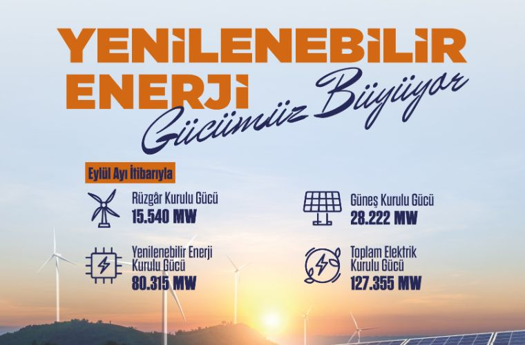
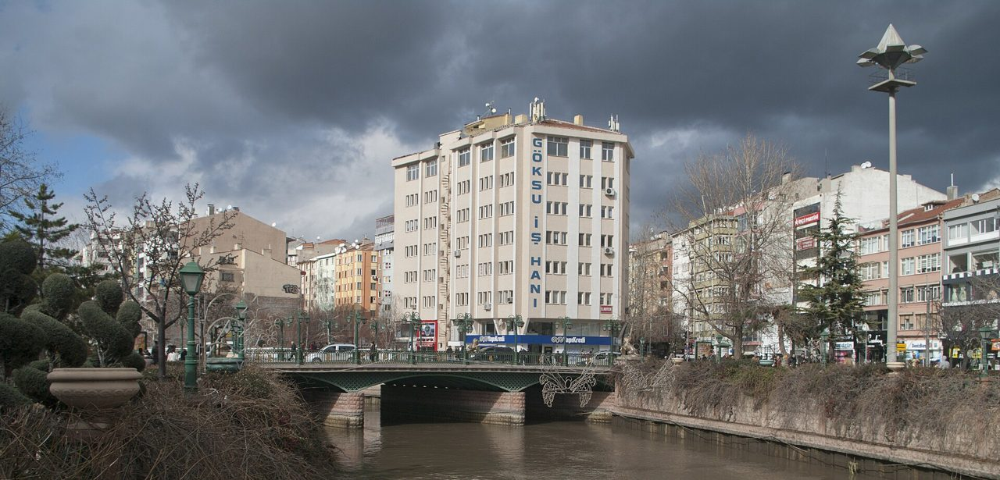
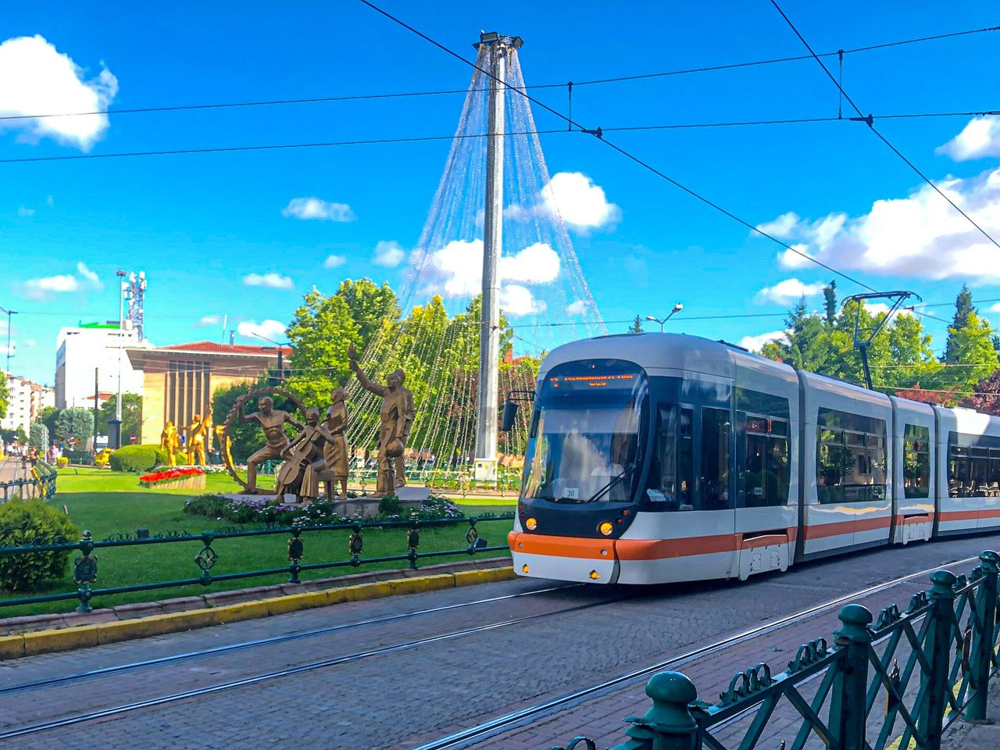
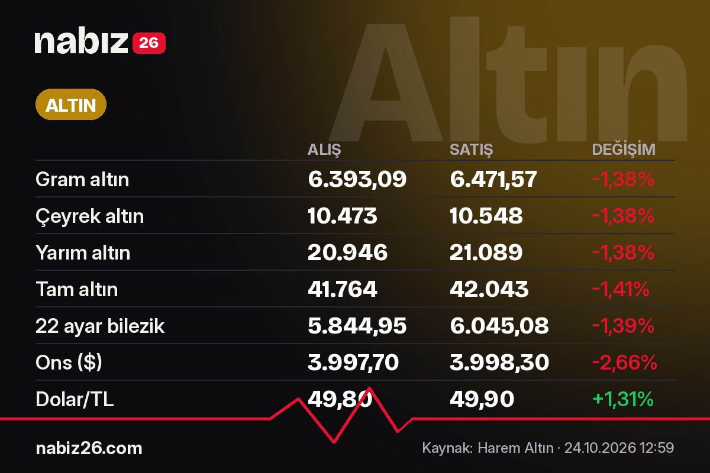
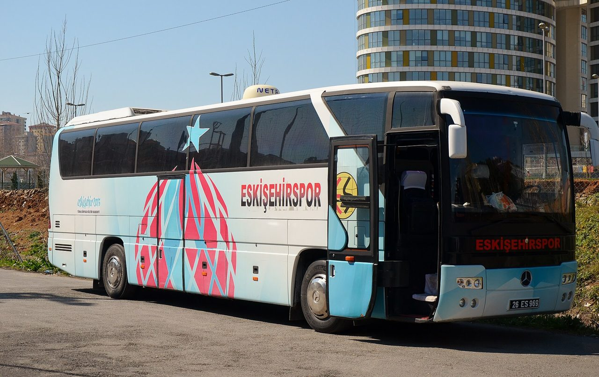
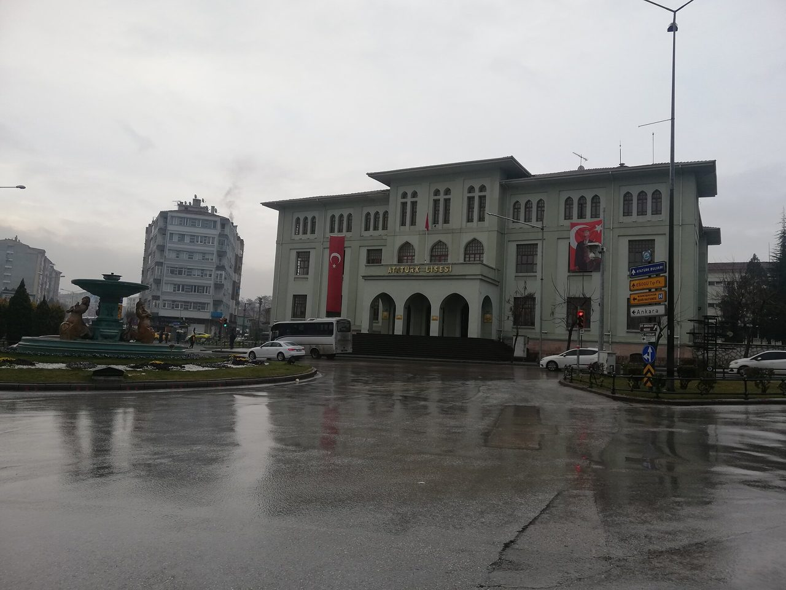
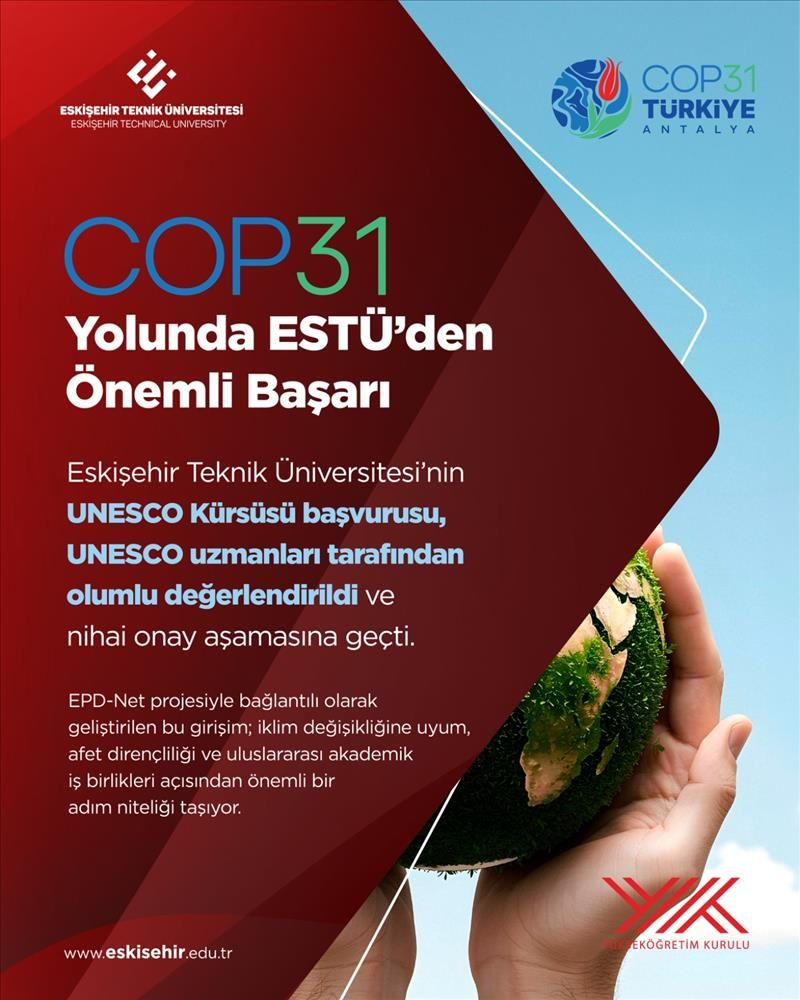

# Son haberler

Ajanın yazdığı son haberler (otomatik güncellenir).

## Türkiye'nin elektrik kurulu gücü Eylül sonunda 127 bin 355 megavata ulaştı

**Ekonomi · Türkiye** · 2026-10-25 10:31 UTC · Kaynak: [Enerji ve Tabii Kaynaklar Bakanlığı](https://enerji.gov.tr/haber-detay?id=31953)

> Yenilenebilir kaynakların payı yüzde 63,1'e çıktı; Bakan Bayraktar yerli kaynakların payını vurguladı.

Türkiye'nin elektrik kurulu gücü, 2026 Eylül ayı sonu itibarıyla 127 bin 355 megavata ulaştı. Yenilenebilir kaynaklı kurulu güç 80 bin 315 megavata çıktı; yenilenebilirin toplam kurulu güç içindeki payı yüzde 63,1, yerli kaynakların payı ise yüzde 72,1 oldu.

Güneş enerjisinin kurulu gücü 28 bin 222 megavata, rüzgâr enerjisinin kurulu gücü 15 bin 540 megavata yükseldi. İki kaynağın toplam kurulu gücü 43 bin 762 megavata, toplam içindeki payı yüzde 34,4'e çıktı.

Eylül'de aylık elektrik üretimi 31,79 milyar kilovatsaat oldu. Üretimin yüzde 26'sına denk gelen 8,27 milyar kilovatsaati hidrolik kaynaklardan elde edildi.

Enerji ve Tabii Kaynaklar Bakanı Alparslan Bayraktar, Eylül'de toplam elektrik üretiminin yüzde 70,3'ünü yerli kaynaklarla karşıladıklarını, böylece dışa bağımlılığı yüzde 30'un altına indirdiklerini söyledi. (Kaynak: Enerji ve Tabii Kaynaklar Bakanlığı)

---

## AİLEM Engelsiz İletişim Merkezi 335 bin 288 çağrıya çeviri desteği sağladı

**Gündem · Türkiye** · 2026-10-25 10:31 UTC · Kaynak: [Aile ve Sosyal Hizmetler Bakanlığı](https://www.aile.gov.tr/haberler/ailem-engelsiz-iletisim-merkezi-335-bin-288-cagriya-ceviri-destegi-sagladi/)

> Bakan Göktaş, merkezin 54 bin 788 kayıtlı kullanıcısı olduğunu ve günde ortalama 250-300 çağrıya destek verildiğini açıkladı.

Aile ve Sosyal Hizmetler Bakanı Mahinur Özdemir Göktaş, işitme engelli bireylerin kamu hizmetlerine, bilgiye ve sosyal hayata erişimini kolaylaştırmak için hizmete sunulan AİLEM Engelsiz İletişim Merkezi aracılığıyla bugüne kadar 335 bin 288 çağrının karşılandığını bildirdi.

Göktaş'a göre merkezin 54 bin 788 kayıtlı kullanıcısı bulunuyor. İşitme engelli bireylerin eğitimden istihdama, sağlık hizmetlerinden bankacılık işlemlerine, aile içi iletişimden kamu kurumlarıyla yürütülen işlemlere kadar hayatın her alanında iletişim kurabilmesi için günlük ortalama 250-300 çağrıya destek sağlanıyor.

Merkeze iOS ve Android mobil uygulamaları ile web üzerinden erişilebiliyor. Göktaş, merkezin işitme engelli danışana, hastaya, veliye veya müşteriye ulaşmak isteyen işiten bireylerin de kullanımına açık olduğunu hatırlattı. (Kaynak: Aile ve Sosyal Hizmetler Bakanlığı)

---

## Altın fiyatları 25 Ekim 2026: Gram altın 6.471,57 TL

**Ekonomi · Merkez** · 2026-10-25 10:24 UTC · Kaynak: [Harem Altın](https://www.haremaltin.com/altin-fiyatlari)

> Gram altın güne düşüşle başladı. Harem Altın verilerine göre gram altın 6.389,88 TL'den alınıyor, 6.471,57 TL'den satılıyor.

Altın piyasasında güne düşüşle başlandı. Harem Altın'ın saat 13.24 itibarıyla verilerine göre gram altının satış fiyatı 6.471,57 TL, alış fiyatı 6.389,88 TL oldu. Gram altın, önceki kapanışa göre yüzde 1,38 geriledi.

Ziynet altınlarda çeyrek altın 10.548 TL, yarım altın 21.089 TL, tam altın 42.043 TL, ata altın 42.798 TL seviyesinden satışa sunuluyor.

22 ayar bileziğin gram satış fiyatı 6.045,08 TL, has altının gram fiyatı 6.452,21 TL olarak belirlendi.

Uluslararası piyasalarda altının onsu 3.998,30 dolardan işlem görürken, dolar/TL 49,90 seviyesinde bulunuyor.

Fiyatlar Harem Altın'ın saat 13.24 itibarıyla paylaştığı verilere dayanmaktadır; kuyumcular arasında farklılık gösterebilir. Bu haber yatırım tavsiyesi değildir.

---

## Başkan Ataç Yeni Mahalle'de tamamlanan asfalt ve kaldırım çalışmalarını inceledi

**Belediye · Tepebaşı** · 2026-10-25 09:31 UTC · Kaynak: [Tepebaşı Belediyesi](https://www.tepebasi.bel.tr/Haber/Detay/yenimahalle’dehizmetevatandaslardantamnot)

> Tepebaşı Belediye Başkanı Ahmet Ataç, mahalle sakinleriyle sohbet etti ve çalışmayı yürüten ekibe baklava ikram etti.

Tepebaşı Belediye Başkanı Dt. Ahmet Ataç, Yeni Mahalle'de Fen İşleri Müdürlüğü ekiplerince yürütülen asfalt ve kaldırım yenileme çalışmalarını yerinde inceledi. Fen İşleri Müdür Vekili Enes Akgün'den çalışmalar hakkında bilgi alan Ataç'a Mahalle Muhtarı Halil Çeltik eşlik etti.

Ataç, mahalle sakinleriyle tek tek sohbet ederek görüş ve taleplerini dinledi. Mahalleliler, tamamlanan asfalt ve kaldırım çalışmalarından memnuniyetlerini dile getirerek Ataç'a ve belediye ekiplerine teşekkür etti. Muhtar Çeltik de mahalleye sunulan hizmetlerden memnun olduğunu belirtti.

Ziyaretin sonunda çalışan asfalt ekibine baklava ikram eden Ataç, "Mahallelerimizin ihtiyaçlarını yerinde görmek, hemşerilerimizin görüşlerini dinlemek bizim için çok önemli. Yeni Mahalle'de asfalt ve kaldırım yenileme çalışmalarımızı tamamladık" dedi. (Kaynak: Tepebaşı Belediyesi)

---

## Bakan Kacır: Togg günde 375 otomobil üretiyor, T6X önümüzdeki yıl satışta

**Türkiye · Türkiye** · 2026-10-25 08:31 UTC · Kaynak: [Google Haberler - Togg](https://www.autobond.tr/haberler/togg-t6x-kacir-gunluk-375-uretim/)

> Sanayi ve Teknoloji Bakanı Mehmet Fatih Kacır, Togg Üretim ve Teknoloji Kampüsü'nü ziyaretinin ardından üretim hızını açıkladı.

Sanayi ve Teknoloji Bakanı Mehmet Fatih Kacır, Togg Üretim ve Teknoloji Kampüsü'nü ziyaret etti. Kacır, Togg T6X ile T10F 4More Kehribar Serisi'ne yönelik çalışmaları incelediklerini belirtti.

Bakan, Togg'un günde 375 otomobil üretim hızına ulaştığını açıkladı. Kacır'a göre tesis, 10 çalışana 1 endüstriyel robot ortalamasıyla otomotiv sektörünün en dijital altyapısına sahip tesisi konumunda.

Açıklamada T6X modelinin önümüzdeki yıl satışa sunulacağı belirtildi. Modelin fiyatı, donanımları, batarya kapasitesi ve menzili ise açıklanmadı.

Kehribar Serisi, çift motorlu ve dört tekerlekten çekişli T10F 4More için hazırlandı ve yedi gövde rengiyle sunuluyor. Kehribar tasarım paketinin fiyatı 100 bin TL olarak açıklandı. (Kaynak: AutoBond)

---

## Şimşek: IMF'ye göre Türkiye mali şeffaflıkta yükseldi

**Ekonomi · Türkiye** · 2026-10-25 05:32 UTC · Kaynak: [Google Haberler - Bakanlıklar](https://www.toplumsal.com.tr/haber/hazine-bakani-simsek-turkiye-nin-mali-seffaflikta-yukseldigini-acikladi_31109/)

> Hazine ve Maliye Bakanı Mehmet Şimşek, IMF'nin Mali Şeffaflık Değerlendirmesi'ni değerlendirdi.

Hazine ve Maliye Bakanı Mehmet Şimşek, IMF'nin Türkiye'ye ilişkin Mali Şeffaflık Değerlendirmesi raporunu değerlendirdi. Şimşek, Türkiye'nin mali şeffaflık derecesinin önemli ölçüde yükseldiğini söyledi.

Bakan'a göre Türkiye, 2015 yılında Mali Şeffaflık Kodu'ndaki ilkelerin yaklaşık yarısında iyi veya ileri uygulama düzeyindeydi; bu oran şimdi üçte ikiye çıktı. Şimşek, bu gelişmeyle Türkiye'nin Birleşik Krallık, Finlandiya, İrlanda, Avusturya ve Portekiz gibi ülkelerin de bulunduğu yaklaşık 40 ülke arasında en üst sıralarda yer aldığını belirtti.

Şimşek, Türkiye'nin mali istatistikler, bütçe yönetimi, mali riskler ve hesap verebilirlik alanlarındaki uygulamalarının IMF tarafından incelendiğini ifade etti. Başarının 20 yılı aşkın süredir süren kurumsal dönüşümün sonucu olduğunu söyleyen Şimşek, mali şeffaflığı artıracak yapısal reform çalışmalarının sürdüğünü vurguladı. (Kaynak: Toplumsal Haber)

---

## ESKİ'nin online su yükleme sistemi 26 Ekim'de başlıyor

**Belediye · Merkez** · 2026-10-25 05:32 UTC · Kaynak: [Google Haberler - Eskişehir](https://www.gazetevatan.com/sehirler/eskisehir/tarih-belli-oldu-eskisehirde-su-yukleme-islemleri-online-gerceklestirilecek-2419789)

> Başkan Ünlüce, ES2026 Yeni Nesil Sayaç ve Online Su Yükleme Sistemi'nin pazartesi günü hayata geçeceğini duyurdu.

Eskişehir Büyükşehir Belediye Başkanı Ayşe Ünlüce, online su yükleme sisteminin 26 Ekim Pazartesi günü hayata geçirileceğini açıkladı.

ESKİ Genel Müdürlüğü'nün kendi mühendislik ve AR-GE birikimiyle geliştirdiği ES2026 Yeni Nesil Sayaç ve Online Su Yükleme Sistemi sayesinde aboneler, su yüklemek için Sumatik noktalarına gitmek zorunda kalmayacak. İşlemler Android ve iOS işletim sistemli telefonlar üzerinden yapılabilecek.

Sistemin resmî tanıtım töreni 26 Ekim Pazartesi günü saat 12.00'de, ESKİ Genel Müdürlüğü Orhangazi Mahallesi Ömür Mevkii İçme Suyu Arıtma Tesisleri'nde yapılacak. Tanıtımda yeni sistemin kullanımı ve dijital altyapıyla planlanan kolaylıklar hakkında bilgi verilecek.

Ünlüce, sosyal medya hesabından yaptığı açıklamada, 2026 Eskişehir Yılı'nda verdikleri bir sözü daha tuttuklarını belirtti ve projede emeği geçen çalışanlara teşekkür etti. (Kaynak: Gazete Vat)

---

## Togg T10F 4More için Kehribar Serisi geldi: Yedi renk seçeneği var

**Türkiye · Türkiye** · 2026-10-25 02:34 UTC · Kaynak: [Google Haberler - Togg](https://m.duzcetv.com/ekonomi-haberleri/262002-togg-t10f-4more-kehribar-serisi-ile-yollara-cikiyor)

> Togg, çift motorlu T10F 4More modelini özel tasarım detaylı Kehribar Serisi ile sunuyor.

Togg, doğadan ilham alan özel serilerine Kehribar ile yenisini ekliyor. Çift motorlu ve dört tekerlekten çekişli T10F 4More, Kehribar Serisi ile kullanıcılarla buluşuyor.

Seri, Ayder, Seyhan, Urla, Kula, Oltu, Gemlik ve Mardin olmak üzere yedi farklı gövde rengiyle sunuluyor. Jantlardan ön panjura, logodan yan aynalara ve cam çerçevelerine kadar tasarımın farklı noktalarında Kehribar detayları kullanılıyor.

İç mekânda Artisyn kumaş ve kabartma desenli detaylara sahip koltuklar ile özel dekoratif yüzeyler yer alıyor. Kehribar, volkanik kökenli obsidiyenin tonlarını yansıtan Obsidiyen Serisi'nin ardından markanın özel serilerine katılıyor. (Kaynak: Düzce TV)

---

## Eskişehir'de kadın çiftçiler için 6 bin metrekarelik kuşburnu bahçesi kuruldu

**Tarım · Merkez** · 2026-10-25 02:34 UTC · Kaynak: [Google Haberler - Odunpazarı](https://www.eskisehir.net/eskisehirde-kadin-ciftciler-icin-6-bin-metrekarelik-bahce-kuruldu)

> İl Tarım ve Orman Müdürlüğü'nün projesiyle altı kadın üreticinin bahçeleri oluşturuldu; çiftçiler Kütahya'ya inceleme gezisi yaptı.

Eskişehir İl Tarım ve Orman Müdürlüğü, kadın çiftçilerin tarımsal bilgi ve becerilerini geliştirmek için Kütahya'ya inceleme gezisi düzenledi. Program, Tarım ve Orman Bakanlığı Eğitim ve Yayın Dairesi Başkanlığı'nın desteğiyle yürütüldü.

"Ege'den Doğan Ay Eskişehir'i Aydınlatıyor" projesiyle kuşburnu üretiminin Eskişehir'in altı ilçesindeki mahallelerde yaygınlaştırılması hedefleniyor. İzmir Ege Tarımsal Araştırma Enstitüsü Müdürlüğü iş birliğindeki proje kapsamında altı kadın üretici için 1.000'er metrekarelik demonstrasyon bahçeleri kuruldu; toplam alan 6.000 metrekareye ulaştı.

Gezide kuşburnu ve ahududu yetiştirilen alanlar ile pazarlama noktaları ziyaret edildi. Kadın çiftçiler S.S. Kütahya Sekiören Kadın Girişimi Üretim ve İşletme Kooperatifi'nde girişimcilik ve kooperatif çalışmaları hakkında bilgi aldı, Hekim Sinan Tıbbi ve Aromatik Merkezi'ni de gezdi.

Üreticiler, bahçelerini geliştirerek kuşburnu yetiştiriciliğini Eskişehir genelinde yaygınlaştırmak istediklerini ifade etti. (Kaynak: Eskişehir Haberleri)

---

## Eskişehirspor Başkanı Entok: Hakan Şapcı görevine devam edecek

**Spor · Merkez** · 2026-10-24 20:34 UTC · Kaynak: [Google Haberler - Eskişehirspor](https://www.gzt26.com/eskisehirsporda-teknik-direktor-hakan-sapci-ile-ilgili-verilen-karar-belli-oldu)

> Bursa Yıldırımspor beraberliğinin ardından tribünlerden istifa çağrıları yapılmıştı.

Eskişehirspor Başkanı Ulaş Entok, Bursa Yıldırımspor ile sahada 2-2 berabere kalınan maçın ardından tribünlerden istifa çağrıları yapılan teknik direktör Hakan Şapcı'nın görevine devam edeceğini söyledi.

Haberlere göre Şapcı maçın ardından bir açıklama yapmadı. Entok'un açıklamasıyla yönetimin teknik direktör değişikliğine gitmeyeceği netleşti.

---

## Kızılinler Bal Kabağı Panayırı 25 Ekim'de, Bal Kabağı Çalıştayı 26 Ekim'de yapılacak

**Kültür-Sanat · Tepebaşı** · 2026-10-24 19:33 UTC · Kaynak: [Google Haberler - Eskişehir etkinlik](https://www.esyenigun.com/bal-kabagi-panayiri-yarin-nerede-ucretsiz-ulasim-nasil-saglanacak)

> Panayıra Tepebaşı Belediyesi Hizmet Binası önünden 11.45'te ücretsiz ulaşım sağlanacak.

Tepebaşı Belediyesi Kırsal Hizmetler Müdürlüğü'nün düzenlediği 4. Kızılinler Bal Kabağı Panayırı 25 Ekim 2026 Pazar günü saat 12.00-16.00 arasında Kızılinler Davet Salonu'nda yapılacak. Panayırda halk oyunları gösterileri, Eko-Şov konseri, sergiler, söyleşiler ve yöresel ürün stantları yer alacak.

Panayıra gitmek isteyenler için Tepebaşı Belediyesi Hizmet Binası önünden saat 11.45'te ücretsiz araç kalkacak; hizmetten yararlanmak için belediyenin belirttiği kayıt formunun doldurulması gerekiyor.

Türkiye'de ilk kez ulusal ölçekte yapılacak Eskişehir Bal Kabağı Çalıştayı ise 26 Ekim'de düzenlenecek. Çalıştayda kabak ıslahı, genetik kaynakların korunması, yetiştiricilik yöntemleri ve coğrafi işaretli bal kabağının kırsal kalkınmaya katkısı ele alınacak.

---

## Eskişehirspor, Bursa Yıldırımspor ile 2-2 berabere kaldı; penaltı direkten döndü

**Spor · Merkez** · 2026-10-24 18:35 UTC · Kaynak: [Google Haberler - Eskişehirspor](https://www.istikbalgazetesi.com/eskisehirspor-bursa-yildirim-macinda-fiyasko-mac-sonucu-2-2)

> Es-Es son dakikalarda iki golle geri döndü; Ahmet Dereli sakatlanınca 10 kişi oynadı.

Eskişehirspor, 3. Lig'de sahasında Bursa Yıldırımspor ile 2-2 berabere kaldı. Konuk ekip 19. dakikada Hakan Öztürk'ün golüyle öne geçti. Eskişehirspor ikinci yarıda baskı kurdu; Beykan Şimşek'in kullandığı penaltı direkten döndü. 78. dakikada sakatlanan Ahmet Dereli oyuna devam edemedi ve oyuncu değişikliği hakkı kalmayan ev sahibi takım son bölümde 10 kişi mücadele etti.

Eskişehirspor 83. dakikada Kerem Baykuş'un golüyle skoru 1-1'e getirdi. Bursa Yıldırımspor 88. dakikada Efe Yüceer'in golüyle yeniden öne geçti, Baykuş 89. dakikada ikinci golünü atarak skoru 2-2 yaptı.

Taraftarının 169 gün sonra takımıyla ligde buluştuğu maçın ardından teknik direktör Hakan Şapcı'ya yönelik istifa çağrıları yapıldığı aktarıldı.

---

## Eskişehirspor, Bursa Yıldırımspor karşısında ilk yarıyı 0-1 geride kapattı

**Spor · Merkez** · 2026-10-24 17:32 UTC · Kaynak: [Google Haberler - Eskişehirspor](https://www.istikbalgazetesi.com/eskisehirspor-bursa-yildirim-macina-kotu-basladi-ilk-yari-sonucu-0-1)

> Maç 22. dakikada stadyumda ışıkların kısmen sönmesi nedeniyle durdu.

Eskişehirspor, 169 gün sonra taraftarı önünde Bursa Yıldırımspor ile oynadığı 3. Lig maçının ilk yarısını 0-1 geride kapattı. Konuk ekip 19. dakikada Hakan Öztürk'ün golüyle öne geçti.

Maça hızlı başlayan ve üst üste kornerlerle gol arayan Eskişehirspor, Abdülkadir'in kafa vuruşunda savunmadan çizgiden çıkan top dışında net pozisyon bulamadı. 45+3'te Hasan Kaya'nın çaprazdan şutunda top savunmadan döndü; Eskişehirspor penaltı beklese de hakem Hatem Yarar oyuna devam dedi. Maçın 22. dakikasında stadyumun bir kısmında ışıklar söndü ve hakem oyunu durdurdu.

Eskişehirspor 11'i: Bora Göymen, Murat Şenel, Ahmet Lütfi Kara, Arda Okumuş, Abdülkadir Öksüz, Ozan İsmail Koç, Mehmet Bağlı, Tayfun Tatlı, Hasan Kaya, Beykan Şimşek, Osman Arslantaş.

---

## Eskişehirspor'un Bursa Yıldırımspor maçı ilk 11'i belli oldu: Şapcı 3 değişiklik yaptı

**Spor · Merkez** · 2026-10-24 16:32 UTC · Kaynak: [Google Haberler - Eskişehirspor](https://www.istikbalgazetesi.com/eskisehirspor-kadrosunda-3-degisiklik-1)

> Mustafa Eren Damar kadroya alınmadı; Kurtuluş ve Baykuş yedek kulübesine çekildi.

Eskişehirspor'un Bursa Yıldırımspor maçı ilk 11'i belli oldu. Kalede Bora, sağ bekte Murat Şener, sol bekte Ahmet Lütfü Kara, savunmanın ortasında Abdülkadir Öksüz ve Arda Okumuş, orta sahada Ozan İsmail Koç, Tayfun Tatlı ve Mehmet Bağlı, kanatlarda Beykan Şimşek ve Hasan Kaya, forvette ise Osman Arslantaş sahaya çıktı.

Teknik direktör Hakan Şapcı, sakatlığı bulunan Mustafa Eren Damar'ı kadroya almadı; son maçtan Ertuğrul Kurtuluş ve Kerem Baykuş'u ise yedek kulübesine çekti.

---

## Eskişehir'de gazeteciler "Sansüre Hayır, Habere Özgürlük" yürüyüşü yaptı

**Gündem · Merkez** · 2026-10-24 15:32 UTC · Kaynak: [Google Haberler - Eskişehir](https://www.cumhuriyet.com.tr/turkiye/eskisehir-de-sansure-hayir-habere-ozgurluk-yuruyusu-duzenlendi-bu-duzene-sessiz-kalmayacagiz-2549879)

> ÇGD, TGS ve EGC şubelerinin çağrısıyla Köprübaşı'ndan Yediler Parkı'na yürüdüler.

Gazetecilere yönelik gözaltı ve tutuklamalara, medya kuruluşlarına kayyum atamalarına ve haber sitelerine getirilen erişim engellerine karşı basın meslek örgütlerinin ortak çağrısıyla Eskişehir'de "Sansüre Hayır, Habere Özgürlük" yürüyüşü yapıldı. Katılımcılar Köprübaşı'ndan Hamamyolu Yediler Parkı'na yürüdü. Yürüyüşe YENİ Parti Eskişehir Milletvekili İbrahim Arslan ile Odunpazarı Belediye Başkanı Kazım Kurt destek verdi.

Çağdaş Gazeteciler Derneği (ÇGD), Türkiye Gazeteciler Sendikası (TGS) ve Eskişehir Gazeteciler Cemiyeti (EGC) Eskişehir şubeleri adına basın metnini okuyan ÇGD Eskişehir Şubesi Yönetim Kurulu Üyesi Eylem Lodos, "Gazeteciliğin suç, haberin tehdit, gerçeğin sakıncalı sayıldığı bu düzene sessiz kalmayacağız" dedi. Lodos, basın örgütlerinin tek taleplerinin mesleği özgürce yapmak olduğunu ve basın özgürlüğünün yalnızca gazetecilerin değil toplumun tüm kesimlerinin sorunu olduğunu söyledi. Açıklamadaki değerlendirmeler basın örgütlerine aittir.

---

## Eskişehir'de bu gece Ay ve Satürn gökyüzünde yan yana görülecek

**Gündem · Merkez** · 2026-10-24 15:32 UTC · Kaynak: [Google Haberler - Eskişehir etkinlik](https://www.eskisehir.net/eskisehirde-bu-gece-gokyuzune-bakin-ay-ve-saturn-bir-arada-gorulecek)

> 24 Ekim akşamı iki gök cismi çıplak gözle izlenebilecek; 26 Ekim'de dolunay olacak.

TÜBİTAK Bilim Genç'in ekim ayı gökyüzü takvimine göre Ay ile Satürn, 24 Ekim Cumartesi akşamı Balıklar Takımyıldızı yönünde birbirine yakın görülecek. Hava koşulları uygun olursa görüntü Eskişehir'de çıplak gözle izlenebilecek. Ay, kentte 16.53 civarında doğacak; iki gök cismi gece boyunca gökyüzünde kalacak.

Gözlem yapmak isteyenlere yüksek binaların görüşü kapatmadığı, gökyüzünün açık olduğu alanları tercih etmeleri öneriliyor. Şelale Park gibi şehre hâkim noktalar değerlendirilebilir; şehir ışıklarından uzak alanlar daha sönük yıldızları görmek için avantaj sağlayabilir. Şehir dışına çıkacakların güvenli alanları seçmesi gerekiyor.

Ekimin son haftasında 26 Ekim Pazartesi günü dolunay olacak. Eskişehir'de Ay'ın yaklaşık 17.49'da doğması bekleniyor.

---

## 29 Ekim'de Eskişehir'de tramvay ve otobüslerin ücretsiz olup olmayacağı henüz belli değil

**Ulaşım · Merkez** · 2026-10-24 14:32 UTC · Kaynak: [Google Haberler - Eskişehir](https://www.gzt26.com/eskisehirde-29-ekimde-tramvay-ve-otobusler-ucretsiz-olacak-mi-iste-son-gelismeler)

> Bakanlığın ücretsiz ulaşım duyurusu Ankara, İstanbul ve İzmir'deki raylı sistemleri kapsıyor.

Ulaştırma ve Altyapı Bakanı Abdulkadir Uraloğlu, 29 Ekim Cumhuriyet Bayramı'nda Bakanlığa bağlı bazı raylı sistem hatlarında ücretsiz ulaşım sağlanacağını duyurdu. İstanbul'da Marmaray, Sirkeci-Kazlıçeşme Hattı ve Gayrettepe-İstanbul Havalimanı-Halkalı Metro Hattı, Ankara'da Başkentray ve İzmir'de İZBAN ücretsiz hizmet verecek.

Bakanlığın uygulaması Eskişehir'deki ESTRAM tramvaylarını ve belediye otobüslerini kapsamıyor. Eskişehir Büyükşehir Belediyesi'nden 29 Ekim Perşembe günü için ücretsiz ulaşıma ilişkin henüz resmî bir duyuru yapılmadı. Belediye yeni bir karar açıklamazsa Eskişehir'de mevcut ücret tarifesi geçerli olacak.

---

## Topkapı Sarayı Darphane-i Amire Müzeleri açıldı: 5 müzede 10 bin 500 eser sergilenecek

**Türkiye · Türkiye** · 2026-10-24 13:32 UTC · Kaynak: [Google Haberler - Cumhurbaşkanı](https://www.trthaber.com/haber/gundem/cumhurbaskani-erdogan-turk-milleti-olarak-dunyada-esine-az-rastlanir-bir-muktesebata-sahibiz-961083.html)

> Açılışı Cumhurbaşkanı Erdoğan yaptı; müzeler 17 bin metrekarelik alana yayılan 7 yapıda yer alıyor.

Cumhurbaşkanı Recep Tayyip Erdoğan, Topkapı Sarayı Darphane-i Amire Müzeleri Açılış Töreni'nde konuştu. Erdoğan'a göre Darphane-i Amire Külliyesi'nde yapılan restorasyonlarla 17 bin metrekarelik alana yayılan 7 yapı ve 46 salon 5 farklı müze olarak düzenlendi. Topkapı Sarayı envanterindeki toplam 10 bin 500 eser müzelerde ziyaretçilerle buluşacak.

Harita Müzesi'nde Osmanlı coğrafyasına ait yaklaşık 200 harita yer alacak; aynı binada 800 binden fazla yazılı ve görsel kaynağın dijital ortamda toplandığı Milli Saraylar Araştırma Merkezi hizmet verecek. Hüsnühat Eserleri Müzesi'nde 2 binden fazla hüsnühat eseri ilk kez sergilenecek. Darphane ve Endüstri Araçları Müzesi'nde yaklaşık 500 endüstri aracı, Esliha-i Hümayun Müzesi'nde 7. yüzyıldan 20. yüzyıla uzanan 2 bin 500'den fazla askeri teçhizat bulunacak; bunların arasında Fatih Sultan Mehmet'in kılıcı ve zırhlı gömleği de yer alacak. Saray Porselenleri Müzesi'nde ise Çin, Japonya, İran, İngiltere, Vietnam, Fransa ve Rusya'da üretilen porselenler ile Yıldız Porselen Sarayı fabrikasının eserleri sergilenecek.

---

## SOLOTÜRK Sazova Parkı'nda çevre tanıma uçuşu yaptı, Eskişehirliler yoğun ilgi gösterdi

**Gündem · Tepebaşı** · 2026-10-24 11:34 UTC · Kaynak: [Google Haberler - Eskişehir etkinlik](https://www.sondakika.com/cevre/haber-soloturk-un-sazova-parki-ndaki-prova-ucusu-eskiseh-20361958/)

> Ekip 29 Ekim Cumhuriyet Bayramı'nda Eskişehir'de gösteri uçuşu yapacak.

Türk Hava Kuvvetleri'nin gösteri takımı SOLOTÜRK, 29 Ekim Cumhuriyet Bayramı kapsamında Eskişehir'de yapacağı gösteri uçuşu öncesinde Sazova Parkı'nda çevre tanıma uçuşu gerçekleştirdi. Saat 12.20'de başlayan uçuşu izleyen Eskişehirliler yoğun ilgi gösterdi. Ekibin bayram günkü ana uçuşu için hazırlıkları sürüyor.

---

## Bakan Güler, 1. Hava Bakım Fabrika'nın 100. yıl kutlaması için Eskişehir'de

**Gündem · Merkez** · 2026-10-24 11:32 UTC · Kaynak: [Google Haberler - Eskişehir](https://www.eskisehirekspres.net/milli-savunma-bakani-yasar-guler-eskisehire-geldi)

> Güler, Hava Kuvvetleri Komutanı Dalkıran'la birlikte Hasan Polatkan Havalimanı'nda karşılandı.

Milli Savunma Bakanı Yaşar Güler, Eskişehir'deki 1. Hava Bakım Fabrika Müdürlüğü'nün 100. yıl dönümü dolayısıyla düzenlenen kutlama programına katılmak için kente geldi. Güler'e üst düzey askeri heyet eşlik etti.

Güler ve Hava Kuvvetleri Komutanı Hava Orgeneral Rafet Dalkıran, Eskişehir Teknik Üniversitesi Hasan Polatkan Havalimanı'nda düzenlenen törenle karşılandı. Karşılama töreninde Vali Erdinç Yılmaz ve kent protokolü hazır bulundu. Ardından Vali Yılmaz ile birlikte 1. Hava Bakım Fabrika Müdürlüğü'ne geçen heyet, tesiste incelemelerde bulundu; fabrikanın geçmişi, bakım, onarım ve modernizasyon çalışmaları ile geleceğe yönelik projeler değerlendirildi.

---

## Erdoğan'dan BM Günü mesajı: BM Güvenlik Konseyi daha adil ve kapsayıcı hale gelmeli

**Siyaset · Türkiye** · 2026-10-24 11:31 UTC · Kaynak: [İletişim Başkanlığı](https://www.iletisim.gov.tr/turkce/haberler/detay/cumhurbaskani-erdoganin-birlesmis-milletler-gunu-ve-bm-teskilatinin-kurulusunun-81-yil-donumu-mesaji-24-10-26)

> Erdoğan, BM'nin kuruluşunun 81. yıl dönümünü kutladı.

Cumhurbaşkanı Recep Tayyip Erdoğan, 24 Ekim Birleşmiş Milletler Günü ve BM'nin kuruluşunun 81. yıl dönümü dolayısıyla mesaj yayımladı. Erdoğan, BM'nin kuruluşunun 81. yıl dönümünü tebrik etti; Genel Sekreter Antonio Guterres başta olmak üzere BM çalışanlarını kutladı.

Erdoğan, savaşlar, insani felaketler, iklim değişikliği, açlık ve yoksulluk gibi küresel sınamaların BM'nin kuruluş misyonunun öneminin azalmadığını, arttığını gösterdiğini belirtti. Tüm ülkelerin BM Şartı'na daha güçlü sahip çıkmasını ve Teşkilat'ın temel organlarının etkinliğini artıracak reformları desteklemesini isteyen Erdoğan, BM Güvenlik Konseyi'nin daha adil, kapsayıcı ve uluslararası toplumun beklentilerini karşılayabilecek bir yapıya kavuşturulmasının önemli hâle geldiğini söyledi.

---

## Bakan Tekin: Ebeveyn Okulu Programı'na katılım zorunlu, katılım oranı yüzde 91'e ulaştı

**Eğitim · Türkiye** · 2026-10-24 10:33 UTC · Kaynak: [Google Haberler - Bakanlıklar](https://filashaber.com/haber/velilere-20-saatlik-egitim-zorunlulugu-bakan-tekin-acikladi-52116)

> Okul öncesi, ilkokul 1. ve ortaokul 5. sınıfa başlayan öğrencilerin velileri 20 saatlik eğitim alıyor.

Millî Eğitim Bakanı Yusuf Tekin, Ebeveyn Okulu Programı'na katılım oranının yüzde 91'e ulaştığını açıkladı. Programa katılım, bu yıl okul öncesine, ilkokul 1. sınıfa ve ortaokul 5. sınıfa yeni başlayan öğrencilerin velileri için zorunlu hâle getirildi.

Yaklaşık iki veya üç güne yayılan, toplam 20 saatlik programda velilere aile içi iletişim ve sağlıklı aile ilişkileri, çocukların akademik gelişiminin desteklenmesi, öğretmen ve okul yönetimiyle doğru iletişim, ebeveynlerin sorumlulukları ile okul-aile iş birliği ve güvenlik konularında eğitim veriliyor. Uygulamayla özellikle okula uyum sürecinde ailelerin daha etkin rol üstlenmesi hedefleniyor.

---

## Eskişehirspor–Bursa Yıldırımspor maçı bugün saat 19.00'da, Tivibu Spor 4'ten yayınlanacak

**Spor · Merkez** · 2026-10-24 10:31 UTC · Kaynak: [Google Haberler - Eskişehirspor](https://www.haberlisin.com/eskisehirspor-bursa-yildirimspor-maci-hangi-kanalda-saat-kacta-24-ekim-canli-yayin)

> Karşılaşma Nesine 3. Lig 2. Grup'un 8. haftasında oynanacak.

Eskişehirspor, Nesine 3. Lig 2. Grup'un 8. haftasında Bursa Yıldırımspor'u konuk edecek. Karşılaşma 24 Ekim 2026 Cumartesi günü saat 19.00'da başlayacak.

Maç Tivibu Spor 4 kanalından canlı yayınlanacak. Dijital ortamda izlemek isteyenler Tivibu GO üzerinden erişim seçeneklerini kontrol edebilecek.

---

## Altın fiyatları 24 Ekim 2026: Gram altın 6.471,57 TL

**Ekonomi · Merkez** · 2026-10-24 09:59 UTC · Kaynak: [Harem Altın](https://www.haremaltin.com/altin-fiyatlari)

> Gram altın güne düşüşle başladı. Harem Altın verilerine göre gram altın 6.393,09 TL'den alınıyor, 6.471,57 TL'den satılıyor.

Altın piyasasında güne düşüşle başlandı. Harem Altın'ın saat 12.59 itibarıyla verilerine göre gram altının satış fiyatı 6.471,57 TL, alış fiyatı 6.393,09 TL oldu. Gram altın, önceki kapanışa göre yüzde 1,38 geriledi.

Ziynet altınlarda çeyrek altın 10.548 TL, yarım altın 21.089 TL, tam altın 42.043 TL, ata altın 42.798 TL seviyesinden satışa sunuluyor.

22 ayar bileziğin gram satış fiyatı 6.045,08 TL, has altının gram fiyatı 6.452,21 TL olarak belirlendi.

Uluslararası piyasalarda altının onsu 3.998,30 dolardan işlem görürken, dolar/TL 49,90 seviyesinde bulunuyor.

Fiyatlar Harem Altın'ın saat 12.59 itibarıyla paylaştığı verilere dayanmaktadır; kuyumcular arasında farklılık gösterebilir. Bu haber yatırım tavsiyesi değildir.

---

## Vali Yılmaz'dan Eskişehirspor'a destek: "Haydi Efsane, bugün galibiyet günü!"

**Spor · Merkez** · 2026-10-24 09:31 UTC · Kaynak: [Google Haberler - Eskişehirspor](https://www.istikbalgazetesi.com/vali-yilmazdan-eskisehirspora-destek-haydi-efsane)

> Yılmaz, takımın 169 günlük hasretin ardından taraftarıyla buluştuğunu belirtti.

Eskişehir Valisi Erdinç Yılmaz, sosyal medya hesabından yaptığı paylaşımda Eskişehirspor'un yeniden taraftarıyla buluşmasının kentte oluşturduğu heyecana dikkat çekti ve takıma başarı diledi.

Yılmaz, "169 günlük hasretin ardından taraftarıyla yeniden buluşan siyah-kırmızılı ekibimiz, Prof. Dr. Fethi Heper Stadyumu'nda galibiyet için sahaya çıkıyor. Tribünler yeniden ateşlenecek, Eskişehir yeniden tek yürek olacak" dedi. Futbolculara son düdüğe kadar mücadele etmeleri çağrısı yapan Yılmaz, "3 puan Eskişehir'e gelecek! Haydi EFSANE, bugün galibiyet günü!" ifadelerini kullandı.

---

## Büyükşehir'in yüzme bilmeyenler eğitimi için online kayıtlar 27 Ekim'de başlıyor

**Spor · Merkez** · 2026-10-24 09:31 UTC · Kaynak: [Google Haberler - Eskişehir gündem](https://www.esyenigun.com/eskisehirde-yuzme-ogrenmek-isteyenlere-mujde-kayit-tarihi-belli-oldu)

> Eğitimler 3 Kasım-27 Aralık'ta Kentpark Kapalı Yüzme Havuzu'nda yapılacak.

Eskişehir Büyükşehir Belediyesi Gençlik ve Spor Hizmetleri Dairesi Başkanlığı, 5-17 yaş arasındaki çocuklar ile yetişkinlere yönelik "Yüzme Bilmeyenler Eğitimi"nin yeni dönemini başlatıyor. Eğitimler 3 Kasım'da başlayıp 27 Aralık'ta sona erecek.

Kentpark Kapalı Yüzme Havuzu'nda yapılacak eğitimler için online kayıtlar 27 Ekim Salı günü saat 09.00'da başlayacak. Program kontenjanla sınırlı. Ayrıntılar Büyükşehir'in resmî internet sitesi ve @ebbsporeskisehir Instagram hesabından duyurulacak.

2012'de hizmete açılan Kentpark Kapalı Yüzme Havuzu'nda yaz sonrası yıllık bakım ve tadilat çalışmaları tamamlandı; havuz serbest yüzmek isteyen vatandaşlara da açık.

---

## Eskişehir Atatürk Lisesi 116 yıllık geçmişiyle eğitim vermeye devam ediyor

**Eğitim · Odunpazarı** · 2026-10-24 08:32 UTC · Kaynak: [Google Haberler - Eskişehir gündem](https://www.ensondakika.com.tr/asirlik-mektepler-eskisehir-in-116-yillik-egitim-cinari-gelecegin-ogrencilerini-yetistiriyor/726155/)

> Okul 1910'da "Rüştiye Mektebi" adıyla açıldı; bugünkü binasına 1934-1935'te taşındı.

Osmanlı Devleti tarafından 1910 yılında "Rüştiye Mektebi" adıyla açılan Eskişehir Atatürk Lisesi, 116 yıllık eğitim geçmişiyle "Asırlık Mektepler" dosya haberinin konusu oldu. Odunpazarı ilçesi Akcami Mahallesi'ndeki okul, Eskişehir'in 1920'de işgal edilmesi nedeniyle eğitime ara verdi; kentin 2 Eylül 1922'de kurtarılmasının ardından "Sultani Mektebi" adıyla yeniden faaliyete geçti.

Okul 1930-1931'de "Eskişehir Lisesi" adını aldı ve ilk mezunlarını 1932-1933'te verdi. Atatürk, 1932'de okulu ziyaret ettikten sonra daha uygun bir binaya taşınması için talimat verdi. Dönemin Hükümet Konağı olarak inşa edilen bugünkü bina okula tahsis edildi; okul 1934-1935 eğitim öğretim yılının başında bu binaya taşındı ve 1961'de "Atatürk Lisesi" adını aldı. Yapı 1988'de anıtsal yapı olarak tescillendi.

Okul bugün 28 derslikte 523 öğrenciyle eğitim veriyor. Yaklaşık 13 bin 500 kitaplı kütüphanesi bulunuyor; "Bayrak Şairi" Arif Nihat Asya 1954-1955 yıllarında okulda edebiyat öğretmenliği yaptı.

---

## ESTÜ'nün UNESCO Kürsüsü başvurusu olumlu değerlendirildi, nihai onay aşamasına geçti

**Eğitim · Tepebaşı** · 2026-10-24 08:31 UTC · Kaynak: [Eskişehir Teknik Üniversitesi](https://www.eskisehir.edu.tr/tr/Haber/Detay/cop31-yolunda-eskisehir-teknik-universitesinden-onemli-bir-basari)

> Kürsü, 13 ülkeden 32 ortaklı EPD-Net projesiyle bağlantılı olarak geliştirildi.

Eskişehir Teknik Üniversitesi'nin (ESTÜ) UNITWIN/UNESCO Kürsüleri Programı kapsamındaki UNESCO Kürsüsü başvurusu, UNESCO uzmanlarınca olumlu değerlendirildi ve nihai onay aşamasına geçti.

Kürsünün, Yer ve Uzay Bilimleri Enstitüsü öğretim üyeleri Prof. Dr. Saye Nihan Çabuk ve Doç. Dr. Gordana Kaplan'ın eş başkanlığında, Uluslararası İlişkiler Birimi Sorumlusu Öğr. Gör. Gülsüm Karaman'ın katkılarıyla faaliyet göstermesi planlanıyor. Kürsü, ESTÜ koordinatörlüğünde 13 ülkeden 32 ortağın katılımıyla yürütülen ve afet riskinin azaltılması, dirençli kentler ve sürdürülebilir yeniden yapılanma alanlarında iş birliği ağı oluşturan EPD-Net projesiyle bağlantılı olarak geliştirildi.

Kürsünün iklim değişikliğine uyum ve afet dirençliliği alanlarında ortak araştırma, eğitim ve kapasite geliştirme faaliyetlerini güçlendirmesi hedefleniyor.

---

## Büyükşehir ve Emeklilerin Sesi Derneği kıdemli vatandaşlara iletişim etkinliği düzenledi

**Belediye · Merkez** · 2026-10-24 07:31 UTC · Kaynak: [Google Haberler - Eskişehir](https://www.gzt26.com/eskisehir-buyuksehir-belediyesi-ve-emeklilerin-sesi-derneginden-ortak-etkinlik)

> Etkinlikte aile içi ilişkiler ve sosyal bağlar konuşuldu.

Eskişehir Büyükşehir Belediyesi Yaşlı Hizmetleri Birimi ile Emeklilerin Sesi Derneği Eskişehir İl Temsilciliği iş birliğinde, kıdemli vatandaşlara yönelik sağlıklı iletişim etkinliği düzenlendi. Etkinlikte aile içi ilişkiler, sosyal bağların güçlendirilmesi ve günlük yaşamda karşılaşılan iletişim sorunları konuşuldu.

Yaşlı Hizmetleri Birimi Sorumlusu Merve Kas, kıdemli vatandaşların sosyal hayata aktif katılımını desteklemeyi ve sağlıklı iletişim kurmalarına katkı sağlamayı amaçladıklarını söyledi. Emeklilerin Sesi Derneği Eskişehir İl Temsilcisi Aydan Çetintürk Güner ise iletişimde sevgi, ilgi ve bilgiye dayanan "üç adım yöntemini" anlattı.

---

## Yasa dışı bahis operasyonu Eskişehir'e de uzandı: 14 gözaltından 11 tutuklama

**Asayiş · Merkez** · 2026-10-24 01:32 UTC · Kaynak: [Google Haberler - Eskişehir](https://www.eskisehirekspres.net/aralarinda-eskisehirde-var4-ilde-yasa-disi-bahis-operasyonunda-11-tutuklama)

> Çerkezköy'deki soruşturmada 14 şüpheli gözaltına alındı, 3'ü adli kontrolle serbest bırakıldı.

Tekirdağ İl Jandarma Komutanlığı ekipleri, Çerkezköy Cumhuriyet Başsavcılığı koordinesinde yasa dışı bahis faaliyetlerine yönelik çalışma yürüttü. 20 Ekim 2026'da saat 06.30'da Tekirdağ, İstanbul, Kütahya ve Eskişehir'de belirlenen adreslere eş zamanlı operasyon düzenlendi. 7258 sayılı Kanun'a muhalefet suçlamasıyla 14 şüpheli gözaltına alındı.

Aramalarda 16 cep telefonu, 9 SIM kart, 1 hard disk, 2 dizüstü bilgisayar, 2 bilgisayar, 1 Micro SD kart ve 4 USB bellek ele geçirildi. Şüphelilerin hesaplarında toplam 2 milyar 146 milyon 143 bin 816 TL işlem hacmi bulunduğu belirlendi. Adliyeye sevk edilen 14 şüpheliden 11'i tutuklandı, 3'ü adli kontrolle serbest bırakıldı. Şüpheliler hakkındaki suçlamalar henüz yargı kararıyla kesinleşmedi.

---
