# Son haberler

Ajanın yazdığı son haberler (otomatik güncellenir).

## Tepebaşı'nda iki okulda öğrencilere atıksız yaşam eğitimi verildi

**Eğitim · Tepebaşı** · 2026-10-21 21:42 UTC · Kaynak: [Tepebaşı Belediyesi](https://www.tepebasi.bel.tr/Haber/Detay/tepebası’ndaogrencilericinatıksızyasamegitimi)

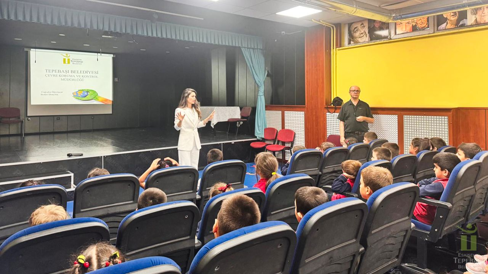

> Tepebaşı Belediyesi Çevre Koruma ve Kontrol Müdürlüğü, Ticaret Borsası İlkokulu ve Arif Nihat Asya Ortaokulu'nda çevre okuryazarlığı eğitimi verdi.

Tepebaşı Belediyesi Çevre Koruma ve Kontrol Müdürlüğü, Ticaret Borsası İlkokulu ve Arif Nihat Asya Ortaokulu'nda öğrencilerle bir araya geldi. Eğitimlerde çevre okuryazarlığı, geri dönüşüm ve atıksız yaşam konuları ele alındı.

Belediye, çevre bilincinin küçük yaşlarda kazanılmasına katkı sunmak için okullarda eğitim ve bilgilendirme çalışmalarını sürdürüyor. Çalışmalarla öğrencilerin çevreye duyarlı alışkanlıklar edinmesi ve atıkların azaltılması konusunda farkındalık kazanması hedefleniyor.

Benzer eğitimler için başvuru yapmak ve bilgi almak isteyenler Tepebaşı Belediyesi'nin 0222 211 40 00 numaralı telefonundan 3324 veya 3085 dahili numaralarına ulaşabiliyor.

---

## Tepebaşı Arama Kurtarma Ekibi AFAD barınma akreditasyonu aldı

**Gündem · Tepebaşı** · 2026-10-21 21:42 UTC · Kaynak: [Tepebaşı Belediyesi](https://www.tepebasi.bel.tr/Haber/Detay/takafadbarınmaakreditasyonunahakkazandı)

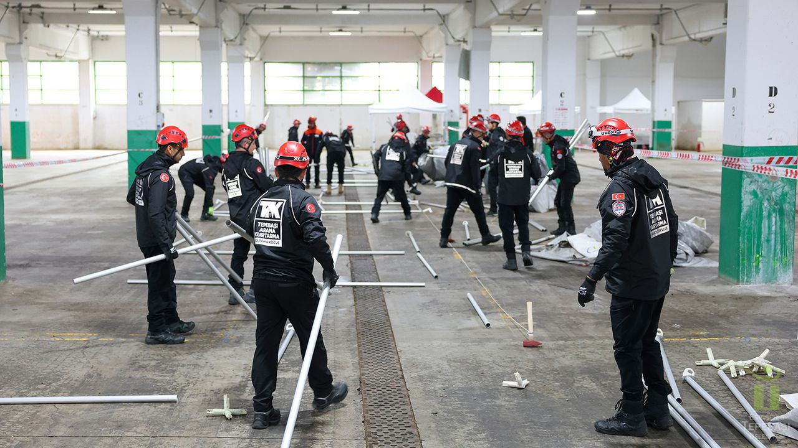

> Tepebaşı Belediyesi Arama Kurtarma (TAK) Ekibi, AFAD'ın barınma akreditasyonu sınavını başarıyla tamamladı.

Tepebaşı Belediyesi Afet İşleri ve Risk Yönetimi Müdürlüğü bünyesindeki Tepebaşı Arama Kurtarma (TAK) Ekibi, AFAD'ın barınma akreditasyonu sınavını başarıyla tamamlayarak akreditasyon almaya hak kazandı.

AFAD standartları doğrultusunda yürütülen eğitim ve sınav sürecini geçen ekip, afet sonrası barınma hizmetlerini koordinasyon içinde yürütebilecek yetkinliğini belgelemiş oldu.

Tepebaşı Belediyesi yetkilileri, akreditasyonun düzenli eğitimlerin ve disiplinli çalışmanın sonucu olduğunu belirtti. Yetkililer, afetlere dirençli kent hedefi doğrultusunda eğitim ve hazırlık çalışmalarının süreceğini bildirdi.

---

## Anadolu Üniversitesi'nde 3. Bağımlılık Farkındalık Haftası başladı

**Eğitim · Tepebaşı** · 2026-10-21 21:42 UTC · Kaynak: [Anadolu Üniversitesi](https://anahaber.anadolu.edu.tr/tr/haber-detay/k19tehab3rdqntlgkx3bhhxo)

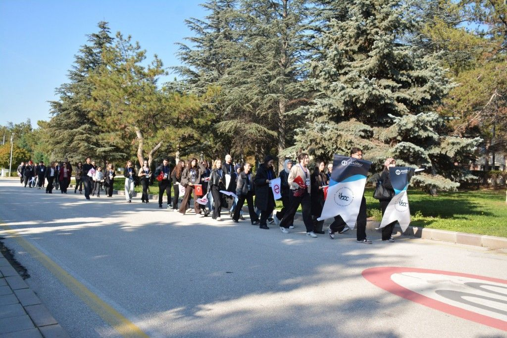

> Anadolu Üniversitesi Bağımlılık Önleme Çalışmaları Birim Müdürlüğü'nün düzenlediği hafta, festival yürüyüşü, atölyeler ve simülasyonlarla başladı.

Anadolu Üniversitesi Bağımlılık Önleme Çalışmaları Birim Müdürlüğü'nün organize ettiği "3. Bağımlılık Farkındalık Haftası" etkinlikleri kampüste başladı. Program, Eczacılık Kapısı'ndan Anadolu Park'a uzanan "Festival Yürüyüşü" ile açıldı. Yürüyüşün ardından katılımcılara çorba, nohutlu pilav, köfte ekmek ve aşure ikram edildi.

Açık alanda ahşap boyama, punch, mandala, miyuki takı tasarımı ve ebru gibi atölyeler kuruldu. Yeşilay Gençlik Komisyonu bez çanta boyama ve vision board atölyeleri düzenledi. Emniyet kemeri ve takla atma simülatörlerinin yanı sıra sanal gerçeklik gözlükleriyle "alkollü araç kullanım farkındalığı simülasyonu" yapıldı.

Yunus Emre Spor Salonu'nda satranç, masa tenisi, dart ve floor curling müsabakaları, Anadolu Park'ta matrak, mini golf ve bilek güreşi etkinlikleri düzenlendi. "Bowl Challenge: Sağlıklı Seçimini Tasarla!" yarışmasında öğrenciler sağlıklı ve dengeli tabaklar hazırladı.

İletişim Bilimleri Fakültesi Şener Şen Salonu'ndaki "Kontrol Kimde? Bağımlılıklar, Riskler ve Seçimler" seminerinde Doç. Dr. Tuğba Görgülü, bağımlılığın yalnızca irade zayıflığı olarak değerlendirilmemesi gerektiğini söyledi. Görgülü, biyolojik, psikolojik ve sosyal faktörlerin etkili olduğunu, kontrolün kaybedildiğinin erken fark edilmesinin önemli olduğunu belirtti. Etkinlikler ertesi gün de sürecek.

---

## Anadolu Üniversitesi Yapay Zekâ Akademisi'nde yeni dönem başvuruları başladı

**Eğitim · Tepebaşı** · 2026-10-21 21:42 UTC · Kaynak: [Anadolu Üniversitesi](https://anahaber.anadolu.edu.tr/tr/haber-detay/zsgpp6gpntf660o0lmhuc3sr)

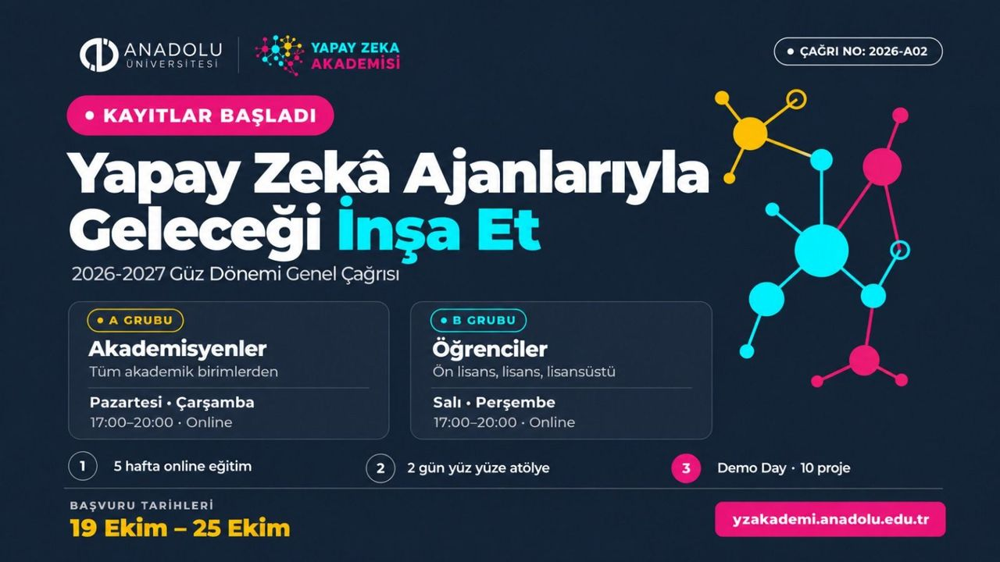

> Anadolu Üniversitesi Yapay Zekâ Akademisi'nin yapay zekâ ajanlarına odaklanan yeni dönem programı için başvurular 25 Ekim'e kadar alınacak.

Anadolu Üniversitesi Yapay Zekâ Akademisi, 2026-2027 Güz döneminde "Yapay Zekâ Ajanlarıyla Geleceği İnşa Et" programını açıyor. Program, araştırma yapan, analiz gerçekleştiren ve verilen görevleri tamamlayan yapay zekâ ajanlarına odaklanıyor.

Eğitimler iki grupta yürütülecek. Öğretim elemanlarına yönelik A Grubu'nda katılımcılar yapay zekâ ajanlarını literatür taraması, veri analizi, akademik yazım, proje hazırlama ve ders tasarımı gibi alanlarda kullanmayı öğrenecek. Ön lisans, lisans ve lisansüstü öğrencilere yönelik B Grubu'nda ise katılımcılar ekipler halinde ajan tabanlı ürünler tasarlayıp geliştirecek.

Beş hafta sürecek çevrim içi eğitimler 16 Kasım 2026'da başlayacak. Dersler A Grubu için pazartesi ve çarşamba, B Grubu için salı ve perşembe günleri 17.00-20.00 saatleri arasında yapılacak. Ön elemeyi geçen katılımcılar 21-24 Aralık'ta iki günlük yüz yüze atölyeye katılacak. Seçilecek 10 proje 21 Ocak 2027'deki Demo Day'de sunulacak.

Başvurular 25 Ekim Pazar gününe kadar yzakademi.anadolu.edu.tr adresinden yapılabilecek. Sonuçlar 13 Kasım 2026'da e-posta ile duyurulacak. Akademinin ilk dönemine katılanlar da başvurabilecek.

---

## 4. Kızılinler Bal Kabağı Panayırı 25 Ekim'de yapılacak

**Tarım · Tepebaşı** · 2026-10-21 21:42 UTC · Kaynak: [Tepebaşı Belediyesi](https://www.tepebasi.bel.tr/Haber/Detay/balkabagındaturkiye’ninilkcalıstayıtepebası’nda)

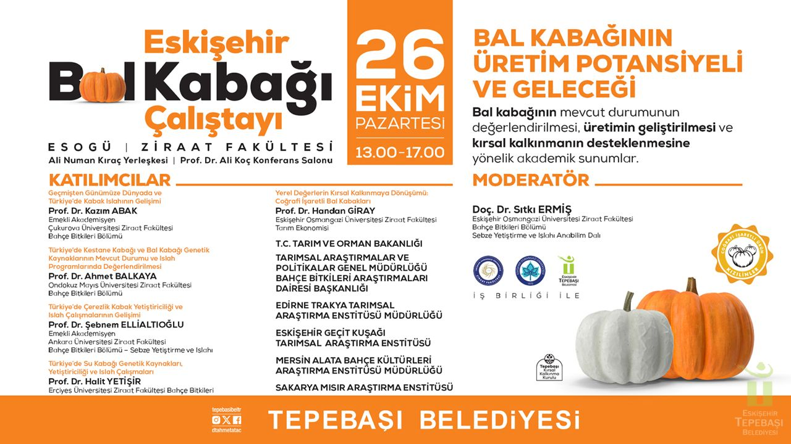

> Tepebaşı Belediyesi, coğrafi işaretli Kızılinler bal kabağını tanıtmak için 25 Ekim'de panayır, 26 Ekim'de çalıştay düzenleyecek.

Tepebaşı Belediyesi, coğrafi işaretli Kızılinler bal kabağını tanıtmak ve üretimin geleceğini ele almak amacıyla iki günlük bir program düzenleyecek. Program, 25 Ekim Pazar günü yapılacak 4. Kızılinler Bal Kabağı Panayırı ile başlayacak.

Panayır 25 Ekim'de saat 12.00-16.00 arasında Kızılinler Davet Salonu'nda yapılacak. Programda halk oyunları gösterisi ve Eko-Şov konseri yer alacak. "Çizgilerle Bal Kabağı" sergisi ile EFSAD fotoğraf sergisi de ziyaretçilerle buluşacak. Ziyaretçiler yöresel ürün ve coğrafi işaretli Kızılinler bal kabağı satış stantlarını gezebilecek, söyleşilere katılabilecek.

Panayır alanına ulaşım için Tepebaşı Belediyesi Hizmet Binası önünden saat 11.45'te ücretsiz araç kalkacak. Ücretsiz ulaşımdan yararlanmak isteyenlerin kayıt formunu doldurması gerekiyor.

Tepebaşı Belediye Başkanı Dt. Ahmet Ataç, Kızılinler bal kabağının Eskişehir'in üretim kültürünün ve yerel değerlerinin önemli bir parçası olduğunu belirtti. Ataç, panayırda hemşehrileri Kızılinler bal kabağı ve üreticilerle buluşturacaklarını söyledi.

Ertesi gün, 26 Ekim Pazartesi saat 13.00-17.00 arasında ESOGÜ Ziraat Fakültesi Ali Numan Kıraç Yerleşkesi'nde Türkiye'de ilk kez ulusal ölçekte Eskişehir Bal Kabağı Çalıştayı yapılacak. Çalıştaya Tarım ve Orman Bakanlığı'na bağlı bazı araştırma enstitüleri de katılacak.

---

## Tepebaşı'nın "Gel Beraber Olsun" yemeği yeni adresinde başladı

**Belediye · Tepebaşı** · 2026-10-21 20:49 UTC · Kaynak: [Tepebaşı Belediyesi](https://www.tepebasi.bel.tr/Haber/Detay/‘gelberaberolsun’yeniyerindeyogunilgigordu)

> Tepebaşı Belediyesi'nin üniversite öğrencilerine yönelik akşam yemeği desteği, 19 Ekim'den itibaren Ali Rıza Efendi Deneyimli Kafe'de veriliyor.

Tepebaşı Belediyesi'nin üniversite öğrencilerine yönelik "Gel Beraber Olsun" akşam yemeği desteği 19 Ekim Pazartesi gününden itibaren yeni adresinde verilmeye başlandı. Etkinlik hafta içi her gün 18.00-19.00 saatleri arasında Ali Rıza Efendi Deneyimli Kafe'de düzenleniyor ve ilk gününde öğrencilerden yoğun ilgi gördü.

Belediye, 2022'de başlattığı etkinlikte bugüne kadar 69 bin 113 öğrenciyi aynı sofrada buluşturdu. Öğrenciler, desteğin eğitim ve yaşam giderlerinin arttığı dönemde kendileri için önemli olduğunu belirtti.

Tepebaşı Belediye Başkanı Dt. Ahmet Ataç, üniversite öğrencilerinin geçim mücadelesi vermek zorunda kaldığını söyledi. Ataç, projeyi gençlerle dayanışmak için hayata geçirdiklerini belirterek tüm öğrencileri yeni adrese davet etti.

Yeni adres Yenibağlar Mahallesi, Kartal Tepesi Sokak No: 14, Şehit Jandarma Er Osman Özgerçik Parkı içinde bulunuyor. Bilgi almak isteyen öğrenciler 0222 211 40 00 / 4200-4205 numaralı telefonu arayabiliyor.

---

## Tepebaşı İklim İzcileri Programı'na 66 izci adayı başvurdu

**Eğitim · Tepebaşı** · 2026-10-21 20:49 UTC · Kaynak: [Tepebaşı Belediyesi](https://www.tepebasi.bel.tr/Haber/Detay/tepebası’nda66izciadayıyenidonemehazırlanıyor)

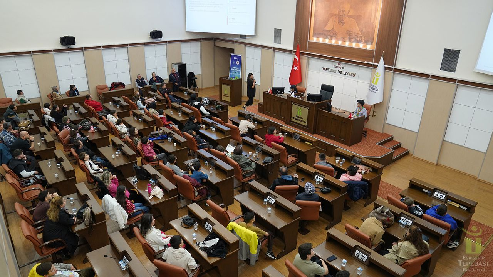

> Tepebaşı İklim İzcileri Programı 2026-2027 dönemi için tanıtım toplantısı yapıldı. Toplantıya 66 izci adayı ve aileleri katıldı.

Tepebaşı Belediyesi İklim Değişikliği ve Sıfır Atık Müdürlüğü öncülüğünde yürütülen Tepebaşı İklim İzcileri Programı, 2026-2027 dönemi için yeni izcilerini karşılamaya hazırlanıyor. Programa başvuran 66 izci adayı ve aileleri, Tepebaşı Belediyesi Meclis Salonu'ndaki tanıtım toplantısında bir araya geldi.

Program, Türkiye İzcilik Federasyonu bünyesinde ve Eskişehir İklim Spor Kulübü iş birliğiyle sürdürülüyor. Toplantıda izcilik kültürü, doğa sevgisi ve çevre bilincinin çocukların gelişimindeki yeri ele alındı, programın işleyişi ve yeni dönem çalışmaları anlatıldı.

Geçmiş dönemlerdeki eğitim, kamp ve doğa etkinliklerinden fotoğraf ve videolar paylaşıldı. Velilerin soruları da yanıtlandı.

Programın çocukların doğayı tanımasını, çevre bilinci kazanmasını ve takım çalışması ile sorumluluk duygusunu geliştirmesini amaçladığı belirtildi. Şu anda yaklaşık 70 izcinin yer aldığı programın yeni dönem başvurularıyla büyümesi bekleniyor.

---

## Tepebaşı İklim Haftası'nda 62 genç İklim Manifestosu hazırladı

**Gündem · Tepebaşı** · 2026-10-21 20:49 UTC · Kaynak: [Tepebaşı Belediyesi](https://www.tepebasi.bel.tr/Haber/Detay/geleceginiklimsozutepebası’ndanyukseliyor)

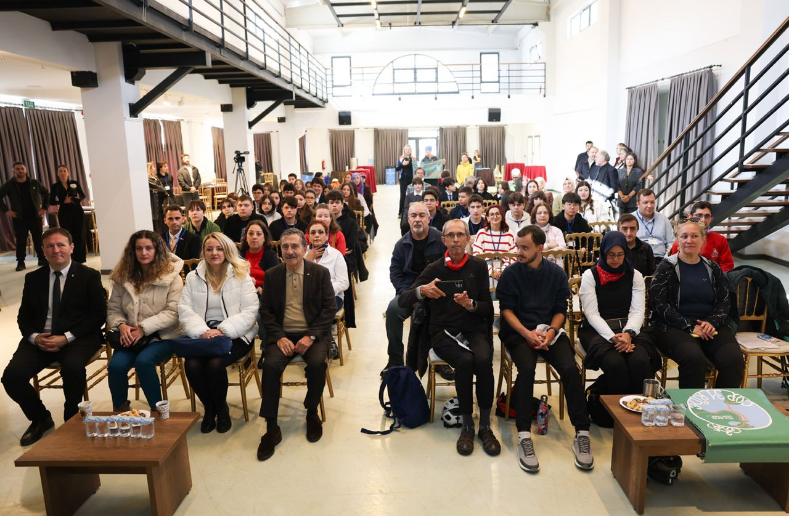

> 16-23 Ekim'de düzenlenen Tepebaşı İklim Haftası, COP31 Bike Ride bisikletçilerinin karşılanması ve Gençlik İklim Çalıştayı ile başladı.

Tepebaşı Belediyesi'nin 16-23 Ekim tarihleri arasında düzenlediği Tepebaşı İklim Haftası, COP31 Bike Ride bisikletçilerinin karşılanması, bir belgesel gösterimi ve Gençlik İklim Çalıştayı ile başladı.

19 Ekim'de Vecihi Hürkuş Havacılık ve Teknoloji Parkı'nda yapılan çalıştaya 62 üniversite ve lise öğrencisi katıldı. Gençler; iklim adaleti, enerji ve düşük karbonlu yaşam, gençlik katılımı, iklim yönetişimi ve iklim farkındalığı ile iklim değişikliğine uyum başlıklarında öneriler geliştirdi. Çalıştay Dr. Nuran Talu ve EKO Okullar İl Koordinatörü Nadir Erdem'in moderatörlüğünde yapıldı. Gençlerin görüşleri Gençlik İklim Manifestosu'nda toplandı ve manifestonun COP31 sürecinde paylaşılması hedefleniyor.

Tepebaşı Belediye Başkanı Dt. Ahmet Ataç, gençlerin iklim kararlarına katılımını önemsediklerini söyledi. Ataç, önerileri kent yönetiminin karar süreçlerine taşımaya çalışacaklarını belirtti.

Brezilya'daki Belém kentinden yola çıkıp COP31'in düzenleneceği Antalya'ya ulaşmayı hedefleyen COP31 Bike Ride ekibi, Türkiye'de İstanbul, Eskişehir, Ankara, Konya ve Antalya güzergâhını izliyor. Bisikletçiler 16 Ekim'de Özdilek Sanat Merkezi'nde karşılandı ve Başkan Ataç ile görüştü. Yolculuklarını anlatan "COP30BikeRide – Together" belgeseli 18 Ekim'de Tepebaşı Belediyesi Hizmet Binası Meclis Salonu'nda gösterildi.

---

## Odunpazarı'nda Kış Dönemi Basketbol Spor Okulu için kayıtlar sürüyor

**Spor · Odunpazarı** · 2026-10-21 20:49 UTC · Kaynak: [Odunpazarı Belediyesi](https://www.odunpazari.bel.tr/guncel/haberler/genel-haberler/odunpazari-belediyesi-kis-donemi-basketbol-spor-okulu-basliyor-cocuklar-basketbo)

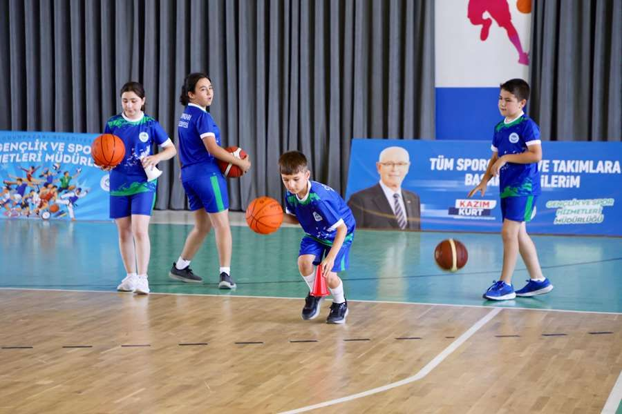

> Odunpazarı Belediyesi'nin 2015, 2016 ve 2017 doğumlu çocuklara yönelik basketbol spor okulu için kayıtlar 23 Ekim'e kadar Mehmet Terzi Spor Salonu'nda alınıyor.

Odunpazarı Belediyesi, çocukları sporla buluşturmak amacıyla Kış Dönemi Basketbol Spor Okulu açıyor. Okul 2015, 2016 ve 2017 doğumlu çocuklara yönelik.

Kayıtlar 19-23 Ekim tarihleri arasında Mehmet Terzi Spor Salonu'nda şahsen yapılıyor. Kayıt sırasında kimlik ibrazı zorunlu.

Basketbol eğitimleri cumartesi ve pazar günleri 13.00-14.00 saatleri arasında verilecek. Spor okulu kapsamında malzeme ücreti olarak 1.250 TL alınacak. Ücretler nakit tahsil edilecek, ayrıntılı bilgi kayıt sırasında ailelerle paylaşılacak.

---

## Odunpazarı'nda deneme merkezinde elde edilen 1,6 ton un Halk Market'e bağışlandı

**Belediye · Odunpazarı** · 2026-10-21 20:49 UTC · Kaynak: [Odunpazarı Belediyesi](https://www.odunpazari.bel.tr/guncel/haberler/genel-haberler/odunpazari-nin-uretimi-ihtiyac-sahibi-ailelerin-sofrasina-ulasiyor-uretimden-day)

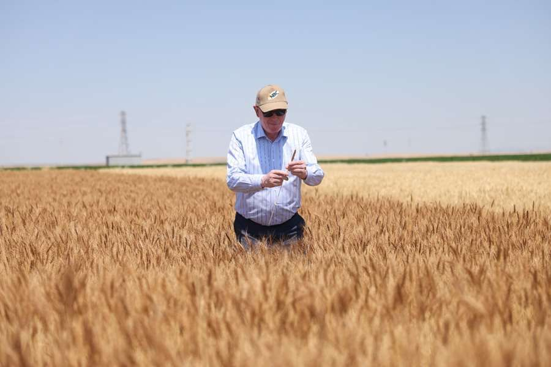

> Odunpazarı Belediyesi Veteriner İşleri Müdürlüğü, Kalkanlı'daki merkezde elde edilen 1 ton 600 kilogram unu ihtiyaç sahibi ailelere ulaştırılmak üzere Halk Market'e verdi.

Odunpazarı Belediyesi Veteriner İşleri Müdürlüğü, Kalkanlı Çiftçi Eğitim ve Yeni Çeşit Deneme Merkezi'nde elde edilen 1 ton 600 kilogram unu belediyenin sosyal yardım modeli Halk Market'e bağışladı.

Merkezde denemeleri yapılan 17 çeşit buğday ve arpa karışık biçimde hasat edildi. Elde edilen un 25'er kilogramlık 63 çuvala konuldu ve Halk Market ile Tarım İşleri Müdürlüğü yetkililerine teslim edildi.

Unların Halk Market aracılığıyla ihtiyaç sahibi ailelere ulaştırılması planlanıyor. Odunpazarı Belediyesi, sosyal belediyecilik anlayışı doğrultusunda ihtiyaç sahibi yurttaşlara destek vermeyi sürdürdüğünü belirtiyor.

---

## Odunpazarı Belediyesi kadın personele meme kanseri semineri düzenledi

**Sağlık · Odunpazarı** · 2026-10-21 20:49 UTC · Kaynak: [Odunpazarı Belediyesi](https://www.odunpazari.bel.tr/guncel/haberler/genel-haberler/odunpazari-belediyesi-nde-meme-kanseri-farkindalik-seminerleri-duzenlendi)

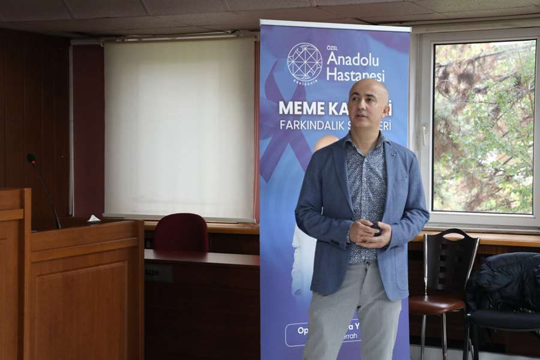

> Odunpazarı Belediyesi ve Özel Anadolu Hastanesi iş birliğiyle düzenlenen seminerde kadın personele meme kanserinin belirtileri ve erken teşhisin önemi anlatıldı.

Odunpazarı Belediyesi ile Özel Anadolu Hastanesi iş birliğinde, belediyede görev yapan kadın personele yönelik "Meme Kanseri Farkındalık Seminerleri" düzenlendi. Seminer Odunpazarı Belediyesi Meclis Salonu'nda yapıldı ve konuşmacı olarak Genel Cerrahi Uzmanı Op. Dr. Mustafa Yıldız katıldı.

Seminerde memede ele gelen kitle, meme boyutunda veya şeklinde değişiklik, ciltte farklılıklar ve meme başındaki değişimler gibi belirtilere dikkat çekildi. Bu tür değişikliklerin fark edilmesi durumunda bir sağlık kuruluşuna başvurmanın önemi vurgulandı.

Tanı ve tedavi süreci hakkında da bilgi verilen seminerde, hastalığın erken evrede tespit edilmesinin tedavi açısından önemi anlatıldı. Katılımcılar sorularını Op. Dr. Yıldız'a yöneltti.

Seminerler, Odunpazarı Belediyesi İnsan Kaynakları ve Eğitim Müdürlüğü koordinasyonunda gerçekleştirildi.

---

## Odunpazarı Belediye Başkanı Kurt, engelli dernekleriyle bir araya geldi

**Belediye · Odunpazarı** · 2026-10-21 20:49 UTC · Kaynak: [Odunpazarı Belediyesi](https://www.odunpazari.bel.tr/guncel/haberler/genel-haberler/baskan-kazim-kurt-engelli-dernekleriyle-bir-araya-geldi-baskan-kurt-sosyal-dev)

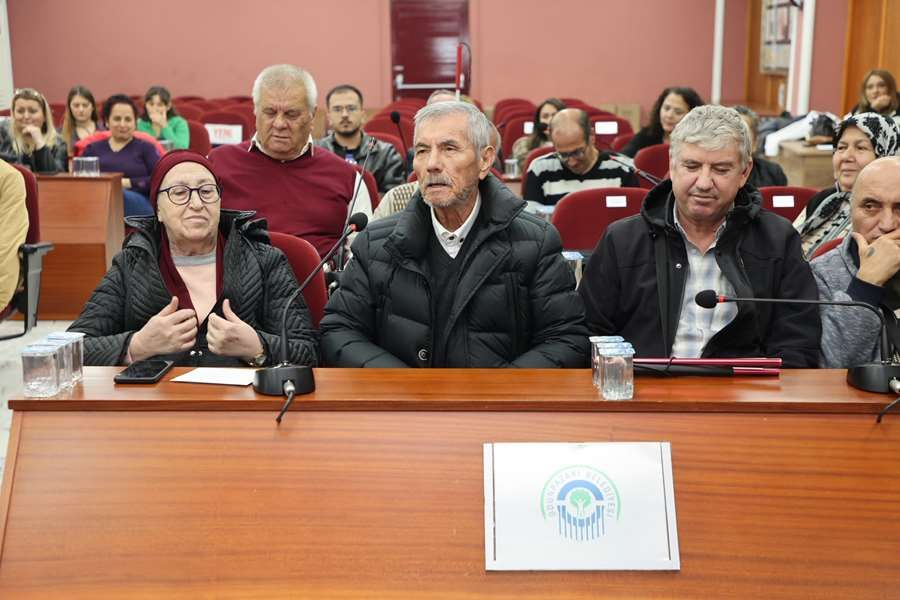

> Odunpazarı Belediye Başkanı Kazım Kurt, Meclis Salonu'nda engelli derneklerinin temsilcileriyle görüştü. Başkan Kurt, sosyal devletin herkesi kucaklaması gerektiğini söyledi.

Odunpazarı Belediye Başkanı Kazım Kurt, engelli derneklerinin temsilcileriyle Odunpazarı Belediyesi Meclis Salonu'nda bir araya geldi. Toplantıda engelli bireylerin talep ve beklentileri ele alındı.

Toplantıya Görme Engelliler Dayanışma Derneği (GÖRSEM), Eskişehir Görme Engelliler Spor Kulübü, Eskişehir Görmeyenleri ve Göz Sağlığını Koruma Derneği (ESGÖRDER), Eskişehir İki Eylül Görme Engelliler Gençlik ve Spor Kulübü, Yunusemre Görme Engelliler Spor Kulübü ve İşitme Engelliler Birliktelik Derneği temsilcileri katıldı. İşitme engelli katılımcılar için toplantıda işaret dili tercümanı görev yaptı.

Dernek temsilcileri, engelli bireylerin yaşamını kolaylaştırmaya yönelik talep ve önerilerini dile getirdi. Başkan Kurt iletilen istekleri not aldı, belediyenin çalışmaları hakkında bilgi verdi.

Kurt, konuşmasında sosyal devletin toplumun bütün kesimlerini kucaklaması gerektiğini söyledi. "Çok ciddi bir tasarruf genelgesi baskısı altındayız. Dolayısıyla bazı şeyler eksik kalabilir, kalıyor" diyen Kurt, bunların düzelmesini umduğunu belirtti.

Belediyenin Engelliler ve Yaşlı Hizmetleri Müdürlüğü kurduğunu hatırlatan Kurt, Yenikent Mahallesi'ndeki Seramik Park içinde yer alan Engelsiz Kültür Sanat Merkezi'nde engelli çocuklara eğitim verildiğini, Ahmet Ara Engelsiz Gündüz Bakımevi ve Kreşi'nin bulunduğunu ve personele işaret dili öğreten kurslar açıldığını anlattı. Belediyenin internet sitesinde de işitme engelliler için çeviri yapan bir sistem bulunuyor.

---

## Eskişehir Bal Kabağı Çalıştayı 26 Ekim'de yapılacak

**Tarım · Tepebaşı** · 2026-10-21 20:49 UTC · Kaynak: [Tepebaşı Belediyesi](https://www.tepebasi.bel.tr/Haber/Detay/balkabagınıngelecegiakademisyenlerleeskisehir’dekonusulacak)

> Tepebaşı Belediyesi Kırsal Hizmetler Müdürlüğü'nün düzenlediği çalıştay, Türkiye'de ilk kez ulusal ölçekte yapılacak. Etkinlik ESOGÜ Ziraat Fakültesi'nde gerçekleşecek.

Tepebaşı Belediyesi Kırsal Hizmetler Müdürlüğü, ESOGÜ Ziraat Fakültesi iş birliğiyle Eskişehir Bal Kabağı Çalıştayı düzenliyor. Çalıştay 26 Ekim Pazartesi günü saat 13.00-17.00 arasında ESOGÜ Ziraat Fakültesi Ali Numan Kıraç Yerleşkesi Prof. Dr. Ali Koç Konferans Salonu'nda yapılacak.

Türkiye'de ilk kez ulusal ölçekte gerçekleştirilecek çalıştayda, farklı üniversitelerden akademisyenler ve tarımsal araştırma kurumları bir araya gelecek. Kabak ıslahı, genetik kaynaklar, yetiştiricilik ve coğrafi işaretli bal kabaklarının kırsal kalkınmaya katkısı ele alınacak.

Programda Prof. Dr. Kazım Abak, Prof. Dr. Ahmet Balkaya, Prof. Dr. Şebnem Ellialtıoğlu ve Prof. Dr. Halit Yetişir'in sunumları yer alıyor. Sunumlar kabak ıslahının gelişimi, kestane kabağı ve bal kabağının genetik kaynakları, çerezlik ve su kabağı yetiştiriciliği gibi konuları kapsıyor.

Çalıştayın moderatörlüğünü ESOGÜ Ziraat Fakültesi'nden Doç. Dr. Sıtkı Ermiş üstlenecek. Ermiş, bal kabağının gıda, tarım ve sanayi açısından önem taşıyan stratejik bir tarımsal ürün olduğunu belirtti. Çalıştayın, Eskişehir'in coğrafi işaretli ürünlerinden Kızılinler Bal Kabağı'nın tanıtılması ve üretim potansiyelinin geliştirilmesi amacıyla düzenlendiği ifade edildi.

---

## Tepebaşı Kadın Sığınma Evi 2007'den bu yana 819 kişiye hizmet verdi

**Belediye · Tepebaşı** · 2026-10-21 18:47 UTC · Kaynak: [Tepebaşı Belediyesi](https://www.tepebasi.bel.tr/Haber/Detay/baskanatackadınlarınesitveozguryasamıicinsorumlulugumuzusurdurecegiz)

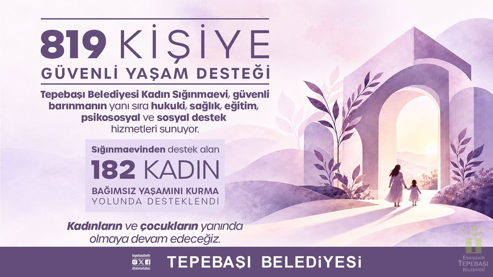

> Tepebaşı Belediyesi Kadın Sığınma Evi'nde bugüne kadar 563 kadın ve 256 çocuk destek aldı. Bu kadınlardan 182'si bağımsız yaşamını kurdu.

Tepebaşı Belediyesi Kadın Sığınma Evi, 2007'den bu yana şiddet gören kadınlara ve çocuklarına güvenli bir yaşam alanı sunuyor. Merkezde bugüne kadar 563 kadın ve 256 çocuk olmak üzere toplam 819 kişiye hizmet verildi.

Sığınma evinden destek alan kadınlardan 182'si bağımsız yaşamını kurdu. Merkez; hukuki, sağlık, eğitim, eşya, psikososyal ve sosyal destek hizmeti sunuyor. Kadın Sığınma Evi'nin kapasitesi 10 kadın ve 5 çocuk.

Tepebaşı Belediye Başkanı Dt. Ahmet Ataç, kadına yönelik şiddetin kadınların yaşam hakkını, güvenliğini ve eşitliğini doğrudan etkileyen ciddi bir toplumsal sorun olduğunu belirtti. Ataç, bu sorunla mücadelenin yalnızca kadınların değil, toplumun ve kamu kurumlarının ortak sorumluluğu olduğunu söyledi.

Ataç, görevlerinin ihtiyaç duyan kadınların güvenli bir yere ulaşmasını sağlamak ve yaşamlarını yeniden kurma sürecinde onları yalnız bırakmamak olduğunu ifade etti. Her kadının güven içinde, eşit ve özgür yaşayabildiği bir kent için çalışmaya devam edeceklerini kaydetti.

Kaynakta yer alan bilgiye göre Türkiye'de yerel yönetimlere bağlı kadın sığınma evlerinin bulunduğu 33 belediyenin 8'i büyükşehir, 25'i ilçe belediyesi statüsünde.

---

## Odunpazarı'nda Eskişehir'in tarihi dansla sahneye taşınacak

**Kültür-Sanat · Odunpazarı** · 2026-10-21 18:47 UTC · Kaynak: [Odunpazarı Belediyesi](https://www.odunpazari.bel.tr/guncel/haberler/genel-haberler/eskisehir-in-hikayesi-dansla-sahneye-tasiniyor)

> Odunpazarı Belediyesi Halk Dansları Topluluğu, Eskişehir'in antik dönemden Cumhuriyet'e uzanan hikâyesini anlatan "Eskişehir'in Hikâyesi" adlı gösteri için hazırlık yapıyor.

Odunpazarı Belediyesi Halk Dansları Topluluğu, Eskişehir'in tarihini ve kültürel zenginliğini dans, müzik ve kostümlerle anlatan "Eskişehir'in Hikâyesi" adlı bir gösteriye hazırlanıyor. Proje, Afyon Kocatepe Üniversitesi Öğretim Görevlisi Muharrem Feratan tarafından hazırlandı.

Gösteri; Frigya uygarlığından Roma dönemine, Nasrettin Hoca'dan Yunus Emre'ye, Osman Gazi'nin rüyasından İnönü ve Sakarya savaşlarına uzanan bir tarih yolculuğunu sahneye taşıyacak. Kırım, Balkan ve Kafkas kültürlerinin dansları ve müzikleri de gösterinin içinde yer alacak. Hazırlıklar yaklaşık bir aydır sürüyor.

Feratan, Eskişehir'in zengin kültürünü sahneye yansıtmanın uzun süredir hayali olduğunu söyledi. 2012'de Türk Dünyası Kültür Başkenti kapsamında benzer bir gösteri hazırladıklarını, üniversite bünyesinde de benzer çalışmalar yaptıklarını belirten Feratan, projeyi bu kez güncellenmiş bir yapıda ve farklı müzikal düzenlemelerle izleyiciye sunmayı hedeflediklerini aktardı.

Topluluğun eğitmeni Oktay Şahin ise Odunpazarı'nın Eskişehir'in ilk yerleşim yeri olması nedeniyle projenin burada hayata geçirilmek istendiğini söyledi. Şahin, topluluğun 2014'ten bu yana farklı yaş gruplarına eğitim verdiğini, gösteri ve festivallere katıldığını belirtti. Yeni gösterinin Odunpazarı'na değer katacağını ifade etti.

---

## ESOGÜ'lü akademisyenlerden omuz MR'da yapay zekâ çalışması

**Sağlık · Merkez** · 2026-10-21 18:47 UTC · Kaynak: [Eskişehir Osmangazi Üniversitesi](https://www.ogu.edu.tr/Web/HaberDetay/2063?tur=AkademikMakale)

> Eskişehir Osmangazi Üniversitesi'nden araştırmacıların omuz MR görüntülerinde rotator manşet yırtığını sınıflandıran yapay zekâ çalışması Journal of Clinical Medicine dergisinde yayımlandı.

Eskişehir Osmangazi Üniversitesi Mühendislik-Mimarlık Fakültesi'nden Arş. Gör. Sergen Aşık ve Prof. Dr. Ahmet Yazıcı, Bilecik Şeyh Edebali Üniversitesi'nden Prof. Dr. Murat Aşçı ve Eskişehir Yunus Emre Devlet Hastanesi'nden Uzm. Dr. İrfan Okumuşer ile birlikte yürüttükleri makale, Q1 kategorisindeki Journal of Clinical Medicine dergisinde yayımlandı.

Çalışmada, çok sekanslı omuz MR görüntüleri yaş, cinsiyet, vücut kitle indeksi ve inceleme tarafı gibi klinik bilgilerle birleştirilerek rotator manşet yırtıklarının sınıflandırılması için yapay zekâ modeli geliştirildi. Retrospektif çalışmada, 100'ünde yırtık bulunan ve 99'unda bulunmayan toplam 199 hastanın görüntüleri değerlendirildi.

En başarılı model, yağ baskılı T2 sagittal, proton yoğunluklu koronal ve proton yoğunluklu aksiyel olmak üzere üç MR sekansını klinik verilerle birleştiren model oldu. Model 0,9961 ROC-AUC, yüzde 96 doğruluk ve yüzde 97,98 duyarlılık değerine ulaştı.

Üç sekans kullanan modelin dört sekansın tamamını kullanan modelden daha yüksek performans göstermesi, daha fazla görüntü kullanmanın her zaman daha iyi sonuç vermeyebileceğini ortaya koydu. Araştırmacılar, görüntü sayısından çok hastalığa özgü bilgi sağlayan sekansların seçilmesinin önemli olduğunu belirtti. Yöntemin farklı hastane ve MR cihazlarından alınacak verilerle doğrulanması da klinik kullanım potansiyelinin değerlendirilmesine katkı sağlayacak.

---

## Eskişehir'de "Mukaddes Emanetler" sergisi ziyarete açıldı

**Kültür-Sanat · Merkez** · 2026-10-21 18:47 UTC · Kaynak: [Google Haberler - Eskişehir](https://www.haberturk.com/gundem/foto/eskisehir-de-mukaddes-emanetler-sergisi-3921470)

> MÜSİAD Eskişehir Şubesi'nin düzenlediği sergi, İl Kültür ve Turizm Müdürlüğü Sergi Salonu'nda açıldı. Sergi 25 Ekim'de sona erecek.

Müstakil Sanayici ve İşadamları Derneği (MÜSİAD) Eskişehir Şubesi tarafından düzenlenen "Mukaddes Emanetler Sergisi", Eskişehir İl Kültür ve Turizm Müdürlüğü Sergi Salonu'nda ziyarete açıldı. Sergide Asr-ı Saadet dönemine ait kutsal emanetler yer alıyor.

Açılış törenine Eskişehir Valisi Erdinç Yılmaz, Cumhuriyet Başsavcısı Ferhat Deniz, Adli Yargı Komisyonu Başkanı Arif Hamdi Sazak, Eskişehir Osmangazi Üniversitesi Rektörü Prof. Dr. Emine Gümüşsoy, İl Müftüsü Muharrem Gül, MÜSİAD Eskişehir Şube Başkanı Oğuz Özdemir, siyasi parti temsilcileri, kurum müdürleri ve vatandaşlar katıldı.

Vali Yılmaz, serginin Hazreti Muhammed'i anmak ve manevi değerleri yaşatmak açısından önemli olduğunu belirterek organizasyonda emeği geçenlere teşekkür etti ve vatandaşları sergiyi ziyarete davet etti. Özdemir de sergiye ev sahipliği yapmaktan memnuniyet duyduklarını, bu tür etkinliklerin milli ve manevi değerlerin gelecek nesillere aktarılmasına katkı sağladığını söyledi.

Koleksiyoner Erol Güzel'in küratörlüğünde düzenlenen sergide kutsal emanetlerin yanı sıra Kabe örtüleri, Sakal-ı Şerifler ve Kabe, Medine ile Kudüs maketleri bulunuyor. Sergi 25 Ekim'de sona erecek.

---

## Tepebaşı İklim Haftası'nda sanayicilere yeşil dönüşüm destekleri anlatıldı

**Ekonomi · Tepebaşı** · 2026-10-21 18:35 UTC · Kaynak: [Tepebaşı Belediyesi](https://www.tepebasi.bel.tr/Haber/Detay/sanayiiciniklimfinansmanıveyesildonusumtepebasıiklimhaftası’ndaelealındı)

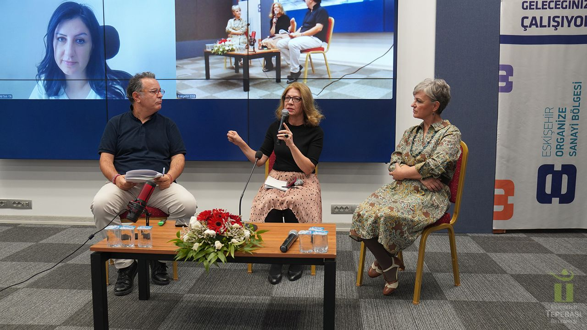

> Eskişehir OSB'de düzenlenen panelde sanayiciler, iklim finansmanı, yeşil dönüşüm destekleri ve Ufuk Avrupa programı hakkında bilgilendirildi.

Tepebaşı Belediyesi ile Eskişehir Organize Sanayi Bölgesi (EOSB) iş birliğinde düzenlenen Tepebaşı İklim Haftası, "İklim Finansmanı ve Yeşil Dönüşüm Paneli" ile devam etti. EOSB İdari Bina Konferans Salonu'ndaki panele sanayiciler, iş dünyası, kamu kurumları ve meslek odalarının temsilcileri katıldı.

Anadolu Üniversitesi İletişim Bilimleri Fakültesi'nden Prof. Dr. Nezih Orhon'un yönettiği panelde, işletmelerin yeşil dönüşüm sürecinde yararlanabileceği destek ve finansman olanakları ele alındı.

BEBKA'dan Nigah Ertekin bölgesel yeşil dönüşüm desteklerini, EcoMuse'den Seyran Hatipoğlu işletmeler için iklim finansmanını anlattı. TÜBİTAK Ufuk Avrupa Programı'ndan Arzu İpek Yılmaz Üçüncü ise Avrupa Birliği programının işletmelere sunduğu iklim odaklı destekleri aktardı.

Panelde düşük karbonlu üretime geçişin işletmeler için önemi ve ulusal ile uluslararası destek programlarından yararlanma yolları değerlendirildi. Katılımcılar uzmanlara sorularını yöneltti. Tepebaşı Belediye Başkanı Ahmet Ataç'ı panelde Meclis Üyesi Nazan Erşahin temsil etti.

---

## Odunpazarı'nda meme kanseri farkındalığı için yoga etkinliği

**Sağlık · Odunpazarı** · 2026-10-21 18:35 UTC · Kaynak: [Odunpazarı Belediyesi](https://www.odunpazari.bel.tr/guncel/haberler/genel-haberler/odunpazari-belediyesi-nden-pembe-ekim-de-yoga-ile-farkindalik-etkinligi)

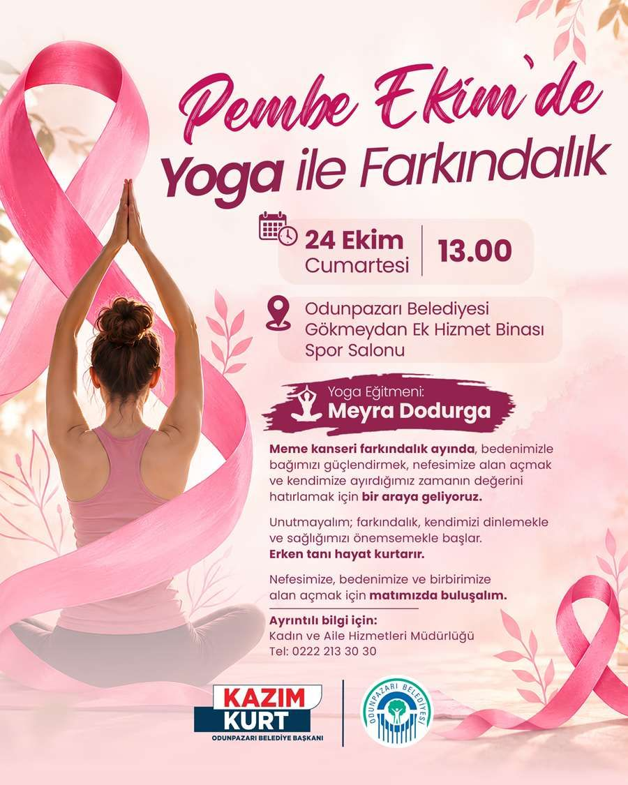

> Odunpazarı Belediyesi, Pembe Ekim kapsamında kadınları 24 Ekim Cumartesi günü Gökmeydan'da düzenlenecek yoga etkinliğine davet etti.

Odunpazarı Belediyesi, meme kanseri farkındalık ayı olan Pembe Ekim kapsamında "Pembe Ekim'de Yoga ile Farkındalık" etkinliği düzenleyecek. Etkinlikle meme kanserinde erken tanının önemine dikkat çekilmesi ve kadınlarda sağlık farkındalığının artırılması amaçlanıyor.

Etkinlik, 24 Ekim Cumartesi günü saat 13.00'te Odunpazarı Belediyesi Gökmeydan Ek Hizmet Binası Spor Salonu'nda yapılacak. Yoga eğitmeni Meyra Dodurga eşliğinde gerçekleştirilecek buluşmada katılımcılar nefeslerine odaklanacak ve kendilerine zaman ayıracak.

Belediyenin açıklamasında, meme kanserinde erken tanının tedavi sürecinde önemli rol oynadığı hatırlatıldı. Düzenli sağlık kontrollerinin aksatılmaması ve şüpheli bir değişiklik fark edildiğinde sağlık kuruluşlarına başvurulması gerektiği vurgulandı.

Etkinlikle ilgili ayrıntılı bilgi almak isteyenler, Odunpazarı Belediyesi Kadın ve Aile Hizmetleri Müdürlüğüne 0222 213 30 30 numaralı telefondan ulaşabilecek.

---

## ESTÜ'de öğrencilere IPARD proje eğitimi verilecek

**Eğitim · Merkez** · 2026-10-21 18:35 UTC · Kaynak: [Eskişehir Teknik Üniversitesi](https://www.eskisehir.edu.tr/tr/Haber/Detay/estu-is-birliginde-universite-ogrencilerine-yonelik-ipard-proje-bilgilendirme-egitimi-duzenlenecek)

> Eskişehir Teknik Üniversitesi'nde 19 Kasım'da düzenlenecek eğitimde öğrenciler IPARD destekleri ve proje hazırlama konusunda bilgilendirilecek. Ön başvurular 2-12 Kasım arasında alınacak.

Eskişehir Teknik Üniversitesi (ESTÜ), Eskişehir Aile ve Sosyal Hizmetler İl Müdürlüğü ve Tarım ve Kırsal Kalkınmayı Destekleme Kurumu (TKDK) iş birliğinde üniversite öğrencilerine yönelik "IPARD Proje Bilgilendirme Eğitimi" düzenlenecek.

Eğitim, Aile ve Sosyal Hizmetler Bakanlığı ile TKDK arasında kadın girişimciliğini teşvik etmek ve kadın kooperatiflerini güçlendirmek amacıyla imzalanan iş birliği protokolü kapsamında yapılacak. Programda öğrencilerin IPARD destekleri, kırsal kalkınma fırsatları ve proje hazırlama süreçleri hakkında bilgilendirilmesi amaçlanıyor.

Eğitim, 19 Kasım 2026 Perşembe günü 13.30-16.30 saatleri arasında ESTÜ Konferans Salonu'nda yapılacak. Başta kız öğrenciler olmak üzere girişimcilik ve kırsal kalkınmaya ilgi duyan üniversite öğrencileri katılabilecek. Katılımcılara sertifika verilecek.

Eğitime katılmak isteyen öğrencilerin 2-12 Kasım 2026 tarihleri arasında pervin.ozyilmaz@aile.gov.tr adresi üzerinden ön başvuru yapması gerekiyor. Bilgi için 0222 217 46 05 (dahili 183) numaralı telefon aranabilir.

---

## Eskişehirspor, yenilgisiz Bursa Yıldırım'ı konuk edecek

**Spor · Merkez** · 2026-10-21 18:35 UTC · Kaynak: [Google Haberler - Eskişehirspor](https://www.istikbalgazetesi.com/eskisehirsporun-teklikeli-rakibi)

> Ligin 8. haftasında Eskişehirspor'un rakibi, 7 maçta hiç kaybetmeyen ve yalnızca 3 gol yiyen Bursa Yıldırım.

Eskişehirspor, ligin 8. haftasında Bursa Yıldırım'ı ağırlayacak.

Konuk ekip Bursa Yıldırım, ilk 7 maçta 4 galibiyet ve 3 beraberlik alarak 15 puan topladı. Ligde henüz yenilgisi bulunmayan takım 8 gol atarken kalesinde yalnızca 3 gol gördü. Bursa ekibi geçen hafta kendi sahasında Uşakspor ile 1-1 berabere kaldı.

Savunmada etkili olan ve kontra atak futbolu oynayan rakip karşısında Eskişehirspor Teknik Direktörü Hakan Şapcı'nın maç planı ve oyun içindeki hamleleri belirleyici olacak.

---
