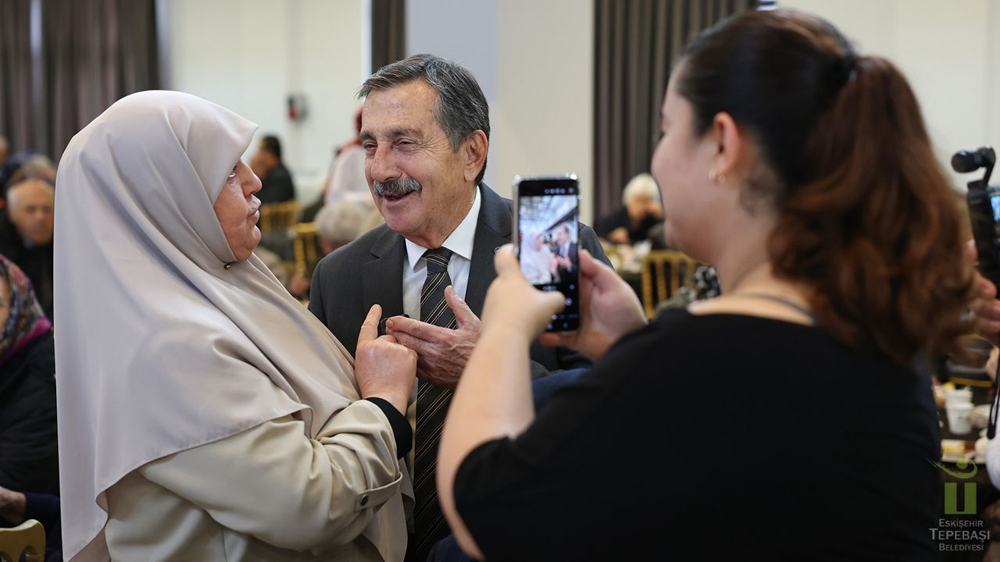
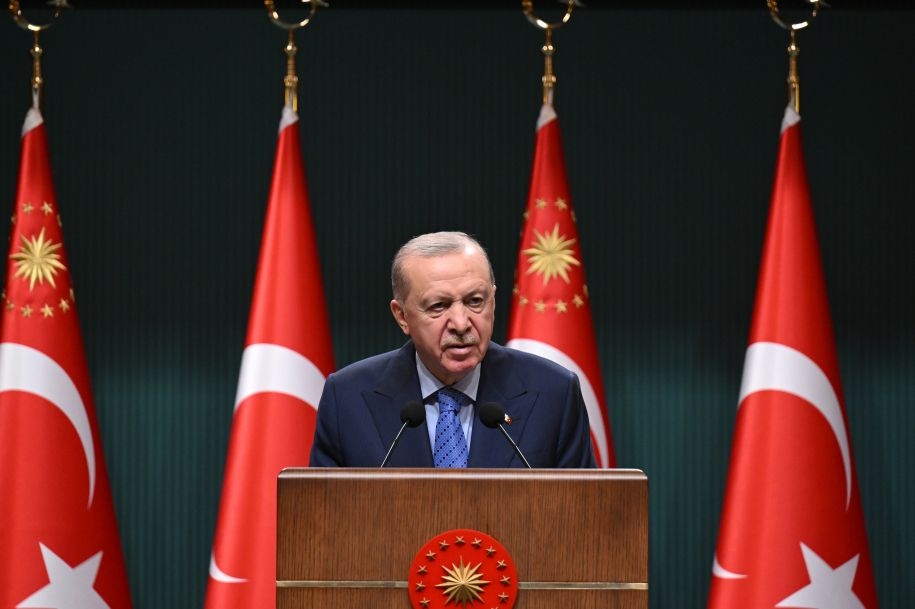
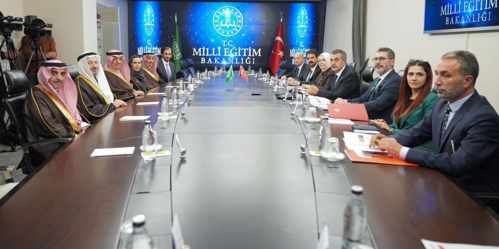
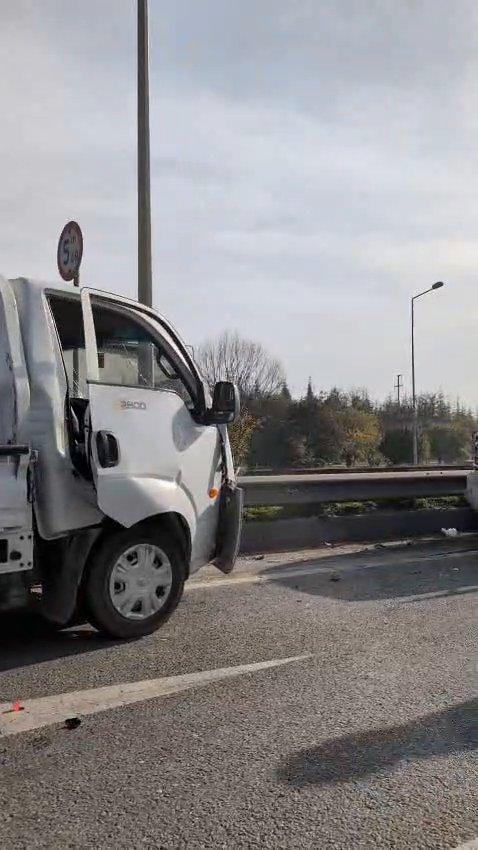
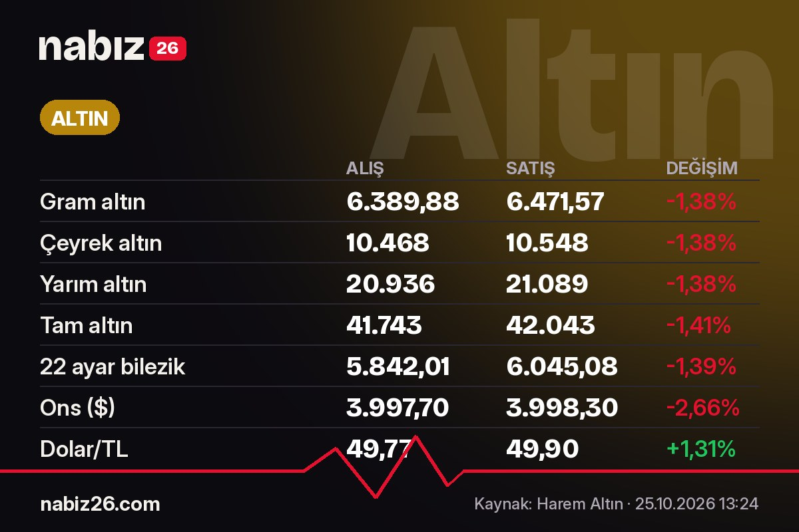

# Son haberler

Ajanın yazdığı son haberler (otomatik güncellenir).

## Altın fiyatları 27 Ekim 2026: Gram altın 6.453,36 TL

**Ekonomi · Merkez** · 2026-10-27 11:16 UTC · Kaynak: [Harem Altın](https://www.haremaltin.com/altin-fiyatlari)

> Gram altın güne düşüşle başladı. Harem Altın verilerine göre gram altın 6.385,87 TL'den alınıyor, 6.453,36 TL'den satılıyor.

Altın piyasasında güne düşüşle başlandı. Harem Altın'ın saat 14.16 itibarıyla verilerine göre gram altının satış fiyatı 6.453,36 TL, alış fiyatı 6.385,87 TL oldu. Gram altın, önceki kapanışa göre yüzde 0,49 geriledi.

Ziynet altınlarda çeyrek altın 10.518 TL, yarım altın 21.030 TL, tam altın 41.925 TL, ata altın 42.742 TL seviyesinden satışa sunuluyor.

22 ayar bileziğin gram satış fiyatı 6.028,75 TL, has altının gram fiyatı 6.434,84 TL olarak belirlendi.

Uluslararası piyasalarda altının onsu 4.012,10 dolardan işlem görürken, dolar/TL 49,80 seviyesinde bulunuyor.

Fiyatlar Harem Altın'ın saat 14.16 itibarıyla paylaştığı verilere dayanmaktadır; kuyumcular arasında farklılık gösterebilir. Bu haber yatırım tavsiyesi değildir.

---

## Tepebaşı'nda Cumhuriyet Bayramı kortej, ücretsiz konser ve EKO-ŞOV ile kutlanacak

**Gündem · Tepebaşı** · 2026-10-27 10:32 UTC · Kaynak: [Tepebaşı Belediyesi](https://www.tepebasi.bel.tr/Haber/Detay/tepebası’ndacumhuriyetbayramıkortejvekonserlerlekutlanacak)

> Kortej 28 Ekim'de 17.30'da Cumhuriyet Meydanı'ndan yola çıkacak; 29 Ekim'de EKO-ŞOV Espark AVM önünde.

Tepebaşı Belediyesi, 29 Ekim Cumhuriyet Bayramı'nı konserler, EKO-ŞOV ve Cumhuriyet Kortejiyle kutlayacak.

Kutlamalar 28 Ekim Çarşamba günü saat 17.30'da Şarhöyük Mahallesi Cumhuriyet Meydanı'ndan yola çıkacak Cumhuriyet Korteji ile başlayacak. Kortej, Tepebaşı Belediyesi yanındaki açık otoparkta sona erecek. Eskişehir Motosiklet Grubu 26, MOSEF, VesBaga Eskişehir, Vos 26 Eskişehir, Yol Kawaşçıları Türkiye ve Demir Pençe 26 Eskişehir gibi topluluklar korteje destek verecek.

Ardından saat 19.00'da Özgenur Altaş, saat 20.00'de Soup Opera sahne alacak. Konserler ücretsiz. 29 Ekim Perşembe günü saat 14.00'te EKO-ŞOV eşliğinde kutlama programı Espark AVM önünde sürecek.

Tepebaşı Belediye Başkanı Ahmet Ataç, tüm Eskişehirlileri kutlamalara davet etti. (Kaynak: Tepebaşı Belediyesi)

---

## Başkan Ataç Gaziler Günü'nde gazi ve şehit yakınlarıyla kahvaltıda buluştu

**Gündem · Tepebaşı** · 2026-10-27 10:32 UTC · Kaynak: [Tepebaşı Belediyesi](https://www.tepebasi.bel.tr/Haber/Detay/baskanatacgazivesehityakınlarıylaaynısofradabulustu)

> Tepebaşı Belediyesi'nin programına Muharip Gaziler Derneği, Şehit Aileleri Derneği ve EMŞAV temsilcileri katıldı.

Tepebaşı Belediyesi, Gaziler Günü kapsamında şehit aileleri ve gaziler için kahvaltı programı düzenledi. Tepebaşı Belediye Başkanı Ahmet Ataç'ın ev sahipliğindeki buluşmaya Eskişehir Muharip Gaziler Derneği, Eskişehir Şehit Aileleri Derneği ve Emniyet Teşkilatı Vazife Malulü ve Şehit Aileleri Vakfı (EMŞAV) temsilcileri, şehit yakınları ve gaziler katıldı.

Ataç, program boyunca konuklarıyla tek tek sohbet etti. Cumhuriyet Bayramı'nın 103. yıl dönümü dolayısıyla kutlama mesajlarının paylaşıldığı programda dernek ve vakıf temsilcileri de konuşma yaptı ve ev sahipliği için teşekkür etti.

Ataç, "Sadece önemli gün ve haftalarda değil, yılın 365 gününde bir ve beraberiz" dedi. Şehitlerin yılın her günü hatırlanması ve hatıralarının yaşatılması gerektiğini söyleyen Ataç, Tepebaşı Belediyesi'nin her zaman yanlarında olacağını belirtti. (Kaynak: Tepebaşı Belediyesi)

---

## Bakan Kurum: Sıfır Atık'ta geri kazanım oranı 2017'de yüzde 13'ten yüzde 37'ye çıktı

**Türkiye · Türkiye** · 2026-10-27 09:32 UTC · Kaynak: [İletişim Başkanlığı](https://www.iletisim.gov.tr/turkce/haberler/detay/bakan-kurum-sifir-atiktan-cop31e-turkiyenin-iklim-diplomasisi-panelinde-konustu)

> COP31 Başkanı Murat Kurum, İletişim Başkanlığı'ndaki 'Sıfır Atık'tan COP31'e' panelinde konuştu.

COP31 Başkanı ve Çevre, Şehircilik ve İklim Değişikliği Bakanı Murat Kurum, Cumhurbaşkanlığı İletişim Başkanlığı Konferans Salonu'nda düzenlenen "Sıfır Atık'tan COP31'e: Türkiye'nin İklim Diplomasisi" panelinin açılışında konuştu.

Kurum'un açıkladığı verilere göre geri kazanım oranı 2017'de yüzde 13 iken 2025'te yüzde 37'ye çıktı. Bu dönemde 90 milyon ton atık geri kazanıldı ve ekonomiye yaklaşık 365 milyar liralık katkı sağlandı. Depozitolu Ambalajlar Sistemi kapsamında bugüne kadar 520 milyon ambalaj yeniden ekonomiye kazandırıldı. Kurum, Sıfır Atık Hareketi'nin Emine Erdoğan'ın öncülüğünde başlatıldığını belirtti.

Kurum, COP31'e hazırlandıklarını söyleyerek iklim krizinin gezegeni yaşanamaz hâle getirme tehlikesine dikkat çekti. Daha önceki gece Antalya'daki şiddetli hortumda 4 kişinin hayatını kaybettiğini aktaran Kurum, ölenlere rahmet, yakınlarına sabır diledi. Türkiye'nin Akdeniz havzasındaki konumu nedeniyle iklim krizinin etkilerine en fazla maruz kalan ülkelerden biri olduğunu belirten Kurum, kentsel dönüşümü milli güvenlik meselesi olarak gördüklerini söyledi. (Kaynak: İletişim Başkanlığı)

---

## 4. Kızılinler Bal Kabağı Panayırı'na binlerce Eskişehirli katıldı

**Tarım · Tepebaşı** · 2026-10-27 06:32 UTC · Kaynak: [Tepebaşı Belediyesi](https://www.tepebasi.bel.tr/Haber/Detay/binlerceeskisehirlipanayırdabulustu)

> Tepebaşı Belediyesi'nin düzenlediği panayırda sembolik mezat ve halk oyunları gösterisi yapıldı.

Tepebaşı Belediyesi'nin düzenlediği 4. Kızılinler Bal Kabağı Panayırı'na binlerce Eskişehirli katıldı. Kızılinler Davet Salonu'ndaki panayırda saatler süren kuyruklar ve yoğun araç trafiği oluştu. Coğrafi işaretli Kızılinler bal kabağı tanıtıldı, sembolik mezat ve halk oyunları gösterisi yapıldı.

Panayıra katılan Tepebaşı Belediye Başkanı Ahmet Ataç, panayırın 2023'te bir fikir olarak doğduğunu, bu yıl dördüncüsünün yapıldığını söyledi. Ataç, geçen yıl ulusal olacağını söylediklerini, bu yıl ulusal olduğunu ve seneye büyük ihtimalle uluslararası olacağını belirtti.

Kızılinler Muhtarı Halil İbrahim Can, bal kabağının rulo pastadan baklavaya uzanan bir lezzet serüveni olduğunu ve bu yıl Tepebaşı Belediyesi'nin de Kızılinler'de üretim yaptığını söyledi. Tepebaşı Kırsal Kalkınma Kurulu Başkanı Mehmet Kızılinler, ürünün yaklaşık 90 yıldır ata tohumuyla üretildiğini hatırlattı. Eskişehir Ticaret Borsası Başkanı Ahmet Oğuz, coğrafi işaret tescilinin markalaşma yolunda önemli bir adım olduğunu belirtti. ESOGÜ Ziraat Fakültesi Dekanı Prof. Dr. Onur Koyuncu da üreticilerin emeğinin bilimsel bilgiyle desteklenip katma değere dönüşmesi gerektiğini söyledi. (Kaynak: Tepebaşı Belediyesi)

---

## Kabine toplantısı sona erdi: Erdoğan haftanın diplomasi programını açıkladı

**Türkiye · Türkiye** · 2026-10-27 05:32 UTC · Kaynak: [Google Haberler - Cumhurbaşkanı](https://www.iletisim.gov.tr/turkce/haberler/detay/cumhurbaskanligi-kabinesi-toplandi-26-10-26)

> Cumhurbaşkanı Erdoğan, yaklaşık 3 saat süren Kabine Toplantısı'nın ardından programı ve dış politika başlıklarını açıkladı.

Cumhurbaşkanlığı Kabinesi, Cumhurbaşkanı Recep Tayyip Erdoğan başkanlığında Cumhurbaşkanlığı Külliyesi'nde toplandı. Saat 15.38'de başlayan toplantı yaklaşık 3 saat sürdü. Erdoğan, toplantının ardından millete seslendi.

Erdoğan konuşmasına, Zonguldak'ta geçen hafta özel bir maden ocağındaki grizu patlamasında hayatını kaybeden 3 madenciye ve Ankara'daki askerî araç kazasında şehit olan Albay Sayit Gökgöz'e başsağlığı dileyerek başladı. Kabine toplantısında iç siyaset, ekonomi, güvenlik ve dış politikaya ilişkin güncel gelişmeleri ele aldıklarını söyledi.

Erdoğan'ın aktardığına göre Kanada Başbakanı Mark Carney'nin ziyaretinde ilişkiler stratejik ortaklık seviyesine yükseltildi; savunma, hava ulaştırma ve enerji alanlarında üç anlaşma imzalandı ve serbest ticaret anlaşması müzakerelerine yıl bitmeden başlanması kararlaştırıldı. 3 milyar dolar civarındaki ticaret hacminin önce 5, sonra 10 milyar dolara çıkarılması hedefleniyor. Erdoğan, 16 Ekim'de Kamboçya Başbakanı Hun Manet'i İstanbul'da ağırladıklarını da hatırlattı.

Erdoğan, önümüzdeki günlerin programını şöyle açıkladı: 28 Ekim'de Kazakistan Cumhurbaşkanı Kasım Cömert Tokayev Ankara'da ağırlanacak ve aynı gün Beştepe Millet Ormanı halkın kullanımına açılacak. 30 Ekim Cuma günü Türk Devletleri Teşkilatı'nın 13. Zirvesi Ankara'da yapılacak. Ardından Güney Kore ziyareti ve dönüşte Antalya'da COP31 Zirvesi planlanıyor. (Kaynak: İletişim Başkanlığı)

---

## Kazım Kurt: Kurşunlu Külliyesi ve eserlerin sorumluluğunu Vakıflar'a bırakıyoruz

**Belediye · Odunpazarı** · 2026-10-27 02:33 UTC · Kaynak: [Google Haberler - Odunpazarı](https://www.2eylul.com.tr/kazim-kurttan-kursunlu-kulliyesi-tepkisi-buyurun-sizin-olsun)

> Odunpazarı Belediye Başkanı Kurt, sosyal medya paylaşımında külliyenin belediyenin elinden alınmak istendiğini öne sürdü.

Odunpazarı Belediye Başkanı Kazım Kurt, Kurşunlu Külliyesi'ne ilişkin sosyal medya hesabından açıklama yaptı. Kurt, külliyenin yıllardır kültür ve sanat faaliyetleriyle yaşatıldığını belirterek yapının belediyenin elinden alınmak istendiğini öne sürdü.

Kurt paylaşımında, külliyenin müzeleri, atölyeleri ve uluslararası festivalleriyle Eskişehir'in önemli kültür ve sanat merkezlerinden biri haline getirildiğini, mevcut gelişmelerin bu birikimin geleceğini belirsizliğe sürüklediğini savundu. Kurt, "Biz üzerimize düşeni yaptık. Bu tarihi mirasa sahip çıktık, sanatla buluşturduk, Eskişehirlilerin hizmetine sunduk. Madem bütün bu emeğin, sanatın ve kültürel birikimin bir karşılığı yok, buyurun Kurşunlu Külliyesi de eserler de sizin olsun!" dedi. Eserlerin sorumluluğunu Kütahya Vakıflar Bölge Müdürlüğü'ne bıraktıklarını belirtti.

Haberde yer alan bilgiler Kurt'un açıklamasına dayanıyor; Vakıflar Bölge Müdürlüğü'nün bu açıklamaya yanıtı kaynakta yer almıyor. (Kaynak: Google Haberler üzerinden Odunpazarı Belediye Başkanı Kazım Kurt'un paylaşımı)

---

## ESKİ'nin ES2026 Yeni Nesil Sayaç ve Online Ödeme Sistemi tanıtıldı: Komisyon yok

**Belediye · Merkez** · 2026-10-27 00:33 UTC · Kaynak: [Google Haberler - Eskişehir](https://www.gzt26.com/ayse-unlucenin-secim-vaadi-hayata-gecti-eskisehirde-sebeke-suyu-yuklemede-yeni-donem)

> Aboneler cep telefonlarından su yükleyebilecek; mevcut sayaçlar ve su yükleme noktaları hizmet vermeyi sürdürecek.

Eskişehir Büyükşehir Belediyesi ve ESKİ Genel Müdürlüğü'nün geliştirdiği ES2026 Yeni Nesil Sayaç ve Online Ödeme Sistemi, 26 Ekim'de ESKİ İçme Suyu Arıtma Tesisleri'nde düzenlenen programla tanıtıldı. Yeni sistemle vatandaşlar su yükleme noktalarına gitmeden cep telefonlarından işlem yapabilecek. Mevcut sayaçlarını kullanmak isteyen aboneler eski sistemle devam edebilecek.

Programa Büyükşehir Belediyesi Genel Sekreter Vekili M. Recai Erdir, ESKİ Genel Müdür Vekili Niyazi Solak, belediye yöneticileri ve basın mensupları katıldı. Fransa'nın Strazburg kentinde bulunan Belediye Başkanı Ayşe Ünlüce, programa video mesaj gönderdi ve sistemin ESKİ çalışanlarının kendi mühendislik çalışmalarıyla geliştirildiğini belirterek teşekkür etti.

Yeni uygulamayla vatandaşlar aile bireylerinin aboneliklerine de uzaktan su yükleyebilecek. Mobil uygulama üzerinden yapılan işlemlerden komisyon alınmayacak. Kullanıcılar kalan su miktarını ve tahmini bitiş tarihini görebilecek; su kredisinin bitmesine bir hafta kala telefonlarına uyarı gönderilecek. Sistem Android ve iOS'ta kullanılabilecek, ESKİ'ye göre iPhone'larda su yüklenmesini sağlayan çözüm Türkiye'de bir ilk.

Nisan ayında saha testlerine başlanan yeni sayaçlar yeni yapılarda kullanılmaya başlandı. Mevcut aboneler mobil uygulamadan başvurarak sayaçlarını değiştirebilecek. İlk aşamada 5 ila 6 bin abonenin talebini karşılayacak hazırlık yapıldı, yıllık üretim kapasitesi 80 bin sayaca ulaşabilecek. (Kaynak: Anadolu Gazetesi)

---

## Türkiye ile Suudi Arabistan arasında eğitim iş birliği mutabakat zaptı imzalandı

**Eğitim · Türkiye** · 2026-10-26 20:32 UTC · Kaynak: [Milli Eğitim Bakanlığı](https://www.meb.gov.tr/bakan-tekin-suudi-arabistan-egitim-bakani-el-benyan039la-gorustu/haber/42293/tr)

> Bakan Tekin ve Suudi Arabistan Eğitim Bakanı El-Benyan, öğretmen-öğrenci değişimi ve denklik konularını içeren mutabakat zaptını imzaladı.

Millî Eğitim Bakanı Yusuf Tekin, Suudi Arabistan Eğitim Bakanı Yusuf Bin Abdullah El-Benyan ile görüştü. Görüşmenin ardından iki bakan eğitim alanında mutabakat zaptı imzaladı. Programda Millî Eğitim Bakan Yardımcısı Celile Eren Ökten de yer aldı.

Mutabakat zaptıyla öğretmen, öğrenci ve uzmanların karşılıklı ziyaretleri, eğitim personelinin mesleki gelişimi, ortak araştırmalar, eğitim materyallerinin geliştirilmesi, özel eğitim, eğitim teknolojileri ve uzaktan eğitim alanlarında iş birliğinin güçlendirilmesi hedefleniyor. Türkçe ve Arapça öğretiminin desteklenmesi, eğitim yeterlilikleri ve sertifikalarının karşılıklı tanınması ve denklikleri konusunda iş birliği, okul açılış ve izin süreçlerinin kolaylaştırılması da öngörülüyor.

Tekin, iki ülke ilişkilerinin daha iyi bir noktaya taşınması için en önemli görevin eğitim bakanlıklarına düştüğünü söyledi. Tekin ayrıca yapay zekânın eğitim süreçlerindeki olumlu ve olumsuz etkilerinin sağlıklı değerlendirilmesi gerektiğini belirtti. El-Benyan ise yapay zekânın eğitimdeki yerinin belirlenmesi gerektiğini, bu rolün Suudi Arabistan'ın dini ve ulusal değerleriyle örtüşmesi gerektiğini söyledi. (Kaynak: Millî Eğitim Bakanlığı)

---

## Valilik Cumhuriyet Bayramı programını açıkladı: 29 Ekim'de resmî geçit töreni

**Gündem · Merkez** · 2026-10-26 18:33 UTC · Kaynak: [Google Haberler - Eskişehir etkinlik](https://www.istikbalgazetesi.com/eskisehir-valiligi-duyurdu-29-ekim-cumhuriyet-bayrami-programi-belli-oldu)

> 26-29 Ekim arasında doğa yürüyüşleri, konserler, çelenk töreni, kortej ve resmî geçit var.

Eskişehir Valiliği'nin paylaştığı programa göre Cumhuriyet Bayramı kutlamaları 26 Ekim'den itibaren kentte çeşitli etkinliklerle sürecek.

26 Ekim: 09.00-17.00 arasında İl Halk Kütüphanesi giriş katında Atatürk Kitap Sergisi açık olacak. 09.00-15.00 arasında Frig Vadisi-Yazılıkaya'da doğa yürüyüşü yapılacak. 11.00'de Büyükşehir Belediyesi Sanat ve Kültür Merkezi'nde Türk Halk Müziği Korosu konseri, 17.00'de Şehit Anıl Gül Spor Salonu'nda güreş turnuvası düzenlenecek.

27 Ekim: 08.45'te Küçükelmalı Tabiat Parkı'nda doğa yürüyüşü, 10.00-15.00 arasında Sümer Mahallesi'nde oryantiring yarışı olacak. 16.00'da ESOGÜ Kongre ve Kültür Merkezi'nde halk müziği konseri ve halk oyunları gösterisi, 19.00-21.00 arasında Anadolu Üniversitesi Öğrenci Merkezi Yunus Emre Salonu'nda konser yapılacak.

28 Ekim: İlköğretim öğrencileri ETİ Arkeoloji Müzesi'ni 08.00-17.00 arasında ücretsiz gezebilecek. 10.00'da Hava Şehitliği'nde şehitlik ziyareti yapılacak. 11.00'de Tepebaşı Belediyesi başkanlık binası yanında "Atatürk ve Çocukları" adlı eserin açılışı yapılacak. 13.00'te Valilik Meydanı'nda çelenk sunma töreni, 17.00'de kortej, 19.30'da Hasan Polatkan Kültür Merkezi'nde Cumhuriyet Bayramı konseri olacak.

29 Ekim: 10.00'da Valilik Makamı'nda tebriklerin kabulü töreni, 10.30'da Atatürk Bulvarı'nda kutlama ve resmî geçit töreni yapılacak. 10.00-17.00 arasında TÜRASAŞ Bölge Müdürlüğü'ndeki Devrim Müzesi ziyaret edilebilecek. (Kaynak: İstikbal Gazetesi, Eskişehir Valiliği programı)

---

## Vali Yılmaz İstiklal Mahallesi Demirciler Sokağı esnafını ziyaret etti

**Gündem · Merkez** · 2026-10-26 14:32 UTC · Kaynak: [Eskişehir Valiliği](https://www.eskisehir.gov.tr/valimiz-dr-erdinc-yilmaz-istiklal-mahallesi-demirciler-sokak-uzerinde-faaliyet-gosteren-esnafi-ziyaret-ederek-hayirli-ve-bereketli-kazanclar-diledi)

> Vali Erdinç Yılmaz esnafın sorunlarını ve önerilerini dinledi.

Eskişehir Valisi Dr. Erdinç Yılmaz, İstiklal Mahallesi Demirciler Sokağı üzerinde faaliyet gösteren esnafı ziyaret etti. Yılmaz, esnafa hayırlı ve bereketli kazançlar diledi.

Esnaf ve vatandaşlarla bir süre sohbet eden Yılmaz, iş yerlerinin durumu ve karşılaşılan sorunlar hakkında bilgi aldı, talep ve önerileri dinledi. Yılmaz, esnafın şehrin ekonomisine ve sosyal hayatına önemli katkılar sunduğunu belirterek "Esnafımızın her zaman yanındayız. Hemşehrilerimizle birlikte Eskişehir'imiz için çalışmaya devam edeceğiz" dedi. (Kaynak: Eskişehir Valiliği)

---

## Ortak Yazılı Sınav Sistemi için 'Sıkça Sorulan Sorular' rehberi hazırlandı

**Eğitim · Merkez** · 2026-10-26 14:32 UTC · Kaynak: [Eskişehir İl Milli Eğitim Müdürlüğü](https://eskisehir.meb.gov.tr/www/ortak-yazili-sinav-sistemi039yle-ilgili-quotsikca-sorulan-sorularquot-rehberi-hazirlandi/icerik/8697/tr)

> İl Milli Eğitim Müdürlüğü, OYSS'nin hangi sınıf ve derslerde uygulanacağını açıkladı.

Eskişehir İl Milli Eğitim Müdürlüğü, Ortak Yazılı Sınav Sistemi (OYSS) ile ilgili sıkça sorulan soruları yanıtladı. Hazırlanan rehberde sistemin amacı, öğrenci başarısı ve eğitim kalitesi bakımından önemi ve nasıl uygulanacağı anlatıldı.

OYSS, okul geneli ortak yazılı sınavların hazırlanması, uygulanması ve değerlendirilmesi süreçlerini dijital ortamda yürütmek için geliştirilen bir sistem. Rehbere göre sınavların öğretim programlarındaki öğrenme çıktılarıyla uyumlu, geçerli ve güvenilir hazırlanması hedefleniyor. Sistemle Türkiye Yüzyılı Maarif Modeli ile uyumlu biçimlendirici değerlendirme uygulamalarının, açık uçlu ve beceri temelli soruların okul düzeyinde yaygınlaştırılması amaçlanıyor.

2026-2027 eğitim öğretim yılında OYSS, ortaokul 5, 6 ve 7. sınıflarda Türkçe, matematik, fen bilimleri, sosyal bilgiler, din kültürü ve ahlak bilgisi ile İngilizce derslerinde; lise 9, 10 ve 11. sınıflarda Türk dili ve edebiyatı, matematik, fizik, kimya, biyoloji, tarih, coğrafya, din kültürü ve ahlak bilgisi, felsefe ve İngilizce derslerinde uygulanacak.

Sistemin kullanımına yönelik bilgilendirme ve eğitim çalışmaları 19-23 Ekim 2026'da tamamlandı. Öğretmenler sistem üzerinde deneme uygulamaları yapabiliyor. (Kaynak: Eskişehir İl Milli Eğitim Müdürlüğü)

---

## Ankara Pursaklar'da Mehmet Akif Ersoy Çocuk Evleri Sitesi açıldı: 80 çocuk kapasitesi

**Türkiye · Türkiye** · 2026-10-26 12:42 UTC · Kaynak: [Aile ve Sosyal Hizmetler Bakanlığı](https://www.aile.gov.tr/haberler/bakanimiz-mahinur-ozdemir-goktas-mehmet-akif-ersoy-cocuk-evleri-sitesinin-acilis-toreninde-konustu/)

> Bakan Göktaş, tesisin açılışında koruma ve bakım altındaki çocuk sayılarını açıkladı.

Aile ve Sosyal Hizmetler Bakanı Mahinur Özdemir Göktaş, Ankara Pursaklar'daki Mehmet Akif Ersoy Çocuk Evleri Sitesi'nin açılış töreninde konuştu. Göktaş, tesisin hayata geçirilmesinde sağladığı iş birliği nedeniyle UNICEF'e teşekkür etti.

Göktaş'ın verdiği bilgiye göre site 0-6 yaş grubundaki kız ve erkek çocuklara ile 7-12 yaş grubundaki kız çocuklarına hizmet verecek. 80 çocuk kapasitesiyle planlanan site, 8 villa tipi yaşam birimi, bir sosyal bina ve bir idari binadan oluşuyor. Kuruluş 14 Ekim'de kapılarını açtı ve 40 kız çocuğu yeni hayatlarına bu evlerde başladı.

Bakan, koruma ve bakım altındaki 15 bin 174 çocuğun barınma, eğitim, sağlık ve psikososyal gelişiminin takip edildiğini söyledi. Göktaş'a göre 11 bin 72 çocuk 9 bin 327 koruyucu ailenin yanında büyüyor; sosyal ve ekonomik destek hizmetiyle 199 bin 889 çocuğun ailesinin yanında büyümesine katkı sağlanıyor. Ankara'da ise 6 bin 754 çocuğun ailesinin yanında büyümesi destekleniyor, 507 çocuğa koruyucu aile hizmeti, 1560 çocuğa kuruluşlarda bakım hizmeti sunuluyor. (Kaynak: Aile ve Sosyal Hizmetler Bakanlığı)

---

## Ailekart ile hak sahiplerine 56 milyar liradan fazla kaynak aktarıldı

**Türkiye · Türkiye** · 2026-10-26 12:42 UTC · Kaynak: [Aile ve Sosyal Hizmetler Bakanlığı](https://www.aile.gov.tr/haberler/ailekart-araciligiyla-hak-sahiplerine-56-milyar-lirayi-askin-kaynak-aktarildi/)

> Aile Bakanlığı'na göre 3 milyon 580 bin Ailekart dağıtıldı; 15 düzenli sosyal yardım tek karttan ödeniyor.

Aile ve Sosyal Hizmetler Bakanlığı'nın açıklamasına göre, Ailekart uygulaması aracılığıyla doğum yardımı ve düzenli sosyal yardım ödemeleri kapsamında hak sahiplerine toplam 56 milyar 12 milyon 551 bin 214 lira aktarıldı.

Uygulama, Eylül 2025'te doğum yardımı ödemeleriyle başladı. 1 Temmuz 2026'dan itibaren engelli ve yaşlı aylıkları ile elektrik ve doğal gaz tüketim desteği gibi 15 farklı düzenli sosyal yardım ödemesi de Halkbank aracılığıyla Ailekart üzerinden yapılıyor. Bakanlık, uygulamanın yapay zekâ destekli merkezi ödeme sistemiyle entegre çalıştığını bildirdi.

Bugüne kadar 3 milyon 580 bin Ailekart dağıtıldı. Eylül 2025'ten bu yana doğum yardımı kapsamında 24 milyar 173 milyon 107 bin 900 lira, Temmuz 2026'dan itibaren düzenli sosyal yardımlar kapsamında ise 31 milyar 839 milyon 443 bin 314 lira ödeme yapıldı.

Ailekart sahipleri ödemelerini kamu bankalarının ortak kullanıma açık ATM'lerinden alabiliyor. Bakanlığa göre önümüzdeki günlerde anlaşmalı iş yerlerinde sunulacak indirimlerden de yararlanabilecekler. (Kaynak: Aile ve Sosyal Hizmetler Bakanlığı)

---

## Altın fiyatları 26 Ekim 2026: Gram altın 6.476,45 TL

**Ekonomi · Merkez** · 2026-10-26 11:53 UTC · Kaynak: [Harem Altın](https://www.haremaltin.com/altin-fiyatlari)

> Gram altın güne düşüşle başladı. Harem Altın verilerine göre gram altın 6.408,61 TL'den alınıyor, 6.476,45 TL'den satılıyor.

Altın piyasasında güne düşüşle başlandı. Harem Altın'ın saat 14.53 itibarıyla verilerine göre gram altının satış fiyatı 6.476,45 TL, alış fiyatı 6.408,61 TL oldu. Gram altın, önceki kapanışa göre yüzde 1,31 geriledi.

Ziynet altınlarda çeyrek altın 10.556 TL, yarım altın 21.105 TL, tam altın 42.075 TL, ata altın 42.895 TL seviyesinden satışa sunuluyor.

22 ayar bileziğin gram satış fiyatı 6.049,66 TL, has altının gram fiyatı 6.457,08 TL olarak belirlendi.

Uluslararası piyasalarda altının onsu 4.019,00 dolardan işlem görürken, dolar/TL 49,81 seviyesinde bulunuyor.

Fiyatlar Harem Altın'ın saat 14.53 itibarıyla paylaştığı verilere dayanmaktadır; kuyumcular arasında farklılık gösterebilir. Bu haber yatırım tavsiyesi değildir.

---

## Kazım Kurt: Kurşunlu Külliyesi'ndeki tahliye için hukuki süreç sürüyor

**Belediye · Odunpazarı** · 2026-10-26 10:32 UTC · Kaynak: [Google Haberler - Odunpazarı](https://www.anadolugazetesi.com/kazim-kurt-tan-kursunlu-kulliyesi-icin-uyari--eserler-yok-olabilir--297015.html)

> Odunpazarı Belediye Başkanı Kurt, ES TV'de dava ve kira sözleşmesi sürecini anlattı; Vakıflar tarafı bu haberde görüş bildirmedi.

Odunpazarı Belediye Başkanı Kazım Kurt, ES TV'de yayınlanan Günaydın Eskişehir programında Kurşunlu Külliyesi'nin tahliye süreci ve Vakıflar Bölge Müdürlüğü ile yaşanan hukuki uyuşmazlık hakkında konuştu. Kurt, Eskişehir'de açtıkları davayı kaybettiklerini, dosyanın Bursa'da istinaf aşamasında olduğunu ve tahliyenin durdurulması için hukuki girişimlerin sürdüğünü söyledi.

Kurt'un anlattığına göre, 20 Kasım 2025'te yürürlüğe giren 7565 sayılı Kanun'un geçici 15'inci maddesi kapsamında kira sözleşmelerinin uzatılması için başvuruda bulundular ancak yanıt alamadılar. Bunun üzerine kiracılık durumlarının tespiti ve ilgili yasal düzenlemeden yararlanma talebiyle yeni bir dava açtılar. Kurt, Vakıflar tarafından tahliye kararının yeniden tebliğ edildiğini ve bu işleme karşı da dava açtıklarını belirtti.

Kurt, külliyede lületaşı müzesi, fotoğraf makineleri müzesi, fotoğraf atölyesi, ahşap eserler müzesi, ahşap atölyesi, cam fırını ve cam atölyesinin bulunduğunu hatırlattı. Külliyede Vakıfların verdiği yetkiyle kiralanan yaklaşık 20-25 küçük işletmede Eskişehirli kadın girişimcilerin el işi ürünlerinin satıldığını söyleyen Kurt, tahliyenin hem ekonomik faaliyetlere hem kültürel üretime zarar verebileceğini savundu. Özellikle ahşap eserler müzesindeki çalışmaların zarar görmesinden endişe duyduğunu ifade etti. (Kaynak: Anadolu Gazetesi)

---

## Bakan Göktaş il müdürlerinden bakım kuruluşlarında habersiz denetim istedi

**Türkiye · Türkiye** · 2026-10-26 07:32 UTC · Kaynak: [Aile ve Sosyal Hizmetler Bakanlığı](https://www.aile.gov.tr/haberler/aile-ve-sosyal-hizmetler-bakanimiz-goktastan-il-mudurlerine-sahada-aktif-yonetim-ve-habersiz-denetim-talimati/)

> Aile ve Sosyal Hizmetler Bakanı Göktaş, 81 il müdürüyle yıllık değerlendirme toplantısı yaptı.

Aile ve Sosyal Hizmetler Bakanı Mahinur Özdemir Göktaş, Ankara'da Bakanlığın 81 il müdürüyle yıllık değerlendirme toplantısında bir araya geldi. Göktaş, çocuk, yaşlı ve engelli bireylerin bakımını üstlenen kuruluşların büyük bir hassasiyetle takip edilmesini ve titizlikle denetlenmesini istedi.

Aile ve Nüfus 10 Yılı'nı Bakanlığın tüm hizmet alanlarını ortak bir gelecek perspektifinde buluşturan stratejik bir süreç olarak gördüklerini belirten Göktaş, il müdürlerinden yerel öncelikleri bu doğrultuda belirlemelerini istedi.

Göktaş, nisandan itibaren 81 ilde kadına yönelik şiddet ve çocukların suça sürüklenmesi sosyal risk haritalarındaki yüksek riskli hanelerin ziyaret edildiğini, hane ziyaretlerinin yüzde 69,94'ünün tamamlandığını söyledi. Yüksek riskli hanelerin üç ay sonra yeniden ziyaret edilmesinin önemine dikkat çekti.

Bakan, il müdürlerinden sahada aktif, vatandaşla doğrudan temas kuran ve ulaşılabilir yöneticiler olmalarını istedi. Göktaş, sahada karşılaşılan sorunların valilik koordinasyonunda çözülmesini, çözülemeyenlerin gecikmeden Bakanlığa iletilmesini de belirtti. (Kaynak: Aile ve Sosyal Hizmetler Bakanlığı)

---

## Eskişehir çevre yolunda otogar karşısında kaza: Olay yerinde itfaiye ve ambulans var

**Asayiş · Merkez** · 2026-10-26 07:10 UTC · Kaynak: [Nabız 26]()

> Ankara yönünde otogar karşısında sabah saatlerinde meydana gelen kazada bir kamyonetin ön kısmı hasar gördü; olay yerinde 112 ekibi ve itfaiye aracı bulunuyor.

Eskişehir çevre yolunda, otogar karşısında Ankara yönünde sabah saatlerinde trafik kazası meydana geldi. Olay yerinde çekilen görüntülerde, beyaz renkli bir kamyonetin ön kısmının ve sürücü kapısı çevresinin hasar gördüğü, yol üzerinde cam kırıkları ve araç parçaları bulunduğu görülüyor.

Görüntülerde olay yerinde bir ambulans ve 112 Acil Çağrı yazılı bir itfaiye aracı bulunuyor. Kazanın nedeni, kazaya karışan araç sayısı ile yaralı olup olmadığı konusunda şu an resmî bir açıklama bulunmuyor. Bilgiler netleştikçe haber güncellenecek. (Kaynak: Nabız 26)

---

## TEDx Vişnelik Women 'Rooted & Rising' temasıyla Eskişehir'de yapıldı

**Kültür-Sanat · Odunpazarı** · 2026-10-26 05:32 UTC · Kaynak: [Odunpazarı Belediyesi](https://www.odunpazari.bel.tr/guncel/haberler/genel-haberler/tedx-visnelik-women-da-rooted-rising-bulusmasi-eskisehir-de-kadinlarin-ilham)

> Odunpazarı Belediyesi'nin katkısıyla düzenlenen etkinlikte beş kadın konuşmacı deneyimlerini paylaştı.

Odunpazarı Belediyesi'nin katkılarıyla Hasan Polatkan Kültür Merkezi'nde düzenlenen TEDx Vişnelik Women, "Rooted & Rising" (Köklerinden Güç Alarak Yükselmek) temasıyla kadınların deneyimlerini, dönüşüm yolculuklarını ve geleceğe yön veren fikirlerini aynı sahnede buluşturdu. Etkinliğe Odunpazarı Belediye Başkanı Kazım Kurt da katıldı.

Etkinlikte Doç. Dr. Aysel Kaya, Nihal Elersu Bağcı, İrem Karakaya Kavalcı, Bedriye Berber Engin ve Feyza Çelik Orbay konuşmacı olarak yer aldı. Farklı disiplinlerden gelen konuşmacılar kendi hikâyelerini ve bakış açılarını katılımcılarla paylaştı.

Etkinliğin sonunda kürsüye çıkan Başkan Kurt, kadınların toplumsal yaşamın her alanında güçlenmesinin ve kendi hikâyelerini özgürce anlatabilmesinin önemine dikkat çekti. (Kaynak: Odunpazarı Belediyesi)

---

## Manidar grubu Yunus Emre Kültür ve Sanat Merkezi'nde konser verdi

**Kültür-Sanat · Odunpazarı** · 2026-10-26 05:32 UTC · Kaynak: [Odunpazarı Belediyesi](https://www.odunpazari.bel.tr/guncel/haberler/genel-haberler/manidar-grubu-ndan-odunpazari-nda-unutulmaz-konser)

> Salonu dolduran müzikseverler grubun seslendirdiği ezgilere eşlik etti; konseri Başkan Yardımcısı Sibel Yeşildal de izledi.

Odunpazarı Belediyesi Kültür ve Sanat Sosyal İşler Müdürlüğü bünyesindeki sanatçıların kurduğu Manidar grubu, Yunus Emre Kültür ve Sanat Merkezi'nde konser verdi. Konsere müzikseverler yoğun ilgi gösterdi, salonu dolduran dinleyiciler seslendirilen ezgilere eşlik etti.

Konseri Odunpazarı Belediyesi Başkan Yardımcısı Sibel Yeşildal da izledi. Konserin sonunda sahneye çıkan Yeşildal, sanatçılara ve geceye katılan müzikseverlere teşekkür etti. Yeşildal, Manidar grubunun belediyenin Kültür ve Sanat Sosyal İşler Müdürlüğü bünyesindeki sanatçılar tarafından kurulmasının önemine dikkat çekti ve kültür-sanat etkinliklerinin artarak süreceğini söyledi. (Kaynak: Odunpazarı Belediyesi)

---

## Türkiye'nin elektrik kurulu gücü Eylül sonunda 127 bin 355 megavata ulaştı

**Ekonomi · Türkiye** · 2026-10-25 10:31 UTC · Kaynak: [Enerji ve Tabii Kaynaklar Bakanlığı](https://enerji.gov.tr/haber-detay?id=31953)

> Yenilenebilir kaynakların payı yüzde 63,1'e çıktı; Bakan Bayraktar yerli kaynakların payını vurguladı.

Türkiye'nin elektrik kurulu gücü, 2026 Eylül ayı sonu itibarıyla 127 bin 355 megavata ulaştı. Yenilenebilir kaynaklı kurulu güç 80 bin 315 megavata çıktı; yenilenebilirin toplam kurulu güç içindeki payı yüzde 63,1, yerli kaynakların payı ise yüzde 72,1 oldu.

Güneş enerjisinin kurulu gücü 28 bin 222 megavata, rüzgâr enerjisinin kurulu gücü 15 bin 540 megavata yükseldi. İki kaynağın toplam kurulu gücü 43 bin 762 megavata, toplam içindeki payı yüzde 34,4'e çıktı.

Eylül'de aylık elektrik üretimi 31,79 milyar kilovatsaat oldu. Üretimin yüzde 26'sına denk gelen 8,27 milyar kilovatsaati hidrolik kaynaklardan elde edildi.

Enerji ve Tabii Kaynaklar Bakanı Alparslan Bayraktar, Eylül'de toplam elektrik üretiminin yüzde 70,3'ünü yerli kaynaklarla karşıladıklarını, böylece dışa bağımlılığı yüzde 30'un altına indirdiklerini söyledi. (Kaynak: Enerji ve Tabii Kaynaklar Bakanlığı)

---

## AİLEM Engelsiz İletişim Merkezi 335 bin 288 çağrıya çeviri desteği sağladı

**Gündem · Türkiye** · 2026-10-25 10:31 UTC · Kaynak: [Aile ve Sosyal Hizmetler Bakanlığı](https://www.aile.gov.tr/haberler/ailem-engelsiz-iletisim-merkezi-335-bin-288-cagriya-ceviri-destegi-sagladi/)

> Bakan Göktaş, merkezin 54 bin 788 kayıtlı kullanıcısı olduğunu ve günde ortalama 250-300 çağrıya destek verildiğini açıkladı.

Aile ve Sosyal Hizmetler Bakanı Mahinur Özdemir Göktaş, işitme engelli bireylerin kamu hizmetlerine, bilgiye ve sosyal hayata erişimini kolaylaştırmak için hizmete sunulan AİLEM Engelsiz İletişim Merkezi aracılığıyla bugüne kadar 335 bin 288 çağrının karşılandığını bildirdi.

Göktaş'a göre merkezin 54 bin 788 kayıtlı kullanıcısı bulunuyor. İşitme engelli bireylerin eğitimden istihdama, sağlık hizmetlerinden bankacılık işlemlerine, aile içi iletişimden kamu kurumlarıyla yürütülen işlemlere kadar hayatın her alanında iletişim kurabilmesi için günlük ortalama 250-300 çağrıya destek sağlanıyor.

Merkeze iOS ve Android mobil uygulamaları ile web üzerinden erişilebiliyor. Göktaş, merkezin işitme engelli danışana, hastaya, veliye veya müşteriye ulaşmak isteyen işiten bireylerin de kullanımına açık olduğunu hatırlattı. (Kaynak: Aile ve Sosyal Hizmetler Bakanlığı)

---

## Altın fiyatları 25 Ekim 2026: Gram altın 6.471,57 TL

**Ekonomi · Merkez** · 2026-10-25 10:24 UTC · Kaynak: [Harem Altın](https://www.haremaltin.com/altin-fiyatlari)

> Gram altın güne düşüşle başladı. Harem Altın verilerine göre gram altın 6.389,88 TL'den alınıyor, 6.471,57 TL'den satılıyor.

Altın piyasasında güne düşüşle başlandı. Harem Altın'ın saat 13.24 itibarıyla verilerine göre gram altının satış fiyatı 6.471,57 TL, alış fiyatı 6.389,88 TL oldu. Gram altın, önceki kapanışa göre yüzde 1,38 geriledi.

Ziynet altınlarda çeyrek altın 10.548 TL, yarım altın 21.089 TL, tam altın 42.043 TL, ata altın 42.798 TL seviyesinden satışa sunuluyor.

22 ayar bileziğin gram satış fiyatı 6.045,08 TL, has altının gram fiyatı 6.452,21 TL olarak belirlendi.

Uluslararası piyasalarda altının onsu 3.998,30 dolardan işlem görürken, dolar/TL 49,90 seviyesinde bulunuyor.

Fiyatlar Harem Altın'ın saat 13.24 itibarıyla paylaştığı verilere dayanmaktadır; kuyumcular arasında farklılık gösterebilir. Bu haber yatırım tavsiyesi değildir.

---

## Başkan Ataç Yeni Mahalle'de tamamlanan asfalt ve kaldırım çalışmalarını inceledi

**Belediye · Tepebaşı** · 2026-10-25 09:31 UTC · Kaynak: [Tepebaşı Belediyesi](https://www.tepebasi.bel.tr/Haber/Detay/yenimahalle’dehizmetevatandaslardantamnot)

> Tepebaşı Belediye Başkanı Ahmet Ataç, mahalle sakinleriyle sohbet etti ve çalışmayı yürüten ekibe baklava ikram etti.

Tepebaşı Belediye Başkanı Dt. Ahmet Ataç, Yeni Mahalle'de Fen İşleri Müdürlüğü ekiplerince yürütülen asfalt ve kaldırım yenileme çalışmalarını yerinde inceledi. Fen İşleri Müdür Vekili Enes Akgün'den çalışmalar hakkında bilgi alan Ataç'a Mahalle Muhtarı Halil Çeltik eşlik etti.

Ataç, mahalle sakinleriyle tek tek sohbet ederek görüş ve taleplerini dinledi. Mahalleliler, tamamlanan asfalt ve kaldırım çalışmalarından memnuniyetlerini dile getirerek Ataç'a ve belediye ekiplerine teşekkür etti. Muhtar Çeltik de mahalleye sunulan hizmetlerden memnun olduğunu belirtti.

Ziyaretin sonunda çalışan asfalt ekibine baklava ikram eden Ataç, "Mahallelerimizin ihtiyaçlarını yerinde görmek, hemşerilerimizin görüşlerini dinlemek bizim için çok önemli. Yeni Mahalle'de asfalt ve kaldırım yenileme çalışmalarımızı tamamladık" dedi. (Kaynak: Tepebaşı Belediyesi)

---

## Bakan Kacır: Togg günde 375 otomobil üretiyor, T6X önümüzdeki yıl satışta

**Türkiye · Türkiye** · 2026-10-25 08:31 UTC · Kaynak: [Google Haberler - Togg](https://www.autobond.tr/haberler/togg-t6x-kacir-gunluk-375-uretim/)

> Sanayi ve Teknoloji Bakanı Mehmet Fatih Kacır, Togg Üretim ve Teknoloji Kampüsü'nü ziyaretinin ardından üretim hızını açıkladı.

Sanayi ve Teknoloji Bakanı Mehmet Fatih Kacır, Togg Üretim ve Teknoloji Kampüsü'nü ziyaret etti. Kacır, Togg T6X ile T10F 4More Kehribar Serisi'ne yönelik çalışmaları incelediklerini belirtti.

Bakan, Togg'un günde 375 otomobil üretim hızına ulaştığını açıkladı. Kacır'a göre tesis, 10 çalışana 1 endüstriyel robot ortalamasıyla otomotiv sektörünün en dijital altyapısına sahip tesisi konumunda.

Açıklamada T6X modelinin önümüzdeki yıl satışa sunulacağı belirtildi. Modelin fiyatı, donanımları, batarya kapasitesi ve menzili ise açıklanmadı.

Kehribar Serisi, çift motorlu ve dört tekerlekten çekişli T10F 4More için hazırlandı ve yedi gövde rengiyle sunuluyor. Kehribar tasarım paketinin fiyatı 100 bin TL olarak açıklandı. (Kaynak: AutoBond)

---

## Şimşek: IMF'ye göre Türkiye mali şeffaflıkta yükseldi

**Ekonomi · Türkiye** · 2026-10-25 05:32 UTC · Kaynak: [Google Haberler - Bakanlıklar](https://www.toplumsal.com.tr/haber/hazine-bakani-simsek-turkiye-nin-mali-seffaflikta-yukseldigini-acikladi_31109/)

> Hazine ve Maliye Bakanı Mehmet Şimşek, IMF'nin Mali Şeffaflık Değerlendirmesi'ni değerlendirdi.

Hazine ve Maliye Bakanı Mehmet Şimşek, IMF'nin Türkiye'ye ilişkin Mali Şeffaflık Değerlendirmesi raporunu değerlendirdi. Şimşek, Türkiye'nin mali şeffaflık derecesinin önemli ölçüde yükseldiğini söyledi.

Bakan'a göre Türkiye, 2015 yılında Mali Şeffaflık Kodu'ndaki ilkelerin yaklaşık yarısında iyi veya ileri uygulama düzeyindeydi; bu oran şimdi üçte ikiye çıktı. Şimşek, bu gelişmeyle Türkiye'nin Birleşik Krallık, Finlandiya, İrlanda, Avusturya ve Portekiz gibi ülkelerin de bulunduğu yaklaşık 40 ülke arasında en üst sıralarda yer aldığını belirtti.

Şimşek, Türkiye'nin mali istatistikler, bütçe yönetimi, mali riskler ve hesap verebilirlik alanlarındaki uygulamalarının IMF tarafından incelendiğini ifade etti. Başarının 20 yılı aşkın süredir süren kurumsal dönüşümün sonucu olduğunu söyleyen Şimşek, mali şeffaflığı artıracak yapısal reform çalışmalarının sürdüğünü vurguladı. (Kaynak: Toplumsal Haber)

---

## ESKİ'nin online su yükleme sistemi 26 Ekim'de başlıyor

**Belediye · Merkez** · 2026-10-25 05:32 UTC · Kaynak: [Google Haberler - Eskişehir](https://www.gazetevatan.com/sehirler/eskisehir/tarih-belli-oldu-eskisehirde-su-yukleme-islemleri-online-gerceklestirilecek-2419789)

> Başkan Ünlüce, ES2026 Yeni Nesil Sayaç ve Online Su Yükleme Sistemi'nin pazartesi günü hayata geçeceğini duyurdu.

Eskişehir Büyükşehir Belediye Başkanı Ayşe Ünlüce, online su yükleme sisteminin 26 Ekim Pazartesi günü hayata geçirileceğini açıkladı.

ESKİ Genel Müdürlüğü'nün kendi mühendislik ve AR-GE birikimiyle geliştirdiği ES2026 Yeni Nesil Sayaç ve Online Su Yükleme Sistemi sayesinde aboneler, su yüklemek için Sumatik noktalarına gitmek zorunda kalmayacak. İşlemler Android ve iOS işletim sistemli telefonlar üzerinden yapılabilecek.

Sistemin resmî tanıtım töreni 26 Ekim Pazartesi günü saat 12.00'de, ESKİ Genel Müdürlüğü Orhangazi Mahallesi Ömür Mevkii İçme Suyu Arıtma Tesisleri'nde yapılacak. Tanıtımda yeni sistemin kullanımı ve dijital altyapıyla planlanan kolaylıklar hakkında bilgi verilecek.

Ünlüce, sosyal medya hesabından yaptığı açıklamada, 2026 Eskişehir Yılı'nda verdikleri bir sözü daha tuttuklarını belirtti ve projede emeği geçen çalışanlara teşekkür etti. (Kaynak: Gazete Vat)

---

## Togg T10F 4More için Kehribar Serisi geldi: Yedi renk seçeneği var

**Türkiye · Türkiye** · 2026-10-25 02:34 UTC · Kaynak: [Google Haberler - Togg](https://m.duzcetv.com/ekonomi-haberleri/262002-togg-t10f-4more-kehribar-serisi-ile-yollara-cikiyor)

> Togg, çift motorlu T10F 4More modelini özel tasarım detaylı Kehribar Serisi ile sunuyor.

Togg, doğadan ilham alan özel serilerine Kehribar ile yenisini ekliyor. Çift motorlu ve dört tekerlekten çekişli T10F 4More, Kehribar Serisi ile kullanıcılarla buluşuyor.

Seri, Ayder, Seyhan, Urla, Kula, Oltu, Gemlik ve Mardin olmak üzere yedi farklı gövde rengiyle sunuluyor. Jantlardan ön panjura, logodan yan aynalara ve cam çerçevelerine kadar tasarımın farklı noktalarında Kehribar detayları kullanılıyor.

İç mekânda Artisyn kumaş ve kabartma desenli detaylara sahip koltuklar ile özel dekoratif yüzeyler yer alıyor. Kehribar, volkanik kökenli obsidiyenin tonlarını yansıtan Obsidiyen Serisi'nin ardından markanın özel serilerine katılıyor. (Kaynak: Düzce TV)

---

## Eskişehir'de kadın çiftçiler için 6 bin metrekarelik kuşburnu bahçesi kuruldu

**Tarım · Merkez** · 2026-10-25 02:34 UTC · Kaynak: [Google Haberler - Odunpazarı](https://www.eskisehir.net/eskisehirde-kadin-ciftciler-icin-6-bin-metrekarelik-bahce-kuruldu)

> İl Tarım ve Orman Müdürlüğü'nün projesiyle altı kadın üreticinin bahçeleri oluşturuldu; çiftçiler Kütahya'ya inceleme gezisi yaptı.

Eskişehir İl Tarım ve Orman Müdürlüğü, kadın çiftçilerin tarımsal bilgi ve becerilerini geliştirmek için Kütahya'ya inceleme gezisi düzenledi. Program, Tarım ve Orman Bakanlığı Eğitim ve Yayın Dairesi Başkanlığı'nın desteğiyle yürütüldü.

"Ege'den Doğan Ay Eskişehir'i Aydınlatıyor" projesiyle kuşburnu üretiminin Eskişehir'in altı ilçesindeki mahallelerde yaygınlaştırılması hedefleniyor. İzmir Ege Tarımsal Araştırma Enstitüsü Müdürlüğü iş birliğindeki proje kapsamında altı kadın üretici için 1.000'er metrekarelik demonstrasyon bahçeleri kuruldu; toplam alan 6.000 metrekareye ulaştı.

Gezide kuşburnu ve ahududu yetiştirilen alanlar ile pazarlama noktaları ziyaret edildi. Kadın çiftçiler S.S. Kütahya Sekiören Kadın Girişimi Üretim ve İşletme Kooperatifi'nde girişimcilik ve kooperatif çalışmaları hakkında bilgi aldı, Hekim Sinan Tıbbi ve Aromatik Merkezi'ni de gezdi.

Üreticiler, bahçelerini geliştirerek kuşburnu yetiştiriciliğini Eskişehir genelinde yaygınlaştırmak istediklerini ifade etti. (Kaynak: Eskişehir Haberleri)

---

## Eskişehirspor Başkanı Entok: Hakan Şapcı görevine devam edecek

**Spor · Merkez** · 2026-10-24 20:34 UTC · Kaynak: [Google Haberler - Eskişehirspor](https://www.gzt26.com/eskisehirsporda-teknik-direktor-hakan-sapci-ile-ilgili-verilen-karar-belli-oldu)

> Bursa Yıldırımspor beraberliğinin ardından tribünlerden istifa çağrıları yapılmıştı.

Eskişehirspor Başkanı Ulaş Entok, Bursa Yıldırımspor ile sahada 2-2 berabere kalınan maçın ardından tribünlerden istifa çağrıları yapılan teknik direktör Hakan Şapcı'nın görevine devam edeceğini söyledi.

Haberlere göre Şapcı maçın ardından bir açıklama yapmadı. Entok'un açıklamasıyla yönetimin teknik direktör değişikliğine gitmeyeceği netleşti.

---
