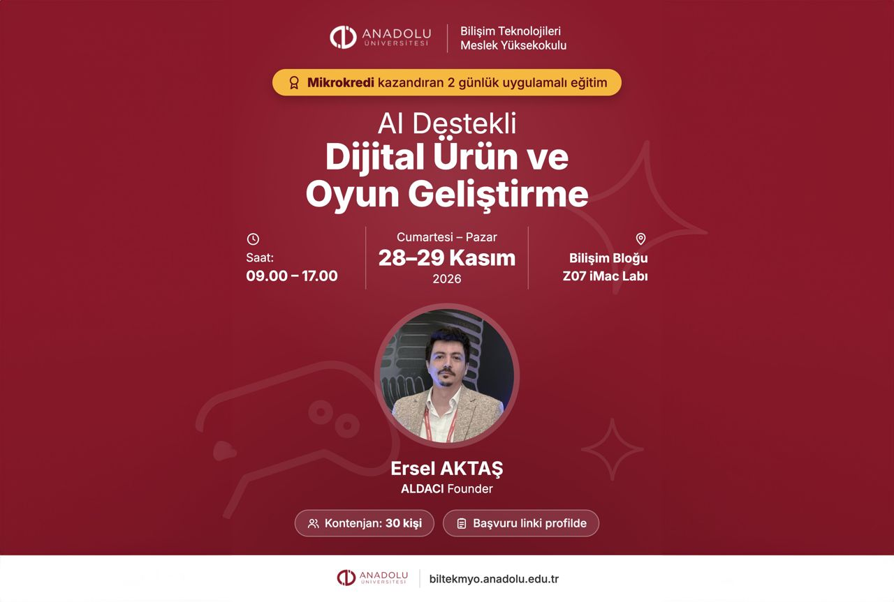
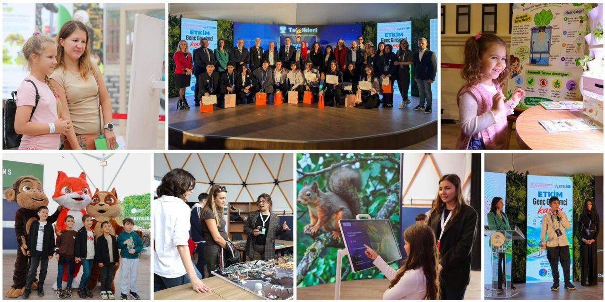
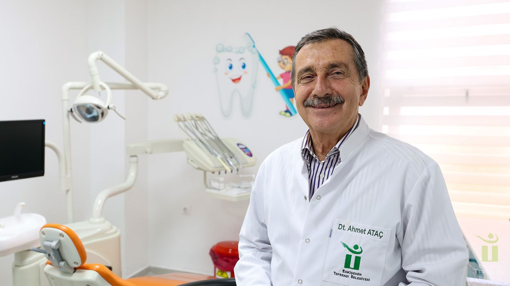
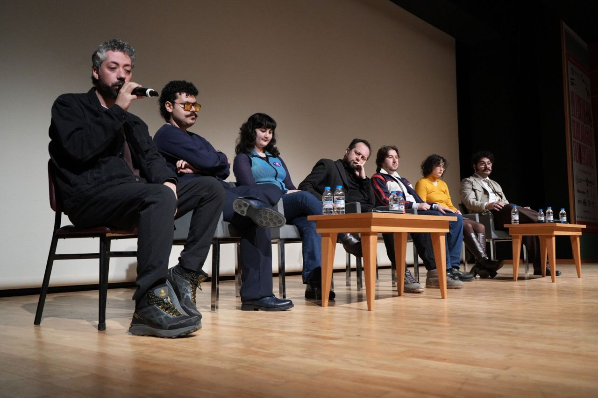
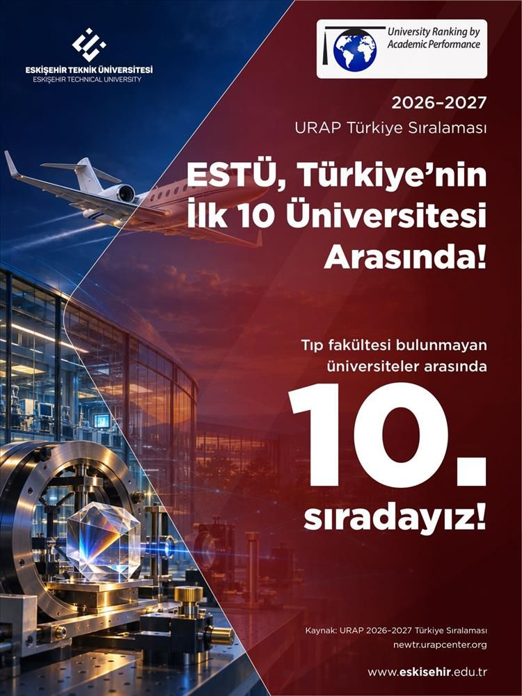
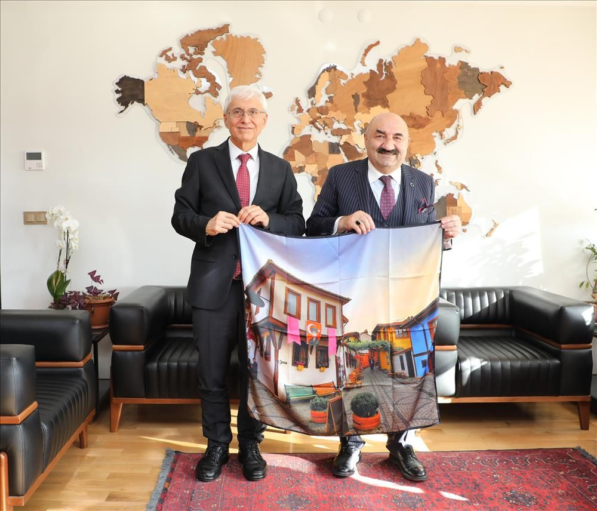

# Son haberler

Ajanın yazdığı son haberler (otomatik güncellenir).

## ESOGÜ'den Boşanma Araştırması: Zorlu Süreç Ergenlerde Gelişim Fırsatına Dönüşebilir

**Eğitim · Odunpazarı** · 2026-11-21 07:08 UTC · Kaynak: [Eskişehir Osmangazi Üniversitesi](https://www.ogu.edu.tr/Web/HaberDetay/2057?tur=AkademikMakale)

> ESOGÜ Öğretim Üyesi Doç. Dr. Fatma Altınsoy'un boşanmış ailelerde yetişen ergenlerin psikolojik dönüşümünü ele alan çalışması uluslararası hakemli dergide yayımlandı.

Eskişehir Osmangazi Üniversitesi (ESOGÜ) Eğitim Fakültesi Eğitim Bilimleri Bölümü Rehberlik ve Psikolojik Danışmanlık Anabilim Dalı öğretim üyesi Doç. Dr. Fatma Altınsoy, boşanmış ailelerde yetişen ergenlerin travma sonrası büyüme süreçlerini inceleyen kapsamlı bir araştırmaya imza attı. Çalışma, çocuk ve ergen çalışmaları alanındaki saygın uluslararası yayınlardan Children and Youth Services Review dergisinde yayımlandı.

Araştırma, ebeveyn ayrılığının yalnızca olumsuz sonuçlar doğurmadığını, uygun psikososyal destek mekanizmalarıyla kişisel bir dönüşüm sürecine evrilebileceğini ortaya koydu. Ergenlerin ilk tepkilerinden zamanla geliştirdikleri başa çıkma yöntemlerine kadar uzanan çok boyutlu deneyimlerin analiz edildiği çalışmada, travma sonrası büyümenin beş temel boyutta gerçekleştiği saptandı. Bu boyutlar; ilişkilerde olumlu değişim, ayrılık sonrası yaşamda anlam oluşturma, kendilik algısında değişim, maneviyata yönelme ve ayrılığın fırsata dönüşümü olarak belirlendi.

Elde edilen veriler doğrultusunda ergenlerin psikolojik dönüşümünü açıklayan "Ayrılık Sonrası Büyüme Modeli" geliştirildi. Araştırma sonuçlarının, aile ve okul psikolojik danışmanlığı ile koruyucu ruh sağlığı uygulamalarının geliştirilmesine önemli katkılar sunması hedefleniyor.

---

## Altın fiyatları 21 Kasım 2026: Gram altın 6.059,59 TL

**Ekonomi · Merkez** · 2026-11-21 06:00 UTC · Kaynak: [Harem Altın](https://www.haremaltin.com/altin-fiyatlari)

> Gram altın güne düşüşle başladı. Harem Altın verilerine göre gram altın 5.914,99 TL'den alınıyor, 6.059,59 TL'den satılıyor.

Altın piyasasında güne düşüşle başlandı. Harem Altın'ın saat 09.00 itibarıyla verilerine göre gram altının satış fiyatı 6.059,59 TL, alış fiyatı 5.914,99 TL oldu. Gram altın, önceki kapanışa göre yüzde 0,83 geriledi.

Ziynet altınlarda çeyrek altın 9.939 TL, yarım altın 19.867 TL, tam altın 39.613 TL, ata altın 40.699 TL seviyesinden satışa sunuluyor.

22 ayar bileziğin gram satış fiyatı 5.653,32 TL, has altının gram fiyatı 6.035,45 TL olarak belirlendi.

Uluslararası piyasalarda altının onsu 3.534,80 dolardan işlem görürken, dolar/TL 50,82 seviyesinde bulunuyor.

Fiyatlar Harem Altın'ın saat 09.00 itibarıyla paylaştığı verilere dayanmaktadır; kuyumcular arasında farklılık gösterebilir. Bu haber yatırım tavsiyesi değildir.

---

## Togg'dan Kadınlara Özel Finansman Paketi: Garanti BBVA ile İş Birliği Yolda

**Ekonomi · Türkiye** · 2026-11-21 05:09 UTC · Kaynak: [Google Haberler - Togg](https://istanbulticaretgazetesi.com/togg-kampanya-2026-kadinlara-ozel-finansman-destegi-togg-kadinlara-ozel-kampanya-ne-zaman-baslayacak)

> Togg, kadınların elektrikli araçlara erişimini kolaylaştırmak amacıyla Garanti BBVA ortaklığıyla yeni bir taşıt kredisi paketi hazırlıyor. Detayların yıl sonuna kadar açıklanması hedefleniyor.

Türkiye'nin yerli elektrikli otomobil üreticisi Togg, kadın tüketicilerin elektrikli araç sahibi olmasını desteklemek amacıyla yeni bir finansman modeli üzerinde çalışıyor. Garanti BBVA iş birliğiyle hayata geçirilmesi planlanan taşıt kredisi paketi, Antalya'da düzenlenen COP31 İklim Zirvesi kapsamındaki oturumda gündeme taşındı.

Zirvede bir araya gelen Togg Üst Yöneticisi (CEO) Gürcan Karakaş ile Garanti BBVA Genel Müdürü Mahmut Akten, sürdürülebilir mobilitenin geniş kitlelere ulaştırılmasında erişilebilir finansman modellerinin önemine dikkat çekti. İki kurumun üzerinde çalıştığı paketin, kadın sürücülere yönelik avantajlı ödeme koşulları sunması hedefleniyor.

Hazırlık aşamasındaki yeni finansman modelinin faiz oranı, vade süresi, kredi üst limiti ve başvuru koşulları henüz kesinleşmedi. Paketin T10X ve T10F modellerini kapsayıp kapsamayacağı ile başvuru kanallarına ilişkin tüm detayların 2026 yılı sona ermeden kamuoyuna duyurulması planlanıyor.

---

## Mihalıççık'a Yüzde 70 AB Hibeli Et Entegre Tesisi: Temeli Cumartesi Atılıyor

**Tarım · Mihalıççık** · 2026-11-21 05:09 UTC · Kaynak: [Google Haberler - Eskişehir](https://www.gazetevatan.com/sehirler/eskisehir/eskisehirin-yeni-sev-tesisi-kuruluyor-yuzde-70i-hibe-olacak-2467019)

> Mihalıççık'ta hayvancılıkla uğraşan üreticilerin kesim sorununu çözecek et entegre tesisi için ilk kazma vuruluyor. Yüzde 70 Avrupa Birliği hibesiyle yapılacak tesis 2027 yılında hizmete girecek.

Eskişehir'in Mihalıççık ilçesinde üreticilerin uzun süredir beklediği et entegre tesisi projesinde somut adım atılıyor. Mihalıççık Belediyesi ve Yunus Emre Kalkınma Kooperatifi iş birliğiyle Tarım ve Kırsal Kalkınmayı Destekleme Kurumu (TKDK) üzerinden hazırlanan ve yüzde 70 Avrupa Birliği hibesi almaya hak kazanan tesisin temel atma töreni cumartesi günü gerçekleştirilecek.

İlçedeki mezbaha eksikliğine dikkat çeken Mihalıççık Belediye Başkanı Haydar Çorum, Büyükşehir Yasası ile ilçelerdeki tesislerin kapandığını hatırlattı. Eskişehir genelinde Keskin dışında bir kesim tesisi bulunmadığını belirten Çorum, üreticilerin mesafe uzaklığı nedeniyle kaçak kesim yapmak zorunda kaldığını ifade etti.

Yeni tesisin standartları yüksek modern bir entegre tesis olacağını vurgulayan Çorum, projenin sadece Mihalıççık için değil tüm bölge üreticileri için büyük bir ihtiyacı karşılayacağını söyledi. Tesisin 2027 yılının mayıs veya haziran ayında tamamlanarak hizmete açılması hedefleniyor.

Öte yandan ilçe yatırımlarına da değinen Çorum, geçtiğimiz hafta sonu kapalı spor salonunun açılışını yaptıklarını ve Erkekler Hentbol Süper Ligi'nde mücadele eden Mihalıççık Belediyespor'un yeni salonunda yoğun taraftar desteğiyle maça çıktığını aktardı.

---

## Erdoğan 'Kadim Dostlar' ile Buluştu: 1994 Yılına Ait Özel Fotoğraf Hediye Edildi

**Siyaset · Türkiye** · 2026-11-21 05:09 UTC · Kaynak: [Google Haberler - Cumhurbaşkanı](https://www.aa.com.tr/tr/gundem/cumhurbaskani-erdogan-kadim-dostlar-bulusmasina-katildi/4132464)

> Cumhurbaşkanı Recep Tayyip Erdoğan, Dolmabahçe Ofisi'nde Kadim Dostlar Derneği üyeleriyle bir araya geldi.

Cumhurbaşkanı Recep Tayyip Erdoğan, Cumhurbaşkanlığı Dolmabahçe Ofisi'nde düzenlenen Kadim Dostlar Buluşması'na katıldı. Dernek üyeleriyle bir araya gelen Erdoğan, davetlilerle tek tek selamlaşarak derneğin yürüttüğü çalışmalar hakkında bilgi aldı.

Ziyaret sırasında Kadim Dostlar Derneği Başkanı Yakup Sucuoğlu, Cumhurbaşkanı Erdoğan'a 1994 yılındaki İstanbul Büyükşehir Belediye Başkanlığı adaylığı döneminde Üsküdar Vapuru'nun kaptan köşkünde çektirmiş olduğu bir fotoğrafı hediye etti. Görüşme, toplu hatıra fotoğrafı çekimiyle tamamlandı.

Programa AK Parti Genel Başkan Yardımcısı ve Parti Sözcüsü Ömer Çelik, AK Parti Genel Başkan Yardımcıları Ahmet Büyükgümüş ve Faruk Acar, AK Parti Grup Başkanvekili Muhammet Emin Akbaşoğlu, Mersin Milletvekili Nureddin Nebati, AK Parti Genel Sekreteri Eyyüp Kadir İnan, İstanbul Valisi Davut Gül, AK Parti İstanbul İl Başkanı Abdullah Özdemir ve Esenler Belediye Başkanı Tevfik Göksu da katıldı.

---

## CHP'li Kaya'dan Erken Seçim ve Komisyon Çıkışı: 'Sonuna Kadar Yer Alacağız'

**Siyaset · Türkiye** · 2026-11-21 05:09 UTC · Kaynak: [Google Haberler - CHP](https://www.indyturk.com/node/785460)

> CHP Genel Başkan Yardımcısı Yıldırım Kaya, Van'da yaptığı açıklamada kurulacak İzleme Komisyonu'nda partisinin sonuna kadar yer alacağını belirterek derhal erken seçim çağrısında bulundu.

CHP Genel Başkan Yardımcısı Yıldırım Kaya, çeşitli temaslarda bulunmak üzere gittiği Van'da partisinin il başkanlığında basın toplantısı düzenledi. Kaya, gündemdeki siyasi gelişmelere, Meclis sürecine ve erken seçim tartışmalarına ilişkin değerlendirmelerde bulundu.

Sürece ilişkin soruları yanıtlayan Kaya, kalıcı barış ve demokratikleşmenin adresinin Türkiye Büyük Millet Meclisi olduğunu vurguladı. Kaya, "Bu çerçeve yasanın hayata geçmesi için İzleme Komisyonu kurulacak. Parlamentonun bu işi çözmekten başka çıkar yolu yoktur. Bu sorunun çözümü için Cumhuriyet Halk Partisi'nin on yıllardır söylediği politika hayata geçiyor. Biz sonuna kadar İzleme Komisyonu'nda yer alacağız. TBMM'nin bu sorunu çözmesi için elimizden gelen tüm gereğini yapacağız" ifadelerini kullandı.

Van'daki kayyum uygulamalarını da eleştiren Kaya, halkın sandıkta ortaya koyduğu iradenin korunması gerektiğini belirtti. Demokrasinin yalnızca kazanılan seçimlerin sonucunu kabul etmek olmadığını söyleyen Kaya, kayyum siyasetinin sona erdirilerek seçme ve seçilme hakkının güvence altına alınması gerektiğini savundu.

Erken seçim konusuna da değinen Kaya, iktidara çağrıda bulunarak "Bir an önce erken seçim kararı alınmalıdır. Yarın değil bugün, hemen erken seçim diyoruz. Bir hafta öne alınan seçim erken seçim değildir. CHP olarak biz her an yapılacak seçime hazırız" dedi.

Kaya ayrıca Van'ın sınır ticareti potansiyelinden yeterince yararlanamadığını, kentte bin 763 ücretli öğretmenin görev yaptığını ve ücretli öğretmenlik yerine kadrolu atama yapılması gerektiğini ifade ederek öğrencilere ücretsiz beslenme ve temiz su sağlanması çağrısında bulundu.

---

## Vali Yılmaz'dan EHA'ya Ziyaret: Kent Gündemi ve Medya Çalışmaları Ele Alındı

**Gündem · Merkez** · 2026-11-20 21:08 UTC · Kaynak: [Eskişehir Valiliği](https://www.eskisehir.gov.tr/valimiz-dr-erdinc-yilmaz-eskisehir-haber-ajansi-eha-internet-sitesini-ziyaret-etti)

> Eskişehir Valisi Dr. Erdinç Yılmaz, Eskişehir Haber Ajansı (EHA) internet sitesini ziyaret ederek kurum yöneticileriyle bir araya geldi.

Eskişehir Valisi Dr. Erdinç Yılmaz, yerel medya temasları kapsamında Eskişehir Haber Ajansı (EHA) internet sitesine ziyarette bulundu.

Gerçekleşen ziyarette EHA Medya Grup Başkanı Soner Yüksel ve İmtiyaz Sahibi Yusuf Melih Turan ile görüşen Vali Yılmaz, ajansın yürüttüğü yayın faaliyetleri hakkında bilgi aldı.

Ziyaret sırasında Eskişehir'in güncel konuları ve basın çalışmaları üzerine fikir alışverişinde bulunuldu.

---

## Vali Yılmaz'dan Kuzey Kafkas Kültür Derneği'ne Ziyaret: Çalışmalar Ele Alındı

**Gündem · Merkez** · 2026-11-20 19:09 UTC · Kaynak: [Eskişehir Valiliği](https://www.eskisehir.gov.tr/valimiz-dr-erdinc-yilmaz-eskisehir-kuzey-kafkas-kultur-ve-dayanisma-dernegini-ziyaret-etti)

> Eskişehir Valisi Dr. Erdinç Yılmaz, Eskişehir Kuzey Kafkas Kültür ve Dayanışma Derneği'ni ziyaret ederek yürütülen faaliyetler hakkında bilgi aldı.

Eskişehir Valisi Dr. Erdinç Yılmaz, kentte faaliyet gösteren Eskişehir Kuzey Kafkas Kültür ve Dayanışma Derneği'ne ziyarette bulundu.

Ziyaret kapsamında Dernek Başkanı Jankat Yelbaşı ve yönetim kurulu üyeleriyle bir araya gelen Vali Yılmaz, derneğin yürüttüğü çalışmalar ve kültürel değerlerin korunup yaşatılmasına yönelik faaliyetler hakkında sohbet etti.

Vali Yılmaz, buluşmada gösterdikleri misafirperverlik dolayısıyla Dernek Başkanı Jankat Yelbaşı ile yönetim kurulu üyelerine teşekkür etti.

---

## Odunpazarı'na Bakanlıktan Tescil: 'Mavi Su Verimliliği Belgesi' Verildi

**Belediye · Odunpazarı** · 2026-11-20 19:09 UTC · Kaynak: [Google Haberler - Odunpazarı](https://www.esgazete.com/odunpazari-belediyesi-mavi-su-verimliligi-belgesi-aldi)

> Su tasarrufuna yönelik adımlar atan Odunpazarı Belediyesi, Tarım ve Orman Bakanlığından Mavi Su Verimliliği Belgesi almaya hak kazandı.

Odunpazarı Belediyesi, su kaynaklarının korunması ve tasarruflu kullanılması amacıyla yürüttüğü uygulamaların ardından Tarım ve Orman Bakanlığı Su Yönetimi Genel Müdürlüğü tarafından verilen Mavi Su Verimliliği Belgesi'nin sahibi oldu.

İki yıl önce yürürlüğe giren Su Verimliliği Yönetmeliği kapsamında bünyesinde Su Verimliliği Sistemi Kurulu kuran belediye, hizmet binalarında yüzde 25 su tasarrufu hedefiyle çeşitli önlemler aldı. Musluklara su tüketimini azaltan perlatörler monte edilirken, çevre düzenlemelerinde su ihtiyacı düşük olan kurakçıl peyzaj bitkileri tercih edildi ve personele yönelik bilinçlendirme çalışmaları yapıldı.

Belgenin alınmasından memnuniyet duyduğunu ifade eden Odunpazarı Belediye Başkanı Kazım Kurt, su kaynaklarının sınırsız olmadığını belirterek iklim değişikliği ve kuraklık tehdidi karşısında suyun her damlasını korumanın ortak bir sorumluluk olduğunu vurguladı.

---

## Eskişehirspor'un Söke Maçına Mersinli Hakem: Burak Filik Düdük Çalacak

**Spor · Merkez** · 2026-11-20 19:09 UTC · Kaynak: [Google Haberler - Eskişehirspor](https://yenisokegazetesi.com/haber/29193465/sokede-gozler-eskisehirspor-macinda-hakem-kadrosu-aciklandi)

> Nesine 3. Lig'de deplasmanda Söke 1970 Spor ile karşılaşacak Eskişehirspor'un maçını yönetecek hakem heyeti açıklandı. Mücadelede Mersin bölgesi hakemi Burak Filik görev yapacak.

Nesine 3. Lig'de mücadele eden Eskişehirspor'un hafta sonu Söke 1970 Spor Kulübü'ne konuk olacağı karşılaşmanın hakem kadrosu Türkiye Futbol Federasyonu (TFF) tarafından belirlendi.

22 Kasım 2026 Pazar günü saat 13.00'te Söke İlçe Stadı'nda oynanacak kritik randevuda Mersin bölgesinden Burak Filik düdük çalacak. Karşılaşmada Filik'in yardımcılıklarını Kahramanmaraş bölgesinden Enes Demirel ile Niğde bölgesinden Enes Ahmetler üstlenecek. Mücadelenin dördüncü hakemi ise yine Mersin bölgesinden Harun Kaan Yıldırım olacak.

1988 doğumlu olan ve 2012 yılından bu yana TFF liglerinde görev yapan orta hakem Burak Filik, bu sezon farklı organizasyonlarda 5 karşılaşma yönetti. Söz konusu maçlarda 27 sarı ve 1 kırmızı kartına başvuran Filik, Söke deplasmanıyla birlikte 2026-2027 sezonundaki 6. orta hakemlik görevine çıkacak.

---

## Eskişehirli Hamza Dönmez Millî Takımda: Ay-Yıldızlı Forma İçin Ter Dökecek

**Spor · Merkez** · 2026-11-20 19:09 UTC · Kaynak: [Eskişehir Büyükşehir Belediyesi](https://www.eskisehir.bel.tr/icerik-detay.php?icerik_id=13577&cat_icerik=1&menu_id=24)

> Eskişehir Büyükşehir Spor Kulübü'nün down sendromlu masa tenisi sporcusu Hamza Dönmez, sergilediği performansla Türk Devletleri müsabakaları öncesinde millî takıma çağrıldı.

Eskişehir Büyükşehir Spor Kulübü sporcuları ulusal ve uluslararası organizasyonlarda başarılarını sürdürüyor. Kulüp bünyesinde masa tenisi oynayan down sendromlu sporcu Hamza Dönmez, gösterdiği performansın ardından millî takım kadrosuna davet edildi.

Genç sporcu, 28 Kasım-2 Aralık tarihleri arasında Antalya'da düzenlenecek Down Sendromlular Türk Devletleri müsabakalarında Türkiye adına raket sallayacak. Hamza Dönmez, şampiyonada ay-yıldızlı formayla madalya mücadelesi verecek.

Eskişehir Büyükşehir Belediye Başkanı Ayşe Ünlüce de milli takıma seçilerek kente gurur yaşatan Hamza Dönmez'i tebrik etti ve katılacağı müsabakalarda başarı dileklerini iletti.

---

## Anadolu Üniversitesi'nden Mikrokredi Kazandıran Yapay Zekâ Eğitimi: Kontenjan 30 Kişi

**Eğitim · Tepebaşı** · 2026-11-20 19:09 UTC · Kaynak: [Anadolu Üniversitesi](https://anahaber.anadolu.edu.tr/tr/haber-detay/y14hrbeao2fykw11edhr330k)

> Anadolu Üniversitesi, dijital ürün ve oyun tasarımı alanında mikrokredi kazandıracak iki günlük ücretsiz yapay zekâ geliştirme eğitimi düzenliyor.

Anadolu Üniversitesi Bilişim Teknolojileri Meslek Yüksekokulu, bilişim alanında kariyer hedefleyen öğrencilere yönelik "AI Destekli Dijital Ürün ve Oyun Geliştirme" eğitimi başlatıyor. 28-29 Kasım 2026 tarihlerinde ücretsiz olarak gerçekleştirilecek uygulamalı program, ALDACI Kurucusu Ersel Aktaş'ın eğitmenliğinde yürütülecek.

İki gün boyunca 09.00-17.00 saatleri arasında Bilişim Bloğu Z07 iMac Laboratuvarında düzenlenecek eğitimde katılımcılar, yapay zekâ destekli araçları ürün ve oyun geliştirme süreçlerinde birebir deneme imkânı bulacak. Programı eksiksiz tamamlayan katılımcılar, edindikleri kazanımları mikrokredi ile belgelendirerek özgeçmişlerine ekleyebilecek.

Kontenjanı 30 kişiyle sınırlandırılan eğitim için başvurular 25 Kasım 2026 Çarşamba günü saat 23.59'a kadar çevrim içi form üzerinden kabul edilecek. Kontenjanın aşılması durumunda eğitime katılacak isimler kura yoluyla belirlenecek ve sonuçlar 26 Kasım'da adayların e-posta adreslerine gönderilecek.

---

## COP31'de Gençlerden 20 İklim Girişimi: Türkiye İklim Okulu Final Yaptı

**Eğitim · Türkiye** · 2026-11-20 17:09 UTC · Kaynak: [Milli Eğitim Bakanlığı](https://www.meb.gov.tr/genclerin-girisim-fikirleri-turkiye-iklim-okulunda-sahneye-cikti/haber/42605/tr)

> Antalya'da düzenlenen COP31 kapsamında Türkiye İklim Okulunda bir araya gelen öğrenciler, çevre sorunlarına yönelik geliştirdikleri 20 girişim fikrini jüriye sundu.

Millî Eğitim Bakanlığı Eğitim Teknolojileri Kuluçka ve İnovasyon Merkezinin (ETKİM) yürüttüğü Genç Girişimci Programı kapsamında kampa katılan öğrenciler, Birleşmiş Milletler İklim Değişikliği Konferansı'nın (COP31) son gününde projelerini sergiledi. Öğrenciler, geliştirdikleri 20 iklim temalı girişim fikrini iş modeli ve prototipleriyle birlikte jüri heyetine aktardı.

Onar takımdan oluşan iki oturumda gerçekleşen sunumlarda genç girişimciler; belirledikleri çevre sorunlarını, ürettikleri çözümleri, hedef kitle analizlerini ve pazar büyüklüklerini anlattı. Çevrim içi sistem üzerinden anlık olarak puanlanan değerlendirmelerin ardından dereceye giren ve Türkiye finalinde yarışacak takımlar açıklanarak ödülleri teslim edildi.

Program çerçevesinde ayrıca GençTek ekibinin hazırladığı oyunlaştırma tabanlı "İklim Terimleri Sözlüğü" uygulaması tanıtıldı. Gençlerin teknoloji ve çevre odaklı projelerini paylaştığı, "İklim Değişikliği ve Türk Mitolojisi" gibi tematik atölyelerin düzenlendiği Türkiye İklim Okulu, konferansın sona ermesiyle birlikte faaliyetlerini tamamladı.

---

## ÇİDEM'de Çiftçilere Toprak Eğitimi: Mikro Bitki Besin Desteği Dağıtıldı

**Tarım · Seyitgazi** · 2026-11-20 17:09 UTC · Kaynak: [Eskişehir Büyükşehir Belediyesi](https://www.eskisehir.bel.tr/icerik-detay.php?icerik_id=13578&cat_icerik=1&menu_id=24)

> Seyitgazi'deki Çiftçi Destekleme ve Eğitim Merkezi'nde bir araya gelen Çiftelerli üreticilere sürdürülebilir tarım ve toprak verimliliği eğitimi verildi.

Eskişehir Büyükşehir Belediyesi ve Seyitgazi Belediyesi ortaklığıyla hizmet veren Çiftçi Destekleme ve Eğitim Merkezi (ÇİDEM), üreticilere yönelik bilgilendirme çalışmalarını sürdürüyor. Merkezde son olarak Eskişehir Büyükşehir Belediyesi Tarımsal Hizmetler Dairesi Başkanlığı, Seyitgazi Belediyesi ve TMMOB Ziraat Mühendisleri Odası Eskişehir Şubesi iş birliğinde "Sürdürülebilir Tarım İçin Toprak Sağlığı Eğitimi" düzenlendi.

Ziraat Mühendisi Hasan Çakıllı tarafından verilen programa Seyitgazi Belediye Başkanı Uğur Tepe ile Çifteler ilçesinden gelen çiftçiler katıldı. Eğitim kapsamında toprak analizi, organik madde yönetimi, bilinçli gübreleme, bitki besin elementleri ve doğru sulama teknikleri ele alındı. Üreticilerin sahada karşılaştığı sorunlar değerlendirilerek soruları yanıtlandı.

Toprakların korunması ve verimliliğin artırılması için üreticilere destek vermeye devam edeceklerini belirten Seyitgazi Belediye Başkanı Uğur Tepe, eğitime katkı sunan uzmanlara ve katılan çiftçilere teşekkür etti. Programın sonunda bilinçli gübrelemeyi teşvik etmek amacıyla katılımcılara mikro bitki besin maddeleri karışımı dağıtıldı.

---

## Bozüyük-Eskişehir Yolunda Feci Kaza: 1 Kişi Öldü, 3 Yaralı

**Asayiş · Merkez** · 2026-11-20 17:09 UTC · Kaynak: [Google Haberler - Eskişehir asayiş](https://www.karsmanset.com/service/amp/haber/bozuyuk-eskisehir-karayolunda-feci-kaza-1-olu-3-yarali-1831761.htm)

> Bozüyük-Eskişehir kara yolu Poyra mevkiinde minibüs ile otomobilin çarpışması sonucu 1 kişi yaşamını yitirdi, 3 kişi yaralandı. Kaza nedeniyle ulaşım durdu.

Bozüyük-Eskişehir kara yolu Poyra mevkisi Eskişehir istikametinde saat 17.00 sıralarında trafik kazası meydana geldi. Edinilen bilgilere göre, 06 VIP 94 plakalı minibüs ile 16 AAY 44 plakalı otomobil henüz bilinmeyen bir nedenle çarpıştı.

Çarpışmanın etkisiyle araçlarda büyük hasar oluşurken olay yerine çok sayıda sağlık ve polis ekibi sevk edildi. Kazada otomobilde yolcu olarak bulunan bir kişi olay yerinde yaşamını yitirdi. Minibüs sürücüsü, otomobil sürücüsü ve otomobildeki diğer yolcu ise yaralandı.

İlk müdahaleleri kaza yerinde yapılan yaralılardan minibüs sürücüsü Eskişehir Şehir Hastanesine, diğer iki yaralı ise Bozüyük Devlet Hastanesine kaldırılarak tedavi altına alındı. Kaza nedeniyle bir süre durma noktasına gelen kara yolundaki trafik akışıyla ilgili polis ekipleri tahkikat başlattı.

---

## 23. Film Festivali'nde Netflix Atölyesi: Prodüksiyon Süreçleri Anlatıldı

**Kültür-Sanat · Tepebaşı** · 2026-11-20 17:09 UTC · Kaynak: [Anadolu Üniversitesi](https://anahaber.anadolu.edu.tr/tr/haber-detay/d9boq7lbed4lr5spoa8p0maj)

> 23. Eskişehir Uluslararası Film Festivali'nin ilk atölyesinde Netflix Yapımlar Direktörü Pelin Ekinci Kaya, dijital yayıncılıkta prodüksiyon süreçlerini öğrencilerle paylaştı.

Kültür ve Turizm Bakanlığı Sinema Genel Müdürlüğünün katkılarıyla Anadolu Üniversitesi İletişim Bilimleri Fakültesi ve Kurumsal İletişim Koordinatörlüğü tarafından düzenlenen 23. Eskişehir Uluslararası Film Festivali sürüyor. Festival kapsamındaki ilk atölye çalışmasının konuğu, Netflix Türkiye, Orta Doğu ve Kuzey Afrika Yapımlar Direktörü Pelin Ekinci Kaya oldu.

İletişim Bilimleri Fakültesi Şener Şen Salonu'nda düzenlenen “Netflix ile Stüdyo Yolculuğu: Prodüksiyon Süreçleri” başlıklı etkinliğe Festival Yönetmeni Prof. Dr. Sırrı Serhat Serter, fakülte akademisyenleri ve çok sayıda öğrenci katılım sağladı.

Atölyede dijital yayıncılık alanındaki üretim dinamiklerini ele alan Pelin Ekinci Kaya; yapım süreçleri, set yönetimi, iş güvenliği standartları ve post-prodüksiyon aşamalarını sahada hayata geçirilen projeler üzerinden aktardı.

---

## Talat Yalaz'dan Dava Açıklaması: 'Ortada Olmayan Bir Kanundan Yargılanıyorum'

**Siyaset · Merkez** · 2026-11-20 15:09 UTC · Kaynak: [Google Haberler - Eskişehir gündem](https://www.haber26.com.tr/politika/talat-yalaz-ortada-olmayan-kanundan-yargilaniyorum)

> Hakkında açılan davanın duruşması 3 Aralık'a ertelenen Talat Yalaz, suçlama konusu konuşmayı yaptığı tarihte yasanın henüz yürürlükte olmadığını belirterek beraat beklediğini söyledi.

İlk duruşması ertelenen davasının 3 Aralık'ta yeniden görüleceğini açıklayan Talat Yalaz, sürece ve gündeme dair değerlendirmelerde bulundu. "Halkı kanunlara uymamaya alenen tahrik" suçlamasıyla yargılandığını ifade eden Yalaz, konuşma yaptığı dönemde ilgili yasal düzenlemenin bulunmadığını kaydetti.

Söz konusu açıklamasının ardından kamuoyundaki tepkilerle birlikte yasa tasarısında değişiklik yapıldığını belirten Yalaz, yürürlükte olmayan bir düzenlemeye dayanılarak suçlama yöneltildiğini savundu. Bir hukukçu olarak dosyanın ceza gerektirmediğini dile getiren Yalaz, mahkemenin beraat kararı vermesini beklediğini ve duruşma günü savunmasını sunacağını dile getirdi.

Dosyadaki siyasi yasak talebine de değinen Yalaz, bir yılın üzerinde hapis cezası verilmesi durumunda bu yaptırımın gündeme geleceğini anımsatarak, ceza öngörmediği için bu talebin de karşılık bulmayacağını ifade etti. Yalaz ayrıca erken seçim tartışmaları kapsamında vatandaşın seçim beklentisi içinde olduğunu ancak iktidarın en az altı aylık süreçte sandığa gitmeyeceğini düşündüğünü aktardı.

---

## Jandarma Genel Komutan Yardımcısı Murat Bulut Eskişehir Valiliğinde

**Gündem · Merkez** · 2026-11-20 15:09 UTC · Kaynak: [Eskişehir Valiliği](https://www.eskisehir.gov.tr/valimiz-dr-erdinc-yilmaz-jandarma-genel-komutan-yardimcisi-korgeneral-murat-bulutu-kabul-etti)

> Çeşitli temaslarda bulunmak üzere kente gelen Jandarma Genel Komutan Yardımcısı Korgeneral Murat Bulut, Eskişehir Valisi Dr. Erdinç Yılmaz'ı makamında ziyaret etti.

Eskişehir'de çeşitli programlara katılmak üzere kente gelen Jandarma Genel Komutan Yardımcısı Korgeneral Murat Bulut, Valilik makamında ağırlandı.

Ziyarette Korgeneral Bulut'a, Eskişehir İl Jandarma Komutanı Albay Veysel Ergün de eşlik etti. Vali Dr. Erdinç Yılmaz, kabulde duyduğu memnuniyeti dile getirerek nazik ziyaretleri dolayısıyla Korgeneral Bulut'a teşekkür etti.

---

## İklim Adası'na Ekolojik Kreş Geliyor: 'Şikâyet Değil Çözüm Merciiyiz'

**Belediye · Merkez** · 2026-11-20 15:09 UTC · Kaynak: [Eskişehir Büyükşehir Belediyesi](https://www.eskisehir.bel.tr/icerik-detay.php?icerik_id=13580&cat_icerik=1&menu_id=24)

> Eskişehir Büyükşehir Belediye Başkanı Ayşe Ünlüce, kent konseyleri ve sivil toplum temsilcileriyle İklim Adası’nda bir araya gelerek merkezin yanına ekolojik kreş inşa edildiğini açıkladı.

Eskişehir Büyükşehir Belediye Başkanı Ayşe Ünlüce; kent konseyleri, çalışma grupları, mahalle muhtarları ve sivil toplum kuruluşlarının temsilcileriyle İklim Adası - İyi Yaşam İçin Ortak Üretim ve İnovasyon Merkezi'nde buluştu. Toplantıya Eskişehir Kent Konseyi Başkanı İnci Ülüğ, Odunpazarı Kent Konseyi Başkanı İsmail Kumru ve Tepebaşı Kent Konseyi Başkanı Hatice Canan Adlım da katıldı.

Porsuk Çayı üzerinde yer alan eski Ada Kafe ve Ada Restoran binasının dönüştürülmesiyle kente kazandırılan merkezin misyonuna değinen Başkan Ünlüce, iklim değişikliğiyle mücadelenin küçük yaşlarda başlaması gerektiğine işaret etti. Bu kapsamda merkezin hemen bitişiğinde ekolojik kreş yapımına başlandığını duyuran Ünlüce, tesis tamamlandığında çocuklara çevre ve doğa bilinci aşılayacak eğitimler verileceğini söyledi.

İklim Adası'nın uzmanlığı olan ya da bu alanda öğrenmek isteyen herkese açık olduğunu vurgulayan Başkan Ünlüce, "Göreve geldiğimden beri söylediğim bir şey var: Biz şikâyet değil, çözüm merciiyiz. Artık şikâyet etmek yerine çözümü hep birlikte burada arayalım istiyoruz" dedi. Buluşma, katılımcıların yerel iklim eylemlerine ilişkin önerilerini paylaşmasının ardından tamamlandı.

---

## Başkan Ataç Beyaz Önlüğü Giydi: 85 Bin Çocuğa Ulaşan Merkezde Minikleri Muayene Etti

**Sağlık · Tepebaşı** · 2026-11-20 15:09 UTC · Kaynak: [Tepebaşı Belediyesi](https://www.tepebasi.bel.tr/Haber/Detay/baskanatacbeyazonlugunugiydi)

> Tepebaşı Belediye Başkanı Dt. Ahmet Ataç, Ağız ve Diş Sağlığı Haftası kapsamında Tepebaşı Çocuk Ağız ve Diş Sağlığı Polikliniği'ni ziyaret ederek çocukların diş kontrollerini yaptı.

Mesleği diş hekimliği olan Tepebaşı Belediye Başkanı Dt. Ahmet Ataç, 20-27 Kasım Ağız ve Diş Sağlığı Haftası ile 22 Kasım Diş Hekimleri Günü dolayısıyla Tepebaşı Çocuk Ağız ve Diş Sağlığı Polikliniği'ni ziyaret etti. Beyaz önlüğünü giyerek muayene koltuğunun başına geçen Ataç, minik hastaların diş kontrollerini gerçekleştirip doğru fırçalama yöntemleri hakkında tavsiyelerde bulundu.

Poliklinikte bugüne kadar yaklaşık 85 bin çocuğa ücretsiz ağız ve diş sağlığı hizmeti sunulduğunu belirten Ataç, merkezin temel misyonunun koruyucu hekimlik olduğunu vurguladı. Vatandaşların ve okulların çocukları merkeze yönlendirebileceğini hatırlatan Ataç; poliklinikte ortodonti haricindeki tedavilerin uygulandığını, diş hekimi korkusu yaşayan miniklere psikolog desteği sağlandığını ve konuşma-dil terapisi hizmeti de verildiğini aktardı.

Diş hekimliği eğitimi ve mesleki standartlar üzerine de değerlendirmelerde bulunan Ataç, 1999 yılında 24 olan fakülte sayısının bugün 100'e ulaştığına dikkat çekti. Kontrolsüz kontenjan artışının eğitim kalitesi ve mezunların istihdamı açısından riskler barındırdığını ifade eden Ataç, yeni fakültelerin akademik kadro ve fiziki imkânlar gözetilerek planlanması gerektiğini dile getirdi.

---

## 23. Film Festivali'nde Kısa Film Rüzgârı: Yönetmenler Sinema Anadolu'da Buluştu

**Kültür-Sanat · Tepebaşı** · 2026-11-20 15:09 UTC · Kaynak: [Anadolu Üniversitesi](https://anahaber.anadolu.edu.tr/tr/haber-detay/fb3vdyrp6akgfrcg3n7irdxc)

> Eskişehir Uluslararası Film Festivali kapsamında düzenlenen Kısa Film Seçkisi etkinliğinde, genç yönetmenler yapımlarının perde arkasını sinemaseverlerle paylaştı.

Anadolu Üniversitesinin ev sahipliğinde devam eden 23. Eskişehir Uluslararası Film Festivali (EFF), genç sinemacıların üretimlerini izleyiciyle buluşturdu. Sinema Anadolu'da gerçekleştirilen "Kısa Film Seçkisi-Söyleşi" programında, farklı temalara sahip yapımlar beyaz perdeye yansıtılırken gösterimlerin ardından film ekipleriyle kapsamlı bir söyleşi gerçekleştirildi.

İletişim Bilimleri Fakültesi Dr. Öğr. Üyesi Nihan Öztürk'ün moderatörlüğünde düzenlenen oturumda, genç yönetmenler filmlerinin ortaya çıkış hikâyelerini aktardı. Sosyal medyadaki dezenformasyon ve linç kültürünü işleyen Egemen Özcan ile Beyşehir Gölü'ndeki balıkçıların yaşam mücadelesini ele alan Doğukan Melik Sevindik izleyicilerin sorularını yanıtladı. Bilim kurgu türündeki animasyonuyla Selin Toprak ve kuramsal deneyimini pratiğe aktaran Münir Alper Doğan da yapım süreçlerini anlattı.

Etkinlikte ayrıca 6 bin liralık bütçeyle stüdyoda tamamladığı filmini aktaran Gökberk Kuyucu, insan duyularını konu edinen Sıla Buse Güler ve caz müziği üzerinden yaşam ritmini arayan Toprak Bektaş ile Mehmet Ali Genç, bağımsız sinema üretimine dair tecrübelerini katılımcılarla paylaştı.

---

## Tepebaşı'na AB Destekli Rüzgâr Hibesi: Temiz Enerji Haritası Çıkarılacak

**Belediye · Tepebaşı** · 2026-11-20 13:09 UTC · Kaynak: [Tepebaşı Belediyesi](https://www.tepebasi.bel.tr/Haber/Detay/tepebası’nınhibezincirineyenihalka)

> Tepebaşı Belediyesi, ilçenin rüzgâr enerjisi potansiyelini belirlemek için hazırladığı projeyle AB destekli TÜREB programından 15 bin avro hibe almaya hak kazandı.

Tepebaşı Belediyesi, temiz enerji yatırımlarına yön vermek ve ilçenin rüzgâr enerjisi potansiyelini ortaya çıkarmak amacıyla hazırladığı projeyle yeni bir dış kaynak sağladı. Türkiye Rüzgâr Enerjisi Birliği (TÜREB) tarafından yürütülen ve Avrupa Birliği tarafından desteklenen hibe programı kapsamındaki sözleşme, Tepebaşı Belediye Başkan Yardımcısı Suat Yalnızoğlu tarafından Ankara'da imzalandı.

Toplam 16 bin 800 avro bütçeli projeye 15 bin avro hibe desteği verilecek. Tepebaşı Belediyesi İklim Değişikliği ve Sıfır Atık Müdürlüğü koordinesinde 23 Kasım 2026'da başlayacak ve dokuz ay sürecek çalışma kapsamında, Coğrafi Bilgi Sistemleri desteğiyle rüzgâr verileri, arazi yapısı ve şebeke bağlantısı uygun olan en fazla üç alan belirlenerek incelenecek. Çalışmanın sonucunda belediyenin elektrik tüketimini rüzgârdan karşılamaya yönelik teknik ön değerlendirme raporu ve yol haritası hazırlanacak.

Teknik incelemelerin yanı sıra belediye personeline ve öğrencilere yönelik eğitim atölyeleri de düzenlenecek. Ayrıca Vecihi Hürkuş Havacılık ve Teknoloji Parkı'nda enerji sektörü temsilcileri, sivil toplum kuruluşları ve kent sakinlerinin bir araya geleceği bir "Enerji Günü" organize edilerek elde edilen veriler kamuoyuyla paylaşılacak.

---

## MEB'den Öğrencilere 'Dijital Anadolu Medeniyetleri Ansiklopedisi'

**Eğitim · Türkiye** · 2026-11-20 13:09 UTC · Kaynak: [Milli Eğitim Bakanlığı](https://www.meb.gov.tr/anadolu-medeniyetleri-ogrencilere-quotdijital-ansiklopediquot-ile-tanitilacak/haber/42598/tr)

> Millî Eğitim Bakanlığı, Anadolu'nun köklü kültürel mirasını yeni nesillere tanıtmak amacıyla 800 dakikalık belgesel serisinden oluşan dijital ansiklopedi projesini kullanıma sunuyor.

Millî Eğitim Bakanlığı Yenilik ve Eğitim Teknolojileri Genel Müdürlüğü, dijital eğitim platformlarının içeriklerini zenginleştirmek amacıyla "Dijital Anadolu Medeniyetleri Ansiklopedisi" projesini başlattı. Çalışmayla Anadolu medeniyetlerinin insanlık tarihine sunduğu katkıların görünür kılınması ve kültürel mirasın gelecek kuşaklara aktarılması hedefleniyor.

Türkiye Yüzyılı Maarif Modeli öğretim programlarında yer alan kavramlarla ilişkilendirilen proje doğrultusunda, ilk aşamada 100 kavram ele alındı. Ardından ortaokul ve lise müfredatıyla uyumlu ilave 100 kavram için toplam 800 dakikalık eğitsel video içeriği oluşturuldu.

Belgesel anlatım tarzında hazırlanan ve her biri 8 dakika süren eğitsel videolar, üç boyutlu animasyonlar, hareketli grafikler ve gerçek mekân çekimleriyle desteklendi. Öğrencilerin kültürel kavramları görsel ve işitsel yöntemlerle kavramasını amaçlayan yapımlar, Türkçe ve İngilizce dil seçeneklerinin yanı sıra çift dilde alt yazı desteğiyle sunuluyor.

Hazırlanan tüm içerikler EBA, TRT EBA ve Bakanlığa bağlı diğer dijital platformlar aracılığıyla öğrenci, öğretmen ve velilerin erişimine açık olacak.

---

## ESTÜ'den Akademik Başarı: URAP Sıralamasında Türkiye'de İlk 10'a Girdi

**Eğitim · Tepebaşı** · 2026-11-20 13:09 UTC · Kaynak: [Eskişehir Teknik Üniversitesi](https://www.eskisehir.edu.tr/tr/Haber/Detay/eskisehir-teknik-universitesi-urap-20262027-turkiye-siralamasinda-ilk-10-universite-arasinda)

> Eskişehir Teknik Üniversitesi, URAP 2026–2027 Türkiye Sıralaması'nda tıp fakültesi bulunmayan üniversiteler kategorisinde 10. basamakta yer aldı.

Orta Doğu Teknik Üniversitesi Enformatik Enstitüsü bünyesindeki URAP Araştırma Laboratuvarı tarafından hazırlanan 2026–2027 Türkiye Sıralaması açıklandı. Yayımlanan raporda Eskişehir Teknik Üniversitesi (ESTÜ), tıp fakültesi bulunmayan yükseköğretim kurumları arasında 667,80 puan toplayarak 10. sıraya yerleşti.

İTÜ, ODTÜ, Sabancı, Yıldız Teknik ve Boğaziçi gibi üniversitelerin yer aldığı listede ilk 10 arasındaki yerini koruyan ESTÜ, bilimsel araştırma ve akademik üretimdeki istikrarını sürdürdü.

Söz konusu sıralama Clarivate Analytics/InCites ile YÖK verileri temel alınarak oluşturuldu. Değerlendirme sürecinde bilimsel yayınlar, atıf sayıları, öğretim üyesi başına düşen üretkenlik, doktora mezun ve öğrenci oranları, ulusal ve uluslararası iş birlikleri ile TÜBİTAK destekli projeler olmak üzere toplam 15 farklı akademik gösterge dikkate alındı.

---

## ESOGÜ'de Geleceğin Diş Hekimleri Beyaz Önlüklerini Giydi: Yeni Hastane Müjdesi

**Eğitim · Odunpazarı** · 2026-11-20 13:09 UTC · Kaynak: [Eskişehir Osmangazi Üniversitesi](https://www.ogu.edu.tr/Web/HaberDetay/2153)

> Eskişehir Osmangazi Üniversitesi Diş Hekimliği Fakültesi 1. sınıf öğrencileri, düzenlenen törenle beyaz önlüklerini giyerek mesleğe ilk adımı attı.

Eskişehir Osmangazi Üniversitesi (ESOGÜ) Diş Hekimliği Fakültesi 14. dönem birinci sınıf öğrencileri için Kongre ve Kültür Merkezi'nde "2026-2027 Eğitim-Öğretim Yılı Beyaz Önlük Giyme Töreni" gerçekleştirildi. Törene üniversite yönetimi, akademisyenler, sağlık sektörü temsilcileri ve öğrenci aileleri katıldı.

Törende konuşan ESOGÜ Rektörü Prof. Dr. Emine Gümüşsoy, fakültenin güçlü kadrosuyla başarılı hekimler yetiştirdiğini belirterek birkaç ay içerisinde yeni hastane binasına taşınma sürecinin tamamlanacağını ve bu adımla hizmet kapasitesinin daha da güçleneceğini duyurdu. Öğrencilere seslenen Gümüşsoy, beyaz önlüğün dürüstlük ve sorumluluğun simgesi olduğunu vurguladı.

Diş Hekimliği Fakültesi Dekanı Prof. Dr. Batu Can Yaman ise Türkiye'de bilimsel diş hekimliğinin temellerinin 22 Kasım 1908'de atıldığını hatırlatarak, mesleğin teknolojik gelişmelerle birlikte sürekli bir öğrenme süreci gerektirdiğini ifade etti. Yaman, ailelerin gösterdiği fedakârlıkların ardından öğrencilerin nitelikli birer hekim olarak yetişeceğini söyledi.

Konuşmaların ardından birinci sınıf öğrencilerine beyaz önlükleri fakülte öğretim üyeleri ve protokol üyeleri tarafından giydirildi.

---

## Eskişehir Sanat Sokağı 2 Yaşında: İki Yılda 80'den Fazla Etkinlik Düzenlendi

**Kültür-Sanat · Merkez** · 2026-11-20 13:09 UTC · Kaynak: [Eskişehir Büyükşehir Belediyesi](https://www.eskisehir.bel.tr/icerik-detay.php?icerik_id=13579&cat_icerik=1&menu_id=24)

> Eskişehir Büyükşehir Belediyesi tarafından kente kazandırılan Sanat Sokağı, ikinci kuruluş yılını geride bıraktı. Kompleks, iki yıllık süreçte 80'i aşkın kültür ve sanat etkinliğine ev sahipliği yaptı.

Eskişehir Büyükşehir Belediyesinin kentin kültür ve sanat hayatına kazandırdığı Sanat Sokağı, ikinci yaşını kutluyor. Bünyesinde Uluslararası Çağdaş Seramik Sanatları Müzesi, sanat atölyeleri, sergi salonu, Genco Erkal Sahnesi ve kukla tiyatrosu barındıran kompleks, iki yıl içinde 80'den fazla sanatsal ve kültürel buluşmaya sahne oldu.

Büyükşehir Belediyesi Kent Tarihi, Tanıtımı ve Turizm Daire Başkanı Sercan Kara, merkezin kentin en genç ve en büyük sanat kompleksi olduğunu belirterek, her ay yenilenen sergiler ve atölyelerle tüm vatandaşları Sanat Sokağı'na davet etti. Alanda üretim yapan cam, minyatür ve bebek yapım sanatçıları da mekânın yerli ve yabancı ziyaretçilerden yoğun ilgi gördüğünü ifade etti.

Merkez, yetişkinlere yönelik sergi, söyleşi ve dinletilerin yanı sıra Çocuk Hakları Birimi iş birliğiyle minik ziyaretçilere de düzenli olarak yaratıcı drama, satranç, tasarım ve dans gibi farklı başlıklarda atölye imkânı sunuyor.

---

## Tepebaşı'nda Tesisler Mercek Altında: Hizmet Binalarında Entegre Su Yönetimi Başladı

**Belediye · Tepebaşı** · 2026-11-20 11:09 UTC · Kaynak: [Google Haberler - Tepebaşı](https://www.ekonomim.com/sehirler/tepebasi-atac-iklim-eylemi-kentlerde-gundelik-kararlarla-hayat-bulur-haberi-932405)

> Tepebaşı Belediyesi, BEBKA desteğiyle yürüttüğü proje kapsamında hizmet binalarında ve yeşil alanlarda su verimliliği analizi gerçekleştirirken 425 kişiye tasarruf eğitimi verdi.

Tepebaşı Belediyesi, iklim krizi ve artan kuraklık riskine karşı kaynakları korumak amacıyla "Hizmet Binalarında Entegre Su Yönetimi ve Su Verimliliği Kapasitesinin Geliştirilmesi" projesini hayata geçirdi. Bursa Eskişehir Bilecik Kalkınma Ajansı (BEBKA) 2026 Yılı Teknik Destek Programı kapsamında desteklenen çalışma ile belediye tesislerinde su tüketim alışkanlıkları kapsamlı şekilde inceleniyor.

Çalışma doğrultusunda Tepebaşı Belediyesi Ana Hizmet Binası, Mustafa Kemal Atatürk Su Sporları Merkezi ve Metin Özöğüt Yaşam Merkezi'nde teknik denetimler yapılıyor. Tüketimin yoğunlaştığı noktalar tespit edilirken kayıpların önlenmesi, yağmur suyu hasadı ve gri suyun geri kazanımı gibi tasarruf alternatifleri değerlendiriliyor. Analizler yalnızca kapalı tesislerle sınırlı kalmayıp park, bahçe ve rekreasyon alanlarındaki sulama sistemlerini de kapsıyor.

Su verimliliği seferberliği kapsamında bugüne kadar toplam 425 kişiye eğitim sunuldu. Mavi Su Belgesi kapsamında 101, okullarla ortaklaşa 259 öğrenci ve BEBKA projesi çerçevesinde 65 belediye personeli bilinçlendirme programlarına katıldı.

Projeye ilişkin değerlendirmede bulunan Tepebaşı Belediye Başkanı Dt. Ahmet Ataç, iklim krizinin kentlerin karşı karşıya olduğu somut bir gerçek olduğuna dikkat çekti. Ataç, "Kuraklık ve su kaynaklarının azalması, suyu nasıl kullandığımızı yeniden düşünmemizi zorunlu kılıyor. Su yalnızca çevresel bir başlık değil; yaşamın, üretimin, ekonominin ve kentlerin geleceğinin temelidir. COP31'de konuşulan iklim eyleminin karşılığı kentlerde alınan kararlarla ortaya çıkar. Bugünden atacağımız her bilinçli adım gelecek kuşakların suya erişimi ve kentimizin dayanıklılığı için hayati önem taşıyor" ifadelerini kullandı.

---

## Sarar Grup'tan Rektör Özcan'a Tebrik Ziyareti: Yeni Dönemde Başarı Diledi

**Eğitim · Tepebaşı** · 2026-11-20 11:09 UTC · Kaynak: [Eskişehir Teknik Üniversitesi](https://www.eskisehir.edu.tr/tr/Haber/Detay/sarar-grup-resmi-iliskiler-ve-protokol-muduru-alaattin-cobandan-rektor-prof-dr-adnan-ozcana-hayirli-olsun-ziyareti)

> Sarar Grup Resmi İlişkiler ve Protokol Müdürü Alaattin Çoban, yeniden ESTÜ Rektörlüğüne atanan Prof. Dr. Adnan Özcan'ı makamında ziyaret etti.

Cumhurbaşkanlığı Kararı ile Eskişehir Teknik Üniversitesi Rektörlüğü görevine yeniden atanan Prof. Dr. Adnan Özcan'a yönelik hayırlı olsun ziyaretleri devam ediyor.

Bu kapsamda Sarar Grup Resmi İlişkiler ve Protokol Müdürü Alaattin Çoban, Rektörlük Ofisinde Prof. Dr. Adnan Özcan ile bir araya geldi. Görüşmede Çoban, yeni görev dönemine başlayan Rektör Özcan'ı tebrik ederek üniversite yönetimine çalışmalarında başarılar diledi.

Ziyaretten duyduğu memnuniyeti ifade eden Rektör Prof. Dr. Adnan Özcan ise iyi dilekleri ve nezaketi dolayısıyla Alaattin Çoban'a teşekkürlerini iletti.

---

## Odunpazarı'nda Türkü Gecesi: Köz Orkestra Dinleyicileri Hayran Bıraktı

**Kültür-Sanat · Odunpazarı** · 2026-11-20 11:09 UTC · Kaynak: [Odunpazarı Belediyesi](https://www.odunpazari.bel.tr/guncel/haberler/genel-haberler/koz-orkestra-dan-beste-formunda-turkuler-konseri)

> Odunpazarı Belediyesi eğitmenlerinin oluşturduğu Köz Orkestra, 'Beste Formunda Türküler' konseriyle Eskişehirli müzikseverlere unutulmaz bir akşam yaşattı.

Odunpazarı Belediyesi bünyesinde görev yapan sanat eğitmenlerinin kurduğu Köz Orkestra, Yunus Emre Kültür ve Sanat Merkezi'nde (YKSM) sahne aldı. Ücretsiz olarak gerçekleştirilen konsere kentteki sanatseverler yoğun ilgi gösterdi.

'Beste Formunda Türküler' temasıyla düzenlenen konserde Anadolu'nun köklü ezgileri çok sesli ve özgün enstrümantal düzenlemelerle yorumlandı. Köz Orkestra'nın sahne performansı salonu dolduran dinleyicilerden alkış topladı.

Belediyenin kültür ve sanat etkinlikleri kapsamında sahne alan orkestra, geleneksel Türk halk müziği mirasını modern yaklaşımlarla kente taşımaya devam ediyor.

---

## MEBİ Yapay Zekâ ve Çevrim Dışı Modla Yenilendi: Kullanıcı Sayısı 8 Milyonu Aştı

**Eğitim · Türkiye** · 2026-11-20 11:09 UTC · Kaynak: [Milli Eğitim Bakanlığı](https://www.meb.gov.tr/quotmebiquot-yenilenen-yuzu-ve-yapay-zeka-destekli-ozellikleriyle-yayinda/haber/42599/tr)

> Millî Eğitim Bakanlığının bireysel öğrenme platformu MEBİ; yapay zekâ asistanı, internetsiz çalışma özelliği ve genişletilen erişilebilirlik seçenekleriyle baştan aşağı güncellendi.

Millî Eğitim Bakanlığı, öğrenci ve öğretmenlerin kullanımına sunduğu MEBİ Bireysel Öğrenme Platformu’nu gelen geri bildirimler doğrultusunda yeniledi. Web arayüzü ve mobil uygulaması daha işlevsel hâle getirilen platformda, öğrencilerin ders çalışma alışkanlıklarını destekleyen kişiselleştirilebilir ekranlar ve yeni dijital modüller devreye alındı.

Platformun yapay zekâ destekli öğrenci asistanı KANKA geliştirilerek öğrencilerin hedeflerine, uygun saatlerine ve zorlandıkları konulara göre kişiye özel haftalık program hazırlaması sağlandı. Doğal dille arama imkânı sunan yapay zekâ desteği, deneme sınavı sonuçlarını değerlendirerek öğrencilere günlük çalışma tavsiyeleri üretiyor. Yeni eklenen çevrim dışı çalışma özelliğiyle de öğrenciler, içerikleri önceden mobil cihazlarına indirerek internet bağlantısı olmayan ortamlarda ders çalışabiliyor.

Farklı ihtiyaçlara sahip öğrencilerin platformdan rahat yararlanabilmesi için erişilebilirlik seçenekleri de genişletildi. Görme engelli öğretmenlerin katılımıyla yapılan testler sonucunda platforma disleksi dostu görünüm, renk körlüğü ayarları, yüksek kontrast ve ekran okuyucu uyumluluğu eklendi. Ayrıca ders notlarının tek noktada toplanmasını sağlayan Not Defteri modülü kullanıma açıldı.

Bakanlık verilerine göre ortaokul ve lise düzeyinde 6 milyon 180 binden fazla öğrencinin yararlandığı platformun toplam kullanıcı sayısı öğretmen ve velilerle birlikte 8 milyon 187 bini aştı. Mobil uygulaması 6,6 milyondan fazla indirilen MEBİ üzerinden bugüne kadar 704 milyonu aşkın soru çözüldüğü bildirildi.

---
