# Son haberler

Ajanın yazdığı son haberler (otomatik güncellenir).

## AK Parti'li İnan: Erdoğan kasım ayında İzmir'e gelecek

**Siyaset · Türkiye** · 2026-10-23 05:34 UTC · Kaynak: [Google Haberler - Cumhurbaşkanı](https://www.gundemebakis.com/cumhurbaskani-erdogan-izmire-geliyor-tarihi-mujdeleri-aciklayacak)

> AK Parti Genel Sekreteri Eyyüp Kadir İnan, Cumhurbaşkanı Erdoğan'ın kasımda İzmir'i ziyaret edeceğini ve kente ilişkin açıklamalar yapacağını söyledi.

AK Parti Genel Sekreteri ve İzmir Milletvekili Eyyüp Kadir İnan, Çiğli Belediye Başkanı Onur Emrah Yıldız'ı ziyareti sırasında yaptığı açıklamada Cumhurbaşkanı Recep Tayyip Erdoğan'ın kasım ayı içinde İzmir'e geleceğini duyurdu.

Gündeme Bakış'ın aktardığına göre İnan, Erdoğan'ın ziyaretinde İzmir'e ilişkin önemli açıklamalar yapacağını belirtti. İnan, "İzmir'in yıllardır beklediği, bu şehrin kaderine etki edecek çok büyük, tarihi müjdeleri bizzat Sayın Cumhurbaşkanımız buradan ilan edecekler" dedi. Müjdelerin içeriği hakkında bilgi verilmedi.

---

## Tugay esnaf odalarıyla buluştu: İzmir'de su tarifesinde indirim yapılacak

**Siyaset · Türkiye** · 2026-10-23 04:33 UTC · Kaynak: [Google Haberler - Cumhurbaşkanı](https://www.milliyet.com.tr/gundem/cemil-tugay-ak-partiye-gecis-surecini-anlatti-cumhurbaskani-erdogan-son-25-yila-damgasini-vurdu-7685571)

> Cemil Tugay, İzmir Esnaf ve Sanatkarlar Odaları Birliği'ni ziyaret etti. Su fiyatlarında indirim için Meclis'e teklif götüreceğini söyledi.

İzmir Büyükşehir Belediye Başkanı Cemil Tugay, İzmir Esnaf ve Sanatkarlar Odaları Birliği'ni ziyaret ederek esnaf odası başkanlarıyla bir araya geldi. Milliyet'in aktardığına göre Tugay, esnafın iş birliği süreçlerinde öncelik verilmesi gereken kesimlerin başında geldiğini söyledi.

Tugay, su fiyatlarında indirim için çalışma yaptıklarını belirterek, su faturalarında belirgin fark yaratacak bir tarife indirimini önümüzdeki Meclis'ten geçireceğini açıkladı. İzmir'in Türkiye'de toplu taşımanın en ucuz olduğu kent olduğunu söyleyen Tugay, önümüzdeki yıl toplu taşımaya zam yapmadan indirimleri çeşitlendirebileceklerini ifade etti.

Tugay ayrıca bakanlarla görüştüğünü, kentin uzun yıllardır çözüm bekleyen sorunlarına hızlı ve kalıcı çözümler üretilmesi için çalıştıklarını anlattı. Cumhurbaşkanı Erdoğan hakkında da olumlu değerlendirmelerde bulunan Tugay, herkesin siyasi tercihinde özgür olduğunu söyledi.

---

## Eskişehirspor taraftarına kombine kampanyası: 100 kişiye bilet hediye edilecek

**Spor · Merkez** · 2026-10-23 04:33 UTC · Kaynak: [Google Haberler - Eskişehirspor](https://www.milliirade.com/nebi-hatipoglundan-taraftara-mujde-eskisehirspor-sevgini-anlat-kombineyi-kap)

> AK Parti Eskişehir Milletvekili Nebi Hatipoğlu, #BirKoltukDaOna etiketiyle başlattığı kampanyada en etkili videoları çeken 100 taraftara kombine bilet verecek.

AK Parti Eskişehir Milletvekili Nebi Hatipoğlu, sosyal medya hesabından Eskişehirspor taraftarlarına yönelik bir kampanya başlattı. Milli İrade Gazetesi'nin aktardığına göre #BirKoltukDaOna etiketiyle yürütülen kampanyada Eskişehirspor sevgisini en iyi anlatan 100 taraftara kombine bilet hediye edilecek.

Katılmak isteyen taraftarların Eskişehirspor formasını giyip takıma olan sevgilerini anlatan kısa bir video çekmesi, videoyu X, Instagram veya Facebook hesabında #BirKoltukDaOna etiketiyle paylaşması ve Hatipoğlu'nun hesabını etiketlemesi gerekiyor. Katılımda hesapların taraftarın gerçek kimliğiyle örtüşmesi şartı aranıyor.

Kampanyaya katılım için son tarih 23 Ekim Cuma. Kombine biletlerin 24 Ekim Cumartesi günü teslim edilmesi planlanıyor.

---

## Cumhurbaşkanı Erdoğan, Türk Kızılay Genel Başkanı Fatma Meriç Yılmaz'ı kabul etti

**Siyaset · Türkiye** · 2026-10-23 04:33 UTC · Kaynak: [Google Haberler - Cumhurbaşkanı](https://www.adanapost.com/gundem/cumhurbaskani-erdogan-turk-kizilay-genel-baskani-prof-dr-fatma-meric-yilmazi-224698h)

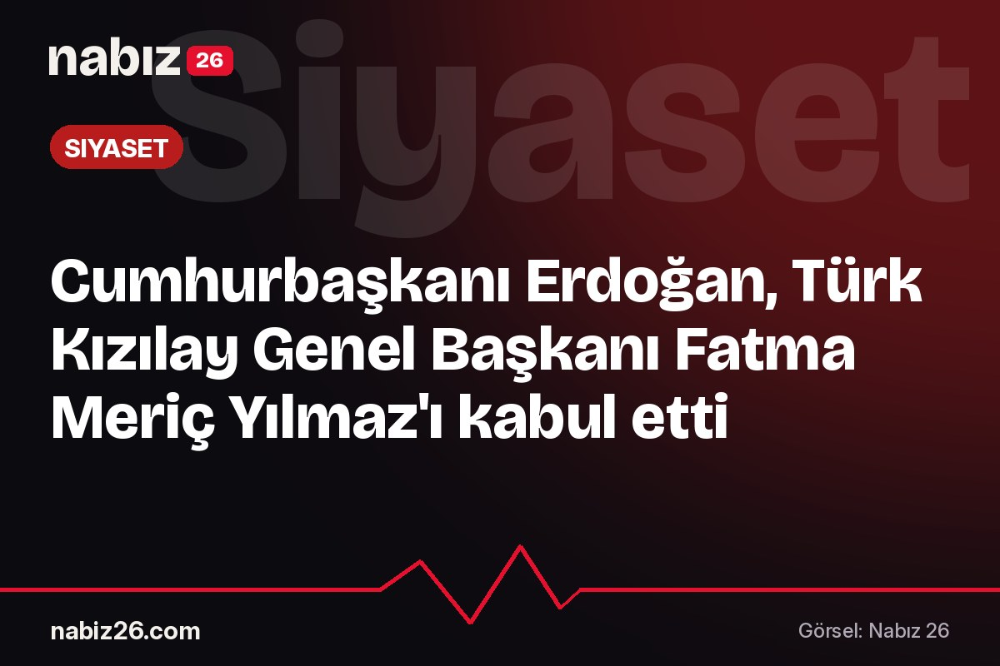

> Kızılay Haftası öncesindeki kabulde Kızılay'ın insani yardım ve afete hazırlık çalışmaları Erdoğan'a anlatıldı.

Türk Kızılay'ın Onursal Başkanı Cumhurbaşkanı Recep Tayyip Erdoğan, Kızılay Genel Başkanı Prof. Dr. Fatma Meriç Yılmaz'ı Cumhurbaşkanlığı Külliyesi'nde kabul etti.

Türk Kızılay'ın sosyal medya hesabından yaptığı açıklamaya göre Kızılay Haftası öncesinde gerçekleşen kabulde, kurumun yurt içinde ve yurt dışında yürüttüğü insani yardım faaliyetleri, afetlere hazırlık çalışmaları, sosyal destek hizmetleri ve geleceğe yönelik hedefleri Erdoğan'a anlatıldı. Kızılay, Erdoğan'ın Kızılay Haftası vesilesiyle çalışanlara ve gönüllülere selam ve iyi dileklerini ilettiğini bildirdi.

---

## CHP'li Tarhan: Avrupa'nın "Made in Europe" yaklaşımına Türkiye izlemekle yetinemez

**Ekonomi · Türkiye** · 2026-10-23 04:33 UTC · Kaynak: [Google Haberler - CHP](https://gazetekalem.com.tr/chpli-tarhandan-made-in-europe-uyarisi-turkiye-izlemekle-yetinemez/)

> CHP Genel Başkan Yardımcısı Tahsin Tarhan, otomotiv ihracatının yaklaşık yüzde 72,5'inin AB'ye yapıldığını hatırlatarak hükümete yerli üretim çağrısı yaptı.

CHP Genel Başkan Yardımcısı Tahsin Tarhan, Almanya ve Fransa'nın otomotiv sektörünü Çin rekabetine karşı korumak için başlattığı "Made in Europe" yaklaşımına ilişkin yazılı açıklama yaptı. Tarhan, Türkiye'nin buna karşı stratejik bir politika geliştirmemesinin kabul edilemez olduğunu söyledi.

Tarhan, Türkiye'nin otomotiv ihracatının yaklaşık yüzde 72,5'inin AB ülkelerine yapıldığını hatırlatarak, Avrupa'nın kamu alımlarında ve desteklerde Avrupa'da üretilen araç ve parçalara avantaj tanıyan yeni bir sanayi politikası oluşturduğunu belirtti. Türkiye'nin Avrupa dışındaki bir üretici konumuna itilebileceği uyarısında bulundu.

Hükümete çağrıda bulunan Tarhan, Türkiye'nin Brüksel nezdinde kendi üreticisinin Avrupa teşviklerinden ve kamu alımlarından dışlanmaması için müzakere yürütmesi gerektiğini ifade etti. Kamu kurumlarının araç alımlarında yerli üretim ve yüksek yerli katma değer önceliği getirilmesini önerdi. Tarhan, elektrikli araç, batarya, yazılım ve elektronik alanlarında yatırım yapılması gerektiğini de söyledi.

---

## CHP MYK, iki İBB meclis üyesi ile Tarsus Belediye Başkanı'nı disipline sevk etti

**Siyaset · Türkiye** · 2026-10-23 04:33 UTC · Kaynak: [Google Haberler - CHP](https://www.sondakika.com/amp/haber-chp-kurmaylari-iki-ibb-meclis-uyesinin-disipline-20354124/)

> CHP Sözcüsü Müslim Sarı, İBB Meclis Üyesi Ülkü İnanlı, Grup Sözcüsü Melendiz Dalyan İzgi ve Ali Boltaç'ın kesin ihraç talebiyle disipline sevk edildiğini açıkladı.

CHP Merkez Yönetim Kurulu (MYK), Genel Başkan Kemal Kılıçdaroğlu başkanlığında yaklaşık iki saat süren toplantı yaptı. Toplantının ardından CHP Sözcüsü Müslim Sarı, İBB Meclis Üyesi Ülkü İnanlı, İBB Grup Sözcüsü Melendiz Dalyan İzgi ve Tarsus Belediye Başkanı Ali Boltaç'ın kesin ihraç talebiyle disipline sevk edildiğini açıkladı.

ANKA'nın haberine göre CHP'li kurmaylar, Türkiye Belediyeler Birliği'ndeki ortak tutumun İstanbul Büyükşehir Belediyesi'nde de sürmesinden yana olduklarını, ancak partinin kurumsal kimliğini zedelemeyeceklerini söyledi. Kurmaylar, İBB'deki meclis üyesi dağılımına dikkat çekerek olası bir başkan seçiminde tek bir oyun bile önemli olabileceğini belirtti.

Toplantının ardından Millî Eğitim Bakanı Yusuf Tekin, CHP Genel Merkezi'ni ziyaret ederek Kılıçdaroğlu ile yaklaşık 10 dakika görüştü. Tekin'in Kılıçdaroğlu'nu kızının nikâhına davet ettiği aktarıldı.

---

## Sağlık Bakanlığı'nın 38 bin personel alımı için başvuru tarihi henüz açıklanmadı

**Sağlık · Türkiye** · 2026-10-23 03:32 UTC · Kaynak: [Google Haberler - Bakanlıklar](https://www.afyonanahaber.com.tr/saglik/saglik-bakanligi-38-bin-personel-alimi-ne-zaman-basvuru-tarihi-aciklandi-mi/402546)

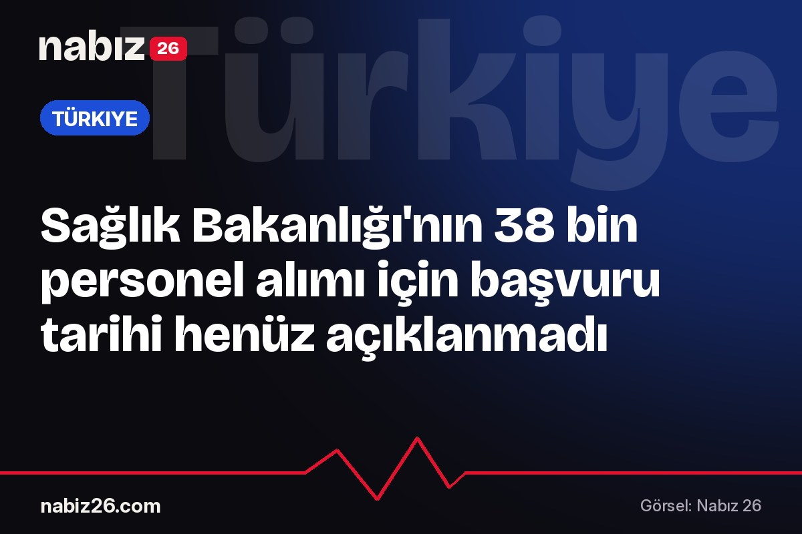

> Cumhurbaşkanı Erdoğan 17 Ekim'de yıl bitmeden 38 bin hekim dışı personel alımı için ilana çıkılacağını duyurmuştu.

Cumhurbaşkanı Recep Tayyip Erdoğan, 17 Ekim 2026'da yaptığı açıklamada, yıl bitmeden 38 bin hekim dışı personel alımı için ilana çıkılacağını bildirmişti. Afyon Ana Haber'in aktardığına göre 22 Ekim itibarıyla başvuruların başlayacağı tarih henüz açıklanmadı.

Hangi meslek gruplarına kaç kişilik kontenjan ayrılacağı, başvuru şartları, eğitim düzeyleri ve KPSS koşulu gibi ayrıntılar da resmî ilanla belli olacak. Başvuruların hangi sistem üzerinden alınacağına ilişkin kesin bir açıklama da yapılmadı. Adayların Sağlık Bakanlığı ve ÖSYM tarafından yapılacak resmî duyuruları takip etmesi gerekiyor.

---

## Eskişehir merkezli tefecilik operasyonu: 5 şüpheli yakalandı, 2'si tutuklandı

**Asayiş · Merkez** · 2026-10-23 03:32 UTC · Kaynak: [Google Haberler - Eskişehir](https://www.malatyaguncel.com/eskisehir-merkezli-3-ilde-60-milyon-liralik-tefeci-3118283h.htm)

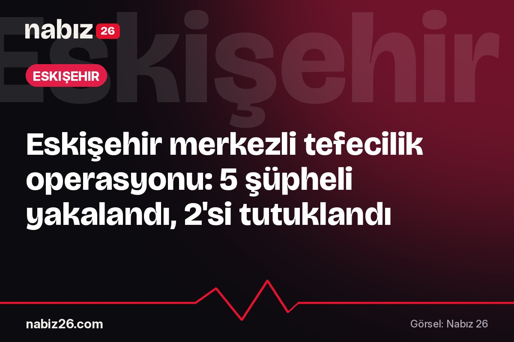

> Eskişehir, İstanbul ve Bursa'da eş zamanlı yapılan operasyonda yüksek faizle borç verdiği belirlenen 5 şüpheli yakalandı.

Eskişehir Cumhuriyet Başsavcılığı koordinesinde İl Emniyet Müdürlüğü Kaçakçılık ve Organize Suçlarla Mücadele Şube Müdürlüğü ekiplerince yürütülen çalışmada, yüksek faizle borç vererek vatandaşları mağdur ettikleri belirlenen şüphelilere yönelik operasyon düzenlendi. İLKHA'nın aktardığına göre operasyon Eskişehir merkezli olarak İstanbul ve Bursa'da eş zamanlı yapıldı ve 5 şüpheli yakalandı.

Şüphelilerin vadeli araç satışı adı altında, senet karşılığında, havale/EFT yoluyla veya elden yüksek faizle para verdikleri, borçlarını ödeyemeyen vatandaşları baskı ve tehditle mağdur ettikleri belirlendi. Şüphelilerin bu yöntemle esnaf ve vatandaşlardan icra yoluyla yaklaşık 60 milyon lira alacaklı oldukları tespit edildi.

Emniyetteki işlemlerinin ardından 22 Ekim'de adli makamlara sevk edilen şüphelilerden 2'si tutuklandı, 2'si adli kontrol şartıyla serbest bırakıldı.

---

## Senetli alışverişte yeni taksit sınırları: Televizyonda 4, mobilyada 9 aya kadar

**Ekonomi · Türkiye** · 2026-10-23 02:33 UTC · Kaynak: [Google Haberler - Bakanlıklar](https://www.bursadabugun.com/haber/taksitle-alisveris-yapacaklar-dikkat-bakanlik-urun-urun-yeni-vade-sinirlarini-acikladi-1958361.html)

> Bursada Bugün'ün aktardığına göre Ticaret Bakanlığı'nın yetkilendirildiği düzenlemeyle senetli satışlarda ürün gruplarına göre azami vade sınırları belirlendi.

15 Ekim 2026 tarihli Resmî Gazete'de yayımlanan yönetmelik değişikliğiyle Ticaret Bakanlığı, perakende işletmelerin tüketicilere yönelik taksitli satışlarında vade sürelerini belirleme ve gerektiğinde ek kısıtlama getirme yetkisini aldı. Bursada Bugün'ün haberine göre düzenleme konut satışları dışındaki mal ve hizmetleri kapsıyor.

Haberde aktarılan azami taksit süreleri şöyle: fiyatı 5 bin TL'nin altındaki televizyonlarda 9 ay, 5 bin TL'nin üzerindekilerde 4 ay; tablet ve bilgisayarda 6 ay; beyaz eşya ve elektrikli küçük ev aletlerinde 9 ay; mobilyada 9 ay; seyahat ve konaklama harcamalarında ise 18 ay. Bu süreler, senet gibi yöntemlerle yapılan taksitli satışlardaki üst sınırları gösteriyor.

Ticaret Bakanlığı daha önce yaptığı açıklamada cep telefonlarında sıfır ve yenilenmiş cihazlar için taksit süreleri ile tutar sınırlarının güncellendiğini duyurmuş, rakamsal ayrıntı vermemişti.

---

## Odunpazarı'nda 3 yaşındaki E. M. A.'nın ölümüne ilişkin sürücü hakkında iddianame

**Asayiş · Odunpazarı** · 2026-10-23 02:33 UTC · Kaynak: [Google Haberler - Eskişehir](https://haberton.com/eskisehirde-3-yasindaki-elif-mavinin-olumune-neden-olmustu-surucu-icin-15-yila-kadar-hapis-istemi/)

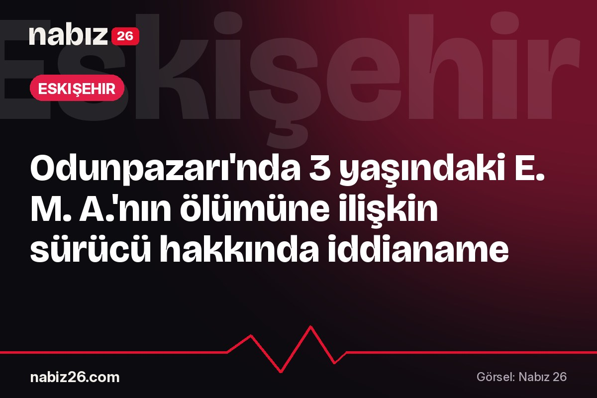

> Savcılık, 3 Eylül'deki trafik kazasında 3 yaşındaki bir çocuğun ölümüne neden olan tutuklu sürücü için 2 yıldan 15 yıla kadar hapis istedi.

Eskişehir Cumhuriyet Başsavcılığı, 3 Eylül'de Odunpazarı ilçesi Vişnelik Mahallesi'nde meydana gelen trafik kazasına ilişkin iddianame hazırladı. Kazada otomobilin çarptığı 3 yaşındaki E. M. A. hayatını kaybetmiş, annesi hafif yaralanmıştı. Haberton'un aktardığına göre tutuklu sürücü F. A. B. (40) hakkında "taksirle ölüme ve yaralanmaya neden olma" suçundan 2 yıldan 15 yıla kadar hapis cezası isteniyor. Dava Eskişehir 1. Ağır Ceza Mahkemesi'nde açıldı.

İddianameye göre trafik kazası tespit tutanağında sürücünün kusurlu olduğu belirtilmiş, bir bilirkişi raporunun ise bunun aksini ortaya koyduğu ifade edilmişti. Bunun üzerine Adli Tıp Kurumu Ankara Trafik İhtisas Dairesi'nden rapor alındı. Gelen raporda sürücünün dikkatsizliği, tedbirsizliği ve kurallara aykırı hareketi nedeniyle asli kusurlu olduğu, ölen çocuk ile annesinin kusurunun bulunmadığı kaydedildi.

Sürücü, kazanın ardından önce "konutu terk etmeme" şeklinde adli kontrol kararıyla serbest bırakılmıştı. Savcılığın itirazı üzerine yeniden gözaltına alınan sürücü, 8 Eylül'de Sulh Ceza Hakimliği tarafından tutuklandı.

---

## MEB ortak sınav takvimini açıkladı; Bakan Tekin 10 Kasım eleştirilerine yanıt verdi

**Eğitim · Türkiye** · 2026-10-23 02:33 UTC · Kaynak: [Google Haberler - Bakanlıklar](https://www.aksutvhaber.net/milli-egitim-bakanligi-2026-2027-ortak-sinav-takvimini-acikladi-iste-gun-gun-ders-listesi)

> Ortak yazılı sınavlar 3 Kasım'da başlayacak. Bakan Tekin, 10 Kasım'daki sınavın 09.30'dan sonra yapılacağını söyledi.

Millî Eğitim Bakanlığı (MEB), Ortak Yazılı Sınav Sistemi'nin 2026-2027 eğitim-öğretim yılı birinci dönem takvimini açıkladı. Ortaokul 5, 6 ve 7. sınıflar ile liselerin 9, 10 ve 11. sınıflarında 40'ar dakikalık ortak sınavlar 3 Kasım'da başlayacak.

Ortaokul takvimine göre 3 Kasım'da Fen Bilimleri, 5 Kasım'da Matematik, 6 Kasım'da Sosyal Bilgiler, 10 Kasım'da (09.30'dan sonra) Türkçe, 11 Kasım'da yalnızca 6. sınıflar için Matematik, 12 Kasım'da İngilizce ve 13 Kasım'da Din Kültürü ve Ahlak Bilgisi sınavı yapılacak. Liselerde Biyoloji sınavı 3 Kasım'da uygulanacak.

Takvimdeki 10 Kasım tarihi eleştirilince açıklama yapan Bakan Yusuf Tekin, sınavların 81 il valiliğine gönderilen genelge uyarınca 4. ders saatinde, yani 09.30'dan sonra yapılacağını söyledi. Tekin, 10 Kasım törenlerinin 08.45'te başladığını, sınavı bu nedenle törenden sonraya koyduklarını anlattı. Okul yönetimleri gerekirse bu sınavı farklı bir ders saatine kaydırabilecek. Tekin ayrıca soruların yapay zekâya hazırlatıldığı yönündeki iddiaları yalanladı ve soruları binden fazla uzman öğretmenin hazırladığını söyledi. Öğretmenlerin sorulara erişim süresi 1 günden 4 güne çıkarıldı, EBA'daki modül 26 Ekim Pazartesi günü açılacak.

---

## Şehit ve gazi çocuklarına 609 milyon liralık eğitim yardımı 23 Ekim'de ödenecek

**Türkiye · Türkiye** · 2026-10-23 01:32 UTC · Kaynak: [Google Haberler - Bakanlıklar](https://www.yenisafak.com/ekonomi/bakan-isikhan-odeme-gununu-acikladi-ogrencilere-609-milyon-liralik-egitim-destegi-4866531)

> Çalışma ve Sosyal Güvenlik Bakanı Işıkhan, 2026-2027 eğitim döneminde 18 bin 441 öğrenciye yapılacak ödemenin cuma günü hesaplara yatacağını açıkladı.

Çalışma ve Sosyal Güvenlik Bakanı Vedat Işıkhan, şehit ve harp-vazife malulü gazi çocuklarına yönelik eğitim-öğretim yardımlarının 23 Ekim Cuma günü ödeneceğini açıkladı.

Işıkhan'ın sosyal medya hesabından yaptığı duyuruya göre 2026-2027 eğitim-öğretim döneminde 18 bin 441 öğrenciye toplam 609 milyon lira destek sağlanacak. Ödemeler, şehit çocuklarının yanı sıra harp ve vazife malulleri ile çocuklarını kapsıyor. Işıkhan, öğrencilere başarı dileklerini ileterek devletin her zaman yanlarında olduğunu söyledi.

---

## CHP Sözcüsü Sarı Adıyaman'da: Tarım ürünlerinin fiyatları geçen yılın altında

**Siyaset · Türkiye** · 2026-10-23 01:32 UTC · Kaynak: [Google Haberler - CHP](https://www.babaocagi.com.tr/chp-sozcusu-sari-ureticinin-sorunlarina-degindi-maliyetler-artmasina-ragmen-fiyatlar-gecen-senenin-altinda)

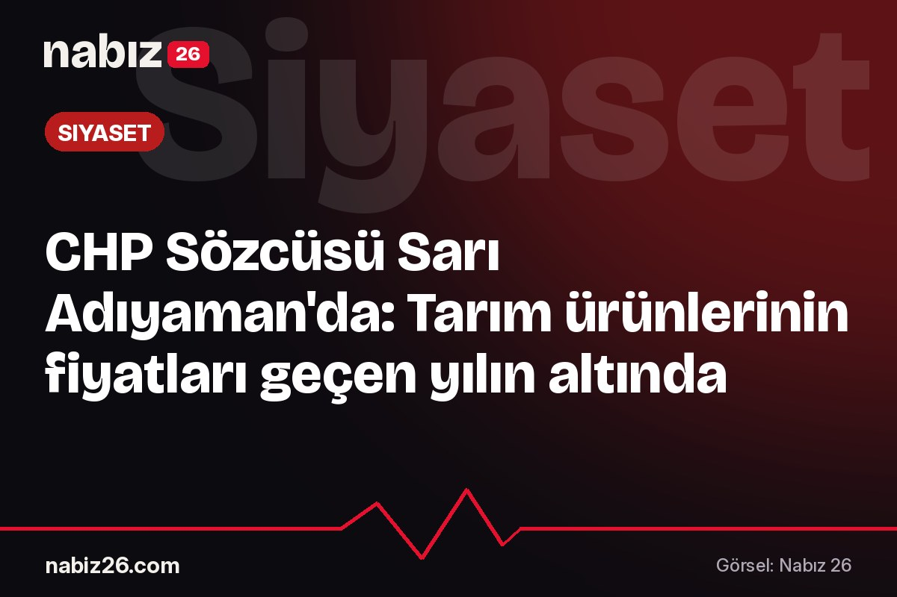

> CHP Parti Sözcüsü Müslim Sarı, Adıyaman'da yaptığı temaslarda tütün, nar ve fıstık üreticilerinin sorunlarına değindi.

CHP Parti Sözcüsü ve Yerel Yönetimlerden Sorumlu Genel Başkan Yardımcısı Müslim Sarı, Adıyaman'da CHP İl Başkanı Engin Doğan ile birlikte partililerle bir araya geldi, ardından Adıyaman Belediyesi'ni ziyaret etti. Ziyarette Belediye Başkanı Abdurrahman Tutdere'ye vekâlet eden Belediye Başkan Yardımcısı Burak Binzet Sarı'yı karşıladı.

ANKA Haber Ajansı'na konuşan Sarı, üç gün boyunca Güneydoğu'da temaslarda bulunacaklarını, CHP Genel Başkanı Kemal Kılıçdaroğlu'nun cumartesi günü Gaziantep'e geleceğini söyledi. Sarı, tütün, nar ve fıstık üreticilerinin sorunlarına değinerek, "Maliyetler çok artmış olmasına rağmen tarım ürünlerinin fiyatları geçen senenin altında kalmış durumda. Dolayısıyla ürün para etmiyor" dedi.

Sarı ayrıca bölgede fıstık ağaçlarının söküldüğüne yönelik bilgiler aldığını ve hükümeti tarımsal üretimde planlama konusunda eleştirdiğini söyledi. Temaslarını Kilis ve Gaziantep'te sürdüreceklerini, gözlemlerini bir basın toplantısıyla paylaşacaklarını belirtti.

---

## Büyükşehir, Anadolu Üniversitesi'ndeki Bağımlılık Farkındalık Haftası'na stantla katıldı

**Belediye · Merkez** · 2026-10-23 01:32 UTC · Kaynak: [Google Haberler - Eskişehir](https://www.basingazetesi.net/amp/gundem/eskisehir-de-genclere-farkindalik-destegi-73661)

> Eskişehir Büyükşehir Belediyesi ESMEK atölyeleri, Gençlik Merkezi ve Kadın Çalışmaları Şube Müdürlüğü ile etkinliğe destek verdi.

Eskişehir Büyükşehir Belediyesi, Anadolu Üniversitesi'nin ev sahipliğinde 21-22 Ekim'de düzenlenen Bağımlılık Farkındalık Haftası etkinliklerine stant ve atölyelerle destek verdi. Etkinlikler Anadolu Park'taki stant alanında yapıldı.

Eskişehir Büyükşehir Belediyesi Sanat Meslek Eğitim Kursları (ESMEK), üniversiteli gençler için ebru sanatı, mandala, anahtarlık yapımı, ahşap boyama ve taş boyama atölyeleri düzenledi. Belediyenin açıklamasına göre öğrenciler atölyelere yoğun ilgi gösterdi.

Büyükşehir Belediyesi Gençlik Merkezi öğrencilere sıcak çorba ikram etti. Zeliha Tabanca Gençlik Danışma Merkezi ile Sosyal Hizmetler Dairesi Başkanlığı Kadın Çalışmaları Şube Müdürlüğü de kurdukları stantlarla yürüttükleri çalışmalar hakkında bilgi verdi.

---

## Adalet Bakanı Gürlek: 64 dosyada 71 cinayet faili meçhul statüsünden çıkarıldı

**Asayiş · Türkiye** · 2026-10-23 01:32 UTC · Kaynak: [Google Haberler - Bakanlıklar](https://gazetegundem.tr/haber/adalet-bakani-gurlek-faili-mechul-dosyalarinda-buyuk-gelismeleri-acikladi-53958)

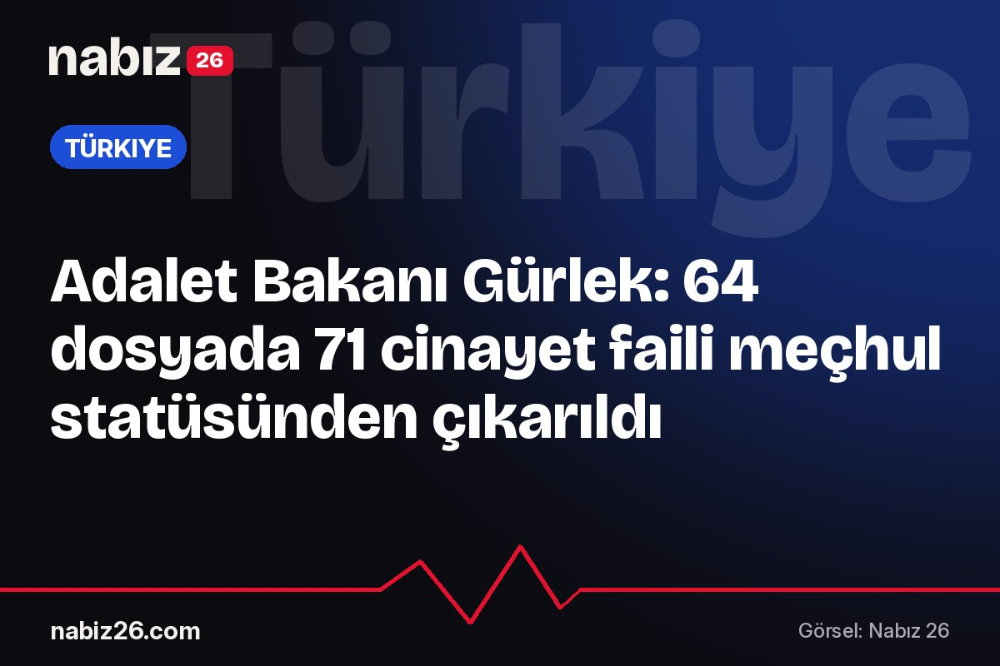

> Bakan Gürlek, İzmir Menemen, Mersin ve Osmaniye'deki üç eski dosyada gelişme yaşandığını açıkladı. Şüpheliler hakkında işlem sürüyor.

Adalet Bakanı Akın Gürlek, sosyal medya hesabından yaptığı açıklamada, faili meçhul suçların aydınlatılmasına yönelik çalışmalar sonucunda 64 dosya kapsamında 71 cinayetin faili meçhul statüsünden çıkarıldığını duyurdu. Gürlek, İzmir, Mersin ve Osmaniye'de 10 ile 21 yıl öncesine uzanan üç dosyada gelişme kaydedildiğini bildirdi.

Açıklamaya göre İzmir'in Menemen ilçesinde 2005'ten bu yana kendisinden haber alınamayan M. O.'nun dosyasında gizli tanık beyanları ve iletişim kayıtları incelendi. Kişinin bir kuyuya atıldığına dair bulgulara ulaşıldığı belirtildi. 19 Ekim'deki operasyonda 5 şüpheli gözaltına alındı, kalıntılara ulaşmak için teknik çalışmalar sürüyor.

Mersin'de 2016'da kaçırılmasının ardından kaybolan F. C.'nin dosyasında, 20 Ekim'de 9 şüpheli hakkında adli işlem başlatıldı. Şüphelilerden 7'si gözaltına alındı, 2'sinin ceza infaz kurumunda bulunduğu belirlendi. Osmaniye'de 2016'da kaybolan M. Ç.'nin dosyasında ise cezaevindeki bir şüphelinin, kişiyi öldürüp bir evin bahçesine gömdüğünü söylemesi üzerine kazı yapıldı. Yaklaşık 4 metre derinlikte kemik parçalarına ulaşıldı ve kalıntılar Adli Tıp Kurumu'na gönderildi. Bu dosyada 2 şüpheli tutuklandı, 1 şüpheli hakkında adli kontrol kararı verildi.

---

## Tarsus Belediye Başkanı Ali Boltaç CHP'den istifa etti

**Siyaset · Türkiye** · 2026-10-23 00:32 UTC · Kaynak: [Google Haberler - CHP](https://ilketv.com.tr/tarsus-belediye-baskani-ali-boltac-chpden-istifa-etti/)

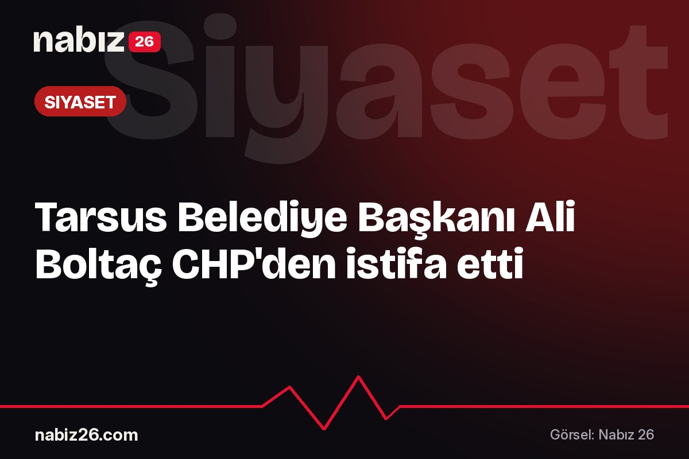

> Mersin'in Tarsus ilçesinin Belediye Başkanı Ali Boltaç, hakkında başlatılan disiplin sürecinin ardından CHP üyeliğinden istifa ettiğini açıkladı.

Mersin'in Tarsus ilçesi Belediye Başkanı Ali Boltaç, CHP üyeliğinden istifa ettiğini yazılı bir açıklamayla duyurdu. Boltaç, parti yönetiminin hakkında başlattığı disiplin sürecini üzüntüyle karşıladığını belirtti.

Boltaç, "Bugün itibarıyla Cumhuriyet Halk Partisi üyeliğimden istifa ediyorum" dedi. Kendisi için esas olanın inandığı değerlere sahip çıkmak ve Tarsus halkına karşı sorumluluğunu yerine getirmek olduğunu söyledi.

CHP Genel Başkan Yardımcısı ve Parti Sözcüsü Müslim Sarı daha önce yaptığı açıklamada Boltaç'ın tedbirli olarak kesin çıkarma istemiyle Yüksek Disiplin Kurulu'na sevk edildiğini duyurmuştu.

---

## Özgür Özel, Halk TV önündeki dayanışma mitinginde konuştu

**Siyaset · Türkiye** · 2026-10-23 00:32 UTC · Kaynak: [Google Haberler - CHP](https://kisadalga.net/amp/haber/gundem/ozgur-ozelden-halk-tv-icin-kilicdaroglunda-timsah-gozyaslari-cikisi-halk-tvyi-hedef-gosterenler-meydanda-olamiyor-141099)

> Yeni Parti Genel Başkanı Özgür Özel, Halk TV'ye kayyım atanmasını protesto eden dayanışma mitinginde basın özgürlüğü vurgusu yaptı.

Yeni Parti Genel Başkanı Özgür Özel, Halk TV önünde düzenlenen dayanışma mitinginde konuştu. Özel, bu akşamı bir parti mitingi olarak değil, Halk TV'ye kayyım atanmasını protesto etmek ve kanalın yaklaşık 200 çalışanıyla dayanışma göstermek için düzenlediklerini söyledi.

Özel'in aktardığına göre eylemde DİSK, KESK, TMMOB ve İstanbul Tabip Odası ile DEM Parti, TİP, EMEP, İYİ Parti, Saadet Partisi, DEVA Partisi, Zafer Partisi ve LDP gibi çok sayıda parti ve kuruluşun temsilcileri yer aldı.

Özel, konuşmasında gazeteciliğin iktidarı denetleyen dördüncü kuvvet olduğunu söyledi. İktidarı denetimden kaçmakla ve gazetecilere yönelik soruşturma, para cezası, gözaltı ve kayyım uygulamalarıyla suçlayan Özel, bu mücadelenin toplumsallaştırılması gerektiğini ifade etti. Özel ayrıca isim vermeden CHP Genel Başkanı Kemal Kılıçdaroğlu'nu Halk TV'yi hedef göstermekle ve mitinge katılmamakla eleştirdi.

---

## MSB: Katar'dan Eurofighter tedariki için taslak sözleşme bekleniyor

**Türkiye · Türkiye** · 2026-10-23 00:32 UTC · Kaynak: [Google Haberler - Bakanlıklar](https://www.savunmasanayist.com/msbden-eurofighter-aciklamasi-katar-tarafi-bekleniyor/)

> Milli Savunma Bakanlığı, Katar'dan Eurofighter Typhoon uçağı tedarikinde Katar'dan taslak eğitim programı ve satış sözleşmesi beklendiğini açıkladı.

Milli Savunma Bakanlığı (MSB) Sözcüsü Tuğamiral Zeki Aktürk, haftalık basın toplantısında Katar'dan Eurofighter Typhoon uçağı tedarikine ilişkin son durumu paylaştı. Aktürk, Hava Kuvvetleri Komutanlığı'nın harekât ihtiyaçlarının karşılanması için çalışmaların sürdüğünü söyledi.

Aktürk'e göre Ağustos ve Eylül aylarında heyetler arası toplantılar yapıldı. Görüşmelerde tedarik edilecek uçak ve mühimmatın kapsamı, pilot ve bakım personelinin eğitimi ile uçakların idame ve işletmesine yönelik teknik ve lojistik destek ele alındı. Gelinen son aşamada Katar tarafından taslak eğitim programı ve satış sözleşmesi bekleniyor.

SavunmaSanayiST'nin aktardığına göre Türkiye, Katar'ın envanterindeki Typhoon'lardan 12'sini devralmayı planlıyor. Bu uçaklar, Birleşik Krallık ile 27 Ekim 2025'te sözleşmesi imzalanan 20 yeni üretim uçağın teslimine kadar ortaya çıkacak ihtiyacı karşılayacak.

---

## Erdoğan AK Parti MKYK'da fon sürecini ve yerel yönetim reformunu ele aldı

**Siyaset · Türkiye** · 2026-10-23 00:32 UTC · Kaynak: [Google Haberler - Cumhurbaşkanı](https://www.sde.org.tr/turkiye/cumhurbaskani-erdogan-dan-fon-skandaliyla-baslayan-ofkeyi-teskin-eden-konusma-haberi-67859)

> Cumhurbaşkanı Erdoğan başkanlığındaki AK Parti MKYK toplantısında fon krizine ilişkin süreç ve yerel yönetimler reform paketi gündeme geldi.

Cumhurbaşkanı Recep Tayyip Erdoğan başkanlığında toplanan AK Parti Merkez Karar ve Yönetim Kurulu'nda (MKYK) fon krizine ilişkin süreç ve yerel yönetimlere yönelik reform çalışmaları görüşüldü.

Türkiye gazetesinin haberine göre Erdoğan, sürecin kararlılıkla yürütüleceğini, sorumluluğu bulunanlar hakkında gerekli adımların atılacağını söyledi. Erdoğan, "Hiçbir şeyin üzeri örtülmeyecek" dedi ve muhalefetin kışkırtmalarına kapılmadan hareket edeceklerini ifade etti.

Toplantıda ayrıca Yerel Yönetimler Başkanlığı'nın hazırladığı reform çalışması ele alındı. Belediyelerde mali disiplinin sağlanması, denetim mekanizmalarının güçlendirilmesi ve büyükşehir, ilçe belediyeleri ile kırsal alanlar arasındaki yetki karmaşasının giderilmesi hedefleniyor. TBMM'ye sunulmak üzere hazırlanan paket; şeffaflık ve denetim, yerel yönetim modeli, mali yapı, yeni uygulamalar ile imar ve planlama olmak üzere beş ana başlıktan oluşuyor.

---

## CHP Engelliler Kurulu Ankara'da istişare toplantısı yaptı

**Siyaset · Türkiye** · 2026-10-23 00:32 UTC · Kaynak: [Google Haberler - CHP](https://www.fibhaber.com/chpli-taylan-simsekten-engelsiz-turkiye-cagrisi)

> CHP Genel Merkezi'ndeki toplantıda engelli bireylerin sorunları, erişilebilirlik ve fırsat eşitliği konuları ele alındı.

CHP Genel Merkezi Parti Meclisi Salonu'nda Engelliler Kurulu İstişare Toplantısı düzenlendi. CHP Genel Başkan Yardımcısı Necdet Saraç'ın sorumluluğunda yürütülen çalışmalar kapsamındaki toplantıda engelli bireylerin yaşam koşulları, erişilebilir çevre düzenlemeleri ve fırsat eşitliğine yönelik sosyal politikalar değerlendirildi.

Toplantıya katılanlar arasında CHP Nevşehir Merkez İlçe Başkanı ve CHP İç Anadolu Bölgesi Sosyal Politikalar Engelliler Kurulu Koordinatör Yardımcısı Taylan Şimşek de vardı. Şimşek, engelli bireylerin sorunlarının çözüm üretilmesi gereken toplumsal meseleler olduğunu söyledi ve herkes için erişilebilir bir Türkiye hedefiyle çalışacaklarını belirtti.

---

## Mukaddes Emanetler Sergisi'ne Eskişehir'de yoğun ilgi: Metrelerce kuyruk oluştu

**Kültür-Sanat · Merkez** · 2026-10-22 23:32 UTC · Kaynak: [Google Haberler - Eskişehir](https://www.saraymedya.com/haber/eskisehir-de-mukaddes-emanetler-sergisi-yogun-ilgi-gordu_316578/)

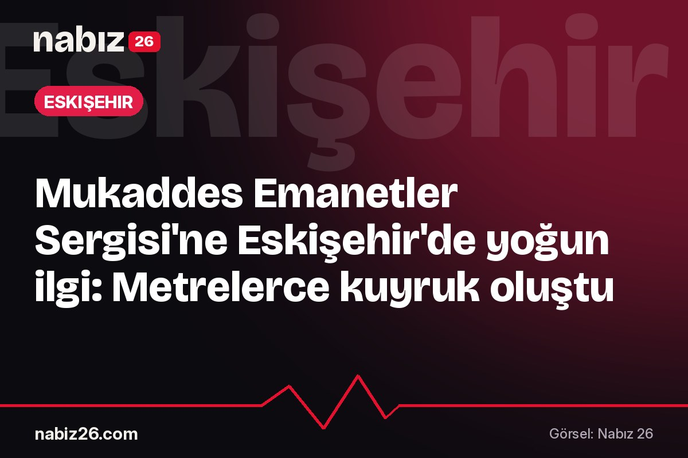

> İl Kültür ve Turizm Müdürlüğü Sergi Salonu'ndaki sergiyi görmek isteyen vatandaşlar uzun kuyruklar oluşturdu.

Eskişehir İl Kültür ve Turizm Müdürlüğü Sergi Salonu'nda açılan Mukaddes Emanetler Sergisi'ne vatandaşlar yoğun ilgi gösterdi. Sergiyi görmek isteyenler metrelerce kuyruk oluşturdu.

Saray Medya'nın haberine göre Asr-ı Saadet'ten Osmanlı dönemine uzanan 150'den fazla kutsal emanetin sergilendiği etkinlik, koleksiyoner Erol Güzel ile MÜSİAD Eskişehir Şubesi'nin iş birliğiyle düzenleniyor. Sergi, Eskişehir'de bu kadar geniş kapsamda ilk kez sunuluyor.

Ziyaretçiler, Sakal-ı Şerif ve Kabe örtülerini görmek için saatlerce beklediklerini söyledi. Bazı ziyaretçiler 2-3 saattir sırada beklediklerini, sabahtan geldiklerini ifade etti. Genç ziyaretçiler de sergiden memnun kaldıklarını belirtti.

---

## MSB haftalık toplantıda hudut güvenliği ve Libya mutabakatını açıkladı

**Türkiye · Türkiye** · 2026-10-22 23:32 UTC · Kaynak: [Google Haberler - Bakanlıklar](https://filashaber.com/haber/milli-savunma-bakanligi-hudut-guvenligi-ve-uluslararasi-askeri-is-birliklerini-acikladi-52090)

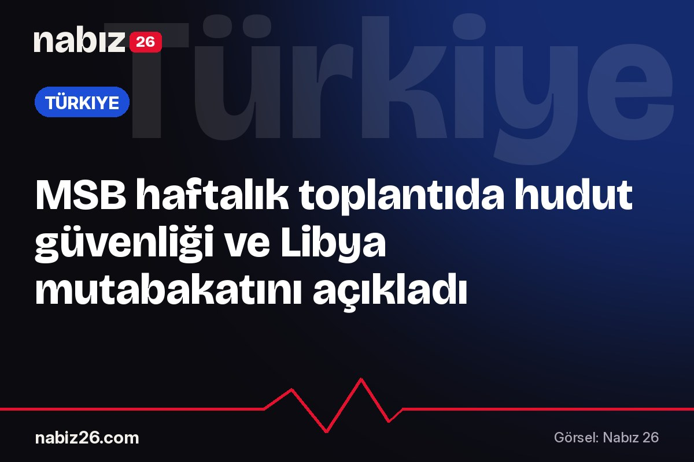

> Milli Savunma Bakanlığı Sözcüsü Tuğamiral Zeki Aktürk haftalık basın toplantısında sınır güvenliği verilerini ve uluslararası iş birliklerini anlattı.

Milli Savunma Bakanlığı (MSB) Sözcüsü Tuğamiral Zeki Aktürk, haftalık basın bilgilendirme toplantısında terörle mücadele, sınır güvenliği ve uluslararası askerî iş birliklerine ilişkin açıklamalarda bulundu.

Aktürk, hafta içinde 4 PKK mensubunun teslim olduğunu bildirdi. Sınırı yasa dışı yollarla geçmeye çalışan 364 kişinin yakalandığını, 2 bin 47 kişinin ise sınırın ötesine geçemeden engellendiğini söyledi. Yılbaşından bu yana yakalanan kişi sayısının 14 bin 207, engellenenlerin sayısının 56 bin 898 olduğunu açıkladı.

Aktürk, Türkiye ile Libya arasında yürürlüğe giren Deniz Yetki Alanlarının Sınırlandırılmasına İlişkin Mutabakat Muhtırası'nın Libya Temsilciler Meclisi tarafından 20 Ekim'de onaylandığını belirtti. Ayrıca Türkiye, Katar, Endonezya ve Pakistan arasındaki askerî iş birliği kapsamında "Bedir Mutabakat Zaptı"nın 21 Ekim'de Doha'da imzalandığını aktardı.

---

## "İyilik Var" gönüllülük platformuna bir ayda 20 bin kişi katıldı

**Türkiye · Türkiye** · 2026-10-22 23:32 UTC · Kaynak: [Aile ve Sosyal Hizmetler Bakanlığı](https://www.aile.gov.tr/haberler/iyilik-varda-bir-ayda-gonullu-sayisi-20-bine-ulasti/)

> Aile ve Sosyal Hizmetler Bakanlığı'nın dijital gönüllülük platformu "İyilik Var", bir ayda 20 bin gönüllüye ulaştı.

Aile ve Sosyal Hizmetler Bakanlığı'nın gönüllülük faaliyetlerine katılımı artırmak amacıyla hayata geçirdiği dijital platform "İyilik Var" ile bir ayda 20 bin vatandaş gönüllülük hareketine dahil oldu.

Platform üzerinden bireysel ve kurumsal gönüllüler; sosyo-kültürel, çevre, eğitim, sanat, spor, psikososyal, bilişsel-gelişimsel, eğlence ve bilim gibi alanlardaki etkinliklere katılabiliyor. Etkinlikler, bakanlığın bağlı kuruluşları ve il müdürlükleri tarafından belirlenen ihtiyaç alanlarına göre planlanıyor. Platformdaki haritada iyilik alanlarının yoğunluğu illere göre farklı renklerle gösteriliyor.

Bakanlığın açıklamasına göre 81 ilde toplam 1088 iyilik alanı oluşturuldu. Platforma ilişkin bilgilere www.iyilikvar.gov.tr adresinden ulaşılabiliyor.

---

## Eskişehir Büyükşehir Belediyesi büfe, çay bahçesi ve otopark için 4 Kasım'da ihale yapacak

**Belediye · Merkez** · 2026-10-22 23:32 UTC · Kaynak: [Google Haberler - Eskişehir](https://ankahaber.net/haber/eskisehir-buyuksehir-belediyesi-yeni-bufe-ve-cay-bahceleri-icin-ihaleye-cikiyor-a585d780)

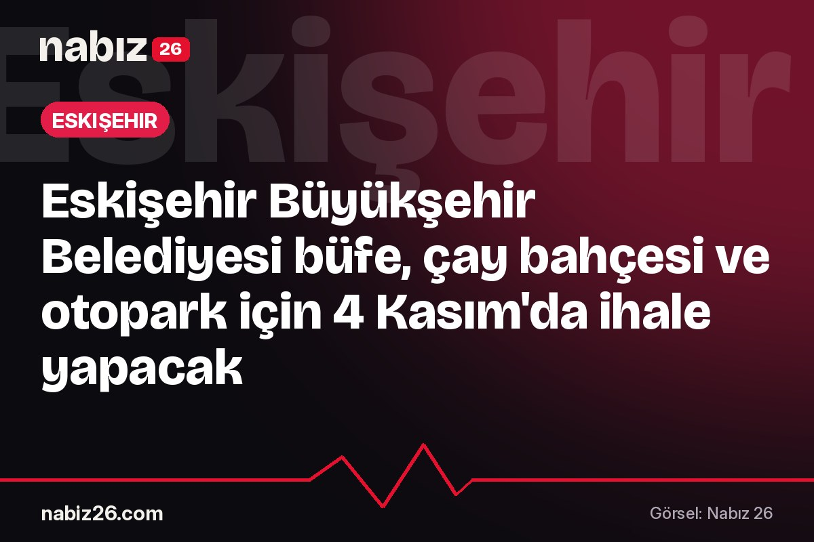

> Büyükşehir Belediyesi, kentin farklı noktalarındaki büfe ve çay bahçesi alanları ile 140 araç kapasiteli katlı otoparkı açık artırmayla kiraya verecek.

Eskişehir Büyükşehir Belediyesi, kentin farklı noktalarında hizmet verecek büfe, çay bahçesi ve çiçekçi alanları ile 140 araç kapasiteli katlı otoparkın kiraya verilmesi için 4 Kasım Çarşamba günü ihaleye çıkacak. İhale, Satın Alma Dairesi Başkanlığı tarafından 2886 sayılı Devlet İhale Kanunu'nun 45. maddesi uyarınca açık artırma usulüyle yapılacak.

İhale kapsamında belediyeye ait 4 büfe ile işletmeciler tarafından yaptırılacak 12 büfe kiralanacak. Büfe yapılması planlanan noktalar arasında 71 Evler Mahallesi (Şehir Hastanesi yanı), Muttalip Orta Mahallesi, Uluönder Mahallesi, Akarbaşı Mahallesi, Sümer Park ve Büyük Park girişi yer alıyor. Babalar Parkı, Söğütönü Parkı, Pati Park yanı ve Batıkent'te tenis kortları yanındaki alanlar büfe ve çay bahçesi olarak kiraya verilecek. Ulus Anıtı Meydanı'nda ise 3 çiçekçi büfesi için ihale yapılacak.

Odunpazarı ilçesi Şarkiye Mahallesi'ndeki 140 araç kapasiteli katlı otopark da kiralanacak. İhaleye katılmak isteyenlerin ikametgâh belgesi, imza sirküleri, nüfus cüzdanı fotokopisi, geçici teminat makbuzu veya banka teminat mektubu, şartname alındı makbuzu ve Gelir Müdürlüğü'nden alınacak "borcu yoktur" yazısını hazırlaması gerekiyor.

---

## CHP Kadın Kolları Genel Başkanı Gülsever, Kadirli'de 87 yaşındaki H. T.'yi ziyaret etti

**Siyaset · Türkiye** · 2026-10-22 23:32 UTC · Kaynak: [Google Haberler - CHP](https://www.medyagazete.com/haber/chp-kadin-kollari-genel-baskani-gulseverden-huru-teyzeye-ziyaret-1467158)

> CHP Kadın Kolları Genel Başkanı Ayten Gülsever, Osmaniye'nin Kadirli ilçesinde geçimini pazarda sağlamaya çalışan yaşlı bir kadını ziyaret ederek barınma ve gelir sorununa dikkat çekti.

CHP Kadın Kolları Genel Başkanı Ayten Gülsever, Osmaniye'nin Kadirli ilçesinde 87 yaşında olmasına rağmen geçimini sağlamaya çalışan H. T.'yi ziyaret etti. Ziyarette CHP Osmaniye İl Başkanı Rıza Tekerek ve yönetim kurulu üyeleri de yer aldı.

Gülsever'in açıklamasına göre H. T., herhangi bir geliri olmadan kömürlükte yaşıyor ve kızının dağdan topladığı nanelerin kurutulup satılmasıyla geçimini sağlamaya çalışıyor. Gülsever, 87 yaşındaki bir vatandaşın bu koşullarda yaşam mücadelesi vermesinin sosyal devlet anlayışı açısından ciddi bir sorun olduğunu söyledi.

Gülsever, CHP Genel Başkanı Kemal Kılıçdaroğlu'nun talimatıyla harekete geçtiklerini, Osmaniye İl Başkanlığı ile salı gününden itibaren iletişim kurduklarını anlattı. Konunun gündeme gelmesinin ardından Osmaniye milletvekillerinin ve Kadirli Belediyesi'nin de harekete geçtiğini belirten Gülsever, atılan adımları sevindirici bulduğunu ifade etti.

---

## Odunpazarı'nda foseptik çukuruna düşen at AFAD ekiplerince kurtarıldı

**Gündem · Odunpazarı** · 2026-10-22 22:32 UTC · Kaynak: [Google Haberler - Odunpazarı](https://www.nefes.com.tr/evden-kacip-foseptik-cukuruna-dusen-ati-afad-kurtardi-159947)

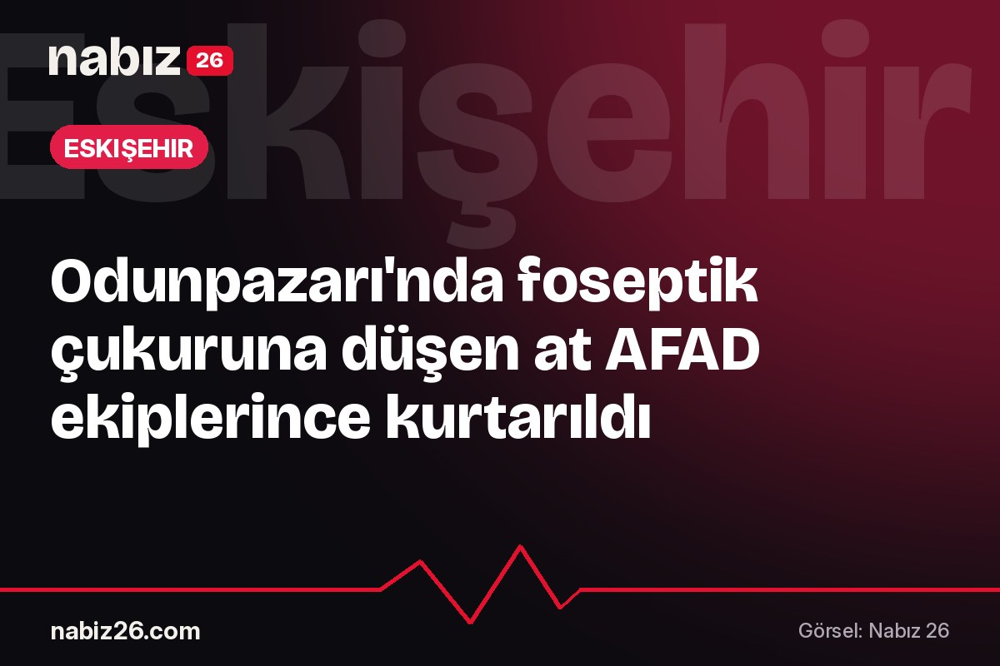

> Evinin bahçesinden kaçan at, boş arsadaki foseptik çukuruna düştü. AFAD ekipleri atı kurtardı.

Odunpazarı'na bağlı 71 Evler Mahallesi Mehmet Akif Ersoy Sokak'ta bir evin bahçesindeki at, bulunduğu yerden kaçtı. Başıboş dolaşan at, boş bir arsadaki foseptik çukuruna düştü.

Atın çukurda mahsur kaldığını fark eden çevredekilerin ihbarı üzerine olay yerine AFAD ve polis ekipleri gönderildi. Hareketsiz kalan at, AFAD ekiplerinin çalışmasıyla çukurdan çıkarıldı.

Bacağında yara oluşan at, belediye personeli tarafından barınağa götürüldü.

---

## MEB, yurt dışındaki öğrenciler için yenilenen Türkçe ders kitaplarını yayımladı

**Eğitim · Türkiye** · 2026-10-22 22:32 UTC · Kaynak: [Milli Eğitim Bakanlığı](https://www.meb.gov.tr/yurt-disindaki-ogrenciler-icin-yenilenen-quotturkce-ve-turk-kulturuquot-ders-kitaplari-yayimlandi/haber/42255/tr)

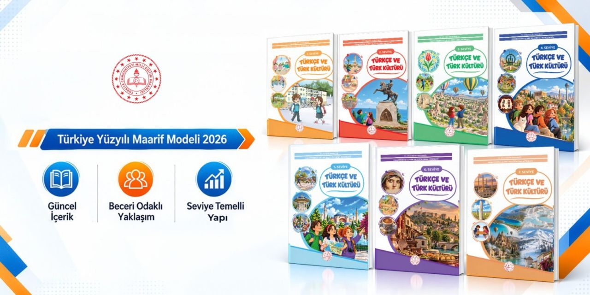

> Yurt dışında yaşayan Türk çocukları için hazırlanan 7 seviyelik "Türkçe ve Türk Kültürü" ders kitabı seti "Ülkem Yanımda" platformunda yayımlandı.

Millî Eğitim Bakanlığı, 2026 Türkçe ve Türk Kültürü Dersi Öğretim Programı doğrultusunda Yükseköğretim ve Yurt Dışı Eğitim Genel Müdürlüğünce hazırlanan 7 seviyelik ders kitabı setini "Ülkem Yanımda" platformunda yayımladı. Kitaplar, yurt dışında yaşayan Türk öğrencilerin Türkçe dil becerilerini geliştirmeyi amaçlıyor.

Bakanlığın açıklamasına göre Almanya, Fransa, Belçika, Birleşik Krallık, İsviçre, İtalya ve Karadağ'da yürütülen yüz yüze eğitime bu yıl Japonya da eklendi. Böylece 8 ülkede 800'e yakın öğretmenle 50 bine yakın öğrenciye ana dili eğitimi veriliyor.

Seviye temelli kitaplar dinleme, konuşma, okuma ve yazma becerilerini destekliyor. İçeriklerde bayramlardan geleneklere, tarihî şahsiyetlerden spor ve sanata, geleneksel oyunlardan bilim ve teknolojiye uzanan konular yer alıyor.

---

## Kadınlar için yapay zekâ ve dijital güçlenme eğitimleri 7 pilot ilde başlıyor

**Türkiye · Türkiye** · 2026-10-22 22:32 UTC · Kaynak: [Aile ve Sosyal Hizmetler Bakanlığı](https://www.aile.gov.tr/haberler/kadinlar-icin-yapay-zeka-ve-dijital-guclenme-egitimleri-7-pilot-ilde-basliyor/)

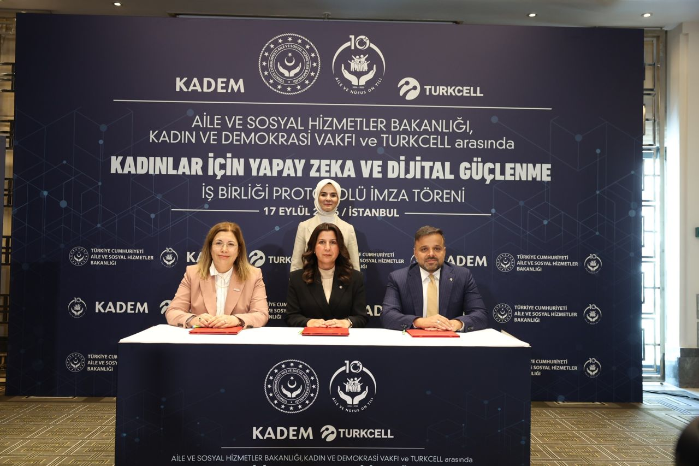

> Aile ve Sosyal Hizmetler Bakanlığı, Turkcell ve KADEM iş birliğindeki eğitimler 27 Ekim'de Van'da başlayacak. Başvurular çevrim içi alınıyor.

Aile ve Sosyal Hizmetler Bakanlığı, Turkcell ve Kadın ve Demokrasi Vakfı (KADEM) iş birliğiyle hayata geçirilen "Kadınlar İçin Yapay Zeka ve Dijital Güçlenme Eğitimleri" 27 Ekim'de Van'da başlayacak. Program, kadınların yapay zekâ ve güvenli internet alanlarındaki yetkinliklerini artırmayı amaçlıyor. Protokol, 17 Eylül'de İstanbul'da imzalanmıştı.

Eğitimler 7 pilot ilde yapılacak: 27 Ekim'de Van, 3 Kasım'da İzmir, 12 Kasım'da Ankara, 1 Aralık'ta Bursa ve Gaziantep, 8 Aralık'ta Adana ve Samsun. Programın 2027'de diğer illere yaygınlaştırılması planlanıyor.

Eğitimlerde dijital ebeveynlik, akıllı ev yönetimi, dijital güvenlik, ev ekonomisi ve güvenli alışveriş konuları işlenecek. Çocuklarıyla gelmek isteyen katılımcılar için eğitim süresince Bakanlık personeli çocuk bakım hizmeti sunacak. Katılmak isteyen kadınlar bakanlığın internet sitesindeki kayıt formundan başvurabilecek.

---

## İçişleri Bakanı Çiftçi: COP31 Zirvesi'nde 26 bin personel görev yapacak

**Türkiye · Türkiye** · 2026-10-22 22:32 UTC · Kaynak: [Google Haberler - Bakanlıklar](https://www.akdenizgercek.com.tr/antalya/icisleri-bakani-ciftci-acikladi-cop31-zirvesinde-26-bin-personel-gorev-yapacak/387838)

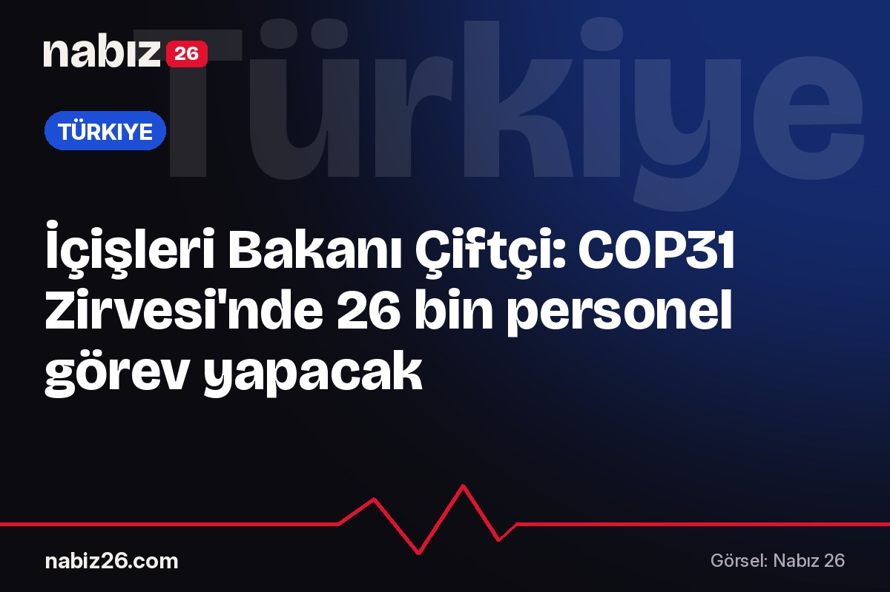

> İçişleri Bakanı Mustafa Çiftçi, Antalya'daki COP31 hazırlıklarını inceledi. Günlük ziyaretçi sayısının 100 bine ulaşması bekleniyor.

İçişleri Bakanı Mustafa Çiftçi ile Çevre, Şehircilik ve İklim Değişikliği Bakanı Murat Kurum, COP31 hazırlıkları kapsamında Antalya'da zirve alanındaki çalışmaları yerinde inceledi.

Çiftçi, zirvede 26 bin personelin görev yapacağını, güvenlik tedbirlerinin kara, hava ve denizden yürütüleceğini söyledi. Günlük ziyaretçi sayısının 100 bin kişiye ulaşmasının beklendiğini belirten Çiftçi, NATO Zirvesi'ndeki hassasiyetle hazırlık yaptıklarını ifade etti. Konferans alanı ve konaklama noktalarındaki yangın önlemleri, tahliye planları ve acil durum senaryolarının gözden geçirildiğini de aktardı.

Bakan Kurum ise şu ana kadar 85 ülke liderinin zirveye katılacağını bildirdiğini söyledi. Çiftçi, zirve süresince gösteri başvurularını değerlendirme yetkisinin Antalya Valiliği'ne devredildiğini açıkladı.

---

## Eskişehir'de üç ilçede tefecilik operasyonu: 4 şüpheli gözaltına alındı

**Asayiş · Merkez** · 2026-10-22 22:32 UTC · Kaynak: [Google Haberler - Eskişehir](https://www.haberler.com/amp/eskisehir-de-3-ilcede-duzenlenen-tefecilik-20357342-haberi/)

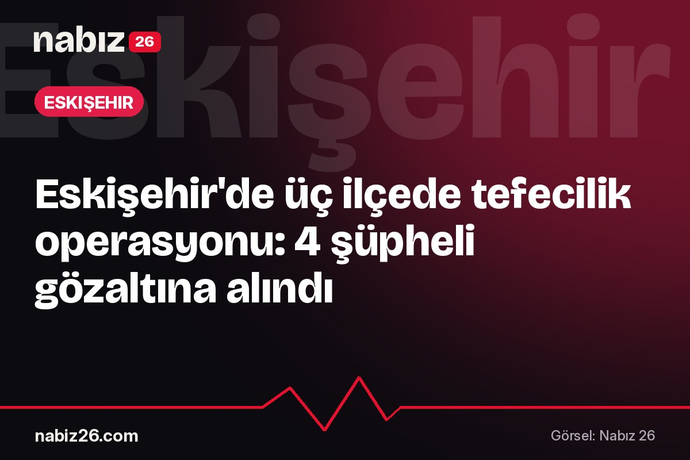

> Jandarma ekipleri Odunpazarı, Tepebaşı ve Alpu'da tefecilik şüphesiyle düzenlediği operasyonda 4 kişiyi gözaltına aldı.

Eskişehir İl Jandarma Komutanlığı ekipleri, tefecilik yaparak haksız kazanç elde ettikleri belirlenen 4 şüpheliyi yakalamak için Odunpazarı, Tepebaşı ve Alpu ilçelerinde operasyon düzenledi. Şüphelilerin ev ve iş yerlerinde arama yapıldı, 4 şüpheli gözaltına alındı.

Aramalarda 2 bin 137 tabanca fişeği, dolu senet, 3 çek, 83 boş senet, 7 alacak-verecek defteri, muhtelif mali belgeler, Roma dönemine ait olduğu değerlendirilen bir sikke ve 4 cep telefonu ele geçirildi.

Gözaltına alınan şüpheliler hakkında tefecilik suçu kapsamında işlem başlatıldı.

---
