# Son haberler

Ajanın yazdığı son haberler (otomatik güncellenir).

## Vali Yılmaz Öğretmenevinde İncelemelerde Bulundu: Güçlendirme Sürüyor

**Eğitim · Merkez** · 2026-11-17 15:09 UTC · Kaynak: [Eskişehir Valiliği](https://www.eskisehir.gov.tr/valimiz-dr-erdinc-yilmaz-depreme-karsi-guclendirme-calismalari-devam-eden-eskisehir-ogretmenevini-ziyaret-etti)

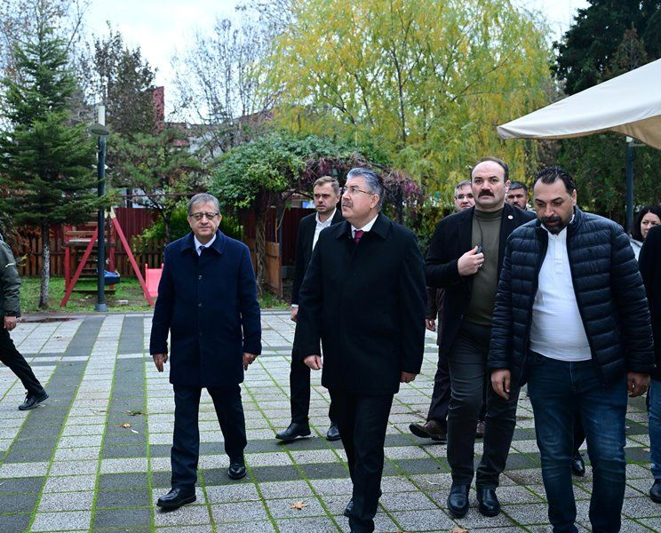

> Eskişehir Valisi Dr. Erdinç Yılmaz, depreme karşı güçlendirme çalışmaları yürütülen Eskişehir Öğretmenevini ziyaret ederek yetkililerden son durum hakkında bilgi aldı.

Eskişehir Valisi Dr. Erdinç Yılmaz, depreme dayanıklılık çalışmaları devam eden Eskişehir Öğretmenevi binasında incelemelerde bulundu.

Çalışma alanını gezerek yürütülen güçlendirme faaliyetlerini yerinde inceleyen Vali Yılmaz, inşaat sürecinin mevcut durumu ve yapılan işlemler hakkında teknik ekipten ayrıntılı bilgi aldı.

Çalışmaların titizlikle sürdürülmesinin önemini vurgulayan Vali Yılmaz, sahada görev yapan personele çalışmalarında kolaylıklar diledi.

---

## Şehir Tiyatroları'nda Ücretsiz Eğitim Sezonu: Yetişkin ve Kadın Atölyeleri Başlıyor

**Kültür-Sanat · Merkez** · 2026-11-17 15:09 UTC · Kaynak: [Eskişehir Büyükşehir Belediyesi](https://www.eskisehir.bel.tr/icerik-detay.php?icerik_id=13568&cat_icerik=1&menu_id=24)

> Eskişehir Şehir Tiyatroları, yeni sezonda 25 yaş üzeri yetişkinler ile 20 yaş üzeri kadınlara yönelik tiyatro ve drama eğitimleri için başvuru sürecini başlattı.

Eskişehir Büyükşehir Belediyesi Şehir Tiyatroları, sahnelediği oyunların yanı sıra kent genelindeki eğitim ve atölye çalışmalarını yeni sezonda da sürdürüyor. Gençlik Sahnesi seçmelerinin ardından farklı yaş gruplarına yönelik ücretsiz kurs takvimi belirlendi.

Bu sezon ilk defa uygulanacak program kapsamında 25 yaş üzeri yetişkinlere tiyatro kursu, 20 yaş üzeri kadınlara ise özel drama atölyesi düzenlenecek. Başvuruları alınmaya başlanan eğitimlerin dersleri yakın zamanda başlayacak.

Öte yandan Sultandere Sahnesi'nde iki sezondur yürütülen eğitimler çerçevesinde 15-18 yaş arası gençlere yönelik tiyatro kursu başvuruları da açıldı. Kasım ayı içerisinde başlayacak tüm eğitimlerin sezon sonuna kadar devam edeceği, kayıt ve detaylı bilgilere ise kurumun sosyal medya hesapları üzerinden ulaşılabileceği bildirildi.

---

## Köz Orkestra'dan Ücretsiz Türkü Konseri: 19 Kasım'da Sahne Alacaklar

**Kültür-Sanat · Odunpazarı** · 2026-11-17 15:09 UTC · Kaynak: [Odunpazarı Belediyesi](https://www.odunpazari.bel.tr/guncel/haberler/genel-haberler/koz-orkestra-dan-turkulerle-muzik-ziyafeti)

> Odunpazarı Belediyesi bünyesindeki eğitmenlerin kurduğu Köz Orkestra, "Beste Formunda Türküler" konseriyle 19 Kasım Perşembe günü dinleyicilerin karşısına çıkacak.

Odunpazarı Belediyesi Kültür, Sanat ve Sosyal İşler Müdürlüğü bünyesinde görev yapan eğitmenlerin bir araya gelmesiyle hayata geçirilen Köz Orkestra, yeni bir dinletiyle sanatseverlerle buluşmaya hazırlanıyor. Topluluk, bu kez türküleri sahneye taşıyacak.

"Beste Formunda Türküler" başlığıyla organize edilen konserde orkestra, Anadolu'nun köklü müzikal mirasını kendine has yorumuyla icra edecek. Farklı enstrümanların ve müzikal deneyimlerin bir araya geleceği gecede türküseverlere zengin bir repertuvar sunulacak.

Yunus Emre Kültür ve Sanat Merkezi'nde düzenlenecek etkinlik, 19 Kasım Perşembe günü saat 19.30'da başlayacak. Müzikseverler konseri ücretsiz olarak takip edebilecek.

---

## Eskişehirspor İlk Yarıyı Zirvede Bitirmek İstiyor: 5 Maçta Hedef 15 Puan

**Spor · Merkez** · 2026-11-17 15:09 UTC · Kaynak: [Google Haberler - Eskişehirspor](https://www.istikbalgazetesi.com/eskisehirsporun-hedefi-5-macta-15-puan)

> TFF 3. Lig'de zirve takibini sürdüren Eskişehirspor, ilk yarının kalan beş haftasında tüm maçları kazanarak liderliği geri almayı hedefliyor.

TFF 3. Lig 2. Grup'un 12. haftasında sahasında Ayvalıkgücü Belediyespor ile 2-2 berabere kalan Eskişehirspor, haftayı 25 puanla ikinci sırada tamamladı. Zirvede 26 puanlı Etimesgut Spor Kulübü yer alırken, aynı puana sahip Gemlik Sümerbey üçüncü sırada bulunuyor. Siyah-kırmızılı ekip, ilk devrenin kalan beş haftasında 15 puan toplayarak yeniden liderlik koltuğuna oturmayı amaçlıyor.

Siyah-kırmızılıların ilk yarı fikstüründe üç deplasman maçı yer alıyor. Eskişehirspor, 22 Kasım'da Söke 1970 deplasmanına konuk olduktan sonra 29 Kasım'da Denizli İdmanyurdu 1959'u Eskişehir'de ağırlayacak. 6 Aralık'ta Karşıyaka ile deplasmanda karşılaşacak olan Kırmızı Şimşekler, 13 Aralık'ta zirve yarışındaki rakiplerinden Gemlik Sümerbey'i konuk edecek. İlk devrenin son maçı ise 20 Aralık'ta Bucaspor 1928 deplasmanında oynanacak.

Lig mücadelesinin ortasında siyah-kırmızılıları Ziraat Türkiye Kupası randevusu da bekliyor. Üçüncü turda Iğdır FK'yı eleyen Eskişehirspor, dördüncü eleme turunda Trendyol 1. Lig ekibi Bodrum FK'ya konuk olacak. 2 Aralık Çarşamba günü saat 15.00'te tek maç eleme usulüyle oynanacak bu karşılaşmayla birlikte Eskişehirspor, sekiz gün içinde ikisi ligde biri kupada olmak üzere üç kritik maça çıkacak.

---

## Eskişehir'deki 5 Lisede Patent ve Marka Seferberliği: Üniversiteliler Eğitti

**Eğitim · Merkez** · 2026-11-17 15:09 UTC · Kaynak: [Anadolu Üniversitesi](https://anahaber.anadolu.edu.tr/tr/haber-detay/nlkdrmwy60xk36b114tj8nhr)

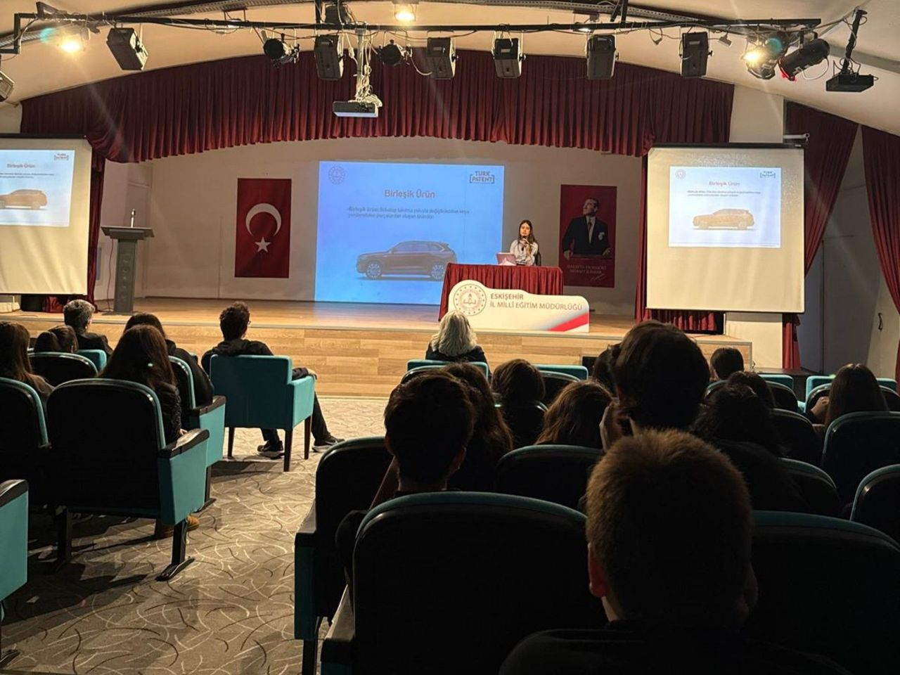

> TÜRKPATENT'in 'IP Öncüleri' projesi kapsamında Anadolu Üniversitesi öğrencileri, Eskişehir'deki liselilere marka, tasarım ve patent haklarını anlattı.

Türk Patent ve Marka Kurumu (TÜRKPATENT) tarafından hayata geçirilen "IP Öncüleri" Projesi kapsamında Eskişehir'deki liselerde fikrî ve sınai mülkiyet haklarına yönelik bilgilendirme etkinlikleri düzenlendi. Anadolu Üniversitesi ARİNKOM Teknoloji Transfer Ofisi (TTO) Fikrî Haklar ve Ticarileştirme Koordinatörü Zeynep Can ile TTO Yöneticisi Öğr. Gör. Dr. Rabia Taş’ın mentörlüğünde yürütülen programda üniversite öğrencileri liderlik yaptı.

TÜRKPATENT bünyesindeki eğitimleri başarıyla tamamlayan üniversite öğrencileri Ceyda Tekbaş, Simge Durgut, Gülin Gültekin, Mehmet Kaya Koca, Elen Karataş ve Mervegül Memiş, edindikleri bilgi birikimini lise öğrencilerine aktardı. Çalışmayla gençlerin yenilikçi fikirler üretmesi, bu buluşların korunması ve ticarileştirilmesi konusunda farkındalık oluşturulması amaçlandı.

Eskişehir Borsa İstanbul Fen Lisesi, Eti Sosyal Bilimler Lisesi, Tepebaşı Şehit Mehmet Şengül Fen Lisesi, Eskişehir Anadolu İmam Hatip Lisesi ve Cevat Ülger Uluslararası Anadolu İmam Hatip Lisesi'nde gerçekleştirilen oturumlarda "Marka ve Tasarım" ile "Patent ve Faydalı Model" başlıkları işlendi. Sunumların ardından programa katılan TÜRKPATENT temsilcileri, lise öğrencilerinin mülkiyet haklarına ilişkin merak ettiği soruları yanıtladı.

---

## Tarih Bulvarı ve Albayrak Caddesi'nde Yağmur Suyu Hattı Tamamlandı

**Belediye · Merkez** · 2026-11-17 13:09 UTC · Kaynak: [Eskişehir Büyükşehir Belediyesi](https://www.eskisehir.bel.tr/icerik-detay.php?icerik_id=13569&cat_icerik=1&menu_id=24)

> Eskişehir'de aşırı yağış risklerine karşı altyapıyı güçlendiren ESKİ, Tarih Bulvarı ve Albayrak Caddesi'ndeki yağmur suyu tahliye hattı çalışmalarını bitirdi.

Eskişehir Büyükşehir Belediyesi Su ve Kanalizasyon İdaresi Genel Müdürlüğü (ESKİ), kent genelinde yağmur suyu tahliye kapasitesini artırmak amacıyla yürüttüğü çalışmalara yenilerini ekledi. Bu kapsamda Tarih Bulvarı ve Albayrak Caddesi'nde planlanan yeni yağmur suyu hattının imalatı bitirildi.

Sızdırmazlığı artırmak için entegre contalı beton boruların döşendiği güzergâhta, bakım ve kontrol süreçleri için muayene bacaları yerleştirildi. Yol yüzeyinde biriken suların hatta aktarılması amacıyla yağmur suyu ızgaralarının montajı yapılarak bütünleşik bir drenaj sistemi kuruldu. Çalışmalarla iklim krizine bağlı ani ve yoğun yağışların kent içi ulaşımı olumsuz etkilemesinin önüne geçilmesi hedefleniyor.

Boru döşeme ve altyapı işlemlerinin ardından kazı yapılan noktalarda asfalt serimi gerçekleştirilerek üstyapı onarımları tamamlandı.

Kent genelindeki yatırımların kentin bugünkü ve gelecekteki altyapı gereksinimlerine yanıt verecek şekilde yürütüldüğünü belirten Eskişehir Büyükşehir Belediye Başkanı Ayşe Ünlüce, yapılan çalışmalarla hemşehrilerin günlük yaşamının kolaylaştırıldığını ve kentin geleceğine yatırım yapıldığını ifade etti.

---

## Rektör Adıgüzel'den SUBÜ'ye Tebrik Ziyareti: Akademik İş Birlikleri Görüşüldü

**Eğitim · Tepebaşı** · 2026-11-17 13:09 UTC · Kaynak: [Anadolu Üniversitesi](https://anahaber.anadolu.edu.tr/tr/haber-detay/qyigc976ekw5lb5mflv27a2t)

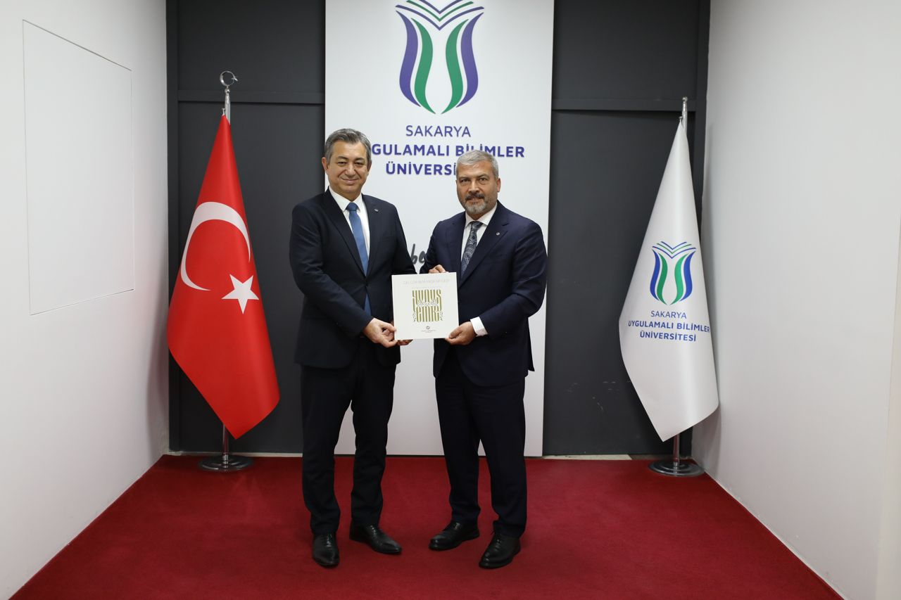

> Anadolu Üniversitesi Rektörü Prof. Dr. Yusuf Adıgüzel, Sakarya Uygulamalı Bilimler Üniversitesi Rektörlüğü'ne atanan Prof. Dr. Zafer Tatlı'yı makamında ziyaret etti.

Anadolu Üniversitesi Rektörü Prof. Dr. Yusuf Adıgüzel, Sakarya Uygulamalı Bilimler Üniversitesi (SUBÜ) Rektörlüğü görevine atanan Prof. Dr. Zafer Tatlı'ya hayırlı olsun ziyaretinde bulundu. Gerçekleşen ziyarete Anadolu Üniversitesi Rektör Danışmanı Prof. Dr. Mustafa Bostancı ile SUBÜ Rektör Yardımcısı Prof. Dr. İsa Vural da eşlik etti.

Ziyarette Rektör Prof. Dr. Yusuf Adıgüzel, mevkidaşı Prof. Dr. Zafer Tatlı'yı yeni görevi dolayısıyla tebrik ederek çalışmalarında başarılar diledi. Görüşme kapsamında iki yükseköğretim kurumu arasındaki bağların güçlendirilmesi, akademik iş birliklerinin artırılması ve ortaklaşa hayata geçirilebilecek projeler ele alındı.

Üniversiteler arası iş birliği mesajlarının verildiği buluşma, karşılıklı hediye takdiminin ardından tamamlandı.

---

## Rakip Futbolculardan Eskişehirspor'a Övgü: 'Seyircisiyle Çok Farklı Oluyor'

**Spor · Tepebaşı** · 2026-11-17 13:09 UTC · Kaynak: [Google Haberler - Eskişehirspor](https://www.milliirade.com/rakipten-eskisehirspora-ovgu)

> Ayvalıkgücü Belediyesporlu futbolcular Atakan Akbulut ve Mehmet Yıkılmazdağ, 2-2 biten maçın ardından Eskişehirspor'un kadro kalitesine ve tribün gücüne dikkat çekti.

Nesine 3. Lig 2. Grup'ta Eskişehirspor ile 2-2 berabere kalan Ayvalıkgücü Belediyespor'da Atakan Akbulut ve Mehmet Yıkılmazdağ, mücadelenin ardından açıklamalarda bulundu. Konuk ekibin 2-0 öne geçtiği ve kırmızı kart sonrası siyah-kırmızılı ekibin skoru dengelediği randevuyu değerlendiren futbolcular, Eskişehirspor camiasına övgü yağdırdı.

Karşılaşmaya iyi hazırlandıklarını belirten Atakan Akbulut, istedikleri başlangıcı yapmalarına karşın kırmızı kartın ardından dengelerin bozulduğunu söyledi. Akbulut, "Bizim için maç çok güzel başladı, galip gelmek istiyorduk. Kırmızı karttan sonra oyun dengemiz bozuldu. Eskişehir büyük bir camia. Taraftar baskısıyla iyi mücadele ettiler. İyi takımın da ayağına sağlık" ifadelerini kullandı.

Eskişehirspor'un ligdeki kadro kalitesine işaret eden Mehmet Yıkılmazdağ ise siyah-kırmızılıların güçlü oyunculardan kurulu olduğunu belirtti. Tribün baskısının maçın kaderini etkilediğini vurgulayan Yıkılmazdağ, "Eskişehirspor bu ligde en kaliteli futbolculara sahip takımlardan biri. Seyirci desteğini de arkasına aldığında çok farklı oluyor" değerlendirmesini yaptı.

Gruptaki şampiyonluk yarışını da ele alan Yıkılmazdağ, ligde puan farklarının açılmasını beklemediğini ve sezon sonunda hak eden tarafın zirveye çıkacağını dile getirdi.

---

## ESTÜ COP31'de Sahneye Çıkıyor: 15 Bilimsel Proje Antalya'da Tanıtılacak

**Eğitim · Tepebaşı** · 2026-11-17 13:09 UTC · Kaynak: [Eskişehir Teknik Üniversitesi](https://www.eskisehir.edu.tr/tr/Haber/Detay/eskisehir-teknik-universitesi-cop31de-15-projesiyle-yerini-aliyor)

> Eskişehir Teknik Üniversitesi, sürdürülebilir gelecek hedefiyle geliştirdiği 15 bilimsel projesini Antalya'da düzenlenen COP31 Yeşil Bölge etkinliklerinde uluslararası kamuoyuna sunuyor.

Eskişehir Teknik Üniversitesi (ESTÜ), iklim değişikliği ve çevre teknolojileri odaklı bilimsel çalışmalarını uluslararası platformda sergilemeye hazırlanıyor. Üniversite, Antalya'da gerçekleştirilen COP31 Yeşil Bölge etkinlikleri kapsamında 12 stant projesi ve 3 dijital ekran sunumu olmak üzere toplam 15 çalışmasını katılımcılarla buluşturacak.

Akademisyenler tarafından yürütülen çalışmalar; iklim değişikliğine uyum, çevresel sürdürülebilirlik, döngüsel ekonomi, atık yönetimi, ekolojik planlama, afetlere dirençli kentler, dijital kültürel miras ve iklim okuryazarlığı gibi geniş bir yelpazeyi kapsıyor. Projeler, ESTÜ'nün bilimsel araştırma kapasitesini ve sürdürülebilir kalkınmaya yönelik geliştirdiği yenilikçi çözüm modellerini yansıtıyor.

COP31 Yeşil Bölge kapsamında yer alacak çalışmalar, 18 Kasım 2026 Çarşamba günü 10.00 ile 18.00 saatleri arasında Yeşil Bölge 12 numaralı stantta ziyaret edilebilecek. Dijital formattaki 3 proje ise ortak ekran sunumları üzerinden katılımcıların incelemesine açılacak.

---

## Başkan Ataç: 2030'a Kadar Sera Gazı Emisyonunu Yüzde 40 Azaltmayı Hedefliyoruz

**Belediye · Tepebaşı** · 2026-11-17 13:09 UTC · Kaynak: [Tepebaşı Belediyesi](https://www.tepebasi.bel.tr/Haber/Detay/baskanataciklimmucadelesitepebası’ndayıllardırkentyasamınınicinde)

> Tepebaşı Belediye Başkanı Ahmet Ataç, iklim mücadelesinin yerel kararlarla somutlaşacağını belirterek ilçedeki enerji verimliliği ve çevre yatırımlarını anlattı.

Antalya'da devam eden COP31 iklim zirvesi sürecinde değerlendirmelerde bulunan Tepebaşı Belediye Başkanı Ahmet Ataç, çevre ve iklim çalışmalarının dönemsel projelerden çıkarılarak kurumsal bir yapıya dönüştürüldüğünü kaydetti. Ataç, Aralık 2020'de kurulan İklim Değişikliği Müdürlüğü ile Türkiye'deki yerel yönetimlere öncülük ettiklerini ifade etti.

Kuraklık, aşırı sıcaklar ve seller gibi iklim krizinin doğrudan kentleri etkilediğini vurgulayan Ataç, 2013 yılında Belediye Başkanları Sözleşmesi'ne imza attıklarını hatırlattı. Hazırlanan Sürdürülebilir Enerji ve İklim Eylem Planı doğrultusunda hareket ettiklerini belirten Ataç, 2030 yılına kadar sera gazı emisyonlarını yüzde 40 oranında düşürmeyi hedeflediklerini açıkladı.

Mustafa Kemal Atatürk Su Sporları Merkezi ve Melih Savaş Yaşam Köyü gibi tesislerde güneş enerjisinden faydalandıklarını ve su tasarrufu için yağmur suyu hasadı gibi yöntemleri hayata geçirdiklerini aktaran Ataç, ulaşımda ise elektrikli otobüsler, hibrit araçlar ve paylaşımlı bisiklet sistemi ESPEDAL'ın devrede olduğunu bildirdi. Ataç ayrıca İklim Akademi çalışmalarıyla bugüne kadar 117 okulda düzenlenen 182 eğitim sayesinde 16 bin 446 öğrenciye ulaşıldığını kaydetti.

---

## Bakan Göktaş'tan Dijital Güvenlik Çağrısı: 'Teknoloji Şirketleri Sorumluluk Almalı'

**Türkiye · Türkiye** · 2026-11-17 13:09 UTC · Kaynak: [Aile ve Sosyal Hizmetler Bakanlığı](https://www.aile.gov.tr/haberler/bakanimiz-mahinur-ozdemir-goktas-singapur-da-asya-aile-konferansi-nda-konustu/)

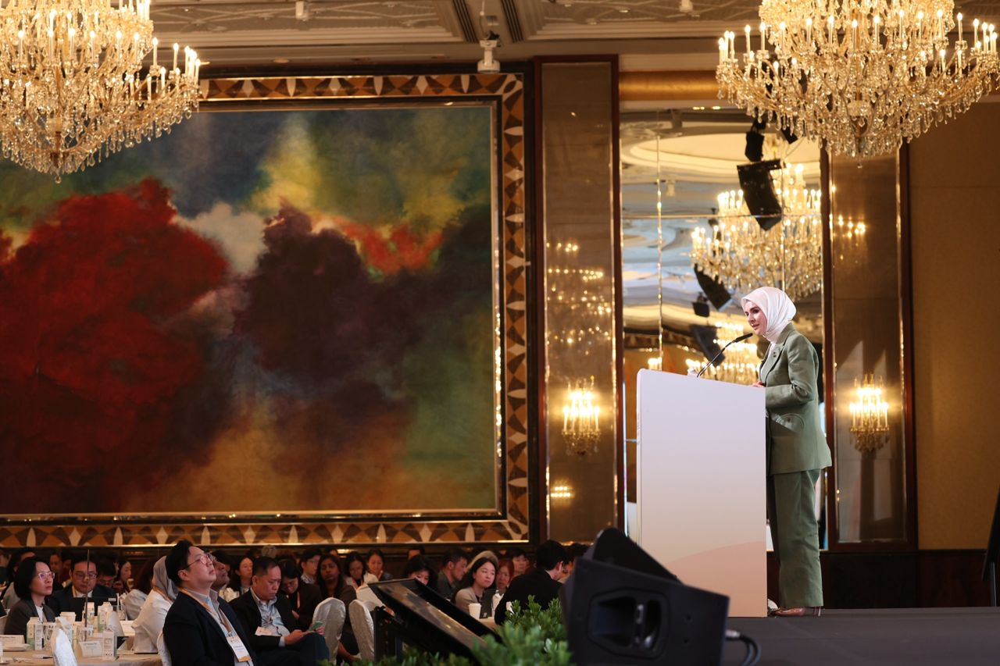

> Singapur'daki Asya Aile Konferansı'nda konuşan Bakan Mahinur Özdemir Göktaş, çocukların dijital dünyada korunmasında teknoloji şirketlerinin aktif rol üstlenmesi gerektiğini vurguladı.

Aile ve Sosyal Hizmetler Bakanı Mahinur Özdemir Göktaş, Singapur’da gerçekleştirilen Asya Aile Konferansı kapsamındaki "Çocukları ve Aileleri Desteklemeye Yönelik Ulusal Yaklaşımlar" oturumunda hitap etti. Konferansın "Güçlenen Aileler, Gelişen Çocuklar" temasıyla toplandığını aktaran Bakan Göktaş, bu yaklaşımın Türkiye'deki sosyal politikalara da temel oluşturduğunu belirtti.

Dijital platformların sınır tanımaksızın çocuklara ulaştığına dikkat çeken Göktaş, çocukların güvenliğini sağlamanın ortak bir sorumluluk olduğunu ifade etti. Türkiye'de 1 Kasım'da yürürlüğe giren sosyal medya düzenlemesine değinen Bakan Göktaş, söz konusu adımla platformların 15 yaşından küçük çocuklara hizmet sunmasının engellendiğini, 15-17 yaş grubuna ise yaşa uygun koruyucu tedbirler getirildiğini hatırlattı. Göktaş, uluslararası alanda teknoloji şirketlerinin sorumluluklarının netleştirilmesi için Asya ülkeleriyle iş birliğine açık olduklarını kaydetti.

Demografik değişimlere de değinen Bakan Göktaş, doğurganlık oranlarının azalması ve yaşlı nüfusun artmasının getirdiği risklere karşı 2026-2035 döneminin "Aile ve Nüfus On Yılı" ilan edildiğini aktardı. Bakanlık bünyesinde geliştirilen Sosyal Risk Haritaları sayesinde hane düzeyinde analizler yürütüldüğünü bildiren Göktaş, Aile Endeksi ve Türkiye Aile Yapısı Araştırması gibi çalışmalarla süreçlerin yakından izlendiğini sözlerine ekledi.

---

## 23. Film Festivali'nde Onur Ödülleri Feyzi Tuna ve Nilüfer Aydan'a Verilecek

**Kültür-Sanat · Tepebaşı** · 2026-11-17 11:10 UTC · Kaynak: [Google Haberler - Eskişehir etkinlik](https://www.hurriyet.com.tr/yazarlar/gozde-hatunoglu/haftanin-kultur-sanat-ajandasi-43381119)

> 19-27 Kasım tarihlerinde düzenlenecek 23. Eskişehir Uluslararası Film Festivali'nde onur ödülleri usta yönetmen Feyzi Tuna ile oyuncu Nilüfer Aydan'a sunulacak.

Kültür ve Turizm Bakanlığı Sinema Genel Müdürlüğü desteğiyle Anadolu Üniversitesi İletişim Bilimleri Fakültesi tarafından düzenlenen 23. Eskişehir Uluslararası Film Festivali, 19-27 Kasım 2026 tarihleri arasında sinemaseverlerle buluşuyor. Festivalin açılışı, 19 Kasım'da Sinema Anadolu'da yapılacak tören ve yönetmenliğini Morgan Matthews'un üstlendiği "500 Mil" filminin Türkiye prömiyeriyle gerçekleştirilecek.

Festival kapsamında bu yılki onur ödülleri, Türk sinemasına önemli yapıtlar kazandıran yönetmen Feyzi Tuna ile 100'ü aşkın filmde rol alan usta oyuncu Nilüfer Aydan'a takdim edilecek. Emek ödüllerinin sahipleri ise yönetmen ve yapımcı Biket İlhan ile sinema ses çalışmaları ve yapımcılığıyla tanınan Necip Sarıcı olacak.

Görsel teması Jean-Luc Godard'ın sözünden ilhamla "Sinemada hareket" olarak belirlenen etkinlikte, 34 ülkeden 37 uzun metraj ve 18 kısa metraj yapım yer alıyor. Gösterimlerin yanı sıra usta sinemacıların katılımıyla söyleşiler ve sinema dersleri de festival programında yer bulacak.

---

## Tepebaşı'nda Yüzme Kayıtları Başlıyor: Başvurular 18-20 Kasım'da Online Yapılacak

**Spor · Tepebaşı** · 2026-11-17 11:09 UTC · Kaynak: [Tepebaşı Belediyesi](https://www.tepebasi.bel.tr/Haber/Detay/tepebası’ndayuzmeprogramlarıicinkayıtlarbaslıyor)

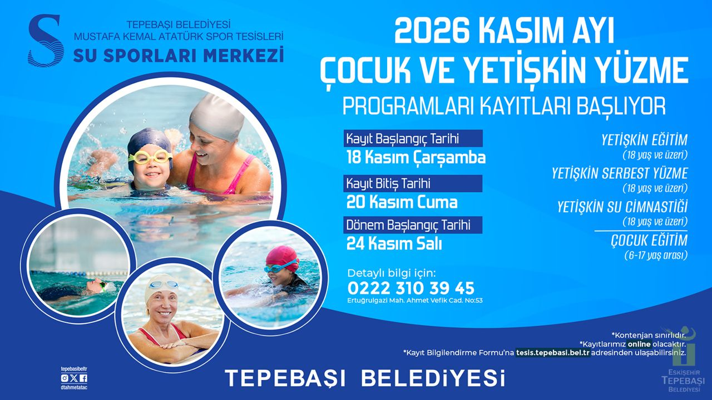

> Tepebaşı Belediyesi Su Sporları Merkezi'nde çocuk ve yetişkinlere yönelik yeni dönem yüzme programları için online kayıtlar 18 Kasım'da açılıyor.

Tepebaşı Belediyesi Mustafa Kemal Atatürk Spor Tesisleri Su Sporları Merkezi, farklı yaş gruplarına yönelik yüzme eğitimleri için kapılarını açıyor. Çocuk ve yetişkinleri su sporlarıyla buluşturacak yeni dönem programları için başvurular 18 Kasım Çarşamba günü başlayıp 20 Kasım Cuma günü sona erecek.

Eğitimler kapsamında 6-17 yaş grubundaki çocuklara temel ve ileri düzey yüzme kursları verilecek. 18 yaş ve üzeri yetişkinler ise yüzme eğitiminin yanı sıra serbest yüzme saatleri ve su jimnastiği branşlarından faydalanabilecek.

Kontenjanların sınırlı tutulduğu yüzme programlarında dersler 24 Kasım Salı günü başlayacak. Başvuruların belediyenin tesis.tepebasi.bel.tr internet adresi üzerinden alınacağı, detaylı bilgi edinmek isteyenlerin 0222 310 39 45 numaralı hattı arayabileceği bildirildi.

---

## Odunpazarı Sanat Merkezi'nde Resim Mesaisi: 104 Kursiyer Tuval Başına Geçti

**Kültür-Sanat · Odunpazarı** · 2026-11-17 11:09 UTC · Kaynak: [Google Haberler - Odunpazarı](https://www.karsmanset.com/service/amp/haber/odunpazari-sanat-merkezinde-104-kisi-resim-ogreniyor-1829168.htm)

> Odunpazarı Sanat Merkezi'nde haftanın beş günü düzenlenen resim kursu, farklı yaş gruplarından 104 kursiyerin katılımıyla devam ediyor.

Odunpazarı Belediyesi bünyesinde faaliyetlerini sürdüren Odunpazarı Sanat Merkezi'nde (OSM) açılan resim eğitimi yoğun ilgi görüyor. Sanat eğitimini kentin geneline yaymayı hedefleyen çalışma kapsamında 104 kursiyer atölye çalışmalarına katılıyor.

Eğitmen Melek Tan yönetiminde sürdürülen dersler pazar ve pazartesi günleri dışında haftanın beş günü gerçekleştiriliyor. Katılımcılar eğitim sürecinde resim sanatının temel tekniklerini uygulayarak kendi sanatsal becerilerini geliştirme imkânı buluyor.

Farklı yaş ve tecrübe düzeyinden yurttaşları bir araya getiren kurs programı, kursiyerlere hem kendilerini ifade edebilecekleri sanatsal bir alan hem de üretmenin keyfini yaşayabilecekleri bir ortam sunuyor.

---

## Kaligrafi ve Tipografide Atölye Heyecanı: Çalıştaylar Cuma Gününe Kadar Sürecek

**Kültür-Sanat · Tepebaşı** · 2026-11-17 11:09 UTC · Kaynak: [Anadolu Üniversitesi](https://anahaber.anadolu.edu.tr/tr/haber-detay/fdeml5ogqoy921ryzvtn6cqb)

> Anadolu Üniversitesi Güzel Sanatlar Fakültesi tarafından düzenlenen 18. Uluslararası Anadolu Kaligrafi ve Tipografi Festivali kapsamında akademisyen ve sanatçıların katıldığı uygulamalı çalıştaylar başladı.

Anadolu Üniversitesi Güzel Sanatlar Fakültesi Grafik Sanatlar Bölümü ev sahipliğinde gerçekleştirilen 18. Uluslararası Anadolu Kaligrafi ve Tipografi Festivali kapsamında düzenlenen çalıştaylar, akademisyenleri, sanatçıları ve öğrencileri bir araya getirdi. Süleyman Demirel Üniversitesi öğretim üyesi Prof. Yusuf Keş, Eskişehir Osmangazi Üniversitesi öğretim üyesi Doç. Bilge Kınam, Eskişehir Teknik Üniversitesi öğretim elemanı Öğr. Gör. Onur Kuran ve sanatçı Dilruba Güneysu’nun katılımıyla yapılan atölyelerde öğrenciler, alanında deneyimli isimlerle birlikte üretim yapma imkânı buldu.

Düzenlenen çalıştaylar, öğrencilerin derslerde edindikleri kuramsal bilgileri uygulamaya dökerek farklı üretim yöntemlerini deneyimlemelerine katkı sağlıyor. Sanatçı ve akademisyenlerle doğrudan çalışma fırsatı yakalayan öğrenciler, kaligrafi ve tipografi alanındaki becerilerini pekiştirirken özgün tasarımlar ortaya koyuyor.

Hafta boyunca devam edecek uygulamalı atölyeler cuma gününe kadar çeşitli oturumlarla sürecek. Çalıştaylar sürecinde üretilen eserler ise cuma günü düzenlenecek sergiyle sanatseverlerin beğenisine sunulacak. Festival kapsamındaki Yunus Emre sergisi ise 11 Aralık Cuma gününe kadar Anadolu Üniversitesi Çağdaş Sanatlar Müzesinde ziyarete açık kalmaya devam edecek.

---

## Hakan Şapcı'dan 2-2'lik Maç Sonrası Açıklama: 'Oynanan Oyundan Çok Memnunum'

**Spor · Tepebaşı** · 2026-11-17 11:09 UTC · Kaynak: [Google Haberler - Eskişehirspor](https://www.gazetevatan.com/sehirler/eskisehir/eskisehirspor-2-puan-kaybetti-hakan-sapci-cok-memnunum-dedi-2465696)

> Eskişehirspor Teknik Direktörü Hakan Şapcı, 2-2 sona eren Ayvalıkgücü karşılaşmasının ardından yaptığı değerlendirmede kaybedilen puana üzüldüklerini ancak sergilenen futboldan memnun olduğunu söyledi.

Bölgesel Amatör Lig temsilcisi Eskişehirspor'da, Ayvalıkgücü deplasmanında alınan 2-2'lik beraberliğin yankıları sürüyor. Karşılaşmanın ardından teknik direktör Hakan Şapcı, maçta sergilenen oyun ve kaybedilen puanlara ilişkin değerlendirmelerde bulundu.

Karşılaşmanın başında bireysel hatalar nedeniyle kalelerinde iki gol gördüklerini belirten Şapcı, oyuncularının geriye düşmelerine karşın sahada iyi bir direnç ortaya koyduğunu ifade etti. Çok pozisyon ürettiklerini dile getiren tecrübeli teknik adam, yenmemesi gereken basit goller yediklerine dikkat çekti.

Savunma hattındaki talihsizliklere değinen Şapcı, "Sezon başından bu yana büyük talihsizlikler ve hatalar oluyor, özellikle savunma bölgesinde yaşanıyor. Buna rağmen oyuncularımız müthiş bir karakter gösterdi. Kaybedilen 2 puana elbette üzgünüz ancak oynanan oyundan çok memnunum" şeklinde konuştu.

---

## Bakanlıktan 'Verimli Ev' Uygulaması: Fatura ve Cihaz Tüketimi Takip Edilecek

**Türkiye · Türkiye** · 2026-11-17 11:09 UTC · Kaynak: [Enerji ve Tabii Kaynaklar Bakanlığı](https://enerji.gov.tr/haber-detay?id=31975)

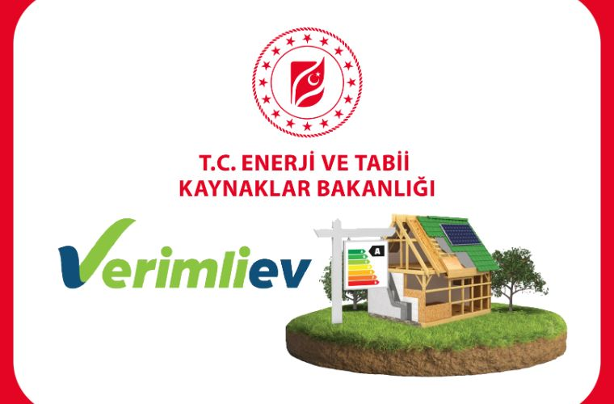

> Enerji ve Tabii Kaynaklar Bakanlığı, hanelerdeki elektrik ve doğal gaz tüketiminin analiz edilmesini sağlayan "Verimli Ev" mobil uygulamasını kullanıma sundu.

Enerji ve Tabii Kaynaklar Bakanlığı tarafından geliştirilen "Verimli Ev" mobil uygulaması vatandaşların erişimine açıldı. Uygulama sayesinde kullanıcılar, evlerinde kullandıkları elektrikli cihazların ve ısıtma sistemlerinin enerji tüketimini ayrıntılı biçimde analiz edebilecek.

Kullanıcılar uygulamaya e-posta adresiyle ya da e-Devlet kapısı üzerinden giriş yapabilecek. Sisteme elektrik ve doğal gaz fatura bilgileri girildikten sonra; buzdolabı, çamaşır makinesi, bulaşık makinesi, kombi ve klima gibi temel cihazların enerji sınıfı, motor gücü ve günlük çalışma süreleri tanımlanabilecek.

Sistem, girilen verileri işleyerek her bir cihazın toplam enerji tüketimindeki payını ve maliyetini hesaplayacak. Tüketimin yol açtığı karbon emisyonu miktarını da gösteren uygulama, kullanıcılara cihaz bazında özel tasarruf ve verimlilik önerileri sunacak.

Enerji ve Tabii Kaynaklar Bakanı Alparslan Bayraktar, Milli Enerji 2040 vizyonunun temel ayaklarından birinin enerji verimliliği olduğunu belirtti. Enerjide tam bağımsızlığın sadece üretimi artırmakla değil, tüketimi verimli kılmakla mümkün olacağını vurgulayan Bayraktar, enerji tasarrufu bilincinin evlerden başladığını ve uygulamanın aile bütçesine katkı sağlayacağını ifade etti.

"Verimli Ev" mobil uygulaması, akıllı telefon ve tablet kullanıcıları için uygulama mağazalarından ücretsiz olarak indirilebiliyor.

---

## Odunpazarı'nda Sanat ve Kitap Günleri: 21-22 Kasım'da Kapılarını Açıyor

**Kültür-Sanat · Odunpazarı** · 2026-11-17 09:09 UTC · Kaynak: [Google Haberler - Eskişehir](https://www.cumhuriyet.com.tr/yerel-gundem/odunpazari-belediyesi-cumhuriyet-sanat-ve-kitap-gunleri-21-22-kasim-da-eskisehir-de-2556827)

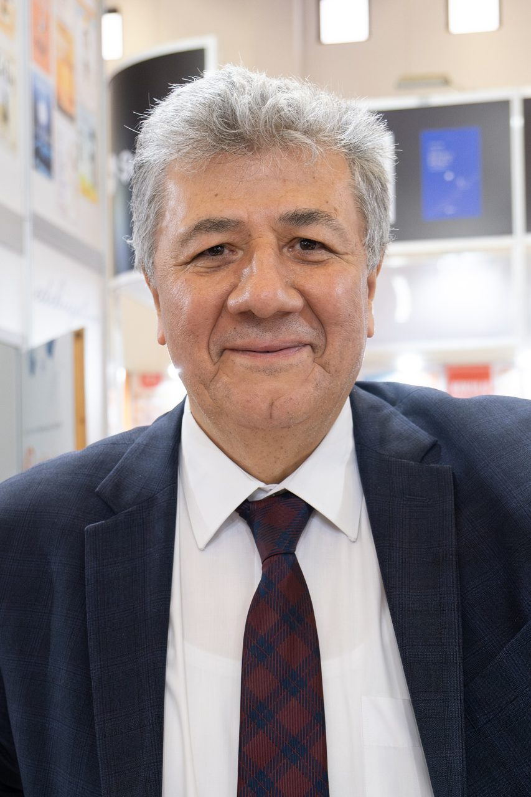

> Cumhuriyet gazetesi ve Odunpazarı Belediyesi iş birliğiyle düzenlenen Sanat ve Kitap Günleri, 21-22 Kasım tarihlerinde 100. Yıl Kültür Merkezi'nde gerçekleştirilecek.

Odunpazarı Belediyesi ile Cumhuriyet gazetesinin ortaklaşa düzenlediği Sanat ve Kitap Günleri, 21-22 Kasım tarihlerinde Eskişehir'deki 100. Yıl Kültür Merkezi'nde kitapseverler ve sanatseverlerle buluşacak.

Etkinlik programı, 21 Kasım Cumartesi günü saat 13.00'te Cumhuriyet Sanat Galerisi Koleksiyonu'nda yer alan eserlerden oluşan karma resim sergisinin açılışıyla başlayacak. Sergide çok sayıda usta sanatçının fırçasından çıkan yapıtlar Eskişehirlilerin beğenisine sunulacak.

İki gün boyunca sürecek organizasyonda Cumhuriyet Kitapları Yayınevi bünyesindeki yazarlar düzenlenecek söyleşi ve imza günlerinde okurlarıyla bir araya gelecek. Etkinlik dizisi, 22 Kasım Pazar günü saat 17.00'de Odunpazarı Belediye Başkanı Kazım Kurt ile gazeteci-yazar Mustafa Balbay'ın katılımıyla gerçekleştirilecek "Yerel Siyaset, Yerel Yönetim" başlıklı söyleşiyle tamamlanacak.

---

## AÖF'te Mikro Yeterlilik Dönemi: Alınan Eğitimler 12 Krediye Kadar Sayılabilecek

**Eğitim · Tepebaşı** · 2026-11-17 09:08 UTC · Kaynak: [Anadolu Üniversitesi](https://anahaber.anadolu.edu.tr/tr/haber-detay/xh5qv6cxeepbo68x9f0xwzk8)

> Anadolu Üniversitesi Açıköğretim Fakültesi, yapay zekâ odaklı Mikro Yeterlilik Programlarını başlattı. Başarılı olan öğrenciler lisans düzeyinde 12 AKTS'ye kadar ders kredisinden muaf olabilecek.

Anadolu Üniversitesi Açıköğretim Fakültesi (AÖF), öğrencilerin mesleki becerilerini geliştirmeleri amacıyla yapay zekâ odaklı Mikro Yeterlilik Programlarını uygulamaya aldı. Yükseköğretim Kurulunun (YÖK) yetkinlik odaklı dönüşüm vizyonu doğrultusunda örgün eğitimin ardından AÖF öğrencilerine de açılan sistemle, katılımcılara ilgi duydukları alanlarda esnek öğrenme olanakları sunuluyor.

Program kapsamında ölçme ve değerlendirme aşamalarını geçen öğrenciler, kazandıkları yetkinlikleri doğrulanabilir dijital rozetlerle tescilleyebilecek. Dijital cüzdan altyapısında saklanabilen bu rozetler, LinkedIn ve benzeri profesyonel ağlarda paylaşılarak istihdam süreçlerinde referans olarak kullanılabilecek.

Avrupa Kredi Transfer Sistemi (AKTS) ile uyumlu yürütülen eğitimler transkriptlere ve diploma eklerine de yansıtılabilecek. Değerlendirme sınavlarında başarı gösteren öğrenciler, aldıkları mikro yeterlilikler sayesinde ön lisans programlarında 6, lisans programlarında ise 12 AKTS'ye kadar seçmeli ders kredisi elde ederek eğitim yüklerini hafifletebilecek.

Program dahilinde ilk etapta “Yapay Zekâ Araçları ile Ofis Verimliliği”, “Yapay Zekâ Çağında Telif Hukuku ve Dijital İçerik Hakları”, “Veri Okuryazarlığı ve Temel Veri Analizi” ile “Yapay Zekâ ve Habercilik” gibi 1 ila 3 kredi değerindeki çevrim içi dersler erişime açıldı. Önümüzdeki süreçte 4 kredilik derslerin de sisteme dahil edileceği bildirildi. Sürece ilişkin başvuruların "my.anadolu.edu.tr" adresi üzerinden kabul edildiği kaydedildi.

---

## Mezuniyet Filmiyle 3 Ödül Birden: Anadolu Üniversitesi Mezununa Tebrik

**Kültür-Sanat · Tepebaşı** · 2026-11-17 07:09 UTC · Kaynak: [Anadolu Üniversitesi](https://anahaber.anadolu.edu.tr/tr/haber-detay/h2jq0e9daova2kyy7zfx4ty7)

> Anadolu Üniversitesi Çizgi Film ve Animasyon Bölümü mezunu Selin Toprak, hazırladığı kısa filmle Altın Portakal dâhil üç ayrı festivalden ödülle döndü.

Anadolu Üniversitesi Güzel Sanatlar Fakültesi Çizgi Film ve Animasyon Bölümünden bu yıl mezun olan Selin Toprak, mezuniyet projesi olan "Dünya Günü Kutlu Olsun (Happy Earth Day)" isimli animasyon filmiyle önemli başarılara imza attı.

Toprak, 12. TRT Geleceğin İletişimcileri Yarışması Animasyon Film kategorisinde ikincilik derecesi elde ederken, 14. Uluslararası Canlandıranlar Film Festivali'nde "En İyi Senaryo" ve 63. Uluslararası Antalya Altın Portakal Film Festivali'nde ise "Jüri Özel Ödülü" kazandı. Film, elverişsiz hâle gelen Dünya'dan ayrılarak uzay gemisinde yeni bir yaşam kuran insanların öyküsünü ve Dünya Günü kutlaması sırasında uzaylıların gizemli planıyla yüzleşmelerini konu ediniyor.

Elde edilen ulusal ve uluslararası başarıların ardından Anadolu Üniversitesi Rektörü Prof. Dr. Yusuf Adıgüzel, genç animatörü makamında ağırlayarak tebrik etti. Ziyarette Güzel Sanatlar Fakültesi Dekanı Prof. Duygu Kahraman, Bölüm Başkanı Prof. Dr. Çiğdem Taş Alicenap ile proje danışmanları Prof. Fethi Kaba ve Doç. Sabahattin Çalışkan da yer aldı.

---

## MEB Türkiye'nin Eğitim Dönüşümünü Kitaplaştırdı: 2026 Görünümü Yayımlandı

**Eğitim · Türkiye** · 2026-11-17 07:09 UTC · Kaynak: [Milli Eğitim Bakanlığı](https://www.meb.gov.tr/turkiye039nin-egitimdeki-gelisimi-kitaplastirildi/haber/42554/tr)

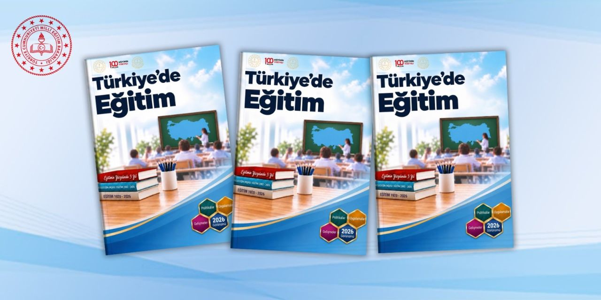

> Millî Eğitim Bakanlığı, geçmişten bugüne eğitim sisteminde kaydedilen gelişmeleri ve uluslararası göstergeleri dokuz bölümlük kapsamlı bir eserde bir araya getirdi.

Millî Eğitim Bakanlığı Strateji Geliştirme Başkanlığı tarafından hazırlanan "Türkiye'de Eğitim: Politikalar, Uygulamalar, Gelişmeler - 2026 Görünümü" adlı çalışma yayımlandı. Kitapta, Türk eğitim sisteminin yıllar içindeki dönüşümü sayısal veriler, tablolar ve grafiklerle ayrıntılı şekilde ortaya konuldu.

Dokuz ana bölümden oluşan çalışmada; öğrenci, öğretmen ve derslik sayılarındaki değişimden okullaşma oranlarına, bütçe imkanlarından fiziki yatırımlara kadar birçok başlık ele alındı. Okul binalarındaki deprem güçlendirme çalışmaları, enerji verimliliği ve yeşil dönüşüm projelerine dair detaylar da veriler eşliğinde paylaşıldı.

Eğitimde fırsat eşitliği başlığı altında ücretsiz ders kitabı dağıtımı, taşımalı eğitim, bursluluk ve destekleme kurslarına değinilen eserde; FATİH Projesi, etkileşimli tahtalar ve dijital eğitim platformlarındaki teknolojik altyapı adımları özetlendi. Eserde ayrıca TIMSS ve PISA sonuçları ışığında Türkiye'nin uluslararası eğitim göstergelerindeki performansına yer verildi.

Kitabın sunuş yazısını kaleme alan Millî Eğitim Bakanı Yusuf Tekin, köklü birikimle geleceğin harmanlandığını belirterek, Türkiye Yüzyılı Maarif Modeli ile teoriden pratiğe aktarılan ve insanı merkeze alan esnek bir eğitim yapısının hedeflendiğini ifade etti.

---

## Eskişehirspor Kadın Futbol Takımı Tekirdağ GSK'yı 2-1 Mağlup Etti

**Spor · Tepebaşı** · 2026-11-17 07:09 UTC · Kaynak: [Google Haberler - Eskişehirspor](https://www.gzt26.com/maddi-imkansizliklarla-da-mucadele-eden-eskisehirspor-kadin-futbol-takimindan-onemli-galibiyet)

> Kadınlar 2. Lig'de mücadele eden Eskişehirspor Kadın Futbol Takımı, sahasında ağırladığı Tekirdağ GSK'yı 2-1 yenerek üç puanı hanesine yazdırdı.

Kadınlar 2. Lig'in 3. haftasında Eskişehirspor Kadın Futbol Takımı, Behiç Erkin Spor Kompleksi'nde Tekirdağ GSK ile karşılaştı. Maddi imkânsızlıklara rağmen sahaya galibiyet parolasıyla çıkan siyah-kırmızılı ekip, zorlu mücadeleden üstünlükle ayrılmayı başardı.

Karşılaşmada Eskişehirspor'a galibiyeti getiren golleri Esin Demirtürk ve Eylül Naz Kurt kaydetti. Konuk ekip Tekirdağ GSK'nın tek golüne rağmen skor üstünlüğünü maçın son düdüğüne kadar koruyan ev sahibi ekip, sahadan 2-1'lik skorla galip ayrıldı.

Ligin üçüncü haftasını kayıpsız geçen ve puanını artıran siyah-kırmızılı ekipte, maç sonu futbolcular ve teknik heyet galibiyet sevincini birlikte yaşadı. Eskişehirspor Kadın Futbol Takımı, gelecek haftalarda da çıkışını sürdürerek üst sıralara tırmanmayı hedefliyor.

---

## Altın fiyatları 17 Kasım 2026: Gram altın 6.370,23 TL

**Ekonomi · Merkez** · 2026-11-17 06:00 UTC · Kaynak: [Harem Altın](https://www.haremaltin.com/altin-fiyatlari)

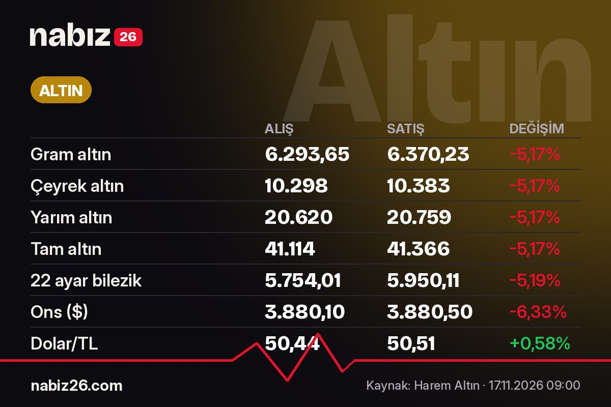

> Gram altın güne düşüşle başladı. Harem Altın verilerine göre gram altın 6.293,65 TL'den alınıyor, 6.370,23 TL'den satılıyor.

Altın piyasasında güne düşüşle başlandı. Harem Altın'ın saat 09.00 itibarıyla verilerine göre gram altının satış fiyatı 6.370,23 TL, alış fiyatı 6.293,65 TL oldu. Gram altın, önceki kapanışa göre yüzde 5,17 geriledi.

Ziynet altınlarda çeyrek altın 10.383 TL, yarım altın 20.759 TL, tam altın 41.366 TL, ata altın 42.471 TL seviyesinden satışa sunuluyor.

22 ayar bileziğin gram satış fiyatı 5.950,11 TL, has altının gram fiyatı 6.351,18 TL olarak belirlendi.

Uluslararası piyasalarda altının onsu 3.880,50 dolardan işlem görürken, dolar/TL 50,51 seviyesinde bulunuyor.

Fiyatlar Harem Altın'ın saat 09.00 itibarıyla paylaştığı verilere dayanmaktadır; kuyumcular arasında farklılık gösterebilir. Bu haber yatırım tavsiyesi değildir.

---

## Günyüzü Kayakent'te 2 Kilometrelik Su Terfi Hattı Yenilendi

**Belediye · Günyüzü** · 2026-11-17 05:09 UTC · Kaynak: [Eskişehir Büyükşehir Belediyesi](https://www.eskisehir.bel.tr/icerik-detay.php?icerik_id=13562&cat_icerik=1&menu_id=24)

> ESKİ, Günyüzü ilçesine bağlı Kayakent Mahallesi Topal Yayla mevkisinde ekonomik ömrünü tamamlayan yaklaşık 2 kilometrelik içme suyu terfi hattını baştan sona yeniledi.

Eskişehir Büyükşehir Belediyesi Su ve Kanalizasyon İdaresi (ESKİ) Genel Müdürlüğü, kırsal mahallelerde içme ve kullanma suyu altyapısını güçlendirmeye yönelik çalışmalarına devam ediyor. Bu kapsamda Günyüzü ilçesi Kayakent Mahallesi Topal Yayla mevkisindeki su iletim altyapısı kapsamlı bir çalışmayla yenilendi.

Türbe Caddesi Topal Yayla mevkisinde yürütülen çalışmalarda, bölgedeki kuyudan su deposuna iletim sağlayan ve kullanım ömrünü tamamlamış olan yaklaşık 2 kilometrelik terfi hattı yenilendi. İmalat işlemlerinin tamamlanmasıyla birlikte su iletim sisteminin güvenilirliği artırılarak olası arızaların önüne geçildi.

Yürütülen çalışmadan duyduğu memnuniyeti ifade eden Kayakent Mahalle Muhtarı Fatih Olçay, suyun yaklaşık 17 kilometre uzaklıktan ulaştığını ve hat üzerinde sık sık yaşanan arızaların yıllardır mağduriyete yol açtığını aktardı. Taleplerini değerlendirerek sorunu çözen Büyükşehir Belediye Başkanı Ayşe Ünlüce'ye ve ESKİ ekiplerine teşekkür eden Olçay, hattın yenilenmesiyle mahallede önemli bir ihtiyacın karşılandığını vurguladı.

---

## Göç İdaresi Heyetinden Anadolu Üniversitesi Rektörü Adıgüzel'e Ziyaret

**Eğitim · Tepebaşı** · 2026-11-17 05:09 UTC · Kaynak: [Anadolu Üniversitesi](https://anahaber.anadolu.edu.tr/tr/haber-detay/uy1yzj33k92434w1a2lrtvmm)

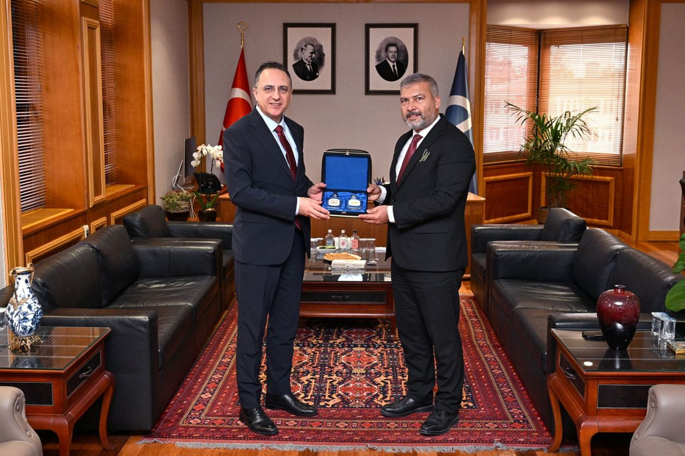

> Göç İdaresi Başkanlığı heyeti, Anadolu Üniversitesi Rektörü Prof. Dr. Yusuf Adıgüzel'i ziyaret ederek göç yönetimi ve ortak projeler üzerine görüştü.

İçişleri Bakanlığı Göç İdaresi Başkanlığı Uyum ve İletişim Genel Müdürü Ahmet Dalkıran ve beraberindeki heyet, Anadolu Üniversitesi Rektörü Prof. Dr. Yusuf Adıgüzel'e makamında ziyarette bulundu.

Ziyarete Uyum ve İletişim Grup Başkanı Ali Rıza Beşkat, Göç Uzmanı Ekrem Demir, Eskişehir İl Göç İdaresi Müdür Vekili Özkan Çetin ile İl Göç Uzmanı Gülşan Dolgun da eşlik etti.

Görüşmede göç yönetimi, uyum ve iletişim faaliyetleri kapsamındaki çalışmalar masaya yatırıldı. Üniversite ile göç alanında hayata geçirilebilecek ortak projeler ve iş birliği olanakları değerlendirildi. Rektör Prof. Dr. Adıgüzel, konuklarına teşekkür ederken ziyaret hediye takdimiyle tamamlandı.

---

## Erdoğan'dan Üniversiteli Gençlere: 'Bugün Dünyada Artık Türkiye Konuşuluyor'

**Siyaset · Türkiye** · 2026-11-17 05:09 UTC · Kaynak: [Google Haberler - Cumhurbaşkanı](https://www.trthaber.com/haber/gundem/cumhurbaskani-erdogan-bugun-dunyada-artik-turkiye-konusuluyor-963424.html)

> Cumhurbaşkanı Erdoğan, AK Parti Gençlik Kolları Üniversiteli Gençlik Buluşması'nda yaptığı konuşmada, Türkiye'nin iç ve dış politikada attığı adımlarla uluslararası alanda öne çıktığını belirtti.

Cumhurbaşkanı Recep Tayyip Erdoğan, partisinin Kongre Merkezi'nde düzenlenen AK Parti Gençlik Kolları Üniversiteli Gençlik Buluşması'na katılarak gençlere hitap etti. Türkiye genelindeki 81 ilde ve 208 üniversitede yürütülen çalışmalara değinen Erdoğan, üniversiteye yeni kayıt yaptıran 450 bin öğrencinin ÜniAK teşkilatına katıldığını ifade etti.

Konuşmasında muhalefet ile aralarında gençliğe bakış konusunda temel bir vizyon farkı bulunduğunu savunan Erdoğan, iktidar olarak gençleri siyasetin nesnesi değil doğrudan aktörü olarak konumlandırdıklarını söyledi. Erdoğan, gençlerin eğitim, teknoloji, kültür ve sanat başta olmak üzere her alanda kendilerini geliştirmeleri adına çalışmalar yürüttüklerini kaydetti.

Türkiye'nin ev sahipliğinde gerçekleşen uluslararası organizasyonlara da değinen Cumhurbaşkanı Erdoğan, Antalya'da düzenlenen COP31 Zirvesi'nde 96 dünya liderinin ağırlandığını hatırlattı. Erdoğan, Türk Devletleri Teşkilatı Zirvesi ve NATO toplantılarının ardından Türkiye'nin bölgesel ve küresel ölçekteki etkinliğinin arttığını, dünyada artık Türkiye'nin hamlelerinin konuşulduğunu ifade etti.

Gençlere özgüven çağrısında bulunan Erdoğan, karşılaşılan ekonomik ve sosyal engellerin hiçbirinin umutsuzluğa yol açacak büyüklükte olmadığını dile getirdi. Geçmişte yaşanan kutuplaşmaların ve 28 Şubat sürecindeki hak gasplarının geride bırakıldığını belirten Erdoğan, gençlerin Türkiye Yüzyılı vizyonunun ana taşıyıcısı olacağını sözlerine ekledi.

---

## Ayşe Ünlüce Derince'de Kent Lokantası Açılışına Katıldı

**Belediye · Merkez** · 2026-11-17 05:09 UTC · Kaynak: [Eskişehir Büyükşehir Belediyesi](https://www.eskisehir.bel.tr/icerik-detay.php?icerik_id=13561&cat_icerik=1&menu_id=24)

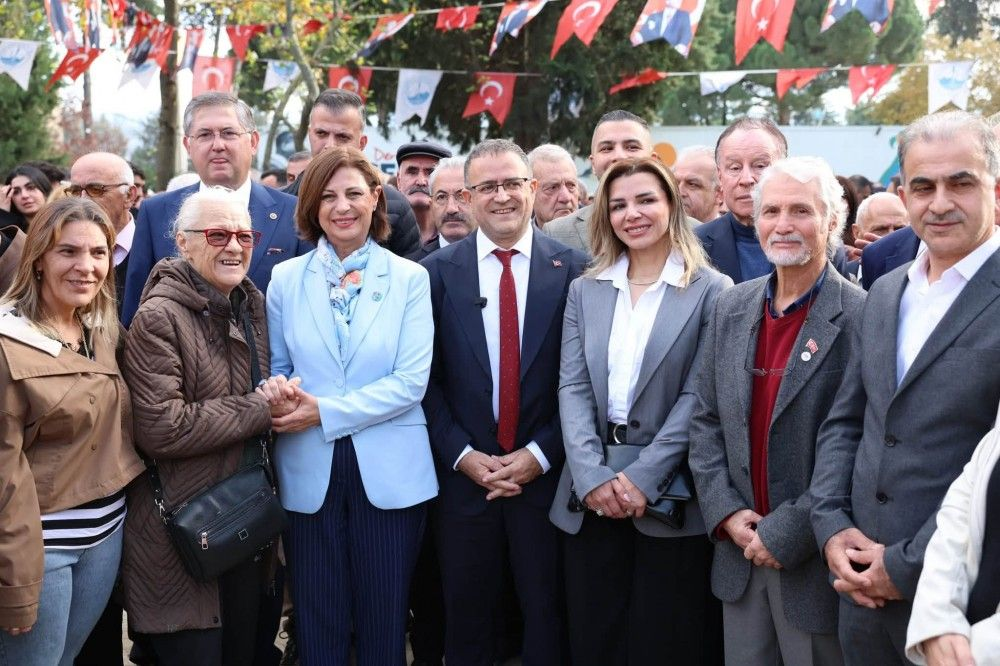

> Eskişehir Büyükşehir Belediye Başkanı Ayşe Ünlüce, Kocaeli'nin Derince ilçesinde Kent Lokantası açılışına katılarak tarımsal üretim tesislerinde incelemelerde bulundu.

Türkiye Belediyeler Birliği Başkan Vekili ve Eskişehir Büyükşehir Belediye Başkanı Ayşe Ünlüce, Derince Belediye Başkanı Sertif Gökçe’nin ev sahipliğinde düzenlenen açılış programı kapsamında Kocaeli’yi ziyaret etti. Programda ilçe sakinlerine uygun fiyatlı ve sağlıklı yemek sunulması hedeflenen Kent Lokantası ile Senin Kafen Çenesuyu sosyal tesisinin açılışı yapıldı.

Ziyaret kapsamında İshakçılar bölgesinde yer alan DERTAŞ Tarım Ürünleri tesislerini de gezen Ünlüce, süt ve süt ürünleri üretim süreçlerini yerinde takip etti. Tesis yetkililerinden kapasite ve yeni dönem projelerine ilişkin bilgi alan Ünlüce, yerel tarım ve üretimin güçlendirilmesi gerektiğine dikkat çekti.

Sosyal dayanışmayı artıran ve yerel üreticiye katkı sağlayan uygulamaların önemine değinen Ünlüce, Derince'de hayata geçirilen projeler dolayısıyla emeği geçenleri tebrik etti. Açılış törenine katılan ilçe sakinleri de Ünlüce ile hatıra fotoğrafı çektirdi.

---

## Anadolu Üniversitesi'nden AB Destekli Proje: Yeşil İnsan Kaynakları Başlatıldı

**Eğitim · Tepebaşı** · 2026-11-17 05:09 UTC · Kaynak: [Anadolu Üniversitesi](https://anahaber.anadolu.edu.tr/tr/haber-detay/p3dul1fx5oho8xwq6g42vykc)

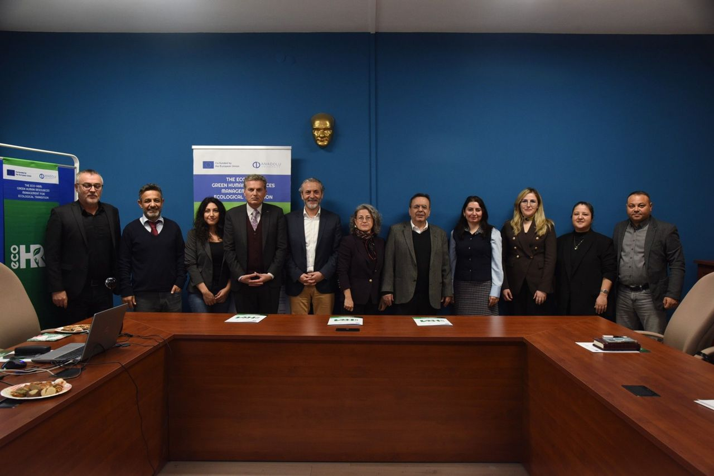

> Anadolu Üniversitesi, Avrupa Birliği Jean Monnet Faaliyetleri kapsamında desteklenen ve 36 ay sürecek olan ECO-HRM projesini tanıttı.

Anadolu Üniversitesi yürütücülüğünde hayata geçirilen "Ekolojik Dönüşüm İçin Yeşil İnsan Kaynakları Yönetimi" (ECO-HRM) projesinin açılış toplantısı, İktisadi ve İdari Bilimler Fakültesi Yüzüncü Yıl Toplantı Salonu'nda yapıldı. Proje; üniversite, mesleki eğitim kurumları ve sanayi kesimini yeşil dönüşümün insan kaynağı boyutunda bir araya getirmeyi amaçlıyor.

Toplantının açılışında konuşan Proje Yürütücüsü Doç. Dr. Seda Tekeli, ekolojik dönüşümün yalnızca çevresel politikalar ve teknolojik adımlardan ibaret olmadığını belirterek, istihdam yapısı ve nitelikli insan kaynağının sürecin temel taşlarından biri olduğunu vurguladı. Tekeli, yeşil insan kaynakları yaklaşımının işe alımdan eğitime ve performans yönetimine kadar geniş bir alanı kapsadığını, meslek lisesi öğrencilerinin de projenin öncelikli hedef grupları arasında yer aldığını kaydetti.

Üç yıl boyunca devam edecek proje çerçevesinde, farklı disiplinlerden üniversite öğrencilerinin seçebileceği "Yeşil İnsan Kaynakları Yönetimi" dersi açılacak. İl Millî Eğitim Müdürlüğü ve Eskişehir Sanayi Odası iş birliğiyle yürütülecek çalışmada; eğitimler, araştırmalar ve çalıştaylarla ekolojik dönüşümün çalışma hayatına etkilerine yönelik farkındalık artırılacak.

---

## Otogarda Sıkı Denetim: Sefer Saatleri ve Belgeler İncelendi

**Belediye · Tepebaşı** · 2026-11-16 21:09 UTC · Kaynak: [Eskişehir Büyükşehir Belediyesi](https://www.eskisehir.bel.tr/icerik-detay.php?icerik_id=13563&cat_icerik=1&menu_id=24)

> Eskişehir Şehirlerarası Otobüs Terminali'nde denetime çıkan zabıta ekipleri, otobüs firmalarının yetki belgelerini, sefer saatlerini ve terminal düzenini kontrol etti.

Eskişehir Büyükşehir Belediyesi Zabıta Dairesi Başkanlığı ekipleri, kamu düzenini korumak ve yolcuların güvenli hizmet almasını temin etmek amacıyla Eskişehir Şehirlerarası Otobüs Terminali’nde geniş kapsamlı denetim gerçekleştirdi.

Çalışmalar kapsamında otogarda faaliyet gösteren esnaf ve otobüs işletmeleri incelendi. Ekipler, firmaların bulundurması zorunlu yetki belgelerini kontrol ederek mevzuata uygunluğu denetledi. Şehirlerarası otobüslerin ilan edilen kalkış saatlerine uyup uymadığını da yerinde takip eden zabıta, otogar dışındaki noktalarda yolcu indirme ve bindirme yapılmaması hususunda sürücüler ile firma yetkililerine uyarılarda bulundu.

Terminal binası içindeki işletmeleri de denetleyen ekipler, ortak kullanım alanlarının işgal edilmemesi ve yolcuların yaya geçiş yollarının kapatılmaması gerektiğini hatırlattı. Belediye yetkilileri, hem yolcu güvenliğinin sağlanması hem de kent içi düzenin korunması hedefiyle denetimlerin aralıksız sürdürüleceğini bildirdi.

---

## Eskişehir Film Festivali'nde Bilet Fiyatları Belli Oldu: Öğrenci 50, Tam 150 TL

**Kültür-Sanat · Merkez** · 2026-11-16 21:09 UTC · Kaynak: [Google Haberler - Eskişehir etkinlik](https://www.eskisehir.net/eskisehir-film-festivali-bilet-fiyatlari-50-tlden-satisa-cikaril)

> 23. Uluslararası Eskişehir Film Festivali için biletler satışa çıktı. Festivalde öğrenci biletleri 50 TL, tam biletler ise 150 TL olarak belirlendi.

Eskişehir'de sinemaseverlerin heyecanla beklediği 23. Uluslararası Eskişehir Film Festivali'nin bilet tarifesi ve satış detayları açıklandı. Festival kapsamında gösterilecek yapımları izlemek isteyen öğrenciler için bilet fiyatı 50 TL, tam bilet ücreti ise 150 TL olarak duyuruldu.

Festival yönetiminin paylaştığı bilgilere göre Cinemapink salonlarında gerçekleştirilecek gösterimlerin biletleri 16 Kasım itibarıyla satışa sunuldu. İzleyiciler bu salondaki filmlerin biletlerini hem internet üzerinden çevrim içi olarak hem de doğrudan sinema gişelerinden temin edebilecek.

Sinema Anadolu'daki gösterimlerde ise farklı bir uygulama geçerli olacak. Bu salonda izleyiciyle buluşacak filmlerin biletleri internet üzerinden satılmayacak; biletler yalnızca gösterim günü sinema gişesinden satın alınabilecek.

23. Uluslararası Eskişehir Film Festivali, 19-27 Kasım 2026 tarihleri arasında düzenlenecek. Dokuz gün sürecek etkinlik boyunca zengin bir film seçkisi Eskişehirli izleyicilerle buluşacak.

---
