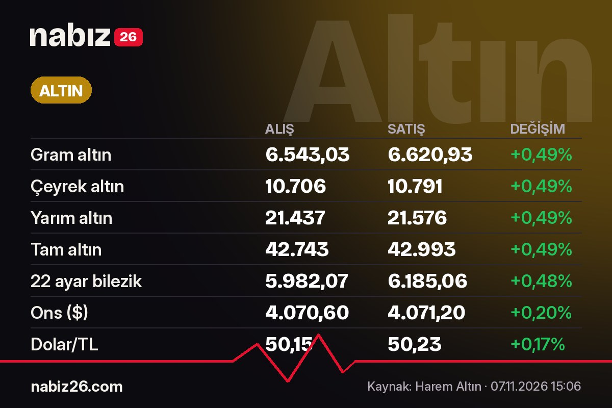
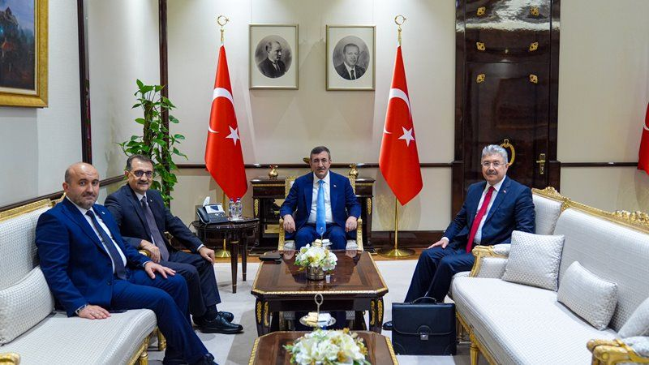
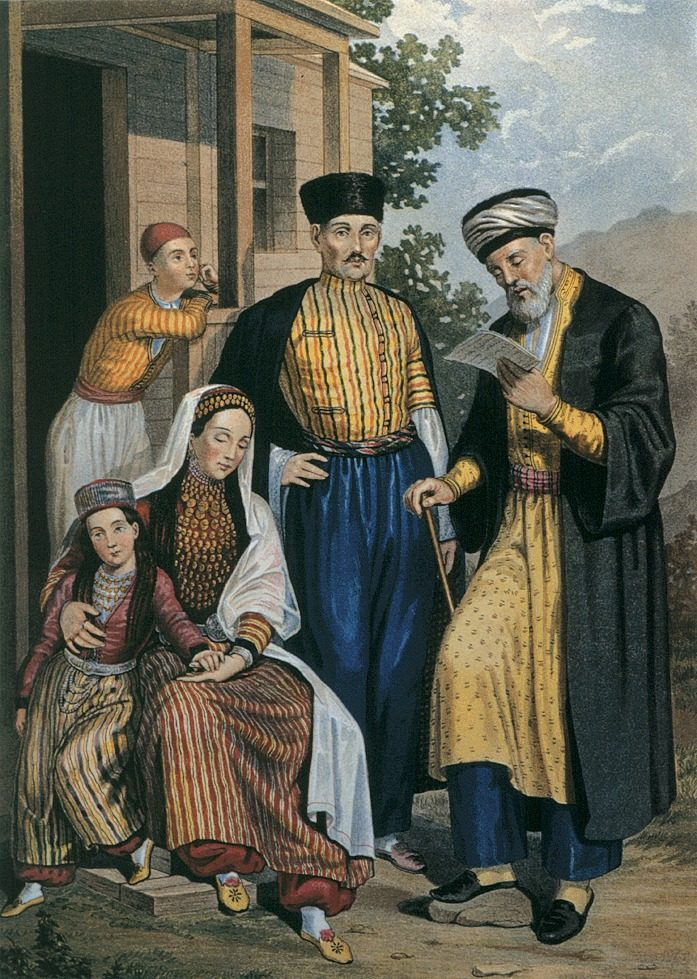
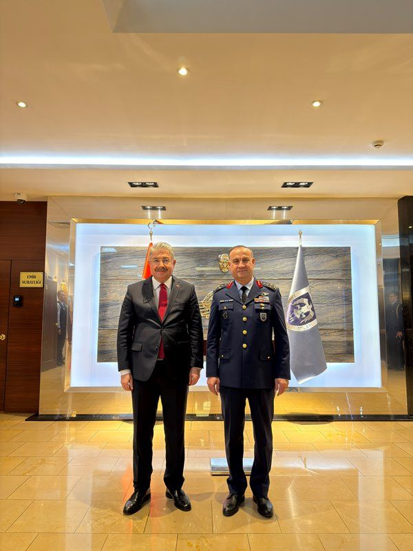

# Son haberler

Ajanın yazdığı son haberler (otomatik güncellenir).

## Tepebaşı'nda toplumsal cinsiyet eşitliği ve şiddet semineri

**Belediye · Tepebaşı** · 2026-11-08 06:40 UTC · Kaynak: [Google Haberler - Tepebaşı](https://www.toplumsal.com.tr/haber/tepebasi-nda-seminere-40-kisi-katildi_33414/)

> Tepebaşı Belediyesi tarafından Bahçelievler Belde Evi'nde düzenlenen toplumsal cinsiyet eşitliği ve şiddet konulu seminerde 40 kursiyer bir araya geldi.

Tepebaşı Belediyesi, ilçe genelinde toplumsal cinsiyet eşitliği ve şiddet konularında farkındalığı artırmaya yönelik eğitim çalışmalarını sürdürüyor. Bu kapsamda Bahçelievler Belde Evi'nde gerçekleştirilen seminere toplam 40 kişi katılım gösterdi.

Sağlık İşleri Müdürlüğü bünyesinde görev yapan psikolog Ecem Kumaş'ın konuşmacı olarak katıldığı buluşmada, örgü grubundan 23 ve giyim grubundan 17 kursiyer yer aldı. Oturumda katılımcılara toplumsal cinsiyet eşitliği ile şiddet konularında bilgilendirme yapılarak farkındalıklarının desteklenmesi hedeflendi.

Belediye yetkilileri, benzer eğitim etkinliklerinin ay boyunca farklı noktalardaki tüm belde evleri ve deneyimli kafelerde devam edeceğini bildirdi.

---

## İletişim Başkanı Duran'dan TRT World Forum'da dijital egemenlik vurgusu

**Türkiye · Türkiye** · 2026-11-08 06:40 UTC · Kaynak: [İletişim Başkanlığı](https://www.iletisim.gov.tr/turkce/haberler/detay/iletisim-baskani-duran-algoritmik-cagda-kontrol-kimde-sirketler-devletler-vatandaslar-baslikli-oturumda-konustu)

> İletişim Başkanı Burhanettin Duran, TRT World Forum 2026'da yaptığı konuşmada, dijital dünyanın birkaç teknoloji şirketinin kontrolüne bırakılamayacağını belirterek hesap verebilirlik, adalet ve çoğulculuk çağrısı yaptı.

Cumhurbaşkanlığı İletişim Başkanı Burhanettin Duran, TRT tarafından "Merkezsiz Dünya: Kurallar Geçersiz Kaldığında Kim Liderlik Eder?" temasıyla İstanbul Kongre Merkezi'nde düzenlenen TRT World Forum etkinliğine katıldı.

Etkinliğin ikinci gününde gerçekleştirilen "Algoritmik Çağda Kontrol Kimde? Şirketler, Devletler, Vatandaşlar" başlıklı oturumda konuşan Duran, bilgi ve iletişim teknolojilerindeki dijital devrimin getirdiği sorunlara dikkat çekti. Geleneksel gazetecilikteki editöryal denetimin yerini algoritmaların aldığını belirten Duran, bu durumun doğru ve önemli haberlerin kitlelere ulaşmasını engellerken yanıltıcı paylaşımların hızla yayılmasına yol açtığını ifade etti.

Algoritmaların tarafsız olmadığını ve arkasında ticari ile siyasi çıkarlar barındırdığını vurgulayan İletişim Başkanı Duran, bir avuç şirketin insanların ne göreceğini kontrol etmesinin düşünceyi de şekillendirdiğini kaydetti. Türkiye açısından bu durumun bir dijital egemenlik meselesi olduğunun altını çizen Duran, teknolojik ilerlemenin insanlara ve toplumlara hizmet etmesi gerektiğini belirtti.

Duran, daha adil bir dijital düzen için hesap verebilirlik, algoritmik dağıtımda adalet ve çoğulculuk olmak üzere üç temel ilkenin önemine işaret etti. Ayrıca TRT ve Anadolu Ajansının farklı dillerdeki yayıncılık faaliyetleriyle hakikati dünyaya ulaştırma çabasını sürdürdüğünü, bu süreçte gazetecilerin önemli bedeller ödediğini sözlerine ekledi.

---

## Eskişehirli sanatçıların eserleri COP31'de sergileniyor

**Kültür-Sanat · Merkez** · 2026-11-08 06:40 UTC · Kaynak: [Google Haberler - Eskişehir etkinlik](https://www.ensondakika.com.tr/artik-sergisi-cop31-de-antalya-da-sanatseverlerle-bulusuyor/736394/)

> Çanakkale, Eskişehir ve İzmir'den sanatçıların atık metallerden yaptığı eserlerin yer aldığı 'ARTIK' sergisi Antalya'da sanatseverlerle buluştu.

Akfen Holding işbirliği ve Loft Art katkılarıyla hayata geçirilen "ARTIK" sergisi, Birleşmiş Milletler İklim Değişikliği Çerçeve Sözleşmesi'nin 31. Taraflar Konferansı (COP31) sürecinde Gloria Hotels & Resorts ev sahipliğinde kapılarını açtı.

Sürdürülebilirlik kavramını sanatın yaratıcı gücüyle ele alan sergi; plastik parçalar, kullanılmış elektronik cihazlar ve atık metaller gibi malzemeleri sanat aracılığıyla yeniden yorumluyor. Eserlerin büyük bölümü, endüstriyel üretim atıklarının ileri dönüşümüyle heykellere dönüştürüldü. Çanakkale, Eskişehir ve İzmir'den altı sanatçının katkı sunduğu sergi, doğanın döngüsünü ve tüketim alışkanlıklarının canlı yaşamına etkilerini gözler önüne seriyor.

Akfen Holding Yönetim Kurulu Üyesi Pelin Akın Özalp, sergiyle doğanın tahribatına ve bilinçsiz tüketime dikkat çekmek istediklerini belirterek, "Yaşamın kaynağı olan doğanın bir gün metallerden oluştuğunu düşünmek korkutucu ama bir o kadar da mümkün. Bu ihtimali sanat aracılığıyla görünür kılmak istedik" ifadelerini kullandı.

Özaltın Holding Yönetim Kurulu Başkan Yardımcısı Elif Özdemir Şankaya ise kullanım ömrünü tamamlamış malzemelerin sanatla yeniden anlam kazanmasının döngüsel ekonominin yaratıcı yönünü ortaya koyduğunu vurguladı. 29 Kasım'a kadar Gloria Serenity Resort'ta gezilebilecek olan sergi, izleyicileri tüketim alışkanlıklarını yeniden sorgulamaya davet ediyor.

---

## Eskişehir'de kışlık alışveriş hareketliliği: Termal ürünler kapışılıyor

**Ekonomi · Tepebaşı** · 2026-11-08 06:40 UTC · Kaynak: [Google Haberler - Eskişehir](https://www.gazetevatan.com/sehirler/eskisehir/eskisehirde-kislik-kiyafetlere-yogun-talep-termal-urunler-kapisiliyor-2462470)

> Havaların soğumasıyla birlikte Eskişehir'deki pazarlarda kışlık kıyafetlere talep arttı. Vatandaşlar uygun fiyatlı termal ürünlere yöneldi.

Eskişehir'de hava sıcaklıklarının düşmesi, vatandaşları kışlık kıyafet alışverişine yönlendirdi. Tepebaşı ilçesindeki Çamlıca Kapalı Pazar Yeri'nde piyasa fiyatlarının altında satışa sunulan kışlık ürünler yoğun ilgi görüyor.

Pazarda özellikle soğuk havaların vazgeçilmezi olan termal kıyafetler vatandaşlar tarafından en çok tercih edilen ürünler arasında yer alıyor. Bunun yanı sıra günlük kullanıma uygun eşofman altları, sweatshirtler ve çoraplar da tezgahlarda hareketlilik oluşturuyor.

Farklı ihtiyaçlara yönelik kıyafetleri bütçelerine uygun fiyatlarla temin etmek isteyen vatandaşlar tezgahları doldururken, kış hazırlıkları kapsamında pazar yerindeki alışveriş yoğunluğunun devam etmesi bekleniyor.

---

## Cumhurbaşkanı Erdoğan bugün Azerbaycan'a gidiyor: Karabağ'ı ziyaret edecek

**Siyaset · Türkiye** · 2026-11-08 06:40 UTC · Kaynak: [Google Haberler - Cumhurbaşkanı](https://www.ntv.com.tr/turkiye/cumhurbaskani-erdogan-bugun-azerbaycana-gidecek-1749891)

> Cumhurbaşkanı Recep Tayyip Erdoğan, 8 Kasım Zafer Günü dolayısıyla bugün Azerbaycan'ı ziyaret ederek Karabağ'da temaslarda bulunacak.

Cumhurbaşkanı Recep Tayyip Erdoğan, Azerbaycan Cumhurbaşkanı İlham Aliyev'in daveti üzerine Zafer Günü kutlamalarına katılmak üzere bugün Azerbaycan'a gidecek. Ziyaret kapsamında iki lider ikili ilişkileri ve bölgesel gelişmeleri ele alacak.

İletişim Başkanı Burhanettin Duran, ziyaretin Azerbaycan'ın Zafer Günü vesilesiyle gerçekleştirileceğini belirterek, iki liderin Türkiye-Azerbaycan iş birliğinin yanı sıra küresel ve bölgesel meseleleri istişare edeceğini açıkladı. Ziyaret öncesinde Erdoğan, Aliyev'e gönderdiği tebrik mektubunda 30 yıllık işgalin sona ermesinin ardından elde edilen zaferin Türk dünyası için gurur kaynağı olduğunu vurguladı.

Mecliste Şuşa Beyannamesi ile pekiştirilen kardeşlik vurgusu yapan Erdoğan, Güney Kafkasya'nın artık bir çatışma bölgesi değil, iş birliği ve kalkınma merkezi olarak anıldığını ifade etti. Mektupta ayrıca vatan savunmasında hayatını kaybeden şehitler rahmetle anıldı.

Azerbaycan, Karabağ'da Ermenistan işgaline son veren 2. Karabağ Savaşı'nın ardından Zafer Günü'nü 8 Kasım'da kutluyor.

---

## Yunus Emre Yurdu'nda yangın tatbikatı: Gerçeğini aratmadı

**Gündem · Merkez** · 2026-11-07 22:46 UTC · Kaynak: [Google Haberler - Eskişehir asayiş](https://www.haberler.com/amp/eskisehir-yunus-emre-yurdu-personeline-yangin-20404168-haberi/)

> Eskişehir Yunus Emre Yurdu personel kapsamlı yangın eğitimi ve uygulamalı tahliye tatbikatıyla acil durumlara karşı hazırlandı.

Gençlik ve Spor Bakanlığı Eskişehir Yurt Müdürlüğü bünyesinde faaliyet gösteren Yunus Emre Yurdu'nda görevli personele yönelik yangın güvenliği eğitimi ve uygulamalı tatbikat gerçekleştirildi.

Düzenlenen programın ilk aşamasında personele, olası bir yangın anında sergilenecek doğru hareket tarzları, güvenli tahliye adımları ve yangın söndürme cihazlarının etkin kullanımı konularında teorik bilgiler aktarıldı.

Eğitimin ardından yurt bahçesinde senaryo gereği kontrollü bir yangın çıkarıldı. Teorik bilgileri pratiğe döken yurt personeli, yangına müdahale ederek söndürme işlemlerini başarıyla tamamladı.

---

## Kasım 2026'nın en ucuz elektrikli otomobilleri: Togg da listede

**Ekonomi · Türkiye** · 2026-11-07 22:46 UTC · Kaynak: [Google Haberler - Togg](https://www.yenisafak.com/galeri/ekonomi/kasim-2026da-elektrikli-otomobil-alacaklar-dikkat-en-ucuz-10-model-siralandi-4870514)

> Türkiye'de satışa sunulan en uygun fiyatlı 10 elektrikli otomobilin kasım ayı güncel fiyatları belli oldu. Bütçe dostu listede Togg modelleri de yer aldı.

Türkiye otomobil pazarında satışta olan en uygun fiyatlı elektrikli araçların Kasım 2026 dönemi fiyatları ve teknik detayları netleşti. Şehir içi kullanıma uygun kompakt modellerden SUV segmentine kadar farklı seçeneklerin yer aldığı listede fiyatlar 1,5 milyon TL seviyesinden başlıyor.

Otomobil pazarındaki bütçe dostu seçenekler arasında Togg'un T10X ve T10F modelleri de kendine yer buldu. Listeye göre Togg T10X 1.909.048 TL'den başlayan fiyatla sunulurken, Togg T10F ise 1.884.980 TL'lik fiyat etiketiyle alıcı bekliyor. İki model de gelişmiş batarya kapasiteleri ve hızlı şarj destekleriyle dikkat çekiyor.

Sıralamada yer alan diğer modeller ve başlangıç fiyatları ise şu şekilde sıralandı: Hyundai Inster 1.520.000 TL, Fiat Grande Panda Elektrikli 1.584.900 TL, Citroën ë-C3 1.605.000 TL, Fiat 600e 1.854.900 TL, Citroën ë-C3 Aircross 1.875.000 TL, Opel Corsa Elektrik 1.890.000 TL, Opel Frontera Elektrik 1.895.000 TL ve Peugeot E-208 2.080.000 TL.

---

## Eskişehir İl Halk Kütüphanesi'nde öğrencilere yönelik drama atölyesi yapıldı

**Kültür-Sanat · Merkez** · 2026-11-07 22:46 UTC · Kaynak: [Google Haberler - Eskişehir etkinlik](https://www.anadolugazetesi.com/eskisehir-il-halk-kutuphanesi-nde-ogrenciler-icin-drama-atolyesi-duzenlendi-297707.html)

> Millî Eğitim Bakanlığı ile Kültür ve Turizm Bakanlığı protokolü kapsamında Eskişehir İl Halk Kütüphanesi'nde öğrenciler için drama atölyesi düzenlendi.

Eskişehir İl Halk Kütüphanesi, öğrencilerin kişisel gelişimlerini ve sosyal becerilerini desteklemeye yönelik renkli bir etkinliğe ev sahipliği yaptı. Millî Eğitim Bakanlığı ile Kültür ve Turizm Bakanlığı arasında hayata geçirilen "Kütüphanelerde İş Birliği Protokolü" çerçevesinde gerçekleştirilen drama atölyesi, öğrencilerden yoğun ilgi gördü.

İl Millî Eğitim Müdürlüğü koordinasyonunda kütüphane bünyesinde düzenlenen çalışmalarda uzman eğitmenler görev aldı. Etkinlik boyunca gençlerin kendilerini ifade etme yeteneklerini artırmak, iletişim güçlerini pekiştirmek ve hayal güçlerini harekete geçirmek amacıyla çeşitli uygulamalar yapıldı.

Eğlenceli ve öğretici anlara sahne olan program, öğrencilerin katıldığı ortak canlandırma çalışmalarının ardından başarıyla tamamlandı.

---

## Odunpazarı'nda otomobil bisikletle çarpıştı: Çocuk yaralandı

**Asayiş · Odunpazarı** · 2026-11-07 22:45 UTC · Kaynak: [Google Haberler - Odunpazarı](https://www.sondakika.com/3-sayfa/haber-eskisehir-odunpazari-nda-otomobil-bisikletle-carpi-20405712/)

> Eskişehir'in Odunpazarı ilçesinde otomobilin bisikletle çarpışması sonucu meydana gelen kazada bir çocuk yaralandı. Kaza anı güvenlik kameralarına yansıdı.

Eskişehir'de otomobil ile bisikletin çarpışması sonucu yaşanan kazada bir çocuk yaralandı.

Kaza, Odunpazarı ilçesi Kurtuluş Mahallesi Bilgin Sokak üzerinde meydana geldi. Alınan bilgilere göre, otomobil ile bisikletin çarpışması neticesinde bisikletten düşen çocuk yaralandı. Çevredekilerin ihbarı üzerine olay yerine 112 Acil Sağlık ve polis ekipleri yönlendirildi.

Yaralı çocuk, sağlık ekiplerinin olay yerindeki ilk müdahalesinin ardından ambulansla hastaneye kaldırılarak tedavi altına alındı. Öte yandan kaza anı çevredeki bir güvenlik kamerasının kayıtlarına anbean yansıdı.

Polis ekipleri kazayla ilgili inceleme başlattı.

---

## Eskişehirspor evinde kazandı: Kepezspor'u tek golle geçtiler

**Spor · Tepebaşı** · 2026-11-07 22:45 UTC · Kaynak: [Google Haberler - Eskişehir](https://www.akdenizgercek.com.tr/kepez/kepezspor-as-eskisehir-deplasmaninda-geriye-dustu-1-0/388805)

> Nesine 3. Lig'de Eskişehirspor, sahasında konuk ettiği Kepezspor'u 20. dakikada Hasan Kaya'nın attığı golle 1-0 mağlup etti.

Nesine 3. Lig 10. hafta mücadelesinde Eskişehirspor ile Antalya temsilcisi Kepezspor A.Ş. karşı karşıya geldi. Prof. Dr. Fethi Heper Stadyumu’nda oynanan karşılaşmada ev sahibi ekip sahadan 1-0 galibiyetle ayrıldı.

Yağmurlu hava ve yoğun taraftar desteği altında oynanan mücadelenin ilk dakikalarından itibaren hücumda etkili bir oyun ortaya koyan Eskişehirspor, aradığı golü 20. dakikada buldu. Mert Bağer’in pasını iyi değerlendiren Hasan Kaya, meşin yuvarlağı ağlarla buluşturarak takımını 1-0 öne geçirdi ve ilk yarı bu skorla tamamlandı.

Maçın ikinci devresinde erken yediği golün dezavantajını kapatmak ve beraberliği yakalamak için rakip kalede ataklar geliştiren Kepezspor A.Ş., Eskişehirspor savunmasını aşamadı. Saha ve seyirci avantajını maç sonuna kadar koruyan kırmızı-siyahlılar, skoru koruyarak hanesine 3 puan yazdırdı.

---

## Robotik Türkiye Platformu kuruldu: Togg da yer aldı

**Ekonomi · Türkiye** · 2026-11-07 18:05 UTC · Kaynak: [Google Haberler - Togg](https://www.cozumpark.com/robotik-turkiye-platformu-kuruldu-togg-thy-ve-eczacibasi-ayni-catida-bulustu/)

> Türkiye Bilişim Vakfı öncülüğünde kurulan Robotik Türkiye Platformu, yerli sanayi kuruluşları ve teknoloji girişimlerini fiziksel yapay zekâ alanında buluşturdu.

Türkiye Bilişim Vakfı öncülüğünde hayata geçirilen Robotik Türkiye Platformu, yerli sanayi kuruluşları ile teknoloji girişimlerini ortak bir ekosistemde bir araya getirdi. İstanbul Modern'de düzenlenen lansmanla tanıtılan platformun kurucu üyeleri arasında Togg'un yanı sıra Eczacıbaşı Topluluğu, Milvus Robotics, Türk Hava Yolları ve Zorlu Holding yer alıyor.

Girişim; üniversiteler, teknoloji girişimleri, yatırımcılar ve kamu kurumlarını da paydaş olarak buluşturarak robotik teknolojilerin sanayide uygulanmasını ve ticarileşmesini amaçlıyor. Odaklanılan fiziksel yapay zekâ sistemleri; depo otomasyonundan üretim hatlarına, tarımdan sağlık hizmetlerine kadar geniş bir kullanım alanı sunuyor.

Tanıtım etkinliğinde ayrıca Togg sponsorluğunda hazırlanan Türkiye Robotik Ekosistemi Raporu da açıklandı. Rapora göre Türkiye'de 2025 yılı boyunca 3 bin 194 endüstriyel robot kurulumu gerçekleştirildiği belirtildi.

Platform, ilk yılında pilot uygulamalar, bilgi ve deneyim paylaşımı ile kamu ile sektör diyaloğu olmak üzere üç temel çalışma alanına odaklanacak.

---

## Kurşunlu Külliyesi'ndeki müzeler ziyarete kapatıldı

**Belediye · Odunpazarı** · 2026-11-07 18:05 UTC · Kaynak: [Google Haberler - Odunpazarı](https://www.istikbalgazetesi.com/odunpazari-belediyesi-muzelerin-kapatildigini-ziyaretcilere-bu-pankartla-duyurdu)

> Odunpazarı Belediyesi, Vakıflar Bölge Müdürlüğü tarafından alandan çıkarıldıklarını belirterek Kurşunlu Külliyesi'ndeki dört müzenin kapandığını duyurdu.

Eskişehir'in turistik açıdan önemli merkezlerinden biri olan Kurşunlu Külliyesi bünyesindeki müzeler ve sanat merkezi kapılarını kapattı. Ahşap Eserler Müzesi, Fotoğraf Müzesi, Lületaşı Müzesi ve Cam Sanatları Merkezi'nin ziyarete kapatıldığı bildirildi.

Odunpazarı Belediyesi tarafından alana asılan pankartla durum ziyaretçilere duyuruldu. Açıklamada, kapatma kararının Vakıflar Bölge Müdürlüğü tarafından belediyenin alandan çıkarılması nedeniyle alındığı ifade edildi.

Belediye yönetimi, ziyaretçilerin yaşadığı hayal kırıklığını paylaştıklarını belirterek gösterilen anlayış için teşekkür etti.

---

## Eskişehir'de Erzurum Gastronomi ve Cağ Kebabı Festivali Başladı

**Kültür-Sanat · Merkez** · 2026-11-07 18:05 UTC · Kaynak: [Google Haberler - Eskişehir](https://www.esgazete.com/eskisehirde-erzurum-lezzetleri-bulusmasi)

> Eskişehir'de düzenlenen Erzurum Gastronomi ve Cağ Kebabı Festivali, Vali Dr. Erdinç Yılmaz'ın katılımıyla kapılarını açtı.

Eskişehir Erzurumlular Sosyal Yardımlaşma, Kültür ve Dayanışma Derneği tarafından Erzurum'un zengin mutfak kültürünü tanıtmak ve hemşehri dayanışmasını güçlendirmek amacıyla Erzurum Gastronomi ve Cağ Kebabı Festivali düzenlendi. Etkinliğe Eskişehir Valisi Dr. Erdinç Yılmaz da katılarak incelemelerde bulundu.

Erzurum'un köklü gastronomi kültürünün en önemli simgelerinden biri olan cağ kebabının ön plana çıkarıldığı festival, yöresel lezzetlerin gelecek nesillere aktarılmasını amaçlıyor. Kentte faaliyet gösteren hemşehri derneklerinin düzenlediği bu tür etkinlikler, farklı şehirlerin geleneklerinin yaşatılmasına ve kültürel bağların korunmasına katkı sağlıyor.

---

## Eskişehir heyetinden Savunma Sanayii Başkanlığı'na kritik ziyaret

**Ekonomi · Merkez** · 2026-11-07 18:05 UTC · Kaynak: [Google Haberler - Eskişehir gündem](https://www.pembepusula.org/eskisehir-heyetinden-savunma-sanayii-baskanligi-na-ziyaret/631598/)

> Eskişehir Valisi Dr. Erdinç Yılmaz ve Kalkınma Platformu üyeleri, Savunma Sanayii Başkanlığı'nı ziyaret ederek kentin havacılık potansiyelini masaya yatırdı.

Eskişehir Kalkınma Platformu üyeleri, savunma sanayisindeki stratejik projeleri görüşmek üzere Savunma Sanayii Başkanlığı'nı (SSB) ziyaret etti. Gerçekleşen temasta kentin havacılık altyapısı ve uçak motoru imalatındaki tecrübesi detaylı şekilde ele alındı.

Vali Dr. Erdinç Yılmaz ve beraberindeki heyetin katıldığı görüşmede, yerel sanayicilerin tedarik zincirindeki etkinliği değerlendirildi. Ayrıca savunma sanayisinin ihtiyaç duyduğu nitelikli teknik personelin yetiştirilmesi için mesleki ve teknik liselerin sektörle entegre çalışması gerektiği vurgulandı.

AK Parti Eskişehir İl Başkanı ve Albayrak Makine Elektronik Yönetim Kurulu Başkanı Gürhan Albayrak, toplantının çok verimli geçtiğini belirterek, SSB Başkanı Prof. Dr. Haluk Görgün'ün en kısa sürede Eskişehir'i ziyaret ederek sanayicilerle bir araya geleceğini açıkladı.

---

## Erdoğan ve Trump telefonda görüştü: Bölgesel meseleler ele alındı

**Türkiye · Türkiye** · 2026-11-07 18:05 UTC · Kaynak: [İletişim Başkanlığı](https://www.iletisim.gov.tr/turkce/haberler/detay/cumhurbaskani-erdoganin-abd-baskani-trump-ile-gorusmesine-iliskin-aciklama-07-11-26)

> Cumhurbaşkanı Erdoğan, ABD Başkanı Trump ile bir telefon görüşmesi gerçekleştirerek ikili ilişkiler ile bölgesel ve küresel gelişmeleri değerlendirdi.

Cumhurbaşkanı Recep Tayyip Erdoğan, Amerika Birleşik Devletleri Başkanı Donald Trump ile telefon görüşmesi yaptı. Görüşmede Türkiye-ABD ikili ilişkilerinin yanı sıra bölgesel ve küresel meseleler masaya yatırıldı.

Cumhurbaşkanı Erdoğan, iki ülke arasındaki iş birliğinin artarak devam edeceğine inandığını ve önümüzdeki dönemde ilişkilere ivme kazandırmak için çalışacaklarını belirtti. Görüşmede İran ile ABD arasındaki gerilimin diplomasi yoluyla çözülmesi gerektiğine vurgu yapan Erdoğan, Türkiye'nin barış için gayret göstermeyi sürdüreceğini ifade etti.

Ukrayna-Rusya savaşına da değinen Erdoğan, çatışmaların sonlandırılmasına yönelik diplomatik çabaların olumlu sonuçlanmasını umduğunu, bu sürece katkı sunmaya devam ederek her iki ülke ile temasları artırmanın önemini dile getirdi. Ayrıca Erdoğan, ABD Başkanı Trump'a Türk Devletleri Teşkilatı Zirvesi'ne verdiği destek dolayısıyla teşekkür etti.

---

## Erdoğan ve Trump telefon görüşmesinde ikili ilişkileri ele aldı

**Siyaset · Türkiye** · 2026-11-07 18:05 UTC · Kaynak: [Google Haberler - Cumhurbaşkanı](https://www.trthaber.com/haber/gundem/cumhurbaskani-erdogan-abd-baskani-trump-ile-gorustu-962557.html)

> Cumhurbaşkanı Erdoğan, ABD Başkanı Trump ile bir telefon görüşmesi gerçekleştirerek ikili ilişkiler ile bölgesel ve küresel gelişmeleri değerlendirdi.

Cumhurbaşkanı Recep Tayyip Erdoğan, Amerika Birleşik Devletleri Başkanı Donald Trump ile telefon görüşmesi yaptı. İletişim Başkanlığı'ndan yapılan açıklamaya göre görüşmede, Türkiye-ABD ikili ilişkilerinin yanı sıra bölgesel ve küresel meseleler ele alındı.

Görüşmede Cumhurbaşkanı Erdoğan, Türkiye ile ABD arasındaki iş birliğinin artarak sürmesine inandığını ve ilişkileri daha ileriye taşımak için çalışacaklarını ifade etti. İran ile ABD arasındaki gerilimin diplomasi yoluyla çözülmesi gerektiğini vurgulayan Erdoğan, Türkiye'nin barışın tesisi için gayret göstermeye devam edeceğini belirtti.

Ukrayna-Rusya savaşının sonlandırılmasına yönelik diplomatik çabaların önemine dikkat çeken Erdoğan, her iki tarafla da temasları artırmanın gerekli olduğunu kaydetti. Ayrıca Cumhurbaşkanı Erdoğan, ABD Başkanı Trump'a Türk Devletleri Teşkilatı Zirvesi'ne verdiği destek dolayısıyla teşekkür etti.

---

## Altın fiyatları 7 Kasım 2026: Gram altın 6.620,93 TL

**Ekonomi · Merkez** · 2026-11-07 12:06 UTC · Kaynak: [Harem Altın](https://www.haremaltin.com/altin-fiyatlari)

> Gram altın güne yükselişle başladı. Harem Altın verilerine göre gram altın 6.543,03 TL'den alınıyor, 6.620,93 TL'den satılıyor.

Altın piyasasında güne yükselişle başlandı. Harem Altın'ın saat 15.06 itibarıyla verilerine göre gram altının satış fiyatı 6.620,93 TL, alış fiyatı 6.543,03 TL oldu. Gram altın, önceki kapanışa göre yüzde 0,49 yükseldi.

Ziynet altınlarda çeyrek altın 10.791 TL, yarım altın 21.576 TL, tam altın 42.993 TL, ata altın 44.142 TL seviyesinden satışa sunuluyor.

22 ayar bileziğin gram satış fiyatı 6.185,06 TL, has altının gram fiyatı 6.601,13 TL olarak belirlendi.

Uluslararası piyasalarda altının onsu 4.071,20 dolardan işlem görürken, dolar/TL 50,23 seviyesinde bulunuyor.

Fiyatlar Harem Altın'ın saat 15.06 itibarıyla paylaştığı verilere dayanmaktadır; kuyumcular arasında farklılık gösterebilir. Bu haber yatırım tavsiyesi değildir.

---

## İletişim Başkanı Duran, Nijeryalı Bakan Malagi ile görüştü

**Türkiye · Türkiye** · 2026-11-07 11:46 UTC · Kaynak: [İletişim Başkanlığı](https://www.iletisim.gov.tr/turkce/haberler/detay/iletisim-baskani-duran-nijerya-enformasyon-ve-ulusal-uyum-bakani-malagi-ile-bir-araya-geldi)

> İletişim Başkanı Burhanettin Duran, TRT World Forum 2026 için ülkemizde bulunan Nijerya Enformasyon ve Ulusal Uyum Bakanı Mohammed İdris Malagi'yi ağırladı.

Cumhurbaşkanlığı İletişim Başkanı Burhanettin Duran, TRT World Forum 2026 etkinlikleri dolayısıyla Türkiye'de bulunan Nijerya Federal Cumhuriyeti Enformasyon ve Ulusal Uyum Bakanı Mohammed İdris Malagi ve beraberindeki heyetle bir araya geldi.

Görüşmede, Türkiye ile Nijerya arasında medya ve iletişim alanındaki iş birliği imkânları masaya yatırıldı. Taraflar, kamu diplomasisi ve stratejik iletişim konularında geliştirilebilecek ortak çalışmaları değerlendirdi.

İletişim Başkanı Duran, iki ülke arasındaki ilişkilerin iletişim alanında da güçlenerek sürmesini dilediğini belirterek konuk bakana ve heyetine teşekkür etti.

---

## Eskişehir'e yeni bir vizyon: Kentpark'taki İklim Adası kapılarını açtı

**Belediye · Merkez** · 2026-11-07 11:46 UTC · Kaynak: [Google Haberler - Eskişehir gündem](https://www.istikbalgazetesi.com/unlucenin-iklim-adasi-gelecege-acilan-kapi)

> Eskişehir Büyükşehir Belediyesi tarafından Kentpark içinde hayata geçirilen İklim Adası, sürdürülebilirlik, bilim ve teknolojiyi buluşturan yeni bir yaşam alanı olarak hizmet vermeye başladı.

Eskişehir Büyükşehir Belediyesi, kentte sürdürülebilir yaşam kültürünü yaygınlaştırmak amacıyla önemli bir projeyi daha hayata geçirdi. Başkan Ayşe Ünlüce'nin öncülüğünde Kentpark içerisinde yeniden düzenlenen İklim Adası, bilim, teknoloji ve çevre bilincini bir araya getiren bir merkez olarak kapılarını açtı.

Eski Ada Restoran'ın bulunduğu alanda kurulan ve yaklaşık 500 metrekare kapalı ile 2 bin metrekare açık alana sahip olan merkez; kütüphane, atölyeler, amfi, çalışma alanları, podcast ve çekim odalarının yanı sıra yeme-içme ve dinlenme bölümlerini barındırıyor. Projede çevre dostu uygulamalar dikkat çekerken, kafeteryadaki mobilyaların tamamının sürdürülebilirlik anlayışıyla ikinci el ürünlerden tercih edildiği belirtildi.

İklim Adası'nda ayrıca yağmur sularının depolanarak yeşil alanların sulamasında kullanılacağı çevre dostu sistemler de yer alıyor. Öğrencilerden akademisyenlere ve girişimcilere kadar her kesimden vatandaşın buluşma noktası olması hedeflenen merkez, Eskişehir'in akıllı şehir vizyonuna katkı sunmayı amaçlıyor.

---

## Erdoğan'dan Azerbaycan ziyareti açıklaması: 8 Kasım'da gideceğim

**Siyaset · Türkiye** · 2026-11-07 11:46 UTC · Kaynak: [Google Haberler - Cumhurbaşkanı](https://ankahaber.net/haber/cumhurbaskani-erdogan-dan-azerbaycan-aciklamasi-kardesligimizin-asamayacagi-hicbir-engel-yoktur-a4c49662)

> Cumhurbaşkanı Erdoğan, Seul dönüşü uçakta yaptığı açıklamada 8 Kasım'da Azerbaycan'ın Zafer Günü etkinliklerine katılmayı planladığını duyurdu.

Cumhurbaşkanı Recep Tayyip Erdoğan, Seul ziyaretinden Türkiye'ye dönüşü sırasında uçakta gazetecilerin sorularını yanıtladı. Azerbaycan ile ilişkiler hakkında değerlendirmelerde bulunan Erdoğan, fevkalade bir durum olmazsa 8 Kasım'da Azerbaycan'ın Zafer Günü'ne katılmak üzere bir ziyaret gerçekleştirmeyi düşündüğünü belirtti.

İki ülke arasındaki bağların klasik diplomatik temasların ötesinde olduğunu vurgulayan Erdoğan, "Türkiye ve Azerbaycan kardeşliğinin evelallah aşamayacağı hiçbir engel yoktur" ifadesini kullandı. Ziyaret kapsamında gerekli adımların atılacağını belirten Erdoğan, Azerbaycan Cumhurbaşkanı İlham Aliyev ile telefon görüşmeleri gerçekleştirdiğini, ayrıca İstihbarat Başkanı ile Dışişleri Bakanı'nı da Azerbaycan'a gönderdiğini aktardı.

Açıklamalarında fon soruşturmasına da değinen Cumhurbaşkanı Erdoğan, sermaye piyasalarının usulsüzlüklerden ve manipülasyonlardan temizleneceğini belirterek, gerekli yol haritasının oluşturulduğunu ve sürecin titizlikle takip edildiğini kaydetti.

---

## Bakan Tekin: PISA'daki yükseliş vesayetle mücadelenin sonucudur

**Eğitim · Türkiye** · 2026-11-07 11:46 UTC · Kaynak: [Milli Eğitim Bakanlığı](https://www.meb.gov.tr/il-milli-egitim-mudurleri-toplantisi-diyarbakir039da-gerceklesti/haber/42428/tr)

> Millî Eğitim Bakanı Yusuf Tekin, Diyarbakır'da düzenlenen İl Millî Eğitim Müdürleri Toplantısı'nda eğitim alanındaki gelişmeleri değerlendirdi.

Millî Eğitim Bakanı Yusuf Tekin, yürütülen çalışmaları değerlendirmek üzere bakan yardımcıları ve birim amirlerinin de katılımıyla Diyarbakır'da 81 ilin millî eğitim müdürüyle bir araya geldi.

Toplantıda, bakanlığın eğitim politikalarının ülke genelinde aynı hassasiyetle uygulanmasında il millî eğitim müdürlerinin kritik bir sorumluluk üstlendiğini belirten Bakan Tekin, her çocuğun eğitim hakkının gözetilmesi ve öğretmenlerin mesleki itibarının korunması için sahadan gelen görüşlerle çalışmalara yön vermeye devam edeceklerini kaydetti.

Türkiye'nin eğitimde fiziki imkânların yanı sıra akademik başarı bakımından da önemli mesafeler kat ettiğini dile getiren Tekin, 2003'te OECD PISA araştırmalarında ilk 30'da yer alamayan ülkenin, 2015 sonrasında istikrarlı bir yükseliş gösterdiğini ifade etti. Bu başarının arkasında eğitim sistemi üzerindeki vesayetçi yapılarla mücadelenin yattığını vurgulayan Tekin, 2013'ten itibaren atılan adımların ve dershanelere yönelik yasal düzenlemelerin bakanlığın kendi politikalarını uygulamasını sağladığını aktardı.

İki gün sürecek olan toplantı, bakan yardımcıları ve birim amirlerinin sunumlarıyla sürdürülüyor.

---

## AK Partili Akyel'den Odunpazarı'na 'ruhsat' tepkisi

**Belediye · Odunpazarı** · 2026-11-07 11:46 UTC · Kaynak: [Google Haberler - Odunpazarı](https://www.gzt26.com/berke-akyelden-odunpazari-belediyesine-tepki-arsa-sahipleri-ruhsat-bekliyor)

> Odunpazarı Belediyesi AK Parti Meclis Üyesi Berke Akyel, Aşağı Çağlan, Kayapınar ve Kocakır bölgelerindeki TOKİ hak sahiplerine ruhsat verilmediğini ve kanuna aykırı olarak çap parası tahsil edildiğini öne sürdü.

Odunpazarı Belediyesi AK Parti Meclis Üyesi Berke Akyel, meclis toplantısında yaptığı konuşmada TOKİ arsaları için hak sahiplerinden talep edilen ücretlere ve ruhsat gecikmelerine tepki gösterdi. Aşağı Çağlan, Kayapınar ve Kocakır'da ev yapmak isteyen vatandaşların tapularını aldığını belirten Akyel, süreçteki tek engelin belediye olduğunu iddia etti.

Belediyenin hak sahiplerinden çap parası aldığını savunan Akyel, 775 sayılı Gecekondu Kanunu'nun 33. maddesi gereğince bu işlemlerin her türlü vergi, resim ve harçtan muaf olduğunu hatırlattı. Alınan belgelere harç yerine ücret yazıldığını ifade eden Akyel, alınan ücretlerin durdurulması ve tahsil edilen tutarların iade edilmesi için önerge sunacaklarını kaydetti.

Ayrıca vatandaşların temmuz ayından bu yana verdiği 200'ün üzerindeki dilekçeye yanıt alamadığını belirten Akyel, kırmızı kot ve yol profili gibi teknik çizimlerin vatandaşlar tarafından temin edilmesine rağmen ruhsat verilmediğini söyledi. Akyel, belediyeyi TOKİ ile iletişime geçmeye ve hak sahiplerinin mağduriyetini gidermeye çağırdı.

---

## Vali Yılmaz ve beraberindeki heyet Cumhurbaşkanı Yardımcısı Yılmaz'ı ziyaret etti

**Gündem · Merkez** · 2026-11-07 06:40 UTC · Kaynak: [Eskişehir Valiliği](https://www.eskisehir.gov.tr/alimiz-dr-erdinc-yilmaz-cumhurbaskani-yardimcimiz-sayin-cevdet-yilmaz-tarafindan-kabul-edildi)

> Eskişehir Valisi Dr. Erdinç Yılmaz, Cumhurbaşkanı Yardımcısı Cevdet Yılmaz ile bir araya geldi.

Eskişehir Valisi Dr. Erdinç Yılmaz, Ankara'da temaslarda bulundu. Valilikten edinilen bilgilere göre, Cumhurbaşkanı Yardımcısı Cevdet Yılmaz, Vali Erdinç Yılmaz'ı makamında kabul etti.

Gerçekleşen kabule, Eskişehir Milletvekili ve TBMM Yapay Zekâ Araştırma Komisyonu Başkanı Fatih Dönmez ile AK Parti Eskişehir İl Başkanı Gürhan Albayrak da katıldı.

---

## Kırım Tatar Akademik İş Birliği Çalıştayı Eskişehir'de Başladı

**Kültür-Sanat · Odunpazarı** · 2026-11-07 06:40 UTC · Kaynak: [Google Haberler - Eskişehir](https://www.qha.com.tr/diaspora/kirim-tatar-akademik-is-birligi-calistayi-eskisehir-de-basladi-537407)

> Kırım Tatar dili, tarihi ve kültürünün ele alındığı akademik çalıştay, Eskişehir Osmangazi Üniversitesinde bilim ve siyaset dünyasından isimlerin katılımıyla başladı.

Kırım Tatar dili, edebiyatı, tarihi ve kültürünün bilimsel paylaşımı ile iş birliği kapsamının genişletilmesi amacıyla düzenlenen Kırım Tatar Akademik İş Birliği Çalıştayı, Eskişehir Osmangazi Üniversitesinde kapılarını açtı.

Eskişehir Osmangazi Üniversitesinde gerçekleştirilen program, şehitler için saygı duruşunda bulunulmasının ardından Kırım Tatar millî marşı "Ant Etkenmen", İstiklâl Marşı ve Ukrayna millî marşının okunmasıyla başladı. Kırım Ailesi Derneği, Eskişehir Kırım Derneği, YTB, TİKA ve Ukrayna'nın Ankara Büyükelçiliğinin ortaklığıyla düzenlenen etkinlikte, Kırım Tatarlarının tarihi mücadelesi, kültürel mirası ve geleceğe yönelik yol haritası masaya yatırıldı.

Açılışta konuşan Kırım Ailesi Kurucusu Anife Kurtseitova, savaş ve işgal acılarına rağmen pes etmediklerini belirterek, amaçlarının sürgünde olsalar dahi Kırım'ın eğilmez ruhunu yeni nesillere aktarmak olduğunu ifade etti. Eskişehir Kırım Derneği Başkanı Recep Şen ise İsmail Bey Gaspıralı’nın "Dilde, fikirde, işte birlik" şiarına atıf yaparak, 1783'ten bu yana süren sürgün ve soykırımlara rağmen Kırım Türklerinin direnmeye devam ettiğini vurguladı.

Türk Ocakları Eskişehir Şubesi Başkanı Prof. Dr. Nedim Ünal, Kırım'ın ebediyen bir Türk vatanı olmaya devam edeceğini kaydetti. AK Parti Gençlik Kolları Genel Başkan Yardımcısı Murat Resul Karaman ve Odunpazarı Belediye Başkanı Av. Kâzım Kurt da çalıştayın Kırım'ın geleceği ve ortak hafıza açısından taşıdığı öneme dikkat çekti.

Program kapsamında Ukrayna Silahlı Kuvvetleri korosu ve Kültür Güçleri grubunun solisti İsmail Kurtumer ile Safiye Lenterkızı konser verirken, Kırım Ailesi halk danslarıyla sahne aldı. Gün boyunca açık olan sergide ise Kırım Tatar sanatçıların eserleri, mutfağı ve tarihi sürgün ile siyasi tutsaklara ait fotoğraflar ziyaretçilerle buluştu.

---

## Eskişehirspor seriyi sürdürmek için sahada: Kepez maçı saat 15.30'da

**Spor · Odunpazarı** · 2026-11-07 06:40 UTC · Kaynak: [Google Haberler - Eskişehirspor](https://www.istikbalgazetesi.com/eskisehirsporda-seri-zamani-simsekler-kepezi-bekliyor)

> Kırmızı Şimşekler, 9 günlük zorlu periyottaki kritik maçta Antalya Kepezspor'u konuk ediyor.

Evinde Bursa Yıldırım ile berabere kalıp Türkiye Kupası'nda Iğdır'ı eleyen, ardından deplasmanda Gaziemir'i mağlup ederek moral depolayan Eskişehirspor, galibiyet serisi yakalamak için sahaya çıkıyor.

Zorlu bir dönemece giren ve 9 gün içinde 3 kritik karşılaşmaya çıkacak olan Kırmızı Şimşekler, sahasında ağırlayacağı Antalya temsilcisini yenerek çıkışını sürdürmeyi hedefliyor. Öte yandan konuk ekip Kepezspor ise teknik direktör değişikliğinin ardından son iki maçını kazanarak Eskişehir'e moralli geliyor.

Prof. Dr. Fethi Heper Stadyumu'nda oynanacak karşılaşma saat 15.30'da başlayacak. Mücadeleyi İstanbul bölgesi üst klasman hakemi Deniz Güven yönetecek.

---

## Eskişehir'de ehliyet sınavında kopya şebekesine operasyon: 3 tutuklama

**Asayiş · Merkez** · 2026-11-07 06:40 UTC · Kaynak: [Google Haberler - Eskişehir asayiş](https://www.iha.com.tr/eskisehir-haberleri/ehliyet-sinavinda-kopya-sebekesine-operasyon-512022951)

> Eskişehir merkezli düzenlenen operasyonda ehliyet sınavlarında gizli kamera ve kulaklık düzenekleriyle kopya çektirdiği belirlenen 8 şüpheli yakalandı, adliyeye sevk edilen zanlılardan 3'ü tutuklandı.

Eskişehir Emniyet Müdürlüğü Kaçakçılık ve Organize Suçlarla Mücadele (KOM) Şube Müdürlüğü ekipleri, ehliyet sınavlarında organize şekilde kopya çekilmesini sağlayan bir suç şebekesini takibe aldı.

Gerçekleştirilen operasyonda, sınav sırasında üzerlerinde özel kopya düzeneği taşıyan 2 şüpheli ile bina dışında kamera görüntüleri aracılığıyla soruları yanıtlayan 6 şüpheli suçüstü yakalandı. Şüphelilerin üst aramalarında ve ikametlerinde yapılan aramalarda 4 Wi-Fi cihazı, 3 kamera düzeneği, 4 kulak içi gizli kulaklık ve 10 cep telefonu ele geçirildi.

6114 Sayılı Kanuna Muhalefet suçu kapsamında adliyeye sevk edilen zanlılardan 3'ü mahkemece tutuklanarak cezaevine gönderilirken, diğer 5 şüpheli hakkında adli kontrol kararı uygulandı.

---

## Erdoğan, Malezya Başbakan Yardımcısı Hamidi'yi kabul etti

**Siyaset · Türkiye** · 2026-11-07 06:40 UTC · Kaynak: [İletişim Başkanlığı](https://www.iletisim.gov.tr/turkce/haberler/detay/cumhurbaskani-erdogan-malezya-basbakan-yardimcisi-hamidiyi-kabul-etti)

> Cumhurbaşkanı Recep Tayyip Erdoğan, İstanbul Kongre Merkezi'nde Malezya Başbakan Yardımcısı Ahmad Zahid Hamidi ile bir araya geldi.

Cumhurbaşkanı Recep Tayyip Erdoğan, Malezya Başbakan Yardımcısı Ahmad Zahid Hamidi'yi kabul etti.

İstanbul Kongre Merkezi'nde gerçekleştirilen kabulde, Cumhurbaşkanı Yardımcısı Cevdet Yılmaz, Sanayi ve Teknoloji Bakanı Mehmet Fatih Kacır ve Cumhurbaşkanlığı İletişim Başkanı Burhanettin Duran da hazır bulundu.

---

## Başkan Kurt'tan Kurşunlu Külliyesi Tepkisi: Siyasi Eylem

**Belediye · Odunpazarı** · 2026-11-07 06:40 UTC · Kaynak: [Google Haberler - Odunpazarı](https://www.gzt26.com/kazim-kurttan-kursunlu-kulliyesi-ve-odunpazari-turizmi-hakkinda-sert-aciklamalar)

> Odunpazarı Belediye Başkanı Kazım Kurt, Kurşunlu Külliyesi'nin boşaltılmasının siyasi bir karar olduğunu belirterek turizme zarar verildiğini söyledi.

Odunpazarı Belediye Başkanı Kazım Kurt, Kurşunlu Külliyesi'nin boşaltılması süreci ve Odunpazarı turizmine yönelik eleştirilere ilişkin değerlendirmelerde bulundu.

Külliyenin boşaltılması kararının siyasi bir hamle olduğunu savunan Başkan Kurt, sürecin hukuki boyutuna ve yaşanan çifte standartlara dikkat çekti. Yasal haklar çerçevesinde başvuru yaptıklarını ancak taleplerinin karşılık bulmadığını ifade eden Kurt, bu kararın Eskişehir turizmini olumsuz etkileyeceğini dile getirdi.

Odunpazarı'nda gerçekleştirilen sokak sağlıklaştırmaları, konak restorasyonları ve uluslararası festivaller hakkında da bilgi veren Kurt, ilçenin cazibe merkezi haline gelmesi için önemli projelere imza attıklarını kaydetti. Dönemlerinde yapılan kültürel etkinliklerin ve müze çalışmalarının kentin turizmine büyük katkı sağladığını belirtti.

---

## Vali Yılmaz'dan Hava Kuvvetleri Komutanı Dalkıran'a ziyarette heyetli temas

**Gündem · Merkez** · 2026-11-07 00:58 UTC · Kaynak: [Eskişehir Valiliği](https://www.eskisehir.gov.tr/valimiz-dr-erdinc-yilmaz-hava-kuvvetleri-komutani-orgeneral-rafet-dalkirani-ziyaret-etti)

> Eskişehir Valisi Erdinç Yılmaz, beraberindeki heyetle birlikte Hava Kuvvetleri Komutanı Orgeneral Rafet Dalkıran'ı makamında ziyaret etti.

Eskişehir Valisi Dr. Erdinç Yılmaz, kentteki kurum ve kuruluş temsilcileriyle birlikte Ankara'da temaslarda bulundu. Bu kapsamda Vali Yılmaz, TEI Genel Müdürü Prof. Dr. Mahmut Faruk Akşit ve AK Parti Eskişehir İl Başkanı Gürhan Albayrak ile bir araya geldi.

Gerçekleştirilen program çerçevesinde heyet, Hava Kuvvetleri Komutanı Orgeneral Rafet Dalkıran'ı ziyaret etti. Ziyaretin detaylarına ilişkin başka bir ayrıntı paylaşılmadı.

---

## Eskişehirspor - Antalya Kepezspor maçı hangi kanalda? Yayın bilgisi açıklandı

**Spor · Merkez** · 2026-11-07 00:58 UTC · Kaynak: [Google Haberler - Eskişehirspor](https://www.gzt26.com/eskisehirspor-antalya-kepezspor-maci-hangi-kanalda-canli-yayin-programi-aciklandi)

> Nesine 3. Lig 2. Grup'ta mücadele eden Eskişehirspor'un Antalya Kepezspor ile oynayacağı 10. hafta karşılaşmasının canlı yayın kanalı belli oldu.

Nesine 2. Lig ve Nesine 3. Lig'de 10. hafta karşılaşmalarının canlı yayın programı Türkiye Futbol Federasyonu tarafından açıklandı. Futbolseverlerin merakla beklediği Eskişehirspor-Antalya Kepezspor mücadelesinin ekran bilgileri de netlik kazandı.

Siyah-kırmızılı ekibin 7 Kasım 2026 Cumartesi günü saat 15.30'da başlayacak kritik mücadelesi, Tivibu Spor 2 ekranlarından canlı olarak izlenebilecek. Karşılaşmayı stadyumdan takip edemeyecek olan Eskişehirspor taraftarları, mücadeleyi televizyon üzerinden canlı olarak takip edebilecek.

Açıklanan yayın programı kapsamında hafta sonu boyunca Nesine 2. Lig ve Nesine 3. Lig'deki toplam 20 karşılaşma Tivibu Spor ve Yaay platformları aracılığıyla futbolseverlerle buluşacak.

---
