# Son haberler

Ajanın yazdığı son haberler (otomatik güncellenir).

## Tepebaşı'nda darp edilen kişi tedaviyi reddedip kaçtı, arsada baygın bulundu

**Asayiş · Tepebaşı** · 2026-10-23 07:35 UTC · Kaynak: [Google Haberler - Eskişehir](https://www.esgazete.com/eskisehirde-kanlar-icinde-kacti-arsada-bulundu)

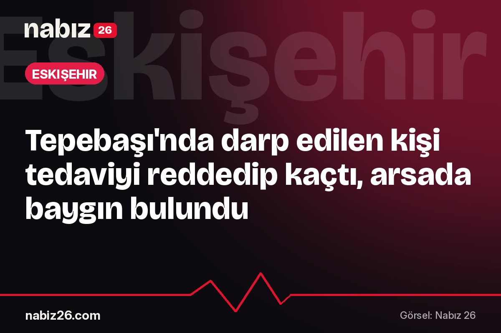

> Tunalı Mahallesi'nde çıkan kavgada darp edilen kişi, evinin yakınındaki arsada bulunarak hastaneye kaldırıldı.

Eskişehir'in Tepebaşı ilçesine bağlı Tunalı Mahallesi Turgut Reis Caddesi üzerinde henüz bilinmeyen bir nedenle iki grup arasında kavga çıktı. Kimliği belirlenemeyen kişilerce darp edilen bir kişiye çevredeki esnaf yardıma koştu.

Ağzı ve yüzü kanlar içinde kalan yaralı, sağlık ekiplerinin müdahalesini kabul etmedi. Ambulansı fark eden yaralı ile yanındaki kadın yakını olay yerinden koşarak uzaklaştı.

İlerleyen saatlerde yaralı, evinin yakınındaki boş bir arsada baygın halde bulundu. 112 Acil Sağlık ekiplerinin ilk müdahalesinin ardından Yunus Emre Devlet Hastanesi'ne kaldırılan yaralı tedavi altına alındı. Olayla ilgili inceleme başlatıldı.

---

## Odunpazarı'nda araçtakiler karşılıklı ateş etti, bir evin duvarına mermi isabet etti

**Asayiş · Odunpazarı** · 2026-10-23 07:35 UTC · Kaynak: [Google Haberler - Eskişehir](https://www.sondakika.com/guncel/haber-eskisehir-odunpazari-nda-aractakiler-karsilikli-at-20357873/)

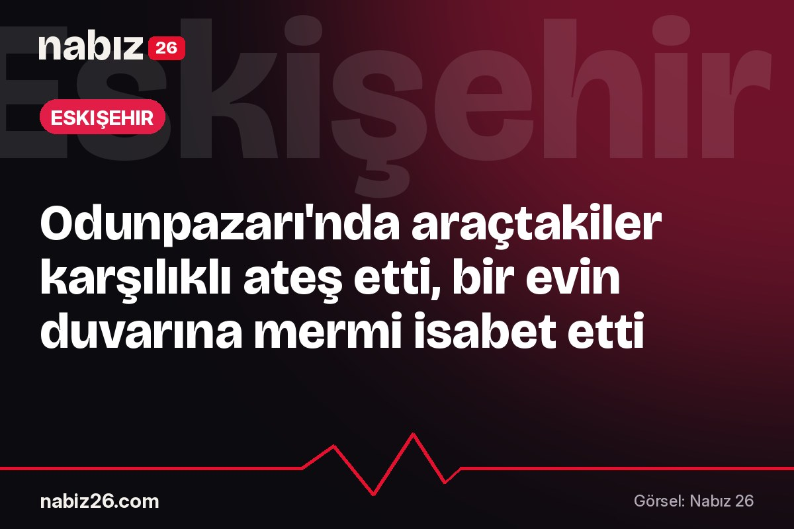

> Huzur Mahallesi'nde iki araçtaki kişiler silahla karşılıklı ateş etti; polis şüphelileri arıyor.

Eskişehir'in Odunpazarı ilçesinde Huzur Mahallesi'nde iki araçtaki kişiler henüz belirlenemeyen nedenle karşılıklı silahla ateş etti. Bir evin duvarına mermi isabet etti.

Olay, Dener Sokak ile Camlı Sokak'ın kesişiminde yaşandı. Silah seslerini duyan vatandaşların ihbarı üzerine bölgeye polis ekipleri sevk edildi.

Polisin incelemesinde, iki araçtaki kişilerin karşılıklı ateş ettiği ve ardından olay yerinden ayrıldığı belirlendi. Polis, şüpheli ya da şüphelileri yakalamak için çalışma başlattı.

---

## MSB: Askerlik yerleri 27 Ekim'de açıklanacak

**Türkiye · Türkiye** · 2026-10-23 07:35 UTC · Kaynak: [Google Haberler - Bakanlıklar](https://www.ilerigazetesi.com.tr/msb-askerlik-yerlerini-acikliyor)

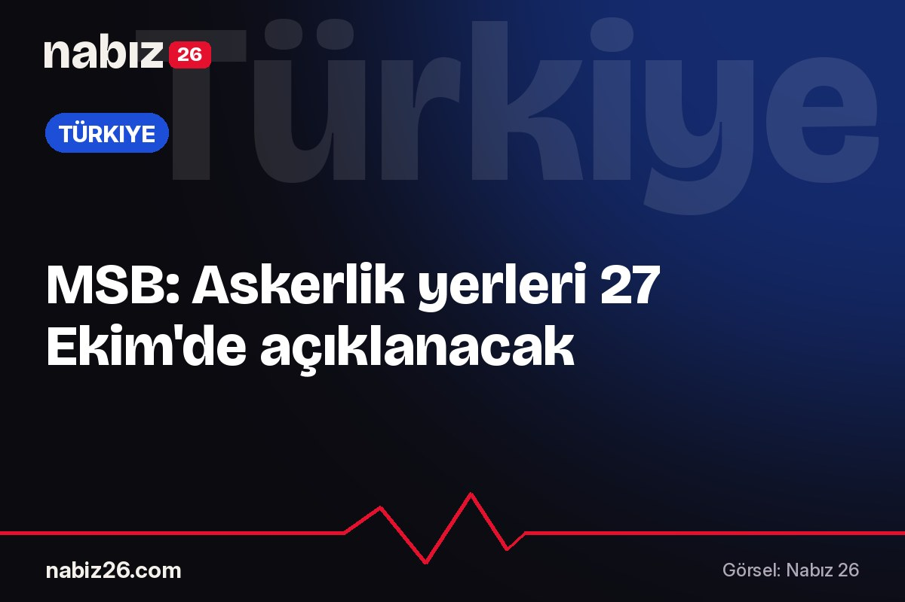

> Kasım, Aralık 2026 ve Ocak 2027 dönemi yükümlülerinin sınıflandırma sonuçları 27 Ekim Salı günü erişime açılacak.

Milli Savunma Bakanlığı (MSB), yedek subay ve yedek astsubay adayları ile erlerin askerlik yerlerinin 27 Ekim 2026 Salı günü açıklanacağını duyurdu. Açıklama, MSB Sözcüsü Tuğamiral Zeki Aktürk'ten geldi.

Kasım, Aralık 2026 ve Ocak 2027 dönemlerinde silahaltına alınacak yükümlüler, sonuçlara e-Devlet Kapısı, askerlik şubeleri ve MSB Mobil uygulaması üzerinden ulaşabilecek.

Muvazzaf subay adayı temini başvuruları ile Deniz Kuvvetleri Komutanlığı deniz sınıfı muvazzaf subay adayı temini başvuruları 2 Kasım 2026 tarihine kadar sürecek.

Açıklamada ayrıca Kara Kuvvetleri Komutanlığı'na, Bilgi Güvenliği Derneği'nin Ankara'daki konferansında "Siber Güvenlik Üstün Hizmet Ödülü" verildiği bildirildi.

---

## Kılıçdaroğlu: Yeni Parti'ye aktarıldığı öne sürülen 5,1 milyon lira için ihtar çekildi

**Siyaset · Türkiye** · 2026-10-23 07:35 UTC · Kaynak: [Google Haberler - CHP](https://www.takvim.com.tr/guncel/2026/10/23/kemal-kilicdaroglu-chpde-yeni-partiye-aktarilan-paranin-iadesini-istedi)

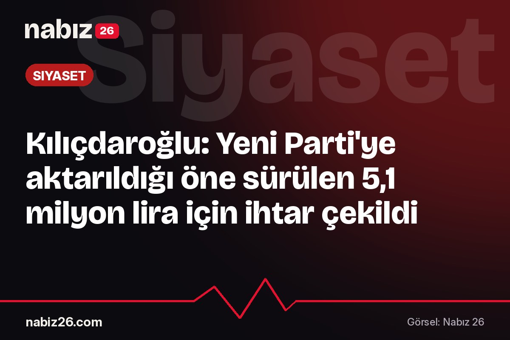

> Kılıçdaroğlu, paranın iade edilmemesi halinde suç duyurusunda bulunulacağını belirtti.

CHP Genel Başkanı Kemal Kılıçdaroğlu, CHP grup hesabından Yeni Parti'ye geçen milletvekillerine aktarıldığı öne sürülen 5 milyon 100 bin liranın iadesi için resmi ihtar çekildiğini açıkladı. Haberde, Kılıçdaroğlu'nun sözleri gazeteci Melik Yiğitel'in aktardığı bilgilere dayandırıldı.

İddiaya göre Yeni Parti'nin kuruluşundan bir gün önce, 23 Temmuz'da Özgür Özel tarafından imzalanan belge doğrultusunda grup hesabındaki para, Yeni Parti'ye geçecek milletvekillerinin hesaplarına ayrı ayrı 57 bin lira olarak yatırıldı.

Kılıçdaroğlu, işlemi ahlaki bulmadığını söyleyerek paranın iadesini istediklerini belirtti. İade edilmemesi halinde Sayıştay denetiminde sorun çıkabileceğini ve hazineden gelecek ödemenin kesilebileceğini ifade etti. Haberde, ihtarın sonuç vermemesi durumunda Özel ve ekibi hakkında suç duyurusunda bulunulacağının öğrenildiği de aktarıldı. Konuya ilişkin Özel ve ekibinin açıklaması kaynak metinde yer almıyor.

---

## Eskişehirspor'da Dereli, Kulet ve Damar'ın hafta sonu forma şansı düşük

**Spor · Merkez** · 2026-10-23 07:35 UTC · Kaynak: [Google Haberler - Eskişehirspor](https://www.2eylul.com.tr/forma-giyemeyecekler-3)

> Şapcı, sakatlığı süren iki oyuncunun oynama ihtimalinin yüksek olmadığını söyledi.

Eskişehirspor'da sakatlığı süren Ahmet Dereli ve İsmail Kulet'in sağlık durumu maç saatine kadar beklenecek. Şapcı, bu iki oyuncuyu pek oynatmayı düşünmediğini, günlük durumlarına göre 21 kişilik kadroda yer alabileceklerini söyledi.

Şapcı, gerekirse oyuncuların iğneyle oynayacak noktaya getirilebileceğini ancak oynama ihtimallerinin çok umut verici olmadığını belirtti.

Sakat listesine Mustafa Eren Damar da eklendi. Damar'ın sırtında ağrı bulunduğu ve tedavisine başlandığı aktarıldı. Şapcı, büyük ihtimalle Damar'ın da hafta sonu kadroda yer alamayacağını söyledi.

---

## Eskişehir'de hava parçalı ve az bulutlu, sıcaklık 22 dereceye çıkacak

**Hava Durumu · Merkez** · 2026-10-23 07:35 UTC · Kaynak: [Google Haberler - Eskişehir](https://www.sakaryagazetesi.com.tr/eskisehirde-hava-degisiyor-mu-meteoroloji-acikladi)

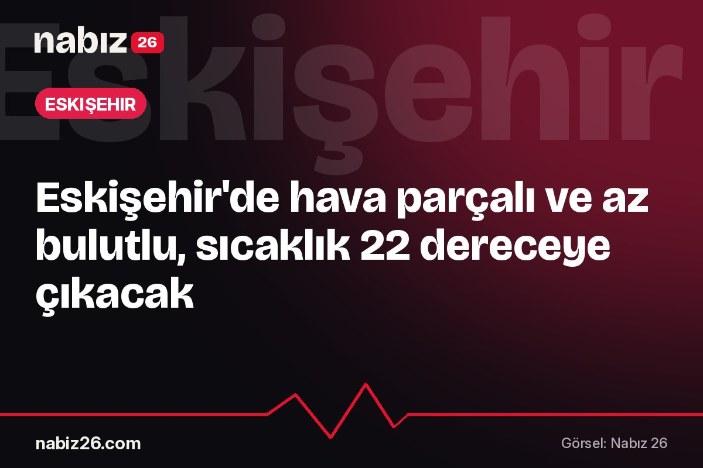

> Meteoroloji'ye göre kentte yağış beklenmiyor, önemli bir hava değişikliği öngörülmüyor.

Meteoroloji 3. Bölge Müdürlüğü'nün tahminlerine göre Eskişehir ve çevresinde parçalı ve az bulutlu hava etkili olacak. Sıcaklıklarda önemli bir değişiklik beklenmiyor.

Odunpazarı ilçesinde en yüksek sıcaklığın 22, Tepebaşı ilçesinde 21 derece olması tahmin ediliyor. Yağış beklenmiyor.

Rüzgârın başlangıçta güneyli yönlerden, ilerleyen saatlerde kuzey ve batı yönlerden hafif, zaman zaman orta kuvvette esmesi bekleniyor. Eskişehir için güncel bir meteorolojik uyarı bulunmuyor.

---

## CHP'li Sarıbal: 2027 bütçesinde tarımsal destek için ayrılan 235 milyar lira yetersiz

**Siyaset · Türkiye** · 2026-10-23 07:35 UTC · Kaynak: [Google Haberler - CHP](https://baskentpostasi.com/chp-genel-baskan-yardimcisi-orhan-saribal-235-milyar-lira-ciftcinin-mazotunun-bile-bedeli-degil)

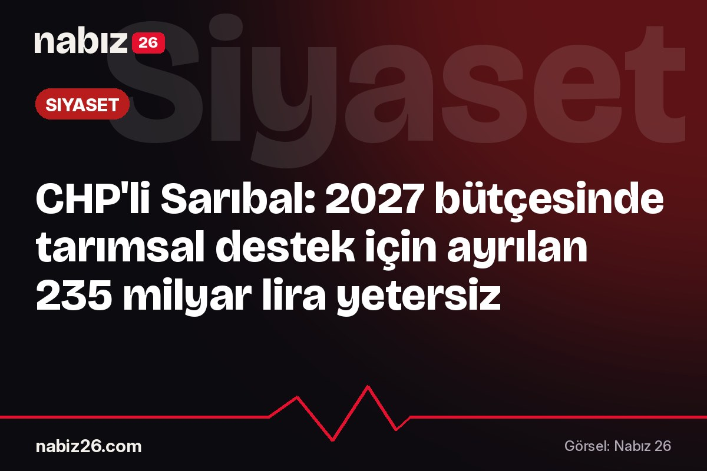

> Sarıbal, TBMM'de düzenlediği basın toplantısında tarımsal desteklerin yasadaki yüzde 1 ölçütünün çok altında kaldığını savundu.

CHP Genel Başkan Yardımcısı ve Bursa Milletvekili Orhan Sarıbal, TBMM'de düzenlediği basın toplantısında 2027 bütçe teklifini değerlendirdi. Sarıbal, tarımsal destekleme programlarına ayrılan 235 milyar liranın çiftçinin temel giderlerini karşılamadığını söyledi.

Sarıbal'a göre tarıma ayrıldığı açıklanan 1 trilyon 305 milyar liralık toplam kaynağın tamamı çiftçiye ödenecek destek değil. Sarıbal, bu tutarın tarımsal kredi destekleri için 325 milyar lira, tarım sektörü yatırımları için 268 milyar lira ve kamu iktisadi teşebbüsleri ile ihracat destekleri için 135 milyar lira gibi kalemleri de kapsadığını aktardı.

5488 sayılı Tarım Kanunu'nun 21. maddesini hatırlatan Sarıbal, destekleme kaynağının gayrisafi millî hasılanın yüzde 1'inden az olamayacağını belirtti. 2027 için öngörülen yaklaşık 111 trilyon liralık hasıla üzerinden bunun yaklaşık 1 trilyon 110 milyar lira olması gerektiğini savundu.

Sarıbal ayrıca üreticilerin banka borçlarının faizlerinin silinmesini ve anaparanın uzun vadeye yayılmasını istedi. Basın özgürlüğüne ilişkin değerlendirmelerde de bulunan Sarıbal, gazeteciler Murat Ağırel ve İsmail Arı'nın tutuklanmasına tepki gösterdi.

---

## Odunpazarı Belediyesi desteğiyle anneler Alaaddin Park Cafe'de buluştu

**Belediye · Odunpazarı** · 2026-10-23 06:36 UTC · Kaynak: [Google Haberler - Eskişehir](https://www.esgazete.com/kazim-kurtun-destegiyle-anneler-alaaddin-park-cafede-bulustu)

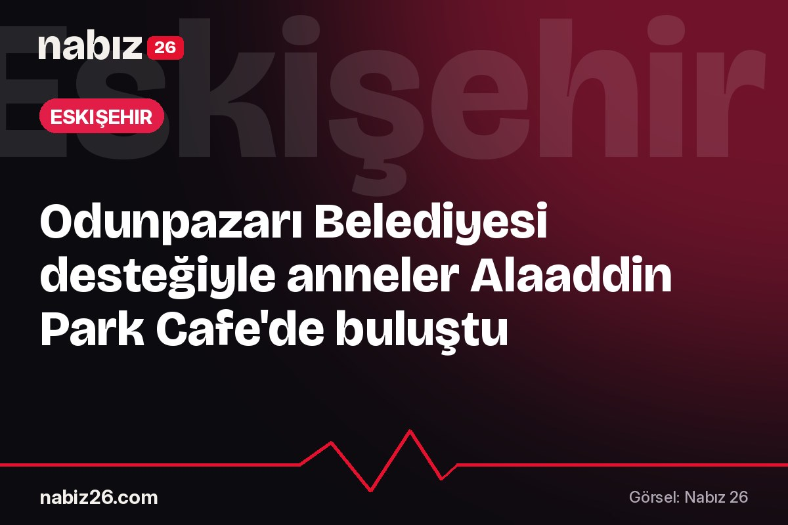

> Eskişehir Anneleri Buluşuyor Platformu'nun sonbahar etkinliğine yaklaşık 100 anne ve çocuk katıldı.

Odunpazarı Belediyesi'nin desteğiyle düzenlenen Eskişehir Anneleri Buluşuyor etkinliğinde, 0-6 yaş arasındaki çocuklar ve anneleri Alaaddin Park Cafe'de bir araya geldi. Esgazete'nin haberine göre etkinliğe yaklaşık 100 anne ve çocuk katıldı.

Çocuklar sonbahar temalı boyama etkinliğine katıldı, sonbahar yapraklarından taçlar hazırladı; müzik ve geleneksel sokak oyunlarıyla vakit geçirdi. Odunpazarı Belediyesi Kadın ve Aile Hizmetleri Müdürlüğü ile Eskişehir Anneleri Buluşuyor Platformu'nun iş birliğinde düzenlenen etkinlikle annelerin tanışması ve deneyimlerini paylaşması amaçlandı.

Belediye Başkanı Kazım Kurt, daha önce Kanlıkavak Parkı'ndaki buluşmada Alaaddin Park Cafe'nin anneler tarafından kullanılabileceğini söylemişti. Müdürlük de annelerle görüş alışverişinde bulunarak mekânda yapılabilecek düzenlemeleri değerlendirdi.

---

## Kurtuluş Kapalı Pazar Yeri'nin açılış tarihi için henüz resmî açıklama yok

**Belediye · Merkez** · 2026-10-23 06:36 UTC · Kaynak: [Google Haberler - Eskişehir](https://www.gzt26.com/eskisehir-kurtulus-kapali-pazar-yeri-ne-zaman-acilacak-iste-dusunulen-tarihler)

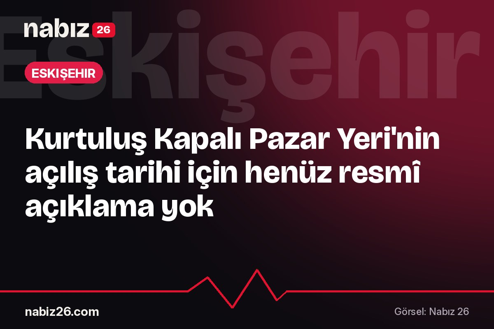

> Gazeteci Akif Yer, projede fiziki gerçekleşmenin yüzde 99'u geçtiğinin ifade edildiğini, resmî bitiş tarihinin Haziran 2027 olduğunu söyledi.

Eskişehir'de uzun süredir beklenen Kurtuluş Kapalı Pazar Yeri projesinde çalışmaların son aşamaya geldiği belirtiliyor. Kanal 26'daki "Muhabirin Gözünden" programında Esra Merve Özer'in sorularını yanıtlayan gazeteci Akif Yer, projenin son durumunu anlattı.

Akif Yer, fiziki gerçekleşme oranının yüzde 99'u geçtiğinin ifade edildiğini, iç düzenleme ve yerleşim çalışmalarının sürdüğünü söyledi. Projenin resmî bitiş tarihinin Haziran 2027 olduğunu belirten Yer, açılışın daha erken yapılabileceğine dair duyumlar aldığını ve 23 Nisan ile 19 Mayıs tarihlerinin gündeme gelebileceğini aktardı; bu tarihler için resmî bir açıklama bulunmadığını vurguladı.

Yer'in aktardığına göre pazarcı esnafı halen İmar Sokak çevresindeki geçici alanda satış yapıyor. Yeni binada balıkçılar, şarküteriler ve diğer esnaf için kapalı satış alanları oluşturulacak, zemin altında iki katlı otopark ve Pazarcılar Odası için bir ofis yer alacak.

---

## Eskişehir'de 23 Ekim'de 7 ilçede planlı elektrik kesintisi: Mahalle mahalle liste

**Gündem · Merkez** · 2026-10-23 06:36 UTC · Kaynak: [Google Haberler - Odunpazarı](https://www.eskisehirhaber26.com/eskisehirde-23-ekimde-elektrik-kesintisi-iste-mahalle-mahalle-liste)

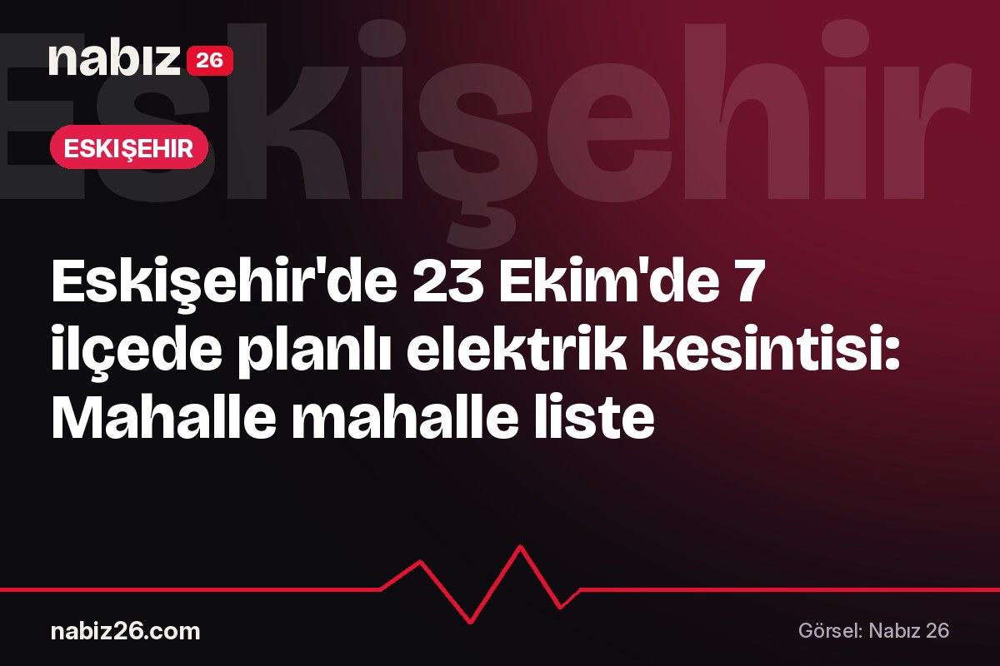

> OEDAŞ'ın açıkladığı programa göre Odunpazarı, Tepebaşı, Sarıcakaya, Sivrihisar, Beylikova ve Çifteler'de bazı mahallelerde saatlerce elektrik verilemeyecek.

Osmangazi Elektrik Dağıtım AŞ (OEDAŞ), 23 Ekim 2026 Cuma günü Eskişehir'in 6 ilçesinde bakım, yatırım ve ağaç budama çalışmaları nedeniyle planlı elektrik kesintisi yapılacağını duyurdu. Kesintiler sabah 09.00'da başlayacak, bazı bölgelerde 18.00'e kadar sürecek.

Odunpazarı'nda Orhangazi Mahallesi'nde 09.00-16.00, Karaçay ve Kireç mahallelerinde 10.00-16.00 arasında enerji verilemeyecek. Sarıcakaya'da Beyyayla, Güney ve Kapıkaya mahallelerinde 09.00-17.00 arasında kesinti olacak. Tepebaşı'nda Ertuğrulgazi Mahallesi'nin bazı sokaklarında (Huzur, Arzugül, Damar, İncesu, Ödül ve Porsuk Nehri sokakları) 13.00-16.00 arasında elektrik olmayacak.

Sivrihisar'da Demirciköy, İlören, Koltan, Mülkköy, Nasrettin Hoca, Oğlakçı ve Ortaklar mahallelerinde 10.00-15.30 arasında, Beylikova'da Ata (İstasyon), İkipınar ve Parsıbey mahallelerinde 10.00-16.00 arasında, Çifteler'de Doğanay Mahallesi'nde 11.45-18.00 arasında kesinti yapılacak.

Çalışmaların erken tamamlanması veya saha koşullarına göre saatler değişebilir. Güncel bilgiler OEDAŞ'ın duyurularından ve ALO 186 elektrik arıza hattından öğrenilebiliyor.

---

## Eskişehir Şeker Fabrikası'nın taşınması tartışması yeniden gündemde

**Gündem · Merkez** · 2026-10-23 06:36 UTC · Kaynak: [Google Haberler - Eskişehir](https://www.gzt26.com/eskisehir-seker-fabrikasi-tasinacak-mi-koku-sikintisi-yine-gundemde)

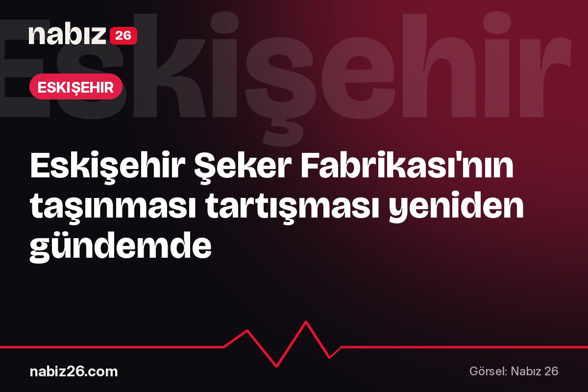

> Kanal 26'da konuşan gazeteci Akif Yer, fabrikanın kokusu, kapasitesi ve çiftçi nakliye giderleri üzerine yürüyen tartışmayı değerlendirdi.

Kanal 26'daki "Muhabirin Gözünden" programında Esra Merve Özer'in sorularını yanıtlayan gazeteci Akif Yer, Eskişehir Şeker Fabrikası'nın taşınmasına ilişkin tartışmaları değerlendirdi. Yer, yaklaşık 93 yıl önce kurulan fabrikanın başlangıçta şehir dışında kaldığını, kentin büyümesiyle yerleşim alanlarının arasında kaldığını anlattı.

Yer'e göre tartışma, AK Parti Eskişehir İl Başkanı Gürhan Albayrak'ın Eskişehir Genç Rençberler Derneği'ni ziyaretiyle gündeme geldi. Albayrak'ın gerekli görülürse taşınmanın mümkün olabileceğini söylediği iddia ediliyor. İYİ Parti Odunpazarı İlçe Başkanı Gürol Yer ise fabrikanın yerinde kalmasını savunuyor ve arazinin rant amacıyla kullanılmaması gerektiğini söylüyor. Genç Rençberler Derneği Başkanı Burak Kuşan ise Mahmudiye'yi pancar üreticileri için ulaşılabilir bir nokta olarak öneriyor.

Akif Yer, taşınmanın nakliye giderlerini azaltabileceğini, ancak fabrikanın üretim ve işleme kapasitesinin artırılmasının şart olduğunu söyledi. Koku sorununun özellikle Tepebaşı'nda hissedildiğini belirten Yer, taşınma kararı alınırsa mevcut arazinin kamu mülkiyetinde kalmasını ve satışa çıkarılmamasını savundu.

---

## Erdoğan AK Parti grup toplantısında siyaset dilini ve sel çalışmalarını anlattı

**Siyaset · Türkiye** · 2026-10-23 06:36 UTC · Kaynak: [Google Haberler - Cumhurbaşkanı](https://www.tbmm.gov.tr/Haber/Detay?Id=fe054b99-be80-4d03-a5a7-01a15e25ca54)

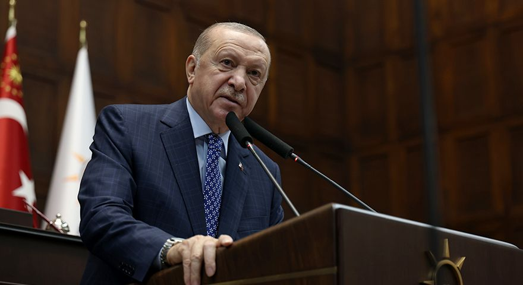

> Cumhurbaşkanı Erdoğan, TBMM'deki AK Parti Grup Toplantısı'nda muhalefete yönelik eleştirilerde bulundu ve afet çalışmalarına ilişkin bilgi verdi.

Cumhurbaşkanı Recep Tayyip Erdoğan, AK Parti TBMM Grup Toplantısı'nda yaptığı konuşmada geçen hafta İstanbul'dan Ankara'ya gelirken geçirdiği trafik kazasında hayatını kaybeden Üsküdar Belediye Başkan Vekili Dündar Ziya Gültekin için başsağlığı diledi. Erdoğan, Üsküdar Belediye Başkan Vekili seçilen Muhammed Emin Sarıoğlu'nu da tebrik etti.

Erdoğan, siyasette artan kutuplaşmanın tehlikelerine dikkat çektiğini ve tüm siyasi partileri müştereklerini çoğaltmaya davet ettiğini söyledi. Son üç haftada muhalefetin bazı isimlerinden beklediği tavrı görmediğini belirten Erdoğan, muhalefetin bir kısmının sorumsuz bir tavır sergilediğini ileri sürdü. Fon tartışmalarına da değinen Erdoğan, belgesiz itham ve iftira olarak nitelendirdiği iddialara karşı hukuk ve demokrasi zemininde mücadele edeceklerini söyledi.

Erdoğan ayrıca geçen hafta İstanbul ve çevre illerde yaşanan aşırı yağış, sel ve su baskınlarına ilişkin açıklama yaptı. Devlet olarak vakit kaybetmeden harekete geçtiklerini belirten Erdoğan, 14 Ekim'de afet gruplarının İstanbul'daki il ve ilçe AFAD yönetim merkezlerinde 7 gün 24 saat çalışmaya başladığını, arama kurtarma, müdahale ve destek çalışmalarında 47 bin 217 personelin, 5 bin 280 araç ve 14 botla görev aldığını açıkladı.

---

## Çukurova Belediyesi soruşturmasında 34 kişi tutuklandı

**Asayiş · Türkiye** · 2026-10-23 06:36 UTC · Kaynak: [Google Haberler - CHP](https://www.sonmuhur.com/uc-ay-once-chp-genel-sekreter-yardimcisi-olarak-atanmisti-cukurova-belediyesine-yonelik-sorusturmada-tutuklandi)

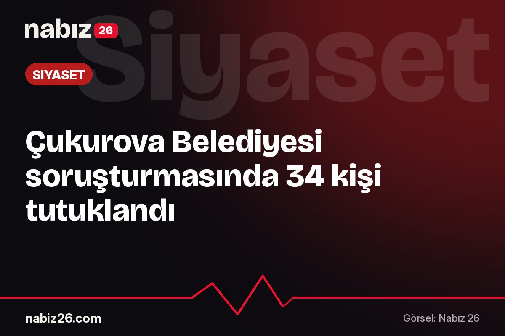

> Adana Cumhuriyet Başsavcılığı'nın soruşturmasında 19 Ekim'de 51 kişi hakkında gözaltı kararı verilmişti.

Adana Cumhuriyet Başsavcılığı, Çukurova Belediyesi'ne yönelik "suç işlemek amacıyla örgüt kurma, yönetme ve örgüte üye olma", "rüşvet", "nitelikli dolandırıcılık" ve "ihaleye fesat karıştırma" suçlamalarıyla soruşturma yürütüyor. Son Mühür'ün aktardığına göre soruşturmada 19 Ekim'de 51 kişi hakkında gözaltı kararı çıkarılmıştı.

Gözaltına alınanlar arasında Çukurova Belediyesi'nin 2014-2024 arasındaki eski başkanı S. Ç. ile mevcut başkan E. K. de bulunuyordu. Şüphelilerin sorgusunun tamamlanmasının ardından, aralarında üç belediye başkan yardımcısının da olduğu 34 kişi hakkında tutuklama kararı verildi. Haberde, tutuklananlardan eski başkanın bu yıl haziranda CHP Genel Sekreter Yardımcısı olarak atandığı ve mevcut başkanın CHP'den aday gösterildikten sonra Yeni Parti'ye geçtiği belirtildi. Soruşturma sürüyor.

---

## AK Parti Eskişehir İl Başkanı Albayrak: Eskişehir Kalkınma Platformu dernekleşecek

**Gündem · Merkez** · 2026-10-23 06:36 UTC · Kaynak: [Google Haberler - Eskişehir](https://www.sakaryagazetesi.com.tr/ak-parti-eskisehir-il-baskani-gurhan-albayrak-eskisehiri-dunyaya-acmak-istiyoruz)

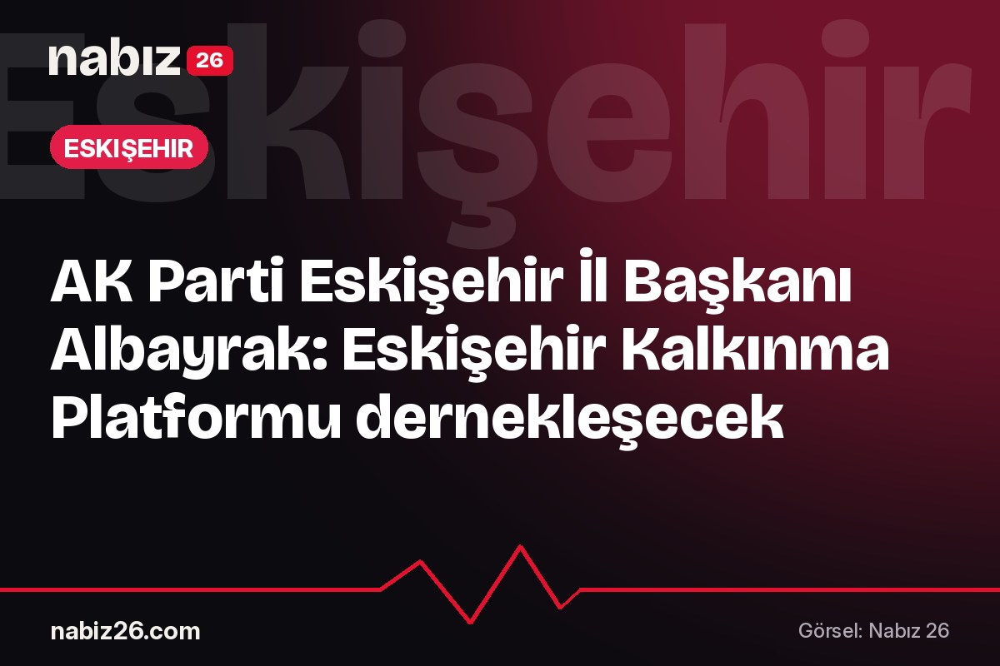

> Albayrak, Brüksel temaslarının ardından THY'yi Eskişehir'e getirmek ve kenti uluslararası alanda tanıtmak istediklerini söyledi.

AK Parti Eskişehir İl Başkanı Gürhan Albayrak, Brüksel temaslarının ardından Sakarya Gazetesi'ne açıklamalarda bulundu. Albayrak, Eskişehir Kalkınma Platformu'nun dernekleşeceğini, platformun internet sitesi ve sosyal medya hesaplarının oluşturulacağını ve faaliyetlerin büyük ölçüde sponsorluklarla yürütülmesinin planlandığını söyledi.

Albayrak'a göre platform DEİK Avrupa İş Dünyası Zirvesi'ne katıldı. Koç Holding CEO'su, Türk Hava Yolları yetkilileri, TÜRSAB Başkanı ve Türkiye'nin Brüksel büyükelçisiyle görüşüldü. THY yetkilileriyle Eskişehir Teknik Üniversitesi ile birlikte pilotaj eğitimleri ve motor bakımı konularının konuşulduğunu anlatan Albayrak, THY'nin Eskişehir'e gelmesini istediklerini belirtti.

Albayrak, kasım sonu veya aralık başında vali, belediye başkanları ve oda başkanlarıyla yeniden Brüksel'e gitmeyi, nisan veya mayısta Brüksel'de Eskişehir Tanıtım Günleri düzenlemeyi ve haziran ya da temmuzda Eskişehir'de Gurbetçiler Festivali yapmayı planladıklarını söyledi. Çevre yolu ve Yenişehir-Gemlik bağlantısının öncelikli konular olduğunu belirten Albayrak, Ulaştırma Bakanlığı'ndan aldığı bilgiye göre bağlantı yolunun ihalesinin 2027'nin ilk çeyreğinde yapılmasının öngörüldüğünü aktardı.

---

## AK Parti'li İnan: Erdoğan kasım ayında İzmir'e gelecek

**Siyaset · Türkiye** · 2026-10-23 05:34 UTC · Kaynak: [Google Haberler - Cumhurbaşkanı](https://www.gundemebakis.com/cumhurbaskani-erdogan-izmire-geliyor-tarihi-mujdeleri-aciklayacak)

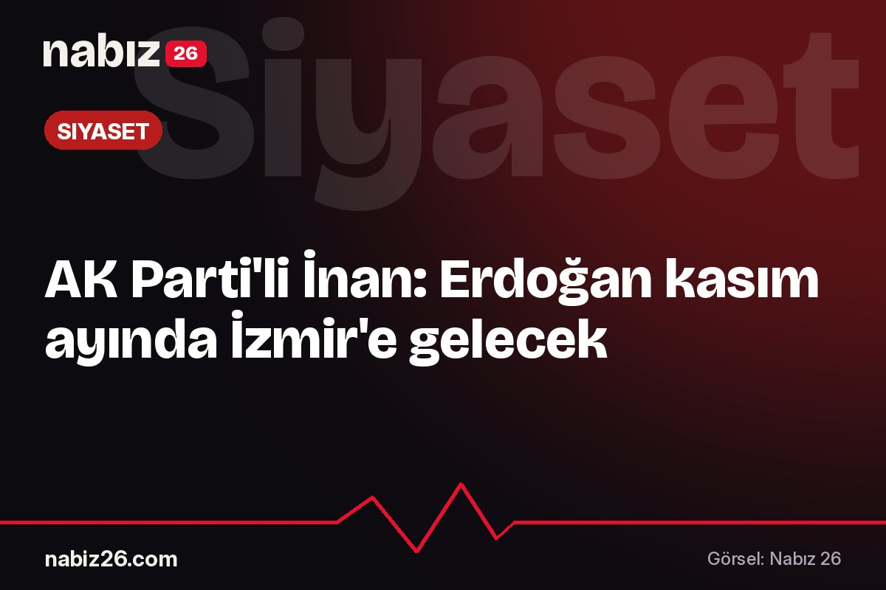

> AK Parti Genel Sekreteri Eyyüp Kadir İnan, Cumhurbaşkanı Erdoğan'ın kasımda İzmir'i ziyaret edeceğini ve kente ilişkin açıklamalar yapacağını söyledi.

AK Parti Genel Sekreteri ve İzmir Milletvekili Eyyüp Kadir İnan, Çiğli Belediye Başkanı Onur Emrah Yıldız'ı ziyareti sırasında yaptığı açıklamada Cumhurbaşkanı Recep Tayyip Erdoğan'ın kasım ayı içinde İzmir'e geleceğini duyurdu.

Gündeme Bakış'ın aktardığına göre İnan, Erdoğan'ın ziyaretinde İzmir'e ilişkin önemli açıklamalar yapacağını belirtti. İnan, "İzmir'in yıllardır beklediği, bu şehrin kaderine etki edecek çok büyük, tarihi müjdeleri bizzat Sayın Cumhurbaşkanımız buradan ilan edecekler" dedi. Müjdelerin içeriği hakkında bilgi verilmedi.

---

## Tugay esnaf odalarıyla buluştu: İzmir'de su tarifesinde indirim yapılacak

**Siyaset · Türkiye** · 2026-10-23 04:33 UTC · Kaynak: [Google Haberler - Cumhurbaşkanı](https://www.milliyet.com.tr/gundem/cemil-tugay-ak-partiye-gecis-surecini-anlatti-cumhurbaskani-erdogan-son-25-yila-damgasini-vurdu-7685571)

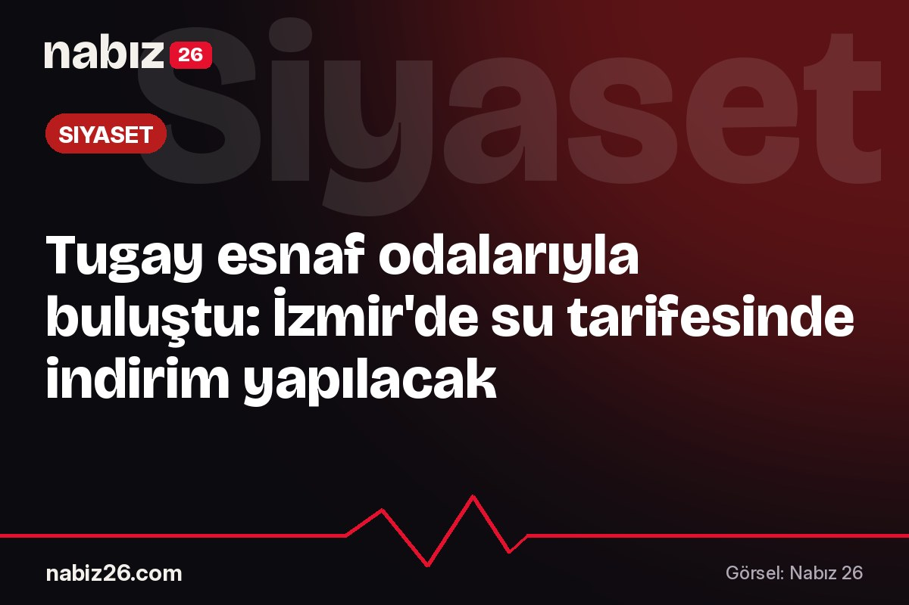

> Cemil Tugay, İzmir Esnaf ve Sanatkarlar Odaları Birliği'ni ziyaret etti. Su fiyatlarında indirim için Meclis'e teklif götüreceğini söyledi.

İzmir Büyükşehir Belediye Başkanı Cemil Tugay, İzmir Esnaf ve Sanatkarlar Odaları Birliği'ni ziyaret ederek esnaf odası başkanlarıyla bir araya geldi. Milliyet'in aktardığına göre Tugay, esnafın iş birliği süreçlerinde öncelik verilmesi gereken kesimlerin başında geldiğini söyledi.

Tugay, su fiyatlarında indirim için çalışma yaptıklarını belirterek, su faturalarında belirgin fark yaratacak bir tarife indirimini önümüzdeki Meclis'ten geçireceğini açıkladı. İzmir'in Türkiye'de toplu taşımanın en ucuz olduğu kent olduğunu söyleyen Tugay, önümüzdeki yıl toplu taşımaya zam yapmadan indirimleri çeşitlendirebileceklerini ifade etti.

Tugay ayrıca bakanlarla görüştüğünü, kentin uzun yıllardır çözüm bekleyen sorunlarına hızlı ve kalıcı çözümler üretilmesi için çalıştıklarını anlattı. Cumhurbaşkanı Erdoğan hakkında da olumlu değerlendirmelerde bulunan Tugay, herkesin siyasi tercihinde özgür olduğunu söyledi.

---

## Eskişehirspor taraftarına kombine kampanyası: 100 kişiye bilet hediye edilecek

**Spor · Merkez** · 2026-10-23 04:33 UTC · Kaynak: [Google Haberler - Eskişehirspor](https://www.milliirade.com/nebi-hatipoglundan-taraftara-mujde-eskisehirspor-sevgini-anlat-kombineyi-kap)

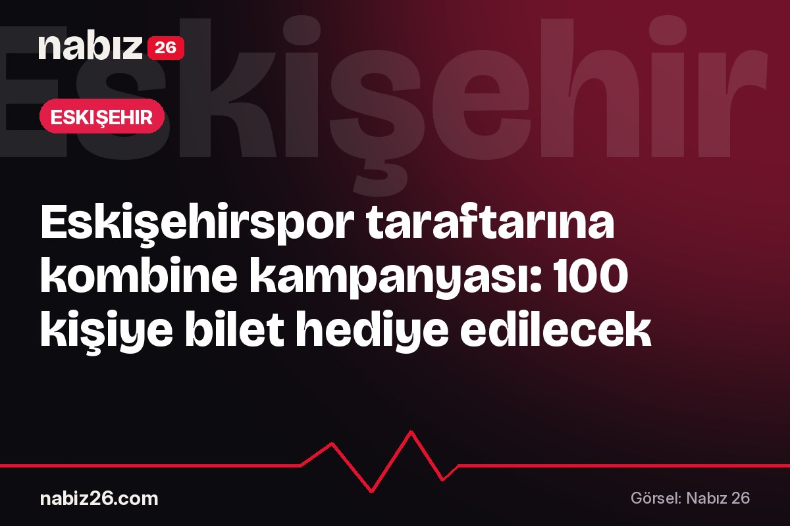

> AK Parti Eskişehir Milletvekili Nebi Hatipoğlu, #BirKoltukDaOna etiketiyle başlattığı kampanyada en etkili videoları çeken 100 taraftara kombine bilet verecek.

AK Parti Eskişehir Milletvekili Nebi Hatipoğlu, sosyal medya hesabından Eskişehirspor taraftarlarına yönelik bir kampanya başlattı. Milli İrade Gazetesi'nin aktardığına göre #BirKoltukDaOna etiketiyle yürütülen kampanyada Eskişehirspor sevgisini en iyi anlatan 100 taraftara kombine bilet hediye edilecek.

Katılmak isteyen taraftarların Eskişehirspor formasını giyip takıma olan sevgilerini anlatan kısa bir video çekmesi, videoyu X, Instagram veya Facebook hesabında #BirKoltukDaOna etiketiyle paylaşması ve Hatipoğlu'nun hesabını etiketlemesi gerekiyor. Katılımda hesapların taraftarın gerçek kimliğiyle örtüşmesi şartı aranıyor.

Kampanyaya katılım için son tarih 23 Ekim Cuma. Kombine biletlerin 24 Ekim Cumartesi günü teslim edilmesi planlanıyor.

---

## Cumhurbaşkanı Erdoğan, Türk Kızılay Genel Başkanı Fatma Meriç Yılmaz'ı kabul etti

**Siyaset · Türkiye** · 2026-10-23 04:33 UTC · Kaynak: [Google Haberler - Cumhurbaşkanı](https://www.adanapost.com/gundem/cumhurbaskani-erdogan-turk-kizilay-genel-baskani-prof-dr-fatma-meric-yilmazi-224698h)

> Kızılay Haftası öncesindeki kabulde Kızılay'ın insani yardım ve afete hazırlık çalışmaları Erdoğan'a anlatıldı.

Türk Kızılay'ın Onursal Başkanı Cumhurbaşkanı Recep Tayyip Erdoğan, Kızılay Genel Başkanı Prof. Dr. Fatma Meriç Yılmaz'ı Cumhurbaşkanlığı Külliyesi'nde kabul etti.

Türk Kızılay'ın sosyal medya hesabından yaptığı açıklamaya göre Kızılay Haftası öncesinde gerçekleşen kabulde, kurumun yurt içinde ve yurt dışında yürüttüğü insani yardım faaliyetleri, afetlere hazırlık çalışmaları, sosyal destek hizmetleri ve geleceğe yönelik hedefleri Erdoğan'a anlatıldı. Kızılay, Erdoğan'ın Kızılay Haftası vesilesiyle çalışanlara ve gönüllülere selam ve iyi dileklerini ilettiğini bildirdi.

---

## CHP'li Tarhan: Avrupa'nın "Made in Europe" yaklaşımına Türkiye izlemekle yetinemez

**Ekonomi · Türkiye** · 2026-10-23 04:33 UTC · Kaynak: [Google Haberler - CHP](https://gazetekalem.com.tr/chpli-tarhandan-made-in-europe-uyarisi-turkiye-izlemekle-yetinemez/)

> CHP Genel Başkan Yardımcısı Tahsin Tarhan, otomotiv ihracatının yaklaşık yüzde 72,5'inin AB'ye yapıldığını hatırlatarak hükümete yerli üretim çağrısı yaptı.

CHP Genel Başkan Yardımcısı Tahsin Tarhan, Almanya ve Fransa'nın otomotiv sektörünü Çin rekabetine karşı korumak için başlattığı "Made in Europe" yaklaşımına ilişkin yazılı açıklama yaptı. Tarhan, Türkiye'nin buna karşı stratejik bir politika geliştirmemesinin kabul edilemez olduğunu söyledi.

Tarhan, Türkiye'nin otomotiv ihracatının yaklaşık yüzde 72,5'inin AB ülkelerine yapıldığını hatırlatarak, Avrupa'nın kamu alımlarında ve desteklerde Avrupa'da üretilen araç ve parçalara avantaj tanıyan yeni bir sanayi politikası oluşturduğunu belirtti. Türkiye'nin Avrupa dışındaki bir üretici konumuna itilebileceği uyarısında bulundu.

Hükümete çağrıda bulunan Tarhan, Türkiye'nin Brüksel nezdinde kendi üreticisinin Avrupa teşviklerinden ve kamu alımlarından dışlanmaması için müzakere yürütmesi gerektiğini ifade etti. Kamu kurumlarının araç alımlarında yerli üretim ve yüksek yerli katma değer önceliği getirilmesini önerdi. Tarhan, elektrikli araç, batarya, yazılım ve elektronik alanlarında yatırım yapılması gerektiğini de söyledi.

---

## CHP MYK, iki İBB meclis üyesi ile Tarsus Belediye Başkanı'nı disipline sevk etti

**Siyaset · Türkiye** · 2026-10-23 04:33 UTC · Kaynak: [Google Haberler - CHP](https://www.sondakika.com/amp/haber-chp-kurmaylari-iki-ibb-meclis-uyesinin-disipline-20354124/)

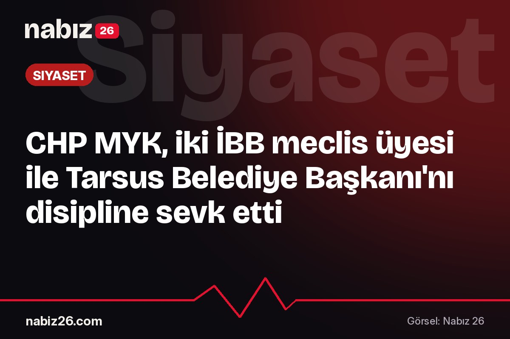

> CHP Sözcüsü Müslim Sarı, İBB Meclis Üyesi Ülkü İnanlı, Grup Sözcüsü Melendiz Dalyan İzgi ve Ali Boltaç'ın kesin ihraç talebiyle disipline sevk edildiğini açıkladı.

CHP Merkez Yönetim Kurulu (MYK), Genel Başkan Kemal Kılıçdaroğlu başkanlığında yaklaşık iki saat süren toplantı yaptı. Toplantının ardından CHP Sözcüsü Müslim Sarı, İBB Meclis Üyesi Ülkü İnanlı, İBB Grup Sözcüsü Melendiz Dalyan İzgi ve Tarsus Belediye Başkanı Ali Boltaç'ın kesin ihraç talebiyle disipline sevk edildiğini açıkladı.

ANKA'nın haberine göre CHP'li kurmaylar, Türkiye Belediyeler Birliği'ndeki ortak tutumun İstanbul Büyükşehir Belediyesi'nde de sürmesinden yana olduklarını, ancak partinin kurumsal kimliğini zedelemeyeceklerini söyledi. Kurmaylar, İBB'deki meclis üyesi dağılımına dikkat çekerek olası bir başkan seçiminde tek bir oyun bile önemli olabileceğini belirtti.

Toplantının ardından Millî Eğitim Bakanı Yusuf Tekin, CHP Genel Merkezi'ni ziyaret ederek Kılıçdaroğlu ile yaklaşık 10 dakika görüştü. Tekin'in Kılıçdaroğlu'nu kızının nikâhına davet ettiği aktarıldı.

---

## Sağlık Bakanlığı'nın 38 bin personel alımı için başvuru tarihi henüz açıklanmadı

**Sağlık · Türkiye** · 2026-10-23 03:32 UTC · Kaynak: [Google Haberler - Bakanlıklar](https://www.afyonanahaber.com.tr/saglik/saglik-bakanligi-38-bin-personel-alimi-ne-zaman-basvuru-tarihi-aciklandi-mi/402546)

> Cumhurbaşkanı Erdoğan 17 Ekim'de yıl bitmeden 38 bin hekim dışı personel alımı için ilana çıkılacağını duyurmuştu.

Cumhurbaşkanı Recep Tayyip Erdoğan, 17 Ekim 2026'da yaptığı açıklamada, yıl bitmeden 38 bin hekim dışı personel alımı için ilana çıkılacağını bildirmişti. Afyon Ana Haber'in aktardığına göre 22 Ekim itibarıyla başvuruların başlayacağı tarih henüz açıklanmadı.

Hangi meslek gruplarına kaç kişilik kontenjan ayrılacağı, başvuru şartları, eğitim düzeyleri ve KPSS koşulu gibi ayrıntılar da resmî ilanla belli olacak. Başvuruların hangi sistem üzerinden alınacağına ilişkin kesin bir açıklama da yapılmadı. Adayların Sağlık Bakanlığı ve ÖSYM tarafından yapılacak resmî duyuruları takip etmesi gerekiyor.

---

## Eskişehir merkezli tefecilik operasyonu: 5 şüpheli yakalandı, 2'si tutuklandı

**Asayiş · Merkez** · 2026-10-23 03:32 UTC · Kaynak: [Google Haberler - Eskişehir](https://www.malatyaguncel.com/eskisehir-merkezli-3-ilde-60-milyon-liralik-tefeci-3118283h.htm)

> Eskişehir, İstanbul ve Bursa'da eş zamanlı yapılan operasyonda yüksek faizle borç verdiği belirlenen 5 şüpheli yakalandı.

Eskişehir Cumhuriyet Başsavcılığı koordinesinde İl Emniyet Müdürlüğü Kaçakçılık ve Organize Suçlarla Mücadele Şube Müdürlüğü ekiplerince yürütülen çalışmada, yüksek faizle borç vererek vatandaşları mağdur ettikleri belirlenen şüphelilere yönelik operasyon düzenlendi. İLKHA'nın aktardığına göre operasyon Eskişehir merkezli olarak İstanbul ve Bursa'da eş zamanlı yapıldı ve 5 şüpheli yakalandı.

Şüphelilerin vadeli araç satışı adı altında, senet karşılığında, havale/EFT yoluyla veya elden yüksek faizle para verdikleri, borçlarını ödeyemeyen vatandaşları baskı ve tehditle mağdur ettikleri belirlendi. Şüphelilerin bu yöntemle esnaf ve vatandaşlardan icra yoluyla yaklaşık 60 milyon lira alacaklı oldukları tespit edildi.

Emniyetteki işlemlerinin ardından 22 Ekim'de adli makamlara sevk edilen şüphelilerden 2'si tutuklandı, 2'si adli kontrol şartıyla serbest bırakıldı.

---

## Senetli alışverişte yeni taksit sınırları: Televizyonda 4, mobilyada 9 aya kadar

**Ekonomi · Türkiye** · 2026-10-23 02:33 UTC · Kaynak: [Google Haberler - Bakanlıklar](https://www.bursadabugun.com/haber/taksitle-alisveris-yapacaklar-dikkat-bakanlik-urun-urun-yeni-vade-sinirlarini-acikladi-1958361.html)

> Bursada Bugün'ün aktardığına göre Ticaret Bakanlığı'nın yetkilendirildiği düzenlemeyle senetli satışlarda ürün gruplarına göre azami vade sınırları belirlendi.

15 Ekim 2026 tarihli Resmî Gazete'de yayımlanan yönetmelik değişikliğiyle Ticaret Bakanlığı, perakende işletmelerin tüketicilere yönelik taksitli satışlarında vade sürelerini belirleme ve gerektiğinde ek kısıtlama getirme yetkisini aldı. Bursada Bugün'ün haberine göre düzenleme konut satışları dışındaki mal ve hizmetleri kapsıyor.

Haberde aktarılan azami taksit süreleri şöyle: fiyatı 5 bin TL'nin altındaki televizyonlarda 9 ay, 5 bin TL'nin üzerindekilerde 4 ay; tablet ve bilgisayarda 6 ay; beyaz eşya ve elektrikli küçük ev aletlerinde 9 ay; mobilyada 9 ay; seyahat ve konaklama harcamalarında ise 18 ay. Bu süreler, senet gibi yöntemlerle yapılan taksitli satışlardaki üst sınırları gösteriyor.

Ticaret Bakanlığı daha önce yaptığı açıklamada cep telefonlarında sıfır ve yenilenmiş cihazlar için taksit süreleri ile tutar sınırlarının güncellendiğini duyurmuş, rakamsal ayrıntı vermemişti.

---

## Odunpazarı'nda 3 yaşındaki E. M. A.'nın ölümüne ilişkin sürücü hakkında iddianame

**Asayiş · Odunpazarı** · 2026-10-23 02:33 UTC · Kaynak: [Google Haberler - Eskişehir](https://haberton.com/eskisehirde-3-yasindaki-elif-mavinin-olumune-neden-olmustu-surucu-icin-15-yila-kadar-hapis-istemi/)

> Savcılık, 3 Eylül'deki trafik kazasında 3 yaşındaki bir çocuğun ölümüne neden olan tutuklu sürücü için 2 yıldan 15 yıla kadar hapis istedi.

Eskişehir Cumhuriyet Başsavcılığı, 3 Eylül'de Odunpazarı ilçesi Vişnelik Mahallesi'nde meydana gelen trafik kazasına ilişkin iddianame hazırladı. Kazada otomobilin çarptığı 3 yaşındaki E. M. A. hayatını kaybetmiş, annesi hafif yaralanmıştı. Haberton'un aktardığına göre tutuklu sürücü F. A. B. (40) hakkında "taksirle ölüme ve yaralanmaya neden olma" suçundan 2 yıldan 15 yıla kadar hapis cezası isteniyor. Dava Eskişehir 1. Ağır Ceza Mahkemesi'nde açıldı.

İddianameye göre trafik kazası tespit tutanağında sürücünün kusurlu olduğu belirtilmiş, bir bilirkişi raporunun ise bunun aksini ortaya koyduğu ifade edilmişti. Bunun üzerine Adli Tıp Kurumu Ankara Trafik İhtisas Dairesi'nden rapor alındı. Gelen raporda sürücünün dikkatsizliği, tedbirsizliği ve kurallara aykırı hareketi nedeniyle asli kusurlu olduğu, ölen çocuk ile annesinin kusurunun bulunmadığı kaydedildi.

Sürücü, kazanın ardından önce "konutu terk etmeme" şeklinde adli kontrol kararıyla serbest bırakılmıştı. Savcılığın itirazı üzerine yeniden gözaltına alınan sürücü, 8 Eylül'de Sulh Ceza Hakimliği tarafından tutuklandı.

---

## MEB ortak sınav takvimini açıkladı; Bakan Tekin 10 Kasım eleştirilerine yanıt verdi

**Eğitim · Türkiye** · 2026-10-23 02:33 UTC · Kaynak: [Google Haberler - Bakanlıklar](https://www.aksutvhaber.net/milli-egitim-bakanligi-2026-2027-ortak-sinav-takvimini-acikladi-iste-gun-gun-ders-listesi)

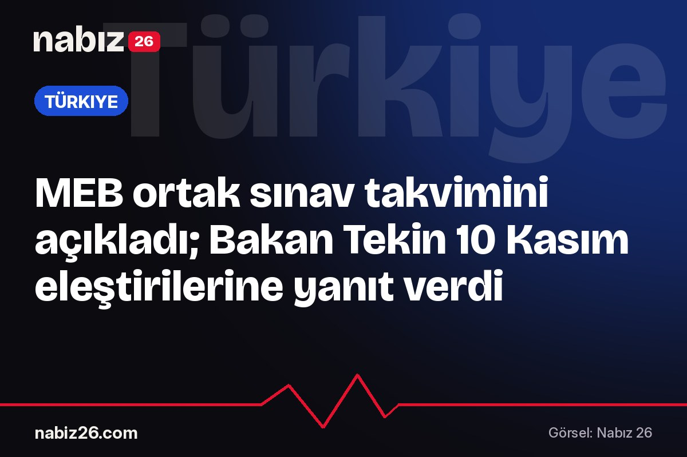

> Ortak yazılı sınavlar 3 Kasım'da başlayacak. Bakan Tekin, 10 Kasım'daki sınavın 09.30'dan sonra yapılacağını söyledi.

Millî Eğitim Bakanlığı (MEB), Ortak Yazılı Sınav Sistemi'nin 2026-2027 eğitim-öğretim yılı birinci dönem takvimini açıkladı. Ortaokul 5, 6 ve 7. sınıflar ile liselerin 9, 10 ve 11. sınıflarında 40'ar dakikalık ortak sınavlar 3 Kasım'da başlayacak.

Ortaokul takvimine göre 3 Kasım'da Fen Bilimleri, 5 Kasım'da Matematik, 6 Kasım'da Sosyal Bilgiler, 10 Kasım'da (09.30'dan sonra) Türkçe, 11 Kasım'da yalnızca 6. sınıflar için Matematik, 12 Kasım'da İngilizce ve 13 Kasım'da Din Kültürü ve Ahlak Bilgisi sınavı yapılacak. Liselerde Biyoloji sınavı 3 Kasım'da uygulanacak.

Takvimdeki 10 Kasım tarihi eleştirilince açıklama yapan Bakan Yusuf Tekin, sınavların 81 il valiliğine gönderilen genelge uyarınca 4. ders saatinde, yani 09.30'dan sonra yapılacağını söyledi. Tekin, 10 Kasım törenlerinin 08.45'te başladığını, sınavı bu nedenle törenden sonraya koyduklarını anlattı. Okul yönetimleri gerekirse bu sınavı farklı bir ders saatine kaydırabilecek. Tekin ayrıca soruların yapay zekâya hazırlatıldığı yönündeki iddiaları yalanladı ve soruları binden fazla uzman öğretmenin hazırladığını söyledi. Öğretmenlerin sorulara erişim süresi 1 günden 4 güne çıkarıldı, EBA'daki modül 26 Ekim Pazartesi günü açılacak.

---

## Şehit ve gazi çocuklarına 609 milyon liralık eğitim yardımı 23 Ekim'de ödenecek

**Türkiye · Türkiye** · 2026-10-23 01:32 UTC · Kaynak: [Google Haberler - Bakanlıklar](https://www.yenisafak.com/ekonomi/bakan-isikhan-odeme-gununu-acikladi-ogrencilere-609-milyon-liralik-egitim-destegi-4866531)

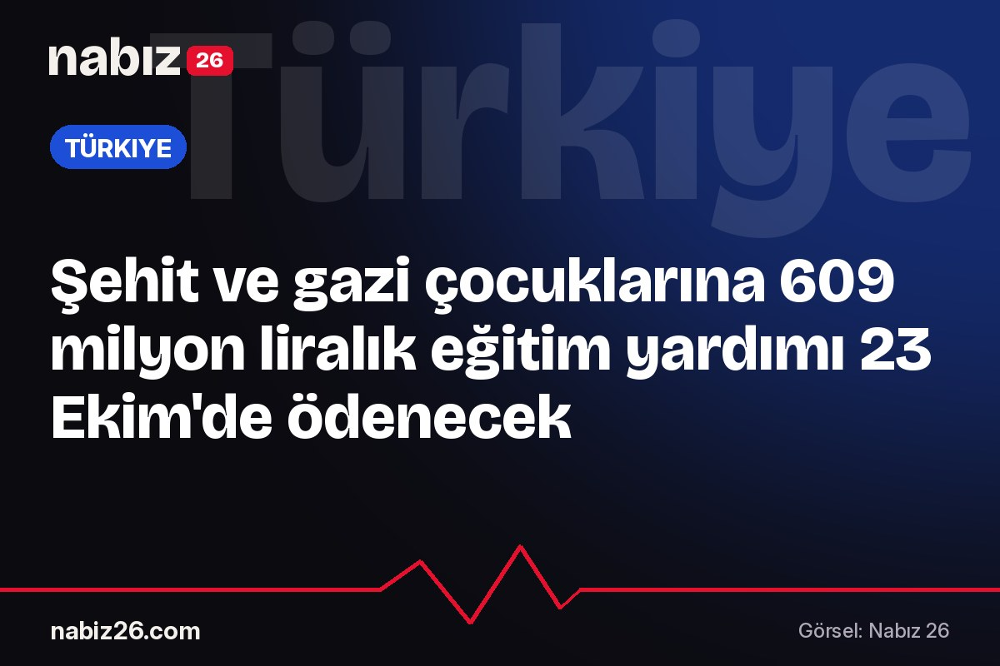

> Çalışma ve Sosyal Güvenlik Bakanı Işıkhan, 2026-2027 eğitim döneminde 18 bin 441 öğrenciye yapılacak ödemenin cuma günü hesaplara yatacağını açıkladı.

Çalışma ve Sosyal Güvenlik Bakanı Vedat Işıkhan, şehit ve harp-vazife malulü gazi çocuklarına yönelik eğitim-öğretim yardımlarının 23 Ekim Cuma günü ödeneceğini açıkladı.

Işıkhan'ın sosyal medya hesabından yaptığı duyuruya göre 2026-2027 eğitim-öğretim döneminde 18 bin 441 öğrenciye toplam 609 milyon lira destek sağlanacak. Ödemeler, şehit çocuklarının yanı sıra harp ve vazife malulleri ile çocuklarını kapsıyor. Işıkhan, öğrencilere başarı dileklerini ileterek devletin her zaman yanlarında olduğunu söyledi.

---

## CHP Sözcüsü Sarı Adıyaman'da: Tarım ürünlerinin fiyatları geçen yılın altında

**Siyaset · Türkiye** · 2026-10-23 01:32 UTC · Kaynak: [Google Haberler - CHP](https://www.babaocagi.com.tr/chp-sozcusu-sari-ureticinin-sorunlarina-degindi-maliyetler-artmasina-ragmen-fiyatlar-gecen-senenin-altinda)

> CHP Parti Sözcüsü Müslim Sarı, Adıyaman'da yaptığı temaslarda tütün, nar ve fıstık üreticilerinin sorunlarına değindi.

CHP Parti Sözcüsü ve Yerel Yönetimlerden Sorumlu Genel Başkan Yardımcısı Müslim Sarı, Adıyaman'da CHP İl Başkanı Engin Doğan ile birlikte partililerle bir araya geldi, ardından Adıyaman Belediyesi'ni ziyaret etti. Ziyarette Belediye Başkanı Abdurrahman Tutdere'ye vekâlet eden Belediye Başkan Yardımcısı Burak Binzet Sarı'yı karşıladı.

ANKA Haber Ajansı'na konuşan Sarı, üç gün boyunca Güneydoğu'da temaslarda bulunacaklarını, CHP Genel Başkanı Kemal Kılıçdaroğlu'nun cumartesi günü Gaziantep'e geleceğini söyledi. Sarı, tütün, nar ve fıstık üreticilerinin sorunlarına değinerek, "Maliyetler çok artmış olmasına rağmen tarım ürünlerinin fiyatları geçen senenin altında kalmış durumda. Dolayısıyla ürün para etmiyor" dedi.

Sarı ayrıca bölgede fıstık ağaçlarının söküldüğüne yönelik bilgiler aldığını ve hükümeti tarımsal üretimde planlama konusunda eleştirdiğini söyledi. Temaslarını Kilis ve Gaziantep'te sürdüreceklerini, gözlemlerini bir basın toplantısıyla paylaşacaklarını belirtti.

---

## Büyükşehir, Anadolu Üniversitesi'ndeki Bağımlılık Farkındalık Haftası'na stantla katıldı

**Belediye · Merkez** · 2026-10-23 01:32 UTC · Kaynak: [Google Haberler - Eskişehir](https://www.basingazetesi.net/amp/gundem/eskisehir-de-genclere-farkindalik-destegi-73661)

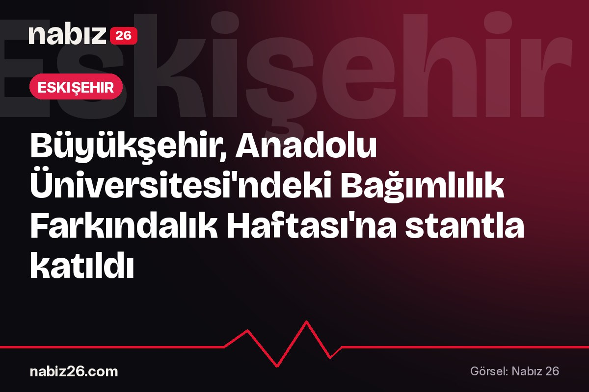

> Eskişehir Büyükşehir Belediyesi ESMEK atölyeleri, Gençlik Merkezi ve Kadın Çalışmaları Şube Müdürlüğü ile etkinliğe destek verdi.

Eskişehir Büyükşehir Belediyesi, Anadolu Üniversitesi'nin ev sahipliğinde 21-22 Ekim'de düzenlenen Bağımlılık Farkındalık Haftası etkinliklerine stant ve atölyelerle destek verdi. Etkinlikler Anadolu Park'taki stant alanında yapıldı.

Eskişehir Büyükşehir Belediyesi Sanat Meslek Eğitim Kursları (ESMEK), üniversiteli gençler için ebru sanatı, mandala, anahtarlık yapımı, ahşap boyama ve taş boyama atölyeleri düzenledi. Belediyenin açıklamasına göre öğrenciler atölyelere yoğun ilgi gösterdi.

Büyükşehir Belediyesi Gençlik Merkezi öğrencilere sıcak çorba ikram etti. Zeliha Tabanca Gençlik Danışma Merkezi ile Sosyal Hizmetler Dairesi Başkanlığı Kadın Çalışmaları Şube Müdürlüğü de kurdukları stantlarla yürüttükleri çalışmalar hakkında bilgi verdi.

---

## Adalet Bakanı Gürlek: 64 dosyada 71 cinayet faili meçhul statüsünden çıkarıldı

**Asayiş · Türkiye** · 2026-10-23 01:32 UTC · Kaynak: [Google Haberler - Bakanlıklar](https://gazetegundem.tr/haber/adalet-bakani-gurlek-faili-mechul-dosyalarinda-buyuk-gelismeleri-acikladi-53958)

> Bakan Gürlek, İzmir Menemen, Mersin ve Osmaniye'deki üç eski dosyada gelişme yaşandığını açıkladı. Şüpheliler hakkında işlem sürüyor.

Adalet Bakanı Akın Gürlek, sosyal medya hesabından yaptığı açıklamada, faili meçhul suçların aydınlatılmasına yönelik çalışmalar sonucunda 64 dosya kapsamında 71 cinayetin faili meçhul statüsünden çıkarıldığını duyurdu. Gürlek, İzmir, Mersin ve Osmaniye'de 10 ile 21 yıl öncesine uzanan üç dosyada gelişme kaydedildiğini bildirdi.

Açıklamaya göre İzmir'in Menemen ilçesinde 2005'ten bu yana kendisinden haber alınamayan M. O.'nun dosyasında gizli tanık beyanları ve iletişim kayıtları incelendi. Kişinin bir kuyuya atıldığına dair bulgulara ulaşıldığı belirtildi. 19 Ekim'deki operasyonda 5 şüpheli gözaltına alındı, kalıntılara ulaşmak için teknik çalışmalar sürüyor.

Mersin'de 2016'da kaçırılmasının ardından kaybolan F. C.'nin dosyasında, 20 Ekim'de 9 şüpheli hakkında adli işlem başlatıldı. Şüphelilerden 7'si gözaltına alındı, 2'sinin ceza infaz kurumunda bulunduğu belirlendi. Osmaniye'de 2016'da kaybolan M. Ç.'nin dosyasında ise cezaevindeki bir şüphelinin, kişiyi öldürüp bir evin bahçesine gömdüğünü söylemesi üzerine kazı yapıldı. Yaklaşık 4 metre derinlikte kemik parçalarına ulaşıldı ve kalıntılar Adli Tıp Kurumu'na gönderildi. Bu dosyada 2 şüpheli tutuklandı, 1 şüpheli hakkında adli kontrol kararı verildi.

---

## Tarsus Belediye Başkanı Ali Boltaç CHP'den istifa etti

**Siyaset · Türkiye** · 2026-10-23 00:32 UTC · Kaynak: [Google Haberler - CHP](https://ilketv.com.tr/tarsus-belediye-baskani-ali-boltac-chpden-istifa-etti/)

> Mersin'in Tarsus ilçesinin Belediye Başkanı Ali Boltaç, hakkında başlatılan disiplin sürecinin ardından CHP üyeliğinden istifa ettiğini açıkladı.

Mersin'in Tarsus ilçesi Belediye Başkanı Ali Boltaç, CHP üyeliğinden istifa ettiğini yazılı bir açıklamayla duyurdu. Boltaç, parti yönetiminin hakkında başlattığı disiplin sürecini üzüntüyle karşıladığını belirtti.

Boltaç, "Bugün itibarıyla Cumhuriyet Halk Partisi üyeliğimden istifa ediyorum" dedi. Kendisi için esas olanın inandığı değerlere sahip çıkmak ve Tarsus halkına karşı sorumluluğunu yerine getirmek olduğunu söyledi.

CHP Genel Başkan Yardımcısı ve Parti Sözcüsü Müslim Sarı daha önce yaptığı açıklamada Boltaç'ın tedbirli olarak kesin çıkarma istemiyle Yüksek Disiplin Kurulu'na sevk edildiğini duyurmuştu.

---
