# Son haberler

Ajanın yazdığı son haberler (otomatik güncellenir).

## Vali Erdinç Yılmaz'dan Hane Ziyareti: Kılıç Ailesinin Taleplerini Dinledi

**Gündem · Merkez** · 2026-11-18 15:09 UTC · Kaynak: [Eskişehir Valiliği](https://www.eskisehir.gov.tr/valimiz-dr-erdinc-yilmaz-hane-ziyaretleri-kapsaminda-fatma-kilic-ve-kizi-ayse-kilici-evlerinde-ziyaret-etti)

> Eskişehir Valisi Dr. Erdinç Yılmaz, hane ziyaretleri kapsamında Fatma Kılıç ve kızı Ayşe Kılıç'ı evlerinde ziyaret ederek ihtiyaç ve taleplerini dinledi.

Eskişehir Valisi Dr. Erdinç Yılmaz, kentte sürdürdüğü hane ziyaretleri doğrultusunda Fatma Kılıç ve kızı Ayşe Kılıç'ın evine konuk oldu.

Ziyarette aile bireyleriyle bir süre sohbet eden Vali Yılmaz, Kılıç ailesinin hâl ve hatırını sorarak iletilen talep ve ihtiyaçları not aldı.

Vatandaşlarla doğrudan bir araya gelmeye ve onların sorunlarını yerinde dinlemeye büyük önem verdiklerini vurgulayan Vali Yılmaz, devletin tüm imkânlarıyla her zaman vatandaşların yanında olduğunu kaydetti.

---

## Tepebaşı ile Belçika Arasında Yeni AB Projesi: Başkan Ataç Büyükelçiyle Görüştü

**Belediye · Tepebaşı** · 2026-11-18 15:09 UTC · Kaynak: [Tepebaşı Belediyesi](https://www.tepebasi.bel.tr/Haber/Detay/baskanatacbelcikaileisbirligimiziabprojesiylebuyutecegiz)

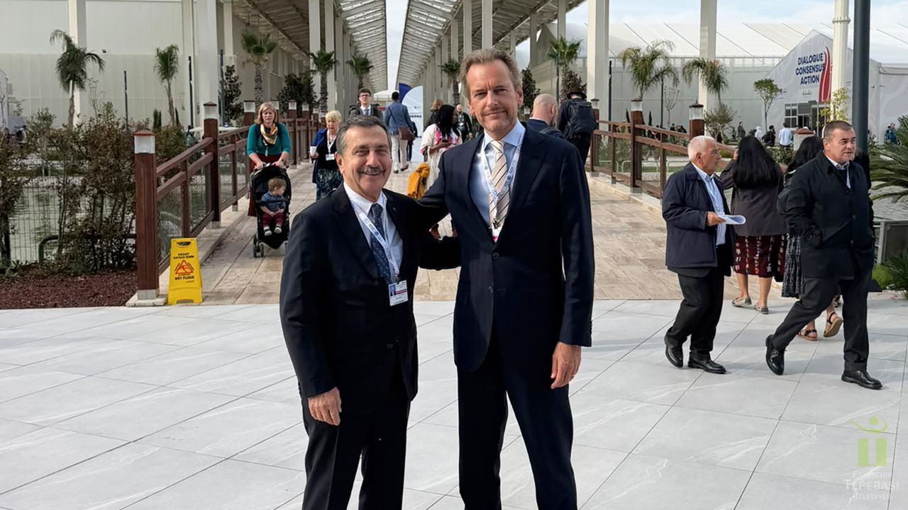

> COP31 için Antalya'da bulunan Tepebaşı Belediye Başkanı Ahmet Ataç, Belçika'nın Ankara Büyükelçisi Hendrik Van de Velde ile bir araya gelerek ortak AB projesi hazırlıklarını görüştü.

Antalya'da düzenlenen COP31 İklim Zirvesi kapsamında temaslarını sürdüren Tepebaşı Belediye Başkanı Ahmet Ataç, Belçika'nın Ankara Büyükelçisi Hendrik Van de Velde ile bir toplantı gerçekleştirdi. Görüşmeye Tepebaşı Belediye Başkan Yardımcısı Suat Yalnızoğlu da katıldı.

Toplantıda Tepebaşı Belediyesi ile Belçika Büyükelçiliği arasında sürdürülebilirlik alanında geliştirilebilecek ortak çalışmalar ve yeni iş birliği olanakları ele alındı. Başkan Ataç, yerel yönetimlerin uluslararası temaslar üzerinden kurduğu bilgi ve deneyim paylaşımının kentlerin sürdürülebilir kalkınmasına güç kattığını dile getirdi.

İki taraf arasındaki diyaloğun somut adımlarla ileriye taşınacağını ifade eden Başkan Ataç, çevre ve iklim alanındaki birikimlerini uluslararası düzleme taşımayı hedeflediklerini belirtti. Ataç, daha önce Eskişehir Caz Festivali ve Jazz Network buluşmasıyla kurulan temasların, Belçika Büyükelçiliği ortaklığında hazırlanacak yeni bir Avrupa Birliği projesiyle sürdürüleceğini kaydetti.

Büyükelçi Hendrik Van de Velde ise iş birliğinden duyduğu memnuniyeti dile getirerek Başkan Ataç ve Başkan Yardımcısı Yalnızoğlu'nu Belçika Büyükelçiliği tarafından organize edilecek resepsiyona davet etti.

---

## Millî Mücadele'nin Lojistik Kahramanı Behiç Erkin Eskişehir'de Anıldı

**Kültür-Sanat · Tepebaşı** · 2026-11-18 15:09 UTC · Kaynak: [Eskişehir Büyükşehir Belediyesi](https://www.eskisehir.bel.tr/icerik-detay.php?icerik_id=13573&cat_icerik=1&menu_id=24)

> Cumhuriyetin ilk Demiryolları Genel Müdürü Behiç Erkin, Eskişehir'deki anıt mezarı başında anıldı ve ardından düzenlenen panelle tarihî rolü ele alındı.

Eskişehir Büyükşehir Belediyesi ile Eskişehir Kent Konseyi ortaklığında, Cumhuriyet tarihinin simge isimlerinden Behiç Erkin için anma programı düzenlendi. Etkinlikler kapsamında ilk olarak Enveriye Tren İstasyonu sınırlarında yer alan Behiç Erkin'in anıt mezarı ziyaret edildi.

Anma programı daha sonra Haller Gençlik Merkezi'nde gerçekleştirilen "Demiryollarının Babası: Behiç Erkin – Cepheye Giden Yol" başlıklı panelle devam etti. Paneli Gazeteci Kerem Akyıl yönetirken, Prof. Dr. Burhan Sayılır ile Prof. Dr. Volkan Marttin konuşmacı olarak Erkin'in Türk demiryolu tarihindeki öncülüğünü ve Millî Mücadele'ye katkılarını aktardı.

Etkinlikte konuşan Eskişehir Büyükşehir Belediye Başkanı Ayşe Ünlüce, Behiç Erkin'in çok yönlü kariyerine dikkat çekerek, mühimmat ve askerin cepheye taşınmasında üstlendiği stratejik rolü vurguladı. Ünlüce, ülkeyi demir ağlarla ören kadrolara ve Gazi Mustafa Kemal Atatürk başta olmak üzere tüm mücadele kahramanlarına minnet duyduklarını ifade etti.

Eskişehir Kent Konseyi Başkanı İnci Ülüğ ve Kent Tarihi Çalışma Grubu Başkanı Kemal Güner Poyraz da kentin tarihî hafızasını canlı tutmak ve gelecek kuşaklara taşımak adına benzer anma programlarını sürdüreceklerini kaydetti.

---

## Eğitim-Bir-Sen Heyetinden ESTÜ Rektörü Özcan'a Hayırlı Olsun Ziyareti

**Eğitim · Tepebaşı** · 2026-11-18 15:09 UTC · Kaynak: [Eskişehir Teknik Üniversitesi](https://www.eskisehir.edu.tr/tr/Haber/Detay/egitim-bir-sen-eskisehir-2-nolu-sube-baskani-ertugrul-baki-ve-yonetim-kurulu-uyeleri-rektor-prof-dr-adnan-ozcana-hayirli-olsun-ziyaretinde-bulundu-)

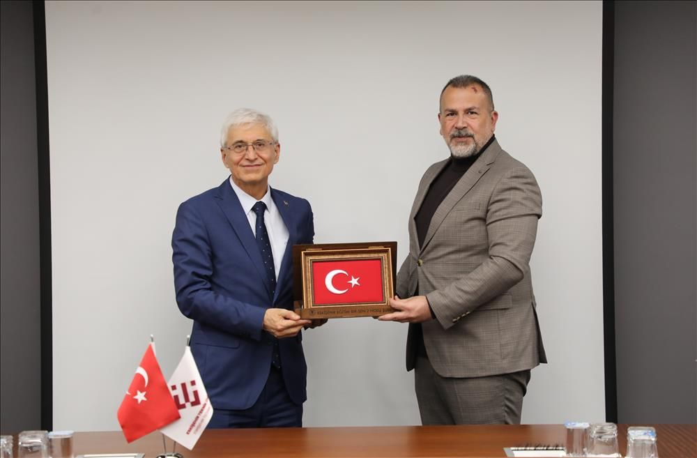

> Eğitim-Bir-Sen Eskişehir 2 No’lu Şube Başkanı Ertuğrul Baki ve yönetim kurulu üyeleri, rektörlük görevine yeniden atanan Prof. Dr. Adnan Özcan'ı ziyaret etti.

Eğitimciler Birliği Sendikası (Eğitim-Bir-Sen) Eskişehir 2 No’lu Şube Başkanı Ertuğrul Baki ve beraberindeki yönetim kurulu üyeleri, Eskişehir Teknik Üniversitesi (ESTÜ) Rektörlüğü görevine yeniden atanan Prof. Dr. Adnan Özcan’a tebrik ziyaretinde bulundu.

Cumhurbaşkanlığı Kararı ile yeniden ESTÜ Rektörlüğü görevine getirilen Prof. Dr. Özcan'ı Rektörlük Toplantı Salonu'nda ziyaret eden heyet, yeni dönem çalışmaları için başarı dileklerini iletti. Şube Başkanı Baki, Özcan'a görevinde muvaffakiyet temennisinde bulundu.

Ziyaretten duyduğu memnuniyeti belirten Rektör Prof. Dr. Adnan Özcan ise nazik ziyaretleri ve tebrikleri dolayısıyla Şube Başkanı Baki ve sendika yönetimine teşekkür etti.

---

## 1072 Sosyal Medya Hesabına Erişim Engeli: FETÖ İncelemesi Başlatıldı

**Türkiye · Türkiye** · 2026-11-18 15:09 UTC · Kaynak: [İletişim Başkanlığı](https://www.iletisim.gov.tr/turkce/haberler/detay/iletisim-baskani-durandan-feto-iltisakli-sosyal-medya-hesaplarina-erisim-engeli-getirilmesine-iliskin-aciklama)

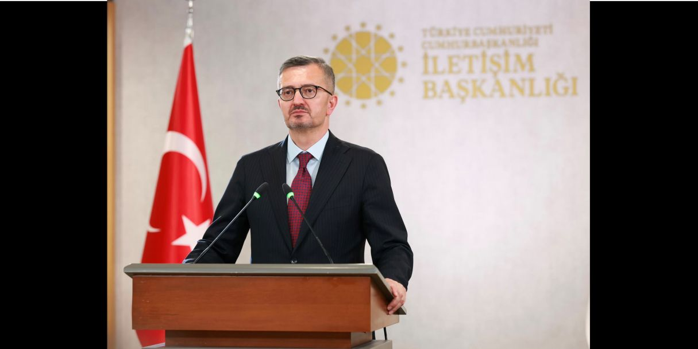

> İletişim Başkanı Burhanettin Duran, kamuoyunu yanıltmaya yönelik faaliyet yürüttüğü belirlenen FETÖ iltisaklı 1072 sosyal medya hesabına erişim engeli getirildiğini açıkladı.

Cumhurbaşkanlığı İletişim Başkanlığı koordinasyonunda ve Ankara Cumhuriyet Başsavcılığı iş birliğinde yürütülen çalışmalar sonucunda, dijital mecralarda dezenformasyon yürüttüğü tespit edilen hesaplara yönelik işlem yapıldı. Kamuoyunu yanıltmayı ve toplumsal güveni zedelemeyi amaçlayan FETÖ iltisaklı 1072 sosyal medya hesabına erişim engeli getirilirken, hesap kullanıcıları hakkında da adli inceleme başlatıldı.

İletişim Başkanı Burhanettin Duran, sosyal medya hesabından yaptığı açıklamada, son üç ayda ulaşılan bu rakamın, terör örgütlerinin dijital platformları propaganda, manipülasyon ve psikolojik harekât aracı olarak kullanma girişimlerine karşı verilen kararlı mücadelenin somut bir göstergesi olduğunu belirtti.

Dijital alanın bir istismar sahasına dönüştürülmesine izin verilmeyeceğini vurgulayan Duran; hakikati çarpıtarak milli güvenliği tehdit eden ve toplumsal huzuru hedef alan her türlü faaliyete karşı hukuk çerçevesinde, ilgili kurumlarla eş güdüm içinde mücadelenin kesintisiz süreceğini kaydetti.

---

## Yaşamkent Aile Destek Merkezi'nde Hazırlıklar Sona Erdi

**Gündem · Tepebaşı** · 2026-11-18 11:43 UTC · Kaynak: [Eskişehir Valiliği](https://www.eskisehir.gov.tr/valimiz-dr-erdinc-yilmaz-yasamkent-aile-destek-merkezinde-incelemelerde-bulundu)

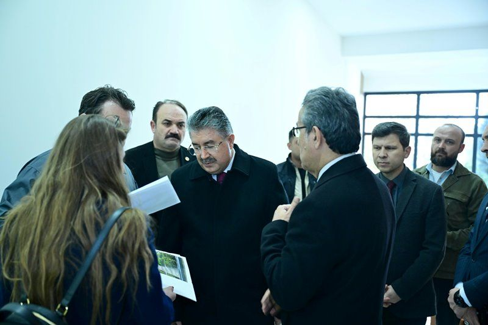

> Vali Dr. Erdinç Yılmaz, Tepebaşı'nda hizmet vermeye hazırlanan Yaşamkent Aile Destek Merkezi'ni ziyaret ederek incelemelerde bulundu.

Eskişehir Valisi Dr. Erdinç Yılmaz, Aşağısöğütönü bölgesindeki Yaşamkent Aile Destek Merkezi'ni ziyaret ederek yürütülen çalışmalarla ilgili yetkililerden bilgi aldı. Ziyaret kapsamında merkezde yer alan spor alanları, etüt merkezi, robotik kodlama sınıfı, çocuk oyun alanları ve gastronomi merkezi tek tek incelendi.

Merkezin Eskişehirlilerin hizmetine sunulmak üzere hazır hâle geldiğini belirten Vali Dr. Erdinç Yılmaz, tesisin ailelere çok yönlü imkânlar sunacağını ifade etti. Vatandaşların ihtiyaç duyabileceği birçok sosyal ve kültürel donatıyı bir arada barındıran merkezin en kısa sürede açılacağı bildirildi.

2011 yılından bu yana Eskişehir Sosyal Yardımlaşma ve Dayanışma Vakfı mülkiyetinde bulunan Aşağısöğütönü Sosyal Konutlar alanındaki sosyal tesis binası, 6 Temmuz 2026 tarihinde imzalanan protokol ile Tepebaşı Sosyal Yardımlaşma ve Dayanışma Vakfına Aile Destek Merkezi olarak kullanılmak üzere 20 yıllığına tahsis edilmişti.

---

## Odunpazarı Belediyesi’nden Dört Çocuklu Anneme Destek Eli

**Belediye · Odunpazarı** · 2026-11-18 11:43 UTC · Kaynak: [Odunpazarı Belediyesi](https://www.odunpazari.bel.tr/guncel/haberler/genel-haberler/dort-cocuguyla-yasam-mucadelesi-veren-kadina-odunpazari-belediyesi-nden-destek)

> Odunpazarı Belediyesi, dört çocuğuyla yaşam mücadelesi veren ve ekonomik güçlükler yaşayan 34 yaşındaki G.B.'ye Halk Market aracılığıyla düzenli destek sağlamaya başladı.

Odunpazarı Belediyesi, sosyal belediyecilik çalışmaları kapsamında ihtiyaç sahibi ailelerin yanında olmayı sürdürüyor. Bu kapsamda, eşinden ayrılan ve herhangi bir geliri bulunmayan 34 yaşındaki G.B. ile dört çocuğuna yardım elini uzattı.

Geçmişte yaşadığı sağlık sorunları nedeniyle sol bacağını kaybeden ve kirada yaşayan G.B., protezinin eski olması ve işsizliği nedeniyle çocuklarının geçimini sağlamakta zorlanıyordu. Yaşadığı zorlukların kamuoyuna yansımasının ardından Odunpazarı Belediyesi harekete geçti.

Belediye bünyesindeki Halk Market sosyal destek sistemine dâhil edilen G.B. için Halk Kart çıkarıldı. Bu sayede ailenin Halk Market'teki tüm yardımlardan düzenli olarak yararlanmasının önü açılırken, temel ihtiyaçları doğrultusunda kıyafet yardımı da gerçekleştirildi. Ekipler, ailenin gıda ve temel ihtiyaçlarını karşılamak üzere her ay düzenli yardım ulaştıracak.

---

## ESOGÜ Antalya'daki COP31 Zirvesi'nde 6 Bilimsel Projeyi Tanıttı

**Eğitim · Odunpazarı** · 2026-11-18 11:43 UTC · Kaynak: [Eskişehir Osmangazi Üniversitesi](https://www.ogu.edu.tr/Web/HaberDetay/2152)

> Eskişehir Osmangazi Üniversitesi, Antalya'da düzenlenen Birleşmiş Milletler İklim Değişikliği Konferansı'na iklim, çevre ve genetik alanındaki 6 projeyle katıldı.

Eskişehir Osmangazi Üniversitesi (ESOGÜ), Antalya'da gerçekleştirilen Birleşmiş Milletler İklim Değişikliği Konferansı (COP31) Türkiye Programı'na dahil oldu. Üniversite, iklim değişikliği, çevresel sürdürülebilirlik, biyolojik çeşitlilik ve genetik araştırmalar odaklı 6 projeyle programda yer aldı.

Antalya'daki buluşmada ESOGÜ'yü Rektör Danışmanı ve COP31 Koordinatörü Prof. Dr. Hakan Demiral, Eğitim Fakültesi'nden Prof. Dr. Ersin Karademir, Fen Fakültesi'nden Prof. Dr. Özgür Emiroğlu ile Prof. Dr. Arif Kıvrak, Ziraat Fakültesi'nden Prof. Dr. Taki Karslı ve yüksek lisans öğrencisi Yusuf Aktaş temsil etti. Program çerçevesinde akademisyenler farklı disiplinlerdeki çalışmalarını katılımcılarla paylaştı.

Sunulan projeler arasında Prof. Dr. Ersin Karademir'in "İklim Dirençliliği İçin STEM ile Bütünleşik Afet Eğitimi ve Doğa Tabanlı Çözümler" çalışması yer aldı. Prof. Dr. Özgür Emiroğlu ise "Türkiye'de Karasal Alanlarda ve İç Sularda İstilacı Yabancı Tür Tehditlerinin Ele Alınması" ile "Türkiye İç Sularındaki İstilacı Gümüşi Havuz Balığı Popülasyonlarının Genetik Çeşitliliği" başlıklı iki projesini aktardı.

Programda kabul edilen diğer çalışmalar arasında Prof. Dr. Arif Kıvrak'ın "Dijital Yeşil" projesi ile Prof. Dr. Taki Karslı'nın "Denizli ve Gerze Tavuklarında ddRADseq ile Genetik Çeşitlilik ve Seleksiyon İzleri" ve "Ile de France × Anadolu Merinosu Koyunlarında Sıcaklık Stresi Toleransı ve Aday Genler" başlıklı araştırmaları da sunuldu. Konferans boyunca ESOGÜ heyeti, YÖK Genel Kurul Üyesi Prof. Dr. Derviş Karaboğa ile bir araya gelerek yürütülen faaliyetler üzerine görüştü.

---

## Bilecik Şeyh Edebali Üniversitesi Rektörü Kaplancıklı'dan ESTÜ'ye Ziyaret

**Eğitim · Tepebaşı** · 2026-11-18 11:43 UTC · Kaynak: [Eskişehir Teknik Üniversitesi](https://www.eskisehir.edu.tr/tr/Haber/Detay/bilecik-seyh-edebali-universitesi-rektoru-prof-dr-zafer-asim-kaplanciklidan-rektor-prof-dr-adnan-ozcana-hayirli-olsun-ziyareti)

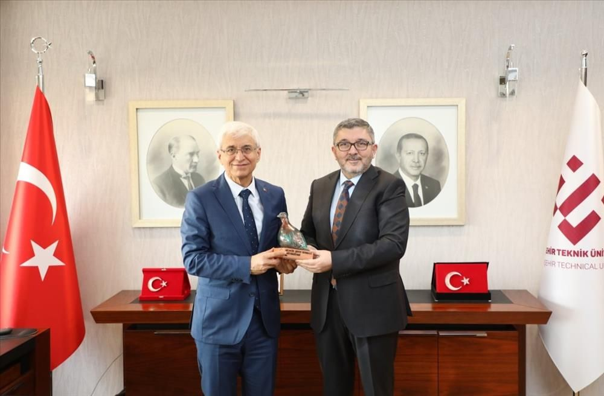

> Bilecik Şeyh Edebali Üniversitesi Rektörü Prof. Dr. Zafer Asım Kaplancıklı, ESTÜ Rektörlüğüne yeniden atanan Prof. Dr. Adnan Özcan'ı ziyaret etti.

Bilecik Şeyh Edebali Üniversitesi Rektörü Prof. Dr. Zafer Asım Kaplancıklı, Eskişehir Teknik Üniversitesi (ESTÜ) Rektörlüğü görevine yeniden atanan Prof. Dr. Adnan Özcan'a hayırlı olsun ziyaretinde bulundu.

Rektörlük ofisinde gerçekleştirilen buluşmada Prof. Dr. Kaplancıklı, Prof. Dr. Özcan'ı tebrik ederek yeni dönemi için başarı dileklerini iletti.

ESTÜ Rektörü Prof. Dr. Adnan Özcan ise konuk rektöre nazik ziyareti ve iyi dilekleri dolayısıyla teşekkür etti.

---

## Altın fiyatları 18 Kasım 2026: Gram altın 6.264,04 TL

**Ekonomi · Merkez** · 2026-11-18 06:00 UTC · Kaynak: [Harem Altın](https://www.haremaltin.com/altin-fiyatlari)

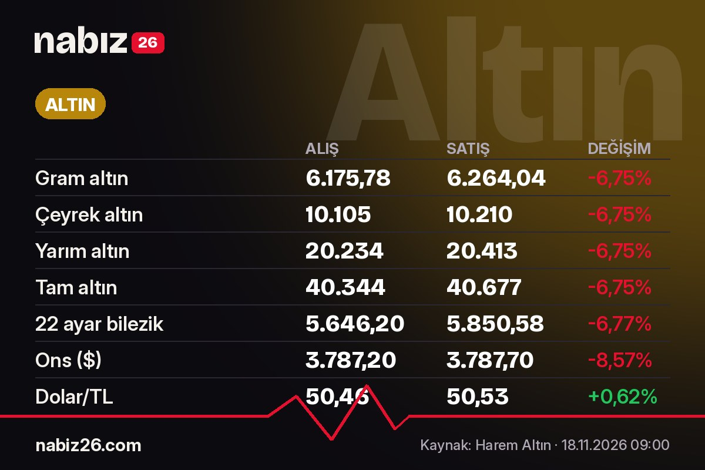

> Gram altın güne düşüşle başladı. Harem Altın verilerine göre gram altın 6.175,78 TL'den alınıyor, 6.264,04 TL'den satılıyor.

Altın piyasasında güne düşüşle başlandı. Harem Altın'ın saat 09.00 itibarıyla verilerine göre gram altının satış fiyatı 6.264,04 TL, alış fiyatı 6.175,78 TL oldu. Gram altın, önceki kapanışa göre yüzde 6,75 geriledi.

Ziynet altınlarda çeyrek altın 10.210 TL, yarım altın 20.413 TL, tam altın 40.677 TL, ata altın 41.764 TL seviyesinden satışa sunuluyor.

22 ayar bileziğin gram satış fiyatı 5.850,58 TL, has altının gram fiyatı 6.245,30 TL olarak belirlendi.

Uluslararası piyasalarda altının onsu 3.787,70 dolardan işlem görürken, dolar/TL 50,53 seviyesinde bulunuyor.

Fiyatlar Harem Altın'ın saat 09.00 itibarıyla paylaştığı verilere dayanmaktadır; kuyumcular arasında farklılık gösterebilir. Bu haber yatırım tavsiyesi değildir.

---

## Eskişehirspor İç Sahada Yenilgisizliğini Koruyor: 6 Maçta 12 Puan

**Spor · Merkez** · 2026-11-17 17:10 UTC · Kaynak: [Google Haberler - Eskişehirspor](https://www.sakaryagazetesi.com.tr/eskisehirspor-ic-sahada-6-puan-birakti)

> Bu sezon taraftarı önünde henüz mağlubiyet yaşamayan Eskişehirspor, iç sahada çıktığı 6 lig karşılaşmasında 3 galibiyet ve 3 beraberlikle 12 puan topladı.

Nesine 3. Lig'de zirve mücadelesini sürdüren Eskişehirspor, bu sezon iç saha maçlarında yenilgisiz serisini devam ettiriyor. Kendi sahasında taraftar desteğini arkasına alan siyah-kırmızılı ekip, oynadığı 6 müsabakada mağlubiyet yüzü görmedi.

Sahasındaki ilk puan kaybını ligin 6. haftasında Etimesgut ile 1-1 berabere kalarak yaşayan Eskişehir temsilcisi, 8. haftada Bursa Yıldırımspor ve son olarak 12. haftada Ayvalıkgücü Belediyespor ile 2-2 berabere kaldı. Kırmızı Şimşekler, evindeki bu üç beraberlikle toplam 6 puan yitirdi.

Buna karşın taraftarı önünde farklı skorlu galibiyetler de elde eden siyah-kırmızılılar; Alanya 1221’i 4-0, Balıkesirspor’u 7-1 ve Kepezspor’u 1-0 mağlup etmeyi başardı. Eskişehirspor, iç sahada çıktığı 6 karşılaşmadan çıkardığı 3 galibiyet ve 3 beraberlikle hanesine 12 puan yazdırdı.

---

## Zorbalığa Karşı Güvenli Tatami: Eskişehir ve Bükreşli Çocuklar Judoda Buluşacak

**Spor · Merkez** · 2026-11-17 17:09 UTC · Kaynak: [Eskişehir Valiliği](https://www.eskisehir.gov.tr/valimiz-dr-erdinc-yilmaz-turkiye-ve-romanya-judo-federasyonu-baskanlari-ile-beraberlerindeki-heyeti-kabul-etti)

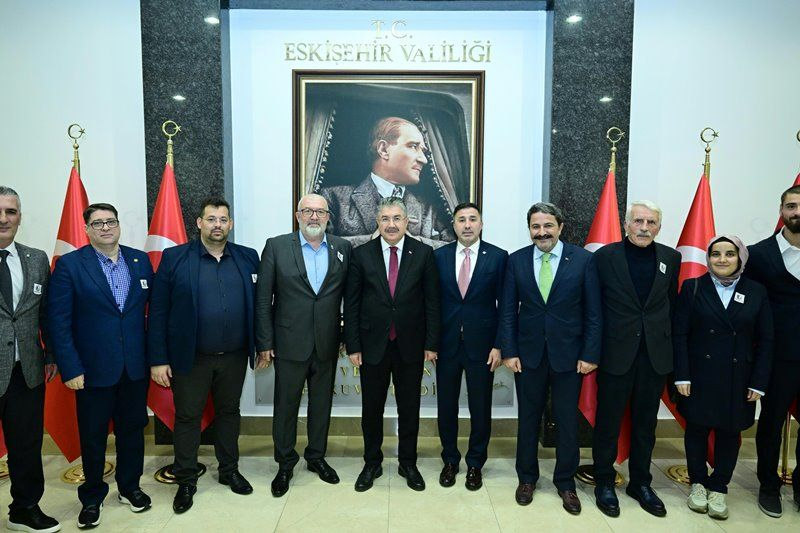

> Eskişehir ve Bükreş'te 7-14 yaş aralığındaki 100 çocuğu sporla buluşturacak AB destekli 'Safe Tatami' projesi için Türkiye ve Romanya heyetleri Eskişehir'de bir araya geldi.

Eskişehir Valisi Dr. Erdinç Yılmaz, Avrupa Birliği Erasmus+ Sport Programı tarafından desteklenen “IPPON-VS-BULLYING: Safe Tatami” projesi dolayısıyla şehre gelen Türkiye Judo Federasyonu Başkanı Sezer Huysuz, Romanya Judo Federasyonu Başkanı Florin Bercean ve beraberindeki heyeti kabul etti. Ziyarette Gençlik ve Spor İl Müdürü Hasan Kalın da hazır bulundu.

Ziyaret sırasında heyet, hayata geçirilen uluslararası proje hakkında Vali Yılmaz'a bilgi sundu. Çalışmayla akran zorbalığının önüne geçilmesi; çocuklar arasında saygı, empati ve dayanışma duygularının pekiştirilmesi amaçlanıyor. Proje kapsamında Eskişehir ve Bükreş'te 7-14 yaş grubundaki toplam 100 çocuğun judo branşı aracılığıyla güvenli ve kapsayıcı spor ortamlarında buluşturulması hedefleniyor.

Vali Dr. Erdinç Yılmaz, çocukların sosyal ve kişisel gelişimlerine değer katan projenin taşıdığı öneme işaret ederek organizasyonda emeği geçen tüm kurumlara teşekkürlerini iletti.

---

## Tarayıcıdan Kodlama Dönemi: Anadolu Üniversitesi 26 Bin Öğrenciye AI Lab'ı Açtı

**Eğitim · Tepebaşı** · 2026-11-17 17:09 UTC · Kaynak: [Anadolu Üniversitesi](https://anahaber.anadolu.edu.tr/tr/haber-detay/ebzttkhrqsmdel8mzn5mqyx1)

> Anadolu Üniversitesi'nin geliştirdiği AI Lab platformu, Açıköğretim'de kodlama eğitimi alan 26 bin öğrencinin kullanımına sunuldu. Sistem, ek yazılım yüklemeden tarayıcı üzerinden kod yazma ve yapay zekâdan anında geri bildirim alma imkânı veriyor.

Anadolu Üniversitesi Yapay Zekâ Uygulama ve Araştırma Merkezi tarafından hayata geçirilen "AI Lab" platformu, Açıköğretim Fakültesi bünyesindeki Yapay Zekâ Destekli Kodlama Ön Lisans Programı'nda öğrenim gören yaklaşık 26 bin öğrencinin erişimine açıldı. Öğrencilerin herhangi bir harici yazılım yüklemesine gerek kalmadan doğrudan internet tarayıcısı üzerinden kod yazabildiği sistem, ilk olarak “Python ile Programlama” dersinin uygulamalı oturumunda kullanıldı.

"Uygula. Üret." yaklaşımıyla ailab.anadolu.edu.tr adresinde hizmete giren platformda ders uygulamaları, basılı ve dijital kitapların ünitelerine paralel olarak yapılandırıldı. Öğrenciler konu anlatımlarını incelerken aynı ekran üzerinde örnek kodları çalıştırabiliyor ve hazırlanan alıştırmaları çözebiliyor. Üniversitenin kendi sunucu altyapısında barındırılan sistem, on binlerce öğrencinin eş zamanlı kod çalıştırmasını destekliyor.

Platformda tamamlanan kodlama alıştırmaları otomatik değerlendirilirken, hata yapılan noktalarda öğrencilere yapay zekâ desteğiyle yönlendirici ipuçları sunuluyor. Öğrenciler ayrıca pekiştirmek istedikleri konular için yapay zekâdan yeni pratik soruları üretmesini talep edebiliyor.

Açıköğretim Fakültesi Dekanı Prof. Dr. Aras Bozkurt, uzaktan eğitimde uygulamalı öğrenme olanaklarını güçlendirmeyi amaçladıklarını belirterek, Türkiye'nin dört bir yanındaki öğrencilerin mekândan bağımsız şekilde aynı laboratuvar altyapısına ulaşabilmesinin önemine dikkat çekti. Yapay Zekâ Uygulama ve Araştırma Merkezi Müdürü Doç. Dr. Özer Çelik ise kodlamanın yazarak öğrenileceğini vurgulayarak, öğrencilerin takıldıkları aşamalarda yapay zekâ ipuçlarıyla desteklendiğini ve platformun diğer Açıköğretim programlarına da kademeli olarak yaygınlaştırılacağını ifade etti.

---

## Başkan Ünlüce Batıkent ve Çamlıca'da: Muhtarlar ve Mahalleliyle Talepleri Görüştü

**Belediye · Tepebaşı** · 2026-11-17 17:09 UTC · Kaynak: [Eskişehir Büyükşehir Belediyesi](https://www.eskisehir.bel.tr/icerik-detay.php?icerik_id=13567&cat_icerik=1&menu_id=24)

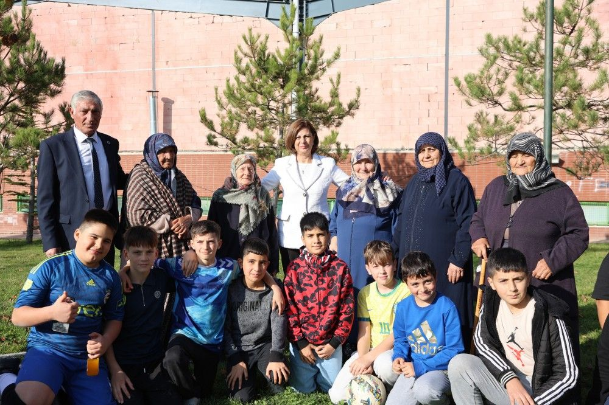

> Eskişehir Büyükşehir Belediye Başkanı Ayşe Ünlüce, saha çalışmaları kapsamında Batıkent ve Çamlıca mahalle muhtarlıklarını ziyaret ederek bölgedeki ihtiyaçları dinledi.

Eskişehir Büyükşehir Belediye Başkanı Ayşe Ünlüce, kentin farklı noktalarındaki temasları kapsamında Batıkent ve Çamlıca mahallelerine ziyarette bulundu. Muhtarlık binalarında gerçekleşen buluşmalarda mahalle sakinleriyle bir araya gelen Ünlüce, bölgenin ihtiyaç ve taleplerini yerinde inceledi.

Ziyaret programı çerçevesinde ilk olarak Batıkent Mahalle Muhtarı Derya Can ile görüşen Başkan Ünlüce, ardından Çamlıca Mahalle Muhtarı Savaş Hancı ile bir araya geldi. Görüşmelerde mahallelerde sürdürülen ve hayata geçirilmesi planlanan belediye çalışmaları ele alındı.

Mahalle sakinleriyle de sohbet ederek beklentilerini dinleyen Başkan Ünlüce, kentin her noktasına eşit ve nitelikli hizmet ulaştırma hedefi doğrultusunda mahalle ziyaretlerine devam edeceklerini ifade etti.

---

## Vali Yılmaz Öğretmenevinde İncelemelerde Bulundu: Güçlendirme Sürüyor

**Eğitim · Merkez** · 2026-11-17 15:09 UTC · Kaynak: [Eskişehir Valiliği](https://www.eskisehir.gov.tr/valimiz-dr-erdinc-yilmaz-depreme-karsi-guclendirme-calismalari-devam-eden-eskisehir-ogretmenevini-ziyaret-etti)

> Eskişehir Valisi Dr. Erdinç Yılmaz, depreme karşı güçlendirme çalışmaları yürütülen Eskişehir Öğretmenevini ziyaret ederek yetkililerden son durum hakkında bilgi aldı.

Eskişehir Valisi Dr. Erdinç Yılmaz, depreme dayanıklılık çalışmaları devam eden Eskişehir Öğretmenevi binasında incelemelerde bulundu.

Çalışma alanını gezerek yürütülen güçlendirme faaliyetlerini yerinde inceleyen Vali Yılmaz, inşaat sürecinin mevcut durumu ve yapılan işlemler hakkında teknik ekipten ayrıntılı bilgi aldı.

Çalışmaların titizlikle sürdürülmesinin önemini vurgulayan Vali Yılmaz, sahada görev yapan personele çalışmalarında kolaylıklar diledi.

---

## Şehir Tiyatroları'nda Ücretsiz Eğitim Sezonu: Yetişkin ve Kadın Atölyeleri Başlıyor

**Kültür-Sanat · Merkez** · 2026-11-17 15:09 UTC · Kaynak: [Eskişehir Büyükşehir Belediyesi](https://www.eskisehir.bel.tr/icerik-detay.php?icerik_id=13568&cat_icerik=1&menu_id=24)

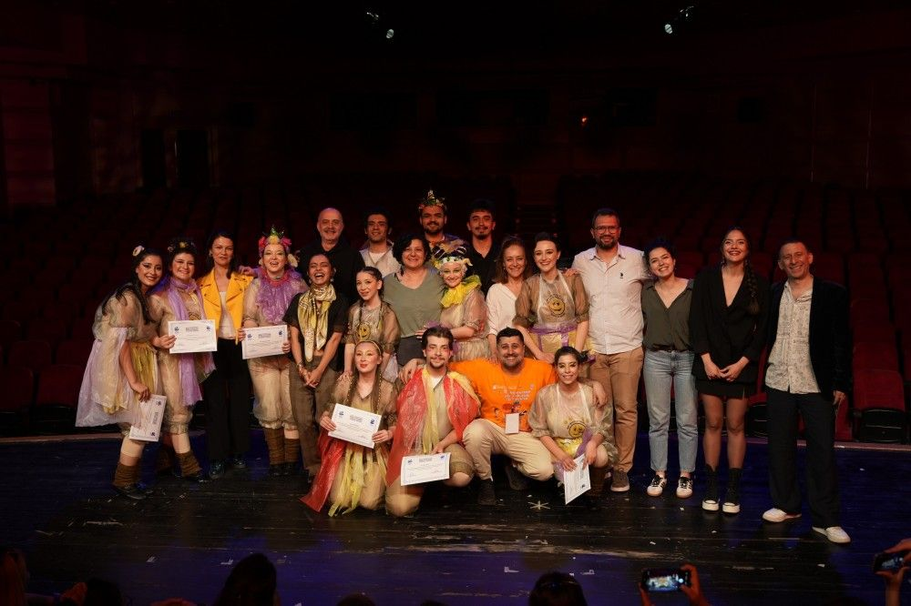

> Eskişehir Şehir Tiyatroları, yeni sezonda 25 yaş üzeri yetişkinler ile 20 yaş üzeri kadınlara yönelik tiyatro ve drama eğitimleri için başvuru sürecini başlattı.

Eskişehir Büyükşehir Belediyesi Şehir Tiyatroları, sahnelediği oyunların yanı sıra kent genelindeki eğitim ve atölye çalışmalarını yeni sezonda da sürdürüyor. Gençlik Sahnesi seçmelerinin ardından farklı yaş gruplarına yönelik ücretsiz kurs takvimi belirlendi.

Bu sezon ilk defa uygulanacak program kapsamında 25 yaş üzeri yetişkinlere tiyatro kursu, 20 yaş üzeri kadınlara ise özel drama atölyesi düzenlenecek. Başvuruları alınmaya başlanan eğitimlerin dersleri yakın zamanda başlayacak.

Öte yandan Sultandere Sahnesi'nde iki sezondur yürütülen eğitimler çerçevesinde 15-18 yaş arası gençlere yönelik tiyatro kursu başvuruları da açıldı. Kasım ayı içerisinde başlayacak tüm eğitimlerin sezon sonuna kadar devam edeceği, kayıt ve detaylı bilgilere ise kurumun sosyal medya hesapları üzerinden ulaşılabileceği bildirildi.

---

## Köz Orkestra'dan Ücretsiz Türkü Konseri: 19 Kasım'da Sahne Alacaklar

**Kültür-Sanat · Odunpazarı** · 2026-11-17 15:09 UTC · Kaynak: [Odunpazarı Belediyesi](https://www.odunpazari.bel.tr/guncel/haberler/genel-haberler/koz-orkestra-dan-turkulerle-muzik-ziyafeti)

> Odunpazarı Belediyesi bünyesindeki eğitmenlerin kurduğu Köz Orkestra, "Beste Formunda Türküler" konseriyle 19 Kasım Perşembe günü dinleyicilerin karşısına çıkacak.

Odunpazarı Belediyesi Kültür, Sanat ve Sosyal İşler Müdürlüğü bünyesinde görev yapan eğitmenlerin bir araya gelmesiyle hayata geçirilen Köz Orkestra, yeni bir dinletiyle sanatseverlerle buluşmaya hazırlanıyor. Topluluk, bu kez türküleri sahneye taşıyacak.

"Beste Formunda Türküler" başlığıyla organize edilen konserde orkestra, Anadolu'nun köklü müzikal mirasını kendine has yorumuyla icra edecek. Farklı enstrümanların ve müzikal deneyimlerin bir araya geleceği gecede türküseverlere zengin bir repertuvar sunulacak.

Yunus Emre Kültür ve Sanat Merkezi'nde düzenlenecek etkinlik, 19 Kasım Perşembe günü saat 19.30'da başlayacak. Müzikseverler konseri ücretsiz olarak takip edebilecek.

---

## Eskişehirspor İlk Yarıyı Zirvede Bitirmek İstiyor: 5 Maçta Hedef 15 Puan

**Spor · Merkez** · 2026-11-17 15:09 UTC · Kaynak: [Google Haberler - Eskişehirspor](https://www.istikbalgazetesi.com/eskisehirsporun-hedefi-5-macta-15-puan)

> TFF 3. Lig'de zirve takibini sürdüren Eskişehirspor, ilk yarının kalan beş haftasında tüm maçları kazanarak liderliği geri almayı hedefliyor.

TFF 3. Lig 2. Grup'un 12. haftasında sahasında Ayvalıkgücü Belediyespor ile 2-2 berabere kalan Eskişehirspor, haftayı 25 puanla ikinci sırada tamamladı. Zirvede 26 puanlı Etimesgut Spor Kulübü yer alırken, aynı puana sahip Gemlik Sümerbey üçüncü sırada bulunuyor. Siyah-kırmızılı ekip, ilk devrenin kalan beş haftasında 15 puan toplayarak yeniden liderlik koltuğuna oturmayı amaçlıyor.

Siyah-kırmızılıların ilk yarı fikstüründe üç deplasman maçı yer alıyor. Eskişehirspor, 22 Kasım'da Söke 1970 deplasmanına konuk olduktan sonra 29 Kasım'da Denizli İdmanyurdu 1959'u Eskişehir'de ağırlayacak. 6 Aralık'ta Karşıyaka ile deplasmanda karşılaşacak olan Kırmızı Şimşekler, 13 Aralık'ta zirve yarışındaki rakiplerinden Gemlik Sümerbey'i konuk edecek. İlk devrenin son maçı ise 20 Aralık'ta Bucaspor 1928 deplasmanında oynanacak.

Lig mücadelesinin ortasında siyah-kırmızılıları Ziraat Türkiye Kupası randevusu da bekliyor. Üçüncü turda Iğdır FK'yı eleyen Eskişehirspor, dördüncü eleme turunda Trendyol 1. Lig ekibi Bodrum FK'ya konuk olacak. 2 Aralık Çarşamba günü saat 15.00'te tek maç eleme usulüyle oynanacak bu karşılaşmayla birlikte Eskişehirspor, sekiz gün içinde ikisi ligde biri kupada olmak üzere üç kritik maça çıkacak.

---

## Eskişehir'deki 5 Lisede Patent ve Marka Seferberliği: Üniversiteliler Eğitti

**Eğitim · Merkez** · 2026-11-17 15:09 UTC · Kaynak: [Anadolu Üniversitesi](https://anahaber.anadolu.edu.tr/tr/haber-detay/nlkdrmwy60xk36b114tj8nhr)

> TÜRKPATENT'in 'IP Öncüleri' projesi kapsamında Anadolu Üniversitesi öğrencileri, Eskişehir'deki liselilere marka, tasarım ve patent haklarını anlattı.

Türk Patent ve Marka Kurumu (TÜRKPATENT) tarafından hayata geçirilen "IP Öncüleri" Projesi kapsamında Eskişehir'deki liselerde fikrî ve sınai mülkiyet haklarına yönelik bilgilendirme etkinlikleri düzenlendi. Anadolu Üniversitesi ARİNKOM Teknoloji Transfer Ofisi (TTO) Fikrî Haklar ve Ticarileştirme Koordinatörü Zeynep Can ile TTO Yöneticisi Öğr. Gör. Dr. Rabia Taş’ın mentörlüğünde yürütülen programda üniversite öğrencileri liderlik yaptı.

TÜRKPATENT bünyesindeki eğitimleri başarıyla tamamlayan üniversite öğrencileri Ceyda Tekbaş, Simge Durgut, Gülin Gültekin, Mehmet Kaya Koca, Elen Karataş ve Mervegül Memiş, edindikleri bilgi birikimini lise öğrencilerine aktardı. Çalışmayla gençlerin yenilikçi fikirler üretmesi, bu buluşların korunması ve ticarileştirilmesi konusunda farkındalık oluşturulması amaçlandı.

Eskişehir Borsa İstanbul Fen Lisesi, Eti Sosyal Bilimler Lisesi, Tepebaşı Şehit Mehmet Şengül Fen Lisesi, Eskişehir Anadolu İmam Hatip Lisesi ve Cevat Ülger Uluslararası Anadolu İmam Hatip Lisesi'nde gerçekleştirilen oturumlarda "Marka ve Tasarım" ile "Patent ve Faydalı Model" başlıkları işlendi. Sunumların ardından programa katılan TÜRKPATENT temsilcileri, lise öğrencilerinin mülkiyet haklarına ilişkin merak ettiği soruları yanıtladı.

---

## Tarih Bulvarı ve Albayrak Caddesi'nde Yağmur Suyu Hattı Tamamlandı

**Belediye · Merkez** · 2026-11-17 13:09 UTC · Kaynak: [Eskişehir Büyükşehir Belediyesi](https://www.eskisehir.bel.tr/icerik-detay.php?icerik_id=13569&cat_icerik=1&menu_id=24)

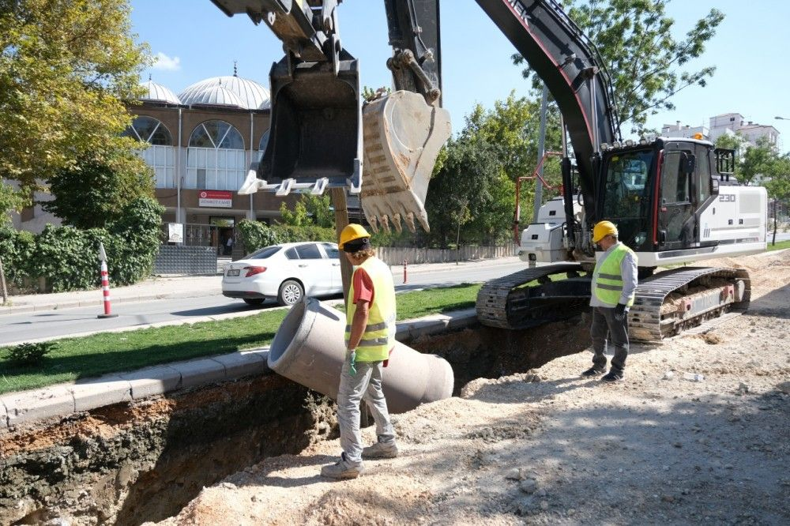

> Eskişehir'de aşırı yağış risklerine karşı altyapıyı güçlendiren ESKİ, Tarih Bulvarı ve Albayrak Caddesi'ndeki yağmur suyu tahliye hattı çalışmalarını bitirdi.

Eskişehir Büyükşehir Belediyesi Su ve Kanalizasyon İdaresi Genel Müdürlüğü (ESKİ), kent genelinde yağmur suyu tahliye kapasitesini artırmak amacıyla yürüttüğü çalışmalara yenilerini ekledi. Bu kapsamda Tarih Bulvarı ve Albayrak Caddesi'nde planlanan yeni yağmur suyu hattının imalatı bitirildi.

Sızdırmazlığı artırmak için entegre contalı beton boruların döşendiği güzergâhta, bakım ve kontrol süreçleri için muayene bacaları yerleştirildi. Yol yüzeyinde biriken suların hatta aktarılması amacıyla yağmur suyu ızgaralarının montajı yapılarak bütünleşik bir drenaj sistemi kuruldu. Çalışmalarla iklim krizine bağlı ani ve yoğun yağışların kent içi ulaşımı olumsuz etkilemesinin önüne geçilmesi hedefleniyor.

Boru döşeme ve altyapı işlemlerinin ardından kazı yapılan noktalarda asfalt serimi gerçekleştirilerek üstyapı onarımları tamamlandı.

Kent genelindeki yatırımların kentin bugünkü ve gelecekteki altyapı gereksinimlerine yanıt verecek şekilde yürütüldüğünü belirten Eskişehir Büyükşehir Belediye Başkanı Ayşe Ünlüce, yapılan çalışmalarla hemşehrilerin günlük yaşamının kolaylaştırıldığını ve kentin geleceğine yatırım yapıldığını ifade etti.

---

## Rektör Adıgüzel'den SUBÜ'ye Tebrik Ziyareti: Akademik İş Birlikleri Görüşüldü

**Eğitim · Tepebaşı** · 2026-11-17 13:09 UTC · Kaynak: [Anadolu Üniversitesi](https://anahaber.anadolu.edu.tr/tr/haber-detay/qyigc976ekw5lb5mflv27a2t)

> Anadolu Üniversitesi Rektörü Prof. Dr. Yusuf Adıgüzel, Sakarya Uygulamalı Bilimler Üniversitesi Rektörlüğü'ne atanan Prof. Dr. Zafer Tatlı'yı makamında ziyaret etti.

Anadolu Üniversitesi Rektörü Prof. Dr. Yusuf Adıgüzel, Sakarya Uygulamalı Bilimler Üniversitesi (SUBÜ) Rektörlüğü görevine atanan Prof. Dr. Zafer Tatlı'ya hayırlı olsun ziyaretinde bulundu. Gerçekleşen ziyarete Anadolu Üniversitesi Rektör Danışmanı Prof. Dr. Mustafa Bostancı ile SUBÜ Rektör Yardımcısı Prof. Dr. İsa Vural da eşlik etti.

Ziyarette Rektör Prof. Dr. Yusuf Adıgüzel, mevkidaşı Prof. Dr. Zafer Tatlı'yı yeni görevi dolayısıyla tebrik ederek çalışmalarında başarılar diledi. Görüşme kapsamında iki yükseköğretim kurumu arasındaki bağların güçlendirilmesi, akademik iş birliklerinin artırılması ve ortaklaşa hayata geçirilebilecek projeler ele alındı.

Üniversiteler arası iş birliği mesajlarının verildiği buluşma, karşılıklı hediye takdiminin ardından tamamlandı.

---

## Rakip Futbolculardan Eskişehirspor'a Övgü: 'Seyircisiyle Çok Farklı Oluyor'

**Spor · Tepebaşı** · 2026-11-17 13:09 UTC · Kaynak: [Google Haberler - Eskişehirspor](https://www.milliirade.com/rakipten-eskisehirspora-ovgu)

> Ayvalıkgücü Belediyesporlu futbolcular Atakan Akbulut ve Mehmet Yıkılmazdağ, 2-2 biten maçın ardından Eskişehirspor'un kadro kalitesine ve tribün gücüne dikkat çekti.

Nesine 3. Lig 2. Grup'ta Eskişehirspor ile 2-2 berabere kalan Ayvalıkgücü Belediyespor'da Atakan Akbulut ve Mehmet Yıkılmazdağ, mücadelenin ardından açıklamalarda bulundu. Konuk ekibin 2-0 öne geçtiği ve kırmızı kart sonrası siyah-kırmızılı ekibin skoru dengelediği randevuyu değerlendiren futbolcular, Eskişehirspor camiasına övgü yağdırdı.

Karşılaşmaya iyi hazırlandıklarını belirten Atakan Akbulut, istedikleri başlangıcı yapmalarına karşın kırmızı kartın ardından dengelerin bozulduğunu söyledi. Akbulut, "Bizim için maç çok güzel başladı, galip gelmek istiyorduk. Kırmızı karttan sonra oyun dengemiz bozuldu. Eskişehir büyük bir camia. Taraftar baskısıyla iyi mücadele ettiler. İyi takımın da ayağına sağlık" ifadelerini kullandı.

Eskişehirspor'un ligdeki kadro kalitesine işaret eden Mehmet Yıkılmazdağ ise siyah-kırmızılıların güçlü oyunculardan kurulu olduğunu belirtti. Tribün baskısının maçın kaderini etkilediğini vurgulayan Yıkılmazdağ, "Eskişehirspor bu ligde en kaliteli futbolculara sahip takımlardan biri. Seyirci desteğini de arkasına aldığında çok farklı oluyor" değerlendirmesini yaptı.

Gruptaki şampiyonluk yarışını da ele alan Yıkılmazdağ, ligde puan farklarının açılmasını beklemediğini ve sezon sonunda hak eden tarafın zirveye çıkacağını dile getirdi.

---

## ESTÜ COP31'de Sahneye Çıkıyor: 15 Bilimsel Proje Antalya'da Tanıtılacak

**Eğitim · Tepebaşı** · 2026-11-17 13:09 UTC · Kaynak: [Eskişehir Teknik Üniversitesi](https://www.eskisehir.edu.tr/tr/Haber/Detay/eskisehir-teknik-universitesi-cop31de-15-projesiyle-yerini-aliyor)

> Eskişehir Teknik Üniversitesi, sürdürülebilir gelecek hedefiyle geliştirdiği 15 bilimsel projesini Antalya'da düzenlenen COP31 Yeşil Bölge etkinliklerinde uluslararası kamuoyuna sunuyor.

Eskişehir Teknik Üniversitesi (ESTÜ), iklim değişikliği ve çevre teknolojileri odaklı bilimsel çalışmalarını uluslararası platformda sergilemeye hazırlanıyor. Üniversite, Antalya'da gerçekleştirilen COP31 Yeşil Bölge etkinlikleri kapsamında 12 stant projesi ve 3 dijital ekran sunumu olmak üzere toplam 15 çalışmasını katılımcılarla buluşturacak.

Akademisyenler tarafından yürütülen çalışmalar; iklim değişikliğine uyum, çevresel sürdürülebilirlik, döngüsel ekonomi, atık yönetimi, ekolojik planlama, afetlere dirençli kentler, dijital kültürel miras ve iklim okuryazarlığı gibi geniş bir yelpazeyi kapsıyor. Projeler, ESTÜ'nün bilimsel araştırma kapasitesini ve sürdürülebilir kalkınmaya yönelik geliştirdiği yenilikçi çözüm modellerini yansıtıyor.

COP31 Yeşil Bölge kapsamında yer alacak çalışmalar, 18 Kasım 2026 Çarşamba günü 10.00 ile 18.00 saatleri arasında Yeşil Bölge 12 numaralı stantta ziyaret edilebilecek. Dijital formattaki 3 proje ise ortak ekran sunumları üzerinden katılımcıların incelemesine açılacak.

---

## Başkan Ataç: 2030'a Kadar Sera Gazı Emisyonunu Yüzde 40 Azaltmayı Hedefliyoruz

**Belediye · Tepebaşı** · 2026-11-17 13:09 UTC · Kaynak: [Tepebaşı Belediyesi](https://www.tepebasi.bel.tr/Haber/Detay/baskanataciklimmucadelesitepebası’ndayıllardırkentyasamınınicinde)

> Tepebaşı Belediye Başkanı Ahmet Ataç, iklim mücadelesinin yerel kararlarla somutlaşacağını belirterek ilçedeki enerji verimliliği ve çevre yatırımlarını anlattı.

Antalya'da devam eden COP31 iklim zirvesi sürecinde değerlendirmelerde bulunan Tepebaşı Belediye Başkanı Ahmet Ataç, çevre ve iklim çalışmalarının dönemsel projelerden çıkarılarak kurumsal bir yapıya dönüştürüldüğünü kaydetti. Ataç, Aralık 2020'de kurulan İklim Değişikliği Müdürlüğü ile Türkiye'deki yerel yönetimlere öncülük ettiklerini ifade etti.

Kuraklık, aşırı sıcaklar ve seller gibi iklim krizinin doğrudan kentleri etkilediğini vurgulayan Ataç, 2013 yılında Belediye Başkanları Sözleşmesi'ne imza attıklarını hatırlattı. Hazırlanan Sürdürülebilir Enerji ve İklim Eylem Planı doğrultusunda hareket ettiklerini belirten Ataç, 2030 yılına kadar sera gazı emisyonlarını yüzde 40 oranında düşürmeyi hedeflediklerini açıkladı.

Mustafa Kemal Atatürk Su Sporları Merkezi ve Melih Savaş Yaşam Köyü gibi tesislerde güneş enerjisinden faydalandıklarını ve su tasarrufu için yağmur suyu hasadı gibi yöntemleri hayata geçirdiklerini aktaran Ataç, ulaşımda ise elektrikli otobüsler, hibrit araçlar ve paylaşımlı bisiklet sistemi ESPEDAL'ın devrede olduğunu bildirdi. Ataç ayrıca İklim Akademi çalışmalarıyla bugüne kadar 117 okulda düzenlenen 182 eğitim sayesinde 16 bin 446 öğrenciye ulaşıldığını kaydetti.

---

## Bakan Göktaş'tan Dijital Güvenlik Çağrısı: 'Teknoloji Şirketleri Sorumluluk Almalı'

**Türkiye · Türkiye** · 2026-11-17 13:09 UTC · Kaynak: [Aile ve Sosyal Hizmetler Bakanlığı](https://www.aile.gov.tr/haberler/bakanimiz-mahinur-ozdemir-goktas-singapur-da-asya-aile-konferansi-nda-konustu/)

> Singapur'daki Asya Aile Konferansı'nda konuşan Bakan Mahinur Özdemir Göktaş, çocukların dijital dünyada korunmasında teknoloji şirketlerinin aktif rol üstlenmesi gerektiğini vurguladı.

Aile ve Sosyal Hizmetler Bakanı Mahinur Özdemir Göktaş, Singapur’da gerçekleştirilen Asya Aile Konferansı kapsamındaki "Çocukları ve Aileleri Desteklemeye Yönelik Ulusal Yaklaşımlar" oturumunda hitap etti. Konferansın "Güçlenen Aileler, Gelişen Çocuklar" temasıyla toplandığını aktaran Bakan Göktaş, bu yaklaşımın Türkiye'deki sosyal politikalara da temel oluşturduğunu belirtti.

Dijital platformların sınır tanımaksızın çocuklara ulaştığına dikkat çeken Göktaş, çocukların güvenliğini sağlamanın ortak bir sorumluluk olduğunu ifade etti. Türkiye'de 1 Kasım'da yürürlüğe giren sosyal medya düzenlemesine değinen Bakan Göktaş, söz konusu adımla platformların 15 yaşından küçük çocuklara hizmet sunmasının engellendiğini, 15-17 yaş grubuna ise yaşa uygun koruyucu tedbirler getirildiğini hatırlattı. Göktaş, uluslararası alanda teknoloji şirketlerinin sorumluluklarının netleştirilmesi için Asya ülkeleriyle iş birliğine açık olduklarını kaydetti.

Demografik değişimlere de değinen Bakan Göktaş, doğurganlık oranlarının azalması ve yaşlı nüfusun artmasının getirdiği risklere karşı 2026-2035 döneminin "Aile ve Nüfus On Yılı" ilan edildiğini aktardı. Bakanlık bünyesinde geliştirilen Sosyal Risk Haritaları sayesinde hane düzeyinde analizler yürütüldüğünü bildiren Göktaş, Aile Endeksi ve Türkiye Aile Yapısı Araştırması gibi çalışmalarla süreçlerin yakından izlendiğini sözlerine ekledi.

---

## 23. Film Festivali'nde Onur Ödülleri Feyzi Tuna ve Nilüfer Aydan'a Verilecek

**Kültür-Sanat · Tepebaşı** · 2026-11-17 11:10 UTC · Kaynak: [Google Haberler - Eskişehir etkinlik](https://www.hurriyet.com.tr/yazarlar/gozde-hatunoglu/haftanin-kultur-sanat-ajandasi-43381119)

> 19-27 Kasım tarihlerinde düzenlenecek 23. Eskişehir Uluslararası Film Festivali'nde onur ödülleri usta yönetmen Feyzi Tuna ile oyuncu Nilüfer Aydan'a sunulacak.

Kültür ve Turizm Bakanlığı Sinema Genel Müdürlüğü desteğiyle Anadolu Üniversitesi İletişim Bilimleri Fakültesi tarafından düzenlenen 23. Eskişehir Uluslararası Film Festivali, 19-27 Kasım 2026 tarihleri arasında sinemaseverlerle buluşuyor. Festivalin açılışı, 19 Kasım'da Sinema Anadolu'da yapılacak tören ve yönetmenliğini Morgan Matthews'un üstlendiği "500 Mil" filminin Türkiye prömiyeriyle gerçekleştirilecek.

Festival kapsamında bu yılki onur ödülleri, Türk sinemasına önemli yapıtlar kazandıran yönetmen Feyzi Tuna ile 100'ü aşkın filmde rol alan usta oyuncu Nilüfer Aydan'a takdim edilecek. Emek ödüllerinin sahipleri ise yönetmen ve yapımcı Biket İlhan ile sinema ses çalışmaları ve yapımcılığıyla tanınan Necip Sarıcı olacak.

Görsel teması Jean-Luc Godard'ın sözünden ilhamla "Sinemada hareket" olarak belirlenen etkinlikte, 34 ülkeden 37 uzun metraj ve 18 kısa metraj yapım yer alıyor. Gösterimlerin yanı sıra usta sinemacıların katılımıyla söyleşiler ve sinema dersleri de festival programında yer bulacak.

---

## Tepebaşı'nda Yüzme Kayıtları Başlıyor: Başvurular 18-20 Kasım'da Online Yapılacak

**Spor · Tepebaşı** · 2026-11-17 11:09 UTC · Kaynak: [Tepebaşı Belediyesi](https://www.tepebasi.bel.tr/Haber/Detay/tepebası’ndayuzmeprogramlarıicinkayıtlarbaslıyor)

> Tepebaşı Belediyesi Su Sporları Merkezi'nde çocuk ve yetişkinlere yönelik yeni dönem yüzme programları için online kayıtlar 18 Kasım'da açılıyor.

Tepebaşı Belediyesi Mustafa Kemal Atatürk Spor Tesisleri Su Sporları Merkezi, farklı yaş gruplarına yönelik yüzme eğitimleri için kapılarını açıyor. Çocuk ve yetişkinleri su sporlarıyla buluşturacak yeni dönem programları için başvurular 18 Kasım Çarşamba günü başlayıp 20 Kasım Cuma günü sona erecek.

Eğitimler kapsamında 6-17 yaş grubundaki çocuklara temel ve ileri düzey yüzme kursları verilecek. 18 yaş ve üzeri yetişkinler ise yüzme eğitiminin yanı sıra serbest yüzme saatleri ve su jimnastiği branşlarından faydalanabilecek.

Kontenjanların sınırlı tutulduğu yüzme programlarında dersler 24 Kasım Salı günü başlayacak. Başvuruların belediyenin tesis.tepebasi.bel.tr internet adresi üzerinden alınacağı, detaylı bilgi edinmek isteyenlerin 0222 310 39 45 numaralı hattı arayabileceği bildirildi.

---

## Odunpazarı Sanat Merkezi'nde Resim Mesaisi: 104 Kursiyer Tuval Başına Geçti

**Kültür-Sanat · Odunpazarı** · 2026-11-17 11:09 UTC · Kaynak: [Google Haberler - Odunpazarı](https://www.karsmanset.com/service/amp/haber/odunpazari-sanat-merkezinde-104-kisi-resim-ogreniyor-1829168.htm)

> Odunpazarı Sanat Merkezi'nde haftanın beş günü düzenlenen resim kursu, farklı yaş gruplarından 104 kursiyerin katılımıyla devam ediyor.

Odunpazarı Belediyesi bünyesinde faaliyetlerini sürdüren Odunpazarı Sanat Merkezi'nde (OSM) açılan resim eğitimi yoğun ilgi görüyor. Sanat eğitimini kentin geneline yaymayı hedefleyen çalışma kapsamında 104 kursiyer atölye çalışmalarına katılıyor.

Eğitmen Melek Tan yönetiminde sürdürülen dersler pazar ve pazartesi günleri dışında haftanın beş günü gerçekleştiriliyor. Katılımcılar eğitim sürecinde resim sanatının temel tekniklerini uygulayarak kendi sanatsal becerilerini geliştirme imkânı buluyor.

Farklı yaş ve tecrübe düzeyinden yurttaşları bir araya getiren kurs programı, kursiyerlere hem kendilerini ifade edebilecekleri sanatsal bir alan hem de üretmenin keyfini yaşayabilecekleri bir ortam sunuyor.

---

## Kaligrafi ve Tipografide Atölye Heyecanı: Çalıştaylar Cuma Gününe Kadar Sürecek

**Kültür-Sanat · Tepebaşı** · 2026-11-17 11:09 UTC · Kaynak: [Anadolu Üniversitesi](https://anahaber.anadolu.edu.tr/tr/haber-detay/fdeml5ogqoy921ryzvtn6cqb)

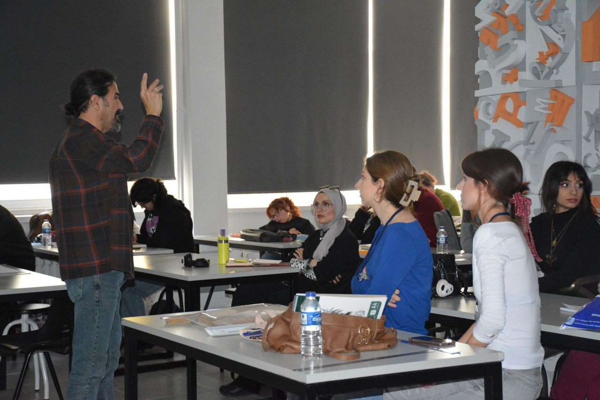

> Anadolu Üniversitesi Güzel Sanatlar Fakültesi tarafından düzenlenen 18. Uluslararası Anadolu Kaligrafi ve Tipografi Festivali kapsamında akademisyen ve sanatçıların katıldığı uygulamalı çalıştaylar başladı.

Anadolu Üniversitesi Güzel Sanatlar Fakültesi Grafik Sanatlar Bölümü ev sahipliğinde gerçekleştirilen 18. Uluslararası Anadolu Kaligrafi ve Tipografi Festivali kapsamında düzenlenen çalıştaylar, akademisyenleri, sanatçıları ve öğrencileri bir araya getirdi. Süleyman Demirel Üniversitesi öğretim üyesi Prof. Yusuf Keş, Eskişehir Osmangazi Üniversitesi öğretim üyesi Doç. Bilge Kınam, Eskişehir Teknik Üniversitesi öğretim elemanı Öğr. Gör. Onur Kuran ve sanatçı Dilruba Güneysu’nun katılımıyla yapılan atölyelerde öğrenciler, alanında deneyimli isimlerle birlikte üretim yapma imkânı buldu.

Düzenlenen çalıştaylar, öğrencilerin derslerde edindikleri kuramsal bilgileri uygulamaya dökerek farklı üretim yöntemlerini deneyimlemelerine katkı sağlıyor. Sanatçı ve akademisyenlerle doğrudan çalışma fırsatı yakalayan öğrenciler, kaligrafi ve tipografi alanındaki becerilerini pekiştirirken özgün tasarımlar ortaya koyuyor.

Hafta boyunca devam edecek uygulamalı atölyeler cuma gününe kadar çeşitli oturumlarla sürecek. Çalıştaylar sürecinde üretilen eserler ise cuma günü düzenlenecek sergiyle sanatseverlerin beğenisine sunulacak. Festival kapsamındaki Yunus Emre sergisi ise 11 Aralık Cuma gününe kadar Anadolu Üniversitesi Çağdaş Sanatlar Müzesinde ziyarete açık kalmaya devam edecek.

---

## Hakan Şapcı'dan 2-2'lik Maç Sonrası Açıklama: 'Oynanan Oyundan Çok Memnunum'

**Spor · Tepebaşı** · 2026-11-17 11:09 UTC · Kaynak: [Google Haberler - Eskişehirspor](https://www.gazetevatan.com/sehirler/eskisehir/eskisehirspor-2-puan-kaybetti-hakan-sapci-cok-memnunum-dedi-2465696)

> Eskişehirspor Teknik Direktörü Hakan Şapcı, 2-2 sona eren Ayvalıkgücü karşılaşmasının ardından yaptığı değerlendirmede kaybedilen puana üzüldüklerini ancak sergilenen futboldan memnun olduğunu söyledi.

Bölgesel Amatör Lig temsilcisi Eskişehirspor'da, Ayvalıkgücü deplasmanında alınan 2-2'lik beraberliğin yankıları sürüyor. Karşılaşmanın ardından teknik direktör Hakan Şapcı, maçta sergilenen oyun ve kaybedilen puanlara ilişkin değerlendirmelerde bulundu.

Karşılaşmanın başında bireysel hatalar nedeniyle kalelerinde iki gol gördüklerini belirten Şapcı, oyuncularının geriye düşmelerine karşın sahada iyi bir direnç ortaya koyduğunu ifade etti. Çok pozisyon ürettiklerini dile getiren tecrübeli teknik adam, yenmemesi gereken basit goller yediklerine dikkat çekti.

Savunma hattındaki talihsizliklere değinen Şapcı, "Sezon başından bu yana büyük talihsizlikler ve hatalar oluyor, özellikle savunma bölgesinde yaşanıyor. Buna rağmen oyuncularımız müthiş bir karakter gösterdi. Kaybedilen 2 puana elbette üzgünüz ancak oynanan oyundan çok memnunum" şeklinde konuştu.

---
