# Son haberler

Ajanın yazdığı son haberler (otomatik güncellenir).

## TİHEK, görme engelli başvuru üzerine Büyükşehir ve Tepebaşı'na 50'şer bin lira ceza verdi

**Belediye · Merkez** · 2026-10-23 09:33 UTC · Kaynak: [Google Haberler - Tepebaşı](https://www.memurlar.net/haber/1181773/gorme-engelliye-ayrimcilik-tihek-ten-iki-belediyeye-ceza.html)

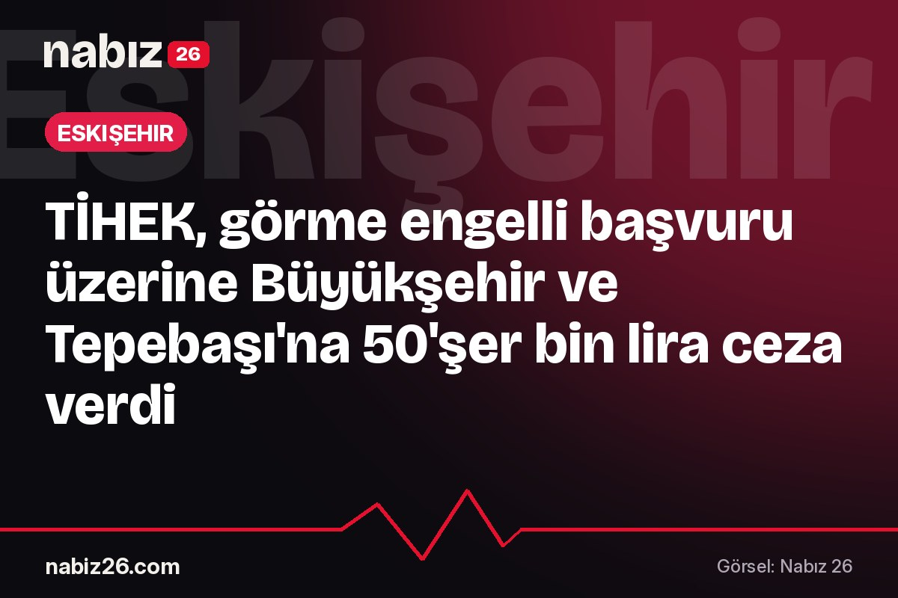

> Kurum, erişilebilirlik koşullarının sağlanmamasını engellilik temelinde ayrımcılık saydı.

Türkiye İnsan Hakları ve Eşitlik Kurumu (TİHEK), görme engelli bir kişinin işe gidiş ve dönüşlerinde kullandığı güzergâhta erişilebilirlik koşullarının sağlanmaması nedeniyle Eskişehir Büyükşehir Belediyesi ile Tepebaşı Belediyesi'ne 50'şer bin lira idari para cezası verdi.

Yüzde 52 oranında görme engeli bulunan başvuran, güzergâhta hız kesici kasis ve yaya geçidi bulunmadığını, kaldırımların erişilebilirlik standartlarına uygun olmadığını öne sürdü. UKOME'ye yaptığı kasis talebinin reddedildiğini savundu. Büyükşehir, bölgenin komisyonca incelendiğini, kasise gerek olmadığı görüşüne varıldığını ve kaldırımlardan sorumlu Tepebaşı Belediyesi'ne konunun bildirildiğini savundu.

Erişilebilirlik İzleme ve Denetleme Komisyonu'nun teknik incelemesinde kaldırımlarda 150 santimetre genişliğinde kesintisiz geçişin sağlanamadığı, elektrik direkleri ve trafik tabelalarının yaya geçişini engellediği, bazı noktalarda rampa, yaya geçidi ve hissedilebilir yüzey işaretlerinin bulunmadığı tespit edildi.

TİHEK, Büyükşehir'in aldığı alternatif tedbirlerin etkili bir çözüm oluşturmadığını, Tepebaşı'nın ise erişilebilir çevre koşullarını makul sürede sağlayamadığını belirterek engellilik temelinde ayrımcılık yasağının ihlal edildiğine hükmetti.

---

## Mahalle AFAD Gönüllü Ekipleri için ESTÜ'de belge takdim töreni yapıldı

**Gündem · Tepebaşı** · 2026-10-23 09:33 UTC · Kaynak: [Eskişehir İl Milli Eğitim Müdürlüğü](https://eskisehir.meb.gov.tr/www/13-ekim-uluslararasi-afet-risklerinin-azaltilmasi-gunu-kapsaminda-belge-takdim-toreni-estu039de-gerceklestirildi/icerik/8691/tr)

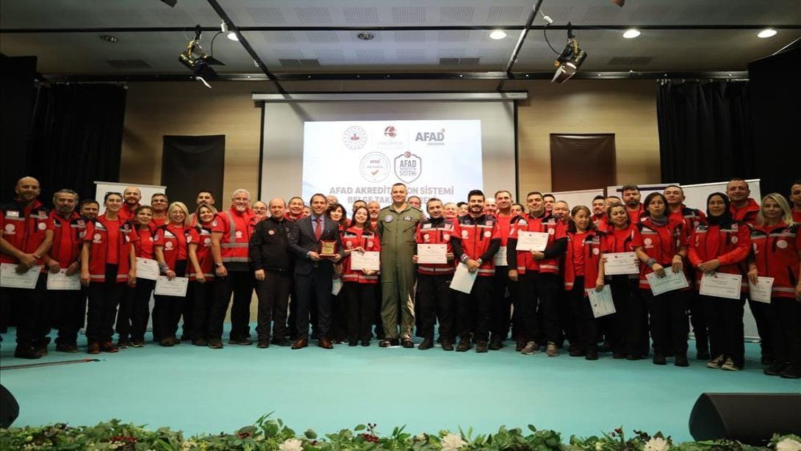

> 13 Ekim Afet Risklerinin Azaltılması Günü kapsamındaki törende 103 gönüllü ve ekipler ödüllendirildi.

13 Ekim Uluslararası Afet Risklerinin Azaltılması Günü kapsamında Eskişehir Valiliği öncülüğünde ve İl AFAD Müdürlüğü koordinasyonunda Mahalle AFAD Gönüllü Ekipleri ve Akredite Arama Kurtarma Ekipleri Belge Takdim Töreni düzenlendi. Tören, Eskişehir Teknik Üniversitesi (ESTÜ) Yabancı Diller Yüksekokulu Konferans Salonu'nda yapıldı.

Törene Vali Yardımcısı Yakup Güney, ESTÜ Rektör Yardımcısı Prof. Dr. Onur Kaya, İl AFAD Müdürü Aslan Mehmet Coşkun ve İl Millî Eğitim Müdür Yardımcısı Ali Türkal katıldı. Deliklitaş, Emek, Kurtuluş, Şirintepe ve Uluönder mahallelerinde toplam 103 gönüllü projeye katıldı.

Projeye katkı sunan beş mahalle muhtarına plaket verildi. MEB AKUB, İHH Eskişehir ve Arçelik bünyesindeki akredite arama kurtarma ekiplerinin temsilcilerine başarı belgesi takdim edildi. Eskişehir MEB AKUB adına İl Millî Eğitim Müdürlüğü'ne plaket verildi.

---

## CHP İstanbul İl Başkanı olarak görevlendirilen Yüksel: CHP vesayet kabul etmez

**Siyaset · Türkiye** · 2026-10-23 09:33 UTC · Kaynak: [Google Haberler - CHP](https://www.babaocagi.com.tr/mehmet-ali-yukselden-vesayet-cikisi-chp-vesayet-kabul-etmez-edemez)

> Mehmet Ali Yüksel, il binası önünde partililerle bir araya gelerek göreve başladı.

CHP İstanbul İl Başkanı olarak görevlendirilen Mehmet Ali Yüksel, il binası önünde partililerle bir araya gelerek göreve başladı. Yüksel konuşmasında "CHP, vesayet kabul etmez, edemez" dedi.

Görevi sona eren Gürsel Tekin'e teşekkür eden Yüksel, Kemal Kılıçdaroğlu'na da saygı ve sevgilerini ilettiğini söyledi. Siyasi iradenin özgürlüğüne vurgu yapan Yüksel, siyasetin satın alınan sadakatler üzerine kurulmaması gerektiğini savundu.

Yüksel, CHP'nin herhangi bir kişi ya da kurumun kontrolüne giremeyeceğini, partiye hiçbir sermaye gücünün sahip olamayacağını söyledi ve partinin farklı kesimleri kapsayan bir anlayışla hareket edeceğini kaydetti.

---

## Büyükşehir'in Caz Günleri Art Baden Quartet konseriyle başladı

**Kültür-Sanat · Merkez** · 2026-10-23 09:33 UTC · Kaynak: [Google Haberler - Eskişehir gündem](https://www.urfadabugun.com/haber/263187/eskisehirde-caz-gunleri-art-baden-quartet-konseriyle-basladi.html)

> Grup Türkiye turnesinin ilk konserini Eskişehir'de verdi; Coltrane doğumunun 100. yılında anıldı.

Eskişehir Büyükşehir Belediyesi'nin 2026-2027 sanat sezonu kapsamındaki Caz Günleri, Art Baden Quartet konseriyle başladı. Türkiye turnesinin ilk konserini Eskişehir'de veren grupta saksafonda Art Baden, gitarda Onur Aymergen, davulda Serkan Alagök ve kontrabasta Ulaş Özdemir yer aldı.

Konserde John Coltrane doğumunun 100. yılında eserleriyle anıldı; Kurt Rosenwinkel ve Richard Rodgers'ın eserleri de seslendirildi. Aymergen'in 2025'te yayımlanan "Africa" adlı bestesi ile Art Baden'in "Chaotic Neutral" adlı eseri de çalındı.

Caz Günleri, 3 Kasım 2026 Salı günü saat 20.00'de Sanat ve Kültür Merkezi Opera Sahnesi'nde "Sibel Köse Quintet" konseriyle sürecek.

---

## Büyükşehir 8059. Cadde'de yol genişletip asfalt serdi: Yaşamkent-Zincirlikuyu bağlantısı

**Ulaşım · Merkez** · 2026-10-23 09:33 UTC · Kaynak: [Google Haberler - Eskişehir](https://www.eskisehirekspres.net/eskisehir-buyuksehirden-bolge-ulasimina-yeni-alternatif)

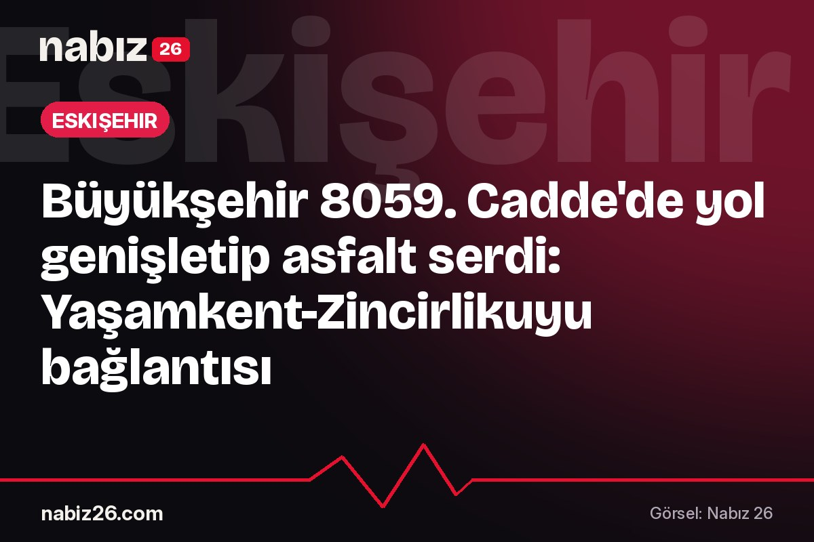

> Cadde Aydın Ünlüce Bulvarı ile 8070. Cadde arasında bağlantı sağlayacak.

Eskişehir Büyükşehir Belediyesi Yol Yapım Bakım ve Onarım Dairesi Başkanlığı ekipleri 8059. Cadde'de yol genişletme çalışması yürütüyor ve bitümlü sıcak asfalt serimine başladı. Çalışmayla Yaşamkent ve Zincirlikuyu mahalleleri arasındaki ulaşım bağlantısının güçlendirilmesi hedefleniyor.

8059. Cadde, Aydın Ünlüce Bulvarı ile 8070. Cadde arasında bağlantı sağlayacak. Yol genişletme ve asfaltlama ile güzergâhın daha düzenli ve güvenli bir ulaşım imkânı sunması amaçlanıyor.

---

## Altay yarın Balıkesirspor'a konuk olacak; geçen hafta Eskişehirspor'a 4-1 yenilmişti

**Spor · Merkez** · 2026-10-23 09:33 UTC · Kaynak: [Google Haberler - Eskişehirspor](https://www.egepostasi.com/haber/Altay-Balikesirspor-ile-karsilasacak/402494)

> 3. Lig 2. Grup 8. hafta maçı Soma Nazım Yavuz Stadı'nda oynanacak.

3. Lig 2. Grup'ta geçen hafta evinde Eskişehirspor'a 4-1 yenilen Altay, yarın deplasmanda Balıkesirspor ile oynayacak. Ev sahibi ekibin stadı bakımda olduğu için 8. hafta karşılaşması Soma Nazım Yavuz Stadı'nda oynanacak; maçı Murat Demir yönetecek.

Altay'da kırmızı kart cezalısı İsa ile sakatlığı bulunan Caner, Arif ve Ferhat forma giyemeyecek. Yunus Efe ile Salih'in durumu maç saatinde netleşecek. Balıkesirspor'da kırmızı kart cezalısı Ferit kadroda yer almayacak.

Ligde iç sahada 3 maçta 3 galibiyet alan Balıkesirspor 13 puanla 7. sırada, son 2 deplasman maçını kazanan Altay ise 9 puanla 11. sırada.

---

## 81 ilde ortaöğretim öğrencileri için "Tabiat ve Yaşanabilir Çevre" yarışması yapılacak

**Eğitim · Türkiye** · 2026-10-23 09:33 UTC · Kaynak: [Eskişehir İl Milli Eğitim Müdürlüğü](https://eskisehir.meb.gov.tr/www/81-ilde-ogrenciler-icin-quottabiat-ve-yasanabilir-cevrequot-bilgi-yarismasi-duzenlenecek/icerik/8689/tr)

> COP31 hazırlıkları kapsamındaki yarışma okul, ilçe ve il olmak üzere üç aşamalı olacak.

Türkiye'nin 9-20 Kasım 2026 tarihleri arasında Antalya'da ev sahipliği yapacağı 31. Taraflar Konferansı (COP31) hazırlıkları çerçevesinde ortaöğretim öğrencilerine yönelik "Tabiat ve Yaşanabilir Çevre" Bilgi Yarışması düzenlenecek.

Yarışmayla öğrencilerin iklim değişikliği ve sürdürülebilirlik konularındaki bilgi ve farkındalığının artırılması hedefleniyor. 81 ilde yapılacak yarışma okul, ilçe ve il olmak üzere üç aşamadan oluşacak.

Sorular iklim değişikliği ve iklim eylemi, sürdürülebilir yaşam, biyoçeşitlilik, enerji kaynakları ve verimliliği, su kaynaklarının korunması, atık yönetimi ve sıfır atık ile iklim politikaları konularından hazırlanacak.

---

## Tarım Kredi Kooperatifi eski müdürü Tahsin B.'nin zimmet davasında bilirkişi kararı

**Asayiş · Merkez** · 2026-10-23 08:33 UTC · Kaynak: [Google Haberler - Eskişehir gündem](https://www.cumhuriyet.com.tr/turkiye/tarim-kredi-kooperatifi-nde-83-ton-komur-acigi-eski-mudure-zimmet-davasi-2549477)

> Mahkeme, 83 ton kömür açığı iddiasıyla ilgili dosyayı Sayıştay emekli uzmanlarından oluşan heyete gönderdi.

Eskişehir'de Tarım Kredi Kooperatifi eski müdürü Tahsin B., zimmet ve resmi belgede sahtecilik suçlamalarıyla yargılanıyor. Davanın duruşması görüldü.

İddialara göre Tahsin B., bir kooperatif ortağından tahsil edilen paranın 5 bin lirasını zimmetine geçirdi, envanter sayımında ortaya çıkan 83 ton 577 kilogram kömür açığından sorumlu ve bir ziraat mühendisinin yerine sahte imza attı.

Savunma yapan Tahsin B. suçlamaları kabul etmedi. Parayı elden teslim edemediğini, sonradan banka havalesiyle iade ettiğini öne sürdü; kömür açığı ve sahte imza iddialarını reddetti. Tanık olarak dinlenen İsa Y., kooperatif kayıtlarında yalnızca 5 bin lira nakit ödeme göründüğünü söyledi. Sanık avukatı beraat talep etti.

Mahkeme, kooperatif zararının basit bir incelemeyle belirlenip belirlenemeyeceği için dosyanın 3 kişilik bilirkişi heyetine, belgelerdeki imzaların incelenmesi için evrakın Ankara Jandarma Kriminal Daire Başkanlığı'na gönderilmesine karar verdi ve duruşmayı erteledi. Sanık hakkında karar verilmedi.

---

## Ortaokul Matematik Zirvesi TED Eskişehir Koleji'nde yapıldı

**Eğitim · Merkez** · 2026-10-23 08:33 UTC · Kaynak: [Eskişehir İl Milli Eğitim Müdürlüğü](https://eskisehir.meb.gov.tr/www/ortaokul-matematik-zirvesi-eskisehir039de-gerceklestirildi/icerik/8693/tr)

> İl Millî Eğitim Müdürlüğü koordinesindeki zirvede öğretmenler Maarif Modeli matematik programını konuştu.

Türkiye Yüzyılı Maarif Modeli doğrultusunda öğretmenlerin program okuryazarlığını güçlendirmek amacıyla düzenlenen Ortaokul Matematik Zirvesi, İl Millî Eğitim Müdürlüğü koordinesinde TED Eskişehir Koleji'nin ev sahipliğinde yapıldı.

Açılış konuşmasını yapan İl Millî Eğitim Müdürü Sinan Aydın, modelin öğrenci merkezli yapısına dikkat çekerek modelin başarısının öğretmenlerin bilgi ve donanımıyla doğrudan ilişkili olduğunu söyledi.

İlde görev yapan matematik öğretmenlerinin katıldığı zirvede, Matematik Dersi Öğretim Programı'nın temel yaklaşımı ve sınıf içi uygulama örnekleri ele alındı. Anadolu Üniversitesi'nden Prof. Dr. Dilek Tanışlı ve Prof. Dr. Nilüfer Köse sunum yaptı.

---

## Odunpazarı'nda çibörekçide yangın: 2 kişi dumandan etkilendi

**Gündem · Odunpazarı** · 2026-10-23 08:33 UTC · Kaynak: [Google Haberler - Eskişehir asayiş](https://www.sakaryagazetesi.com.tr/eskisehirin-islek-noktasinda-korkutan-yangin)

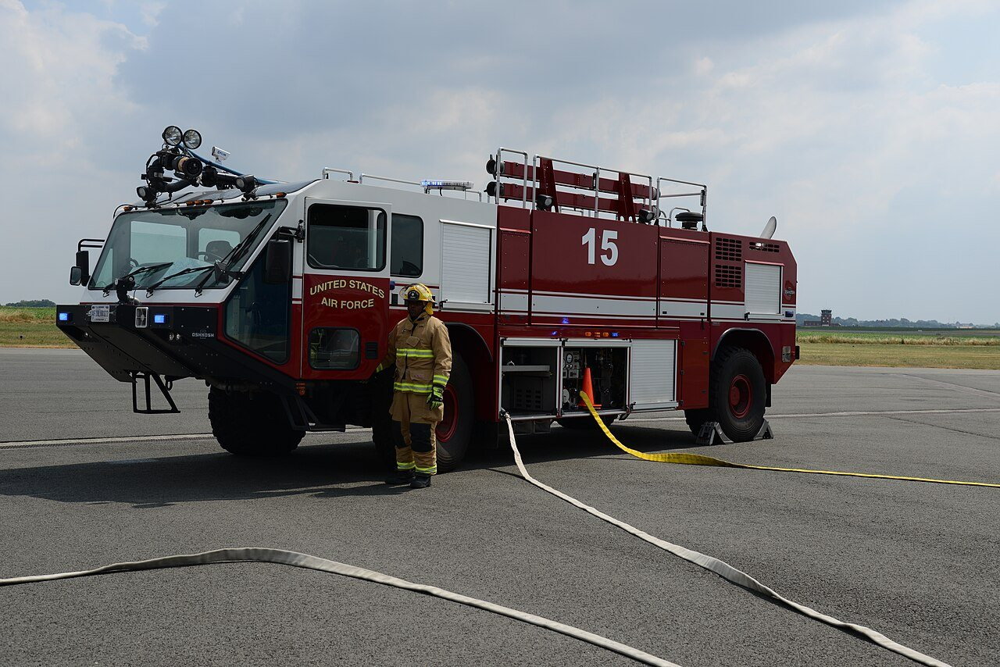

> Arifiye Mahallesi'ndeki yangına itfaiye müdahale etti; ilk değerlendirmede yağdan çıktığı belirtildi.

Eskişehir'in Odunpazarı ilçesine bağlı Arifiye Mahallesi Kıbrıs Şehitleri Caddesi üzerindeki bir çibörekçide henüz kesin olarak belirlenemeyen bir nedenle yangın çıktı. İhbar üzerine olay yerine sevk edilen itfaiye ekipleri yangına müdahale etti.

Yangında işletme personeli 2 kişi dumandan etkilendi ve ambulansta müdahale edildi. İlk değerlendirmelere göre yangının işletmede kullanılan yağdan kaynaklandığı belirtildi. Kesin çıkış nedeninin yapılacak incelemelerle belirlenmesi bekleniyor. Polis ekipleri olayla ilgili inceleme başlattı.

---

## MEB'in Ekim ayı Aile Eğitim Bülteni yayımlandı: Okul öncesi eğitim temalı

**Eğitim · Türkiye** · 2026-10-23 08:33 UTC · Kaynak: [Eskişehir İl Milli Eğitim Müdürlüğü](https://eskisehir.meb.gov.tr/www/quotaile-egitim-bulteniquot-ekim-sayisi-yayimlandi/icerik/8695/tr)

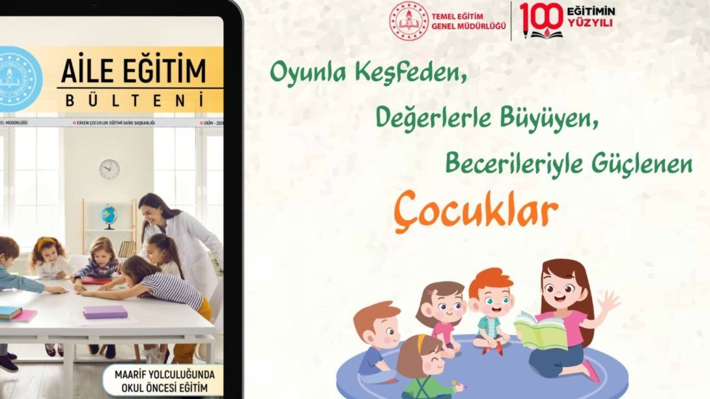

> Temel Eğitim Genel Müdürlüğü, okul öncesi çocukların aileleri için aylık bülteni yayımladı.

Temel Eğitim Genel Müdürlüğü, ailelerin eğitim sürecindeki rolünü güçlendirmek amacıyla her ay hazırladığı "Aile Eğitim Bülteni"nin Ekim sayısını yayımladı. Bülten, okul öncesi eğitime devam eden çocukların anne babalarına rehberlik sunuyor.

Ekim sayısı "Maarif Yolculuğunda Okul Öncesi Eğitim" temasıyla hazırlandı. Bültende okul öncesi eğitimin çocukların gelişimindeki yeri, Türkiye Yüzyılı Maarif Modeli'nin okul öncesi eğitim yaklaşımı ve çocukların okulda yaşayacağı öğrenme deneyimleri ele alındı.

Bültende her çocuğun ilgi alanları, öğrenme hızı ve ihtiyaçlarının farklı olduğu vurgulandı. Ailelerin paylaşacağı gözlemlerin öğretmenin çocuğu daha yakından tanımasına katkı sunacağı belirtildi. Bültende ayrıca Aile Eğitimi ve Katılımı Çalışmaları, Evde Oyun Rehberi ve Ailemle Okul Yolu Programı'na yer verildi.

---

## Eskişehirspor'a Altay maçındaki saha olayları nedeniyle 35 bin lira para cezası

**Spor · Merkez** · 2026-10-23 08:33 UTC · Kaynak: [Google Haberler - Eskişehirspor](https://www.istikbalgazetesi.com/eskisehirspora-para-cezasi-1)

> PFDK, taraftarların neden olduğu olaylar gerekçesiyle kulübe ceza verdi.

Eskişehirspor, Altay ile oynadığı mücadelede yaşanan saha olayları gerekçesiyle Profesyonel Futbol Disiplin Kurulu'na (PFDK) sevk edilmişti.

PFDK, raporlar doğrultusunda Eskişehirspor'a taraftarlarının neden olduğu saha olayları nedeniyle FDT'nin 52/2. ve 46/1. maddeleri uyarınca 35 bin lira para cezası verdi.

---

## Eskişehir'de 2026-2027 eğitim öğretim yılının öncelikleri toplantıda ele alındı

**Eğitim · Merkez** · 2026-10-23 08:33 UTC · Kaynak: [Google Haberler - Eskişehir gündem](https://www.eskisehirekspres.net/eskisehirde-egitimde-yeni-donem-masaya-yatirildi)

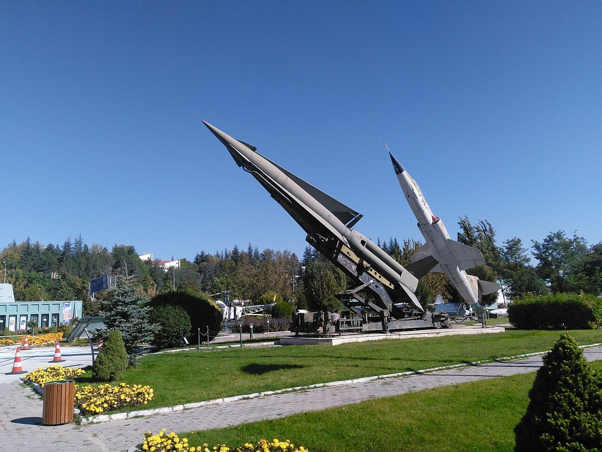

> Millî Eğitim Müdürlükleri Yönetmeliği doğrultusunda yapılan toplantıda eğitim politikaları değerlendirildi.

Eskişehir'de düzenlenen toplantıda, Millî Eğitim Müdürlükleri Yönetmeliği doğrultusunda 2026-2027 eğitim öğretim yılına ilişkin öncelikler ve eğitim politikaları değerlendirildi.

Toplantıda Türkiye Yüzyılı Maarif Modeli uygulamaları, mesleki ve teknik eğitim politikaları, okul-aile iş birliği, okul dışı öğrenme ortamları, eğitim yatırımları, rehberlik hizmetleri, okul güvenliği ve eğitim ortamlarının iyileştirilmesi gündem maddeleri olarak ele alındı. İl genelinde yürütülen çalışmaların daha etkin sürdürülmesine yönelik görüş alışverişinde bulunuldu.

---

## Erdoğan: Barışa giden yolu açmanın gayreti içerisindeyiz

**Siyaset · Türkiye** · 2026-10-23 08:33 UTC · Kaynak: [Google Haberler - Cumhurbaşkanı](https://aa.com.tr/tr/gundem/cumhurbaskani-erdogan-barisa-giden-yolu-acmanin-gayreti-icerisindeyiz/4098110)

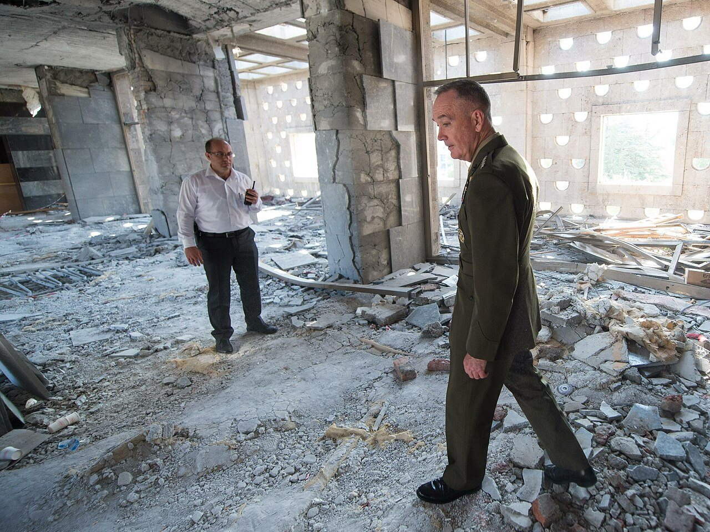

> Erdoğan, 9. İstanbul Arabuluculuk Konferansı'na video mesaj gönderdi.

Cumhurbaşkanı Recep Tayyip Erdoğan, Dışişleri Bakanı Hakan Fidan'ın ev sahipliğinde "Barış için Ortaklıklar ve Yeni Perspektifler: Değişen Dünyada Arabuluculuk" temasıyla İstanbul'da düzenlenen 9. İstanbul Arabuluculuk Konferansı'na video mesaj gönderdi.

Erdoğan, "Rusya ile Ukrayna arasındaki esir takaslarından Afrika kıtasındaki arabuluculuk çabalarımıza geniş bir coğrafyada elde ettiğimiz kazanımlarla bugün de barışa giden yolu açmanın gayreti içerisindeyiz." dedi.

Erdoğan, küresel çatışmaların arttığı bir dönemde Türkiye'nin diplomasiden vazgeçmemeyi ilke edindiğini söyledi. Birleşmiş Milletler'in yapısını eleştiren Erdoğan, "190'dan fazla ülkenin iradesinin 5 ülkenin keyfine bağlı olduğu bir yapı ne adildir ne de güveni tam manasıyla tesis edebilir" ifadesini kullandı. Barış için tarafları bir araya getirmeye ve arabuluculuk yapmaya devam edeceklerini belirtti.

---

## Bakan Tekin: MEB, çocuklara zarar verdiği gerekçesiyle Meta'ya dava açmaya hazırlanıyor

**Eğitim · Türkiye** · 2026-10-23 08:33 UTC · Kaynak: [Google Haberler - Bakanlıklar](https://www.kamudanhaber.net/yusuf-tekin-acikladi-meb-cocuklara-zarar-verdigi-gerekcesiyle-metaya-dava-aciyor)

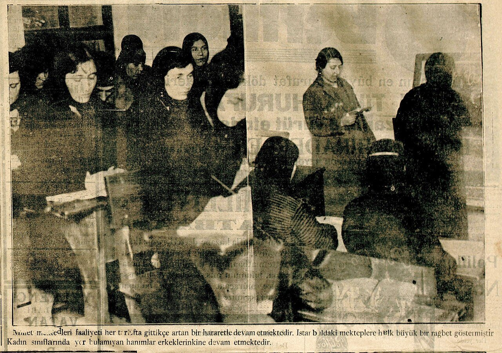

> Tekin, Hukuk Hizmetleri Genel Müdürlüğü'nün süreç hazırlığı yaptığını söyledi.

Millî Eğitim Bakanı Yusuf Tekin, 12. Ankara Erzurum Tanıtım Günleri'nde yaptığı açıklamada Bakanlığın, çocuklara zarar verdiği gerekçesiyle Meta hakkında dava açmaya hazırlandığını söyledi. Tekin, Hukuk Hizmetleri Genel Müdürlüğü'nün süreç hazırlığını yürüttüğünü belirtti.

Tekin, bakanlığın saha araştırmalarında çocukların şiddet algısında sosyal medyanın etkisinin görüldüğünü aktardı. Şiddete maruz kaldığını söyleyen öğrencilerin yaklaşık yüzde 80'inin, sosyal medyada beğenilmemeyi ve gruptan dışlanmayı şiddet tanımı içinde ifade ettiği bildirildi.

Tekin, Cumhurbaşkanı tarafından başta sanal kumar olmak üzere sosyal medyanın çocuklar üzerindeki etkilerinin giderilmesi için tedbir alınması yönünde talimat verildiğini de söyledi.

---

## 4. Uluslararası ESEP Eğitim Bilimleri Kongresi Anadolu Üniversitesi'nde yapıldı

**Eğitim · Tepebaşı** · 2026-10-23 08:33 UTC · Kaynak: [Eskişehir İl Milli Eğitim Müdürlüğü](https://eskisehir.meb.gov.tr/www/4-uluslararasi-esep-egitim-bilimleri-ve-etkili-uygulamalar-kongresi-gerceklestirildi/icerik/8692/tr)

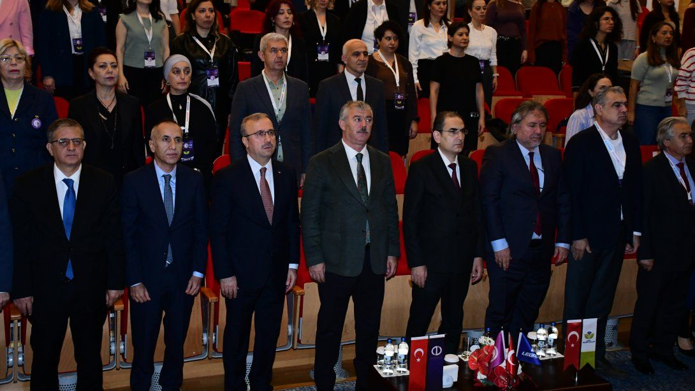

> Kongrede eğitim politikaları, oyun temelli öğrenme ve sanal gerçeklik destekli uygulamalar ele alındı.

4. Uluslararası ESEP Eğitim Bilimleri ve Etkili Uygulamalar Kongresi, Anadolu Üniversitesi'nin ev sahipliğinde Eskişehir'de gerçekleştirildi.

Açılış programına Vali Yardımcısı Akın Ağca, MEB Teftiş Kurulu Başkanı Fethi Fahri Kaya, MEB Personel Genel Müdürü Bülent Çiftçi, Anadolu Üniversitesi Rektör Yardımcısı Prof. Dr. Köksal Büyük, UNESCO Türkiye Millî Komisyonu Başkanı Prof. Dr. M. Öcal Oğuz ve İl Millî Eğitim Müdürü Sinan Aydın katıldı.

Prof. Dr. Adnan Boyacı moderatörlüğündeki panelde eğitim politikaları değerlendirildi. Oturumlarda sanat, medeniyet, sürdürülebilir kalkınma, zekâ, oyun temelli öğrenme ve sanal gerçeklik destekli eğitim uygulamaları ele alındı. Kongrede resim sergisi açılışı, LEGADDER Eğitim Pusulası Ödül Töreni ve akademik bildiri oturumları da yer aldı.

---

## Tepebaşı'nda darp edilen kişi tedaviyi reddedip kaçtı, arsada baygın bulundu

**Asayiş · Tepebaşı** · 2026-10-23 07:35 UTC · Kaynak: [Google Haberler - Eskişehir](https://www.esgazete.com/eskisehirde-kanlar-icinde-kacti-arsada-bulundu)

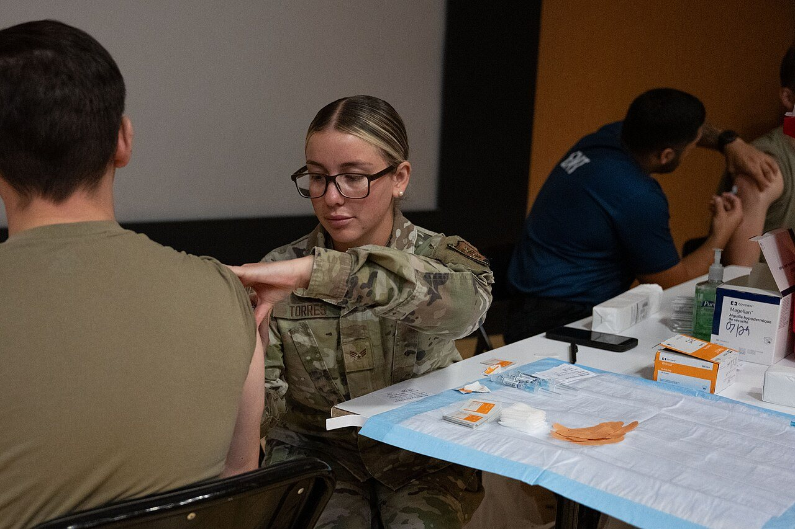

> Tunalı Mahallesi'nde çıkan kavgada darp edilen kişi, evinin yakınındaki arsada bulunarak hastaneye kaldırıldı.

Eskişehir'in Tepebaşı ilçesine bağlı Tunalı Mahallesi Turgut Reis Caddesi üzerinde henüz bilinmeyen bir nedenle iki grup arasında kavga çıktı. Kimliği belirlenemeyen kişilerce darp edilen bir kişiye çevredeki esnaf yardıma koştu.

Ağzı ve yüzü kanlar içinde kalan yaralı, sağlık ekiplerinin müdahalesini kabul etmedi. Ambulansı fark eden yaralı ile yanındaki kadın yakını olay yerinden koşarak uzaklaştı.

İlerleyen saatlerde yaralı, evinin yakınındaki boş bir arsada baygın halde bulundu. 112 Acil Sağlık ekiplerinin ilk müdahalesinin ardından Yunus Emre Devlet Hastanesi'ne kaldırılan yaralı tedavi altına alındı. Olayla ilgili inceleme başlatıldı.

---

## Odunpazarı'nda araçtakiler karşılıklı ateş etti, bir evin duvarına mermi isabet etti

**Asayiş · Odunpazarı** · 2026-10-23 07:35 UTC · Kaynak: [Google Haberler - Eskişehir](https://www.sondakika.com/guncel/haber-eskisehir-odunpazari-nda-aractakiler-karsilikli-at-20357873/)

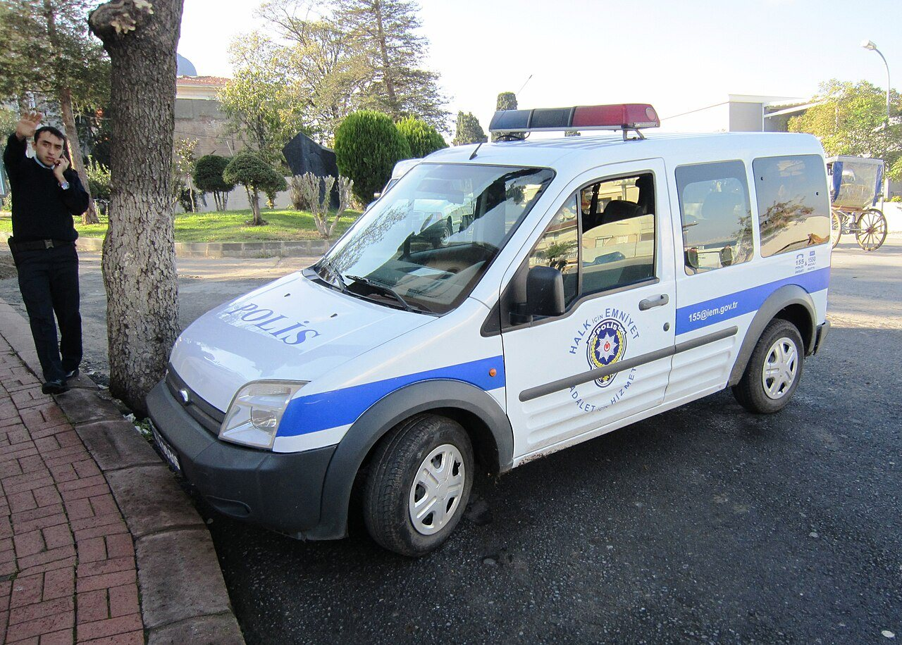

> Huzur Mahallesi'nde iki araçtaki kişiler silahla karşılıklı ateş etti; polis şüphelileri arıyor.

Eskişehir'in Odunpazarı ilçesinde Huzur Mahallesi'nde iki araçtaki kişiler henüz belirlenemeyen nedenle karşılıklı silahla ateş etti. Bir evin duvarına mermi isabet etti.

Olay, Dener Sokak ile Camlı Sokak'ın kesişiminde yaşandı. Silah seslerini duyan vatandaşların ihbarı üzerine bölgeye polis ekipleri sevk edildi.

Polisin incelemesinde, iki araçtaki kişilerin karşılıklı ateş ettiği ve ardından olay yerinden ayrıldığı belirlendi. Polis, şüpheli ya da şüphelileri yakalamak için çalışma başlattı.

---

## MSB: Askerlik yerleri 27 Ekim'de açıklanacak

**Türkiye · Türkiye** · 2026-10-23 07:35 UTC · Kaynak: [Google Haberler - Bakanlıklar](https://www.ilerigazetesi.com.tr/msb-askerlik-yerlerini-acikliyor)

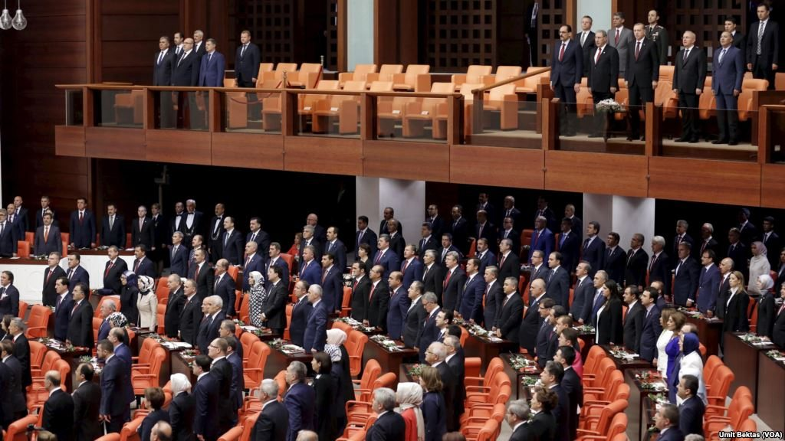

> Kasım, Aralık 2026 ve Ocak 2027 dönemi yükümlülerinin sınıflandırma sonuçları 27 Ekim Salı günü erişime açılacak.

Milli Savunma Bakanlığı (MSB), yedek subay ve yedek astsubay adayları ile erlerin askerlik yerlerinin 27 Ekim 2026 Salı günü açıklanacağını duyurdu. Açıklama, MSB Sözcüsü Tuğamiral Zeki Aktürk'ten geldi.

Kasım, Aralık 2026 ve Ocak 2027 dönemlerinde silahaltına alınacak yükümlüler, sonuçlara e-Devlet Kapısı, askerlik şubeleri ve MSB Mobil uygulaması üzerinden ulaşabilecek.

Muvazzaf subay adayı temini başvuruları ile Deniz Kuvvetleri Komutanlığı deniz sınıfı muvazzaf subay adayı temini başvuruları 2 Kasım 2026 tarihine kadar sürecek.

Açıklamada ayrıca Kara Kuvvetleri Komutanlığı'na, Bilgi Güvenliği Derneği'nin Ankara'daki konferansında "Siber Güvenlik Üstün Hizmet Ödülü" verildiği bildirildi.

---

## Kılıçdaroğlu: Yeni Parti'ye aktarıldığı öne sürülen 5,1 milyon lira için ihtar çekildi

**Siyaset · Türkiye** · 2026-10-23 07:35 UTC · Kaynak: [Google Haberler - CHP](https://www.takvim.com.tr/guncel/2026/10/23/kemal-kilicdaroglu-chpde-yeni-partiye-aktarilan-paranin-iadesini-istedi)

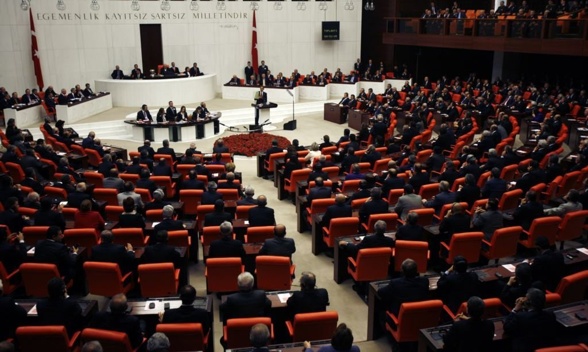

> Kılıçdaroğlu, paranın iade edilmemesi halinde suç duyurusunda bulunulacağını belirtti.

CHP Genel Başkanı Kemal Kılıçdaroğlu, CHP grup hesabından Yeni Parti'ye geçen milletvekillerine aktarıldığı öne sürülen 5 milyon 100 bin liranın iadesi için resmi ihtar çekildiğini açıkladı. Haberde, Kılıçdaroğlu'nun sözleri gazeteci Melik Yiğitel'in aktardığı bilgilere dayandırıldı.

İddiaya göre Yeni Parti'nin kuruluşundan bir gün önce, 23 Temmuz'da Özgür Özel tarafından imzalanan belge doğrultusunda grup hesabındaki para, Yeni Parti'ye geçecek milletvekillerinin hesaplarına ayrı ayrı 57 bin lira olarak yatırıldı.

Kılıçdaroğlu, işlemi ahlaki bulmadığını söyleyerek paranın iadesini istediklerini belirtti. İade edilmemesi halinde Sayıştay denetiminde sorun çıkabileceğini ve hazineden gelecek ödemenin kesilebileceğini ifade etti. Haberde, ihtarın sonuç vermemesi durumunda Özel ve ekibi hakkında suç duyurusunda bulunulacağının öğrenildiği de aktarıldı. Konuya ilişkin Özel ve ekibinin açıklaması kaynak metinde yer almıyor.

---

## Eskişehirspor'da Dereli, Kulet ve Damar'ın hafta sonu forma şansı düşük

**Spor · Merkez** · 2026-10-23 07:35 UTC · Kaynak: [Google Haberler - Eskişehirspor](https://www.2eylul.com.tr/forma-giyemeyecekler-3)

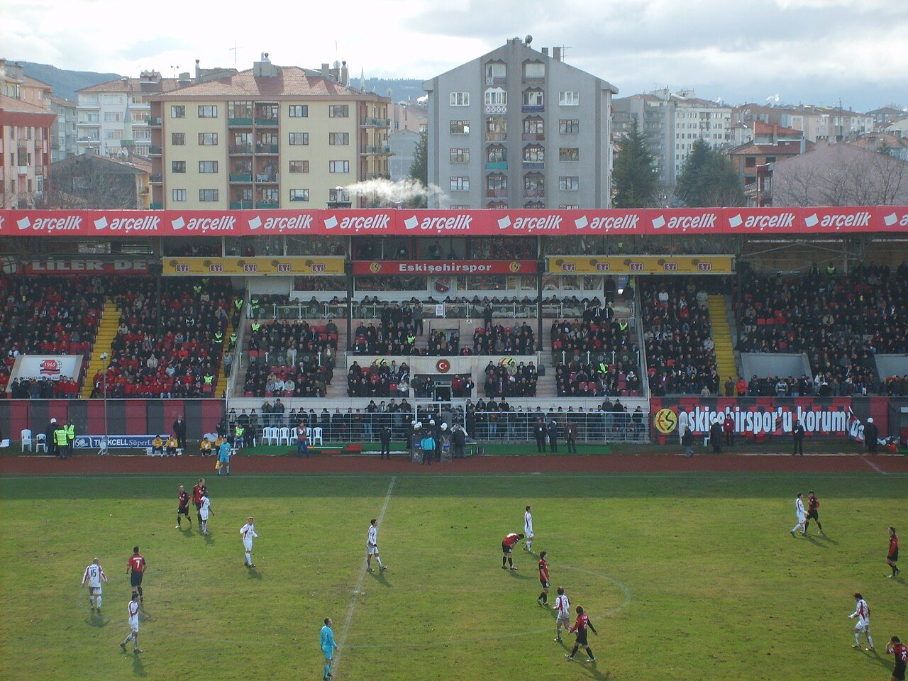

> Şapcı, sakatlığı süren iki oyuncunun oynama ihtimalinin yüksek olmadığını söyledi.

Eskişehirspor'da sakatlığı süren Ahmet Dereli ve İsmail Kulet'in sağlık durumu maç saatine kadar beklenecek. Şapcı, bu iki oyuncuyu pek oynatmayı düşünmediğini, günlük durumlarına göre 21 kişilik kadroda yer alabileceklerini söyledi.

Şapcı, gerekirse oyuncuların iğneyle oynayacak noktaya getirilebileceğini ancak oynama ihtimallerinin çok umut verici olmadığını belirtti.

Sakat listesine Mustafa Eren Damar da eklendi. Damar'ın sırtında ağrı bulunduğu ve tedavisine başlandığı aktarıldı. Şapcı, büyük ihtimalle Damar'ın da hafta sonu kadroda yer alamayacağını söyledi.

---

## Eskişehir'de hava parçalı ve az bulutlu, sıcaklık 22 dereceye çıkacak

**Hava Durumu · Merkez** · 2026-10-23 07:35 UTC · Kaynak: [Google Haberler - Eskişehir](https://www.sakaryagazetesi.com.tr/eskisehirde-hava-degisiyor-mu-meteoroloji-acikladi)

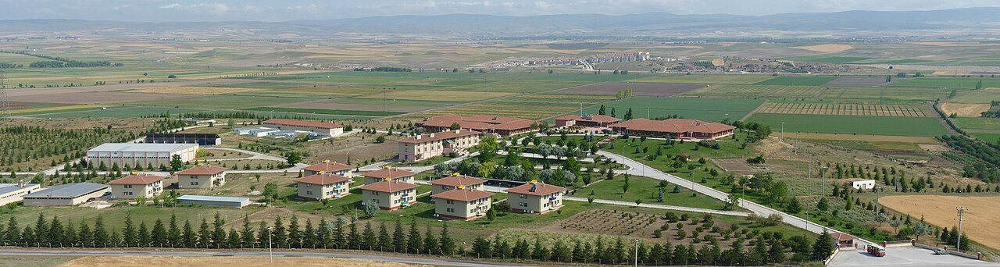

> Meteoroloji'ye göre kentte yağış beklenmiyor, önemli bir hava değişikliği öngörülmüyor.

Meteoroloji 3. Bölge Müdürlüğü'nün tahminlerine göre Eskişehir ve çevresinde parçalı ve az bulutlu hava etkili olacak. Sıcaklıklarda önemli bir değişiklik beklenmiyor.

Odunpazarı ilçesinde en yüksek sıcaklığın 22, Tepebaşı ilçesinde 21 derece olması tahmin ediliyor. Yağış beklenmiyor.

Rüzgârın başlangıçta güneyli yönlerden, ilerleyen saatlerde kuzey ve batı yönlerden hafif, zaman zaman orta kuvvette esmesi bekleniyor. Eskişehir için güncel bir meteorolojik uyarı bulunmuyor.

---

## CHP'li Sarıbal: 2027 bütçesinde tarımsal destek için ayrılan 235 milyar lira yetersiz

**Siyaset · Türkiye** · 2026-10-23 07:35 UTC · Kaynak: [Google Haberler - CHP](https://baskentpostasi.com/chp-genel-baskan-yardimcisi-orhan-saribal-235-milyar-lira-ciftcinin-mazotunun-bile-bedeli-degil)

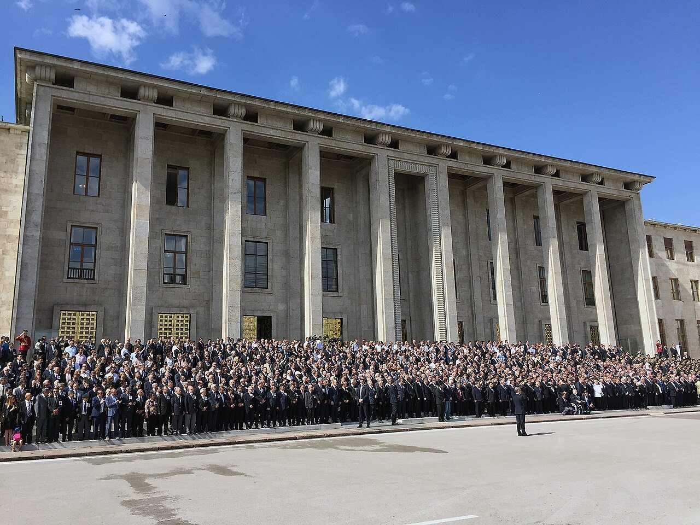

> Sarıbal, TBMM'de düzenlediği basın toplantısında tarımsal desteklerin yasadaki yüzde 1 ölçütünün çok altında kaldığını savundu.

CHP Genel Başkan Yardımcısı ve Bursa Milletvekili Orhan Sarıbal, TBMM'de düzenlediği basın toplantısında 2027 bütçe teklifini değerlendirdi. Sarıbal, tarımsal destekleme programlarına ayrılan 235 milyar liranın çiftçinin temel giderlerini karşılamadığını söyledi.

Sarıbal'a göre tarıma ayrıldığı açıklanan 1 trilyon 305 milyar liralık toplam kaynağın tamamı çiftçiye ödenecek destek değil. Sarıbal, bu tutarın tarımsal kredi destekleri için 325 milyar lira, tarım sektörü yatırımları için 268 milyar lira ve kamu iktisadi teşebbüsleri ile ihracat destekleri için 135 milyar lira gibi kalemleri de kapsadığını aktardı.

5488 sayılı Tarım Kanunu'nun 21. maddesini hatırlatan Sarıbal, destekleme kaynağının gayrisafi millî hasılanın yüzde 1'inden az olamayacağını belirtti. 2027 için öngörülen yaklaşık 111 trilyon liralık hasıla üzerinden bunun yaklaşık 1 trilyon 110 milyar lira olması gerektiğini savundu.

Sarıbal ayrıca üreticilerin banka borçlarının faizlerinin silinmesini ve anaparanın uzun vadeye yayılmasını istedi. Basın özgürlüğüne ilişkin değerlendirmelerde de bulunan Sarıbal, gazeteciler Murat Ağırel ve İsmail Arı'nın tutuklanmasına tepki gösterdi.

---

## Odunpazarı Belediyesi desteğiyle anneler Alaaddin Park Cafe'de buluştu

**Belediye · Odunpazarı** · 2026-10-23 06:36 UTC · Kaynak: [Google Haberler - Eskişehir](https://www.esgazete.com/kazim-kurtun-destegiyle-anneler-alaaddin-park-cafede-bulustu)

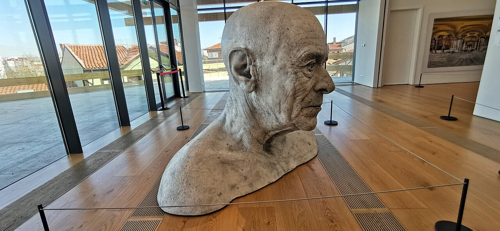

> Eskişehir Anneleri Buluşuyor Platformu'nun sonbahar etkinliğine yaklaşık 100 anne ve çocuk katıldı.

Odunpazarı Belediyesi'nin desteğiyle düzenlenen Eskişehir Anneleri Buluşuyor etkinliğinde, 0-6 yaş arasındaki çocuklar ve anneleri Alaaddin Park Cafe'de bir araya geldi. Esgazete'nin haberine göre etkinliğe yaklaşık 100 anne ve çocuk katıldı.

Çocuklar sonbahar temalı boyama etkinliğine katıldı, sonbahar yapraklarından taçlar hazırladı; müzik ve geleneksel sokak oyunlarıyla vakit geçirdi. Odunpazarı Belediyesi Kadın ve Aile Hizmetleri Müdürlüğü ile Eskişehir Anneleri Buluşuyor Platformu'nun iş birliğinde düzenlenen etkinlikle annelerin tanışması ve deneyimlerini paylaşması amaçlandı.

Belediye Başkanı Kazım Kurt, daha önce Kanlıkavak Parkı'ndaki buluşmada Alaaddin Park Cafe'nin anneler tarafından kullanılabileceğini söylemişti. Müdürlük de annelerle görüş alışverişinde bulunarak mekânda yapılabilecek düzenlemeleri değerlendirdi.

---

## Kurtuluş Kapalı Pazar Yeri'nin açılış tarihi için henüz resmî açıklama yok

**Belediye · Merkez** · 2026-10-23 06:36 UTC · Kaynak: [Google Haberler - Eskişehir](https://www.gzt26.com/eskisehir-kurtulus-kapali-pazar-yeri-ne-zaman-acilacak-iste-dusunulen-tarihler)

> Gazeteci Akif Yer, projede fiziki gerçekleşmenin yüzde 99'u geçtiğinin ifade edildiğini, resmî bitiş tarihinin Haziran 2027 olduğunu söyledi.

Eskişehir'de uzun süredir beklenen Kurtuluş Kapalı Pazar Yeri projesinde çalışmaların son aşamaya geldiği belirtiliyor. Kanal 26'daki "Muhabirin Gözünden" programında Esra Merve Özer'in sorularını yanıtlayan gazeteci Akif Yer, projenin son durumunu anlattı.

Akif Yer, fiziki gerçekleşme oranının yüzde 99'u geçtiğinin ifade edildiğini, iç düzenleme ve yerleşim çalışmalarının sürdüğünü söyledi. Projenin resmî bitiş tarihinin Haziran 2027 olduğunu belirten Yer, açılışın daha erken yapılabileceğine dair duyumlar aldığını ve 23 Nisan ile 19 Mayıs tarihlerinin gündeme gelebileceğini aktardı; bu tarihler için resmî bir açıklama bulunmadığını vurguladı.

Yer'in aktardığına göre pazarcı esnafı halen İmar Sokak çevresindeki geçici alanda satış yapıyor. Yeni binada balıkçılar, şarküteriler ve diğer esnaf için kapalı satış alanları oluşturulacak, zemin altında iki katlı otopark ve Pazarcılar Odası için bir ofis yer alacak.

---

## Eskişehir'de 23 Ekim'de 7 ilçede planlı elektrik kesintisi: Mahalle mahalle liste

**Gündem · Merkez** · 2026-10-23 06:36 UTC · Kaynak: [Google Haberler - Odunpazarı](https://www.eskisehirhaber26.com/eskisehirde-23-ekimde-elektrik-kesintisi-iste-mahalle-mahalle-liste)

> OEDAŞ'ın açıkladığı programa göre Odunpazarı, Tepebaşı, Sarıcakaya, Sivrihisar, Beylikova ve Çifteler'de bazı mahallelerde saatlerce elektrik verilemeyecek.

Osmangazi Elektrik Dağıtım AŞ (OEDAŞ), 23 Ekim 2026 Cuma günü Eskişehir'in 6 ilçesinde bakım, yatırım ve ağaç budama çalışmaları nedeniyle planlı elektrik kesintisi yapılacağını duyurdu. Kesintiler sabah 09.00'da başlayacak, bazı bölgelerde 18.00'e kadar sürecek.

Odunpazarı'nda Orhangazi Mahallesi'nde 09.00-16.00, Karaçay ve Kireç mahallelerinde 10.00-16.00 arasında enerji verilemeyecek. Sarıcakaya'da Beyyayla, Güney ve Kapıkaya mahallelerinde 09.00-17.00 arasında kesinti olacak. Tepebaşı'nda Ertuğrulgazi Mahallesi'nin bazı sokaklarında (Huzur, Arzugül, Damar, İncesu, Ödül ve Porsuk Nehri sokakları) 13.00-16.00 arasında elektrik olmayacak.

Sivrihisar'da Demirciköy, İlören, Koltan, Mülkköy, Nasrettin Hoca, Oğlakçı ve Ortaklar mahallelerinde 10.00-15.30 arasında, Beylikova'da Ata (İstasyon), İkipınar ve Parsıbey mahallelerinde 10.00-16.00 arasında, Çifteler'de Doğanay Mahallesi'nde 11.45-18.00 arasında kesinti yapılacak.

Çalışmaların erken tamamlanması veya saha koşullarına göre saatler değişebilir. Güncel bilgiler OEDAŞ'ın duyurularından ve ALO 186 elektrik arıza hattından öğrenilebiliyor.

---

## Eskişehir Şeker Fabrikası'nın taşınması tartışması yeniden gündemde

**Gündem · Merkez** · 2026-10-23 06:36 UTC · Kaynak: [Google Haberler - Eskişehir](https://www.gzt26.com/eskisehir-seker-fabrikasi-tasinacak-mi-koku-sikintisi-yine-gundemde)

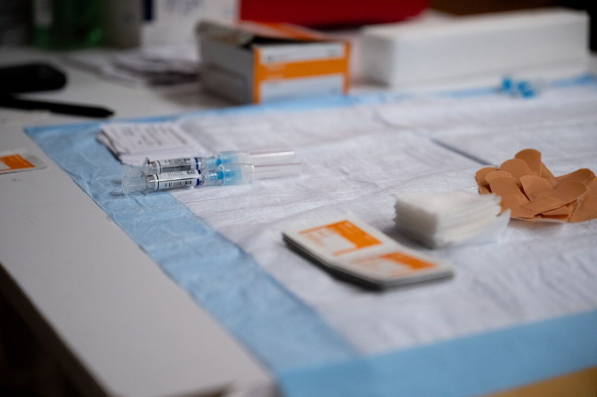

> Kanal 26'da konuşan gazeteci Akif Yer, fabrikanın kokusu, kapasitesi ve çiftçi nakliye giderleri üzerine yürüyen tartışmayı değerlendirdi.

Kanal 26'daki "Muhabirin Gözünden" programında Esra Merve Özer'in sorularını yanıtlayan gazeteci Akif Yer, Eskişehir Şeker Fabrikası'nın taşınmasına ilişkin tartışmaları değerlendirdi. Yer, yaklaşık 93 yıl önce kurulan fabrikanın başlangıçta şehir dışında kaldığını, kentin büyümesiyle yerleşim alanlarının arasında kaldığını anlattı.

Yer'e göre tartışma, AK Parti Eskişehir İl Başkanı Gürhan Albayrak'ın Eskişehir Genç Rençberler Derneği'ni ziyaretiyle gündeme geldi. Albayrak'ın gerekli görülürse taşınmanın mümkün olabileceğini söylediği iddia ediliyor. İYİ Parti Odunpazarı İlçe Başkanı Gürol Yer ise fabrikanın yerinde kalmasını savunuyor ve arazinin rant amacıyla kullanılmaması gerektiğini söylüyor. Genç Rençberler Derneği Başkanı Burak Kuşan ise Mahmudiye'yi pancar üreticileri için ulaşılabilir bir nokta olarak öneriyor.

Akif Yer, taşınmanın nakliye giderlerini azaltabileceğini, ancak fabrikanın üretim ve işleme kapasitesinin artırılmasının şart olduğunu söyledi. Koku sorununun özellikle Tepebaşı'nda hissedildiğini belirten Yer, taşınma kararı alınırsa mevcut arazinin kamu mülkiyetinde kalmasını ve satışa çıkarılmamasını savundu.

---

## Erdoğan AK Parti grup toplantısında siyaset dilini ve sel çalışmalarını anlattı

**Siyaset · Türkiye** · 2026-10-23 06:36 UTC · Kaynak: [Google Haberler - Cumhurbaşkanı](https://www.tbmm.gov.tr/Haber/Detay?Id=fe054b99-be80-4d03-a5a7-01a15e25ca54)

> Cumhurbaşkanı Erdoğan, TBMM'deki AK Parti Grup Toplantısı'nda muhalefete yönelik eleştirilerde bulundu ve afet çalışmalarına ilişkin bilgi verdi.

Cumhurbaşkanı Recep Tayyip Erdoğan, AK Parti TBMM Grup Toplantısı'nda yaptığı konuşmada geçen hafta İstanbul'dan Ankara'ya gelirken geçirdiği trafik kazasında hayatını kaybeden Üsküdar Belediye Başkan Vekili Dündar Ziya Gültekin için başsağlığı diledi. Erdoğan, Üsküdar Belediye Başkan Vekili seçilen Muhammed Emin Sarıoğlu'nu da tebrik etti.

Erdoğan, siyasette artan kutuplaşmanın tehlikelerine dikkat çektiğini ve tüm siyasi partileri müştereklerini çoğaltmaya davet ettiğini söyledi. Son üç haftada muhalefetin bazı isimlerinden beklediği tavrı görmediğini belirten Erdoğan, muhalefetin bir kısmının sorumsuz bir tavır sergilediğini ileri sürdü. Fon tartışmalarına da değinen Erdoğan, belgesiz itham ve iftira olarak nitelendirdiği iddialara karşı hukuk ve demokrasi zemininde mücadele edeceklerini söyledi.

Erdoğan ayrıca geçen hafta İstanbul ve çevre illerde yaşanan aşırı yağış, sel ve su baskınlarına ilişkin açıklama yaptı. Devlet olarak vakit kaybetmeden harekete geçtiklerini belirten Erdoğan, 14 Ekim'de afet gruplarının İstanbul'daki il ve ilçe AFAD yönetim merkezlerinde 7 gün 24 saat çalışmaya başladığını, arama kurtarma, müdahale ve destek çalışmalarında 47 bin 217 personelin, 5 bin 280 araç ve 14 botla görev aldığını açıkladı.

---

## Çukurova Belediyesi soruşturmasında 34 kişi tutuklandı

**Asayiş · Türkiye** · 2026-10-23 06:36 UTC · Kaynak: [Google Haberler - CHP](https://www.sonmuhur.com/uc-ay-once-chp-genel-sekreter-yardimcisi-olarak-atanmisti-cukurova-belediyesine-yonelik-sorusturmada-tutuklandi)

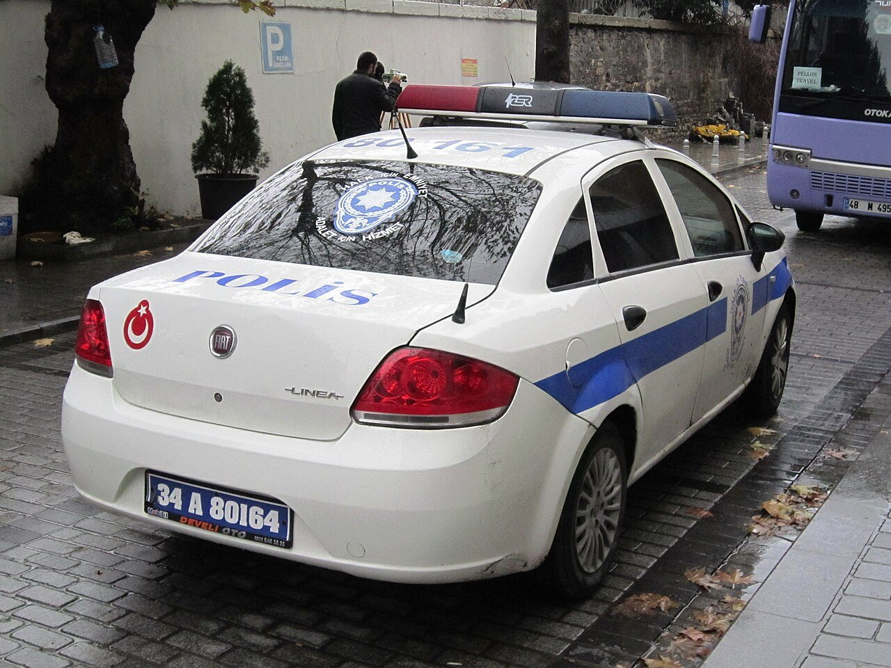

> Adana Cumhuriyet Başsavcılığı'nın soruşturmasında 19 Ekim'de 51 kişi hakkında gözaltı kararı verilmişti.

Adana Cumhuriyet Başsavcılığı, Çukurova Belediyesi'ne yönelik "suç işlemek amacıyla örgüt kurma, yönetme ve örgüte üye olma", "rüşvet", "nitelikli dolandırıcılık" ve "ihaleye fesat karıştırma" suçlamalarıyla soruşturma yürütüyor. Son Mühür'ün aktardığına göre soruşturmada 19 Ekim'de 51 kişi hakkında gözaltı kararı çıkarılmıştı.

Gözaltına alınanlar arasında Çukurova Belediyesi'nin 2014-2024 arasındaki eski başkanı S. Ç. ile mevcut başkan E. K. de bulunuyordu. Şüphelilerin sorgusunun tamamlanmasının ardından, aralarında üç belediye başkan yardımcısının da olduğu 34 kişi hakkında tutuklama kararı verildi. Haberde, tutuklananlardan eski başkanın bu yıl haziranda CHP Genel Sekreter Yardımcısı olarak atandığı ve mevcut başkanın CHP'den aday gösterildikten sonra Yeni Parti'ye geçtiği belirtildi. Soruşturma sürüyor.

---

## AK Parti Eskişehir İl Başkanı Albayrak: Eskişehir Kalkınma Platformu dernekleşecek

**Gündem · Merkez** · 2026-10-23 06:36 UTC · Kaynak: [Google Haberler - Eskişehir](https://www.sakaryagazetesi.com.tr/ak-parti-eskisehir-il-baskani-gurhan-albayrak-eskisehiri-dunyaya-acmak-istiyoruz)

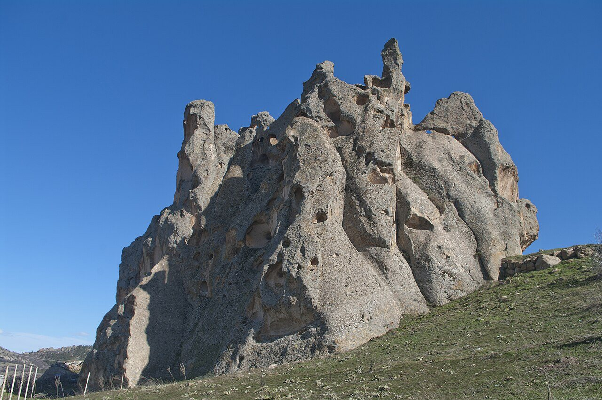

> Albayrak, Brüksel temaslarının ardından THY'yi Eskişehir'e getirmek ve kenti uluslararası alanda tanıtmak istediklerini söyledi.

AK Parti Eskişehir İl Başkanı Gürhan Albayrak, Brüksel temaslarının ardından Sakarya Gazetesi'ne açıklamalarda bulundu. Albayrak, Eskişehir Kalkınma Platformu'nun dernekleşeceğini, platformun internet sitesi ve sosyal medya hesaplarının oluşturulacağını ve faaliyetlerin büyük ölçüde sponsorluklarla yürütülmesinin planlandığını söyledi.

Albayrak'a göre platform DEİK Avrupa İş Dünyası Zirvesi'ne katıldı. Koç Holding CEO'su, Türk Hava Yolları yetkilileri, TÜRSAB Başkanı ve Türkiye'nin Brüksel büyükelçisiyle görüşüldü. THY yetkilileriyle Eskişehir Teknik Üniversitesi ile birlikte pilotaj eğitimleri ve motor bakımı konularının konuşulduğunu anlatan Albayrak, THY'nin Eskişehir'e gelmesini istediklerini belirtti.

Albayrak, kasım sonu veya aralık başında vali, belediye başkanları ve oda başkanlarıyla yeniden Brüksel'e gitmeyi, nisan veya mayısta Brüksel'de Eskişehir Tanıtım Günleri düzenlemeyi ve haziran ya da temmuzda Eskişehir'de Gurbetçiler Festivali yapmayı planladıklarını söyledi. Çevre yolu ve Yenişehir-Gemlik bağlantısının öncelikli konular olduğunu belirten Albayrak, Ulaştırma Bakanlığı'ndan aldığı bilgiye göre bağlantı yolunun ihalesinin 2027'nin ilk çeyreğinde yapılmasının öngörüldüğünü aktardı.

---
