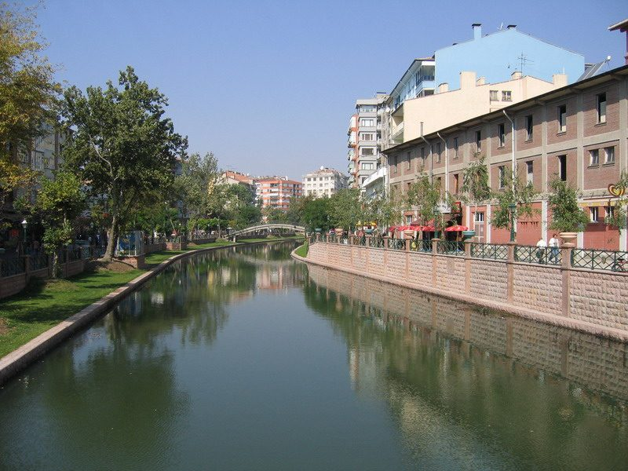
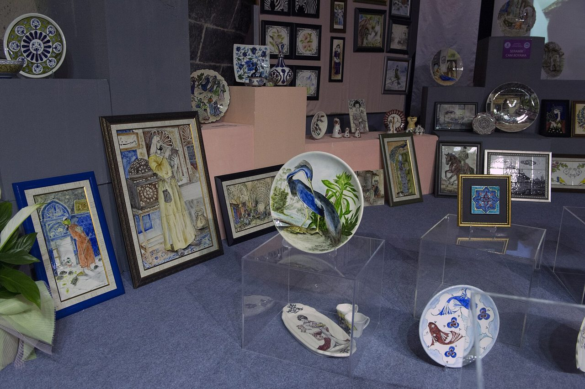

# Son haberler

Ajanın yazdığı son haberler (otomatik güncellenir).

## Özel gereksinimli bireyler ÇİDEM'de domates hasadına katıldı

**Gündem · Merkez** · 2026-11-04 00:31 UTC · Kaynak: [Google Haberler - Eskişehir etkinlik](https://baskentpostasi.com/eskisehirde-ozel-gereksinimli-bireyler-cidemde-domates-hasadina-katilarak-tarimsal-uretimi-deneyimledi)

> Etkinliği Büyükşehir Sosyal Hizmetler Dairesi Başkanlığı düzenledi.

Eskişehir Büyükşehir Belediyesi Sosyal Hizmetler Dairesi Başkanlığı Özel Gereksinimliler Şube Müdürlüğü'nün düzenlediği etkinlikte, Zihinsel Engelli Gündüz Yaşam Merkezi'nden hizmet alan özel gereksinimli bireyler Seyitgazi ilçesi Taşlık Mahallesi'ndeki Çiftçi Destekleme ve Eğitim Merkezi'ni (ÇİDEM) ziyaret etti.

Katılımcılar domates hasadına katılarak tarımsal üretim sürecini yerinde deneyimledi. Etkinlikle özel gereksinimli bireylerin sosyal yaşama katılımlarının desteklenmesi ve yeni deneyimler kazanmaları amaçlandı.

---

## 20. Eskişehir Uluslararası Film Festivali 16-24 Kasım'da, onur ödülleri açıklandı

**Kültür-Sanat · Merkez** · 2026-11-03 23:32 UTC · Kaynak: [Google Haberler - Eskişehir gündem](https://m.haber7.com/kultur/haber/2737858-eskisehir-uluslararasi-film-festivali)

> Onur ödülleri Itır Esen ve Macit Koper'e verilecek; festival bu yıl ilk kez iki yeni yarışma düzenleyecek.

Kültür ve Turizm Bakanlığı Sinema Genel Müdürlüğü desteğiyle Anadolu Üniversitesi (AÜ) ve AÜ İletişim Bilimleri Fakültesi tarafından bu yıl 20'ncisi düzenlenecek Eskişehir Uluslararası Film Festivali 16-24 Kasım'da yapılacak. Festivalin onur ödüllerini kazananlar açıklandı: ödüller oyuncular Itır Esen ve Macit Koper'e verilecek. Her iki oyuncu ödülünü festivalin açılış töreninde alacak.

Türkiye'nin üniversite kimliği taşıyan uluslararası tek uzun metraj film festivali olarak tanıtılan etkinlik, bu yıl ilk kez "Kısa Film Yapım Destek" ve "Sinema Kültürüne Katkı" yarışmalarına yer verecek.

Kaynakta Itır Esen'in 1975'ten itibaren Bizim Aile, Gülen Gözler, Aile Şerefi ve Cennetin Çocukları dahil toplam 8 filmde rol aldığı, Macit Koper'in ise sinemada hem oyuncu hem senarist olarak çalıştığı belirtiliyor.

---

## Eskişehir'de Organ Bağışı Haftası kapsamında 5 Kasım'da yürüyüş düzenlenecek

**Sağlık · Merkez** · 2026-11-03 22:32 UTC · Kaynak: [Google Haberler - Eskişehir etkinlik](https://www.eskisehir.net/eskisehirde-organ-bagisi-icin-yuruyus-duzenlenecek)

> Yürüyüş İl Sağlık Müdürlüğü Ek Hizmet Binası önünden başlayacak.

Eskişehir İl Sağlık Müdürlüğü, Organ Bağışı Haftası kapsamında organ bağışının önemine dikkat çekmek ve toplumsal farkındalığı artırmak amacıyla yürüyüş ve basın açıklaması düzenleyecek. Etkinlik 5 Kasım Perşembe günü saat 13.50'de başlayacak.

Başlangıç noktası İl Sağlık Müdürlüğü Ek Hizmet Binası önü olacak; katılımcılar Doktorlar Caddesi güzergâhında yürüyecek. Etkinlikte İl Sağlık Müdürü Doç. Dr. Yaşar Bildirici ile Sağlık Hizmetleri Başkanı Op. Dr. Ersin Işıldı organ bağışının önemi hakkında açıklama yapacak.

---

## Eskişehir Anadolu SF-Eskişehirspor maçının saati 13.00'e alındı

**Spor · Merkez** · 2026-11-03 20:32 UTC · Kaynak: [Google Haberler - Eskişehirspor](https://www.istikbalgazetesi.com/anadolu-spor-faaliyetleri-eskisehirspor-macinin-saati-degisti)

> Saat değişikliği canlı yayın programı nedeniyle yapıldı; stat görüşmeleri sürüyor.

11 Kasım Çarşamba günü saat 15.00'te oynanacağı duyurulan Eskişehir Anadolu Spor Faaliyetleri-Eskişehirspor karşılaşmasının başlama saati 13.00 olarak güncellendi. İstikbal Gazetesi'nin aktardığına göre TFF'nin Anadolu Spor Faaliyetleri kulübüne yaptığı bildirimde saat değişikliğinin canlı yayın programı nedeniyle yapıldığı belirtildi.

Maçın ESOGÜ Stadyumu yerine Fethi Heper Stadyumu'nda oynanması için görüşmelerin sürdüğü bildirildi.

---

## Odunpazarı'ndaki bentonit ocağının ÇED olumlu kararı mahkemece iptal edildi

**Gündem · Odunpazarı** · 2026-11-03 19:35 UTC · Kaynak: [Google Haberler - Odunpazarı](https://www.istikbalgazetesi.com/eskisehirde-iki-koyu-ilgilendiren-maden-ocagi-davasinda-karar-cikti)

> TEMA Vakfı, bilirkişi raporuna dayanarak sahanın rehabilite edilmesini istedi.

Eskişehir'in Odunpazarı ilçesine bağlı Demirli ve Seklice köylerindeki bentonit ocağında planlanan kapasite artışına ilişkin ÇED olumlu kararı, açılan dava sonucunda iptal edildi. Bilgi TEMA Vakfı'nın sosyal medya açıklamasına dayanıyor.

TEMA Vakfı'na göre dava kapsamında hazırlanan bilirkişi raporu projenin çevresel etkilerine ilişkin önemli tespitler içeriyor. Vakfın aktardığına göre 8 Mayıs'taki bilirkişi keşfinde ocak sahasındaki pasa yığınlarının yağış nedeniyle çöktüğü görüldü. Bilirkişi raporunda ÇED raporundaki teknik hatalar ile projenin doğal ve kültürel varlıklar üzerinde olumsuz etkiler yaratabileceği belirtildi. TEMA Vakfı, ÇED kararının iptalinin ardından proje sahasının vakit kaybedilmeden rehabilite edilmesi ve yeniden doğaya kazandırılması gerektiğini vurguladı.

Haber TEMA Vakfı'nın açıklamasına dayanıyor; ocağı işleten firmanın ve ilgili kurumların görüşü kaynakta yer almıyor.

---

## Ünlüce: Numbeo güvenlik endeksinde Eskişehir Türkiye'de ilk sırada

**Gündem · Merkez** · 2026-11-03 19:36 UTC · Kaynak: [Google Haberler - Eskişehir gündem](https://www.ajans04.net/eskisehir-turkiye-nin-en-guvenli-sehri-oldu)

> Numbeo verileri kitle kaynaklı; endeks 1 Kasım 2026'da güncellendi.

Eskişehir Büyükşehir Belediye Başkanı Ayşe Ünlüce, uluslararası kitle kaynaklı veri tabanı Numbeo'nun 1 Kasım 2026'da güncellenen güvenlik endeksinde Eskişehir'in Türkiye'de değerlendirilen şehirler arasında ilk sırada yer aldığını sosyal medya hesabından duyurdu.

Ünlüce, Eskişehir'in yalnızca kültür, sanat ve çağdaş yaşamıyla değil, güvenli ve huzurlu kent kimliğiyle de öne çıktığını belirtti, sonucun kent adına sevindirici olduğunu söyledi. Başarıda emeği bulunan kurum ve kuruluşları kutlayan Ünlüce, Eskişehir'in huzuruna ve güvenliğine katkı sunan vatandaşlara teşekkür etti. Haber Ünlüce'nin paylaşımına dayanıyor; endeksin ayrıntıları ve puanları kaynakta yer almıyor.

---

## Perma grubu 15 Ocak 2027'de Eskişehir'de konser verecek

**Kültür-Sanat · Merkez** · 2026-11-03 19:34 UTC · Kaynak: [Google Haberler - Eskişehir etkinlik](https://www.eskisehir.net/perma-eskisehire-geliyor)

> Konser Permaverse Tour kapsamında Holly Stone'da yapılacak.

Perma grubu, "Permaverse Tour" turne takvimini duyurdu ve rotaya Eskişehir'i de ekledi. Yayımlanan resmî turne afişine göre grup 15 Ocak 2027'de Eskişehir'de, Holly Stone'da sahne alacak.

Turne kasım ayının son günlerinde İstanbul'da başlayacak; Bursa, Ankara, İzmir, Antalya, Trabzon ve Adana gibi şehirler de rotada yer alıyor. Kaynağa göre biletler henüz satışa çıkmadı; bilet detayları ve etkinlik saatlerine ilişkin duyurular bilet satış platformlarından takip edilebilecek.

---

## Başkan Ünlüce Büyükşehir'in ekim ayı çalışmalarını açıkladı: 170 bin ton asfalt üretildi

**Belediye · Merkez** · 2026-11-03 18:34 UTC · Kaynak: [Google Haberler - Eskişehir](https://www.gzt26.com/ayse-unluce-eskisehirde-ekim-ayinda-yapilan-calismalari-acikladi)

> Ünlüce, yeni nesil su sayaçlarından Bilim Fest'e kadar ekim ayının öne çıkan işlerini sıraladı.

Eskişehir Büyükşehir Belediye Başkanı Ayşe Ünlüce, belediyenin ekim ayındaki çalışmalarını açıkladı. Aşağıdaki bilgiler Ünlüce'nin kendi açıklamasına dayanıyor.

Ünlüce, ekim ayına bu yıl ilk kez düzenlenen Uluslararası Eskişehir Yunus Emre Edebiyat Şenliği ile başladıklarını, dört gün süren şenlikte sanatçı, yazar ve şairleri "neşe" temasında buluşturduklarını söyledi. Kent Edebiyat Ödülü'nün özel ödülü Latife Tekin'e verildi. 15-17 Ekim'de Bilim Fest Eskişehir düzenlendi.

26 Ekim'de tanıtılan yeni nesil su sayaçlarıyla cep telefonlarından su yüklenebilir hale geldi; başvuru yapan tüm abonelere yeni sayaç takılacak. Ünlüce, ekim sonuna kadar kent genelinde 170 bin ton asfalt üretildiğini, kırsalda yaklaşık 70 kilometrelik sathi kaplama yapıldığını ve yılbaşından ekim sonuna kadar kırsal ilçelerde yaklaşık 850 milyon TL'lik altyapı ve üstyapı yatırımı gerçekleştirildiğini belirtti. ESKİ, ekimde Sazova, 71 Evler ve Emek mahallelerinde toplam 160 milyon TL değerinde altyapı yatırımı yaptı.

Ünlüce ayrıca 6 Şubat depremlerinin ardından Adıyaman'la kurulan dayanışma bağının Eskişehir Parkı ile kalıcı bir esere dönüştürüldüğünü, kaldırım ve yol işgalleri ile çevre kirliliğine yönelik denetimlerin artırıldığını, tiyatro, senfoni, müze ve Otobüs 26 biletlerinin ESBilet uygulamasından alınabildiğini söyledi. Halk Dansları Grubu ilk gösterisini yaptı; Şehir Tiyatroları ve Senfoni Orkestrası yeni sezona başladı.

---

## Eskişehirspor 9 günde 3 maç oynayacak: Kepezspor, Anadolu SF ve Ayvalıkgücü

**Spor · Merkez** · 2026-11-03 17:32 UTC · Kaynak: [Google Haberler - Eskişehirspor](https://www.istikbalgazetesi.com/eskisehirsporda-zorlu-donemec-9-gunde-3-mac)

> Eskişehirspor 11 Kasım'da Eskişehir Anadolu SF'ye konuk olacak.

Eskişehirspor, Gaziemir deplasmanında aldığı 5-0'lık galibiyetin ardından 9 günde üç maça çıkacak. 10. haftada 7 Kasım Cumartesi günü saat 15.30'da Kepezspor'u ağırlayacak. 11. haftada 11 Kasım Çarşamba günü saat 15.00'te zirve mücadelesi veren Eskişehir Anadolu SF'ye konuk olacak. 12. haftada ise 15 Kasım Pazar günü saat 15.00'te Ayvalıkgücü Belediyespor'u konuk edecek; İstikbal Gazetesi'ne göre rakip geçen sezon olduğu gibi bu sezon da grupta zirve mücadelesi veriyor.

Teknik direktör Hakan Şapcı'nın öğrencilerinin üç maçı da kazanarak 9 puan almayı hedeflediği belirtildi. Aynı hafta Eskişehir Anadolu SF, 7 Kasım'da saat 15.00'te Uşakspor ile deplasmanda oynayacak.

---

## Bayraktar, Beylikova'daki nadir toprak elementleri için Güney Koreli şirketle görüştü

**Ekonomi · Merkez** · 2026-11-03 17:33 UTC · Kaynak: [Google Haberler - Eskişehir](https://www.cumhuriyet.com.tr/siyaset/bakan-bayraktar-eskisehir-deki-nadir-toprak-elementleri-icin-guney-koreli-sirketle-gorustu-2552995)

> Görüşme, cevherden nihai ürüne uzanan entegre değer zinciri üzerine yapıldı.

Enerji ve Tabii Kaynaklar Bakanı Alparslan Bayraktar, Güney Koreli kalıcı mıknatıs üreticisi JS Link'in Yönetim Kurulu Başkanı J.S. Park ve beraberindeki yetkililerle Güney Kore'de bir araya geldi. Bayraktar sosyal medya hesabından yaptığı açıklamada, görüşmede Eskişehir Beylikova'daki nadir toprak elementleri kaynağının cevherden nihai ürüne uzanan entegre bir değer zinciriyle ekonomiye kazandırılmasına yönelik iş birliği imkânlarının değerlendirildiğini söyledi.

Bayraktar, nadir toprak elementlerinden yenilenebilir enerji teknolojilerine kadar enerjinin ve madenciliğin tüm alanlarında kaynak potansiyelini yüksek katma değerli üretime dönüştürecek yatırımlara ve uluslararası iş birliklerine açık olduklarını vurguladı. Açıklamada somut bir anlaşma veya yatırım tutarı yer almadı.

---

## AK Partili Sivri, Tepebaşı Meclisi'nde SSK Blokları'nda kentsel dönüşümü istedi

**Belediye · Tepebaşı** · 2026-11-03 16:34 UTC · Kaynak: [Google Haberler - Tepebaşı](https://www.eskisehirekspres.net/ahmet-sivriden-ssk-bloklari-icin-acil-donusum-cagrisi-10-bin-kisi-risk-altinda)

> Bölgede yaklaşık 3 bin 600 hane ve 10 bin kişi yaşıyor.

Tepebaşı Belediye Meclisi, Belediye Başkanı Ahmet Ataç başkanlığında toplandı. Gündem dışı söz alan AK Parti Meclis Üyesi Ahmet Sivri, ilçedeki SSK Blokları'nın kentsel dönüşüm sürecini gündeme getirdi.

Sivri, SSK Blokları'nda yaklaşık 3 bin 600 hanenin yaşadığını, bölgenin yaklaşık 10 bin kişilik nüfusa sahip olduğunu ve yapıların yaklaşık 50 yıllık olduğunu belirtti. Türkiye'nin farklı bölgelerinden hemen her gün deprem haberleri geldiğine dikkat çeken Sivri, dönüşüm çalışmalarının bir an önce hızlandırılması gerektiğini söyledi. Ataç'a seslenen Sivri, Cumhur İttifakı meclis üyelerinin yapılacak çalışmalara destek vermeye hazır olduğunu, önceliklerinin vatandaşların can güvenliği olduğunu ifade etti. Hasta, yaşlı ve engelli vatandaşların da depreme dayanıklı ve konforlu konutlarda yaşamasını istediklerini söyledi.

Haber meclis üyesinin konuşmasına dayanıyor; Tepebaşı Belediyesi'nin konuya ilişkin yanıtı kaynakta yer almıyor.

---

## Odunpazarıspor kadınlar hentbol liginde 8 Kasım'da Üsküdar Belediyesi'ne konuk olacak

**Spor · Odunpazarı** · 2026-11-03 16:32 UTC · Kaynak: [Google Haberler - Eskişehir](https://www.istikbalgazetesi.com/eskisehir-odunpazari-cikis-ariyor)

> Eskişehir ekibi 8 haftada 2 galibiyetle 4 puanla altıncı sırada.

Kadınlar Hentbol Süper Ligi'nde mücadele eden Eskişehir Odunpazarıspor, son maçında MC Sistem Yozgat GSK'ye 34-30 yenildi. Antrenör Mehmet Fatih Işık yönetimindeki takım, sekiz haftada 2 galibiyet ve 6 yenilgiyle 4 puanla altıncı sırada bulunuyor. Arkasındaki Göztepe 3 puanda, beşinci sıradaki Manisa Büyükşehir Belediyesi ile arasında 7 puan fark var.

Odunpazarıspor, 8 Kasım Pazar günü saat 16.00'da Çamlıca Spor Salonu'nda 12 puanla ikinci sıradaki Üsküdar Belediyesi'ne konuk olacak. 14 Kasım Cumartesi günü saat 15.00'te ise sahasında Ortahisar Belediyesi ile karşılaşacak.

---

## Tepebaşı Meclisi kıyafet bağış kutuları için Kızılay'la 3 yıllık iş birliğini kabul etti

**Belediye · Tepebaşı** · 2026-11-03 14:33 UTC · Kaynak: [Google Haberler - Tepebaşı](https://www.gzt26.com/tepebasinda-kiyafet-bagis-kutulari-icin-yeni-karar-alindi)

> Karar oy birliğiyle alındı; Ataç, mevcut firmanın işi bıraktığını söyledi.

Tepebaşı Belediye Meclisi kasım ayı toplantısında, ilçedeki kıyafet bağış kutularına ilişkin Türk Kızılay ile üç yıllık iş birliği yapılmasını oy birliğiyle kabul etti. Konu, Türk Kızılay Eskişehir İl Başkanlığı'nın belediyeye gönderdiği yazı üzerine gündeme geldi. Kızılay'ın yürüttüğü "İkinci El Tekstil Projesi", kullanılabilir durumdaki kıyafetlerin yeniden değerlendirilmesini, atık miktarının azaltılmasını ve insani yardım faaliyetlerine düzenli kaynak oluşturulmasını amaçlıyor.

Düzenlemeye göre belediyenin uygun göreceği noktalara Kızılay Kıyafet Bağış Kutuları yerleştirilecek; kutuların yerlerini belediye belirleyecek. Meclis, Belediye Başkanı Ahmet Ataç'a protokolü imzalaması için yetki verdi. Ataç, görüşme sırasında kıyafet toplama faaliyetlerini yürüten mevcut firmanın işi bıraktığını açıkladı.

---

## Kurşunlu Külliyesi'nde tahliye işlemleri başladı: kadın girişimciler kapıları açmadı

**Gündem · Odunpazarı** · 2026-11-03 14:32 UTC · Kaynak: [Google Haberler - Odunpazarı](https://www.birgun.net/haber/kapisina-kilit-vuruldu-744323)

> BirGün'e göre eserler kayıt altına alındı, külliyenin kapısına kilit vuruldu.

BirGün'ün aktardığına göre Kurşunlu Külliyesi'nin 3 Kasım saat 11.00'e kadar boşaltılmasını isteyen tebligatın süresinin dolmasıyla tahliye işlemleri başladı. İlk olarak Ahşap Eserler Müzesi'nin bulunduğu binada işlem yapıldı, ardından diğer müze ve atölyelere geçildi. Eserlerin kayıt altına alınmasını isteyen belediye yetkilileri, sayım yapılmadan tahliye edilmek istenmesine itiraz etti; eserler cep telefonlarıyla görüntülenerek tutanak tutuldu. Bazı noktalarda esnafın tepkisi üzerine görevliler tutanak tuttu.

Külliyede faaliyet gösteren kadın girişimciler, Lületaşı Müzesi'nin boşaltılmasına tepki göstererek Vakıflar Bölge Müdürlüğü ve Kaymakamlık yetkililerini içeri almadı. Yetkililerin polis çağırmak istemesi üzerine belediye görevlileri araya girdi. Osman Yaşar Tanaçan'ın kızı Vicdan Tanaçan, kendi atölyesinin fotoğraflarını çekerek kayıt altına aldığını ve anahtarı yetkililere teslim ettiğini söyledi.

Odunpazarı Belediye Başkanı Kazım Kurt, tahliyenin hukuka aykırı olduğunu savundu. Vakıflar Kanunu'na eklenen düzenlemeyle belediyeye beş yıl daha kiracı olma hakkı tanındığını, bu kapsamdaki başvurunun sonuçlandırılmadığını söyledi. Kurt, "Hiçbir şeyi imzalamayacağız, çünkü bu kararı tanımıyoruz" dedi; Vakıflar ve Kültür Bakanlığı'nın külliye için planının belli olmadığını belirtti. Külliyede Ahşap Eserler Müzesi, Osman Yaşar Tanaçan Fotoğraf Müzesi, Lületaşı Müzesi, Cam Sanatları Merkezi ve Canan Atasoy Müzesi ile kurs ve atölyeler bulunuyor.

Haber BirGün'ün aktardığı bilgilere ve belediye yetkililerinin açıklamalarına dayanıyor; Vakıflar Bölge Müdürlüğü'nün ve Kaymakamlığın görüşü kaynakta yer almıyor.

---

## Eskişehir'de "Erken Tanı ile Kuzularım Ölmüyor" projesi için protokol imzalandı

**Tarım · Merkez** · 2026-11-03 14:32 UTC · Kaynak: [Google Haberler - Eskişehir](https://www.esgazete.com/eskisehirde-kuzu-olumlerini-azaltacak-protokol-imzalandi)

> Proje 2027-2028'de 5 ilçede uygulanacak.

Eskişehir İl Tarım ve Orman Müdürlüğü ile Eskişehir Bilecik Bölgesi Veteriner Hekimler Odası, kuzu ölümlerinin azaltılması ve hayvansal verimliliğin artırılması amacıyla iş birliği protokolü imzaladı. Protokol, "Erken Tanı ile Kuzularım Ölmüyor" projesi kapsamında imzalandı.

2027-2028 yıllarında uygulanması planlanan proje Sivrihisar, Günyüzü, Çifteler, Seyitgazi ve Tepebaşı ilçelerini kapsayacak. Kuzularda doğum sonrası erken dönemde görülen hastalıkların hızlı teşhis edilmesi, uygun tedavi yöntemlerinin uygulanması ve koruyucu veteriner hekimlik hizmetlerinin yaygınlaştırılması hedefleniyor. Protokolle veteriner hekimlere akademisyenler ve uzmanlar tarafından eğitim verilecek, standart teşhis ve tedavi yöntemleri geliştirilecek. Projenin temel hedefi kuzu ölümlerini azaltmak, yetiştiricilerin ekonomik kayıplarını önlemek ve küçükbaş hayvancılığın sürdürülebilirliğine katkıda bulunmak.

---

## Kırım Kavşağı'ndaki kaza tramvay seferlerini yaklaşık 40 dakika aksattı

**Ulaşım · Merkez** · 2026-11-03 13:34 UTC · Kaynak: [Google Haberler - Eskişehir asayiş](https://www.gzt26.com/eskisehirde-trafik-kazasi-tramvay-seferlerini-durdurdu)

> ESTRAM alternatif işletim ve acil durum otobüsleri devreye aldı.

Eskişehir'de Şehir Hastanesi yönündeki Kırım Kavşağı'nın ardından bir karayolu aracının kaza yapması tramvay ulaşımını aksattı. ESTRAM'ın duyurusuna göre Şehir Hastanesi-Kumlubel ile Otogar-Opera-OGÜ hatlarında işletim yapılamadı.

ESTRAM, Şehir Hastanesi ile Otogar arasında tramvay seferlerini alternatif işletim düzeniyle sürdürdü, Kumlubel ile Es-Es arasında acil durum otobüslerini devreye aldı. Aksama yaklaşık 40 dakika sürdü ve seferler yeniden normal düzenine döndü. Kaynakta kazaya karışan aracın sürücüsünün durumu, yaralanan olup olmadığı ve kazanın nasıl meydana geldiği konusunda bilgi paylaşılmadığı belirtiliyor.

---

## YENİ Partili meclis üyeleri Kurşunlu Külliyesi için uzlaşma çağrısı yaptı

**Gündem · Odunpazarı** · 2026-11-03 13:34 UTC · Kaynak: [Google Haberler - Odunpazarı](https://www.istikbalgazetesi.com/yeni-partili-meclis-uyelerinden-kursunlu-kulliyesi-icin-uzlasma-cagrisi)

> Üyeler külliyenin Odunpazarı Belediyesi'nde kalmasını talep etti.

Odunpazarı Belediye Meclisi'ndeki YENİ Parti üyeleri, Kurşunlu Külliyesi önünde basın açıklaması yaptı. Açıklamayı üyeler adına İnci Şentuna okudu. Üyeler külliyenin Odunpazarı Belediyesi'nde kalmasını talep etti ve tahliye kararını tanımadıklarını söyledi.

Şentuna, belediyenin 2004'ten bu yana kira sözleşmeleri kapsamında kullandığı alanda Ahşap Eserler Müzesi, Lületaşı Müzesi, Osman Yaşar Tanaçan Fotoğraf Müzesi ve Cam Sanatları Merkezi gibi kültürel değerleri kazandırdığını belirtti. Konunun sıradan bir kira veya tahliye meselesi olmadığını söyledi. Belediyenin hukuki hak arayışını ve Belediye Başkanı Kazım Kurt'un yaklaşımını desteklediklerini ifade eden Şentuna, müzelerin ve atölyelerin taşınmasının ciddi kamu maliyeti doğuracağını savundu.

Üyeler, mülkiyet hakkını ortadan kaldırmayı değil, vakıf hukukuna saygılı bir çözümü istediklerini belirtti. Vakıflar Genel Müdürlüğü'nü, Kültür ve Turizm Bakanlığı'nı, Eskişehir Valiliği'ni ve ilgili kurumları uzlaşmaya davet ederek külliyenin Odunpazarı Belediyesi'nin kullanımında kalmasını sağlayacak, uzun vadeli, şeffaf ve denetlenebilir bir kira ve kullanım protokolü oluşturulmasını talep etti.

Haber YENİ Parti meclis üyelerinin açıklamasına dayanıyor; Kaymakamlığın ve Vakıflar Bölge Müdürlüğü'nün görüşü kaynakta yer almıyor.

---

## Altın fiyatları 3 Kasım 2026: Gram altın 6.383,19 TL

**Ekonomi · Merkez** · 2026-11-03 13:17 UTC · Kaynak: [Harem Altın](https://www.haremaltin.com/altin-fiyatlari)

> Gram altın güne düşüşle başladı. Harem Altın verilerine göre gram altın 6.314,41 TL'den alınıyor, 6.383,19 TL'den satılıyor.

Altın piyasasında güne düşüşle başlandı. Harem Altın'ın saat 16.17 itibarıyla verilerine göre gram altının satış fiyatı 6.383,19 TL, alış fiyatı 6.314,41 TL oldu. Gram altın, önceki kapanışa göre yüzde 1,57 geriledi.

Ziynet altınlarda çeyrek altın 10.404 TL, yarım altın 20.802 TL, tam altın 41.450 TL, ata altın 42.558 TL seviyesinden satışa sunuluyor.

22 ayar bileziğin gram satış fiyatı 5.962,82 TL, has altının gram fiyatı 6.364,70 TL olarak belirlendi.

Uluslararası piyasalarda altının onsu 3.935,80 dolardan işlem görürken, dolar/TL 50,12 seviyesinde bulunuyor.

Fiyatlar Harem Altın'ın saat 16.17 itibarıyla paylaştığı verilere dayanmaktadır; kuyumcular arasında farklılık gösterebilir. Bu haber yatırım tavsiyesi değildir.

---

## Kızılinler bal kabağı coğrafi işaret olarak tescillendi

**Tarım · Merkez** · 2026-11-03 12:33 UTC · Kaynak: [Google Haberler - Eskişehir](https://yerel-haberler.haberturk.com/eskisehir-haberleri/eskisehirin-kizilinler-bal-kabagi-cografi-isaret-olarak-tescil-edildi-119511141)

> Eskişehir'in tescilli coğrafi işaret sayısı 15'e çıktı, 5 ürünün başvurusu sürüyor.

Eskişehir'in "Kızılinler bal kabağı", Türk Patent ve Marka Kurumu (TÜRKPATENT) tarafından coğrafi işaret olarak tescillendi. Eskişehir Ticaret Borsası'nda yapılan Coğrafi İşaret Tescil Belgesi Takdim Töreni'nde konuşan Vali Erdinç Yılmaz, coğrafi işaretin ürünün yetiştiği toprağı, iklimi, ustasının emeğini ve itibarını korumak olduğunu söyledi.

Yılmaz, "Artık başka bir yerin kabağı 'Kızılinler' diye, başka bir yerin sucuğu 'Sivrihisar' diye satılamayacaktır" dedi. Eskişehir'in 15 tescilli coğrafi işareti bulunduğunu, 5 ürünün başvuru sürecinin ise devam ettiğini belirtti.

TBMM Yapay Zeka Araştırma Komisyonu Başkanı ve AK Parti Eskişehir Milletvekili Fatih Dönmez, Türkiye'de 13 bin 700 bitki türü bulunduğunu, bunlardan 3 bin 700'ünün endemik olduğunu, Eskişehir'de bu sayının 221 olduğunu söyledi. Dönmez, tescil sürecinde emeği geçen Eskişehir Ticaret Borsası Başkanı Ahmet Oğuz'a teşekkür etti. TÜRKPATENT Başkanı Muhammed Zeki Durak da Türkiye'nin coğrafi işaret sayısında dünyada ikinci sırada yer aldığını dile getirdi.

---

## Eskişehirspor-Kepezspor maçının biletleri satışta: fiyatlar 250 ile 1.200 TL arasında

**Spor · Merkez** · 2026-11-03 12:33 UTC · Kaynak: [Google Haberler - Eskişehirspor](https://www.istikbalgazetesi.com/eskisehirspor-kepezspor-macinin-biletleri-satisa-cikti)

> Maç 7 Kasım Cumartesi saat 15.30'da oynanacak.

Nesine 3. Lig'in 10. haftasında oynanacak Eskişehirspor-Kepezspor maçı 7 Kasım Cumartesi günü saat 15.30'da başlayacak. Biletler Espark AVM ve stadyum gişelerinden alınabilecek.

Bilet fiyatları kale arkası 250 TL, maraton alt 350 TL, maraton üst 500 TL ve Batı VIP 1.200 TL olarak açıklandı. Satışlar 3-6 Kasım tarihlerinde Espark AVM'de 13.00-20.00 saatleri arasında yapılacak. Maç günü stadyum Passo gişelerinde saat 10.00'dan 15.30'a kadar satış sürecek. Hem Espark AVM'de hem stadyum gişelerinde yalnızca nakit ödeme kabul edilecek.

---

## "Bi' Fikirle Eskişehir" projesi: Porsuk Çayı ve köprüleri yeni aydınlatmaya kavuştu

**Belediye · Merkez** · 2026-11-03 12:33 UTC · Kaynak: [Google Haberler - Eskişehir](https://ankahaber.net/haber/eskisehir-de-katilimci-butceyle-belirlenen-proje-tamamlandi-porsuk-cayi-ve-kopruler-aydinlatildi-2d53c6fa)

> Vatandaş önerileriyle belirlenen 26 projeden biri tamamlandı.

Eskişehir Büyükşehir Belediyesi'nin "Bi' Fikirle Eskişehir" projesi kapsamında vatandaşların önerileriyle belirlenen 26 proje etaplar halinde hayata geçiriliyor. Bunlardan "Porsuk Çayı ve Köprüleri Aydınlatma Projesi" tamamlandı. Proje, Strateji Geliştirme Dairesi Başkanlığı'nın geçen yıl yaptığı katılımcı bütçe uygulamasında vatandaşlardan gelen ve yine vatandaşlarca değerlendirilen önerilerden biri olarak "2026 Eskişehir Yılı" kapsamında yapıldı.

Çalışmaları Yol Yapım Bakım ve Onarım Dairesi Başkanlığı elektrik ekipleri yürüttü. İlk etapta İki Eylül Caddesi Tramvay Köprüsü aydınlatıldı; ardından Şair Fuzuli Caddesi Araç Köprüsü, Atatürk Caddesi Araç Köprüsü ile Porsuk-1, Porsuk-2, Porsuk-3 ve Porsuk-4 yaya köprülerinde görsel aydınlatma uygulandı. Projeyle Porsuk Çayı'nın gece görünümünün iyileştirilmesi ve kent merkezinin akşam saatlerinde daha aydınlık olması hedefleniyor.

---

## 14. Uluslararası Eskişehir Şiir Buluşması 13 Kasım'da başlıyor: 13 şair katılacak

**Kültür-Sanat · Tepebaşı** · 2026-11-03 12:32 UTC · Kaynak: [Google Haberler - Tepebaşı](https://ankahaber.net/haber/14-uluslararasi-eskisehir-siir-bulusmasi-icin-geri-sayim-basladi-3-ulkeden-13-sair-tepebasi-nda-bulusacak-0f5f2165)

> Etkinlik 13-15 Kasım'da Özdilek Sanat Merkezi ve Atila Özer Karikatürlü Ev'de yapılacak.

Tepebaşı Belediyesi'nin bu yıl 14'üncüsünü düzenleyeceği Uluslararası Eskişehir Şiir Buluşması 13 Kasım Cuma günü başlayacak. Açılış töreni 13 Kasım'da saat 18.30'da Özdilek Sanat Merkezi'nde yapılacak. Üç gün sürecek buluşmaya Mısır ve Fransa'dan 2, Türkiye'den 11 şair katılacak; şiir okumaları, oturumlar ve müzik dinletileri yapılacak.

Etkinlikler 13 ve 14 Kasım'da Özdilek Sanat Merkezi'nde, 15 Kasım'da Atila Özer Karikatürlü Ev'de düzenlenecek ve tüm Eskişehirlilere açık olacak. Belediye Başkanı Ahmet Ataç, kent sakinlerini etkinliklere davet etti. Ataç, şiirin farklı ülkelerden ve düşüncelerden insanları buluşturan güçlü bir dil olduğunu söyledi.

---

## Tepebaşı'nın "Gel Beraber Olsun" yemek projesi yeni adresinde 2 bin 30 öğrenciye ulaştı

**Belediye · Tepebaşı** · 2026-11-03 11:32 UTC · Kaynak: [Google Haberler - Tepebaşı](https://gazetekalem.com.tr/tepebasi-belediyesinin-gel-beraber-olsun-projesi-yeni-adresinde-ogrencileri-agirliyor/)

> Proje 19 Ekim'den bu yana Ali Rıza Efendi Deneyimli Kafe'de hizmet veriyor.

Tepebaşı Belediyesi'nin üniversite öğrencilerine yönelik "Gel Beraber Olsun" projesi, 19 Ekim 2026'dan bu yana Ali Rıza Efendi Deneyimli Kafe'de hizmet veriyor. Hafta içi her gün saat 18.00-19.00 arasında sunulan akşam yemeği desteğinden yeni dönemin başlangıcından bu yana 2 bin 30 öğrenci yararlandı.

Projeyi ziyaret eden Belediye Başkanı Ahmet Ataç, öğrencilerle yemek yedi, sohbet etti ve görüşlerini dinledi. Ataç, gençlerin barınma, ulaşım ve beslenme gibi ihtiyaçları için zorlandığını belirterek belediyenin öğrencilerin bir öğün yemeğini üstlenmek istediğini söyledi. Belediyenin 2022'den bu yana on binlerce öğrenciyle aynı sofrayı paylaştığını ifade eden Ataç, tüm üniversiteli gençleri sofraya davet etti.

---

## Kurşunlu Külliyesi'nde tahliye bildirildi: Kurt "Kararı tanımıyoruz" dedi

**Gündem · Odunpazarı** · 2026-11-03 11:33 UTC · Kaynak: [Google Haberler - Odunpazarı](https://www.medyagazete.com/haber/kursunlu-kulliyesinde-tahliye-gerginligi)

> Odunpazarı Belediye Başkanı Kurt, külliyede basın açıklaması yaptı.

Medya Gazete'nin aktardığına göre Kurşunlu Külliyesi'nin tahliyesi 3 Kasım'da saat 11.00 itibarıyla belediye ekiplerine tebliğ edildi. Külliyeye gelen Odunpazarı Belediye Başkanı Kazım Kurt basın açıklaması yaptı.

Kurt, kararın kanuna aykırı olduğunu savundu. Vakıflar Kanunu'na eklenen maddenin belediyeye 5 yıl daha kiracı olma hakkı verdiğini, bu başvurunun idare mahkemesinde beklediğini, iki gün önce yürütmeyi durdurma kararı verilinceye kadar beklenileceğinin bildirildiğini söyledi. Kurt, "Biz şu anda burada hiçbir şeyi imzalamayacağız, çünkü bu kararı tanımıyoruz" dedi.

Külliyedeki müze ve sanat eserlerinin 400 sayfalık envanterle kayıtlı olduğunu belirten Kurt, eserlerden birine zarar gelirse hesabını soracaklarını söyledi. Külliyenin kapatılması halinde çalışanların işsiz kalacağını ve esnafın ticari yaşamının sıkıntıya düşeceğini ifade etti.

Haber Kurt'un açıklamasına dayanıyor; Kaymakamlığın ve Vakıflar Bölge Müdürlüğü'nün görüşü kaynakta yer almıyor.

---

## Başkan Ünlüce Porsuk Barajı'nda inceleme yaptı: "Eskişehir'in suyuna sahip çıkacağız"

**Gündem · Merkez** · 2026-11-03 11:33 UTC · Kaynak: [Google Haberler - Eskişehir](https://ankahaber.net/haber/eskisehir-buyuksehir-belediye-baskani-unluce-den-porsuk-baraji-nda-inceleme-710bfb95)

> Ünlüce, ESKİ yetkilileriyle barajdaki mevcut durumu değerlendirdi.

Eskişehir Büyükşehir Belediye Başkanı Ayşe Ünlüce, ESKİ Genel Müdürü Niyazi Solak, Genel Müdür Yardımcısı Erdem Uslu ve Su Arıtma ve İşletme Dairesi Başkanı Eylem Sıla Özer ile birlikte Porsuk Barajı'nda inceleme yaptı. Ünlüce, kentin içme suyu ihtiyacının karşılanmasında önemli olan barajdaki mevcut durumu değerlendirdi ve su kaynaklarının korunması ile sürdürülebilir su yönetimi kapsamında yürütülen çalışmalar hakkında yetkililerden bilgi aldı.

Ünlüce, "Eskişehir'imizin tek su kaynağı olan Porsuk Barajı'nda ekiplerimizle birlikte incelemelerde bulunduk" dedi. Önceliklerinin suyu kaynağından başlayarak korumak, sağlıklı ve güvenli biçimde kente ulaştırmak, kayıp ve kaçakları azaltmak, atık suyu doğru yönetmek ve gelecek kuşakların su hakkını gözetmek olduğunu söyledi.

---

## Harezmi Eğitim Modeli Eskişehir'de 16 okulda uygulanacak

**Eğitim · Merkez** · 2026-11-03 11:31 UTC · Kaynak: [Eskişehir İl Milli Eğitim Müdürlüğü](https://eskisehir.meb.gov.tr/www/harezmi-egitim-modeli-2026-2027-egitim-ogretim-yilinda-eskisehir039de-16-okulda-uygulanacak/icerik/8701/tr)

> Model 3 ilçede, 17 ekiple ve 64 öğretmenle yürütülecek.

Eskişehir İl Millî Eğitim Müdürlüğü'nün açıklamasına göre disiplinler arası öğrenmeyi, üretkenliği ve problem çözme becerilerini merkeze alan Harezmi Eğitim Modeli, 2026-2027 eğitim öğretim yılında Eskişehir'de 3 ilçede, 16 okulda ve 17 ekiple uygulanacak. Modelde 64 öğretmen görev alacak.

Model kapsamında öğrenciler günlük yaşamla bağlantılı sorunları belirleyerek çözüm önerileri geliştirecek, tasarımlar yapacak ve ürünlerini uygulamaya dönüştürecek. Bilişim teknolojileri, matematik, fen bilimleri, sosyal bilimler ve sanat gibi farklı disiplinler bir araya getirilecek; öğrencilerin araştırma, sorgulama, eleştirel düşünme, iş birliği, tasarlama ve üretme becerilerinin geliştirilmesi hedefleniyor. Çalışmalar "Düşün, Tasarla, Üret ve Uygula" anlayışıyla yürütülecek.

---

## Tepebaşı'nda belde evlerindeki oyun gruplarında 15 çocuk bir araya geliyor

**Belediye · Tepebaşı** · 2026-11-03 10:32 UTC · Kaynak: [Tepebaşı Belediyesi](https://www.tepebasi.bel.tr/Haber/Detay/tepebası’ndacocuklaroyungruplarındabulusuyor)

> Belde Evleri Eylül 2026 itibarıyla 35 hizmet noktasında 230 kursla sürüyor.

Tepebaşı Belediyesi'nin belde evlerinde düzenlediği çocuk oyun grupları, yaşa uygun etkinliklerle çocukların gelişimine katkı sunuyor. Hasan Ali Yücel ve Hedef Batıkent belde evlerindeki iki grupta toplam 15 çocuk bir araya geliyor.

Hasan Ali Yücel Belde Evi'nde 36-42 aylık 6 çocuk pazartesi ve çarşamba günleri saat 10.00-12.00 arasında, Hedef Batıkent Belde Evi'nde 42-46 aylık 9 çocuk yine pazartesi ve çarşamba günleri 13.00-15.00 arasında etkinliklere katılıyor. Buluşmaların çocukların akranlarıyla iletişim kurmasına, birlikte hareket etmesine ve oyunla öğrenmesine olanak sağladığı belirtildi.

Tepebaşı Belediye Başkanı Ahmet Ataç, çocukların gelişimini desteklemenin geleceğe yapılan yatırım olduğunu söyledi. Belediyeye göre Belde Evleri Eylül 2026 itibarıyla 35 hizmet noktasında, 29 branşta ve 230 kursta sürüyor; başvuruların toplamı 8 bin 151'e, aktif yararlanıcı sayısı 4 bin 466'ya ulaştı.

---

## Kurşunlu Külliyesi'nde Kaymakamlık yetkilileri inceleme yaptı: tutanak imzalanmadı

**Gündem · Odunpazarı** · 2026-11-03 10:33 UTC · Kaynak: [Google Haberler - Odunpazarı](https://www.istikbalgazetesi.com/kursunlu-kulliyesi-odunpazari-belediyesinden-alindi-tutanak-imzalanmadi-eserler-kaydedildi)

> Belediye yetkilileri tutanağı imzalamayacaklarını, 400 eserin kaydedilmesini istedi.

Kurşunlu Külliyesi'nin 3 Kasım saat 11.00'de Vakıflar Bölge Müdürlüğü'ne teslimi istenmişti. İstikbal Gazetesi'nin aktardığına göre külliyeye gelen Odunpazarı Kaymakamlığı yetkilileri içeri girerek alanı incelemek istedi. Kaymakamlık Yazı İşleri Müdürü Muzaffer Kaptan'ı Odunpazarı Belediyesi Başkan Yardımcısı Emre Genç karşıladı.

İncelemede tutanak tutulması konusunda bir kriz yaşandığı belirtildi. Genç ve belediye yetkilileri tutanağa imza atmayacaklarını, ancak bir örneğini istediklerini söyledi. Genç, külliyede 400 sanat eseri bulunduğunu belirterek eserlerin tek tek kayıt altına alınmasını talep etti. Bunun üzerine polis kameraları, belediye ve kaymakamlık görevlileri eserleri tek tek video çekimi eşliğinde kayıt altına aldı.

Haber tek bir gazetenin aktardığı bilgilere dayanıyor; Kaymakamlığın ve Vakıflar Bölge Müdürlüğü'nün konuya ilişkin açıklaması kaynakta yer almıyor.

---

## Eskişehirli Murat Cırık Dünya Bilek Güreşi Şampiyonası'nda +80 kiloda dünya şampiyonu oldu

**Spor · Merkez** · 2026-11-03 10:32 UTC · Kaynak: [Google Haberler - Eskişehir](https://www.sondakika.com/amp/haber-eskisehir-valisi-yilmaz-hindistan-da-80-kiloda-dun-20390059/)

> Vali Yılmaz ve Gençlik ve Spor İl Müdürlüğü şampiyonu tebrik etti.

Eskişehirli milli sporcu Murat Cırık, Hindistan'da düzenlenen 2026 Dünya Bilek Güreşi Şampiyonası'nda ayakta +80 kilogram kategorisinde dünya şampiyonu oldu.

Eskişehir Valisi Dr. Erdinç Yılmaz ve Eskişehir Gençlik ve Spor İl Müdürlüğü, Cırık için tebrik mesajı yayımladı. Gençlik ve Spor İl Müdürlüğü mesajında "Ay-yıldızlı bayrağımızı zirveye taşıyan sporcumuzu yürekten tebrik ediyor, başarılarının devamını diliyoruz. Gururumuzsun Murat Cırık" ifadelerini kullandı. Vali Yılmaz da Cırık'ın tüm rakiplerini geride bırakarak dünya şampiyonu olduğunu belirterek "Seninle gurur duyuyoruz Murat! Bileğin kavi, başarıların daim olsun" dedi.

---

## Eskişehir'de "Kale'm Ailem" projesi kapsamında öğrenciler arası üç yarışma yapılacak

**Eğitim · Merkez** · 2026-11-03 10:32 UTC · Kaynak: [Eskişehir İl Milli Eğitim Müdürlüğü](https://eskisehir.meb.gov.tr/www/quotkale039m-ailemquot-projesi-kapsaminda-ogrenciler-arasi-yarismalar-duzenlenecek/icerik/8699/tr)

> Resim, şiir ve kısa film yarışmalarına son başvuru 23 Kasım.

Eskişehir İl Millî Eğitim Müdürlüğü'nün hazırladığı "Kale'm Ailem" Projesi kapsamında öğrenciler arası yarışmalar düzenlenecek. Proje, 2026-2035 yıllarının "Aile ve Nüfus On Yılı" ilan edilmesi ve Millî Eğitim Bakanlığı'nın aile kurumunun korunması ve güçlendirilmesine yönelik hedefleri doğrultusunda hazırlandı. Eskişehir genelindeki resmî okul öncesi, ilkokul, ortaokul ve liselerde öğrenim gören öğrenciler, öğretmenler ve velileri kapsıyor. İstanbul Aile Vakfı, üniversiteler ve Eskişehir İl Müftülüğü gibi paydaşlar katkı sunuyor.

Üç yarışma yapılacak: ilkokul öğrencileri arasında aile temalı resim yarışması, ortaokul öğrencileri arasında şiir yazma ve okuma yarışması, lise öğrencileri arasında kısa film yarışması.

Takvim: başvuru ilanı 2 Kasım 2026, son başvuru 23 Kasım 2026, okul dereceleri 25 Kasım 2026, ilçe dereceleri 1 Aralık 2026, il dereceleri 10 Aralık 2026. Ödül töreni Nisan 2027'de yapılacak.

---
