# Son haberler

Ajanın yazdığı son haberler (otomatik güncellenir).

## Tramvay Güzergâhlarında Sıcak Asfalt Mesaisi: Bozuk Yollar Yenileniyor

**Belediye · Tepebaşı** · 2026-11-19 17:09 UTC · Kaynak: [Eskişehir Büyükşehir Belediyesi](https://www.eskisehir.bel.tr/icerik-detay.php?icerik_id=13574&cat_icerik=1&menu_id=24)

> Eskişehir Büyükşehir Belediyesi, tramvay hatlarının geçtiği sokaklar başta olmak üzere kent genelinde sıcak asfalt ve yama çalışmalarını hızlandırdı.

Eskişehir Büyükşehir Belediyesi Yol Yapım Bakım ve Onarım Dairesi Başkanlığı ekipleri, kent merkezindeki ulaşım konforunu ve yol güvenliğini artırmak amacıyla yürüttüğü bakım ve onarım mesaisine devam ediyor. Ekipler, uygun hava koşullarını değerlendirerek bozulma yaşanan noktalara müdahale ediyor.

Çalışmalar kapsamında son olarak Tepebaşı ilçesine bağlı Çamlıca Mahallesi Behçet Necatigil Sokak üzerinde asfalt yama çalışması gerçekleştirildi. Sorumluluk sahasındaki cadde ve bulvarları düzenli olarak denetleyen belediye ekipleri, özellikle tramvay geçişlerinin bulunduğu arterleri öncelikli olarak çalışma programına alıyor.

Tramvay hatlarıyla kesişen veya güzergâh üzerinde bulunan yollarda uygulanan sıcak asfalt kaplama ve yama işlemleriyle, zemin bozulmalarının önüne geçilmesi ve trafik güvenliğinin yükseltilmesi hedefleniyor. Yetkililer, kış koşulları öncesinde ihtiyaç duyulan sokak ve caddelerdeki bakım çalışmalarının sürdürüleceğini bildirdi.

---

## Japon Besteci Kozakura Konservatuvarda Sahne Aldı: Çağdaş Müzik Rüzgârı

**Kültür-Sanat · Tepebaşı** · 2026-11-19 17:09 UTC · Kaynak: [Anadolu Üniversitesi](https://anahaber.anadolu.edu.tr/tr/haber-detay/fsgct2vgd2yfglzl4u1o0r2s)

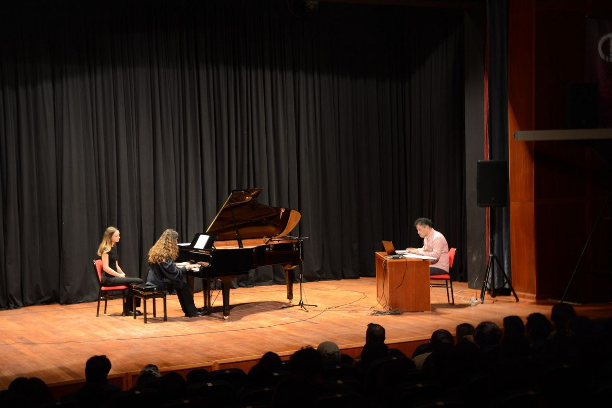

> Anadolu Üniversitesi Devlet Konservatuvarı, Japon besteci Prof. Hideki Kozakura ve piyanist Deniz Erden'in elektronik müzik performansına ev sahipliği yaptı.

Anadolu Üniversitesi Devlet Konservatuvarı tarafından organize edilen “Beyond Silence: BbYond Mozart & Ambient Works” başlıklı çağdaş müzik konseri, Koral Çalgan Salonu'nda dinleyicilerle buluştu.

Konsere Bestecilik ve Orkestra Şefliği Anasanat Dalı Başkanı Prof. Dr. Berkant Gençkal'ın yanı sıra çok sayıda öğrenci ve müziksever katıldı.

Etkinlikte Japon besteci Prof. Hideki Kozakura ile piyanoda besteci Deniz Erden, elektronik müzik tınıları eşliğinde sahne aldı. Dinletide Toru Takemitsu’nun “Litany”, Wenhao Zhao’nun “Drizzle and Fog 2” ve Kozakura’nın kendi bestesi olan “BbYond Mozart” eserleri seslendirildi.

---

## COP31'de 81 İlden Genç İklim Delegeleri Buluştu: Bildiriler Kitaplaştırılıyor

**Eğitim · Türkiye** · 2026-11-19 17:09 UTC · Kaynak: [Milli Eğitim Bakanlığı](https://www.meb.gov.tr/cop31039de-quot81-il-81-iklim-delegesi-genclik-paneliquot-duzenlendi/haber/42590/tr)

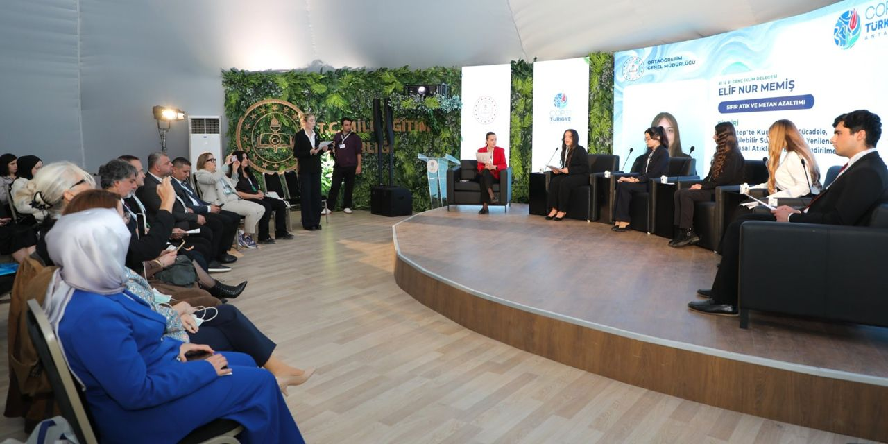

> Antalya'daki COP31 İklim Zirvesi kapsamında kurulan Türkiye İklim Okulunda bir araya gelen 81 ilden lise öğrencisi, çevre ve iklim krizine dair hazırladıkları çözüm önerilerini paylaştı.

Millî Eğitim Bakanlığı tarafından Birleşmiş Milletler İklim Değişikliği Çerçeve Sözleşmesi 31. Taraflar Konferansı (COP31) çerçevesinde kurulan Türkiye İklim Okulunda "81 İl 81 İklim Delegesi Gençlik Paneli" düzenlendi. Antalya'da gerçekleştirilen programa Türkiye'nin 81 ilinden seçilen birer lise öğrencisi iklim delegesi olarak katıldı.

Panelde, genç delegeler tarafından hazırlanan çalışmalar arasından 10 temel tema altında öne çıkan bildirilerin sunumu yapıldı. Söz alan öğrenciler, iklim değişikliğiyle mücadele, çevre bilinci ve sürdürülebilir bir geleceğe yönelik tespit ve çözüm tekliflerini katılımcılara aktardı. 81 ilden gelen tüm bildirilerin "81 İl 81 Genç İklim Delegesi" adıyla dijital ortamda yayımlanacağı açıklandı.

Genç iklim elçilerinin zirveye yönelik değerlendirme ve mesajlarını içeren video kayıtları ise Türkiye haritası üzerinden hazırlanan etkileşimli bir sistemde toplandı. Harita üzerinden seçilen illerdeki öğrencilerin görüşleri izlenebilirken, projeyle gençlerin iklim alanındaki karar alma mekanizmalarına katılımının güçlendirilmesi amaçlanıyor.

---

## 34 Ülkeden 55 Film Eskişehir'de: 23. Uluslararası Film Festivali Perdelerini Açtı

**Kültür-Sanat · Tepebaşı** · 2026-11-19 17:09 UTC · Kaynak: [Google Haberler - Eskişehir](https://yerel-haberler.haberturk.com/eskisehir-haberleri/23-eskisehir-uluslararasi-film-festivali-basladi-119527136)

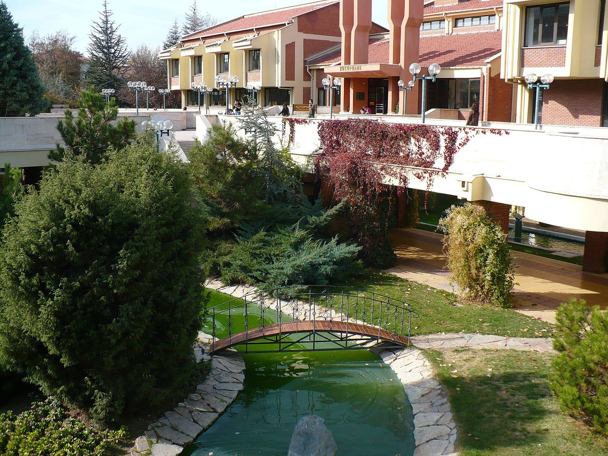

> Anadolu Üniversitesi'nin düzenlediği 23. Eskişehir Uluslararası Film Festivali, '500 Mil' filminin Türkiye prömiyeri ve açılış töreniyle başladı.

Kültür ve Turizm Bakanlığı Sinema Genel Müdürlüğü desteğiyle Anadolu Üniversitesi İletişim Bilimleri Fakültesi tarafından hayata geçirilen 23. Eskişehir Uluslararası Film Festivali, Yunus Emre Yerleşkesi'ndeki Sinema Anadolu'da düzenlenen törenle başladı. Festival, Türkiye'deki üniversite festivalleri arasında uzun metrajlı film gösterimi yapan tek organizasyon olma özelliğini sürdürüyor.

Açılışta konuşan Anadolu Üniversitesi Rektörü Prof. Dr. Yusuf Adıgüzel, üniversitenin kentin kültürel ve ekonomik gelişimine yön veren köklü bir kurum olduğunu belirtti. Festival Yönetmeni Prof. Dr. Sırrı Serhat Serter ise etkinlik boyunca 34 ülkeden 55 filmin 8 gün boyunca izleyiciyle buluşacağını aktararak, programda film gösterimlerinin yanı sıra söyleşiler, atölyeler ve sempozyumların yer alacağını kaydetti.

Törende geleneksel sinema ödülleri de sahiplerini buldu. "Sinema Emek Ödülleri" yönetmen ve yapımcı Biket İlhan ile Necip Sarıcı'ya takdim edilirken, "Sinema Onur Ödülleri" usta yönetmen Feyzi Tuna ve oyuncu Nilüfer Aydan'a verildi. "Sinema Kültürüne Katkı Ödülü" ise Türkiye Film Araştırmalarında Yeni Yönelimler Konferansı'nın oldu.

Festival, Morgan Matthews yönetmenliğindeki 2026 yapımı "500 Mil" (500 Miles) filminin Türkiye prömiyeriyle start aldı. Piyano eşliğinde sessiz film gösterimleri ve özel sinema derslerinin de yer alacağı zengin program, 27 Kasım'a kadar sinemaseverleri ağırlamaya devam edecek.

---

## Odunpazarı'nda Kitap ve Sanat Günleri Başlıyor: İki Gün Boyunca İmza ve Söyleşi

**Kültür-Sanat · Odunpazarı** · 2026-11-19 15:09 UTC · Kaynak: [Odunpazarı Belediyesi](https://www.odunpazari.bel.tr/guncel/haberler/genel-haberler/odunpazari-nda-sanat-ve-kitap-gunleri-basliyor)

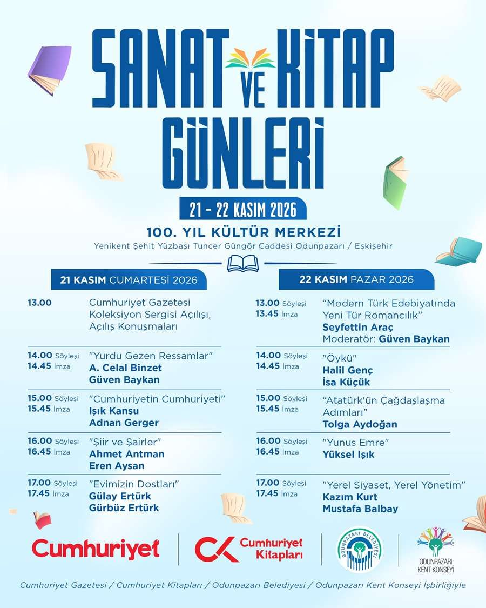

> Odunpazarı Belediyesi ve paydaşlarının iş birliğiyle düzenlenen Sanat ve Kitap Günleri, 21-22 Kasım tarihlerinde 100. Yıl Kültür Merkezi'nde kitapseverleri ağırlayacak.

Cumhuriyet Gazetesi, Cumhuriyet Kitapları, Odunpazarı Belediyesi ve Odunpazarı Kent Konseyi ortaklığıyla hayata geçirilen Sanat ve Kitap Günleri, 21-22 Kasım 2026 tarihlerinde Eskişehirli edebiyat ve sanatseverlerle buluşuyor. Yenikent Mahallesi Şehit Yüzbaşı Tuncer Güngör Caddesi'ndeki 100. Yıl Kültür Merkezi'nde gerçekleştirilecek program, edebiyat, sanat, tarih ve siyaset eksenli oturumlara sahne olacak.

Etkinlik, 21 Kasım Cumartesi günü saat 13.00'te Cumhuriyet Gazetesi Koleksiyon Sergisi'nin açılışıyla başlayacak. Programın ilk gününde resim, edebiyat, cumhuriyet tarihi ve hayvan hakları üzerine çeşitli söyleşiler düzenlenecek. A. Celal Binzet, Güven Baykan, Işık Kansu, Adnan Gerger, Ahmet Antman, Eren Aysan ile Gülay ve Gürbüz Ertürk okurlarla buluşacak.

22 Kasım Pazar günü ise modern Türk edebiyatı, öykü, cumhuriyet devrimleri ve Yunus Emre konuları ele alınacak. Seyfettin Araç, Halil Genç, İsa Küçük, Tolga Aydoğan ve Yüksel Işık'ın konuşmacı olduğu oturumların ardından, saat 17.00'de kapanış söyleşisi yapılacak. Kapanış programında Odunpazarı Belediye Başkanı Kazım Kurt ile gazeteci-yazar Mustafa Balbay, yerel siyaset ve yerel yönetim konusunu ele alacak. İki gün boyunca oturumların bitiminde yazarlar imza stantlarında okurlarıyla bir araya gelecek.

---

## Kazakistan Eski Eğitim Bakanı Beisembayev Anadolu Üniversitesini Ziyaret Etti

**Eğitim · Tepebaşı** · 2026-11-19 15:09 UTC · Kaynak: [Anadolu Üniversitesi](https://anahaber.anadolu.edu.tr/tr/haber-detay/c6b2ohjv3ggvldf2tuut0i6c)

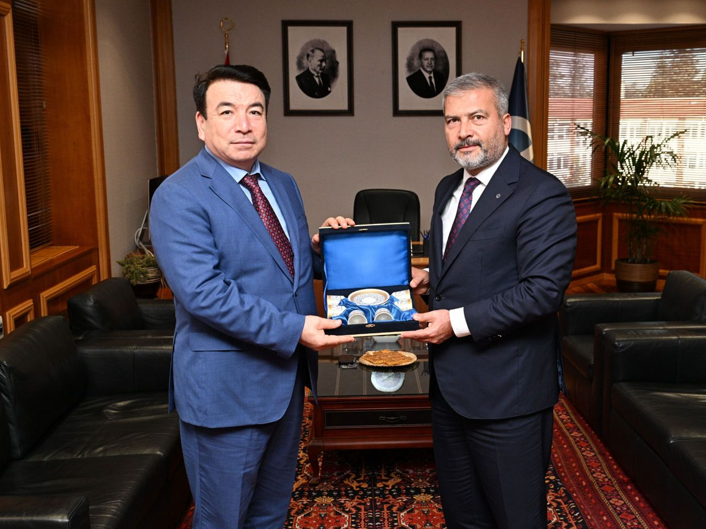

> Kazakistan eski Eğitim Bakanı Gani Beisembayev, Anadolu Üniversitesi Rektörü Prof. Dr. Yusuf Adıgüzel'i ziyaret ederek uzaktan öğrenme ve yükseköğretim iş birliklerini görüştü.

Kazakistan Cumhuriyeti eski Eğitim Bakanı Gani Beisembayev ve beraberindeki heyet, Anadolu Üniversitesi Rektörü Prof. Dr. Yusuf Adıgüzel’i makamında ziyaret etti. Görüşmede Açıköğretim Fakültesi Dekanı Prof. Dr. Aras Bozkurt da yer aldı.

Rektörlük makamında gerçekleştirilen ziyarette, Anadolu Üniversitesinin eğitim alanındaki faaliyetleri, uluslararasılaşma çalışmaları ve iki ülke arasında kurulabilecek yükseköğretim ortaklıkları ele alındı. Görüşmede özellikle üniversitenin açık ve uzaktan öğrenme alanındaki tecrübesi üzerine fikir alışverişinde bulunuldu.

İki ülke arasındaki eğitim ilişkilerini güçlendirmeye yönelik değerlendirmelerin yapıldığı temaslar, karşılıklı iyi niyet temennilerinin ardından çekilen hatıra fotoğrafıyla sona erdi.

---

## Büyükdere'de 410 Metrelik İsale Hattı Yenilendi: ESKİ Çalışmayı Tamamladı

**Belediye · Odunpazarı** · 2026-11-19 15:09 UTC · Kaynak: [Eskişehir Büyükşehir Belediyesi](https://www.eskisehir.bel.tr/icerik-detay.php?icerik_id=13575&cat_icerik=1&menu_id=24)

> ESKİ Genel Müdürlüğü, Büyükdere Mahallesi Söğütlü Sokak'ta kullanım ömrünü tamamlayan 410 metrelik içme suyu iletim hattını yüksek dayanımlı çelik borularla yenileyerek hizmete aldı.

Eskişehir Büyükşehir Belediyesi Su ve Kanalizasyon İdaresi (ESKİ) Genel Müdürlüğü, kentin içme ve kullanma suyu altyapısını modernize etme çalışmaları kapsamında Odunpazarı ilçesine bağlı Büyükdere Mahallesi'ndeki iletim hattını baştan aşağı yeniledi.

Söğütlü Sokak'ta uzun yıllardır kullanılan ve arızalar nedeniyle su iletim güvenliği zayıflayan 410 metre uzunluğundaki hat, yeni nesil malzemelerle değiştirildi. İmalatta iç yüzeyi epoksi, dış yüzeyi ise polietilen kaplamalı yüksek dayanımlı spiral kaynaklı çelik borular tercih edildi.

Kaynak birleştirme, izolasyon ve kalite kontrol süreçlerinin ardından yeni hat mevcut şehir şebekesine başarıyla entegre edilerek devreye alındı. Yetkililer, kent genelinde ekonomik ömrünü dolduran iletim hatlarının yenilenmesine ve arıza risklerini en aza indirmeye yönelik altyapı yatırımlarının süreceğini bildirdi.

---

## Tepebaşı'nda 450 Çocuk Haklarını Keşfetti: Atölyeler 3 Yıldır Aralıksız Sürüyor

**Belediye · Tepebaşı** · 2026-11-19 13:09 UTC · Kaynak: [Tepebaşı Belediyesi](https://www.tepebasi.bel.tr/Haber/Detay/tepebası’ndacocuklarhaklarınıogrenerekbuyuyor)

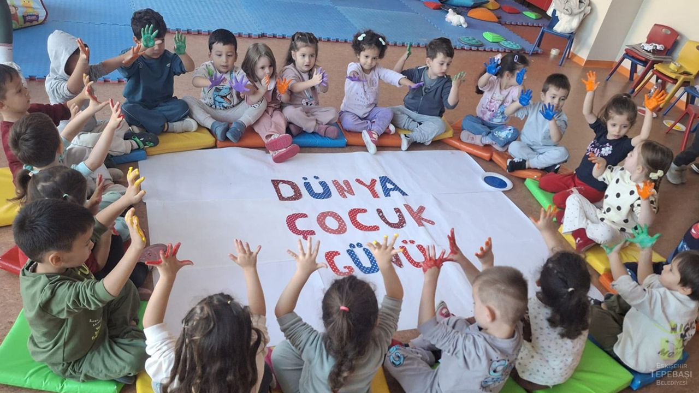

> Tepebaşı Belediyesi Erken Çocukluk Eğitim Merkezleri'nde düzenlenen yaratıcı drama ve atölye çalışmalarıyla son üç yılda yaklaşık 450 çocuk haklarını uygulamalı olarak öğrendi.

Tepebaşı Belediyesi bünyesinde faaliyet gösteren Erken Çocukluk Eğitim Merkezleri, çocukların haklarını erken yaşta öğrenmeleri ve içselleştirmeleri amacıyla yürüttüğü çalışmalara devam ediyor. Merkezlerde son üç yıl içerisinde gerçekleştirilen atölye ve yaratıcı drama etkinliklerine yaklaşık 450 çocuk katıldı.

Eğitimlerde çocuk haklarına yönelik temel bilgilerin soyut kalmaması ve deneyim yoluyla kalıcı hale gelmesi hedefleniyor. Çocukların bu atölyelerde edindikleri kazanımları aileleri ve çevreleriyle paylaşmaları sağlanırken, merkezlerde görev yapan eğitmenler için de sınıf yönetimi ve hak temelli eğitim seminerleri düzenleniyor.

Çocuk haklarının yalnızca belirli günlerde anılamayacağını, tüm hizmetlerin merkezinde olması gerektiğini belirten Tepebaşı Belediye Başkanı Dt. Ahmet Ataç, Birleşmiş Milletler Çocuk Haklarına Dair Sözleşme'nin ilkelerine dikkat çekti. Ataç, her çocuğun ayrımcılığa uğramadan haklarından yararlanması, yaşama ve gelişme hakkının korunması ile kendi görüşlerini ifade edebilmesinin temel bir hak olduğunu vurgulayarak çalışmaların süreceğini ifade etti.

---

## Mezun Şef Tezgâh Başına Geçti: EMYO'da Baklava Yapımının Püf Noktaları Anlatıldı

**Eğitim · Tepebaşı** · 2026-11-19 13:09 UTC · Kaynak: [Anadolu Üniversitesi](https://anahaber.anadolu.edu.tr/tr/haber-detay/ztedysvgkf16kh9t7m7ynlx9)

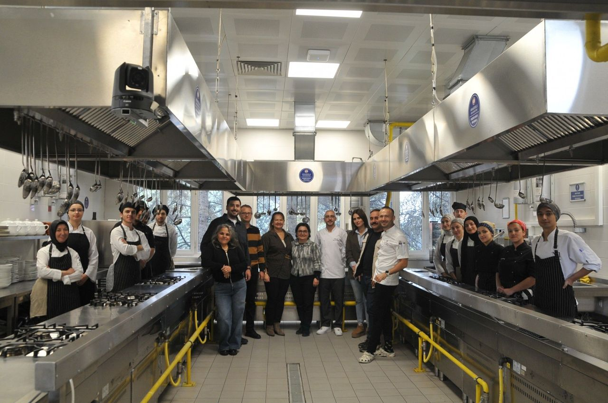

> Anadolu Üniversitesi Eskişehir Meslek Yüksekokulu mezunu Şef Yusuf Can Demir, Aşçılık Programı öğrencileriyle atölye çalışmasında bir araya gelerek fıstıklı baklava hazırladı.

Anadolu Üniversitesi Kariyer Merkezi (ANAKARİYER) ve Mezunlar Birliği (ANAMEZUN) iş birliğiyle Eskişehir Meslek Yüksekokulunda (EMYO) “Mezunumuz Mutfakta” başlıklı atölye çalışması gerçekleştirildi. Etkinlik kapsamında EMYO 2012 mezunu Şef Yusuf Can Demir, Aşçılık Programı öğrencileriyle mutfakta buluşarak mesleki tecrübelerini aktardı.

EMYO Müdürü Doç. Dr. Osman Güldemir'in koordinasyonunda yapılan çalışmada fıstıklı baklava yapıldı. Baklava hazırlığında yağ kullanımının lezzet üzerindeki etkisine değinen Doç. Dr. Güldemir, Antep fıstığının kabuğunun soyulması için sıcak ve soğuk su uygulaması yapıldığını, ardından doğal yağların açığa çıkması için kuru ısıyla hafif kavrulduğunu paylaştı. Şef Demir de öğrencilerin sahip olduğu mutfak altyapısının önemine işaret ederek, mesleki gelişim açısından okul olanaklarının büyük bir fırsat sunduğunu belirtti.

Programa katılan ANAKARİYER Müdürü Prof. Dr. Didem Paşaoğlu Baş ve Öğr. Gör. Dr. Kazım Demirer ise öğrencilik döneminde mesleki ağ kurmanın önemine değinerek üniversitenin kariyer planlama süreçlerindeki desteğinin süreceğini bildirdi. Atölye, soru-cevap bölümünün ardından Şef Demir'e teşekkür belgesi verilmesiyle tamamlandı.

---

## ESTÜ Rektörü Prof. Dr. Adnan Özcan Mazbatasını YÖK Başkanı Özvar'dan Aldı

**Eğitim · Tepebaşı** · 2026-11-19 13:09 UTC · Kaynak: [Eskişehir Teknik Üniversitesi](https://www.eskisehir.edu.tr/tr/Haber/Detay/rektorumuz-prof-dr-adnan-ozcan-rektorluk-mazbatasini-yok-baskani-prof-dr-erol-ozvardan-aldi)

> Cumhurbaşkanlığı Kararı ile Eskişehir Teknik Üniversitesi Rektörlüğüne yeniden atanan Prof. Dr. Adnan Özcan, mazbatasını YÖK Başkanı Prof. Dr. Erol Özvar'dan teslim aldı.

Eskişehir Teknik Üniversitesi (ESTÜ) Rektörlüğü görevine Cumhurbaşkanlığı Kararı doğrultusunda yeniden getirilen Prof. Dr. Adnan Özcan, Yükseköğretim Kurulunda düzenlenen resmî törenle rektörlük mazbatasını aldı.

YÖK Başkanlığı binasında organize edilen mazbata takdim törenine, Cumhurbaşkanlığı Kararı ile çeşitli üniversitelerin rektörlüklerine atanan akademisyenler katıldı. Tören kapsamında Prof. Dr. Adnan Özcan'a mazbatası, YÖK Başkanı Prof. Dr. Erol Özvar tarafından takdim edildi. Özvar, görevine yeniden atanan Özcan'ı tebrik ederek yeni çalışma döneminde başarı temennilerini iletti.

Törende konuşan Rektör Prof. Dr. Adnan Özcan, Cumhurbaşkanı Recep Tayyip Erdoğan ile YÖK Başkanı Prof. Dr. Erol Özvar'a teşekkürlerini sundu. Özcan, yeni dönemde Eskişehir Teknik Üniversitesinin eğitim-öğretim, araştırma-geliştirme, bilimsel üretim, uluslararasılaşma ve toplumsal katkı alanlarındaki başarı grafiğini yukarı taşımak adına kurumsal kapasiteyi geliştirmeye kararlılıkla devam edeceklerini vurguladı.

---

## Başkan Ünlüce'den 20 Kasım Mesajı: 'Çocukların Hayallerini Büyütmeye Devam Edeceğiz'

**Gündem · Merkez** · 2026-11-19 13:09 UTC · Kaynak: [Eskişehir Büyükşehir Belediyesi](https://www.eskisehir.bel.tr/icerik-detay.php?icerik_id=13576&cat_icerik=1&menu_id=24)

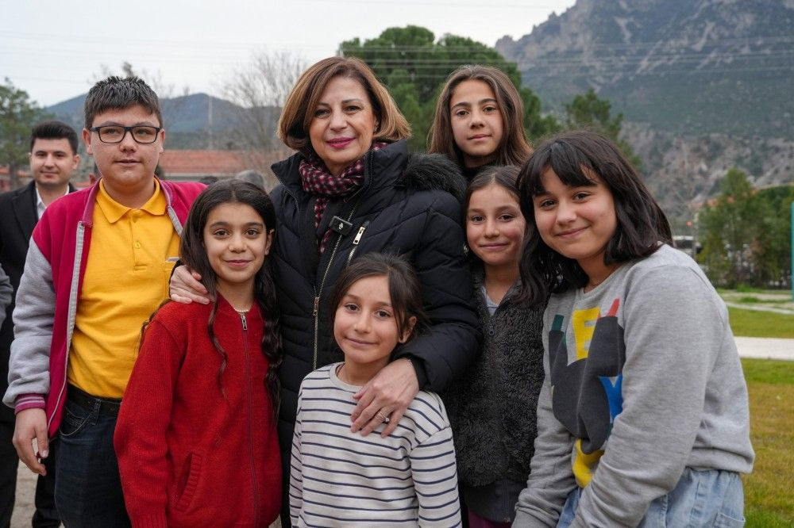

> Eskişehir Büyükşehir Belediye Başkanı Ayşe Ünlüce, 20 Kasım Dünya Çocuk Hakları Günü dolayısıyla yayımladığı mesajda çocuk dostu kent vurgusu yaptı.

Eskişehir Büyükşehir Belediye Başkanı Ayşe Ünlüce, 20 Kasım Dünya Çocuk Hakları Günü kapsamında bir kutlama mesajı yayımladı. Çocukların mutluluğu ve huzurunun kentin en büyük güvencesi olduğunu belirten Ünlüce, her çocuğun sevgiyle büyüme ve eşit fırsatlara sahip olma hakkı bulunduğunu ifade etti.

Eskişehir'de çocukların haklarını öğrenerek bilim, sanat, spor ve doğayla buluştuğu bir yaşam alanı oluşturmak için çalıştıklarını kaydeden Ünlüce; Çocuk Hakları Birimi, Masal Şatosu, Bilim Deney Merkezi, İklim Adası ve ESMEK merkezleriyle bu gelişimi desteklediklerini aktardı. Tiyatro ve atölye etkinlikleriyle de çocukların hayal dünyalarının zenginleştirildiğini vurguladı.

Hiçbir çocuğun şiddet, ihmal, istismar ve ayrımcılığa maruz kalmaması gerektiğine dikkat çeken Başkan Ünlüce, Mustafa Kemal Atatürk'ün çocuklara yönelik sözlerini hatırlatarak tüm dünya çocuklarının haklarıyla güven içinde yaşayacağı yarınlar diledi.

---

## Başkan Ünlüce'den 20 Kasım Dünya Çocuk Hakları Günü Mesajı

**Gündem · Merkez** · 2026-11-19 13:09 UTC · Kaynak: [Google Haberler - Eskişehir](https://ankahaber.net/haber/eskisehir-buyuksehir-belediye-baskani-unluce-den-dunya-cocuk-haklari-gunu-mesaji-4a65ec67)

> Eskişehir Büyükşehir Belediye Başkanı Ayşe Ünlüce, 20 Kasım Dünya Çocuk Hakları Günü dolayısıyla yayımladığı mesajda çocukların eşit fırsatlarla büyüme hakkına dikkat çekti.

Eskişehir Büyükşehir Belediye Başkanı Ayşe Ünlüce, 20 Kasım Dünya Çocuk Hakları Günü vesilesiyle bir kutlama mesajı paylaştı. Ünlüce, bir kentin en büyük güvencesinin çocukların tebessümü olduğunu belirterek, her çocuğun sevgiyle büyüme, eşit imkânlara ulaşma ve hayallerini özgürce ifade etme hakkı bulunduğunu kaydetti.

Eskişehir'de çocukların haklarını öğrenerek bilim, sanat, spor ve doğayla iç içe yetişmeleri amacıyla çalışmalar yürüttüklerini aktaran Ünlüce; Masal Şatosu, Bilim Deney Merkezi, İklim Adası, Çocuk Hakları Birimi, ESMEK merkezleri ve tiyatro atölyeleriyle miniklerin gelişimini desteklediklerini ifade etti.

Çocukların hiçbir ayrımcılığa, ihmale, istismara ve şiddete maruz kalmaması gerektiğinin altını çizen Ünlüce, hiçbir çocuğun çalıştırılmaması ve umutsuzluğa sürüklenmemesi gerektiğini belirterek tüm çocukların 20 Kasım Dünya Çocuk Hakları Günü'nü tebrik etti.

---

## Tepebaşı'nda 46 Noktada Geri Dönüşüm Seferi: Mahalle Mahalle Toplama Takvimi Açıklandı

**Belediye · Tepebaşı** · 2026-11-19 11:09 UTC · Kaynak: [Tepebaşı Belediyesi](https://www.tepebasi.bel.tr/Haber/Detay/tepebası’nda18mahallede46toplamanoktasındageridonusumlerhayatbuluyor)

> Tepebaşı Belediyesi, 18 mahallede oluşturulan 46 noktada biriken geri dönüştürülebilir atıkları haftalık program dahilinde ekonomiye kazandırıyor.

Tepebaşı Belediyesi Çevre Koruma ve Kontrol Müdürlüğü, ilçe genelinde atıkların kaynağında ayrıştırılması ve geri dönüşümün yaygınlaştırılması amacıyla yürüttüğü çalışmaları sürdürüyor. Çalışmalar doğrultusunda 18 mahallede belirlenen 46 toplama noktasında kâğıt, karton, plastik, cam ve metal atıklar düzenli olarak alınıyor.

İlçe genelindeki dağılıma göre Batıkent'te 10, Ertuğrulgazi'de 7, Şirintepe'de 6 nokta bulunuyor. Şeker ve Sazova mahallelerinde 3'er; Aşağısöğütönü, Çukurhisar, Uluönder ve Yukarısöğütönü'nde 2'şer toplama noktası yer alıyor. Bahçelievler, Çamlıca, Fevziçakmak, Hoşnudiye, Kumlubel, Muttalip Orta, Sakintepe, Yaşamkent ve Yeşiltepe mahallelerinde ise 1'er noktada hizmet veriliyor.

Belediye ekipleri, modernize edilen araçlarla atık toplama işlemlerini haftalık takvime göre gerçekleştiriyor. Programa göre pazartesi günleri Zincirlikuyu, Aşağısöğütönü, Yukarısöğütönü, Yaşamkent ve Keskin; salı günleri Batıkent, Çamlıca ve Çukurhisar mahallelerinde toplama yapılıyor.

Çarşamba günü Ertuğrulgazi, Sazova ve Çamlıca'da süren çalışmalar, perşembe günü Yenibağlar, Güllük, Şirintepe, Hoşnudiye, Işıklar, Uluönder ve Muttalip Orta'da devam ediyor. Cuma günleri ise Şeker, Hava İkmal, Yeşiltepe, Kumlubel ve Sakintepe mahallelerindeki toplama noktalarından atıklar alınıyor.

---

## Oruç Reis Pakistan'a Ulaştı: İki Sahada Petrol ve Doğal Gaz Araması Yapacak

**Türkiye · Türkiye** · 2026-11-19 11:09 UTC · Kaynak: [Enerji ve Tabii Kaynaklar Bakanlığı](https://enerji.gov.tr/haber-detay?id=31976)

> Somali'deki ilk kıtalararası görevinin ardından rotasını Asya'ya çeviren Oruç Reis Sismik Araştırma Gemisi, Pakistan karasularında iki ayrı sahada hidrokarbon arama operasyonuna başlıyor.

Mersin Taşucu Limanı'ndaki hazırlıklarının tamamlanmasının ardından yola çıkan yerli ve millî sismik araştırma gemisi Oruç Reis, Pakistan'ın Karaçi Limanı'na ulaştı. Somali'deki 9 aylık görevinin ardından ikinci yurt dışı operasyonuna hazırlanan gemi, Pakistan açıklarındaki iki farklı noktada veri toplayacak.

Operasyon kapsamında öncelikle Indus-C Blok sahasındaki Marjan 3B Sismik Projesi yürütülecek. Gemi, Karaçi açıklarında toplam 670 kilometrekarelik alanda üç boyutlu sismik veri toplayacak ve bu aşamanın yaklaşık 50 gün sürmesi hedefleniyor. Ardından Makran Blokları'na geçecek olan Oruç Reis, Makran 2B Projesi çerçevesinde 2 bin 353 kilometrelik alanda iki boyutlu tarama yapacak.

Enerji ve Tabii Kaynaklar Bakanı Alparslan Bayraktar, Türkiye'nin dünyanın dördüncü büyük derin deniz sondaj filosuna sahip olduğunu belirterek, edinilen derin deniz aramacılığı tecrübesinin Pakistan ile yapılan iş birliği sayesinde yeni başarılara dönüştürülmesinin hedeflendiğini kaydetti. Bakan Bayraktar'ın katılımıyla geminin limandan ayrılışı öncesinde resmî bir tören gerçekleştirilecek.

---

## Odunpazarı'nda İkinci El Giysiler Kızılay'a Devredildi: Her Ay 10 Kişiye Destek

**Belediye · Odunpazarı** · 2026-11-19 11:09 UTC · Kaynak: [Google Haberler - Odunpazarı](https://yerel-haberler.haberturk.com/eskisehir-haberleri/odunpazarinda-kullanilmis-kiyafetler-dayanismaya-donusecek-odunpazari-belediyesi-ile-turk-119526737)

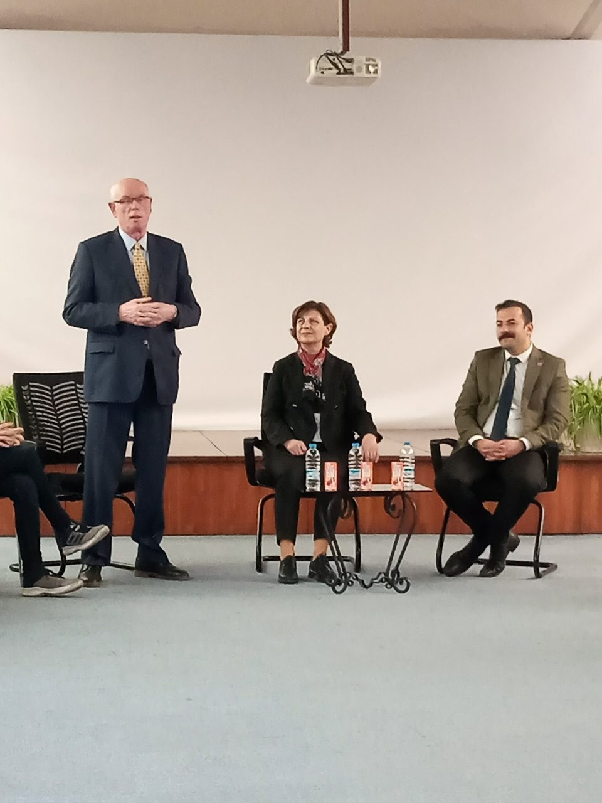

> Odunpazarı Belediyesi ile Türk Kızılay arasında imzalanan iş birliği protokolüyle ilçedeki kullanılmış giysi toplama hizmeti Kızılay'a devredildi. Proje kapsamında her ay 10 ihtiyaç sahibine giyim desteği verilecek.

Odunpazarı Belediyesi, kullanılmış kıyafetlerin toplanması ve geri kazandırılması amacıyla Türk Kızılay ile iş birliği protokolü imzaladı. Belediye Başkanı Kazım Kurt'un makamında düzenlenen imza törenine Kızılay Lojistik AŞ Genel Müdür Yardımcısı Davut Karacan, Kızılay Tekstil Operasyonları Türkiye Müdürü Hakan Sarı ve Kızılay Eskişehir İl Merkezi Başkanı Egemen Temizsoy katıldı.

İmzalanan protokol kapsamında Odunpazarı ilçe sınırları içerisindeki uygun noktalara Türk Kızılay tarafından kıyafet bağış kutuları yerleştirilecek. İlçe sakinlerinin bıraktığı kıyafetler Kızılay Lojistik tarafından toplanarak yeniden değerlendirilecek ve sosyal yardım faaliyetlerine kaynak oluşturacak.

Daha önce özel firmalar aracılığıyla yürütülen giysi toplama hizmetinin belediye meclisi kararıyla Kızılay'a bedelsiz devredildiğini belirten Odunpazarı Belediye Başkanı Kazım Kurt, dayanışma ve çevreye katkı sunan bu adımda emeği geçen meclis üyelerine ve Kızılay yetkililerine teşekkür etti. Kızılay Eskişehir İl Merkezi Başkanı Egemen Temizsoy ise Odunpazarı'nda başlayan bu toplama ağını zamanla tüm Eskişehir'e yaymayı hedeflediklerini kaydetti.

İş birliğinin sosyal destek ayağında ise Türk Kızılay Eskişehir İl Merkezi ile Eskişehir Osmangazi Üniversitesi ortaklığında faaliyet gösteren Kızılay Sevgi Butik yer alıyor. Odunpazarı Belediyesi tarafından her ay belirlenecek ihtiyaç sahibi 10 vatandaşa bu butik üzerinden düzenli giyim yardımı ulaştırılacak.

---

## Eskişehirspor'un Eski Futbolcusu Emre Güral Avusturya'da Antrenörlüğe Başladı

**Spor · Merkez** · 2026-11-19 11:09 UTC · Kaynak: [Google Haberler - Eskişehirspor](https://www.odatv.com/spor/eski-milli-futbolcu-emre-guralin-yeni-meslegi-120171873)

> Eskişehirspor formasıyla attığı kritik gollerle hatırlanan eski milli futbolcu Emre Güral, Avusturya'daki Galatasaray Futbol Okulu'nda antrenörlük görevine başladı.

Türk futbolunda bir dönem Eskişehirspor forması da terleten eski milli futbolcu Emre Güral, aktif kariyerini noktaladıktan sonra antrenörlük yolculuğuna ilk adımı attı.

Süper Lig'de Eskişehirspor'un yanı sıra Trabzonspor, Antalyaspor ve MKE Ankaragücü formaları giyen, son olarak İtalya'nın Crotone takımında oynayan Güral, Avusturya'nın Linz kentine gitti. Deneyimli isim, burada faaliyet gösteren Galatasaray Futbol Okulu bünyesinde antrenör olarak görev yapmaya başladı.

Siyah-kırmızılı taraftarların hafızasında özellikle Fenerbahçe filelerine uzaktan gönderdiği şık golle yer edinen eski forvet, yurt dışındaki genç yeteneklerin yetiştirilmesi için saha kenarında mesai harcayacak.

---

## Togg'dan 1,5 Milyon TL'ye Sıfır Faiz: T6X İçin de İlk Detaylar Belli Oldu

**Ekonomi · Türkiye** · 2026-11-19 09:09 UTC · Kaynak: [Google Haberler - Togg](https://www.merhabahaber.com/togg-en-avantajli-kampanyayi-duyurdu-yil-sonuna-kadar-1-5-milyon-tl-surprizi-1954686h.htm)

> Türkiye'nin yerli otomobili Togg, T10X ve T10F modelleri için 1,5 milyon liraya kadar sıfır faizli kredi desteği duyurdu. Markanın daha erişilebilir yeni modeli T6X'in prototipinin de hazırlandığı bildirildi.

Türkiye'nin yerli elektrikli otomobil üreticisi Togg, satış rakamları 100 bini aşan T10X ve T10F modellerine yönelik yeni finansman kampanyalarını açıkladı. Yıl sonuna kadar sürmesi planlanan kampanya kapsamında özellikle çift motorlu üst versiyonlar için dikkat çeken ödeme kolaylıkları devreye alındı.

Finansman planı doğrultusunda T10X 4More ve T10F 4More modellerini tercih eden alıcılara 1 milyon 500 bin TL tutarında kredi, 10 ay vade ve yüzde sıfır faiz imkanıyla sunuluyor. Kampanyada aylık ödeme tutarı 150 bin TL olarak belirlenirken, standart versiyonlar için de 6 ay vadeli ve sıfır faizli kredi paketleri uygulanıyor. T10X V2 için 800 bin TL, T10F V2 modeli için ise 1 milyon TL'lik kredi desteği sağlanıyor.

Giriş seviyesi modellerin fiyatlarının yüksekliği yönündeki tüketici taleplerini değerlendiren Togg yönetiminin, 'halk tipi' olarak nitelendirilen yeni model T6X üzerinde çalıştığı aktarıldı. Prototip aşamasına gelen ve 2027 yılının ortalarında yollara çıkması hedeflenen T6X'in, 1,3 ila 1,4 milyon TL bandında bir fiyat etiketiyle satışa sunulması öngörülüyor.

---

## Erdoğan Duyurdu: 17 Milyon Emekli İçin Düzenleme Sene Başından Önce Geliyor

**Siyaset · Türkiye** · 2026-11-19 09:09 UTC · Kaynak: [Google Haberler - Cumhurbaşkanı](https://gazeteoksijen.com/turkiye/cumhurbaskani-erdogan-17-milyon-emekliyi-kapsayan-yeni-duzenleme-sene-basindan-once-hayata-gecirilecek-296408)

> Cumhurbaşkanı Recep Tayyip Erdoğan, partisinin grup toplantısında yaptığı açıklamada, yaş ve prim gününü esas alan yeni emekli düzenlemesinin sene başından önce yürürlüğe gireceğini açıkladı.

Cumhurbaşkanı Recep Tayyip Erdoğan, Türkiye Büyük Millet Meclisi'nde düzenlenen AK Parti grup toplantısında iç ve dış gündeme dair önemli açıklamalarda bulundu. Erdoğan, kamuoyunun uzun süredir beklediği emekli düzenlemesine ilişkin takvimi ve temel kriterleri paylaştı.

Emeklilerin yaşadığı ekonomik zorlukların farkında olduklarını belirten Erdoğan, konunun bir önceki Kabine Toplantısı'nda ele alındığını hatırlattı. Hazırlanan çalışmanın detaylarına değinen Erdoğan, "Yaş ve prim gün sayısına göre adalet ve hakkaniyeti merkeze alan bir yaklaşımla meseleyi tüm boyutlarıyla değerlendiriyoruz. 17 milyonu aşkın emeklimizin tamamını kapsayan bir iyileştirmeyi Yüce Meclisimizin de desteğiyle sene başından önce hayata geçireceğiz" dedi.

Konuşmasında uluslararası gelişmelere ve Gazze'deki insani krize de yer veren Erdoğan, yaklaşan kış mevsimi öncesinde bölgedeki çadır eksikliğine ve soğuk hava şartlarına dikkat çekti. İslam dünyasının ortak hareket etmesi gerektiğini ifade eden Erdoğan, Türkiye'nin Gazze'ye konteyner ve insani yardım ulaştırma çalışmalarını sürdüreceğini kaydetti.

---

## MEB'den PISA Zirvesi: Türkiye'nin Başarı Grafiği Başkentte Masaya Yatırılacak

**Eğitim · Türkiye** · 2026-11-19 07:09 UTC · Kaynak: [Milli Eğitim Bakanlığı](https://www.meb.gov.tr/quotturkiye039nin-pisa-performansi-degisim-donusum-ve-gelisimquot-sempozyumu-ankara039da-duzenlenecek/haber/42583/tr)

> Millî Eğitim Bakanlığı, Türkiye'nin uluslararası eğitim göstergelerindeki değişim ve gelişimini Ankara'da düzenlenecek sempozyumla mercek altına alacak.

Millî Eğitim Bakanlığı tarafından organize edilen "Türkiye'nin PISA Performansı: Değişim, Dönüşüm ve Gelişim" sempozyumu, Talim ve Terbiye Kurulu Başkanlığı Maarif Konferans Salonu'nda gerçekleştirilecek. Programa Millî Eğitim Bakanı Yusuf Tekin'in yanı sıra OECD Eğitim ve Beceriler Direktörü Andreas Schleicher da katılım sağlayacak.

Eğitim yöneticileri, akademisyenler ve araştırmacıları buluşturacak etkinlikte, Türkiye'nin geçmişten bugüne PISA sınavlarında sergilediği performans ve farklı yeterlik alanlarında kaydettiği ilerlemeler çok boyutlu olarak masaya yatırılacak.

Sempozyum oturumlarında fen bilimleri, matematik ve okuma becerilerine dair verilerin yanı sıra öğrenci başarısına etki eden bireysel, ailesel ve okul temelli faktörler uzmanlar tarafından değerlendirilecek.

---

## Heykel ve Banka Çarpan Kamyonet Sürücüsü Yunus Timlerince Yakalandı

**Asayiş · Tepebaşı** · 2026-11-19 07:09 UTC · Kaynak: [Google Haberler - Eskişehir asayiş](https://hurgun.com/haber/eskisehirde-heykel-ve-bankaya-carpan-kamyonet-surucusu-polis-tarafindan-yakalandi-172349)

> Eskişehir İsmet İnönü Caddesi'nde heykel ve banka çarparak zarar veren kamyonet sürücüsü, güvenlik kameralarının incelenmesiyle yakalandı.

İsmet İnönü Caddesi üzerinde manevra yaptığı esnada kontrolden çıkan kamyonet, yol kenarındaki heykele ve oturma bankına çarptı. Çarpmanın etkisiyle heykel ve kamusal kullanımda olan bankta maddi hasar meydana geldi.

Olayın ardından Eskişehir Büyükşehir Belediyesi tarafından yapılan açıklamada, kent mobilyalarına ve ortak alandaki sanat eserlerine zarar verilmemesi gerektiği vurgulanarak sorumluların bulunması için kamera kayıtlarının incelendiği duyuruldu.

Bölgedeki güvenlik kamerası görüntülerini detaylı şekilde inceleyen emniyet ekipleri, kamyonetin ve sürücünün kimliğini belirledi. Şüpheli sürücü, Eskişehir İl Emniyet Müdürlüğü bünyesindeki Yunus timleri tarafından kısa sürede yakalanarak hakkında adli işlem başlatıldı.

---

## Eskişehirspor Türkiye'nin En Golcü 3. Takımı Oldu: Süper Lig Devlerini Geride Bıraktı

**Spor · Merkez** · 2026-11-19 07:09 UTC · Kaynak: [Google Haberler - Eskişehirspor](https://www.bolgegundemi.com/eskisehir/eskisehirspor-turkiye-profesyonel-liglerinde-en-golcu-3-takim-oldu-238692.html)

> Türkiye profesyonel ligleri gol ortalaması verilerine göre Eskişehirspor, maç başına ulaştığı 2,71 gol ortalamasıyla en skorer üçüncü ekip unvanını elde etti.

Transfermarkt verileri doğrultusunda hazırlanan profesyonel ligler gol istatistiklerinde Eskişehirspor, hücum performansıyla dikkat çekti. Siyah-kırmızılı ekip, 2026-2027 sezonunda maç başına yakaladığı 2,71 gol ortalamasıyla Türkiye genelinde en çok gol atan üçüncü takım oldu ve Süper Lig kulüpleri dahil çok sayıda rakibini geride bıraktı.

Profesyonel ligler genelinde yapılan değerlendirmede zirvede, 3. Lig temsilcisi Malatya Yeşilyurt SK yer aldı. Mehmet Ak yönetimindeki Malatya ekibi, sezonun ilk 13 haftasında mağlubiyet yüzü görmezken 3,79 gol ortalamasına ulaştı. Sıralamanın ikinci basamağında ise maç başına 2,75 gol ortalaması tutturan 2. Lig ekibi Muş SK kendine yer buldu.

Süper Lig temsilcileri arasında en golcü 10 takım arasına girebilen tek ekip, 2,55 ortalamayla dördüncü sırada yer alan Amed SK oldu. Süper Lig'in diğer ekiplerinden Galatasaray 2,33 ortalamayla 12'nci, Kayserispor 2,27 ortalamayla 16'ncı, Fenerbahçe ise 2,05 ortalamayla 21'inci sırada kaldı. Beşiktaş, Trabzonspor ve Göztepe ise 2,00 gol ortalamasında yer aldı.

---

## Altın fiyatları 19 Kasım 2026: Gram altın 6.199,49 TL

**Ekonomi · Merkez** · 2026-11-19 06:00 UTC · Kaynak: [Harem Altın](https://www.haremaltin.com/altin-fiyatlari)

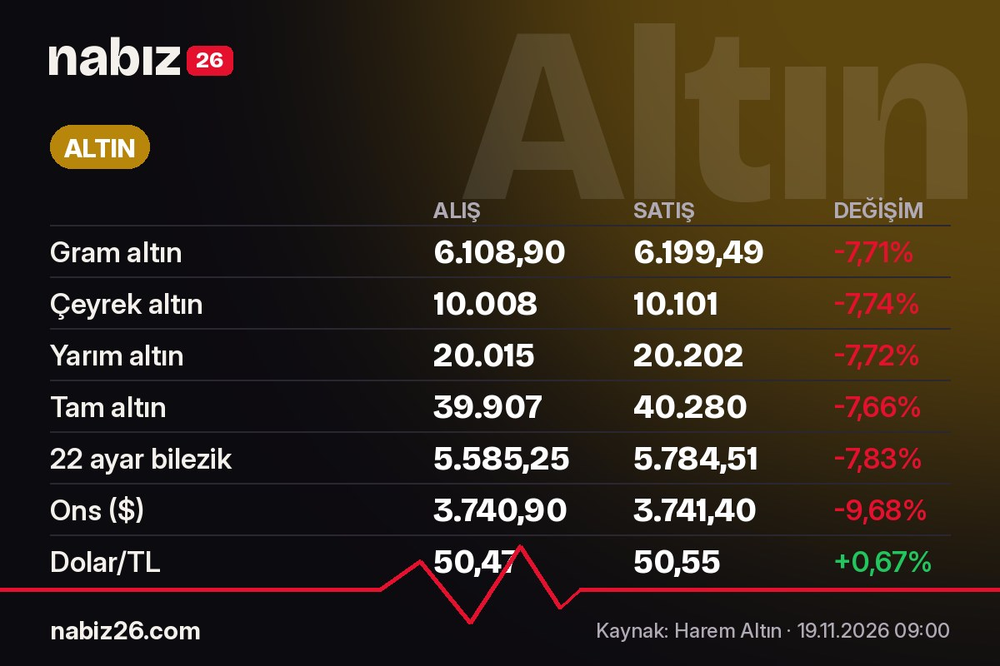

> Gram altın güne düşüşle başladı. Harem Altın verilerine göre gram altın 6.108,90 TL'den alınıyor, 6.199,49 TL'den satılıyor.

Altın piyasasında güne düşüşle başlandı. Harem Altın'ın saat 09.00 itibarıyla verilerine göre gram altının satış fiyatı 6.199,49 TL, alış fiyatı 6.108,90 TL oldu. Gram altın, önceki kapanışa göre yüzde 7,71 geriledi.

Ziynet altınlarda çeyrek altın 10.101 TL, yarım altın 20.202 TL, tam altın 40.280 TL, ata altın 41.329 TL seviyesinden satışa sunuluyor.

22 ayar bileziğin gram satış fiyatı 5.784,51 TL, has altının gram fiyatı 6.175,01 TL olarak belirlendi.

Uluslararası piyasalarda altının onsu 3.741,40 dolardan işlem görürken, dolar/TL 50,55 seviyesinde bulunuyor.

Fiyatlar Harem Altın'ın saat 09.00 itibarıyla paylaştığı verilere dayanmaktadır; kuyumcular arasında farklılık gösterebilir. Bu haber yatırım tavsiyesi değildir.

---

## Togg'dan Kadınlara Özel Finansman Paketi: Garanti BBVA ile Yeni Kampanya Yolda

**Ekonomi · Türkiye** · 2026-11-19 05:09 UTC · Kaynak: [Google Haberler - Togg](https://istanbulticaretgazetesi.com/togg-kadinlara-ozel-kampanya-2026-togg-kadinlara-ozel-kampanya-ne-zaman-baslayacak)

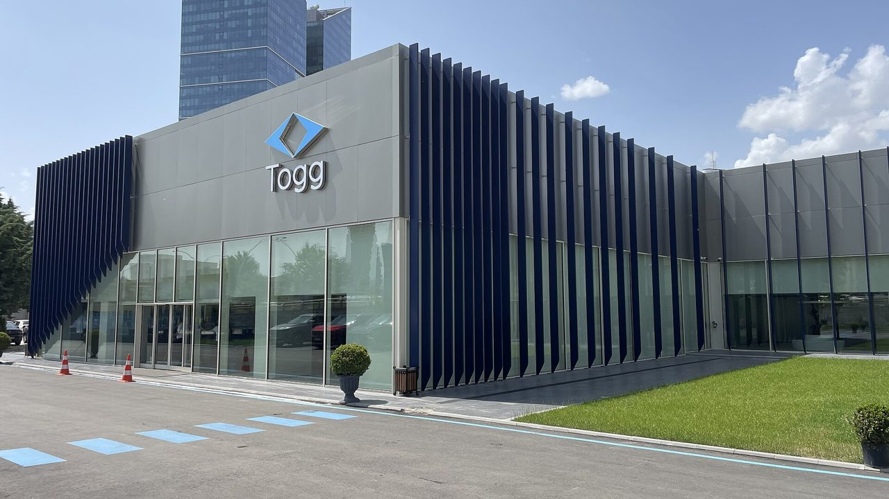

> Togg ve Garanti BBVA, kadınların elektrikli araç sahibi olmasını kolaylaştırmak için özel bir taşıt kredisi paketi hazırlıyor. Detayların yıl sonuna kadar duyurulması bekleniyor.

Türkiye'nin yerli otomobil üreticisi Togg, kadın müşterilere yönelik avantajlı ödeme seçenekleri sunacak yeni bir finansman paketi için Garanti BBVA ile hazırlıklarını sürdürüyor. İş birliği, Antalya'da düzenlenen COP31 İklim Zirvesi kapsamındaki panelde gündeme taşındı.

Zirvede gerçekleştirilen "Sürdürülebilir Mobilite Dönüşümünün Finansmanı" paneline katılan Togg CEO'su Gürcan Karakaş ile Garanti BBVA Genel Müdürü Mahmut Akten, elektrikli araçlara erişimin kolaylaştırılması ve finansman çözümleri üzerine değerlendirmelerde bulundu. Hazırlanan yeni paketle kadınların elektrikli araç ediniminin desteklenmesi amaçlanıyor.

Kredi limitleri, faiz oranları, vade seçenekleri ve başvuru kriterleri henüz kesinleşmeyen kampanyanın ayrıntılarının 2026 yılı sona ermeden açıklanması planlanıyor. Togg, kasım ayı boyunca bireysel müşterilerine T10X ve T10F modellerinde sunduğu mevcut faizsiz finansman seçeneklerini de sürdürüyor.

---

## Meslek Öğrenene Nakdi Destek: MEGEM ve Kızılay'dan İstihdam Protokolü

**Ekonomi · Odunpazarı** · 2026-11-19 05:09 UTC · Kaynak: [Google Haberler - Eskişehir](https://www.gazetevatan.com/sehirler/eskisehir/eskisehirde-ihtiyac-sahipleri-icin-yeni-uygulama-hem-egitim-hem-para-verilecek-2466280)

> Eskişehir'de MEGEM bünyesinde 10 meslek dalında eğitim görecek ihtiyaç sahibi kursiyerlere, eğitim süreleri boyunca Türk Kızılay tarafından maddi yardım sağlanacak.

Türk Kızılay ile Eskişehir Organize Sanayi Bölgesi (EOSB) iştiraki Mesleki Edindirme ve Geliştirme Merkezi (MEGEM) A.Ş. arasında iş birliği protokolü imzalandı. Sosyo-Ekonomik Güçlendirme Kapsamında İstihdama Yönlendirme ve Mesleki Eğitim Projesi çerçevesinde yürütülen çalışmayla, ekonomik desteğe ihtiyaç duyan kişilerin mesleki beceriler kazanarak iş gücüne katılması hedefleniyor.

İmzalanan protokole göre MEGEM'de 10 ayrı alanda mesleki eğitime hak kazanan kursiyerler arasından ihtiyaç sahipleri belirlenecek. İlgili mevzuat uyarınca şartları taşıyan adaylara kurs süresince Türk Kızılay tarafından doğrudan nakdi destek verilecek. Eğitim sürecini başarıyla tamamlayan kişilerin sanayi kuruluşlarında istihdama yönlendirilmesi planlanıyor.

Eskişehir OSB Yönetim Kurulu Başkanı Nadir Küpeli, MEGEM'in hem sanayinin nitelikli personel ihtiyacını karşıladığını hem de toplumsal fayda üreten projelere imza attığını dile getirdi. Daha önce dezavantajlı kadınlara, otizmli gençlere ve denetimli serbestlik yükümlülerine yönelik istihdam adımları atıldığını hatırlatan Küpeli, yeni protokolün bu sosyal sorumluluk halkasının bir parçası olduğunu kaydetti.

MEGEM A.Ş. Yönetim Kurulu Başkanı Samet Özkaya, eğitim altyapısıyla kursiyerlerin üretim süreçlerine katılımına zemin hazırladıklarını aktarırken; Türk Kızılay Afet ve Toplum Hizmetleri Genel Müdürü Nurdal Durmuş da bireylerin mesleki beceri edinerek kendi ayakları üzerinde durmalarının sosyal güçlenme açısından taşıdığı öneme dikkat çekti.

---

## Eskişehir'de Çocuklar Kentpark'ta Buluşuyor: Doğa Atölyesi Başlıyor

**Belediye · Odunpazarı** · 2026-11-19 05:09 UTC · Kaynak: [Google Haberler - Eskişehir etkinlik](https://www.istikbalgazetesi.com/eskisehirde-cocuklar-icin-heyecanlandiran-etkinlik-yarin-kentparkta-bulusacaklar)

> Eskişehir Büyükşehir Belediyesi, 8-12 yaş grubundaki çocuklara yönelik doğa temalı farkındalık atölyesi düzenliyor.

Eskişehir Büyükşehir Belediyesi, çocukların çevre bilincini artırmak amacıyla yeni bir etkinliğe imza atıyor. "Doğa Bize mi Ait, Biz mi Doğaya Aidiz?" başlığıyla hazırlanan programda çocuklar, doğayla kurdukları bağı eğitici aktiviteler ve çeşitli hikâyeler eşliğinde yeniden değerlendirecek.

Kentpark Sosyal Kütüphane bünyesinde saat 15.30'da başlayacak atölye, Büşra Aydemir yürütücülüğünde gerçekleştirilecek. Etkinlik boyunca oyunlar ve hikâyeler aracılığıyla çocukların doğaya bakış açılarını zenginleştirmeleri ve çevre farkındalığı kazanmaları hedefleniyor.

8-12 yaş aralığındaki çocukların ücretsiz olarak katılabileceği buluşmanın kayıt formuna belediyenin 'EBB Etkinlik' sosyal medya hesabı üzerinden ulaşılabiliyor.

---

## Erdoğan: Sermaye Piyasalarına Organize Kötülük Yapanlardan Hesap Soruluyor

**Siyaset · Türkiye** · 2026-11-19 05:09 UTC · Kaynak: [Google Haberler - Cumhurbaşkanı](https://www.hurriyet.com.tr/yazarlar/abdulkadir-selvi/cumhurbaskani-erdoganin-mesajlarinin-kodlari-43383154)

> Cumhurbaşkanı Recep Tayyip Erdoğan, fon soruşturmasına ilişkin değerlendirmesinde, Türkiye ekonomisine ve sermaye piyasalarına organize kötülük yapanlardan hesap sorulduğunu ifade etti.

Cumhurbaşkanı Recep Tayyip Erdoğan, AK Parti TBMM Grup Toplantısı'nda gündemdeki fon soruşturması ve ekonomik gelişmelere ilişkin açıklamalarda bulundu. Erdoğan, sermaye piyasalarında yaşanan sürece dair sorumlulardan hesap sorulacağını vurguladı.

Türkiye ekonomisine ve sermaye piyasalarına kasıtlı zararlar verildiğini belirten Erdoğan, organize kötülük yapanlardan işledikleri cürümlerin hesabının tek tek sorulduğunu kaydetti. AK Parti'nin siyaset yolculuğuna başladığı ilk günden bu yana milletin belirlediği istikametten ayrılmadığını dile getiren Erdoğan, tek pusulalarının milletin vicdanı olduğunu söyledi.

Muhalefet kanadından gelen eleştirilere de değinen Erdoğan, sosyal medya üzerinden yürütülen iddialara ve algı çalışmalarına itibar etmediklerini ifade etti. Erdoğan, parti teşkilatlarına seslenerek umutsuzluğa ve yılgınlığa teslim olunmaması yönünde çağrıda bulundu.

Öte yandan TBMM Genel Kurulu'nda, İzmir'de 19 işçinin hayatını kaybettiği fabrika kazası ve patronun ev hapsinde tutulması kararı da gündeme geldi. AK Parti Grup Başkanvekili Özlem Zengin, konuya ilişkin yaptığı açıklamada söz konusu durumdan rahatsızlık duyduklarını belirterek kamuoyu vicdanını rahatlatacak bir uygulamanın hayata geçirilmesi gerektiğini ifade etti.

---

## MHP'den Eskişehir İçin 5 Kritik Çağrı: Hastane, Çevre Yolu ve Külliye Öne Çıktı

**Siyaset · Merkez** · 2026-11-18 21:09 UTC · Kaynak: [Google Haberler - Eskişehir](https://www.esgazete.com/mhpli-sezerden-eskisehir-icin-5-kritik-cagri)

> MHP Eskişehir İl Başkanı Ayhan Sezer, kentin öncelikli sorunlarını 5 maddede sıralayarak siyasi ayrılıkların bir kenara bırakılması ve ortak hareket edilmesi çağrısında bulundu.

Milliyetçi Hareket Partisi (MHP) Eskişehir İl Başkanı Ayhan Sezer, kentin geleceğine yön verecek temel ihtiyaçlara dair açıklamalarda bulundu. Sorunların çözümünde siyasi ayrılıkların gözetilmemesi gerektiğini belirten Sezer, öncelikli gördükleri konuları belediye projeleri, sağlık yatırımları, turizm, ulaşım ve spor olmak üzere beş ana başlıkta topladıklarını ifade etti.

İlk olarak yerel yönetimlere çağrıda bulunan Sezer, belediyelerin devam eden ve planlanan projelerini kamuoyuyla şeffaf şekilde paylaşmasını istedi. 2026 yılı içinde tamamlanamayan çalışmaların gerekçelerinin açıklanması gerektiğini kaydeden Sezer, 2027 hedeflerinin de netleşmesini beklediklerini aktardı. Sağlık alanında ise Eskişehir Osmangazi Üniversitesi (ESOGÜ) Tıp Fakültesi Hastanesi'nin durumuna değinen Sezer, mevcut yapının yerine modern ve güncel standartlara uygun yeni bir hastane inşa edilmesinin kentin en acil yatırımlarından biri olduğunu vurguladı.

Ulaşım ve turizm konularında da değerlendirmeler yapan Sezer, mevcut çevre yolunun trafik yükünü artık kaldıramadığını belirterek Kuzey Çevre Yolu projesinin Eskişehir hattında vakit kaybedilmeden hayata geçirilmesi gerektiğini söyledi. Tarihi Kurşunlu Külliyesi çevresindeki tartışmalara da değinen Sezer, bölgedeki esnaf ve vatandaşların mağdur edilmeden sürecin Vakıflar Bölge Müdürlüğü koordinesinde turizme katkı sağlayacak biçimde sonuçlandırılmasını talep etti.

Son olarak Eskişehirspor'un kentin marka değeri olduğuna dikkat çeken MHP İl Başkanı Sezer, siyah-kırmızılı kulübün bulunduğu ligi hak etmediğini, üst liglere dönebilmesi için kentin tüm dinamiklerinin takıma destek vermesi gerektiğini dile getirdi. Sezer, gündeme getirdikleri maddelerin Eskişehir'in ortak menfaati olduğunu ve her türlü yapıcı iş birliğine hazır olduklarını sözlerine ekledi.

---

## Çamlıcalı Kadınlar Sivrihisar'ı Keşfetti: Tarih ve Gastronomi Dolu Gezi

**Belediye · Sivrihisar** · 2026-11-18 21:09 UTC · Kaynak: [Eskişehir Büyükşehir Belediyesi](https://www.eskisehir.bel.tr/icerik-detay.php?icerik_id=13570&cat_icerik=1&menu_id=24)

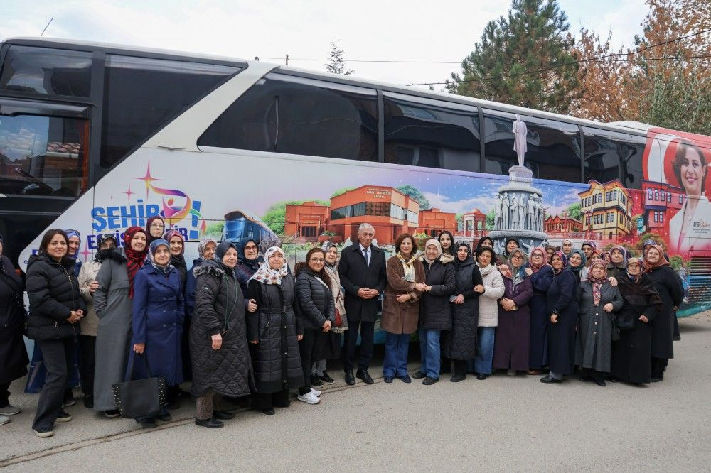

> Eskişehir Büyükşehir Belediyesi'nin kültürel miras projesi kapsamında Çamlıca Mahallesi sakini kadınlar, Sivrihisar'ın simge yapılarını ve yöresel lezzetlerini yerinde tanıdı.

Eskişehir Büyükşehir Belediyesi tarafından kentin kültürel değerlerini tanıtmak ve kadınların sosyal yaşama katılımını artırmak amacıyla yürütülen “Eskişehir Kültürel Mirası ile Buluşuyor” projesi sürüyor. Etkinlik kapsamında bu kez Çamlıca Mahallesi'nde yaşayan kadınlar Sivrihisar ilçesine konuk oldu. Kafileyi mahalleden Büyükşehir Belediye Başkanı Ayşe Ünlüce ile Çamlıca Mahalle Muhtarı Savaş Hancı uğurladı.

Kültürel gezilerin hem kentin köklü mirasını tanıma hem de mahalle içi komşuluk ve dayanışma bağlarını güçlendirme açısından önem taşıdığını belirten Başkan Ünlüce, muhtarlıklarla iş birliği içinde bu buluşmaların süreceğini ifade etti.

Sivrihisar'a ulaşan kafile, gün boyunca ilçenin öne çıkan tarihi ve mimari duraklarını ziyaret etti. Gezi rotasında Metin Yurdanur Açık Hava Müzesi, Sivrihisar Saat Kulesi, Seyir Terası, Surp Yerortutyun Kilisesi, Alemşah Türbesi ve UNESCO Dünya Mirası Listesi'nde yer alan Sivrihisar Ulu Camii incelendi. Kadınlar ayrıca Zaimağa Konağı, Sivrihisar Kilim Müzesi, Nasreddin Hoca Anıt Parkı, Hazinedar Camii, Kurşunlu Camii, Kılıç Mescid Minaresi, Aziz Mahmud Hüdayi Camii ve tarihi Arastalar Çarşısı'nı da gezdi.

Tarihi sokaklardaki gezi programı, ilçenin meşhur bamya çorbası ve yöresel lezzetlerinin tadılmasıyla tamamlandı. Büyükşehir Belediyesi, farklı mahallelerden kadınların katılımıyla ilçelere dönük tanıtım turlarını sürdürecek.

---

## Anadolu Üniversitesi'nden Gazetecilikte Yapay Zekâya Etik Kılavuz Geliyor

**Eğitim · Tepebaşı** · 2026-11-18 21:09 UTC · Kaynak: [Anadolu Üniversitesi](https://anahaber.anadolu.edu.tr/tr/haber-detay/tess101mnvhlvomd4gv37ggk)

> Anadolu Üniversitesi İletişim Bilimleri Fakültesi Gazetecilik Bölümü, öğrencilerin haber üretiminde ve akademik çalışmalarında yapay zekâ araçlarını nasıl kullanacağını belirleyen bir rehber hazırlıyor.

Anadolu Üniversitesi İletişim Bilimleri Fakültesi Gazetecilik Bölümü Liderlik Komisyonu tarafından çevrim içi düzenlenen toplantıda, yapay zekânın mesleki pratiklere etkileri ve gazetecilik eğitimindeki rolü tartışıldı. Toplantıda, bölümün hazırladığı "Üretken Yapay Zekâ Kullanım Kılavuzu" taslağı akademisyenler ve basın mensuplarının görüşüne sunuldu.

Prof. Dr. Erkan Yüksel yönetiminde gerçekleşen oturumda; hız ve kolaylık sağlayan yapay zekâ teknolojilerinin editoryal sorumluluk, haber doğrulama ve telif gibi konularda yol açtığı sorunlar masaya yatırıldı. Toplantıda konuşan Esgazete Yazı İşleri Müdürü Şenay Bilik Yıldırım yapay zekânın haber hazırlık süreçlerinde insan emeği ihtiyacını azalttığına değinirken, NTV Parlamento Muhabiri Özgür Akbaş ise sahadaki muhabirin özgün katkısının ve imzasının yerini yapay zekânın tutamayacağını vurguladı.

Gazetecilik Bölüm Başkanı Prof. Dr. İncilay Cangöz, taslak kılavuzun gelen öneriler doğrultusunda son şeklini alacağını açıkladı. Hazırlanan rehber; insan denetimi, şeffaflık, kaynak gizliliği ve algoritmik yanlılık gibi ilkeleri temel alarak öğrencilere yapay zekâyı yalnızca yardımcı bir araç olarak kullanma sınırlarını çizecek.

---

## 81 İlden Öğretmenler Ankara'da Buluşuyor: MEB 24 Kasım Kutlama Programını Açıkladı

**Eğitim · Türkiye** · 2026-11-18 21:09 UTC · Kaynak: [Milli Eğitim Bakanlığı](https://www.meb.gov.tr/24-kasim-ogretmenler-gunu-cesitli-etkinliklerle-kutlanacak/haber/42570/tr)

> Millî Eğitim Bakanlığı, 24 Kasım Öğretmenler Günü'nü "Hep Sen Varsın Diye" temasıyla tüm yıla yayılacak etkinliklerle kutlamaya hazırlanıyor. 81 ilden temsilci eğitimciler Ankara'da ağırlanacak.

Millî Eğitim Bakanlığı, 24 Kasım Öğretmenler Günü kapsamında eğitimcilerin toplumdaki yerini vurgulamak ve mesleki dayanışmayı güçlendirmek amacıyla "Hep Sen Varsın Diye" temasıyla geniş kapsamlı bir kutlama takvimi hazırladı. Bakanlığın koordinasyonunda yürütülecek faaliyetlerin yalnızca 24 Kasım ile sınırlı kalmayıp yıl geneline yayılması hedefleniyor.

Kutlamalar çerçevesinde 81 ilden belirlenen temsilci öğretmenler, 23-24 Kasım tarihlerinde Ankara'da bir araya gelecek. Millî Eğitim Bakanı Yusuf Tekin'in katılımıyla gerçekleşecek programda öğretmenler; Türk Havacılık ve Uzay Sanayii (TUSAŞ) tesislerini, Şehit Öğretmenler Anıtı'nı ve Öğretmen Hatıra Ormanı'nı ziyaret edecek. Temsilciler ayrıca CSO Ada Ankara'da düzenlenecek "Bir Öğretmen Bin Yürek" konserini takip edecek.

Öğretmenler Günü, 24 Kasım sabahı Anıtkabir ziyaretiyle başlayacak. Bakan Tekin ve öğretmen heyetinin mozoleye çelenk sunmasının ardından sergi açılışları ve söyleşiler düzenlenecek. Heyet akşam saatlerinde ise Cumhurbaşkanlığı Külliyesi'nde gerçekleştirilecek "Öğretmene Saygı Gecesi" programına katılacak. Geceye şehit öğretmen yakınları, emekli ve depremzede eğitimcilerin de aralarında bulunduğu yaklaşık 2 bin kişinin katılması öngörülüyor.

Kutlama programı kapsamında ayrıca 81 ilde "ÖğretmenİZ" söyleşileri gerçekleştirilecek. Ankara'da 25-27 Kasım'da 3. Maarif Kongresi düzenlenecek; İstanbul'da ise Türk Dünyası Öğretmen Buluşması ve emekli öğretmenlere yönelik vefa günleri organize edilecek. Farklı bakanlıklarla yapılan iş birlikleriyle fidan dikimi, spor turnuvaları, askeri bando dinletileri ve sosyal tesis indirimleri gibi birçok etkinlik de hayata geçirilecek.

---
