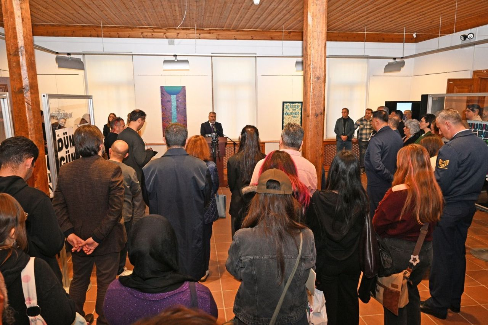
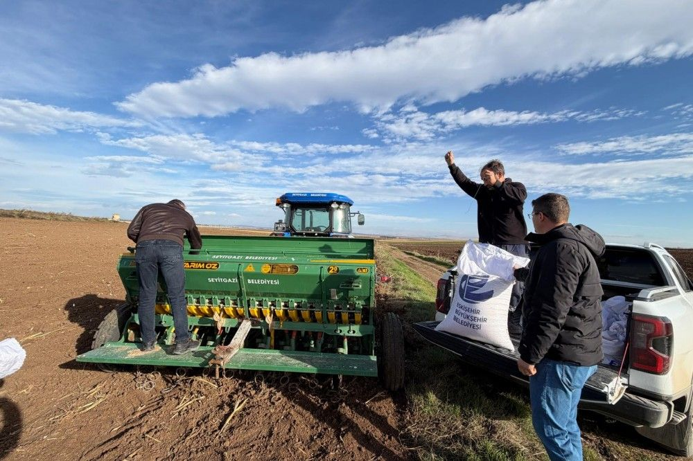
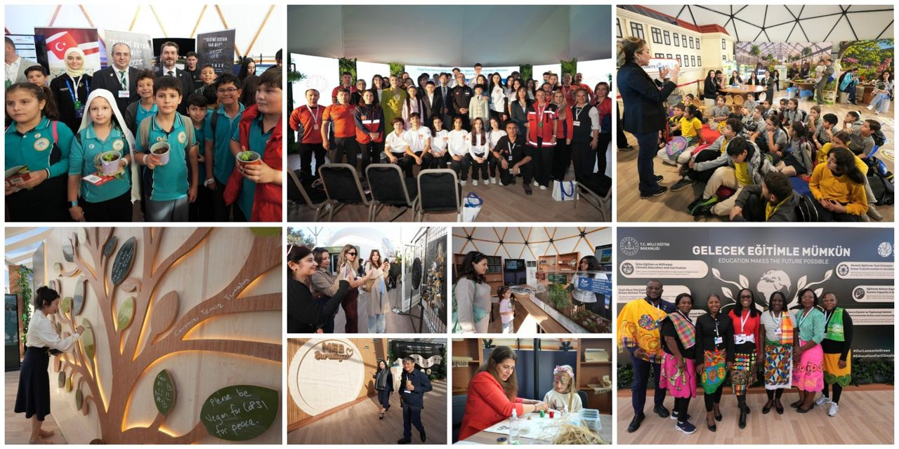
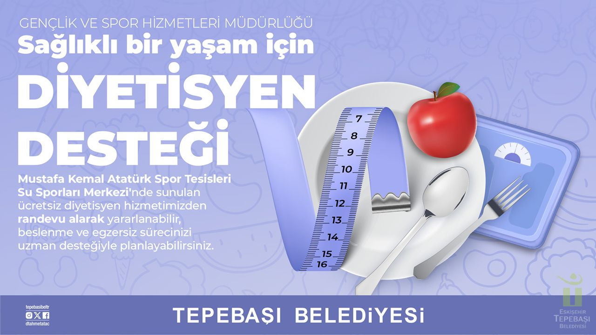
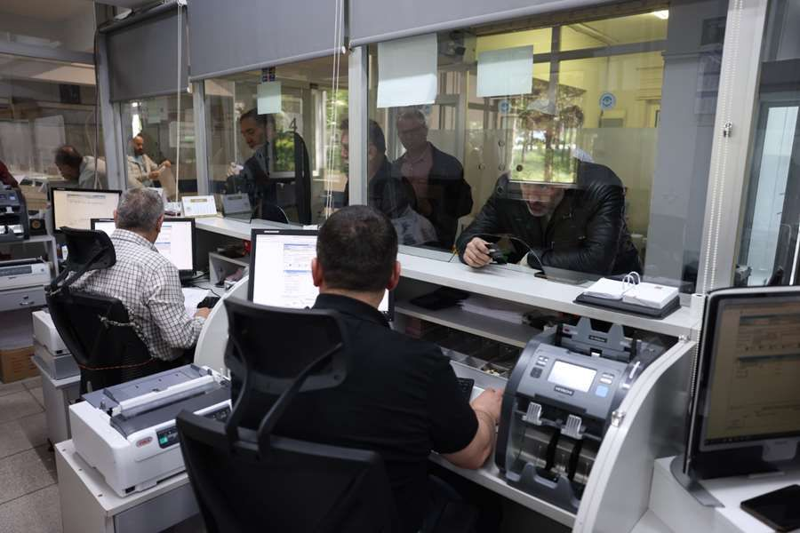
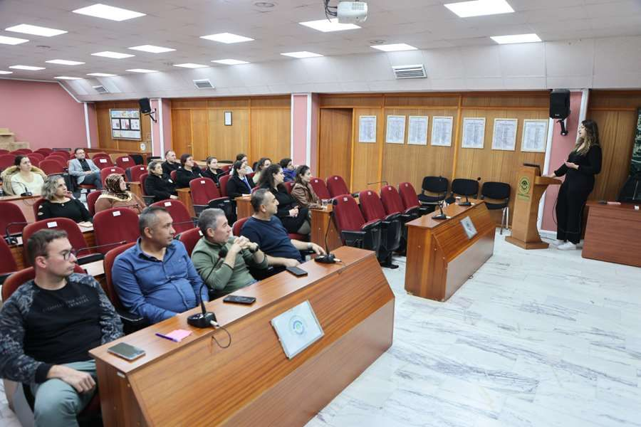
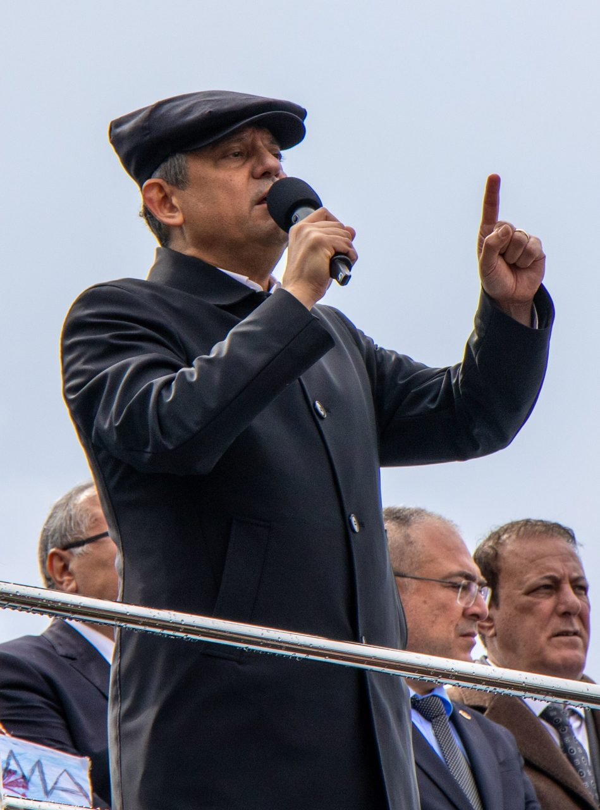
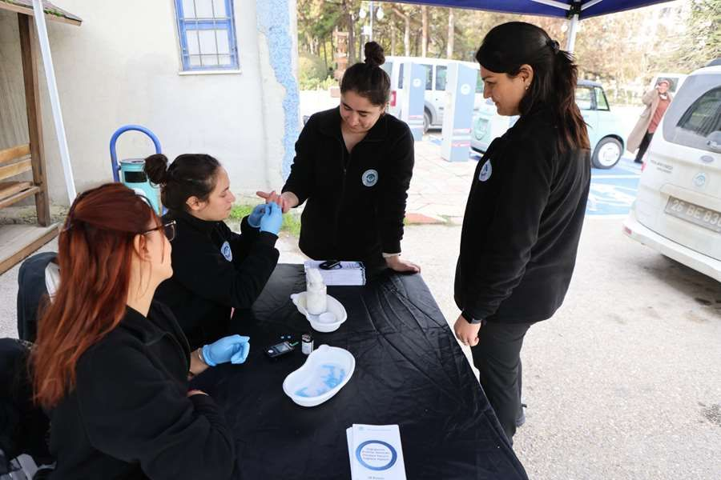
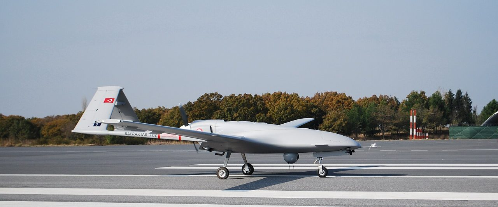

# Son haberler

Ajanın yazdığı son haberler (otomatik güncellenir).

## Kaligrafi ve Tipografiyle Yunus Emre: 18. Festival Sergisi Kapılarını Açtı

**Kültür-Sanat · Tepebaşı** · 2026-11-16 19:43 UTC · Kaynak: [Anadolu Üniversitesi](https://anahaber.anadolu.edu.tr/tr/haber-detay/wb4odbkemtj1p5utywg0t8c3)

> Anadolu Üniversitesi Çağdaş Sanatlar Müzesi'nde açılan 'Yunus Emre' sergisinde, büyük düşünürün sözleri kaligrafi ve tipografinin estetik olanaklarıyla sanatseverlerle buluştu.

Anadolu Üniversitesi Güzel Sanatlar Fakültesi Grafik Sanatlar Bölümü tarafından düzenlenen 18. Uluslararası Anadolu Kaligrafi ve Tipografi Festivali kapsamında hazırlanan “Yunus Emre” sergisi, Anadolu Üniversitesi Çağdaş Sanatlar Müzesi'nde ziyarete açıldı. Yunus Emre’nin felsefesini yazının sanatsal gücüyle buluşturan serginin açılışına 1'inci Ana Jet Üs Komutanı Tuğgeneral Erol Gökmen, Anadolu Üniversitesi Rektörü Prof. Dr. Yusuf Adıgüzel, Güzel Sanatlar Fakültesi Dekanı Prof. Duygu Kahraman, akademisyenler ve öğrenciler katıldı.

Açılışta konuşan Anadolu Üniversitesi Rektörü Prof. Dr. Yusuf Adıgüzel, Yunus Emre'nin barış ve sevgi felsefesini gelecek kuşaklara aktarmada sanatın kritik rol oynadığını vurguladı. Sanatçıların ve öğrencilerin Yunus'un sözlerini estetik bir dille yeniden yorumladığını belirten Adıgüzel, üniversitede geçen yılın Yunus Emre Yılı, bu eğitim öğretim yılının ise Nasreddin Hoca Yılı ilan edildiğini hatırlattı.

Güzel Sanatlar Fakültesi Dekanı Prof. Duygu Kahraman da Yunus Emre’nin insanın ortak değerlerine seslenen evrensel bir miras bıraktığına dikkat çekti. Festival organizasyon komitesi üyesi Dr. Öğr. Üyesi Mehtap Uygungöz ise 2009'dan beri süren etkinliğin Latin harfli modern yazı sanatı ile geleneksel hat sanatını harmanlayan özgün bir modele dönüştüğünü ve öğrencilerin bizzat üretim sürecine katıldığını aktardı.

Yunus Emre’nin düşünce dünyasını yazı sanatıyla harmanlayan sergi, 11 Aralık Cuma gününe kadar Anadolu Üniversitesi Çağdaş Sanatlar Müzesi'nde gezilebilecek.

---

## Eskişehir'de Kadim Tohum Kavılca Buğdayı Ekim Alanı 3 Katına Çıktı: 210 Dekara Ulaştı

**Tarım · Seyitgazi** · 2026-11-16 19:43 UTC · Kaynak: [Eskişehir Büyükşehir Belediyesi](https://www.eskisehir.bel.tr/icerik-detay.php?icerik_id=13565&cat_icerik=1&menu_id=24)

> Eskişehir Büyükşehir Belediyesi, binlerce yıllık geçmişe sahip kavılca buğdayının ekim alanını 70 dekardan 210 dekara çıkardı. Tohumlar Seyitgazi'de de toprakla buluştu.

Eskişehir Büyükşehir Belediyesi Tarımsal Hizmetler Dairesi Başkanlığı, Anadolu'nun köklü tarım miraslarından kavılca buğdayını yeniden kente kazandırmak için ekim sahalarını genişletiyor. Geçtiğimiz üretim sezonunda yaklaşık 70 dekar alanda yapılan ve bölge ortalamasının üzerinde verim sağlanan üretimden elde edilen tohumluklar, bu yılki ekim alanının 210 dekara yükselmesini sağladı.

Proje kapsamında Seyitgazi Belediyesi ile ortak bir çalışma da hayata geçirildi. İki belediye arasındaki iş birliği protokolü çerçevesinde, Seyitgazi ilçesine bağlı Yenikent Mahallesi'nde Küllüoba kazı çalışmalarının sürdüğü bölgedeki 10 dekarlık belediye arazisine kavılca buğdayı ekildi.

Yerel tarımsal çeşitliliği korumayı ve ata tohumlarını gelecek nesillere aktarmayı hedefleyen Büyükşehir Belediyesi, hasat edilecek yeni ürünleri tohumluk olarak değerlendirerek kavılca buğdayının Eskişehir genelindeki yaygınlığını artırmayı sürdürecek.

---

## Erdoğan Vefatının 5. Yılında Sezai Karakoç'u Andı: 'Hürmetle Yad Ediyorum'

**Siyaset · Türkiye** · 2026-11-16 19:43 UTC · Kaynak: [Google Haberler - Cumhurbaşkanı](https://www.aa.com.tr/tr/gundem/cumhurbaskani-erdogan-vefatinin-5-yilinda-sezai-karakocu-andi/4126829)

> Cumhurbaşkanı Recep Tayyip Erdoğan, şair, yazar ve düşünce insanı Sezai Karakoç'u vefatının 5. yıl dönümünde yayımladığı mesajla andı.

Cumhurbaşkanı Recep Tayyip Erdoğan, Türk edebiyatının ve düşünce dünyasının önemli isimlerinden Sezai Karakoç'un vefatının 5. yılı dolayısıyla bir anma mesajı paylaştı.

Sosyal medya hesabı üzerinden açıklamada bulunan Cumhurbaşkanı Erdoğan, "Ebediyete irtihalinin 5'inci yılında Diriliş Şairimiz Üstat Sezai Karakoç'u rahmetle, hürmetle yad ediyorum." ifadelerine yer verdi.

---

## 3. Lig 2. Grup'ta 12. Hafta Geride Kaldı: Eskişehirspor Zirve Takibini Sürdürüyor

**Spor · Merkez** · 2026-11-16 19:43 UTC · Kaynak: [Google Haberler - Eskişehirspor](https://www.habercitv.com.tr/3-lig-2-grup-puan-durumu-ve-12-hafta-mac-sonuclari)

> Nesine 3. Lig 2. Grup'ta 12. hafta maçlarının ardından Eskişehirspor, lider Etimesgut Spor'un bir puan gerisinde 25 puanla ikinci sıradaki yerini korudu.

Nesine 3. Lig 2. Grup'ta 12. hafta karşılaşmaları tamamlandı. Sahasında Ayvalıkgücü Belediyespor ile 2-2 berabere kalan Eskişehirspor, haftayı 25 puanla ikinci sırada kapattı. Gaziemir G.O.G. Spor'u 5-0 mağlup eden Etimesgut Spor ise 26 puana yükselerek liderlik koltuğuna oturdu.

Grupta zirve mücadelesi büyük çekişmeye sahne oluyor. Lider Etimesgut Spor'u 25'er puanla Eskişehirspor ve Gemlik Sümerbey takip ederken, Balıkesirspor ile Karşıyaka 24'er puanla sıralandı. Rakip fileleri 33 kez havalandıran Eskişehirspor, 12 hafta sonunda grubun en golcü takımı unvanını elinde bulunduruyor.

Eskişehir'in gruptaki bir diğer temsilcisi Eskişehir Anadolu Spor ise deplasmanda Balıkesirspor ile 1-1 berabere kalarak puanını 22'ye yükseltti ve haftayı 7. sırada tamamladı.

Ligin 13. haftasında Eskişehirspor, 22 Kasım Pazar günü saat 13.00'te deplasmanda Söke 1970 Spor ile karşılaşacak. Aynı gün Eskişehir Anadolu Spor ise sahasında 1922 Akşehir Spor'u konuk edecek.

---

## ESTÜ Kamu İletişimi Eğitiminde: 'Hassas Verileri Yapay Zekâya Vermeyin' Uyarısı

**Eğitim · Tepebaşı** · 2026-11-16 19:14 UTC · Kaynak: [Eskişehir Teknik Üniversitesi](https://www.eskisehir.edu.tr/tr/Haber/Detay/eskisehir-teknik-universitesi-iletisimin-yuzyili-guclu-iletisim-etkin-kamu-egitim-programina-katildi)

> Eskişehir Teknik Üniversitesi, Afyonkarahisar'da kamu kurumlarına yönelik düzenlenen "İletişimin Yüzyılı: Güçlü İletişim, Etkin Kamu" eğitim programına katıldı.

Cumhurbaşkanlığı İletişim Başkanlığı Afyonkarahisar Bölge Müdürlüğü tarafından düzenlenen "İletişimin Yüzyılı: Güçlü İletişim, Etkin Kamu" eğitim programı gerçekleştirildi. Afyon Kocatepe Üniversitesi Ahmet Necdet Sezer Kampüsü İbrahim Küçükkurt Konferans Salonu'ndaki programa Eskişehir Teknik Üniversitesi'ni (ESTÜ) temsilen Kurumsal İletişim Koordinatörlüğü personeli İhsan Tarık Çelik katıldı.

Kamu kurumlarının basın ve halkla ilişkiler çalışanları ile yerel basın mensuplarını bir araya getiren programın açılışında konuşan Cumhurbaşkanlığı İletişim Başkan Yardımcısı İlhami Giray Şahin, kamu iletişiminin stratejik önem taşıdığını belirtti. Dijitalleşmeyle birlikte bilgi akışının hızlandığına işaret eden Şahin; dezenformasyonla mücadele, kriz iletişimi ve kurumlar arası koordinasyonun gerekliliğine değindi. Yapay zekâ teknolojilerinin veri güvenliği riskleri barındırdığına dikkat çeken Şahin, kurumsal bilgilerin ve hassas verilerin üçüncü taraf yapay zekâ uygulamalarıyla paylaşılmaması gerektiği uyarısında bulundu.

Eğitimler kapsamında Dezenformasyonla Mücadele Merkezi tarafından dezenformasyonla mücadele yöntemleri, Bilgi İşlem Dairesi Başkanlığı tarafından yapay zekâ ile araştırma ve bilgi sentezleme teknikleri aktarıldı. Programda ayrıca halkla ilişkiler, CİMER süreçleri ve basında sosyal medya kullanımı başlıklarında sunumlar yapılarak kurumlar arası bilgi ve deneyim paylaşımı sağlandı.

---

## Eskişehirspor'da Hakan Şapcı Tartışılıyor: Gündemde Barış Filiz İsmi Var

**Spor · Tepebaşı** · 2026-11-16 19:14 UTC · Kaynak: [Google Haberler - Eskişehirspor](https://www.esgazete.com/eskisehirsporda-baris-filiz-sesleri)

> Ayvalıkgücü beraberliği sonrası tribünlerin istifaya çağırdığı teknik direktör Hakan Şapcı'nın ardından siyah-kırmızılı kulüpte Barış Filiz ismi öne çıktı.

Nesine 3. Lig'de şampiyonluk mücadelesi veren Eskişehirspor'da son haftalarda yaşanan puan kayıpları teknik heyeti eleştirilerin hedefine yerleştirdi. Son olarak Ayvalıkgücü Belediyespor karşılaşmasında tribünlerden teknik direktör Hakan Şapcı'ya yönelik yükselen istifa sesleri, camiadaki huzursuzluğu gün yüzüne çıkardı.

Taraftarların sahadaki oyun anlayışı, oyuncu tercihleri ve maç içi hamleler nedeniyle tepki gösterdiği Şapcı'nın durumu belirsizliğini korurken, kulüp yönetiminin teknik direktör alternatifleri üzerinde durduğu iddia edildi. Bu kapsamda gündeme gelen isimlerden biri de Türkiye Futbol Federasyonu bünyesinde antrenör eğitimciliği yapan Barış Filiz oldu.

UEFA Elit A antrenörlük lisansına sahip olan 38 yaşındaki Barış Filiz, antrenörlük kariyerinde Bursaspor'da A takım antrenörlüğü, Fenerbahçe Kadın Futbol Takımı'nda yardımcı antrenörlük, Bodrum FK, Bandırmaspor ve Tuzlaspor altyapılarında çeşitli görevler üstlendi. TFF'de yeni antrenör adaylarına eğitim veren Filiz ile kulüp yönetimi arasında henüz resmî bir temas kurulduğu doğrulanmazken, teknik heyet konusunun önümüzdeki günlerde netleşmesi bekleniyor.

---

## COP31'de İklim ve Afet Eğitimi Masaya Yatırıldı: Türkiye İklim Okulu'na Yoğun İlgi

**Eğitim · Türkiye** · 2026-11-16 19:14 UTC · Kaynak: [Milli Eğitim Bakanlığı](https://www.meb.gov.tr/turkiye-iklim-okulunda-quotafet-risklerinin-azaltilmasinda-egitimin-roluquot-masaya-yatirildi/haber/42545/tr)

> Antalya'da düzenlenen COP31 kapsamında Millî Eğitim Bakanlığının kurduğu Türkiye İklim Okulunda afet risklerinin azaltılmasında eğitimin rolü uluslararası uzmanlarla ele alındı.

Antalya'da devam eden Birleşmiş Milletler İklim Değişikliği Konferansı (COP31) çerçevesinde Millî Eğitim Bakanlığı tarafından oluşturulan Türkiye İklim Okulu, uzmanların katıldığı kapsamlı panellere ve atölyelere ev sahipliği yaptı.

İçişleri Bakanlığı AFAD Eğitim ve Farkındalık Dairesi Başkanı, Japonya Uluslararası İş Birliği Ajansı (JICA) Türkiye Ofisi temsilcileri ve akademisyenlerin yer aldığı panelde, iklim krizine bağlı aşırı hava olayları, sel ve heyelan gibi afetlerin oluşturduğu tehditler ele alındı. Türkiye, Japonya ve Çin örnekleri üzerinden afet risklerine karşı dayanıklılığın artırılmasında okul müfredatları ile öğretmen kapasitesinin kritik rol oynadığı vurgulandı.

Program kapsamında ayrıca yeşil becerilerin hayat boyu öğrenme süreçlerine dahil edilmesi ve gençlerin mücadeledeki rolü üzerine oturumlar düzenlendi. Okul alanındaki çölleşmeyi önleme simülatörleri, yenilenebilir enerji tasarımları ve muz lifi dokuma atölyesi yabancı katılımcılardan yoğun ilgi gördü.

---

## Eskişehirspor'da Atalay Yıldırım Şoku: Köprücük Kemiği Kırıldı, Ameliyat Edildi

**Spor · Merkez** · 2026-11-16 13:39 UTC · Kaynak: [Google Haberler - Eskişehirspor](https://www.gazetevatan.com/sehirler/eskisehir/eskisehirspora-kotu-haber-kemigi-kirildi-ameliyat-oldu-2465371)

> Ayvalıkgücü maçında sakatlanan Eskişehirsporlu futbolcu Atalay Yıldırım'ın sol köprücük kemiğinde kırık tespit edilerek ameliyata alındığı bildirildi.

Nesine 3. Lig 2. Grup'un 12. haftasında Prof. Dr. Fethi Heper Stadyumu'nda oynanan ve 2-2 eşitlikle tamamlanan Ayvalıkgücü Belediyespor karşılaşmasında sakatlanan genç futbolcu Atalay Yıldırım'dan kötü haber geldi.

Siyah-kırmızılı kulübün sosyal medya hesabından yayımlanan sağlık bilgilendirmesine göre, maç sırasında girdiği ikili mücadelede sakatlanan futbolcunun yapılan ayrıntılı kontrollerinde sol köprücük kemiğinde kırık belirlendi.

Tetkiklerin ardından vakit kaybedilmeden ameliyata alınan Atalay Yıldırım'ın operasyonunun başarılı geçtiği belirtildi. Eskişehirspor Kulübü, operasyon sonrası oyuncuya geçmiş olsun dileklerini iletti.

---

## CHP'li Yıldırım Kaya: 'Halil İbrahim Sofrasını Yeniden Kurmak Zorundayız'

**Siyaset · Türkiye** · 2026-11-16 13:39 UTC · Kaynak: [Google Haberler - CHP](https://yerel-haberler.haberturk.com/hatay-haberleri/chp-genel-baskan-yardimcisi-yildirim-kaya-hatayda-konustu-119523905)

> CHP Genel Başkan Yardımcısı Yıldırım Kaya, Hatay'da erken seçime hazır olduklarını belirterek iktidara hazırlığın tüm muhalefetin ortak görevi olduğunu söyledi.

Cumhuriyet Halk Partisi (CHP) Genel Başkan Yardımcısı Yıldırım Kaya, partisinin Hatay'da bir otelde düzenlediği "Yönetici Eğitimleri" programında partililere hitap etti.

Hatay'ın 15 ilçesinin üretim ve kalkınma potansiyeline sahip olduğunu ifade eden Kaya, 6 Şubat 2023 depremlerinden etkilenen bölgede üretici ve esnafın zorluklar yaşadığını belirtti. CHP'nin tek rakibinin mevcut siyasal iktidar olduğunu kaydeden Kaya, muhalefet partileriyle herhangi bir tartışma gündemlerinin bulunmadığını söyledi.

Erken seçim istediklerini ve buna hazır olduklarını dile getiren Kaya, partiden ayrılanlara kapılarının açık olduğunu vurguladı. Tek başına iktidar iddiasının gerçekçi olmadığını savunan Kaya, "Halil İbrahim sofrasını yeniden kurmak zorundayız. Sofraya oturan her yurttaşımız eşit kaşıkla o sofrada yemeğini yiyecek. İktidara hazırlık, muhalefetin bütün olarak görevidir" ifadelerini kullandı.

İlçe yöneticileri ve parti üyelerinin yer aldığı eğitim programına CHP Hatay İl Başkanı Derya Altunay da katılarak konuşma yaptı.

---

## 2027'de 46 Yeni Hastane Açılacak: 5'i Şehir Hastanesi Olacak

**Sağlık · Türkiye** · 2026-11-16 13:39 UTC · Kaynak: [Google Haberler - Bakanlıklar](https://haberton.com/saglik-bakanligi-acikladi-2027de-46-yeni-hastane-acilacak-5i-sehir-hastanesi/)

> Sağlık Bakanı Kemal Memişoğlu, 2027 yılında 5'i şehir hastanesi olmak üzere toplam 46 yeni hastanenin hizmete girmesinin planlandığını duyurdu.

Sağlık Bakanı Kemal Memişoğlu, TBMM Plan ve Bütçe Komisyonunda bakanlığın 2027 yılı bütçe teklifine ilişkin yaptığı sunumda Türkiye genelindeki sağlık yatırımlarına dair ayrıntıları paylaştı. Bakan Memişoğlu, 2027 yılı içinde 5'i şehir hastanesi niteliğinde toplam 46 hastanenin faaliyete geçirilmesinin hedeflendiğini bildirdi.

Son 10 yıllık süreçte 42 bini aşkın yatak kapasiteli 28 şehir hastanesinin açıldığını hatırlatan Memişoğlu, 11 şehir hastanesinin açılışı için de hazırlıkların devam ettiğini aktardı. İnşaatı tamamlanma aşamasına gelen Trabzon Şehir Hastanesinde ise kasım ayı sonunda hasta kabulüne başlanmasının öngörüldüğü ifade edildi. Son bir yılda ise Samsun, Aydın, Şanlıurfa ve Ordu'dakiler dahil toplam 9 bin 540 yatak kapasitesine sahip 34 hastane hizmete alındı.

Kamudaki toplam yatak kapasitesinin 178 bin 66'ya, erişkin ve çocuk dahil yoğun bakım yatak sayısının da 26 bin 228'e ulaştığını belirten Memişoğlu, 81 ilde 486'sı inşaat halinde olan toplam 1.217 birinci basamak sağlık tesisinin yatırım sürecinin sürdüğünü kaydetti. Deprem bölgesindeki yatak kapasitesinin afet öncesine kıyasla yüzde 26 artırılarak 30 binin üzerine çıkarıldığı, bölgede 4 bin 381 yatak kapasiteli 24 sağlık tesisinin inşasının sürdüğü açıklandı.

---

## Tepebaşı'nda Ücretsiz Diyetisyen Hizmeti Başladı: Randevular Salı Günleri

**Sağlık · Tepebaşı** · 2026-11-16 13:04 UTC · Kaynak: [Tepebaşı Belediyesi](https://www.tepebasi.bel.tr/Haber/Detay/tepebası’ndasaglıklıyasamicinucretsizdiyetisyendestegi)

> Tepebaşı Belediyesi Su Sporları Merkezi'nde vatandaşlara yönelik ücretsiz diyetisyen desteği sunuluyor. Uzman kontrolünde beslenme ve egzersiz planı yapmak isteyenler randevuyla hizmet alabiliyor.

Tepebaşı Belediyesi, sağlıklı yaşamı teşvik etmek amacıyla yürüttüğü çalışmalara ücretsiz diyetisyen desteğini ekledi. Gençlik ve Spor Hizmetleri Müdürlüğü koordinasyonunda sunulan hizmet sayesinde Eskişehirliler, beslenme alışkanlıklarını ve fiziksel aktivite süreçlerini uzman rehberliğinde düzenleme fırsatı buluyor.

Mustafa Kemal Atatürk Spor Tesisleri Su Sporları Merkezi bünyesinde verilen hizmetle, vatandaşların sağlıklı yaşama dair güvenilir bilgiye ve profesyonel yönlendirmeye kolayca erişmesi hedefleniyor. Randevu sistemiyle gerçekleştirilen bireysel görüşmelerde, kişiye özel beslenme ve egzersiz planlamaları yapılıyor.

Ertuğrulgazi Mahallesi Alpar Sokak'ta bulunan tesisteki ücretsiz diyetisyen desteğinden yararlanmak isteyenlerin, salı günleri saat 10.00 ile 16.00 arasında randevu alabileceği bildirildi. Hizmete ilişkin ayrıntılı bilgi ve randevu işlemleri için merkeze ait telefon numarasından başvuru yapılabiliyor.

---

## Tepebaşı'nda Çocuk Odaklı Projeler: 82 Bini Aşkın Çocuğa Diş Taraması Yapıldı

**Belediye · Tepebaşı** · 2026-11-16 13:04 UTC · Kaynak: [Google Haberler - Tepebaşı](https://ankahaber.net/haber/tepebasi-belediye-baskani-atac-kentimizin-gelecegini-cocuklarimizla-insa-ediyoruz-2cd76841)

> Tepebaşı Belediye Başkanı Ahmet Ataç, çocuklara yönelik eğitim, sağlık, kültür ve sanat faaliyetlerinde fırsat eşitliğini esas aldıklarını açıkladı.

Tepebaşı Belediyesi, çocukların gelişimini desteklemek amacıyla eğitim, sanat ve sağlık alanlarındaki projelerini sürdürüyor. Tepebaşı Belediye Başkanı Ahmet Ataç, çocukların nitelikli eğitime ve sağlıklı yaşama erişiminin ailelerin ekonomik durumuna bağlı olmaması gerektiğini vurgulayarak yürütülen hizmetlerin ayrıntılarını paylaştı.

Eğitim alanındaki çalışmalara değinen Başkan Ataç, 2023 yılında açılan Bahriye Üçok Eğitim ve Gelişim Merkezi'nden bugüne kadar 3 bin 688 öğrencinin faydalandığını bildirdi. Merkezde 2026 güz döneminde 26 grupta 357 öğrenciye temel derslerin yanı sıra rehberlik desteği sunulduğu kaydedildi.

Kültür ve sanat faaliyetleri kapsamında yetenek sınavı şartı aranmaksızın eğitim veren İki Elin Sesi Var Çocuk ve Gençlik Senfoni Orkestrası ile bugüne dek 2 bin 500 çocuğa ulaşıldığı belirtildi. Ayrıca 90 çocuğun katkısıyla hayata geçirilen "Cumhuriyet’in Çocukları" kolektif anıtı gibi çalışmalarla çocukların sanatsal üretime dahil edildiği aktarıldı.

Koruyucu sağlık hizmetleri kapsamında 2013'ten bu yana hizmet veren Tepebaşı Belediyesi Çocuk Ağız ve Diş Sağlığı Polikliniği'nde ise 82 bin 910 çocuğa tarama yapıldığı açıklandı. Bu taramalarda sorun tespit edilen 39 bin 838 çocuğun tedavisi tamamlanırken, 4 bin 201 çocuğa toplam 7 bin 173 kez psikolojik destek sağlandığı ve 25 bin 632 çocuğa sağlık eğitimi verildiği kaydedildi.

---

## Odunpazarı'nda İkinci Taksit İçin Süre Daralıyor: Vergi Ödemelerinde Son Gün 30 Kasım

**Belediye · Odunpazarı** · 2026-11-16 13:04 UTC · Kaynak: [Odunpazarı Belediyesi](https://www.odunpazari.bel.tr/guncel/haberler/genel-haberler/odunpazari-nda-kasim-ayi-vergi-odemeleri-icin-son-gun-30-kasim)

> Odunpazarı Belediyesi, emlak, çevre temizlik ile ilan ve reklam vergileri taksitleri için son ödeme gününün 30 Kasım Pazartesi olduğunu hatırlattı.

Odunpazarı Belediyesi, 2026 yılına ait Emlak Vergisi, Çevre Temizlik Vergisi ve İlan ve Reklam Vergisi'nin ikinci taksitleri ile Katı Atık Ücreti'nin 5'inci taksitine ilişkin mükelleflere kritik bir uyarıda bulundu. Vatandaşların cezalı duruma düşmemesi ve gecikme zammıyla karşılaşmaması için ödemelerin 30 Kasım 2026 Pazartesi günü mesai bitimine kadar yapılması gerektiği bildirildi.

Mükellefler vergi ve ücret borçlarını doğrudan belediye veznelerine giderek ödeyebilecek. Ayrıca veznelere gitmek istemeyen vatandaşlar için e-Devlet kapısı ve belediyenin resmi internet sitesi olan 'www.odunpazari.bel.tr' adresindeki e-Belediye sistemi üzerinden de çevrim içi ödeme imkânı sunuluyor.

Yetkililer, veznelerde ve internet altyapısında son günlerde oluşabilecek yoğunlukları önlemek amacıyla mükelleflerin işlemlerini son güne bırakmamaları tavsiyesinde bulundu.

---

## 20 Sanatçının Eseri Tek Çatıda: 'Buluşma' Sergisi Ziyarete Açıldı

**Kültür-Sanat · Tepebaşı** · 2026-11-16 13:04 UTC · Kaynak: [Google Haberler - Eskişehir gündem](https://www.eskisehirekspres.net/eskisehirde-bulusma-sergisi-sanatseverlerden-tam-not-aldi)

> Yolları Eskişehir'de kesişen sanatçıların eserlerini bir araya getiren 'Buluşma' karma sergisi, Turgut Özakman Sanat Galerisi'nde ziyarete açıldı.

Çekirdek Eskişehir'in yeni merkezi olarak hizmet veren Turgut Özakman Sanat Galerisi, "Buluşma" başlıklı sergiyle kapılarını sanatseverlere açtı. Genç sanatçıların üretimlerini görünür kılmayı ve kentin kültür hayatına dinamizm kazandırmayı hedefleyen galerideki açılışa, Eskişehir Büyükşehir Belediyesi Başkan Vekili Hasan Ünal'ın yanı sıra sanatçılar ve çok sayıda davetli katıldı.

Küratörlüğünü Prof. Dr. Gülbin Özdamar Akarçay, Doç. Özgür Uğuz ve E. Gülşah Akın'ın üstlendiği sergide 20 sanatçının eserleri yer alıyor. Farklı deneyim ve pratiklere sahip sanatçıların kentle kurdukları kişisel ve kolektif bağlardan yola çıkan seçki; mekân, zaman ve bellek kavramlarının kesişim noktalarını konu alıyor.

Farklı bakış açılarını ve özgün anlatımları bir arada sunan "Buluşma" karma sergisi, 6 Aralık 2026 tarihine kadar Eskişehir Büyükşehir Belediyesi Kültür ve Sanat Merkezi Turgut Özakman Sanat Galerisi'nde ziyaret edilebilecek.

---

## Togg Ekim Ayında Türkiye İkincisi Oldu: Pazar Payı Yüzde 11,7'ye Ulaştı

**Ekonomi · Türkiye** · 2026-11-16 11:04 UTC · Kaynak: [Google Haberler - Togg](https://finanshatti.com/otomotiv-sektorunde-ekim-raporu-togg-satislarda-zirveyi-zorluyor/)

> Türkiye İstatistik Kurumu verilerine göre Ekim ayında trafiğe kaydı yapılan araçlar arasında Togg, yüzde 11,7'lik pazar payıyla en çok tercih edilen ikinci marka oldu.

Türkiye otomotiv pazarında Ekim ayı trafiğe kayıt verileri açıklandı. Türkiye İstatistik Kurumu verilerine göre, ay boyunca toplam 62 bin 97 otomobilin trafiğe kaydı gerçekleştirildi. Açıklanan istatistikler, yerli üretici ile küresel otomotiv markaları arasındaki rekabetin güncel durumunu ortaya koydu.

Ekim ayı sonuçlarına göre pazarın zirvesinde yüzde 14,5'lik pay ile Renault yer aldı. Türkiye'nin yerli elektrikli otomobil markası Togg ise yüzde 11,7 pazar payı elde ederek satış listesinde ikinci sıraya yerleşti. Togg'un ardından gelen Volkswagen, yüzde 11,1'lik oranla listenin üçüncü basamağında kendine yer buldu.

Elektrikli araçlara yönelik ilginin arttığı otomotiv sektöründe yerli üreticinin küresel markalar arasındaki yükselişi sürerken, pazar paylarının birbirine oldukça yakın seyretmesi markalar arasındaki rekabetin önümüzdeki dönemde de devam edeceğini gösteriyor.

---

## Odunpazarı Personeline Kanser ve Lösemide Erken Teşhis Semineri

**Sağlık · Odunpazarı** · 2026-11-16 11:04 UTC · Kaynak: [Odunpazarı Belediyesi](https://www.odunpazari.bel.tr/guncel/haberler/genel-haberler/losev-den-odunpazari-belediyesi-personeline-kanser-ve-losemi-egitimi)

> LÖSEV yetkilileri, Odunpazarı Belediyesi Meclis Salonu'nda personele kanser ve lösemide erken tanının hayati önemini anlattı.

Odunpazarı Belediyesi çalışanlarına yönelik sağlık bilgilendirme çalışmaları kapsamında, Lösemili Çocuklar Sağlık ve Eğitim Vakfı (LÖSEV) iş birliğiyle kanser ve lösemi semineri gerçekleştirildi.

Belediye Meclis Salonu'nda düzenlenen eğitimde, erken teşhisin hastalıklarla mücadeledeki belirleyici rolü üzerinde duruldu. LÖSEV yetkilileri, katılımcılara hastalıkların erken dönemde tespit edilmesinin tedavi sürecine sağladığı katkıları aktardı.

Seminerde ayrıca belediye personelinin sağlık kontrollerini düzenli yaptırması ve farkındalık düzeyinin artırılması hedeflendi.

---

## MEB Duyurdu: Öğretmen Bilgi Servisi'ni Yaklaşık 500 Bin Eğitimci Kullandı

**Eğitim · Türkiye** · 2026-11-16 11:04 UTC · Kaynak: [Milli Eğitim Bakanlığı](https://www.meb.gov.tr/ogretmen-bilgi-servisi039nden-yaklasik-500-bin-ogretmen-yararlandi/haber/42536/tr)

> Millî Eğitim Bakanlığı'nın yerli mesajlaşma platformu üzerinden sunduğu Öğretmen Bilgi Servisi'nden 474 bini aşkın öğretmen, Okul Veli Asistanı'ndan ise yaklaşık 400 bin veli yararlandı.

Millî Eğitim Bakanlığı (MEB), eğitim çalışanları ile velilerin doğru bilgiye güvenli şekilde erişimini sağlamak amacıyla devreye aldığı dijital iletişim araçlarına ilişkin verileri paylaştı. Katılım zorunluluğu bulunmayan Öğretmen Bilgi Servisi'ni (ÖBS) bugüne kadar 474 bin 907 öğretmenin kullandığı bildirildi.

Türk mühendisler tarafından geliştirilen yerli mesajlaşma uygulaması BiP altyapısıyla çalışan sistem, yabancı kaynaklı platformlardan bağımsız bir iletişim ortamı sunuyor. Bakanlık merkez teşkilatı; Türkiye Yüzyılı Maarif Modeli'ne dair duyurular, çalışma takvimleri, yönergeler ve toplantı bilgilerini ÖBS üzerinden doğrudan taşra teşkilatına ve öğretmenlere aktarabiliyor. Uçtan uca şifreleme yönteminin kullanıldığı sistemde, bölge ve grup bazında mesajlaşma ile geri bildirim toplama süreçleri de yürütülebiliyor.

Öte yandan veliler ile okul idaresi arasındaki bağı güçlendirmek için hayata geçirilen Okul Veli Asistanı (OVA) sistemine de ilginin sürdüğü belirtildi. Bugüne kadar 399 bin 944 velinin kullandığı asistan aracılığıyla sınav tarihleri, notlar ve devamsızlık durumları anlık takip edilebiliyor. Veliler ayrıca sistem üzerinden düzenlenen anketlerle Bakanlığa görüş ve önerilerini iletebiliyor.

---

## Büyükerşen'in Önerisiyle Başladı: Eskişehir'in Gülen Yüzlerini Fotoğraflıyor

**Kültür-Sanat · Merkez** · 2026-11-16 11:04 UTC · Kaynak: [Google Haberler - Eskişehir](https://www.gazetevatan.com/sehirler/eskisehir/yilmaz-buyukersenin-tek-cumlesi-hayatini-degistirdi-simdi-eskisehirin-gulen-yuzlerini-topluyor-2465384)

> Köpeğini kaybettikten sonra zor günler geçiren emekli Ali Kaplaner, Yılmaz Büyükerşen'in 'Mutluluğun resmini çek' tavsiyesiyle kentin tebessümlerini ölümsüzleştiriyor.

Eskişehir'de emekli olduktan sonra köpeği "Bal" ile Adalar bölgesinde yürüyüşlere çıkan Ali Kaplaner'in fotoğraf serüveni, vatandaşların köpeğine gösterdiği ilgiyle başladı. Ancak Kaplaner'in hayatında derin iz bırakan köpeği 22 Eylül 2019'da yaşamını yitirdi.

Köpeğinin kaybıyla zor bir döneme giren Kaplaner'in yaşamındaki dönüm noktası, 29 Ekim 2019 tarihinde dönemin Eskişehir Büyükşehir Belediye Başkanı Yılmaz Büyükerşen ile karşılaşması oldu. Büyükerşen'in kendisine ilettiği "Mutluluğun resmini çek" tavsiyesi, Kaplaner için yepyeni bir sayfa açtı.

Bu sözün ardından fotoğraf makinesini eline alarak Eskişehir sokaklarını adım adım gezen Kaplaner, kent sakinlerinin tebessümlerini ve neşeli anlarını fotoğraflamaya başladı. Çektiği kareleri "Bal Gibi Sevgi" adlı sosyal medya hesabı üzerinden paylaşan Kaplaner, sokakta tanıştığı insanlarla birlikte objektifin karşısına geçerek kente dair hatıralar biriktirmeyi sürdürüyor.

---

## Yeni Parti'de 160 Kişilik Parti Meclisi Belirlendi: Kurultay Sona Erdi

**Siyaset · Türkiye** · 2026-11-16 09:05 UTC · Kaynak: [Google Haberler - CHP](https://www.dw.com/tr/yeni-parti-y%C3%B6netimi-belli-oldu-pmde-kimler-var/a-79954360)

> Yeni Parti'nin ilk olağan kurultayı Parti Meclisi ve Yüksek Disiplin Kurulu seçimleriyle tamamlandı. Üye sayısı 160'a çıkarılan Parti Meclisi'nde ekonomi, dış politika ve bilim dünyasından isimler yer aldı.

Ankara Spor Salonu'nda "Türkiye Yenileniyor" sloganıyla düzenlenen Yeni Parti 1. Olağan Kurultayı, ikinci gününde yapılan yönetim organları seçimleriyle sona erdi. Kayıtlı 1202 delegeden 1116'sının sandık başına gittiği seçimde, Genel Başkan Özgür Özel'in hazırladığı 160 kişilik Parti Meclisi (PM) ve 15 kişilik Yüksek Disiplin Kurulu listeleri delegeler tarafından kabul edildi.

Kurultay sürecinde yapılan tüzük düzenlemesiyle üye sayısı 160'a yükseltilen Parti Meclisi; 80 kişilik yasama grubu, 40 kişilik örgüt grubu ve 40 kişilik politika geliştirme grubundan oluşturuldu. Yeni yönetim kadrosunda Selin Sayek Böke, Ümit Özlale, Yalçın Karatepe, Serkan Özcan ve Kerim Rota gibi ekonomi kurmaylarının yanı sıra emekli büyükelçiler, akademisyenler ile bilim ve hukuk alanından isimler görev aldı.

Oy verme işleminin ardından değerlendirmelerde bulunan Genel Başkan Özgür Özel, mahallelerden başlayan kuruluş sürecini kurultayla noktaladıklarını belirterek iktidar hazırlıklarına odaklanacaklarını ifade etti. Özel, uzman kadroların ekonomi, tarım, sağlık ve sosyal politikalar başlıklarında çalışma yürüteceğini, Ekonomi Eşgüdüm Konseyi'nin 14 kişiye ulaştığını ve kamuoyunun gündemindeki iddialara ilişkin teyit edilen dosyaların da aşamalı olarak paylaşılacağını açıkladı.

Genel Sekreter Yunus Emre tarafından okunan ve kurultayda kabul edilen sonuç bildirgesinde ise parlamenter sisteme dönüş, bağımsız yargı, kuvvetler ayrılığı, kayyım uygulamalarına son verilmesi ve İstanbul Sözleşmesi'nin yürürlüğe konulması hedeflerine yer verildi.

---

## Tepebaşı'na Kapsamlı Sağlık Kompleksi: 6 Farklı Birim Tek Çatıda Toplanıyor

**Sağlık · Tepebaşı** · 2026-11-16 09:05 UTC · Kaynak: [Google Haberler - Eskişehir](https://www.canligaste.com/eskisehir-tepebasi-ndaki-saglik-kompleksi-insaatinda-inceleme/950417/)

> İl Sağlık Müdürü Yaşar Bildirici, Tepebaşı Uluönder Mahallesi'nde bünyesinde poliklinikten acil istasyonuna kadar 6 birimi barındıracak sağlık kompleksinin inşaatını inceledi.

Eskişehir İl Sağlık Müdürlüğünden yapılan bilgilendirmeye göre, İl Sağlık Müdürü Yaşar Bildirici, Tepebaşı ilçesine bağlı Uluönder Mahallesi'nde yapımı süren dev sağlık kompleksinin şantiye alanında incelemelerde bulundu.

Yetkililerden çalışmaların son durumu ve inşaatın ilerleyişine ilişkin bilgi alan Bildirici, projenin sahadaki aşamalarını yerinde değerlendirdi.

Tamamlandığında tek çatı altında hizmet verecek kompleks; Çocuk İzlem Merkezi (ÇİM), Sağlıklı Hayat Merkezi (SHM), Aile Sağlığı Merkezi (ASM), Toplum Sağlığı Merkezi (TSM), Ağız ve Diş Sağlığı Hastalıkları Semt Polikliniği ile 112 Acil Sağlık Hizmetleri İstasyonuna ev sahipliği yapacak. Projeyle koruyucu hekimlik, birinci basamak ve acil sağlık hizmetlerine erişimin kolaylaşması hedefleniyor.

---

## Kerem Baykuş Eskişehirspor'u Sırtlıyor: 11 Maçta 10 Skora Katkı

**Spor · Merkez** · 2026-11-16 09:05 UTC · Kaynak: [Google Haberler - Eskişehirspor](https://www.61saat.com/trabzonspor-altyapisindan-yetisen-kerem-istatistikleri-parcaladi)

> Eskişehirspor formasıyla bu sezon 11 maça çıkan Trabzonspor altyapılı Kerem Baykuş, kaydettiği 7 gol ve 3 asistle takımın en skorer ismi oldu.

TFF 3. Lig'in 12. haftasında Ayvalıkgücü Belediyespor ile 2-2 berabere kalan Eskişehirspor'da, beraberlik golünü frikikten atan Kerem Baykuş performansıyla öne çıkıyor.

Trabzonspor altyapısından yetişen 26 yaşındaki futbolcu, bu sezon siyah-kırmızılı ekipte sergilediği başarılı grafikle dikkat çekiyor. Ligde geride kalan 11 karşılaşmada forma giyen hücum oyuncusu, rakip fileleri 7 kez sarsarken 3 de gol pası vererek takımının skor yükünü üstlendi.

Kariyerinde daha önce 1461 Trabzon FK formasıyla çıktığı 90 müsabakada 20 gol ve 15 asist üreten Baykuş, Isparta 32 SK bünyesinde ise 32 karşılaşmada 10 gol, 10 asistlik performans sergilemişti.

---

## Odunpazarı Belediyesi'nde Personele Diyabet Taraması ve Bilgilendirme

**Sağlık · Odunpazarı** · 2026-11-16 07:04 UTC · Kaynak: [Odunpazarı Belediyesi](https://www.odunpazari.bel.tr/guncel/haberler/genel-haberler/odunpazari-belediyesi-nden-diyabet-farkindaligi)

> Odunpazarı Belediyesi, 14 Kasım Dünya Diyabet Günü kapsamında çalışanlarına yönelik kan şekeri ölçümü ve farkındalık etkinliği gerçekleştirdi.

Odunpazarı Belediyesi Engelli ve Yaşlı Hizmetleri Müdürlüğü, 14 Kasım Dünya Diyabet Günü dolayısıyla belediye çalışanlarına yönelik sağlık taraması ve bilgilendirme programı düzenledi.

Belediyenin ana hizmet binası ile Park ve Bahçeler Müdürlüğü şantiyesinde kurulan noktalarda personelin kan şekeri ölçümleri yapıldı. Sağlık ekipleri, çalışanlara diyabet hastalığının belirtileri ve korunma yolları hakkında bilgi verdi.

Yoğun ilgi gören etkinlik kapsamında dağıtılan bilgilendirici broşürlerle erken teşhisin önemine dikkat çekildi ve sağlıklı yaşam alışkanlıklarının benimsenmesi teşvik edildi.

---

## Cumhurbaşkanı Erdoğan'ın 21 Kasım İzmir Ziyareti Aralık Ayına Ertelendi

**Siyaset · Türkiye** · 2026-11-16 07:04 UTC · Kaynak: [Google Haberler - Cumhurbaşkanı](https://www.gundemebakis.com/erdoganin-izmir-programina-erteleme)

> Cumhurbaşkanı Recep Tayyip Erdoğan’ın 21 Kasım’da İzmir’de gerçekleştirmesi planlanan toplu açılış ve rozet takma programı ileri bir tarihe ertelendi.

Cumhurbaşkanı Recep Tayyip Erdoğan’ın 21 Kasım tarihinde İzmir’e yapmayı planladığı resmi ziyaret programı ertelendi.

İlk planlamaya göre Erdoğan'ın Konak Meydanı’nda düzenlenecek toplu açılış törenine katılması, partiye katılacak belediye başkanlarına rozet takması ve kente ilişkin çeşitli yatırım projelerine dair açıklamalarda bulunması bekleniyordu.

Programın ertelenmesinin ardından Cumhurbaşkanı Erdoğan'ın İzmir ziyaretini aralık ayı içerisinde gerçekleştirmesinin planlandığı öğrenildi.

---

## Altın fiyatları 16 Kasım 2026: Gram altın 6.298,08 TL

**Ekonomi · Merkez** · 2026-11-16 06:00 UTC · Kaynak: [Harem Altın](https://www.haremaltin.com/altin-fiyatlari)

> Gram altın güne düşüşle başladı. Harem Altın verilerine göre gram altın 6.210,29 TL'den alınıyor, 6.298,08 TL'den satılıyor.

Altın piyasasında güne düşüşle başlandı. Harem Altın'ın saat 09.00 itibarıyla verilerine göre gram altının satış fiyatı 6.298,08 TL, alış fiyatı 6.210,29 TL oldu. Gram altın, önceki kapanışa göre yüzde 6,25 geriledi.

Ziynet altınlarda çeyrek altın 10.265 TL, yarım altın 20.524 TL, tam altın 40.898 TL, ata altın 41.990 TL seviyesinden satışa sunuluyor.

22 ayar bileziğin gram satış fiyatı 5.882,48 TL, has altının gram fiyatı 6.279,24 TL olarak belirlendi.

Uluslararası piyasalarda altının onsu 3.836,60 dolardan işlem görürken, dolar/TL 50,50 seviyesinde bulunuyor.

Fiyatlar Harem Altın'ın saat 09.00 itibarıyla paylaştığı verilere dayanmaktadır; kuyumcular arasında farklılık gösterebilir. Bu haber yatırım tavsiyesi değildir.

---

## Karayolları İHA ve SİHA Pisti Oluyor: 52 Güzergah Belirlendi

**Ulaşım · Türkiye** · 2026-11-16 05:04 UTC · Kaynak: [Google Haberler - Bakanlıklar](https://notbir.com.tr/gundem/ulastirma-bakani-abdulkadir-uraloglu-acikladi-karayollari-iha-siha-pistleri-olacak)

> Ulaştırma ve Altyapı Bakanı Abdulkadir Uraloğlu, afet ve acil durum lojistiğinde karayollarının insansız hava araçları için pist olarak kullanılacağını bildirdi.

Ulaştırma ve Altyapı Bakanı Abdulkadir Uraloğlu, afet, acil durum ve olağanüstü lojistik operasyonlar kapsamında karayolu altyapısının insansız hava araçlarının iniş, kalkış ve konuşlanmasına uygun hale getirilmesi için çalışma yürütüldüğünü açıkladı.

Mevcut yol ağında inceleme yapıldığını belirten Bakan Uraloğlu, fiziki şartları karşılayan 9 bin 562 yol kesimi arasından ilk etapta 7, ardından 45 olmak üzere toplam 52 potansiyel alanın belirlendiğini duyurdu. Projenin ilk deneme uygulaması Manisa-Balıkesir Karayolu'nda gerçekleştirildi.

İlk uygulama alanında hava araçlarının emniyetle iniş kalkış yapabilmesi amacıyla çeşitli düzenlemeler yapıldı. Güzergah çevresinde 3 ayrı noktada 3 bin 600 metrekarelik park alanı oluşturulurken, 5 bin 200 metre uzunluğundaki otokorkuluk söküldü ve 45 trafik levhası kolay sökülebilir hale getirildi.

Milli Savunma Bakanlığı koordinasyonunda Türk Silahlı Kuvvetleri birimleri, İçişleri Bakanlığı unsurları, Karayolları Genel Müdürlüğü ve Baykar iş birliğiyle yapılan tatbikatta AKINCI ve Bayraktar TB2 araçları karayoluna başarıyla iniş ve kalkış yaptı. Uraloğlu, karayolu ağının acil senaryolarda çok yönlü lojistik fayda sağlayacağını ifade etti.

---

## CHP'li Canpolat: Bu Kadrolar Kişisel Çıkarları İçin Mücadele Etmedi

**Siyaset · Türkiye** · 2026-11-16 05:04 UTC · Kaynak: [Google Haberler - CHP](https://www.habername.com/haber-chp-genel-baskan-yardimcisi-canpolat-fethiyede-partisinin-ilce-baskanligini-302040.htm)

> CHP Genel Başkan Yardımcısı Cemal Canpolat, parti kadrolarının hiçbir dönem şahsi menfaat peşinde koşmadığını ve kamucu belediyecilik anlayışıyla hizmet verdiğini söyledi.

Cumhuriyet Halk Partisi (CHP) Genel Başkan Yardımcısı Cemal Canpolat, Muğla'nın Fethiye ilçesinde partisinin ilçe başkanlığına ziyarette bulundu. Parti yöneticileri ve üyelerle bir araya gelen Canpolat, parti geleneğinin cumhuriyet değerleri ve halk odaklı anlayış üzerine kurulu olduğunu ifade etti.

CHP kadrolarının Cumhuriyet'i kuran ve bağımsızlığı inşa eden bir geçmişe sahip olduğunu kaydeden Canpolat, "Bu büyük, Cumhuriyet sevdalısı kadrolar, hiçbir dönem kendi kişisel ikballeri, kendi kişisel çıkarları için mücadele etmedi. Hep toplumun değerleriyle, büyük bir aile olmanın mücadelesini verdiler" diye konuştu.

Partili belediyelerin halkçı ve kamucu projeler ürettiğini dile getiren Canpolat, Fethiye Belediye Başkanı Alim Karaca'ya çalışmalarından ötürü teşekkür etti. Canpolat ayrıca Fethiye'nin il statüsüne kavuşacak öncelikli ilçeler arasında yer almasını beklediklerini aktardı. Belediye Başkanı Karaca ise parti çatısı altında halka hizmet etmeye devam edeceğini bildirdi.

Toplantıya CHP Muğla İl Başkanı Halil Karahan, Fethiye İlçe Başkanı Mustafa Barış Güler ve partililer katıldı. Canpolat, ilçe başkanlığındaki görüşmelerin ardından kentteki temaslarını sürdürdü.

---

## Beş Caddede PİTS Dönemi Başladı: Eskişehirlilerden Çift Sıra Park Denetimine Destek

**Ulaşım · Merkez** · 2026-11-16 05:04 UTC · Kaynak: [Google Haberler - Eskişehir gündem](https://www.eskisehirekspres.net/eskisehirliler-pitsi-degerlendirdi-caddelerimiz-cift-sira-parki-kaldirmiyor)

> Eskişehir Emniyet Müdürlüğü'nün kentin beş işlek caddesinde devreye aldığı Park İhlali Tespit Sistemi (PİTS), çift sıra park yapan sürücülere ceza kesmeye başladı. Uygulamayı değerlendiren bölge sakinleri, denetimlerin trafiği rahatlatacağını belirtti.

Eskişehir Emniyet Müdürlüğü Trafik Denetleme Şube Müdürlüğü, şehir merkezinde trafik akışını engelleyen ve kazalara davetiye çıkaran park ihlallerini önlemek amacıyla Park İhlali Tespit Sistemi'ni (PİTS) faaliyete geçirdi. Nilüfer Caddesi, Birlik Caddesi, Kızılcıklı Mahmut Pehlivan Caddesi, Cengiz Topel Caddesi ve Sakarya-1 Caddesi'nde kurulan kameralı sistemle, ikinci sıra araç parkı yapan sürücülere idari para cezası uygulanıyor.

Uygulamanın devreye girdiği caddelerde yaşayanlar ve esnaf, denetim kararını memnuniyetle karşıladı. Cengiz Topel Caddesi'nde dershane öğretmeni olarak görev yapan Nilüfer Uğraş, caddenin aşırı yoğunluğuna dikkat çekerek giriş ve çıkışlarda büyük sıkıntı yaşandığını, gün içinde çok sayıda kazaya şahit olduklarını ve öğrencilerin yolun karşısına geçişini sağlamakta güçlük çektiklerini ifade etti.

Çift sıra park alışkanlığının acil durumlarda yaratacağı riskleri dile getiren vatandaşlar, özellikle ambulans ve itfaiye gibi araçların daralan yollardan geçemediğini vurguladı. Kızılcıklı Mahmut Pehlivan Caddesi'ndeki araç yoğunluğuna işaret eden mahalle sakinleri, caddelerin mevcut genişliğinin yalnızca tek sıra parkı kaldırdığını kaydetti.

Sistemin trafik güvenliği açısından zorunlu olduğunu belirten vatandaşlardan Mehmet Ulaş ise denetimlerin yanı sıra kalıcı çözüm için otopark sayısının artırılması ve yüksek otopark ücretlerine yönelik adımlar atılması gerektiğini söyledi.

---

## Sivrihisar'daki Sağlık Yatırımları İçin İl Sağlık Müdürü Bildirici'ye Teşekkür Belgesi

**Sağlık · Sivrihisar** · 2026-11-16 01:02 UTC · Kaynak: [Google Haberler - Eskişehir gündem](https://www.tv42haber.com/genel/eskisehir-il-saglik-muduru-doc-dr-yasar-bildiriciye-tesekkur-belgesi-verildi-183746)

> Eskişehir Sivrihisarlılar Derneği, ilçeye kazandırılan sağlık yatırımları dolayısıyla İl Sağlık Müdürü Doç. Dr. Yaşar Bildirici'ye teşekkür belgesi takdim etti.

Eskişehir Sivrihisarlılar Derneği (ES SİVDER) Başkanı İsmail Arslan ve yönetim kurulu üyeleri, Eskişehir İl Sağlık Müdürü Doç. Dr. Yaşar Bildirici'yi makamında ziyaret etti. Görüşmede Sivrihisar ilçesindeki sağlık hizmetleri ve tamamlanan yatırımlar ele alındı.

Ziyaretten duyduğu memnuniyeti ifade eden İl Sağlık Müdürü Doç. Dr. Bildirici, ilçedeki çalışmaları değerlendirdi. Sivrihisar Devlet Hastanesi ile Aile Sağlığı Merkezi binalarının yapılarak hizmete açıldığını belirten Bildirici, birçok branşta hekim atamasının tamamlandığını kaydetti.

İlçedeki sağlık altyapısının güçlendirildiğini vurgulayan Bildirici, "Devlet Hastanesinin tam teşekküllü hastane olmasını sağladık. Acil Merkezi yapılması için arsa temini gibi birçok güzel çalışmayı Sivrihisar'a kazandırdık" ifadelerini kullandı.

Ziyaretin sonunda ES SİVDER Başkanı İsmail Arslan, ilçeye sunulan hizmetler ve katkılarından dolayı Sivrihisarlılar adına Doç. Dr. Yaşar Bildirici'ye teşekkür belgesi verdi.

---

## Eskişehir Şehir Tiyatroları'nda Yeni Oyun: 'Karanlıktan Bahsetmek Yok' Sahnelendi

**Kültür-Sanat · Merkez** · 2026-11-16 01:02 UTC · Kaynak: [Google Haberler - Eskişehir etkinlik](https://www.2eylul.com.tr/karanliktan-bahsetmek-yok)

> Eskişehir Büyükşehir Belediyesi Şehir Tiyatroları, yeni sezon yapımlarından "Karanlıktan Bahsetmek Yok" adlı oyunu izleyiciyle buluşturdu.

Eskişehir Büyükşehir Belediyesi Şehir Tiyatroları, yeni sezonda repertuarına kattığı "Karanlıktan Bahsetmek Yok" isimli tiyatro oyununu tiyatroseverlerin beğenisine sundu. Gerçekleştirilen basın gösteriminde salonu dolduran sanatseverler oyunu ilgiyle takip etti.

Günay Ertekin'in kaleme aldığı ve Özen Yula'nın yönetmenliğini üstlendiği yapım, annelerinin vefatının ardından bir araya gelen üç kız kardeşin geçmişle yüzleşmesini konu ediniyor. Oyunda aile bağları, kardeşler arasındaki ilişkiler ve geçmişin izleri dram ve mizah ögeleriyle sahneye taşınıyor.

Yılda yaklaşık 100 bin seyirciye ulaşan Eskişehir Şehir Tiyatroları'nın yeni oyunu, sezon boyunca tiyatroseverlerle buluşmaya devam edecek.

---

## 259 Eski Parlamenterden Toplu Katılım: Özgür Özel Genel Merkezde Rozet Taktı

**Siyaset · Türkiye** · 2026-11-16 01:02 UTC · Kaynak: [Google Haberler - CHP](https://ankahaber.net/haber/ozgur-ozel-eski-chp-milletvekillerine-rozet-takti-72321020)

> Önceki dönemlerde CHP'de görev yapan 259 milletvekili partiye katıldı. Genel Başkan Özgür Özel, parlamenterleri temsilen 94 yaşındaki eski senatör Ziya Gökalp Mülayim'e rozet taktı.

Önceki dönemlerde parlamentoda görev almış 259 milletvekili, yayımladıkları ortak bildirinin ardından parti genel merkezinde Genel Başkan Özgür Özel ile buluştu. Basına kapalı olarak gerçekleştirilen ve yaklaşık üç saat süren toplantıda Genel Sekreter Yunus Emre ile Genel Başkan Yardımcısı Ensar Aytekin de yer aldı.

Toplantıda Özel, partiye verilen destek ve kongre süreçlerine sunulan katkılar nedeniyle eski milletvekillerine teşekkürlerini iletti. Görüşmede parlamenterlerin yeni döneme ilişkin değerlendirmeleri ele alındı.

Özgür Özel, katılımcıları temsilen eski Başbakan Bülent Ecevit'in davetiyle siyasete giren ve 60 yıldır siyasetin içinde bulunan 94 yaşındaki Cumhuriyet Senatörü Ziya Gökalp Mülayim'e parti rozetini taktı. Buluşma, katılımcılarla çekilen hatıra fotoğrafıyla sona erdi.

---
