# Son haberler

Ajanın yazdığı son haberler (otomatik güncellenir).

## Türkiye ve Kanada ilişkileri stratejik ortaklık düzeyine yükseltildi

**Siyaset · Türkiye** · 2026-10-22 22:27 UTC · Kaynak: [İletişim Başkanlığı](https://www.iletisim.gov.tr/turkce/haberler/detay/cumhurbaskani-erdogan-kanada-basbakani-carney-ile-ortak-basin-toplantisinda-konustu)

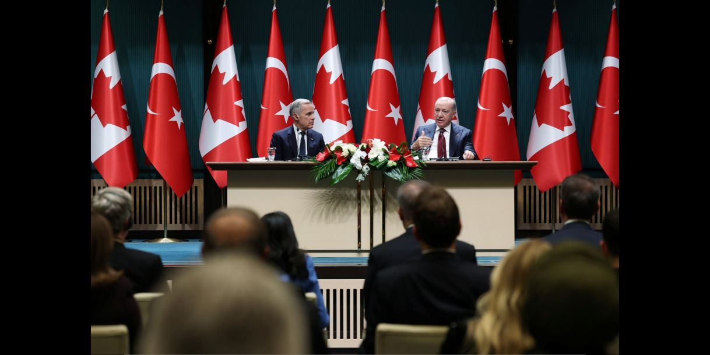

> Cumhurbaşkanı Erdoğan ile Kanada Başbakanı Carney Ankara'da görüştü. Görüşmenin ardından üç belge imzalandı.

Cumhurbaşkanı Recep Tayyip Erdoğan, Cumhurbaşkanlığı Külliyesi'nde Kanada Başbakanı Mark Carney ile baş başa ve heyetler arası görüşme yaptı. Erdoğan, Carney'i resmî törenle karşıladı. Görüşmenin ardından iki ülke arasında üç belge imzalandı.

İmzalanan belgeler; Savunma Sanayii Başkanı Haluk Görgün ile Kanada Dışişleri Bakanı Anita Anand arasındaki "Savunma Sektörü Ortaklıkları Mutabakat Zaptı", Ulaştırma ve Altyapı Bakanı Abdulkadir Uraloğlu ile Anand'ın imzaladığı "Hava Ulaştırma Antlaşması" ve Enerji ve Tabii Kaynaklar Bakanı Alparslan Bayraktar ile Kanada Enerji Bakanı Tim Hodgson arasındaki "Enerji Alanında İşbirliğine Dair Ortak Bildiri" oldu.

Ortak basın toplantısında konuşan Erdoğan, ilişkilerin stratejik ortaklık düzeyine yükseltilmesine karar verdiklerini ve enerji, ticaret, ulaştırma ile savunma sanayi gibi alanlarda yeni projeler hedeflediklerini söyledi. Erdoğan'a göre Serbest Ticaret Anlaşması müzakerelerine yıl sonundan önce başlanması kararlaştırıldı. Yaklaşık 3 milyar dolar olan ticaret hacminin önce 5 milyar, sonra 10 milyar dolara çıkarılması hedefleniyor. Güncellenen Hava Ulaştırma Anlaşması ile doğrudan uçuşların yaklaşık iki katına çıkacağını belirten Erdoğan, enerji alanında madencilikten LNG'ye, kritik minerallerden nükleer enerjiye uzanan bir iş birliği alanı bulunduğunu ifade etti.

İletişim Başkanlığı'nın yayımladığı ortak açıklamaya göre liderler dört sütundan oluşan üç yıllık bir eylem planı başlattı. Açıklamada ayrıca Kanada'nın, Türkiye'nin 9-20 Kasım 2026'da Antalya'da düzenleyeceği COP31'e ev sahipliği yapmasını memnuniyetle karşıladığı belirtildi. Erdoğan, Gazze, Ukrayna ve Körfez dahil bölgesel gelişmeleri de ele aldıklarını söyledi.

---

## Ticaret Bakanlığı: Taksit düzenlemesi sıfır ve yenilenmiş cep telefonlarını kapsıyor

**Ekonomi · Türkiye** · 2026-10-22 22:27 UTC · Kaynak: [Google Haberler - Bakanlıklar](https://www.yenisafak.com/ekonomi/cep-telefonu-taksit-ve-tutar-siniri-kac-ticaret-bakanligi-yeni-kapsami-acikladi-4866556)

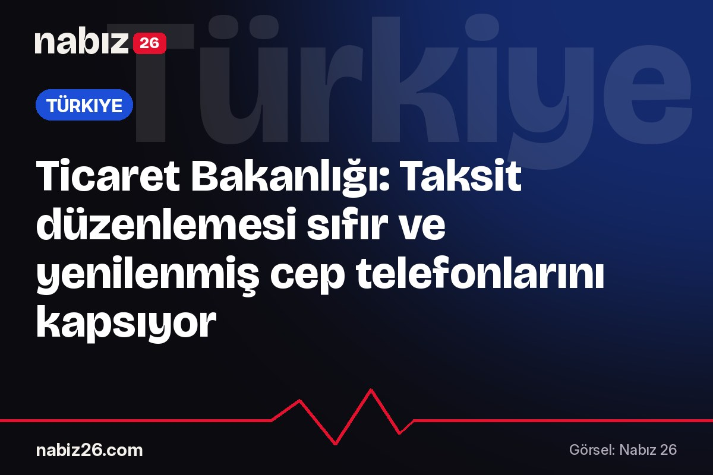

> Ticaret Bakanlığı, cep telefonu taksit düzenlemesiyle yalnızca sıfır ve yenilenmiş telefonların taksit sürelerinin ve tutar sınırlarının güncellendiğini, diğer ürünlerde mevcut koşulların korunduğunu açıkladı.

Ticaret Bakanlığı, cep telefonu taksit düzenlemesinin sıfır ve yenilenmiş telefonlara yönelik vade ve limit koşullarını kapsadığını duyurdu. Bakanlığın açıklamasına göre, 15 Ekim 2026 tarihli ve 33401 sayılı Resmî Gazete'de yayımlanan yönetmelik değişikliğiyle verilen yetki kapsamında telefonların taksit süreleri ve tutar sınırları güncellendi.

Güncelleme, Bankacılık Düzenleme ve Denetleme Kurumu (BDDK) kararlarıyla uyumlu olacak şekilde yapıldı. Bakanlık, telefonlar dışındaki ürün gruplarında mevcut taksit sürelerinin, taksit uygulamasındaki tutarların ve geçerli sınırlamaların aynen korunduğunu bildirdi.

---

## MEB, "Söz Varlığı Bilgi Ağı" projesini tanıttı

**Eğitim · Türkiye** · 2026-10-22 22:27 UTC · Kaynak: [Milli Eğitim Bakanlığı](https://www.meb.gov.tr/quotmeb-soz-varligi-bilgi-agiquot-tanitim-programi-bakan-tekin039in-katilimiyla-gerceklesti/haber/42261/tr)

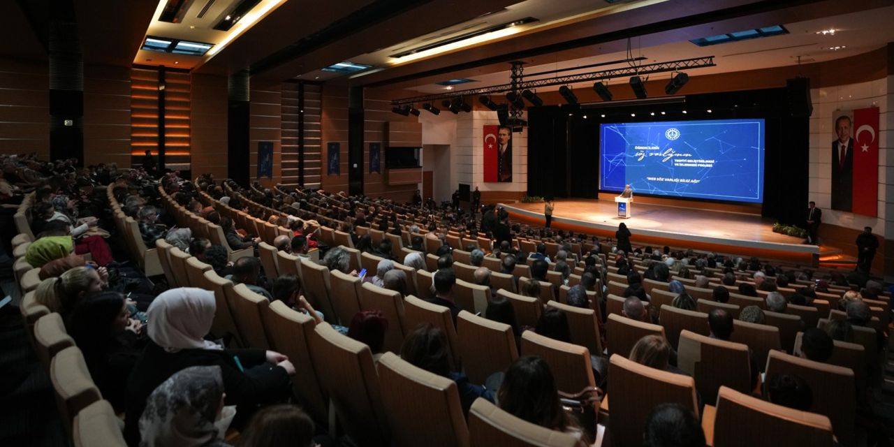

> Millî Eğitim Bakanlığı, ders kitapları ve öğretim programlarında kullanılan kelimelerin envanterini oluşturan "MEB Söz Varlığı Bilgi Ağı"nı Bakan Tekin'in katılımıyla tanıttı.

Millî Eğitim Bakanlığı (MEB), Talim ve Terbiye Kurulu Başkanlığı Maarif Salonu'nda "MEB Söz Varlığı Bilgi Ağı Tanıtım Programı" düzenledi. Programa Bakan Yusuf Tekin, Bakan Yardımcısı Ömer Faruk Yelkenci ve ÖSYM Başkanı Bayram Ali Ersoy katıldı.

Tekin, ders kitapları ve öğretim programlarında hangi kelimelerin kullanıldığına ilişkin bir envanter oluşturduklarını, bu envanterin öğretmenler için kullanışlı olacağını söyledi. Projenin ÖSYM, Yunus Emre Enstitüsü ve Türk Dil Kurumu için de önemli bir veri kaynağı olacağını belirten Tekin, çalışmada kelimelerden türetilen yeni kelimelerin ve gündelik ihtiyaçlara göre üretilmesi gereken kelimelerin de ele alındığını aktardı.

Bakan Tekin, Türkçe ve Türk dili ve edebiyatı derslerinde geçme notunu yükselttiklerini, bu derslerin ölçme-değerlendirme yöntemini dört beceri üzerine yeniden kurguladıklarını söyledi. Projenin Türk devletleri coğrafyasında ortak kavramsal dilin oluşturulması için bir başlangıç noktası olabileceğini de ifade etti.

---

## Kılıçdaroğlu: Siyasi ahlak yasası çıkarılmalı

**Siyaset · Türkiye** · 2026-10-22 22:27 UTC · Kaynak: [Google Haberler - CHP](https://www.indyturk.com/node/784194)

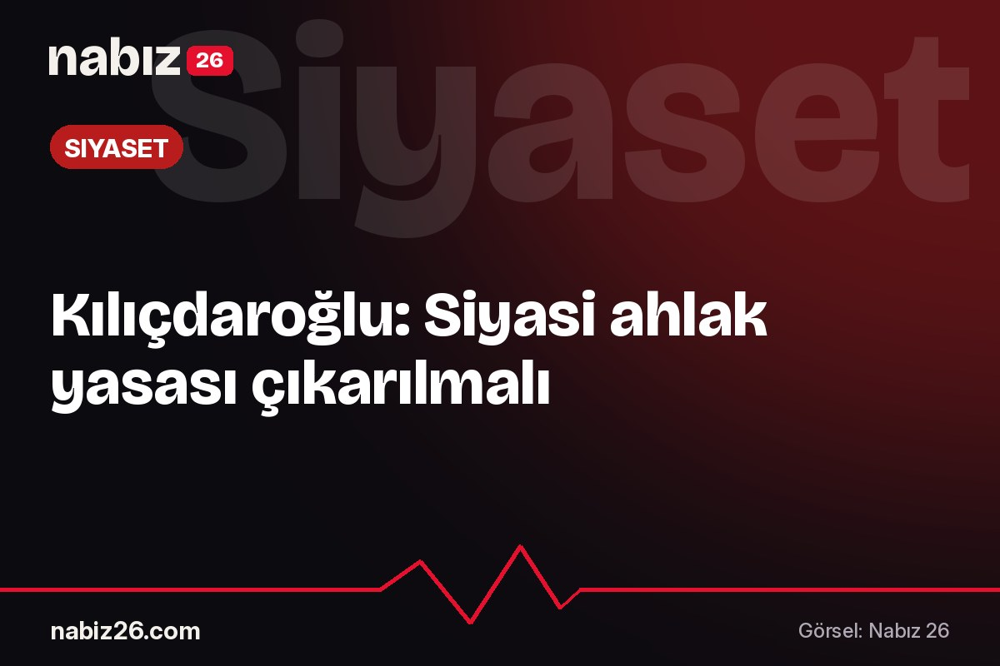

> CHP Genel Başkanı Kemal Kılıçdaroğlu, televizyonların Ankara temsilcileriyle yaptığı toplantıda siyasi ahlak veya etik kanunu çağrısı yaptı.

CHP Genel Başkanı Kemal Kılıçdaroğlu, televizyonların Ankara temsilcileriyle bir araya geldi. Kılıçdaroğlu, siyaset kurumunun kirlendiğini söylediği bir ortamda Türkiye'yi temizlemenin yine siyaset kurumuna düştüğünü belirtti.

Kılıçdaroğlu, Cumhurbaşkanı Erdoğan'ın Meclis açılış konuşmasında anayasa değişikliğinden söz ettiğini hatırlatarak, kendisinin önce bir siyasi ahlak yasasının çıkması gerektiğini söylediğini aktardı. Adı ne olursa olsun, temel ilkeleri ve kuralları olan bir siyasi ahlak ya da etik kanununa ihtiyaç olduğunu belirten Kılıçdaroğlu, devlet memurları için kurallar bulunduğunu, 600 milletvekili için de aynı ilkelerin olması gerektiğini ifade etti. Bunun yalnızca CHP'nin talebi olarak görülmemesini isteyen Kılıçdaroğlu, her partiden milletvekillerinin, grup başkanlarının ve grup başkanvekillerinin bir araya gelmesi çağrısında bulundu.

Habertürk'ün aktardığına göre Kılıçdaroğlu, Ankara Büyükşehir Belediye Başkanı Mansur Yavaş'ın istifasına ilişkin soruya, Yavaş'ın bağımsız olarak görevini sürdürdüğünü, istifasına üzüldüğünü ve belediye başkanlarının hizmet ettiklerini ayrım gözetmeden yönetmeleri gerektiğini söyleyerek yanıt verdi.

---

## Cumhurbaşkanı Erdoğan, TDT Genel Sekreteri Ömüraliyev'i kabul etti

**Siyaset · Türkiye** · 2026-10-22 22:27 UTC · Kaynak: [Google Haberler - Cumhurbaşkanı](https://www.trthaber.com/haber/gundem/cumhurbaskani-erdogan-tdt-genel-sekreteri-omuraliyevi-kabul-etti-960897.html)

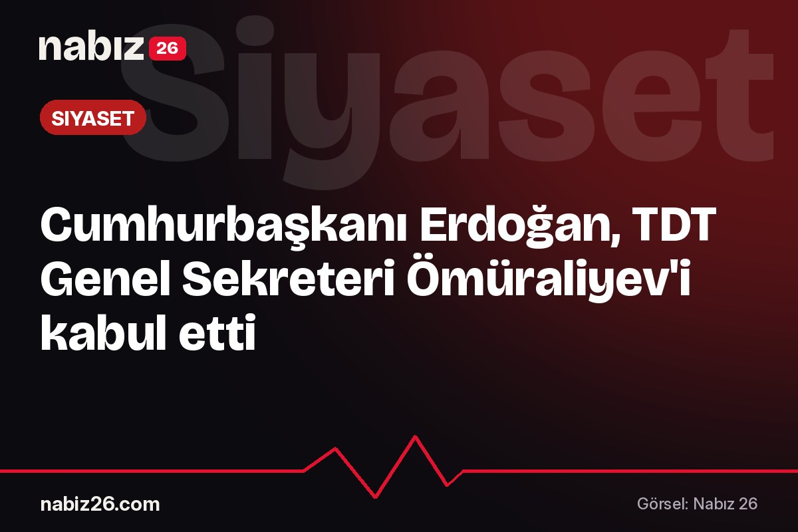

> Cumhurbaşkanı Erdoğan, Türk Devletleri Teşkilatı Genel Sekreteri Ömüraliyev ile Külliye'de bir araya geldi. Teşkilatın 13. zirvesi 29-30 Ekim'de Ankara'da yapılacak.

Cumhurbaşkanı Recep Tayyip Erdoğan, Türk Devletleri Teşkilatı (TDT) Genel Sekreteri Ömüraliyev'i Cumhurbaşkanlığı Külliyesi'nde kabul etti.

TRT Haber'in aktardığına göre TDT, kuruluşundan bu yana devlet başkanları düzeyinde 12 zirve düzenledi ve 13'üncü zirvesini 29-30 Ekim'de Ankara'da yapacak. Zirvenin teması "Türk Yüzyılı: Dilde, Fikirde, İşte Birlik" olarak belirlendi. Cumhuriyet'in kuruluşunun 103. yıl dönümüne denk gelen buluşmayla birlikte Türkiye, teşkilatın dönem başkanlığını üstlenecek.

---

## Bakan Tekin, Macaristan Millî Günü resepsiyonuna katıldı

**Türkiye · Türkiye** · 2026-10-22 22:27 UTC · Kaynak: [Milli Eğitim Bakanlığı](https://www.meb.gov.tr/bakan-tekin-macaristan-milli-gunu-resepsiyonuna-katildi/haber/42265/tr)

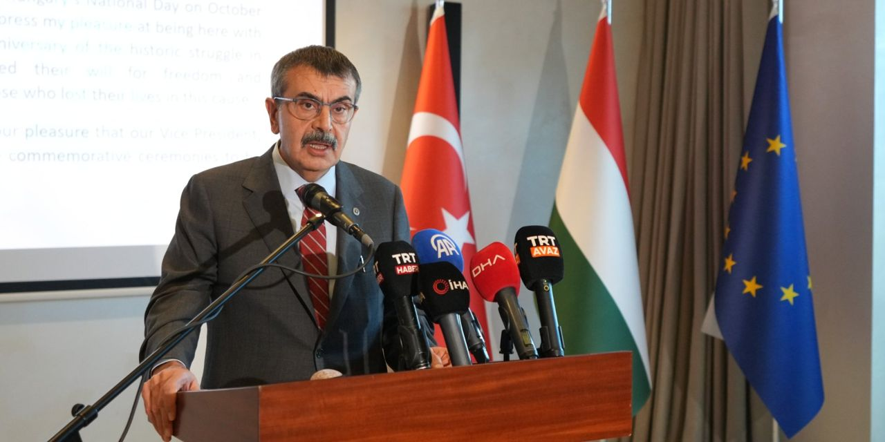

> Millî Eğitim Bakanı Yusuf Tekin, Macaristan'ın Ankara Büyükelçiliğindeki Millî Gün resepsiyonunda konuştu.

Macaristan'ın Ankara Büyükelçiliğinde Maslahatgüzar Gabor Baar'ın ev sahipliğinde Macaristan Millî Günü resepsiyonu düzenlendi. Resepsiyona Millî Eğitim Bakanı Yusuf Tekin, diplomatik misyon mensupları ve davetliler katıldı.

Konuşmasında Macaristan'ın 23 Ekim Millî Günü'nü kutlayan Tekin, 1956'daki mücadelenin 70. yıl dönümünde hayatını kaybedenleri andı. İki ülkenin 2023'ten bu yana geliştirilmiş stratejik ortaklık düzeyinde ilişkiler yürüttüğünü hatırlatan Tekin, 2025'te yaklaşık 5,16 milyar dolara ulaşan ikili ticaret hacmini 10 milyar dolara çıkarmayı hedeflediklerini söyledi.

Eğitim alanındaki iş birliğine de değinen Tekin, Macaristan'ın Türk öğrencilere sunduğu Stipendium Hungaricum burs programı kapsamında her yıl yaklaşık 200 öğrenciye karşılıklı burs verildiğini belirtti. Programın 2026-2028 dönemine ilişkin mutabakat zaptının 8 Aralık 2025'te imzalandığını ifade etti.

---

## Bakan Göktaş, Semerkant'taki çocuk refahı zirvesinde konuştu

**Türkiye · Türkiye** · 2026-10-22 22:27 UTC · Kaynak: [Aile ve Sosyal Hizmetler Bakanlığı](https://www.aile.gov.tr/haberler/bakanimiz-goktas-ozbekistanda-cocuklarin-refahina-yatirim-yapmak-konulu-zirvede-konustu/)

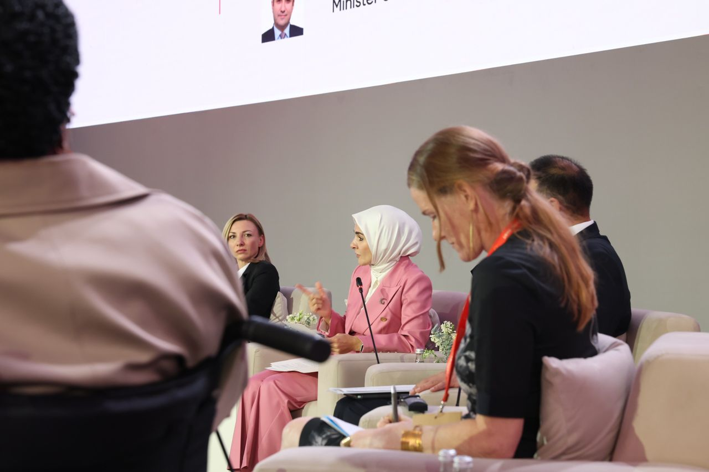

> Aile ve Sosyal Hizmetler Bakanı Mahinur Özdemir Göktaş, Özbekistan'ın Semerkant kentindeki zirvede çocuk odaklı sosyal koruma sistemlerinin önemine değindi.

Aile ve Sosyal Hizmetler Bakanı Mahinur Özdemir Göktaş, Özbekistan'ın Semerkant kentinde düzenlenen "Çocukların Refahına Yatırım Yapmak: Gelecek Nesillerin Sürdürülebilir ve Adil Kalkınmasına Giden Yol Dünya Zirvesi"nde konuştu.

Göktaş, her çocuğun haklarını koruyan, ihtiyaçlarını gözeten ve potansiyelini geliştiren güçlü bir sosyal koruma sistemi kurulmasının öncelik olması gerektiğini söyledi. Sosyal yardım, eğitim, sağlık ve sosyal hizmetlerin bütüncül bir anlayışla ele alınması gerektiğini belirtti.

Türkiye'deki uygulamaları anlatan Göktaş, Şartlı Eğitim Yardımı Programı ile çocukların okula düzenli devamının, Şartlı Sağlık Yardımları ile de düzenli sağlık kontrollerinin desteklendiğini ifade etti. Eylül ayı itibarıyla Sosyal ve Ekonomik Destek hizmeti kapsamında yaklaşık 200 bin çocuğa destek sağlandığını açıkladı. Koruyucu aile modeliyle çocukların aile ortamında büyümelerinin amaçlandığını da kaydetti.

Zirvede kabul edilmesi beklenen Semerkant Deklarasyonu'nun çocuk odaklı sosyal koruma alanındaki ortak öncelikleri somut taahhütlere dönüştürmesini temenni eden Göktaş, Türkiye'nin bilgi birikimini ve uygulama tecrübesini paylaşmaya hazır olduğunu söyledi.

---

## Bakan Bayraktar Ankara Üniversitesi'nde enerji hedeflerini anlattı

**Ekonomi · Türkiye** · 2026-10-22 22:27 UTC · Kaynak: [Enerji ve Tabii Kaynaklar Bakanlığı](https://enerji.gov.tr/haber-detay?id=31950)

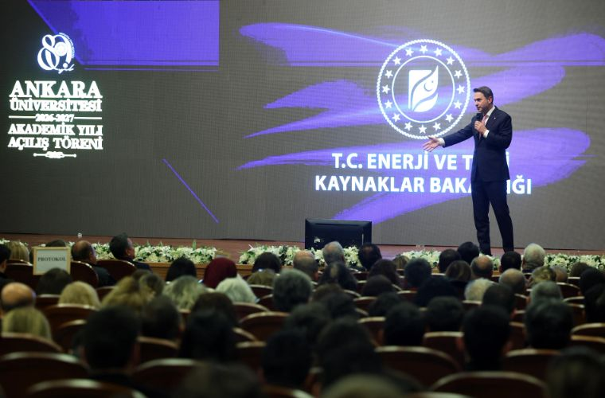

> Enerji ve Tabii Kaynaklar Bakanı Alparslan Bayraktar, Ankara Üniversitesi'nin akademik yıl açılışında 2040'a kadar enerjinin yaklaşık yüzde 70'inin yenilenebilirden sağlanacağını söyledi.

Enerji ve Tabii Kaynaklar Bakanı Alparslan Bayraktar, Ankara Üniversitesi 2026-2027 Akademik Yılı Açılış Töreni'nde öğrencilere Türkiye'nin enerji ve tabii kaynaklar alanındaki hedeflerini anlattı.

Bayraktar, 2040'a gelindiğinde Türkiye'nin enerjisinin yaklaşık yüzde 70'ini yenilenebilir kaynaklardan sağlayacağını söyledi. Enerji verimliliğinin en ucuz enerji kaynağı olduğunu belirten Bakan, Osman Gazi Yüzer Üretim Platformu'nun geçen cumartesi görev yerine uğurlandığını, doğal gaz üretiminin 2027'den itibaren iki katına çıkacağını ve 2028'de dört katına çıkarılacağını açıkladı. Bugün 4 milyon evde yerli doğal gaz kullanıldığını ifade etti.

Gabar'da günde yaklaşık 85 bin varil petrol üretildiğini, yeni keşiflerle bu rakamın 2027'de 100 binin üzerine çıkmasını beklediklerini anlatan Bayraktar, Akkuyu Nükleer Santrali'nin birinci reaktöründe son testlerin yapıldığını, önümüzdeki birkaç ay içinde ilk elektriğin üretilmesini planladıklarını söyledi. Türkiye'nin yılda en az 100 ton altın üretmesi gerektiğini de vurguladı.

---

## Aile ve Gençlik Fonu'ndan ekimde 15 bin 468 gence ödeme yapıldı

**Türkiye · Türkiye** · 2026-10-22 22:27 UTC · Kaynak: [Aile ve Sosyal Hizmetler Bakanlığı](https://www.aile.gov.tr/haberler/aile-ve-genclik-fonu-kapsaminda-yeni-yuva-kuran-15-bin-468-genc-icin-ekim-ayinda-1-milyar-756-milyon-600-bin-lira-odeme-yapildi/)

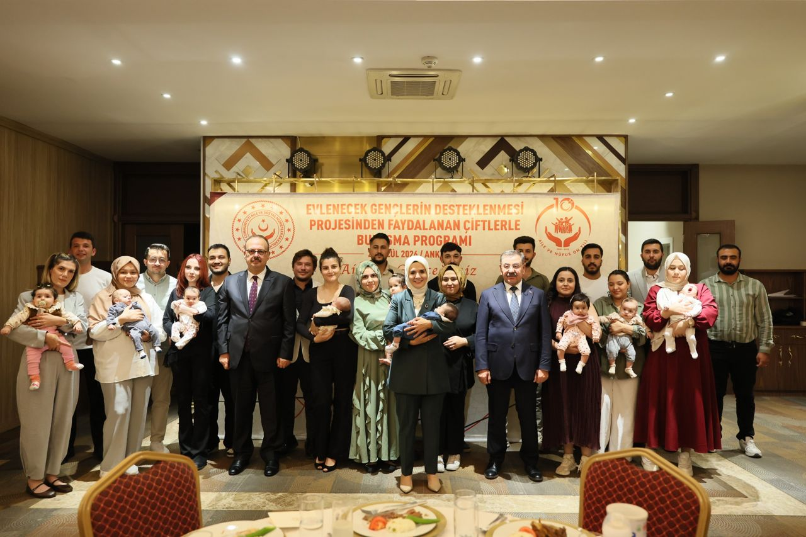

> Aile ve Sosyal Hizmetler Bakanı Göktaş, ekim ayında 15 bin 468 gence toplam 1 milyar 756 milyon 600 bin lira ödeme yapıldığını duyurdu.

Aile ve Sosyal Hizmetler Bakanı Mahinur Özdemir Göktaş, Aile ve Gençlik Fonu kapsamında ekim ayında 15 bin 468 gence toplam 1 milyar 756 milyon 600 bin lira ödeme yapıldığını açıkladı.

Göktaş'ın yazılı açıklamasına göre fona yapılan başvurular 315 bin 696'ya ulaştı. Evlilik yolundaki 238 bin 448 gence şimdiye kadar toplam 22 milyar 804 milyon 100 bin liralık sıfır faizli kredi desteği sağlandı. Başvurular ailegenclikfonu.aile.gov.tr adresinden veya e-Devlet üzerinden yapılabiliyor.

Göktaş, çiftlerin ikisinin de 18-25 yaş arasında olması halinde 250 bin lira, 26-29 yaş arasında olması halinde 200 bin lira destek verildiğini, kredinin 48 ay vadeli ve 2 yıl geri ödemesiz olduğunu belirtti. Gelir şartının asgari ücretin 2,3 katından 2,5 katına çıkarıldığını da hatırlattı. Ayrıca ilk çocukta 12 aylık geri ödemenin hibe edildiğini, ikinci çocukta ise kalan borcun tamamının hibe edildiğini söyledi.

---

## Savunma Sanayii Başkan Yardımcısı Gökhan Uçar Eskişehir Teknik Üniversitesi'ni ziyaret etti

**Eğitim · Tepebaşı** · 2026-10-22 15:33 UTC · Kaynak: [Eskişehir Teknik Üniversitesi](https://www.eskisehir.edu.tr/tr/Haber/Detay/savunma-sanayii-baskan-yardimcisi-gokhan-ucardan-eskisehir-teknik-universitesine-ziyaret)

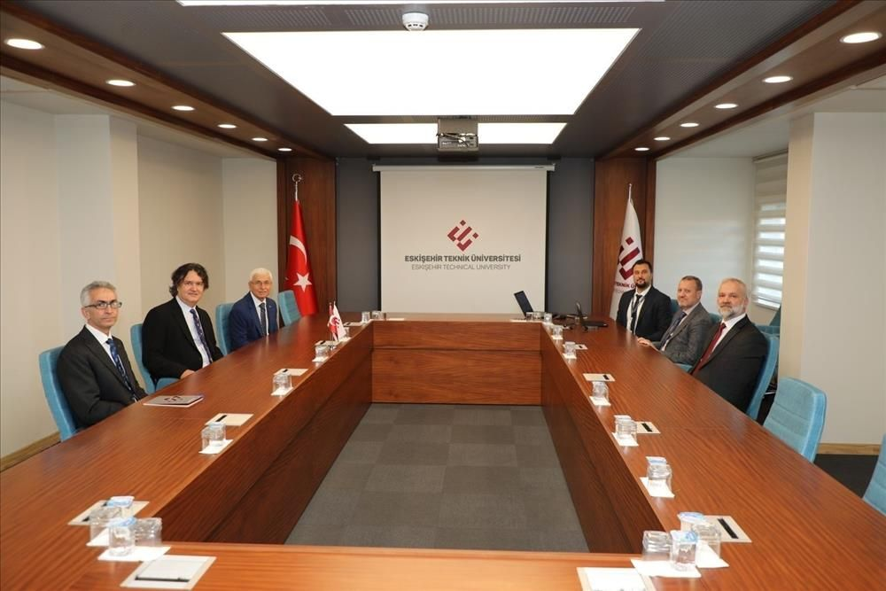

> Savunma Sanayii Başkan Yardımcısı Gökhan Uçar, 22 Ekim'de Eskişehir Teknik Üniversitesi'ni ziyaret etti. Ziyarette Rektör Prof. Dr. Adnan Özcan ev sahipliği yaptı.

Savunma Sanayii Başkan Yardımcısı Gökhan Uçar, 22 Ekim 2026 Perşembe günü Eskişehir Teknik Üniversitesi'ni (ESTÜ) ziyaret etti. Ziyarette Rektör Prof. Dr. Adnan Özcan ev sahipliği yaptı.

Görüşmeye TEITECH Genel Müdürü Ahmet Fındık, TEITECH Kurumsal Yönetim Genel Müdür Yardımcısı Ercan Arıcan, Havacılık ve Uzay Bilimleri Fakültesi Dekanı Prof. Dr. Cem Çetek ve Yapı İşleri ve Teknik Daire Başkanı İbrahim Halil Umur katıldı. Ziyaret, hatıra fotoğrafı çekilmesinin ardından sona erdi.

---

## Togg'dan ekim ayında sıfır faizli kredi kampanyası

**Ekonomi · Merkez** · 2026-10-22 14:33 UTC · Kaynak: [Google Haberler - Togg](https://www.memurlar.net/album/28350/togg-dan-dev-kampanya.html)

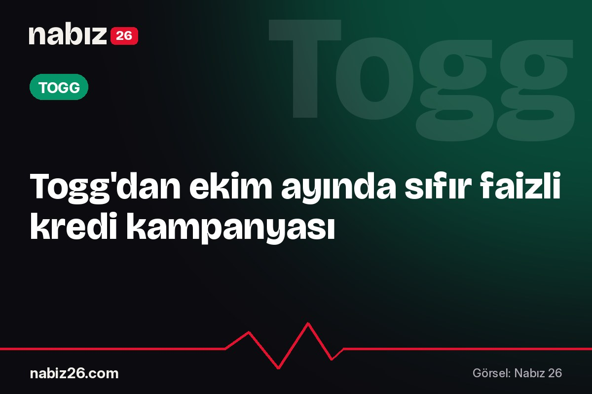

> Togg, T10X ve T10F modelleri için ekim ayına özel sıfır faizli ve uzun vadeli kredi paketleri sundu.

Togg, ekim ayında T10X ve T10F modelleri için finansman kampanyası başlattı. Aktarılan bilgilere göre kampanya sınırlı sayıdaki araç için geçerli ve sipariş ile kredi başvuruları Togg'un resmi web sitesi ile dijital mobil kanalları üzerinden yürütülüyor.

T10F V2 için 1 milyon TL kredi 6 ay vade ve yüzde 0 faizle sunuluyor, aylık taksit 166 bin 667 TL oluyor. Aynı modelde 800 bin TL için 8 ay, 600 bin TL için 12 ay vadeli yüzde 0 faizli seçenekler var. T10X V2'de 800 bin TL kredi 6 ay vadeyle yüzde 0 faizli verilirken aylık taksit 133 bin 333 TL oluyor.

T10X 4More ve T10F 4More modellerinde 1,5 milyon TL kredi 10 ay vade ve yüzde 0 faizle sunuluyor, aylık taksit 150 bin TL. Aynı tutar 36 ay vadede yüzde 2,99 faizle 78 bin 93 TL aylık ödemeyle kullanılabiliyor. T10X V2 ve T10F V2 için 1 milyon 700 bin TL'lik 48 ay vadeli kredi ise yüzde 2,95 faizle aylık 78 bin 8 TL taksit içeriyor.

---

## Togg T10X ve T10F için yeni OTA yazılım güncellemesi yayında

**Ekonomi · Merkez** · 2026-10-22 14:33 UTC · Kaynak: [Google Haberler - Togg](https://www.haber7.com/otomobil/haber/3666930-togglara-isinize-yarayacak-ozellik-geliyor-alacaklari-memnun-edecek)

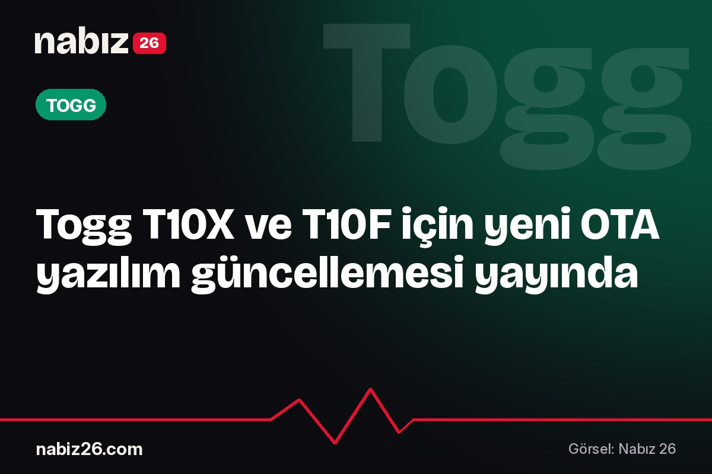

> Togg, T10X ve T10F modellerine multimedya ekranı, şarj ve ses ayarlarında iyileştirmeler getiren yeni kablosuz yazılım güncellemesini sundu.

Togg, T10X ve T10F modelleri için yeni kablosuz yazılım (OTA) güncellemesini kullanıcıların erişimine açtı. Güncelleme; şarj deneyimi, multimedya sistemi, ses ayarları ve enerji yönetimi alanlarında iyileştirmeler içeriyor.

Bilgi-eğlence ekranının tepki hızı artırıldı, menüler arası geçişler daha akıcı hale getirildi. 360 derece çevre görüş kamerası daha kısa sürede devreye giriyor. Standart ses sistemine manuel ekolayzer ayarı eklendi ve Bluetooth bağlantısının kararlılığına yönelik düzenlemeler yapıldı.

T10X kullanıcıları uyumlu şarj istasyonlarında otomatik şarj özelliğinden yararlanabilecek. AC şarj sırasında araç kablo bağlıyken kapı kilitlerinin açılması şarjı kesmeyecek.

---

## Togg, COP31'in mobilite sektör ortağı oldu

**Ekonomi · Merkez** · 2026-10-22 14:33 UTC · Kaynak: [Google Haberler - Togg](https://www.haberturk.com/ekonomi/togg-cop31-turkiyenin-mobilite-sektor-ortagi-oldu-3921749)

> Togg, Türkiye'nin ev sahipliğinde yapılacak COP31'de "Mobilite Sektör Ortağı" olarak yer alacak ve Start-up Zone'un ana sahne sponsorluğunu üstlenecek.

Togg, Türkiye'nin ev sahipliğinde gerçekleştirilecek Birleşmiş Milletler İklim Değişikliği Konferansı COP31'in "Mobilite Sektör Ortağı" oldu. Kamu, özel sektör, uluslararası kuruluşlar, akademi ve sivil toplum temsilcilerini bir araya getirecek zirvede Togg, elektrikli mobiliteye geçişin iklim hedeflerine katkısını enerji ve dijital hizmetleriyle birlikte anlatacak. Şirket ayrıca Start-up Zone'un ana sahne sponsoru olacak.

Togg Yönetim Kurulu Başkanı Fuat Tosyalı, COP31'in Türkiye'nin üretim yetkinliklerini, teknoloji geliştirme kapasitesini ve yeşil dönüşüm hedeflerini uluslararası ölçekte ortaya koyması açısından önemli bir fırsat olduğunu söyledi.

Togg CEO'su M. Gürcan Karakaş, yollardaki 130 bine yaklaşan akıllı cihazla 600 bin tona varan CO₂ emisyonunun önüne geçildiğini belirtti. Karakaş, Gemlik Teknoloji Kampüsü'nde kendi bataryalarını ürettiklerini, ultra hızlı şarj ağı Trugo ile 81 ilde yenilenebilir enerji kaynaklarından sağlanan enerji sunduklarını ifade etti.

---

## Piyano Günleri'nde Barış Büyükyıldırım "Akışın Hafızası" resitali verdi

**Kültür-Sanat · Tepebaşı** · 2026-10-22 14:33 UTC · Kaynak: [Anadolu Üniversitesi](https://anahaber.anadolu.edu.tr/tr/haber-detay/pxplibx0jufhoq0n37bnmr4j)

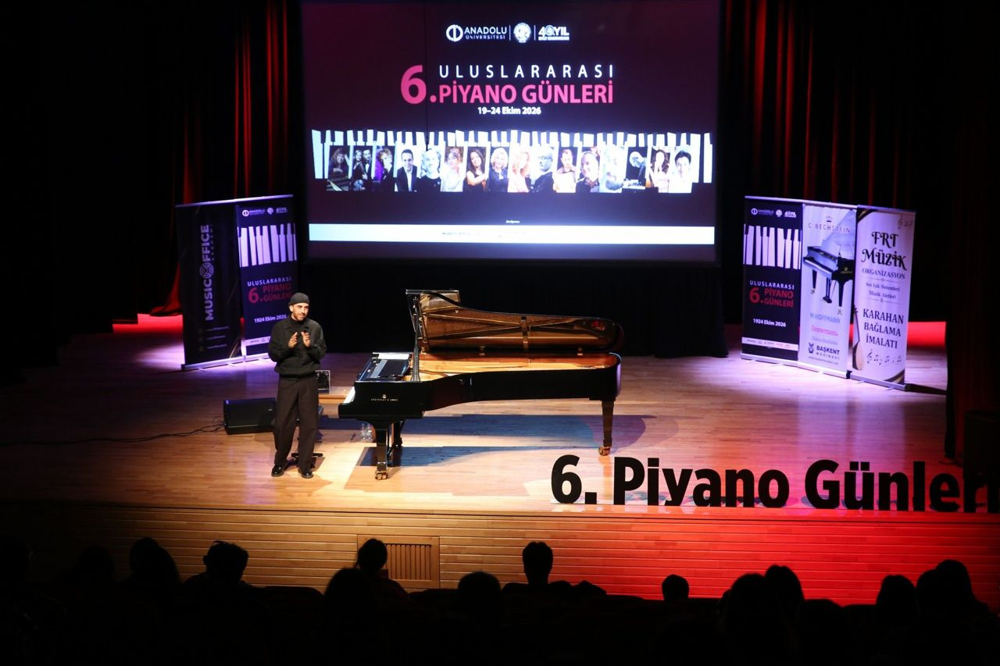

> Anadolu Üniversitesi'ndeki 6. Uluslararası Piyano Günleri kapsamında piyanist Barış Büyükyıldırım Händel, Riley ve Liszt'in eserlerinden oluşan resital sundu.

Anadolu Üniversitesi Devlet Konservatuvarı'nın düzenlediği 6. Uluslararası Piyano Günleri kapsamında piyanist Barış Büyükyıldırım "Akışın Hafızası" başlıklı resitalini verdi. Resital Öğrenci Merkezi Yunus Emre Salonu'nda yapıldı ve Halk Bilimi Uygulama ve Araştırma Merkezi Müdürü Prof. Oytun Eren ile çok sayıda sanatsever tarafından izlendi.

Programda Georg Friedrich Händel'in Sol Majör Chaconne ve 21 Varyasyon'u, Terry Riley'nin Keyboard Study No. 1'i ve Franz Liszt'in Bach'ın bir kantatı ile Si Minör Missa'daki "Crucifixus" motifi üzerine yazdığı varyasyonlar yer aldı.

Büyükyıldırım, 19. yüzyılın ortalarına kadar bestecilerin aynı zamanda doğaçlamacı olduğunu, sonradan yorumculuk, bestecilik ve doğaçlamanın birbirinden ayrılmaya başladığını anlattı. Kendi bestelerinden "Triquetra" ve "Wasserreise"yi de seslendirdi. Resitalin sonunda Prof. Eren, sanatçıya teşekkür belgesi ve çiçek verdi.

---

## Anadolu Üniversitesi'nde Bağımlılık Farkındalık Haftası ikinci gününde sürdü

**Eğitim · Tepebaşı** · 2026-10-22 14:33 UTC · Kaynak: [Anadolu Üniversitesi](https://anahaber.anadolu.edu.tr/tr/haber-detay/acoeslhv9rdll385k587o6y1)

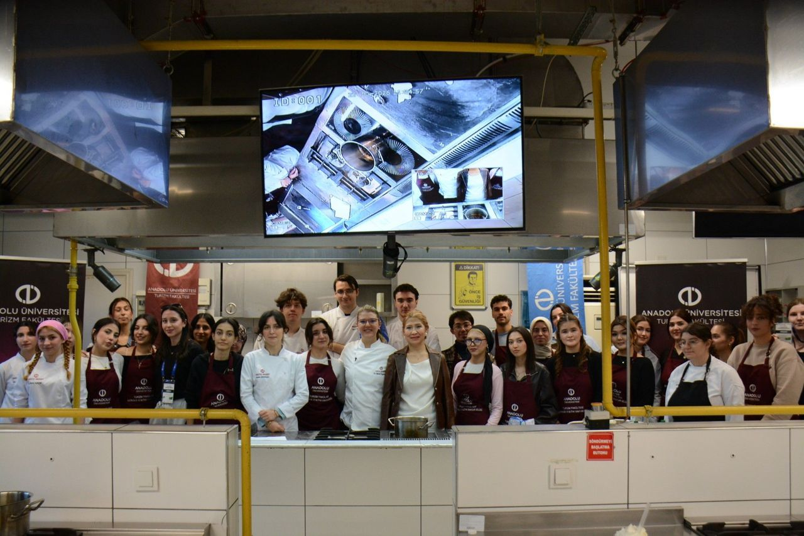

> 3. Bağımlılık Farkındalık Haftası'nın ikinci gününde Anadolu Park'ta atölyeler, spor salonunda turnuvalar, Turizm Fakültesi'nde atölye ve "Narko Gençlik" semineri yapıldı.

Anadolu Üniversitesi Bağımlılık Önleme Çalışmaları Birim Müdürlüğü'nün düzenlediği "3. Bağımlılık Farkındalık Haftası" etkinlikleri ikinci gününde de sürdü. Birim Müdürü Doç. Dr. Ayşe Çevik, her yıl ekim ayının üçüncü haftasında bu etkinlikleri düzenlediklerini, öğrencilere olabildiğince fazla etkinlik sunmaya çalıştıklarını söyledi.

Çevik'e göre Anadolu Park'ta atölye çalışmaları ve etkinlikler devam ediyor, öğrencilere çeşitli ikramlar sunuluyor. Yunus Emre Spor Salonu'nda 3x3 basketbol turnuvası yapılırken, önceki gün düzenlenen floor curling, dart, satranç ve masa tenisi turnuvalarında kazanan öğrencilere madalyaları verildi. Çevik, birkaç günlük de olsa bağımlılığa dikkat çekmek, bağımsızlıkla ilgili alternatifler sunmak istediklerini belirtti.

Turizm Fakültesi uygulama mutfağında Doç. Dr. Merve Özgür Göde ve Araş. Gör. Halide Gernaz'ın yürüttüğü "Latte'nin Moleküler Yolculuğu" atölyesi düzenlendi. Atölye sonunda eğitmenlere Doç. Dr. Çevik tarafından katılım sertifikası verildi.

İletişim Bilimleri Fakültesi Şener Şen Kültür Salonu'nda ise Polis Memuru Mehmet Ali Avcı "Narko Gençlik" semineri verdi. Avcı, madde bağımlılığının çoğu zaman merak duygusu ve arkadaş çevresiyle başladığını, tedavinin zor ve uzun bir süreç olduğunu anlattı.

---

## Festival kenti Eskişehir'de iptal zinciri: Faturayı esnaf ve seyirci ödedi

**Kültür-Sanat · Merkez** · 2026-10-22 14:32 UTC · Kaynak: [Eskişehir.net ve yerel basın](https://www.eskisehir.net/eskisehirde-bir-festival-daha-iptal-edildi)

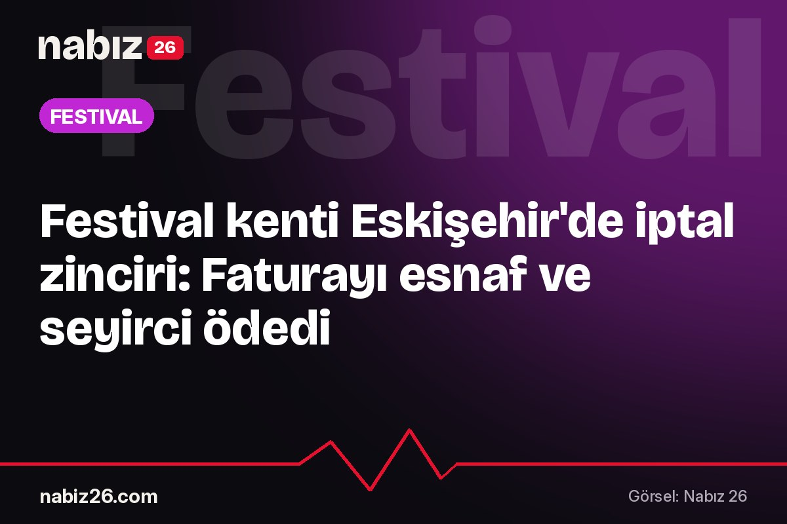

> Festivalleriyle öne çıkan Eskişehir'de son iki ayda beş etkinlik iptal edildi. Organizasyon krizinde tezgâh açan esnaf zarar ettiğini söylerken, bilet alanlar iade için platform platform dolaşmak zorunda kaldı.

Konserleri, açık hava etkinlikleri ve uluslararası festivalleriyle kendini "festival kenti" olarak tanıtan Eskişehir, eylül ve ekim aylarında art arda gelen iptallerle anıldı. Son iki ayda beş etkinlik ya tamamen iptal edildi ya da programdan çıkarıldı. İptallerin bedelini ise bilet alan seyirciler, yol masrafına girip tezgâh kuran esnaf ve hazırlık yapan kurumlar ödedi.

Tablonun en ağır halkası Tepebaşı'nda 18-20 Eylül'de düzenlenen Food Vibe Fest oldu. Ceza, Piiz ve İrem Derici, organizasyon firmasının sorumluluklarını yerine getirmediğini açıklayarak konserlerini iptal etti. İrem Derici paylaşımında, "Kabahatli ben olmasam da bizi de mağdur edenler adına ben sizlerden özür dilerim" diyerek seyircilerden özür diledi.

Festival için Türkiye'nin farklı illerinden Eskişehir'e gelen esnaf ise stant ücretleri, elektrik ve jeneratör sorunları, beklenenin çok altında kalan ziyaretçi sayısı ve bozulan ürünler nedeniyle ciddi zarara uğradıklarını anlattı. Adana'dan geldiğini söyleyen esnaf Hüseyin Yüksel, "7 bin bilet satıldığı söylenmişti ancak 2 günde bin kişi bile gelmedi" dedi. Esnafın şikâyetçi olduğu organizasyon sorumlusu E.Ü. polis tarafından karakola götürüldü ve hakkında işlem başlatıldı.

Kriz bununla da sınırlı kalmadı. 23-25 Ekim'de Kentpark'ta yapılacak Şehir Festivalleri, düzenleyici Because Creative'in yoğun yağış riski açıklamasıyla iptal edildi. Bilet sahiplerine, iade için bileti aldıkları platformlarla kendilerinin iletişime geçmesi söylendi; festivalin ileri bir tarihte yapılıp yapılmayacağına dair bir bilgi verilmedi.

26 Eylül'deki 3. İnönü Havacılık Festivali de hazırlıkları tamamlanmışken güçlü rüzgâr nedeniyle iptal edildi ve yeni bir tarih açıklanmadı. 7 Ekim'deki Yalın konseri ise bilet sahiplerine gönderilen bir mesajla iptal edildi; kararın gerekçesi kamuoyuyla paylaşılmadı, prodüksiyon şirketi yalnızca konserin bahara kaldığını bildirdi. Porsuk Festivali kapsamındaki "Yıldız" adlı tiyatro oyunu da sağlık sorunu gerekçesiyle sahnelenemedi.

Art arda gelen iptaller, kentte etkinlik düzenleyen firmaların nasıl denetlendiği, açık hava etkinliklerinde hava koşullarına karşı neden bir yedek plan bulunmadığı, bilet iadelerinin tamamlanıp tamamlanmadığı ve Food Vibe Fest'te zarar eden esnafın kayıplarının kim tarafından karşılanacağı sorularını gündeme getirdi. Nabız 26, bu soruların yanıtlarının peşini bırakmayacak.

---

## Altın fiyatları 22 Ekim 2026: Gram altın 6.515,09 TL

**Ekonomi · Merkez** · 2026-10-22 14:23 UTC · Kaynak: [Harem Altın](https://www.haremaltin.com/altin-fiyatlari)

> Gram altın güne düşüşle başladı. Harem Altın verilerine göre gram altın 6.437,10 TL'den alınıyor, 6.515,09 TL'den satılıyor.

Altın piyasasında güne düşüşle başlandı. Harem Altın'ın saat 17.23 itibarıyla verilerine göre gram altının satış fiyatı 6.515,09 TL, alış fiyatı 6.437,10 TL oldu. Gram altın, önceki kapanışa göre yüzde 0,72 geriledi.

Ziynet altınlarda çeyrek altın 10.619 TL, yarım altın 21.231 TL, tam altın 42.326 TL, ata altın 43.086 TL seviyesinden satışa sunuluyor.

22 ayar bileziğin gram satış fiyatı 6.085,32 TL, has altının gram fiyatı 6.495,02 TL olarak belirlendi.

Uluslararası piyasalarda altının onsu 4.049,00 dolardan işlem görürken, dolar/TL 49,69 seviyesinde bulunuyor.

Fiyatlar Harem Altın'ın saat 17.23 itibarıyla paylaştığı verilere dayanmaktadır; kuyumcular arasında farklılık gösterebilir. Bu haber yatırım tavsiyesi değildir.

---

## Vali Yılmaz, Ticaret Borsası Başkanı Ahmet Oğuz ve yönetimini kabul etti

**Ekonomi · Merkez** · 2026-10-22 13:45 UTC · Kaynak: [Eskişehir Valiliği](https://www.eskisehir.gov.tr/valimiz-dr-erdinc-yilmaz-eskisehir-ticaret-borsasi-baskani-ahmet-oguz-ve-yonetimini-kabul-etti)

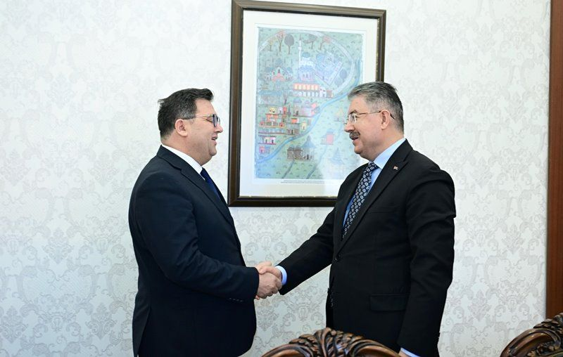

> Eskişehir Ticaret Borsası Yönetim Kurulu Başkanlığı'na seçilen Ahmet Oğuz ve yönetim kurulu üyeleri Vali Dr. Erdinç Yılmaz'ı ziyaret etti.

Eskişehir Valisi Dr. Erdinç Yılmaz, son seçimlerde Eskişehir Ticaret Borsası Yönetim Kurulu Başkanlığı'na seçilen Ahmet Oğuz ve yönetim kurulu üyelerini makamında kabul etti.

Vali Yılmaz, Oğuz ve yönetim kurulu üyelerini tebrik ederek yeni görevlerinde başarılar diledi. Yeni dönem yönetimi de kabulden duydukları memnuniyeti dile getirdi, borsa çalışmaları ve hedefleri hakkında bilgi verdi.

---

## Piyano Günleri'nde İris Şentürker masterclass verdi

**Kültür-Sanat · Tepebaşı** · 2026-10-22 13:45 UTC · Kaynak: [Anadolu Üniversitesi](https://anahaber.anadolu.edu.tr/tr/haber-detay/u44umfsfnhghc0ynnbwuogi0)

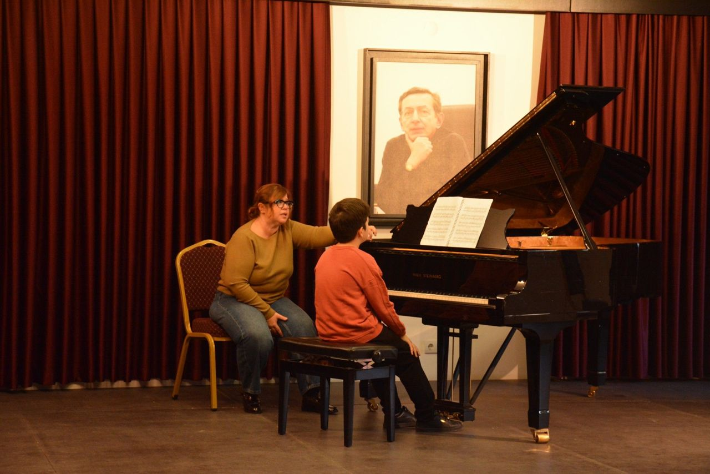

> 6. Uluslararası Piyano Günleri kapsamında Dr. Öğr. Üyesi İris Şentürker, Anadolu Üniversitesi öğrencileriyle masterclass çalışması yaptı.

Anadolu Üniversitesi 6. Uluslararası Piyano Günleri kapsamında Mimar Sinan Güzel Sanatlar Üniversitesi İstanbul Devlet Konservatuvarı Müzik Bölümü'nden Dr. Öğr. Üyesi İris Şentürker, Anadolu Üniversitesi öğrencileriyle masterclass çalışması yaptı. Çalışma, Halk Bilimi Uygulama ve Araştırma Merkezi Faris Akarsu Konser Salonu'nda yapıldı; akademisyenler ve çok sayıda öğrenci katıldı.

Ortaokul, lise ve lisans düzeylerinden piyano öğrencileri Chopin, Beethoven, Mozart, Brahms, Bach, Debussy, Mendelssohn, Liszt ve Rachmaninoff gibi bestecilerin eserlerini seslendirdi. Şentürker, eserlerin teknik icrası, tuşe hakimiyeti ve müzikal yorumu üzerine değerlendirmelerde bulunarak öğrencilere önerilerde bulundu.

Piyano Günleri 24 Ekim'e kadar konserler ve etkinliklerle sürecek.

---

## Piyano Günleri'nde "21. Yüzyıl Müziği" söyleşisi yapıldı

**Kültür-Sanat · Tepebaşı** · 2026-10-22 13:45 UTC · Kaynak: [Anadolu Üniversitesi](https://anahaber.anadolu.edu.tr/tr/haber-detay/r7qb3ezhp72rc10snww3ndwx)

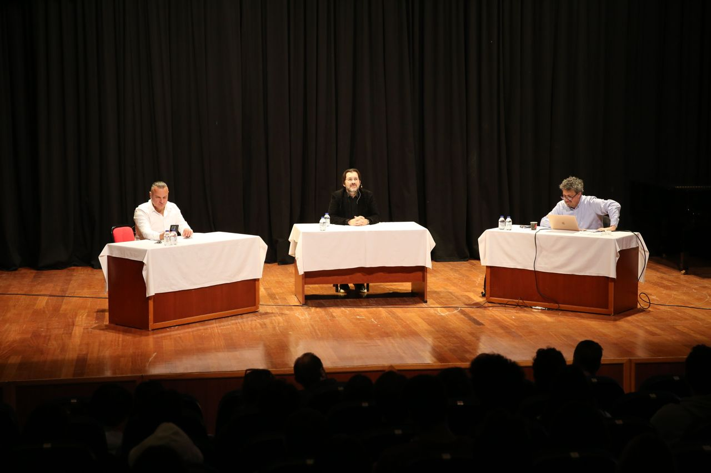

> Anadolu Üniversitesi'ndeki 6. Uluslararası Piyano Günleri kapsamında günümüz müziğindeki değişimler konuşuldu.

Anadolu Üniversitesi 6. Uluslararası Piyano Günleri kapsamında Devlet Konservatuvarı Koral Çalgan Salonu'nda "21. Yüzyıl Müziği" başlıklı söyleşi yapıldı. Söyleşinin moderatörlüğünü Halk Bilimi Uygulama ve Araştırma Merkezi Müdürü Prof. Oytun Eren yaptı. Konuşmacılar Anadolu Üniversitesi Devlet Konservatuvarı öğretim üyesi Doç. Dr. Onur Dülger ile Mimar Sinan Güzel Sanatlar Üniversitesi İstanbul Devlet Konservatuvarı öğretim üyesi Prof. Dr. Mesut Erdem Çöloğlu oldu.

Etkinlik, farklı müzikal yaklaşımları yansıtan iki eserin dinletisiyle başladı. Konuşmacılar günümüz müziğindeki değişimleri, ses tasarımını ve müzikal üretimde kullanılan malzemelerin çeşitliliğini ele aldı.

Dülger, tanıdık seslerin dinleyiciyle iletişimi kolaylaştırdığını, alışılmışın dışındaki seslerin ise yeni anlatım olanakları sunduğunu söyledi. Müzikal sesleri armonik, inarmonik ve gürültü olarak üç grupta değerlendirdi. Eren ise 21. yüzyılda ritim, melodi ve armoni anlayışının yanı sıra müzisyen kimliğinin de değiştiğini belirtti.

---

## Pazaryeri Belediye Başkanı Zekiye Tekin, Vali Yılmaz'ı ziyaret etti

**Gündem · Merkez** · 2026-10-22 13:45 UTC · Kaynak: [Eskişehir Valiliği](https://www.eskisehir.gov.tr/bilecik-pazaryeri-belediye-baskani-zekiye-tekin-valimiz-dr-erdinc-yilmazi-makaminda-ziyaret-etti)

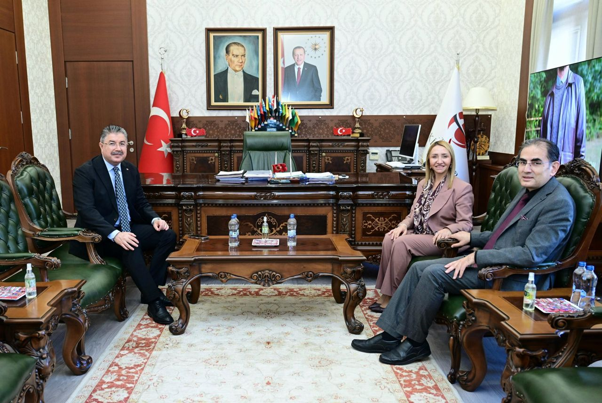

> Bilecik Pazaryeri Belediye Başkanı Zekiye Tekin, Eskişehir Valisi Dr. Erdinç Yılmaz'ı makamında ziyaret etti.

Bilecik Pazaryeri Belediye Başkanı Zekiye Tekin, Eskişehir Valisi Dr. Erdinç Yılmaz'ı makamında ziyaret etti.

Ziyaretten memnuniyet duyduğunu belirten Vali Yılmaz, Belediye Başkanı Tekin'e nazik ziyareti dolayısıyla teşekkür etti.

---

## Odunpazarı'nda sokak müzisyenleri için seçmeler yapıldı

**Kültür-Sanat · Odunpazarı** · 2026-10-22 13:45 UTC · Kaynak: [Odunpazarı Belediyesi](https://www.odunpazari.bel.tr/guncel/haberler/genel-haberler/odunpazari-nda-sokak-muzigi-icin-secmeler-yapildi)

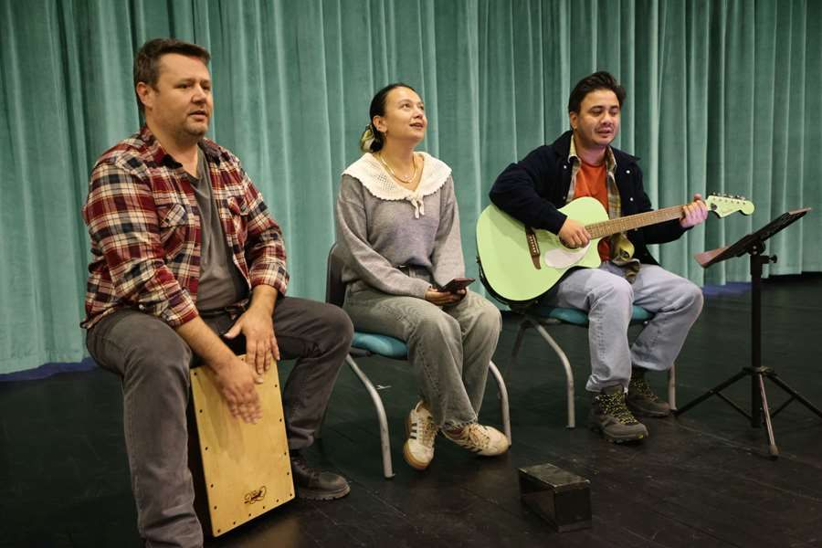

> Odunpazarı Belediyesi'nin sokak müzisyenleri projesi için yapılan seçmelere toplam 14 kişi katıldı. Seçilenler bir yıl boyunca belirlenen noktalarda performans sergileyecek.

Odunpazarı Belediyesi'nin sokak müzisyenleri projesi kapsamında seçmeler yapıldı. Hasan Polatkan Kültür Merkezi'nde düzenlenen seçmelere bireysel ve grup halinde toplam 14 kişi başvurdu. Katılımcılar arasında farklı etnik kimliklerden gelen müzisyenler de yer aldı.

Seçmeler sonucunda performans sergilemeye hak kazanan müzisyenlere belediye tarafından belirlenen noktalarda performans alanları tahsis edilecek. Müzisyenler bir yıl boyunca bu noktalarda sahne alacak. Adalar, Hamamyolu ve Odunpazarı Tarihi Bölge'de farklı müzik türleri dinlenebilecek.

Belediye, projeyle sanatı kentin günlük yaşamının bir parçası haline getirmeyi, sokak müzisyenlerini desteklemeyi ve müzik kültürünü güçlendirmeyi hedefliyor. Düzenli aralıklarla yapılacak performanslarla müzisyenler için fırsat eşitliğinin desteklenmesi amaçlanıyor.

---

## Mülkiye Başmüfettişi Aydın Ölmez ve heyeti Vali Yılmaz'ı ziyaret etti

**Gündem · Merkez** · 2026-10-22 13:45 UTC · Kaynak: [Eskişehir Valiliği](https://www.eskisehir.gov.tr/mulkiye-basmufettisi-aydin-olmez-ve-beraberindeki-heyet-valimiz-dr-erdinc-yilmazi-makaminda-ziyaret-etti)

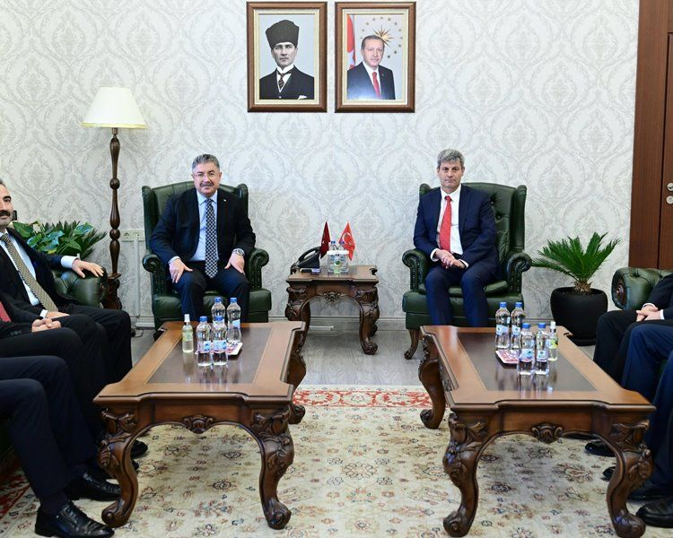

> Mülkiye Başmüfettişi Aydın Ölmez ve beraberindeki heyet, Eskişehir Valisi Dr. Erdinç Yılmaz'ı makamında ziyaret etti.

Mülkiye Başmüfettişi Aydın Ölmez ve beraberindeki heyet, Eskişehir Valisi Dr. Erdinç Yılmaz'ı makamında ziyaret etti.

Vali Yılmaz, ziyaretten duyduğu memnuniyeti dile getirdi ve Ölmez ile beraberindeki heyetle bir süre sohbet etti.

---

## Anadolu Üniversitesi Açıköğretim'de seçmeli ders dönemi başladı

**Eğitim · Tepebaşı** · 2026-10-22 11:32 UTC · Kaynak: [Anadolu Üniversitesi](https://anahaber.anadolu.edu.tr/tr/haber-detay/ejdtr8opvgzilaleo2z7gv0d)

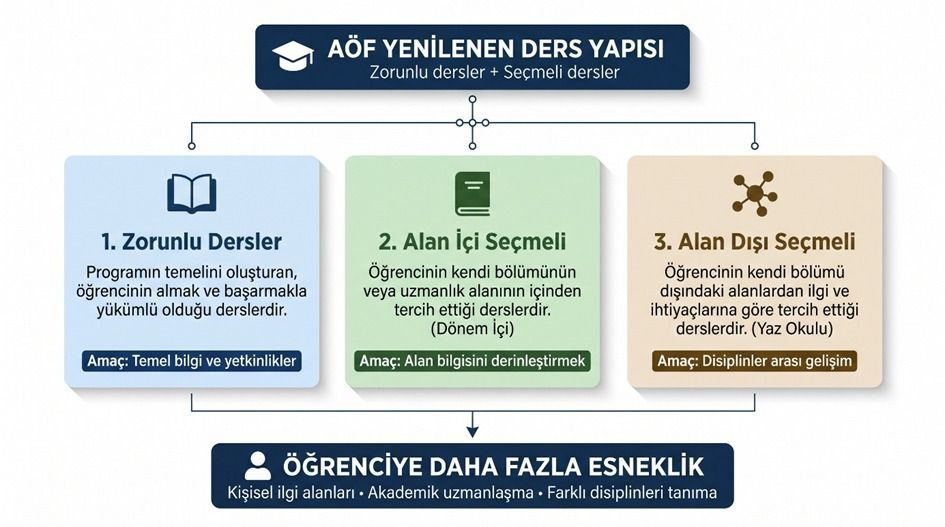

> Açıköğretim Fakültesi'nde 2026-2027 güz döneminden itibaren seçmeli ders uygulaması başladı. Üniversite, bunun Türkiye'de açıköğretim kurumları arasında bir ilk olduğunu belirtiyor.

Anadolu Üniversitesi Açıköğretim Fakültesi'nde 2026-2027 akademik yılı güz döneminden itibaren seçmeli ders uygulaması hayata geçirildi. Üniversite, bu uygulamayla Türkiye'de açıköğretim hizmeti veren kurumlar arasında bir ilke imza attığını belirtiyor.

Yenilenen ders programlarında zorunlu derslerin yanı sıra alan içi ve alan dışı seçmeli dersler de yer alıyor. Müfredat güncellemesiyle 65 programa 209 alan içi seçmeli ders ve 2 bin 663 alan dışı seçmeli ders eklendi. Alan içi seçmeli dersler dönem içinde, alan dışı seçmeli dersler ise yaz okulunda öğrencilerin tercihine sunuluyor.

Mevcut öğrencilerin yeni program yapısına geçişi için 86 programda toplam 4 bin 289 intibak işlemi yapıldı.

Öğrenciler ders seçimi, ders değiştirme, derslerin yerine saydırılması, yaz okulu ve mezuniyet koşulları gibi konulardaki bilgilere www.anadolu.edu.tr/acikogretim/secmeli-dersler adresinden ulaşabiliyor.

---

## Açıköğretim mezunu çifte Anadolu Üniversitesi'nde başarı belgesi verildi

**Eğitim · Tepebaşı** · 2026-10-22 11:32 UTC · Kaynak: [Anadolu Üniversitesi](https://anahaber.anadolu.edu.tr/tr/haber-detay/ujoxhk0wf8t5odfq1hg90vz9)

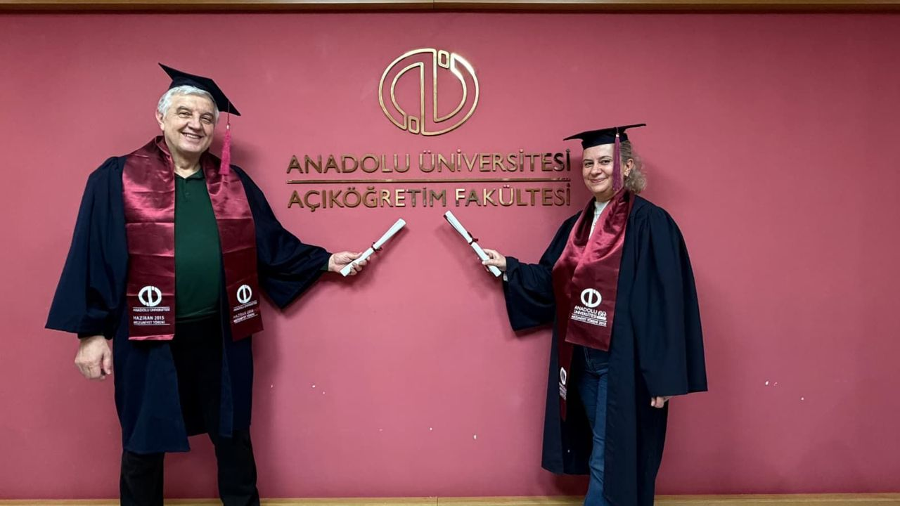

> Açıköğretim Fakültesi mezunları Nihal Güler ve Sebahattin Konceli'ye Dekan Yardımcısı Doç. Dr. Seçil Kaya Gülen başarı belgelerini takdim etti.

Anadolu Üniversitesi Açıköğretim Fakültesi mezunları Nihal Güler ve eşi Sebahattin Konceli, uzun yıllara yayılan eğitim yolculuklarını tamamladı. Fakülteyi ziyaret eden çifte Dekanlık Toplantı Salonu'nda Dekan Yardımcısı Doç. Dr. Seçil Kaya Gülen tarafından başarı belgeleri verildi.

Eğitimine 1986'da başlayan emekli asker Konceli, yurt içi ve yurt dışındaki görevleri nedeniyle eğitimini uzun süre sürdürmekte zorlandığını, mezuniyetini emekli olduktan sonra tamamlayabildiğini söyledi. Açıköğretimin öz disiplin ve bireysel çalışma gerektirdiğini belirten Konceli, bu diplomaya sahip olanların başarısına daha fazla saygı duyulması gerektiğini ifade etti.

Güler ise 1998'de başladığı eğitim hayatında 2004'te Açıköğretim Fakültesi Bankacılık ve Sigortacılık Bölümü'nü, 2015'te İktisat Fakültesi Kamu Yönetimi Bölümü'nü tamamladı. Örgün eğitime devam edemediği için açıköğretimi seçtiğini, çocuklarıyla ilgilenirken eğitimini sürdürdüğünü anlattı.

Konceli gençlere okulda öğrendikleriyle yetinmemelerini, yabancı dil öğrenmelerini ve yeni beceriler kazanmalarını tavsiye etti.

---

## Eskişehir'de SEM'e atıcılık, badminton, güreş ve kano için sporcu alımı başladı

**Spor · Merkez** · 2026-10-22 09:32 UTC · Kaynak: [Eskişehir Gençlik ve Spor İl Müdürlüğü](https://eskisehir.gsb.gov.tr/HaberDetaylari/1/304908/2026-2027-sem-basvurulari.aspx)

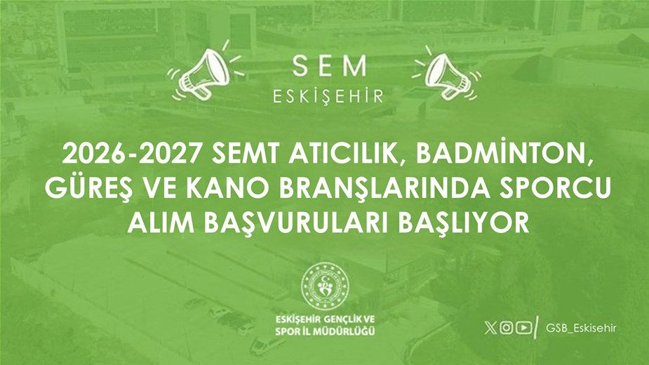

> Sporcu Eğitim Merkezleri'ne dört branşta sporcu alım başvuruları 22 Ekim - 1 Kasım tarihlerinde e-Devlet üzerinden yapılacak.

Eskişehir Gençlik ve Spor İl Müdürlüğü, 2026-2027 eğitim öğretim yılı kapsamında Sporcu Eğitim Merkezleri'ne (SEM) atıcılık, badminton, güreş ve kano branşlarında sporcu alım başvurularının başladığını duyurdu.

Başvurular 22 Ekim - 1 Kasım 2026 tarihleri arasında e-Devlet Kapısı üzerinden yapılacak. Sporcu alım kriterleri ve başvuru rehberi, il müdürlüğünün duyurusunda ek olarak yer alıyor.

İl müdürlüğü, adayların başvuru öncesinde ilgili kriterleri ve açıklamaları dikkatle incelemesini istedi. Ayrıntılı bilgi için Spor Hizmetleri Genel Müdürlüğü'ne yönlendirme yapıldı.

---

## Piyano Günleri'nde "Boratav Project / Sesin Bedeni" doğaçlama resitali yapıldı

**Kültür-Sanat · Tepebaşı** · 2026-10-22 08:33 UTC · Kaynak: [Anadolu Üniversitesi](https://anahaber.anadolu.edu.tr/tr/haber-detay/tn23myoaq5ty7l61hl56ts58)

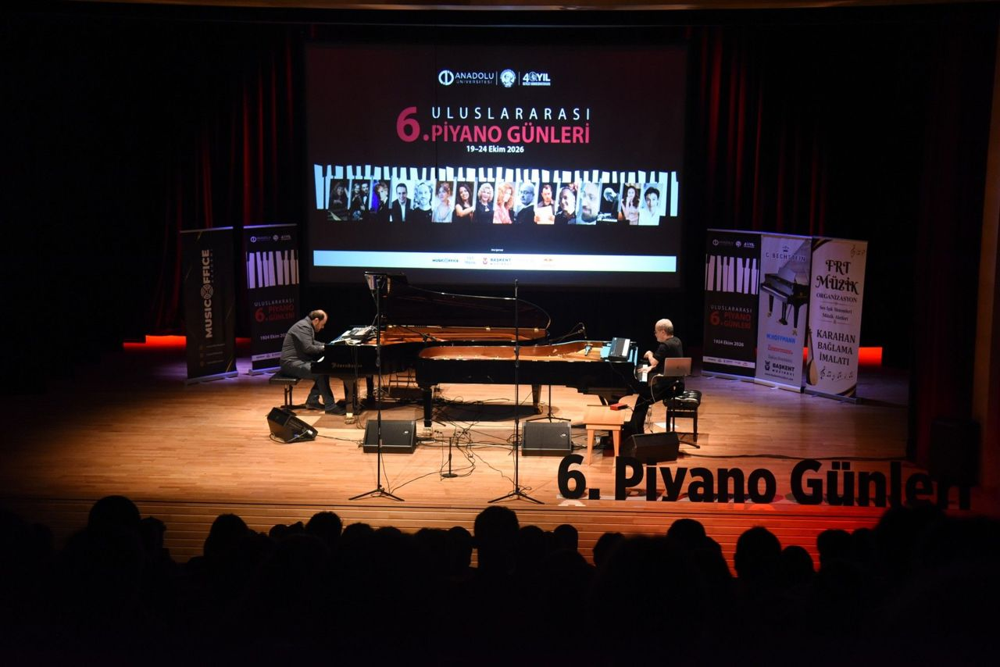

> Anadolu Üniversitesi'ndeki 6. Uluslararası Piyano Günleri kapsamında Emre Dündar ve Mehmet Ali Uzunselvi iki piyano doğaçlama resitali verdi.

Anadolu Üniversitesi Devlet Konservatuvarı Müzik Bölümü Piyano Anasanat Dalı Başkanlığı'nın düzenlediği 6. Uluslararası Piyano Günleri kapsamında "Boratav Project / Sesin Bedeni" iki piyano doğaçlama resitali yapıldı. Resitalde besteci ve piyanistler Emre Dündar ile Mehmet Ali Uzunselvi sahne aldı. Etkinlik Öğrenci Merkezi Yunus Emre Salonu'nda gerçekleşti.

Resitale Halk Bilimi Uygulama ve Araştırma Merkezi Müdürü Prof. Oytun Eren, Mimar Sinan Güzel Sanatlar Üniversitesi Devlet Konservatuvarı'nda uzun yıllar görev yapan Prof. Dr. Hülya Tarcan, öğretim elemanları, öğrenciler ve sanatseverler katıldı.

Boratav Project, 2007'de Dündar ve Uzunselvi tarafından kuruldu. Sanatçıların serbest doğaçlama performanslarını ve bu performanslardan elde ettikleri ses malzemeleriyle ürettikleri elektroakustik yapıtları kapsıyor. Adını halk edebiyatı araştırmacısı Pertev Naili Boratav'dan alıyor.

"Sesin Bedeni" performansı, önceden planlanmış ses yapılarıyla sahnede ortaya çıkan doğaçlama ses olaylarının bir araya gelmesine dayandı. Piyanonun sesine elektronik klavyelerde saklanan özgün ses malzemeleri de eşlik etti.

Dündar, iki çok sesli enstrümanla doğaçlama yapmanın belirsizlikler ve riskler taşıdığını söyledi. Uzunselvi ise iki piyanonun etkileşimini bir bedenin oluşumuna benzeterek, iki farklı uzvun tek bir bedeni meydana getirmesi gibi iki piyanonun da zamanla ortak hareket ettiğini anlattı.

---

## Vali Yılmaz, Muhtar Erol Erdal Gürdoğan'ın ailesine taziye ziyaretinde bulundu

**Gündem · Odunpazarı** · 2026-10-22 01:33 UTC · Kaynak: [Eskişehir Valiliği](https://www.eskisehir.gov.tr/valimiz-dr-erdinc-yilmaz-merhum-muhtar-erol-erdal-gurdoganin-ailesine-taziye-ziyaretinde-bulundu)

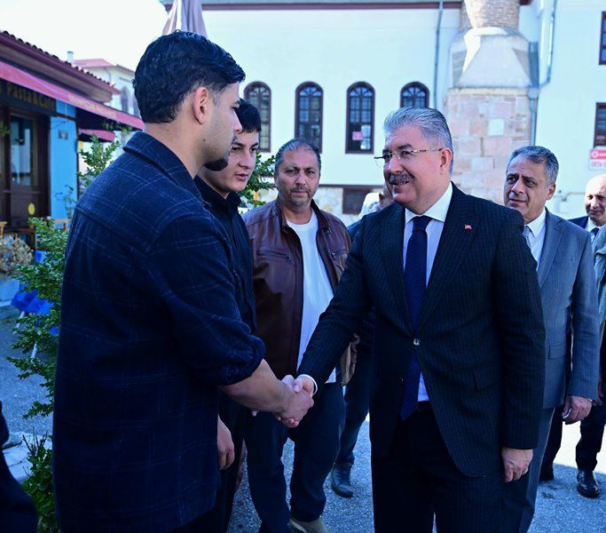

> Odunpazarı Muhtarlar Derneği Başkanı ve Orta Mahalle Muhtarı Erol Erdal Gürdoğan 19 Ekim'de hayatını kaybetti.

Eskişehir Valisi Dr. Erdinç Yılmaz, 19 Ekim 2026'da hayatını kaybeden Odunpazarı Muhtarlar Derneği Başkanı ve Orta Mahalle Muhtarı Erol Erdal Gürdoğan'ın ailesine taziye ziyaretinde bulundu.

Vali Yılmaz, Gürdoğan'a Allah'tan rahmet diledi. Ailesine ve yakınlarına başsağlığı ve sabır dileklerini ileterek acılarını paylaştı.

---

## Eskişehir'de Kadına Yönelik Şiddetle Mücadele Koordinasyon Toplantısı yapıldı

**Gündem · Merkez** · 2026-10-22 01:33 UTC · Kaynak: [Eskişehir Valiliği](https://www.eskisehir.gov.tr/valimiz-dr-erdinc-yilmaz-baskanliginda---kadina-yonelik-siddetle-mucadele-toplantisi-gerceklestirildi)

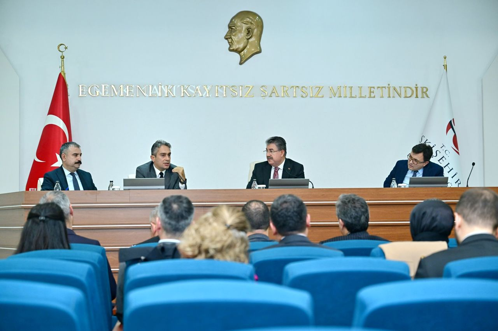

> Vali Dr. Erdinç Yılmaz başkanlığındaki toplantıda ŞÖNİM, kadına yönelik şiddete ilişkin 2025 ve 2026'nın ilk dokuz aya ait istatistikleri paylaştı.

Kadına Yönelik Şiddetle Mücadele 2026 Yılı 3. Dönem Koordinasyon, İzleme ve Değerlendirme Toplantısı, Eskişehir Valisi Dr. Erdinç Yılmaz'ın başkanlığında yapıldı.

Toplantıda Eskişehir Şiddet Önleme ve İzleme Merkezi (ŞÖNİM) Müdürlüğü, 6284 sayılı Ailenin Korunması ve Kadına Karşı Şiddetin Önlenmesine Dair Kanun kapsamında kadına yönelik şiddetle mücadele alanındaki 2025 ve 2026 yıllarının ilk dokuz ayına ilişkin istatistiki verileri paylaştı.

Eskişehir Cumhuriyet Başsavcılığı da Kadına Yönelik Şiddetle Mücadele İl Eylem Planı doğrultusunda yürütülen çalışmalar, kurumlar arası iş birliği ve şiddetle mücadele kapsamındaki faaliyetler hakkında sunum yaptı. Toplantı, görüş ve önerilerin değerlendirilmesinin ardından sona erdi.

---

## 6. Uluslararası Piyano Günleri Gülsin Onay konseriyle başladı

**Kültür-Sanat · Tepebaşı** · 2026-10-22 01:33 UTC · Kaynak: [Anadolu Üniversitesi](https://anahaber.anadolu.edu.tr/tr/haber-detay/xc1j315vrsgn4ufm5bp3dvu2)

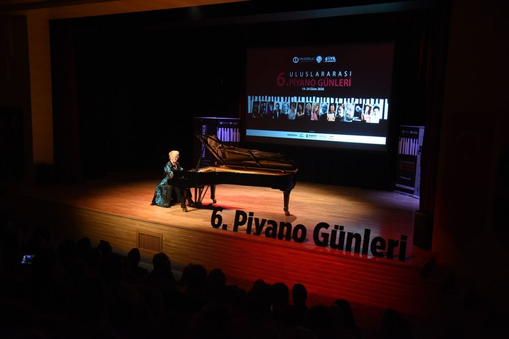

> Anadolu Üniversitesi'ndeki Piyano Günleri, Devlet Sanatçısı Gülsin Onay'ın "Chopin Gecesi" konseriyle açıldı. Etkinlikte 18 sanatçıyla 12 etkinlik yapılacak.

Anadolu Üniversitesi Devlet Konservatuvarı Müzik Bölümü Piyano Anasanat Dalı Başkanlığı'nın düzenlediği 6. Uluslararası Piyano Günleri, Devlet Sanatçısı Gülsin Onay'ın "Chopin Gecesi" açılış konseriyle başladı. Konser, Öğrenci Merkezi Yunus Emre Salonu'nda yapıldı.

Açılışa Rektör Danışmanı ve İletişim Bilimleri Fakültesi Dekanı Prof. Dr. Barış Kılınç, Devlet Konservatuvarı Müdürü Prof. Hüseyin Bülent Akdeniz, Halk Bilimi Uygulama ve Araştırma Merkezi Müdürü Prof. Oytun Eren, öğretim elemanları, öğrenciler ve davetliler katıldı. Etkinlik kapsamında 18 sanatçının katılımıyla masterclass, resital ve söyleşilerin de bulunduğu toplam 12 etkinlik düzenlenecek.

Prof. Kılınç, Anadolu Üniversitesi'nin sanata ve kültüre önem verdiğini belirterek Türkiye'nin tek Piyano Günleri'ni gerçekleştirdiklerini söyledi. Prof. Akdeniz ise etkinliğin genç sanatçıları ulusal ve uluslararası sanat ortamlarıyla buluşturduğunu ifade etti.

Gülsin Onay, bugüne kadar 83 ülkede konser verdiğini, Piyano Günleri'ne dördüncü kez katıldığını ve Eskişehir'in kendisi için özel bir yeri olduğunu söyledi. Genç sanatçılara en önemli tavsiyesinin severek ve disiplinle çalışmak olduğunu belirtti.

---
