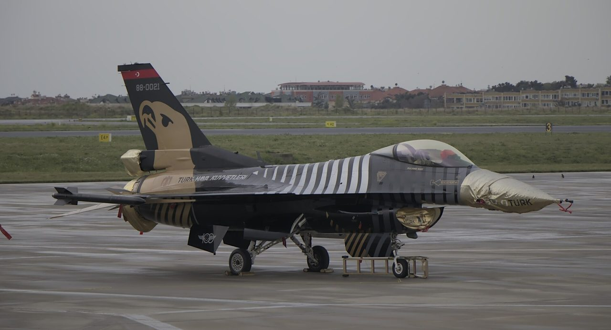
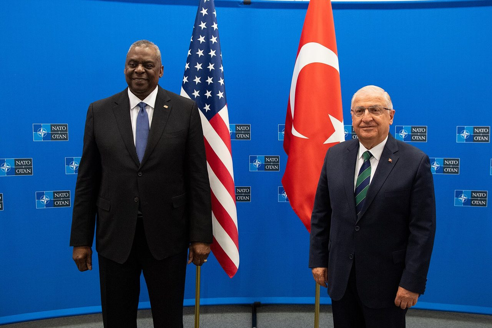
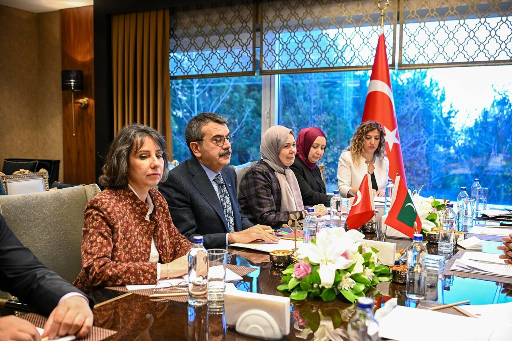
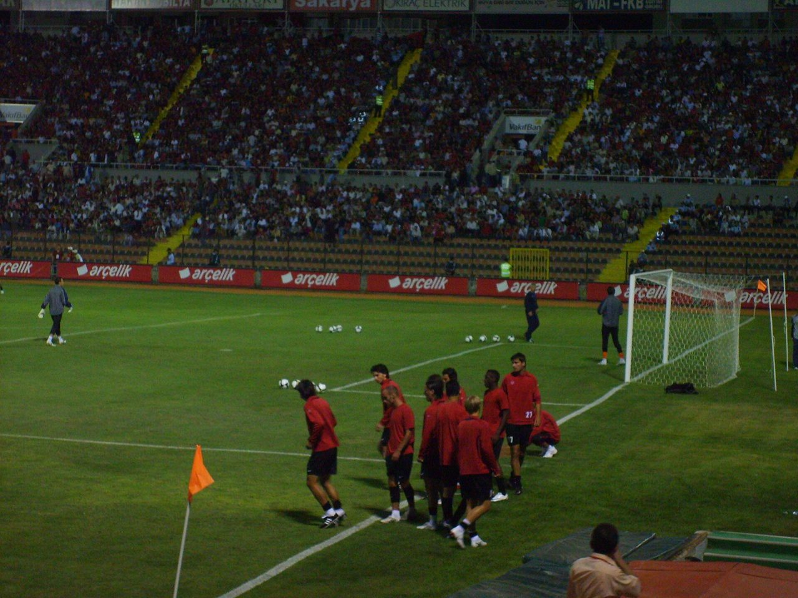
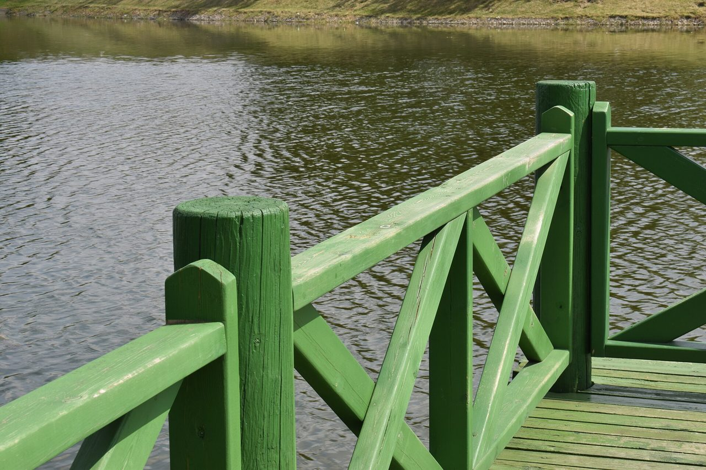
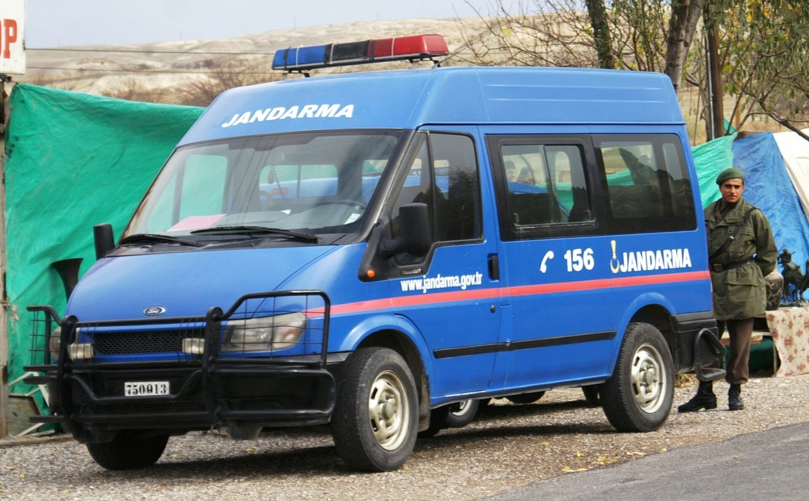
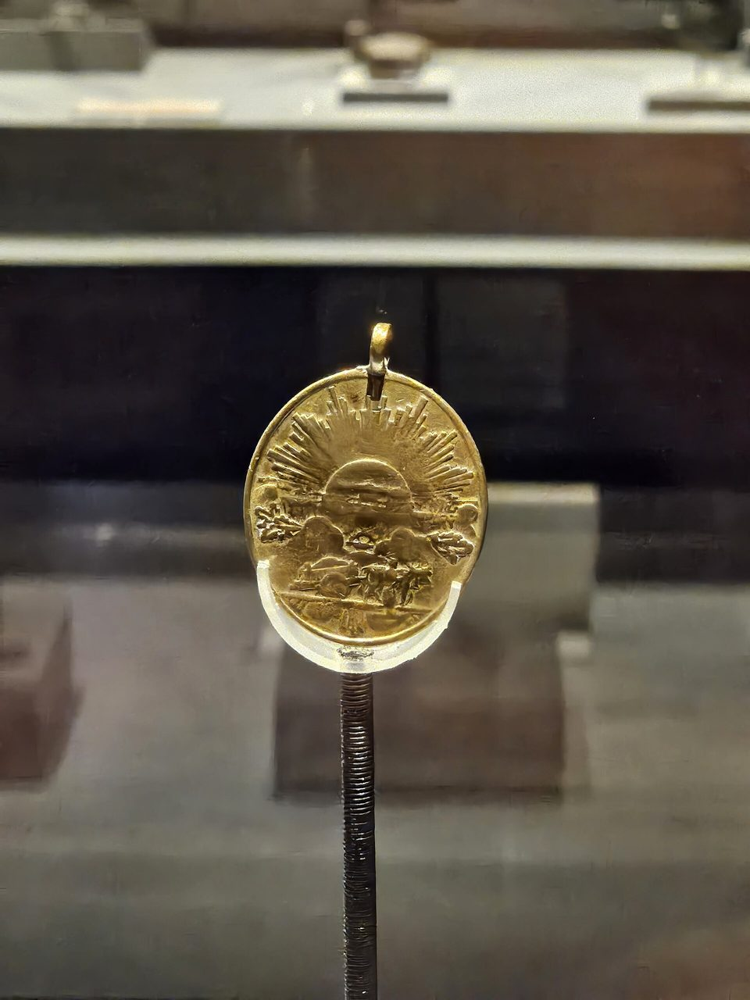
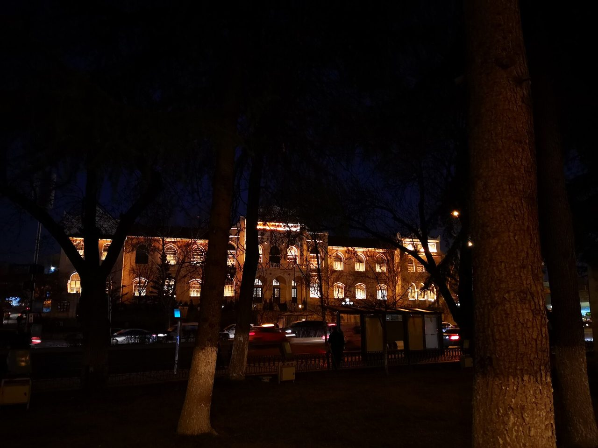
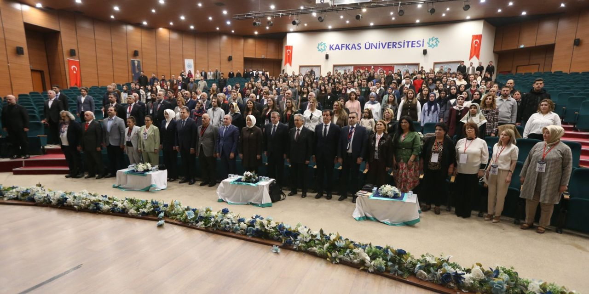

# Son haberler

Ajanın yazdığı son haberler (otomatik güncellenir).

## Eskişehirspor'un Bursa Yıldırımspor maçı ilk 11'i belli oldu: Şapcı 3 değişiklik yaptı

**Spor · Merkez** · 2026-10-24 16:32 UTC · Kaynak: [Google Haberler - Eskişehirspor](https://www.istikbalgazetesi.com/eskisehirspor-kadrosunda-3-degisiklik-1)

> Mustafa Eren Damar kadroya alınmadı; Kurtuluş ve Baykuş yedek kulübesine çekildi.

Eskişehirspor'un Bursa Yıldırımspor maçı ilk 11'i belli oldu. Kalede Bora, sağ bekte Murat Şener, sol bekte Ahmet Lütfü Kara, savunmanın ortasında Abdülkadir Öksüz ve Arda Okumuş, orta sahada Ozan İsmail Koç, Tayfun Tatlı ve Mehmet Bağlı, kanatlarda Beykan Şimşek ve Hasan Kaya, forvette ise Osman Arslantaş sahaya çıktı.

Teknik direktör Hakan Şapcı, sakatlığı bulunan Mustafa Eren Damar'ı kadroya almadı; son maçtan Ertuğrul Kurtuluş ve Kerem Baykuş'u ise yedek kulübesine çekti.

---

## Eskişehir'de gazeteciler "Sansüre Hayır, Habere Özgürlük" yürüyüşü yaptı

**Gündem · Merkez** · 2026-10-24 15:32 UTC · Kaynak: [Google Haberler - Eskişehir](https://www.cumhuriyet.com.tr/turkiye/eskisehir-de-sansure-hayir-habere-ozgurluk-yuruyusu-duzenlendi-bu-duzene-sessiz-kalmayacagiz-2549879)

> ÇGD, TGS ve EGC şubelerinin çağrısıyla Köprübaşı'ndan Yediler Parkı'na yürüdüler.

Gazetecilere yönelik gözaltı ve tutuklamalara, medya kuruluşlarına kayyum atamalarına ve haber sitelerine getirilen erişim engellerine karşı basın meslek örgütlerinin ortak çağrısıyla Eskişehir'de "Sansüre Hayır, Habere Özgürlük" yürüyüşü yapıldı. Katılımcılar Köprübaşı'ndan Hamamyolu Yediler Parkı'na yürüdü. Yürüyüşe YENİ Parti Eskişehir Milletvekili İbrahim Arslan ile Odunpazarı Belediye Başkanı Kazım Kurt destek verdi.

Çağdaş Gazeteciler Derneği (ÇGD), Türkiye Gazeteciler Sendikası (TGS) ve Eskişehir Gazeteciler Cemiyeti (EGC) Eskişehir şubeleri adına basın metnini okuyan ÇGD Eskişehir Şubesi Yönetim Kurulu Üyesi Eylem Lodos, "Gazeteciliğin suç, haberin tehdit, gerçeğin sakıncalı sayıldığı bu düzene sessiz kalmayacağız" dedi. Lodos, basın örgütlerinin tek taleplerinin mesleği özgürce yapmak olduğunu ve basın özgürlüğünün yalnızca gazetecilerin değil toplumun tüm kesimlerinin sorunu olduğunu söyledi. Açıklamadaki değerlendirmeler basın örgütlerine aittir.

---

## Eskişehir'de bu gece Ay ve Satürn gökyüzünde yan yana görülecek

**Gündem · Merkez** · 2026-10-24 15:32 UTC · Kaynak: [Google Haberler - Eskişehir etkinlik](https://www.eskisehir.net/eskisehirde-bu-gece-gokyuzune-bakin-ay-ve-saturn-bir-arada-gorulecek)

> 24 Ekim akşamı iki gök cismi çıplak gözle izlenebilecek; 26 Ekim'de dolunay olacak.

TÜBİTAK Bilim Genç'in ekim ayı gökyüzü takvimine göre Ay ile Satürn, 24 Ekim Cumartesi akşamı Balıklar Takımyıldızı yönünde birbirine yakın görülecek. Hava koşulları uygun olursa görüntü Eskişehir'de çıplak gözle izlenebilecek. Ay, kentte 16.53 civarında doğacak; iki gök cismi gece boyunca gökyüzünde kalacak.

Gözlem yapmak isteyenlere yüksek binaların görüşü kapatmadığı, gökyüzünün açık olduğu alanları tercih etmeleri öneriliyor. Şelale Park gibi şehre hâkim noktalar değerlendirilebilir; şehir ışıklarından uzak alanlar daha sönük yıldızları görmek için avantaj sağlayabilir. Şehir dışına çıkacakların güvenli alanları seçmesi gerekiyor.

Ekimin son haftasında 26 Ekim Pazartesi günü dolunay olacak. Eskişehir'de Ay'ın yaklaşık 17.49'da doğması bekleniyor.

---

## 29 Ekim'de Eskişehir'de tramvay ve otobüslerin ücretsiz olup olmayacağı henüz belli değil

**Ulaşım · Merkez** · 2026-10-24 14:32 UTC · Kaynak: [Google Haberler - Eskişehir](https://www.gzt26.com/eskisehirde-29-ekimde-tramvay-ve-otobusler-ucretsiz-olacak-mi-iste-son-gelismeler)

> Bakanlığın ücretsiz ulaşım duyurusu Ankara, İstanbul ve İzmir'deki raylı sistemleri kapsıyor.

Ulaştırma ve Altyapı Bakanı Abdulkadir Uraloğlu, 29 Ekim Cumhuriyet Bayramı'nda Bakanlığa bağlı bazı raylı sistem hatlarında ücretsiz ulaşım sağlanacağını duyurdu. İstanbul'da Marmaray, Sirkeci-Kazlıçeşme Hattı ve Gayrettepe-İstanbul Havalimanı-Halkalı Metro Hattı, Ankara'da Başkentray ve İzmir'de İZBAN ücretsiz hizmet verecek.

Bakanlığın uygulaması Eskişehir'deki ESTRAM tramvaylarını ve belediye otobüslerini kapsamıyor. Eskişehir Büyükşehir Belediyesi'nden 29 Ekim Perşembe günü için ücretsiz ulaşıma ilişkin henüz resmî bir duyuru yapılmadı. Belediye yeni bir karar açıklamazsa Eskişehir'de mevcut ücret tarifesi geçerli olacak.

---

## Topkapı Sarayı Darphane-i Amire Müzeleri açıldı: 5 müzede 10 bin 500 eser sergilenecek

**Türkiye · Türkiye** · 2026-10-24 13:32 UTC · Kaynak: [Google Haberler - Cumhurbaşkanı](https://www.trthaber.com/haber/gundem/cumhurbaskani-erdogan-turk-milleti-olarak-dunyada-esine-az-rastlanir-bir-muktesebata-sahibiz-961083.html)

> Açılışı Cumhurbaşkanı Erdoğan yaptı; müzeler 17 bin metrekarelik alana yayılan 7 yapıda yer alıyor.

Cumhurbaşkanı Recep Tayyip Erdoğan, Topkapı Sarayı Darphane-i Amire Müzeleri Açılış Töreni'nde konuştu. Erdoğan'a göre Darphane-i Amire Külliyesi'nde yapılan restorasyonlarla 17 bin metrekarelik alana yayılan 7 yapı ve 46 salon 5 farklı müze olarak düzenlendi. Topkapı Sarayı envanterindeki toplam 10 bin 500 eser müzelerde ziyaretçilerle buluşacak.

Harita Müzesi'nde Osmanlı coğrafyasına ait yaklaşık 200 harita yer alacak; aynı binada 800 binden fazla yazılı ve görsel kaynağın dijital ortamda toplandığı Milli Saraylar Araştırma Merkezi hizmet verecek. Hüsnühat Eserleri Müzesi'nde 2 binden fazla hüsnühat eseri ilk kez sergilenecek. Darphane ve Endüstri Araçları Müzesi'nde yaklaşık 500 endüstri aracı, Esliha-i Hümayun Müzesi'nde 7. yüzyıldan 20. yüzyıla uzanan 2 bin 500'den fazla askeri teçhizat bulunacak; bunların arasında Fatih Sultan Mehmet'in kılıcı ve zırhlı gömleği de yer alacak. Saray Porselenleri Müzesi'nde ise Çin, Japonya, İran, İngiltere, Vietnam, Fransa ve Rusya'da üretilen porselenler ile Yıldız Porselen Sarayı fabrikasının eserleri sergilenecek.

---

## SOLOTÜRK Sazova Parkı'nda çevre tanıma uçuşu yaptı, Eskişehirliler yoğun ilgi gösterdi

**Gündem · Tepebaşı** · 2026-10-24 11:34 UTC · Kaynak: [Google Haberler - Eskişehir etkinlik](https://www.sondakika.com/cevre/haber-soloturk-un-sazova-parki-ndaki-prova-ucusu-eskiseh-20361958/)

> Ekip 29 Ekim Cumhuriyet Bayramı'nda Eskişehir'de gösteri uçuşu yapacak.

Türk Hava Kuvvetleri'nin gösteri takımı SOLOTÜRK, 29 Ekim Cumhuriyet Bayramı kapsamında Eskişehir'de yapacağı gösteri uçuşu öncesinde Sazova Parkı'nda çevre tanıma uçuşu gerçekleştirdi. Saat 12.20'de başlayan uçuşu izleyen Eskişehirliler yoğun ilgi gösterdi. Ekibin bayram günkü ana uçuşu için hazırlıkları sürüyor.

---

## Bakan Güler, 1. Hava Bakım Fabrika'nın 100. yıl kutlaması için Eskişehir'de

**Gündem · Merkez** · 2026-10-24 11:32 UTC · Kaynak: [Google Haberler - Eskişehir](https://www.eskisehirekspres.net/milli-savunma-bakani-yasar-guler-eskisehire-geldi)

> Güler, Hava Kuvvetleri Komutanı Dalkıran'la birlikte Hasan Polatkan Havalimanı'nda karşılandı.

Milli Savunma Bakanı Yaşar Güler, Eskişehir'deki 1. Hava Bakım Fabrika Müdürlüğü'nün 100. yıl dönümü dolayısıyla düzenlenen kutlama programına katılmak için kente geldi. Güler'e üst düzey askeri heyet eşlik etti.

Güler ve Hava Kuvvetleri Komutanı Hava Orgeneral Rafet Dalkıran, Eskişehir Teknik Üniversitesi Hasan Polatkan Havalimanı'nda düzenlenen törenle karşılandı. Karşılama töreninde Vali Erdinç Yılmaz ve kent protokolü hazır bulundu. Ardından Vali Yılmaz ile birlikte 1. Hava Bakım Fabrika Müdürlüğü'ne geçen heyet, tesiste incelemelerde bulundu; fabrikanın geçmişi, bakım, onarım ve modernizasyon çalışmaları ile geleceğe yönelik projeler değerlendirildi.

---

## Erdoğan'dan BM Günü mesajı: BM Güvenlik Konseyi daha adil ve kapsayıcı hale gelmeli

**Siyaset · Türkiye** · 2026-10-24 11:31 UTC · Kaynak: [İletişim Başkanlığı](https://www.iletisim.gov.tr/turkce/haberler/detay/cumhurbaskani-erdoganin-birlesmis-milletler-gunu-ve-bm-teskilatinin-kurulusunun-81-yil-donumu-mesaji-24-10-26)

> Erdoğan, BM'nin kuruluşunun 81. yıl dönümünü kutladı.

Cumhurbaşkanı Recep Tayyip Erdoğan, 24 Ekim Birleşmiş Milletler Günü ve BM'nin kuruluşunun 81. yıl dönümü dolayısıyla mesaj yayımladı. Erdoğan, BM'nin kuruluşunun 81. yıl dönümünü tebrik etti; Genel Sekreter Antonio Guterres başta olmak üzere BM çalışanlarını kutladı.

Erdoğan, savaşlar, insani felaketler, iklim değişikliği, açlık ve yoksulluk gibi küresel sınamaların BM'nin kuruluş misyonunun öneminin azalmadığını, arttığını gösterdiğini belirtti. Tüm ülkelerin BM Şartı'na daha güçlü sahip çıkmasını ve Teşkilat'ın temel organlarının etkinliğini artıracak reformları desteklemesini isteyen Erdoğan, BM Güvenlik Konseyi'nin daha adil, kapsayıcı ve uluslararası toplumun beklentilerini karşılayabilecek bir yapıya kavuşturulmasının önemli hâle geldiğini söyledi.

---

## Bakan Tekin: Ebeveyn Okulu Programı'na katılım zorunlu, katılım oranı yüzde 91'e ulaştı

**Eğitim · Türkiye** · 2026-10-24 10:33 UTC · Kaynak: [Google Haberler - Bakanlıklar](https://filashaber.com/haber/velilere-20-saatlik-egitim-zorunlulugu-bakan-tekin-acikladi-52116)

> Okul öncesi, ilkokul 1. ve ortaokul 5. sınıfa başlayan öğrencilerin velileri 20 saatlik eğitim alıyor.

Millî Eğitim Bakanı Yusuf Tekin, Ebeveyn Okulu Programı'na katılım oranının yüzde 91'e ulaştığını açıkladı. Programa katılım, bu yıl okul öncesine, ilkokul 1. sınıfa ve ortaokul 5. sınıfa yeni başlayan öğrencilerin velileri için zorunlu hâle getirildi.

Yaklaşık iki veya üç güne yayılan, toplam 20 saatlik programda velilere aile içi iletişim ve sağlıklı aile ilişkileri, çocukların akademik gelişiminin desteklenmesi, öğretmen ve okul yönetimiyle doğru iletişim, ebeveynlerin sorumlulukları ile okul-aile iş birliği ve güvenlik konularında eğitim veriliyor. Uygulamayla özellikle okula uyum sürecinde ailelerin daha etkin rol üstlenmesi hedefleniyor.

---

## Eskişehirspor–Bursa Yıldırımspor maçı bugün saat 19.00'da, Tivibu Spor 4'ten yayınlanacak

**Spor · Merkez** · 2026-10-24 10:31 UTC · Kaynak: [Google Haberler - Eskişehirspor](https://www.haberlisin.com/eskisehirspor-bursa-yildirimspor-maci-hangi-kanalda-saat-kacta-24-ekim-canli-yayin)

> Karşılaşma Nesine 3. Lig 2. Grup'un 8. haftasında oynanacak.

Eskişehirspor, Nesine 3. Lig 2. Grup'un 8. haftasında Bursa Yıldırımspor'u konuk edecek. Karşılaşma 24 Ekim 2026 Cumartesi günü saat 19.00'da başlayacak.

Maç Tivibu Spor 4 kanalından canlı yayınlanacak. Dijital ortamda izlemek isteyenler Tivibu GO üzerinden erişim seçeneklerini kontrol edebilecek.

---

## Altın fiyatları 24 Ekim 2026: Gram altın 6.471,57 TL

**Ekonomi · Merkez** · 2026-10-24 09:59 UTC · Kaynak: [Harem Altın](https://www.haremaltin.com/altin-fiyatlari)

> Gram altın güne düşüşle başladı. Harem Altın verilerine göre gram altın 6.393,09 TL'den alınıyor, 6.471,57 TL'den satılıyor.

Altın piyasasında güne düşüşle başlandı. Harem Altın'ın saat 12.59 itibarıyla verilerine göre gram altının satış fiyatı 6.471,57 TL, alış fiyatı 6.393,09 TL oldu. Gram altın, önceki kapanışa göre yüzde 1,38 geriledi.

Ziynet altınlarda çeyrek altın 10.548 TL, yarım altın 21.089 TL, tam altın 42.043 TL, ata altın 42.798 TL seviyesinden satışa sunuluyor.

22 ayar bileziğin gram satış fiyatı 6.045,08 TL, has altının gram fiyatı 6.452,21 TL olarak belirlendi.

Uluslararası piyasalarda altının onsu 3.998,30 dolardan işlem görürken, dolar/TL 49,90 seviyesinde bulunuyor.

Fiyatlar Harem Altın'ın saat 12.59 itibarıyla paylaştığı verilere dayanmaktadır; kuyumcular arasında farklılık gösterebilir. Bu haber yatırım tavsiyesi değildir.

---

## Vali Yılmaz'dan Eskişehirspor'a destek: "Haydi Efsane, bugün galibiyet günü!"

**Spor · Merkez** · 2026-10-24 09:31 UTC · Kaynak: [Google Haberler - Eskişehirspor](https://www.istikbalgazetesi.com/vali-yilmazdan-eskisehirspora-destek-haydi-efsane)

> Yılmaz, takımın 169 günlük hasretin ardından taraftarıyla buluştuğunu belirtti.

Eskişehir Valisi Erdinç Yılmaz, sosyal medya hesabından yaptığı paylaşımda Eskişehirspor'un yeniden taraftarıyla buluşmasının kentte oluşturduğu heyecana dikkat çekti ve takıma başarı diledi.

Yılmaz, "169 günlük hasretin ardından taraftarıyla yeniden buluşan siyah-kırmızılı ekibimiz, Prof. Dr. Fethi Heper Stadyumu'nda galibiyet için sahaya çıkıyor. Tribünler yeniden ateşlenecek, Eskişehir yeniden tek yürek olacak" dedi. Futbolculara son düdüğe kadar mücadele etmeleri çağrısı yapan Yılmaz, "3 puan Eskişehir'e gelecek! Haydi EFSANE, bugün galibiyet günü!" ifadelerini kullandı.

---

## Büyükşehir'in yüzme bilmeyenler eğitimi için online kayıtlar 27 Ekim'de başlıyor

**Spor · Merkez** · 2026-10-24 09:31 UTC · Kaynak: [Google Haberler - Eskişehir gündem](https://www.esyenigun.com/eskisehirde-yuzme-ogrenmek-isteyenlere-mujde-kayit-tarihi-belli-oldu)

> Eğitimler 3 Kasım-27 Aralık'ta Kentpark Kapalı Yüzme Havuzu'nda yapılacak.

Eskişehir Büyükşehir Belediyesi Gençlik ve Spor Hizmetleri Dairesi Başkanlığı, 5-17 yaş arasındaki çocuklar ile yetişkinlere yönelik "Yüzme Bilmeyenler Eğitimi"nin yeni dönemini başlatıyor. Eğitimler 3 Kasım'da başlayıp 27 Aralık'ta sona erecek.

Kentpark Kapalı Yüzme Havuzu'nda yapılacak eğitimler için online kayıtlar 27 Ekim Salı günü saat 09.00'da başlayacak. Program kontenjanla sınırlı. Ayrıntılar Büyükşehir'in resmî internet sitesi ve @ebbsporeskisehir Instagram hesabından duyurulacak.

2012'de hizmete açılan Kentpark Kapalı Yüzme Havuzu'nda yaz sonrası yıllık bakım ve tadilat çalışmaları tamamlandı; havuz serbest yüzmek isteyen vatandaşlara da açık.

---

## Eskişehir Atatürk Lisesi 116 yıllık geçmişiyle eğitim vermeye devam ediyor

**Eğitim · Odunpazarı** · 2026-10-24 08:32 UTC · Kaynak: [Google Haberler - Eskişehir gündem](https://www.ensondakika.com.tr/asirlik-mektepler-eskisehir-in-116-yillik-egitim-cinari-gelecegin-ogrencilerini-yetistiriyor/726155/)

> Okul 1910'da "Rüştiye Mektebi" adıyla açıldı; bugünkü binasına 1934-1935'te taşındı.

Osmanlı Devleti tarafından 1910 yılında "Rüştiye Mektebi" adıyla açılan Eskişehir Atatürk Lisesi, 116 yıllık eğitim geçmişiyle "Asırlık Mektepler" dosya haberinin konusu oldu. Odunpazarı ilçesi Akcami Mahallesi'ndeki okul, Eskişehir'in 1920'de işgal edilmesi nedeniyle eğitime ara verdi; kentin 2 Eylül 1922'de kurtarılmasının ardından "Sultani Mektebi" adıyla yeniden faaliyete geçti.

Okul 1930-1931'de "Eskişehir Lisesi" adını aldı ve ilk mezunlarını 1932-1933'te verdi. Atatürk, 1932'de okulu ziyaret ettikten sonra daha uygun bir binaya taşınması için talimat verdi. Dönemin Hükümet Konağı olarak inşa edilen bugünkü bina okula tahsis edildi; okul 1934-1935 eğitim öğretim yılının başında bu binaya taşındı ve 1961'de "Atatürk Lisesi" adını aldı. Yapı 1988'de anıtsal yapı olarak tescillendi.

Okul bugün 28 derslikte 523 öğrenciyle eğitim veriyor. Yaklaşık 13 bin 500 kitaplı kütüphanesi bulunuyor; "Bayrak Şairi" Arif Nihat Asya 1954-1955 yıllarında okulda edebiyat öğretmenliği yaptı.

---

## ESTÜ'nün UNESCO Kürsüsü başvurusu olumlu değerlendirildi, nihai onay aşamasına geçti

**Eğitim · Tepebaşı** · 2026-10-24 08:31 UTC · Kaynak: [Eskişehir Teknik Üniversitesi](https://www.eskisehir.edu.tr/tr/Haber/Detay/cop31-yolunda-eskisehir-teknik-universitesinden-onemli-bir-basari)

> Kürsü, 13 ülkeden 32 ortaklı EPD-Net projesiyle bağlantılı olarak geliştirildi.

Eskişehir Teknik Üniversitesi'nin (ESTÜ) UNITWIN/UNESCO Kürsüleri Programı kapsamındaki UNESCO Kürsüsü başvurusu, UNESCO uzmanlarınca olumlu değerlendirildi ve nihai onay aşamasına geçti.

Kürsünün, Yer ve Uzay Bilimleri Enstitüsü öğretim üyeleri Prof. Dr. Saye Nihan Çabuk ve Doç. Dr. Gordana Kaplan'ın eş başkanlığında, Uluslararası İlişkiler Birimi Sorumlusu Öğr. Gör. Gülsüm Karaman'ın katkılarıyla faaliyet göstermesi planlanıyor. Kürsü, ESTÜ koordinatörlüğünde 13 ülkeden 32 ortağın katılımıyla yürütülen ve afet riskinin azaltılması, dirençli kentler ve sürdürülebilir yeniden yapılanma alanlarında iş birliği ağı oluşturan EPD-Net projesiyle bağlantılı olarak geliştirildi.

Kürsünün iklim değişikliğine uyum ve afet dirençliliği alanlarında ortak araştırma, eğitim ve kapasite geliştirme faaliyetlerini güçlendirmesi hedefleniyor.

---

## Büyükşehir ve Emeklilerin Sesi Derneği kıdemli vatandaşlara iletişim etkinliği düzenledi

**Belediye · Merkez** · 2026-10-24 07:31 UTC · Kaynak: [Google Haberler - Eskişehir](https://www.gzt26.com/eskisehir-buyuksehir-belediyesi-ve-emeklilerin-sesi-derneginden-ortak-etkinlik)

> Etkinlikte aile içi ilişkiler ve sosyal bağlar konuşuldu.

Eskişehir Büyükşehir Belediyesi Yaşlı Hizmetleri Birimi ile Emeklilerin Sesi Derneği Eskişehir İl Temsilciliği iş birliğinde, kıdemli vatandaşlara yönelik sağlıklı iletişim etkinliği düzenlendi. Etkinlikte aile içi ilişkiler, sosyal bağların güçlendirilmesi ve günlük yaşamda karşılaşılan iletişim sorunları konuşuldu.

Yaşlı Hizmetleri Birimi Sorumlusu Merve Kas, kıdemli vatandaşların sosyal hayata aktif katılımını desteklemeyi ve sağlıklı iletişim kurmalarına katkı sağlamayı amaçladıklarını söyledi. Emeklilerin Sesi Derneği Eskişehir İl Temsilcisi Aydan Çetintürk Güner ise iletişimde sevgi, ilgi ve bilgiye dayanan "üç adım yöntemini" anlattı.

---

## Yasa dışı bahis operasyonu Eskişehir'e de uzandı: 14 gözaltından 11 tutuklama

**Asayiş · Merkez** · 2026-10-24 01:32 UTC · Kaynak: [Google Haberler - Eskişehir](https://www.eskisehirekspres.net/aralarinda-eskisehirde-var4-ilde-yasa-disi-bahis-operasyonunda-11-tutuklama)

> Çerkezköy'deki soruşturmada 14 şüpheli gözaltına alındı, 3'ü adli kontrolle serbest bırakıldı.

Tekirdağ İl Jandarma Komutanlığı ekipleri, Çerkezköy Cumhuriyet Başsavcılığı koordinesinde yasa dışı bahis faaliyetlerine yönelik çalışma yürüttü. 20 Ekim 2026'da saat 06.30'da Tekirdağ, İstanbul, Kütahya ve Eskişehir'de belirlenen adreslere eş zamanlı operasyon düzenlendi. 7258 sayılı Kanun'a muhalefet suçlamasıyla 14 şüpheli gözaltına alındı.

Aramalarda 16 cep telefonu, 9 SIM kart, 1 hard disk, 2 dizüstü bilgisayar, 2 bilgisayar, 1 Micro SD kart ve 4 USB bellek ele geçirildi. Şüphelilerin hesaplarında toplam 2 milyar 146 milyon 143 bin 816 TL işlem hacmi bulunduğu belirlendi. Adliyeye sevk edilen 14 şüpheliden 11'i tutuklandı, 3'ü adli kontrolle serbest bırakıldı. Şüpheliler hakkındaki suçlamalar henüz yargı kararıyla kesinleşmedi.

---

## Resmî Gazete: 5 şehit ve gazinin mirasçılarına İstiklal Madalyası verilecek

**Türkiye · Türkiye** · 2026-10-24 01:32 UTC · Kaynak: [Google Haberler - Cumhurbaşkanı](https://www.son.tv/cumhurbaskani-erdogan-imzaladi-istiklal-madalyasi-karari-resmi-gazetede-5-kahramanin-mirascilarina-madalya-verilecek/)

> Listede Eskişehir doğumlu Er Ferhat Taymaz'ın torunu Baykal Taymaz da var.

24 Ekim 2026 tarihli ve 33410 sayılı Resmî Gazete'de yayımlanan 11925 sayılı Cumhurbaşkanı Kararı ile Kurtuluş Savaşı'ndaki hizmetleri tespit edilen beş şehit ve gazinin mirasçılarına İstiklal Madalyası verilmesine karar verildi. Karar, 66 sayılı İstiklal Madalyası Kanunu'nun ek 4. ve ek 6. maddelerine dayanıyor.

Listede yer alanlardan biri, Eskişehir doğumlu Baykal Taymaz. Taymaz, 1898 doğumlu Er Ferhat Taymaz'ın torunu; Ferhat Taymaz 28 Mart 1921'de İkinci İnönü Muharebesi'nde yaralandı. Diğer mirasçılar arasında Dumlupınar Muharebesi'nde şehit düşen Onbaşı Mustafa Kırcılar, Sakarya Muharebesi'nde şehit düşen Er Halis Köse, Türkmen Dağı Taarruzu'nda şehit düşen Er Yasin Şekerlisoy ve 1922'deki İstiklal Muharebesi nedeniyle malul olarak kayıtlı Er Halil Taş'ın yakınları bulunuyor.

Millî Savunma Bakanlığı'na göre başvurular askerlik şubeleri aracılığıyla alınıyor; madalya işlemlerini Askeralma Genel Müdürlüğü yürütüyor.

---

## Kültür ve Turizm Bakanlığı Eskişehir için 3 asıl, 2 yedek sözleşmeli kütüphaneci alacak

**Gündem · Merkez** · 2026-10-24 00:32 UTC · Kaynak: [Google Haberler - Eskişehir gündem](https://www.milliirade.com/eskisehire-kutuphaneci-kadrosu-acildi-basvuru-tarihleri-netlesti)

> Türkiye genelinde 162 kişilik alımın başvuruları 2-16 Kasım'da yapılacak.

Kültür ve Turizm Bakanlığı, taşra teşkilatında görevlendirmek üzere Türkiye genelinde 162 sözleşmeli kütüphaneci alacak. 23 Ekim 2026 tarihli Resmî Gazete'de yayımlanan ilana göre Eskişehir için 3 asıl ve 2 yedek aday kontenjanı ayrıldı.

Alımlar KPSS P3 puan sıralamasına göre sözlü sınavla yapılacak; her il için kontenjanın üç katı kadar aday mülakata çağrılacak. Başvurular 2-16 Kasım 2026 tarihleri arasında e-Devlet üzerinden "Kariyer Kapısı-Kamu İşe Alım" hizmetiyle yapılacak. Adayların Bilgi ve Belge Yönetimi, Kütüphanecilik, Arşivcilik veya Dokümantasyon ve Enformasyon bölümlerinden mezun olması ve 2026 KPSS B Grubu P3 puan türünden en az 70 puan alması gerekiyor. Adaylar yalnızca tek bir ile başvurabilecek.

---

## Eskişehirspor–Bursa Yıldırım maçı için 24 Ekim'de Alaaddin Parkı'ndan ring seferi

**Ulaşım · Merkez** · 2026-10-23 23:31 UTC · Kaynak: [Google Haberler - Odunpazarı](https://www.anadolugazetesi.com/amp/eskisehirspor-un-bursa-yildirim-maci-oncesi-ulasim-kolayligi--sefer-saatleri-belli-oldu-296881.html)

> Büyükşehir seferleri saat 17.00'de başlatacak.

Eskişehir Büyükşehir Belediyesi, Eskişehirspor'un Bursa Yıldırım ile oynayacağı maç öncesinde taraftarların stadyuma ulaşımını kolaylaştırmak için ring seferleri düzenleyecek. Seferler 24 Ekim Cumartesi günü saat 17.00'de Odunpazarı Alaaddin Parkı'ndan başlayacak.

Belediyenin sosyal medya hesaplarından yapılan duyuruda "Hasret bitiyor, büyük taraftar Eskişehirspor'a kavuşuyor!" ifadelerine yer verildi.

---

## Kurşunlu Külliyesi'nde tahliye kasım başında uygulanacak: Vakıflar Bölge Müdürü açıkladı

**Belediye · Odunpazarı** · 2026-10-23 22:35 UTC · Kaynak: [Google Haberler - Odunpazarı](https://www.anadolugazetesi.com/eskisehir-kursunlu-kulliyesi-nde-tahliye-karari--tarih-verildi-296896.html)

> Odunpazarı Belediyesi'nin yürütmeyi durdurma başvurusu kabul edilmedi; külliyenin geleceği netleşmedi.

Kütahya Vakıflar Bölge Müdürü Muhammet Enes Çınar, Odunpazarı Belediyesi ile Kurşunlu Külliyesi'nin kira bedeli ve artış oranı nedeniyle yaşanan anlaşmazlığın yargıya taşındığını, mahkeme sürecinin ardından tahliye kararı verildiğini söyledi. Çınar, belediyenin tahliye kararına karşı yaptığı yürütmeyi durdurma başvurusunun kabul edilmediğini belirtti.

Çınar, tahliyenin kasım ayının başında Odunpazarı Kaymakamlığı ve emniyet güçlerince yürütüleceğini ifade etti. Külliyenin nasıl değerlendirileceğine ilişkin bir rapor hazırlayıp Vakıflar Genel Müdürlüğü'ne sunduklarını, henüz kesinleşmiş bir karar bulunmadığını ve külliyedeki müzeler ile alt kiracıların durumunun netleşmediğini söyledi.

Haberde, Başkan Kazım Kurt'un daha önce belediyeye tahliye tebligatı gönderildiğini ve işlemin 3 Kasım'a kadar gerçekleştirilmesinin istendiğini açıkladığı aktarıldı. Yaklaşık 10 yıl önce benzer bir süreçte Kurt'un oturma eylemi yaptığı ve iki kurum arasında uzlaşma sağlandığı da hatırlatıldı.

---

## AÖF'te İkinci Üniversite kayıtları 26 Ekim saat 17.00'ye kadar uzatıldı

**Eğitim · Tepebaşı** · 2026-10-23 22:32 UTC · Kaynak: [Google Haberler - Eskişehir gündem](https://www.eskisehirhaberajansi.com/aofte-ikinci-universite-kayitlari-uzatildi)

> AÖF'ün aktif öğrenci sayısı 1 milyonu aştı; öğrenci affı bahar dönemi başvuruları 9 Aralık'a kadar sürecek.

Anadolu Üniversitesi Açıköğretim Fakültesi (AÖF), aktif öğrenci sayısında 1 milyon barajını geçti. Üniversite öğrencileri ve mezunlarına sınava girmeden ön lisans veya lisans programlarına kayıt olma imkânı sunan İkinci Üniversite programına yoğun ilgi gösterilmesi üzerine kayıt süresi 26 Ekim Pazartesi günü saat 17.00'ye kadar uzatıldı. Kayıtlar aoskayit.anadolu.edu.tr adresinden yapılıyor. Yapay Zekâ Destekli Kodlama ve Veri Görselleştirme programları adayların en çok tercih ettiği yeni programlar oldu.

Öğrenci affı kapsamında güz dönemi kesin kayıt işlemleri sona erdi; yaklaşık 300 bin kişi başvuruda bulundu. Kesin kaydı onaylanan öğrenciler ders ekleme ve silme işlemlerini 26 Ekim saat 22.00'ye kadar yapabilecek. Öğrenci affı 2026-2027 bahar dönemi başvuruları ise 9 Aralık 2026 Çarşamba günü saat 17.00'ye kadar kabul edilecek.

---

## Altes Tribün Lideri Uluçay'dan Altay deplasmanı öncesi taraftara "siyah giyin" çağrısı

**Spor · Merkez** · 2026-10-23 21:34 UTC · Kaynak: [Google Haberler - Eskişehirspor](https://www.eskisehirhaber.com/altes-tribun-lideri-mucahit-ulucaydan-eskisehirspor-taraftarina-cagri)

> Uluçay, deplasman yolunda ve tribünde tek görüntü oluşturulmasını istedi.

Eskişehirspor'un taraftar grubu Altes'in tribün lideri Mücahit Uluçay, hafta sonu oynanacak Altay deplasmanı öncesinde taraftarlara birlik ve beraberlik mesajı verdi. Uluçay, taraftarlardan deplasman yolunda ve tribünde siyah kıyafet giyerek tek bir görüntü oluşturmalarını istedi.

Uluçay, "Siyahın içinde tek yürek, tek ses, tek sevda olalım" dedi. Tribün kültürünün kardeşlik, sadakat ve vefa olduğunu vurgulayan Uluçay, taraftarların gittikleri her yerde kulübü en iyi şekilde temsil etmesi gerektiğini söyledi.

---

## SOLOTÜRK 29 Ekim'de Sazova Parkı'nda gösteri uçuşu yapacak

**Gündem · Tepebaşı** · 2026-10-23 20:32 UTC · Kaynak: [Google Haberler - Eskişehir](https://www.trthaber.com/haber/turkiye/soloturk-29-ekimde-eskisehirde-gosteri-ucusu-yapacak-961033.html)

> Ekip 24 Ekim'de çevre tanıma, 27 Ekim'de prova uçuşu gerçekleştirecek.

SOLOTÜRK, 29 Ekim Perşembe günü saat 14.00'te Eskişehir'de Sazova Parkı üzerinde gösteri uçuşu yapacak. SOLOTÜRK'ün sosyal medya hesabından yapılan paylaşıma göre ekip aynı yerde 24 Ekim Cumartesi günü saat 12.20'de çevre tanıma, 27 Ekim Salı günü saat 14.00'te ise prova uçuşu gerçekleştirecek.

---

## Kars'ta 13. Uluslararası Çocuk ve Gençlik Edebiyatı Sempozyumu düzenlendi

**Eğitim · Türkiye** · 2026-10-23 20:32 UTC · Kaynak: [Milli Eğitim Bakanlığı](https://www.meb.gov.tr/kars039ta-quot13-uluslararasi-cocuk-ve-genclik-edebiyati-sempozyumuquot-duzenlendi/haber/42283/tr)

> Millî Eğitim Bakan Yardımcısı Ökten, Maarif Modeli ders kitaplarını anlattı.

Kars'ta "13. Uluslararası Çocuk ve Gençlik Edebiyatı Sempozyumu" düzenlendi. Sempozyum "çocuğa yönelik olumsuz yayınlar, çocuk ve gençlik edebiyatı ile psikoloji ilişkisi" temasıyla yapıldı; Kafkas Halk Oyunları Ekibi gösteri sundu.

Millî Eğitim Bakan Yardımcısı Celile Eren Ökten konuşmasında, Türkiye Yüzyılı Maarif Modeli kapsamında hazırlanan ortaokul Türkçe ve lise Türk Dili ve Edebiyatı ders kitaplarının öğrencinin yalnızca bilgi edinen değil, okuyan, sorgulayan, yorumlayan ve özgün ürünler ortaya koyan bir birey olarak gelişimini desteklediğini söyledi.

---

## TOKİ, Odunpazarı ve Tepebaşı'ndaki arsaları 5-6 Kasım'da açık artırmayla satacak

**Ekonomi · Merkez** · 2026-10-23 19:34 UTC · Kaynak: [Google Haberler - Odunpazarı](https://www.eskisehir.net/toki-eskisehirde-arsa-satacak-fiyatlar-19-milyon-tlden-basliyor)

> 61 ilde 725 arsa satılacak; Eskişehir'de başlangıç bedeli 1,9 milyon TL'den başlıyor.

TOKİ'nin açıkladığı takvime göre 61 ilde 725 arsanın açık artırmaları 5 Kasım Perşembe ve 6 Kasım Cuma günleri saat 10.30'da başlayacak. Satış listesinde Eskişehir'in Odunpazarı ve Tepebaşı ilçelerinde taşınmazlar da yer alıyor.

Odunpazarı'nda 71 Evler Mahallesi'ndeki toplu işyeri alanlarından birinin bedeli 1 milyon 900 bin TL; diğerlerinin bedelleri 32 milyon 600 bin TL ile 93 milyon 600 bin TL arasında. Aşağı Çağlan Mahallesi'ndeki 373 metrekarelik konut alanı parsellerinin her biri 3 milyon 200 bin TL, Eşenkara bölgesindeki termal turizm tesisi alanları ise 40 milyon 500 bin, 50 milyon 300 bin ve 58 milyon 500 bin TL bedelle listelendi. Tepebaşı'nda Zincirlikuyu Mahallesi'ndeki 10 bin 358,41 metrekarelik ticaret-konut alanının bedeli 145 milyon 100 bin TL.

---

## St. Johnstone taraftarı Eskişehir'e gelip 20 kombine alarak #VarsanVarım'a destek verdi

**Spor · Merkez** · 2026-10-23 19:32 UTC · Kaynak: [Google Haberler - Eskişehirspor](https://www.eskisehirhaberajansi.com/eskisehirspor-icin-iskocyadan-geldi-varsan-varim-kampanyasina-destek-verdi)

> İskoç taraftar Ricky Marshall, Bursa Yıldırım SK maçı öncesinde Eskişehir'e geldi.

Eskişehirspor'un İskoçya'daki kardeş kulübü St. Johnstone'un taraftarı Ricky Marshall, yarın oynanacak Bursa Yıldırım SK karşılaşması öncesinde Eskişehir'e geldi. Kulübü ziyaret eden Marshall, 20 adet kombine satın alarak #VarsanVarım kampanyasına destek verdi.

Eskişehirspor, yaptığı açıklamada Marshall'a hoş geldin dedi ve kulübe gösterdiği ilgi ile katkısı için teşekkür etti.

---

## KPSS Ortaöğretim sınavı için Eskişehir'de toplu ulaşıma ek sefer yapılacak

**Ulaşım · Merkez** · 2026-10-23 19:32 UTC · Kaynak: [Google Haberler - Eskişehir gündem](https://www.urfadabugun.com/haber/263563/eskisehirde-kpss-oncesi-toplu-ulasima-ek-seferler-planlandi.html)

> Sınav 25 Ekim Pazar günü saat 10.15'te, 111 merkezde yaklaşık 40 bin adayla yapılacak.

Eskişehir Büyükşehir Belediyesi, 25 Ekim 2026 Pazar günü saat 10.15'te başlayacak KPSS Ortaöğretim sınavı nedeniyle kent genelinde ulaşım ve trafik önlemleri aldı. Eskişehir'de 111 sınav merkezinde yaklaşık 40 bin adayın katılması beklenen sınav 130 dakika sürecek.

Sınav sabahı otobüs seferleri hafta içi tarifesine göre yapılacak, ihtiyaç duyulan güzergâhlarda ek seferler düzenlenecek. ESTRAM cumartesi sefer saatlerini uygulayacak. Üniversite bölgelerinde trafik akışını rahatlatmak için sinyalizasyon sistemlerinde düzenleme yapıldı. Eskişehir Osmangazi Üniversitesi'nin üç kapısı sınav süresince açık olacak, emniyet ekipleri kavşaklarda ilave tedbir alacak.

Büyükşehir, adayların sınav merkezlerine en az 2 saat önce ulaşmasını ve mümkün olduğunca toplu taşımayı tercih etmesini istedi.

---

## İtalyan köpek eğitmenleri Eskişehir'de Türk çoban köpeklerini inceledi

**Gündem · Merkez** · 2026-10-23 18:34 UTC · Kaynak: [Google Haberler - Eskişehir gündem](https://www.sehirgazetesi.com.tr/eskisehire-ikinci-kez-geldiler-italyanlar-turk-coban-kopeklerine-hayran-kaldi)

> 10 kişilik heyet, Eskişehirli çoban Süleyman Savran'ın çiftliğinde 1 ay kaldı.

Orta İtalya'dan gelen 10 kişilik köpek eğitmeni heyeti, Eskişehirli çiftçi ve çoban Süleyman Savran'ın konuğu olarak yaklaşık 1 ay boyunca Türk çoban köpeklerinin sürü içindeki davranışlarını inceledi. Heyet iki yıl önce başlayan gözlem sürecinin ardından ikinci kez Eskişehir'e geldi.

İtalyan eğitmen Christopher Paoletti, Türk çoban köpeklerinin kurda karşı çok daha baskın ve atılgan olduğunu, kendi ülkelerindeki köpeklerin ise havlayarak ve koku bırakarak yabani hayvanı püskürttüğünü söyledi. Eğitmen Elisa Malacrida ise Türkiye'ye ilk kez geldiğini belirterek grup içindeki dinamikleri ve çobanın çalışma tarzını izlemenin büyüleyici olduğunu ifade etti.

Savran, konuklarının topladıkları bilgilerle Türk çoban köpeklerinin karakterini İtalya'da tanıtacağını söyledi.

---

## Erdoğan, R4+E3 toplantısı için gelen altı ülkenin dışişleri bakanlarını kabul etti

**Siyaset · Türkiye** · 2026-10-23 18:31 UTC · Kaynak: [Google Haberler - Cumhurbaşkanı](https://www.trthaber.com/haber/gundem/cumhurbaskani-erdogan-6-ulkenin-disisleri-bakanlarini-kabul-etti-961021.html)

> Kabulde Fidan, Wadephul, Barrot, Tajani, Dar, Abdulati ve Faysal bin Ferhan yer aldı.

Cumhurbaşkanı Recep Tayyip Erdoğan, R4 (Türkiye, Mısır, Pakistan ve Suudi Arabistan) ile İtalya'nın katılımıyla gerçekleştirilen R4+E3 (İngiltere, Almanya ve Fransa) Dışişleri Bakanları Toplantıları kapsamında Türkiye'ye gelen dışişleri bakanlarını kabul etti.

Kabulde Dışişleri Bakanı Hakan Fidan, Almanya Dışişleri Bakanı Johann Wadephul, Fransa Dışişleri Bakanı Jean-Noel Barrot, İtalya Başbakan Yardımcısı ve Dışişleri Bakanı Antonio Tajani, Pakistan Dışişleri Bakanı Muhammad Ishaq Dar, Mısır Dışişleri Bakanı Bedir Abdulati ve Suudi Arabistan Dışişleri Bakanı Faysal bin Ferhan yer aldı.

---
